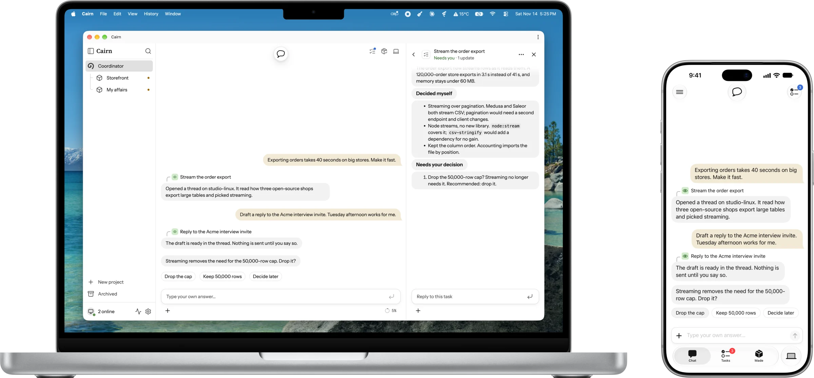
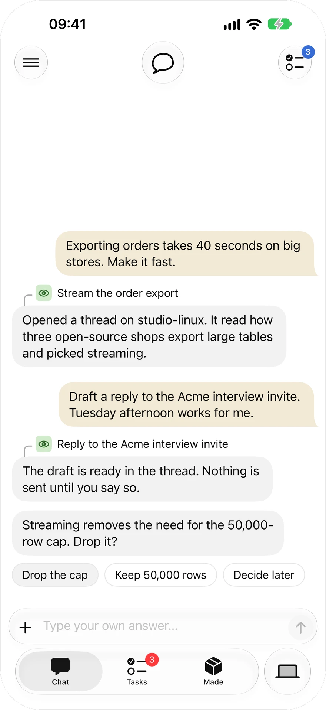
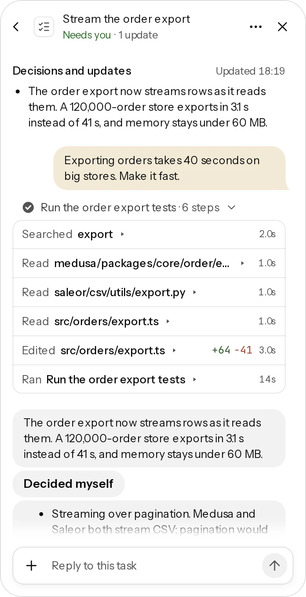
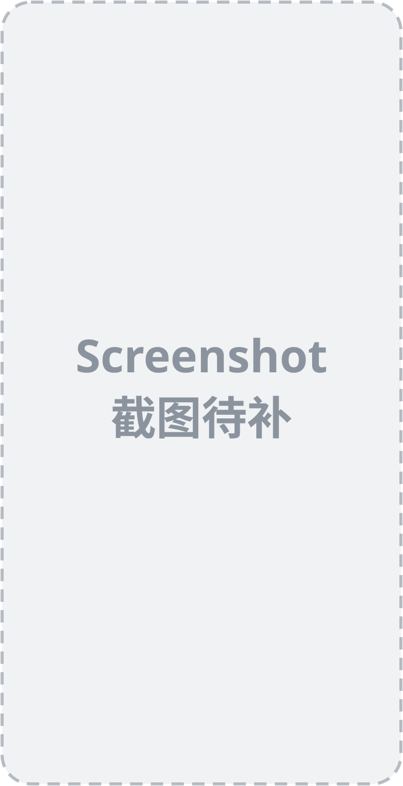
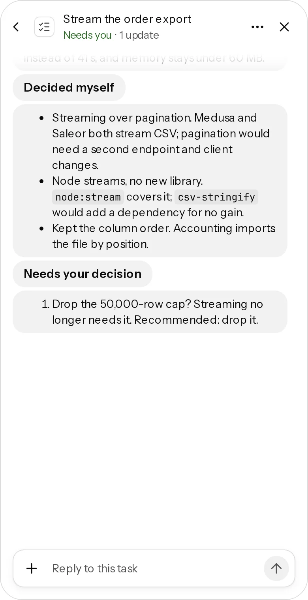

<div align="center">
  
  <h1>Cairn</h1>

  <p><b>A self-hosted personal assistant for people who write code.</b></p>

  <p>
    <a href="https://cairn.xmon.me">Website</a> ·
    <a href="./docs/getting-started.md">Docs</a> ·
    <a href="https://github.com/xiechimon/cairn/discussions">Discussions</a> ·
    <b>English</b> | <a href="./README.zh.md">Simplified Chinese</a>
  </p>

  <p>
    <a href="https://github.com/xiechimon/cairn/actions/workflows/ci.yml"></a>
    <a href="https://www.npmjs.com/package/@xiechimon/cairn"></a>
    
    
  </p>

  <picture>
    <source media="(prefers-color-scheme: dark)" srcset="docs/assets/readme/hero-en-dark.webp">
    
  </picture>
</div>

Tell one Coordinator what you want, from code to your own affairs. It opens a thread for each piece of work on your own machines, and comes to you only when a decision is yours. Start at your desk; make the call from your phone.

## What you get

- **Your own subscriptions.** Claude Code, Codex, Gemini, or an API key from any provider. Cairn never resells compute.
- **Research, then build.** A thread reads how strong open-source projects solved the problem before it changes anything, and decides the details itself.
- **Only what needs you.** The home page pins the decisions waiting on you, and a push goes out only when you must act.
- **Results you can trust.** Before an agent merges, the gate counts only review verdicts bound to the current patch. Anything that cannot be undone waits for your yes.
- **Your machines, your data.** A daemon on each machine runs threads in their own git worktree, or in a throwaway container where the host supports it. Code and credentials stay with you.
- **Your own affairs (planned).** Mail, calendar and job search as a project with no repository: agents read, sort and draft; sending and submitting wait for you.

<table>
  <tr>
    <td width="33%"><picture>
    <source media="(prefers-color-scheme: dark)" srcset="docs/assets/readme/ios-home-en-dark.webp">
    
  </picture></td>
    <td width="33%"><picture>
    <source media="(prefers-color-scheme: dark)" srcset="docs/assets/readme/work-en-dark.webp">
    
  </picture></td>
    <td width="33%"></td>
  </tr>
  <tr>
    <td>Say it, decide from your phone</td>
    <td>Watch or steer the thread</td>
    <td>The gate decides the merge</td>
  </tr>
</table>

## It researches and decides on its own

You decide what you want and the architecture. The thread does the rest:

1. **Reads the prior art.** It finds two or three strong open-source implementations, reads their source rather than their README, and compares them.
2. **Decides the details.** Libraries, file layout, naming and tests are its call, unless your rules say to ask.
3. **Reports both lists.** Every report ends with *Decided myself*, each choice with its reason, and *Needs your decision*: at most three items, each with options, evidence and a recommendation.

<p align="center">
  <picture>
    <source media="(prefers-color-scheme: dark)" srcset="docs/assets/readme/report-en-dark.webp">
    
  </picture>
</p>

## See it work


## Install

Requirements: Node.js 22 or 24.

```sh
npx @xiechimon/cairn
```

This downloads Cairn and serves it at **<http://127.0.0.1:8787/app>**. The first boot creates the database under `~/.cairn`.

Then, on each machine where agents should work, create an API key in the web UI and start the daemon:

```sh
npm i -g @xiechimon/cairn-cli
cairn start --api-key <cairn_...> --team <teamId>
```

Connect a model in the web UI: a Claude Code or Gemini CLI subscription, an API key, OAuth for GitHub Copilot or OpenAI Codex, or a custom endpoint. To follow along from your phone, see [private access over Tailscale](./docs/deploy/tailscale-mobile.md). Docker and building from source are in [getting started](./docs/getting-started.md).

## "Wait, what are you selling?"

Nothing. All code is Apache-2.0 with no feature gating; only a private, rotating holdout subset of the eval task set stays unpublished. There is no hosted control plane and no resold compute: Cairn runs on your machines with your subscriptions.

## Who it's for

Cairn is for one person, not a team: you run your own copy, and someone else who wants it runs theirs.

It fits you if you:

- write code, or work alongside code, and want agents to do the work in the background while you only make the calls;
- have a machine that can stay on (a desktop, a home server or a VPS), and ideally a laptop or a phone to follow along from;
- already pay for Claude Code, Codex or Gemini, or have an API key, and want to keep using them rather than buy compute again;
- want your code, mail and credentials to stay on your own machines.

It is not the right fit if you want:

- a tool for a team to share, with shared channels, roles and billing ([Amp Spaces](https://ampcode.com/docs/spaces) or [Multica](https://github.com/multica-ai/multica));
- only a better interface for driving Claude Code or Codex yourself ([T3 Code](https://github.com/pingdotgg/t3code));
- an assistant that lives in your chat apps, such as Telegram or WhatsApp ([OpenClaw](https://github.com/openclaw/openclaw) or [Hermes Agent](https://github.com/NousResearch/hermes-agent));
- a hosted service with nothing to install or keep running.

## Documentation

| Document | Contents |
|---|---|
| [docs/getting-started.md](./docs/getting-started.md) | Run the server, enroll a machine, Docker, deploy publicly, build from source |
| [docs/configuration.md](./docs/configuration.md) | Every server and daemon environment variable |
| [docs/deploy/tailscale-mobile.md](./docs/deploy/tailscale-mobile.md) | Private access from your phone over Tailscale |
| [CONTEXT.md](./CONTEXT.md) | Domain model and glossary |
| [docs/spec/](./docs/spec/) | Implementation canon |

<details>
<summary>Repository layout</summary>

| Path | Contents |
|---|---|
| `CONTEXT.md` | Domain model & glossary — canonical terminology (Chinese interface terms ↔ English ↔ internal names) |
| `apps/web` | Web UI, React + vite (`@cairn/web`) |
| `apps/server` | Server: Hono REST + SSE + SQLite (package `@xiechimon/cairn` — directory name differs from package name) |
| `apps/daemon` | Executor daemon (package `@xiechimon/cairn-cli` — directory name differs from package name) |
| `packages/shared` | Protocol vocabulary, record shapes, brand-slot single source (`@cairn/shared`) |
| `docs/spec/` | Implementation canon, volumes 00–30 |
| `docs/research/` | r1–r15 site inventories and later product research (historical archive) |
| `scripts/` | Build, CI and ops tooling |

</details>

## Community

Questions, setup help and "how do I do X with cairn" go to [GitHub Discussions](https://github.com/xiechimon/cairn/discussions): the **Q&A** category for questions and **Show and tell** for what you built. Bugs and feature work go to the [issue tracker](https://github.com/xiechimon/cairn/issues), where a maintainer labels them before an agent picks them up. Security reports go to neither place; see [SECURITY.md](./SECURITY.md). Cairn is built with Cairn: agents inside it take its own tickets and open the pull requests.

After your first pull request merges, Cairn can show a dismissible card linking to a prefilled discussion post. The card is off by default, Cairn opens nothing on its own, and nothing is sent anywhere: you choose whether to submit the post. [docs/privacy.md](./docs/privacy.md) lists the exact fields the prefilled text carries.

## Acknowledgments

Cairn learned from products we read the source or docs of and used ourselves. No code is copied from them; bundled code and assets are listed under Third-party credits.

- [Amp](https://ampcode.com): threads, Spaces, runners across machines, and reading prior art before deciding.
- [T3 Code](https://github.com/pingdotgg/t3code): following work from any device and reconnecting cleanly.
- [Multica](https://github.com/multica-ai/multica): the runtime model of one machine running one agent CLI.
- [todos.dev](https://todos.dev): plans and reviews as stopping points in a task's life.
- [Claude Code](https://claude.com/product/claude-code), [Codex](https://github.com/openai/codex) and [pi](https://github.com/badlogic/pi-mono): the engines threads run on.

## Third-party credits

- Avatar font [Lorelei](https://www.figma.com/community/file/1198749693280469639) — © Lisa Wischofsky, CC0 1.0
- Fonts Instrument Sans / Source Serif 4 / JetBrains Mono — SIL Open Font License 1.1
- Icons [lucide](https://lucide.dev) — ISC License
- Emoji curation data [gitmoji](https://gitmoji.dev) — MIT License
- Execution engine [pi SDK](https://github.com/badlogic/pi-mono) — MIT License

## License

Apache-2.0 — see [LICENSE](./LICENSE). Contributions use DCO sign-off, not a CLA: see [CONTRIBUTING.md](./CONTRIBUTING.md).
