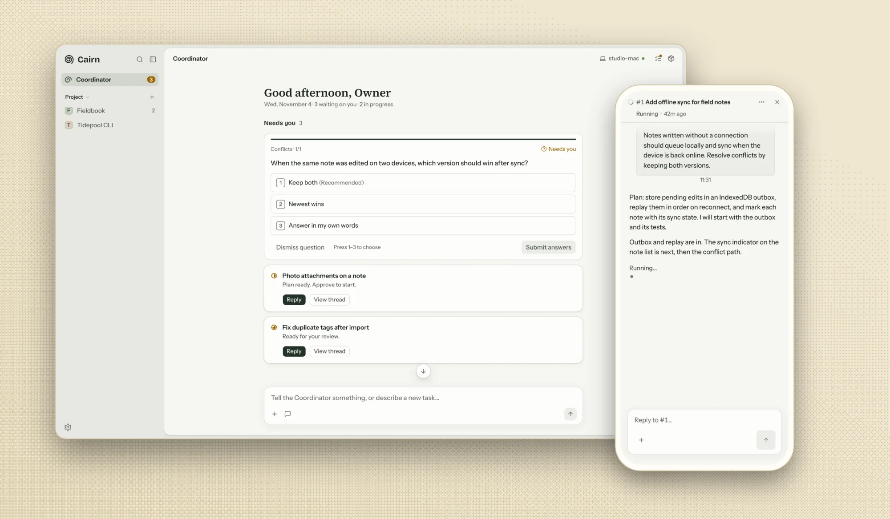
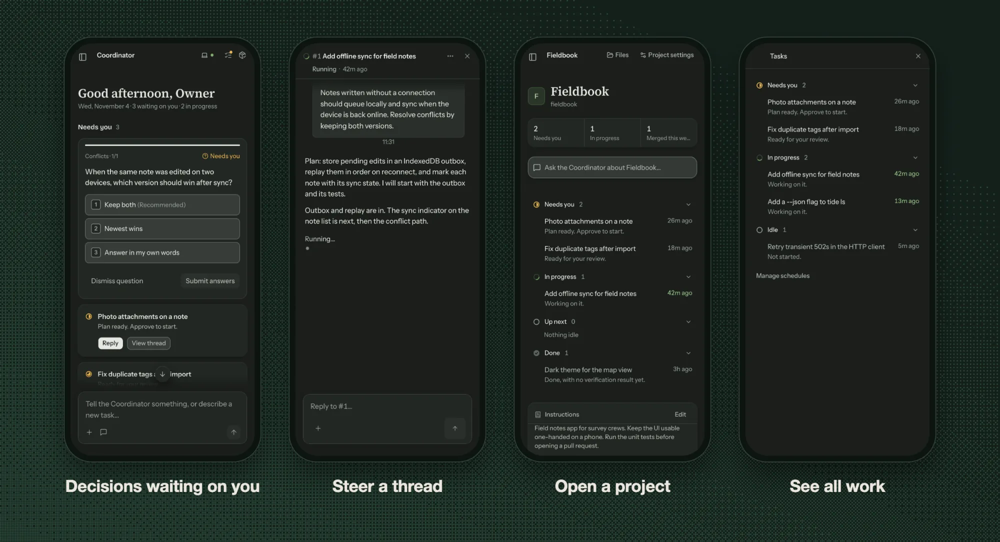

<div align="center">
  
  <h1>Cairn</h1>

  <p>
    <b>English</b> ·
    <a href="./README.zh.md">Simplified Chinese</a> ·
    <a href="https://cairn.xmon.me">Website</a> ·
    <a href="#quickstart">Quickstart</a>
  </p>

  <p>
    <a href="https://github.com/xiechimon/cairn/actions/workflows/ci.yml"></a>
    <a href="https://www.npmjs.com/package/@xiechimon/cairn"></a>
    
    
    
  </p>

  <p><b>Cairn is a self-hosted personal assistant for people who write code. Tell one Coordinator what you want, from code to your own affairs, and agents do the work in isolated threads on your own machines.</b></p>

  <picture>
    <source media="(prefers-color-scheme: dark)" srcset="site/img/hero-dark.webp">
    
  </picture>

  
</div>

- **Coordinator.** You talk to a single Coordinator from any device. It listens, opens a thread for each piece of work and reports back in one conversation that never ends.
- **Threads.** One unit of work, one agent session: Claude Code or Gemini CLI on your subscription, or the built-in pi runtime on any provider. A thread carries the work from plan to pull request, and you can open it in a side chat to steer it.
- **Only what needs you.** The home page pins the decisions waiting on you and shows what is in progress. A push notification goes out only when a person must act.
- **Evidence-bound merge gate.** Before an agent merges, the gate counts only review verdicts bound to the PR's current patch digest and refuses if the head moved after the verdict; its rules are model-checked in TLA+. The manual merge button still checks only the pinned commit (spec 18, F1). Protected paths still stop for you, and the AI reviewer can block a merge, not just comment on it.
- **Eval-gated harness.** Every build records its base SHA and a harness hash, and rejections are stored as structured records. Changes to the Coordinator's dispatch harness must clear an eval regression floor before they merge; paired-trial adoption for prompt, skill and routing changes is planned. "Training" here means improving the harness, never fine-tuning weights.
- **Your machines.** Register any host by running the daemon on it. A thread runs on any machine that meets its runtime, model and tool constraints, in its own git worktree, or in a throwaway per-task Orb container where the host supports it (`CAIRN_EXECUTOR=orb`, opt-in for now). Planned: E2B and Daytona sandboxes using your own key; the project never resells compute. Plans, diffs and tool calls stream back live. Cairn runs on your own machine with no hosted control plane, and credentials stay there.
- **Projects.** A project home with its instructions, memory, secrets and a concurrency limit; a person's message always jumps the queue. Repos are hosted by the server itself or connected from GitHub.
- **Bootstrap loop.** Cairn takes its own tickets, implements them, reviews them and opens the PRs: it is being used to build itself.
- **Your own affairs (planned).** Mail, calendar and job search run as a project with no repository: agents read, sort and draft, and anything that cannot be undone, such as sending a mail or submitting an application, waits for your yes.

## Who it's for

Cairn is for one person, not a team: you run your own copy, and someone else who wants it runs theirs.

It fits you if you:

- write code, or work alongside code, and want agents to do the work in the background while you only make the calls;
- have a machine that can stay on (a desktop, a home server or a VPS), and ideally a laptop or a phone to follow along from;
- already pay for Claude Code, Codex or Gemini, or have an API key, and want to keep using them rather than buy compute again;
- want your code, mail and credentials to stay on your own machines.

It is not the right fit if you want:

- a tool for a team to share, with shared channels, roles and billing ([Amp Spaces](https://ampcode.com/docs/spaces) or [Multica](https://github.com/multica-ai/multica));
- only a better interface for driving Claude Code or Codex yourself ([T3 Code](https://github.com/pingdotgg/t3code));
- an assistant that lives in your chat apps, such as Telegram or WhatsApp ([OpenClaw](https://github.com/openclaw/openclaw) or [Hermes Agent](https://github.com/NousResearch/hermes-agent));
- a hosted service with nothing to install or keep running.

## Showcase

Real work that agents shipped inside Cairn, each with a recording, the pull request and numbers you can check. Cairn is still taking shape, so these slots are placeholders for now.

| | Work | What it will show |
|---|---|---|
| 1 | Bootstrap loop | An agent inside Cairn takes one of Cairn's own tickets from claim through build and review to merge. *Coming soon.* |
| 2 | An app from scratch | One sentence in, and the agent team builds a complete app on your machine. *Coming soon.* |
| 3 | Harness before and after | The same task set, scored before and after a prompt, skill and routing change. *Coming soon.* |

## Features

- **Coordinator** — one conversation that never ends: it opens threads and reports back. Context is compacted for you, and memory is kept per project.
- **Threads** — one unit of work, one agent session, from plan through tests and implementation to a pull request. Open any thread in a side chat to steer it directly.
- **Projects** — a project home with its instructions, memory, secrets and a concurrency limit; a person's message always jumps the queue.
- **Scheduled tasks** — re-run a thread on a cycle.
- **Machines and routing** — register hosts with the daemon; routing rules pick the runtime, model, tools and machine for each step.
- **Providers** — Claude Code and Gemini CLI subscriptions, API keys, OAuth (GitHub Copilot, OpenAI Codex) or a custom endpoint.
- **Repos** — git repositories hosted by the server itself (push/pull with an API key) or connected from GitHub.
- **Live everything** — SSE streams for conversations and threads, Web Push, token-usage accounting per build and model.

## Quickstart

Requirements: Node.js 22 or 24. One command downloads, starts and serves Cairn on **http://127.0.0.1:8787/app**; the first boot creates the database under `~/.cairn` and seeds a default team.

```sh
npx @xiechimon/cairn
```

Register a machine when you want agents to build on it, or run the server in Docker: [docs/getting-started.md](./docs/getting-started.md).

## Where to go next

| Document | Contents |
|---|---|
| [docs/getting-started.md](./docs/getting-started.md) | Run the server, enroll a machine, Docker, deploy publicly, build from source |
| [docs/configuration.md](./docs/configuration.md) | Every server and daemon environment variable |
| [docs/deploy/tailscale-mobile.md](./docs/deploy/tailscale-mobile.md) | Private access from your phone over Tailscale (embedded tsnet with automatic LAN, tailnet or optional Funnel routing is planned) |
| [CONTEXT.md](./CONTEXT.md) | Domain model and glossary |
| [docs/spec/](./docs/spec/) | Implementation canon |

## Repository layout

| Path | Contents |
|---|---|
| `CONTEXT.md` | Domain model & glossary — canonical terminology (Chinese interface terms ↔ English ↔ internal names) |
| `apps/web` | Web UI, React + vite (`@cairn/web`) |
| `apps/server` | Server: Hono REST + SSE + SQLite (package `@xiechimon/cairn` — directory name differs from package name) |
| `apps/daemon` | Executor daemon (package `@xiechimon/cairn-cli` — directory name differs from package name) |
| `packages/shared` | Protocol vocabulary, record shapes, brand-slot single source (`@cairn/shared`) |
| `docs/spec/` | Implementation canon, volumes 00–30 |
| `docs/research/` | r1–r15 site inventories and later product research (historical archive) |
| `scripts/` | Build, CI and ops tooling |

## Community

Questions, setup help and "how do I do X with cairn" go to [GitHub Discussions](https://github.com/xiechimon/cairn/discussions): the **Q&A** category for questions and **Show and tell** for what you built. Bugs and feature work go to the [issue tracker](https://github.com/xiechimon/cairn/issues), where a maintainer labels them before an agent picks them up. Security reports go to neither place; see [SECURITY.md](./SECURITY.md).

After your team's first pull request merges, Cairn can show a dismissible card linking to a prefilled discussion post. The card is off by default, Cairn opens nothing on its own, and nothing is sent anywhere: you choose whether to submit the post. [docs/privacy.md](./docs/privacy.md) lists the exact fields the prefilled text carries.

## Third-party credits

- Avatar font [Lorelei](https://www.figma.com/community/file/1198749693280469639) — © Lisa Wischofsky, CC0 1.0
- Fonts Instrument Sans / Source Serif 4 / JetBrains Mono — SIL Open Font License 1.1
- Icons [lucide](https://lucide.dev) — ISC License
- Emoji curation data [gitmoji](https://gitmoji.dev) — MIT License
- Execution engine [pi SDK](https://github.com/badlogic/pi-mono) — MIT License

## License

Apache-2.0 — see [LICENSE](./LICENSE). All code is open source with no feature gating; only a private, rotating holdout subset of the eval task set stays unpublished. Contributions use DCO sign-off, not a CLA: see [CONTRIBUTING.md](./CONTRIBUTING.md).
