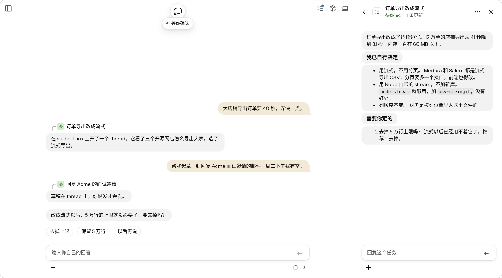
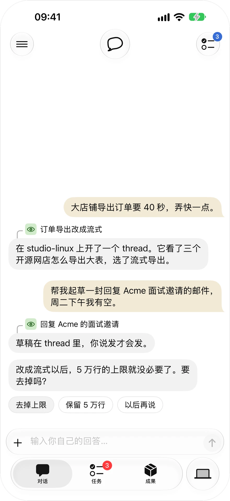
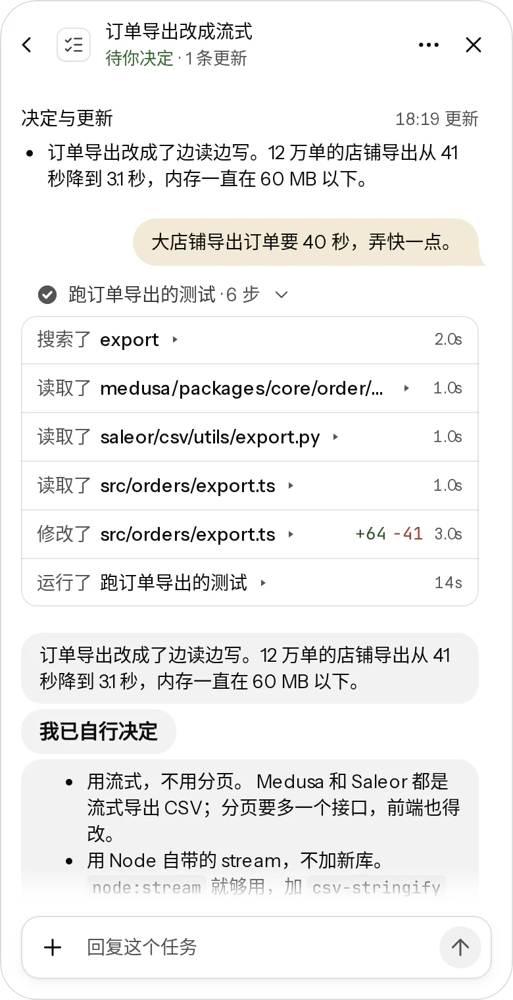
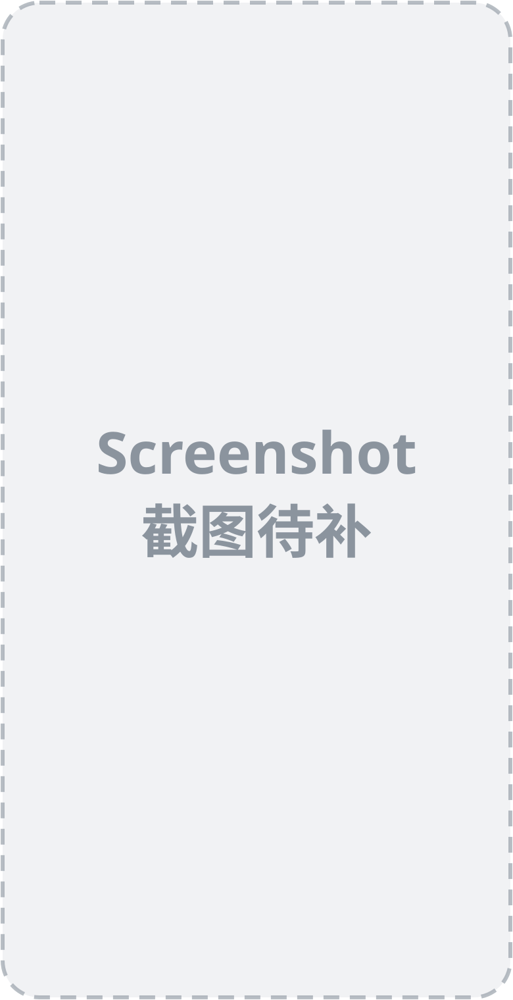
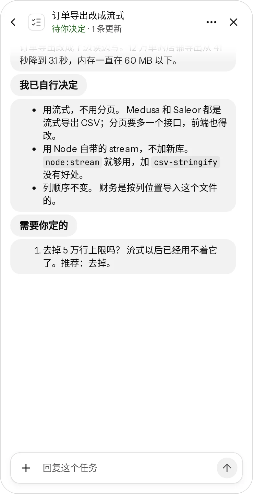

<div align="center">
  
  <h1>Cairn</h1>

  <p><b>给写代码的人用的自托管个人助理。</b></p>

  <p>
    <a href="https://cairn.xmon.me">官网</a> ·
    <a href="./docs/getting-started.md">文档</a> ·
    <a href="https://github.com/xiechimon/cairn/discussions">Discussions</a> ·
    <b>简体中文</b> | <a href="./README.md">English</a>
  </p>

  <p>
    <a href="https://github.com/xiechimon/cairn/actions/workflows/ci.yml"></a>
    <a href="https://www.npmjs.com/package/@xiechimon/cairn"></a>
    
    
  </p>

  <picture>
    <source media="(prefers-color-scheme: dark)" srcset="docs/assets/readme/hero-zh-dark.webp">
    
  </picture>
</div>

从写代码到你自己的事，你跟一个 Coordinator 说要做什么。它在你自己的机器上为每件活开一个 thread，只有需要你拍板时才找你。在桌前开始的活，在手机上接着拍板。

## 你会得到什么

- **用你自己的订阅。** Claude Code、Codex、Gemini，或任意服务商的 API key。Cairn 不转售算力。
- **先研究，再动手。** thread 改东西之前，先看几个强的开源项目是怎么解决的，细节自己定。
- **只在需要你时打扰。** 首页只置顶等你拍板的事，推送也只发需要你动手的事。
- **结果可信。** agent 合并前，合并闸只认绑定当前补丁的审核结论。撤不回的动作都等你点头。
- **你的机器，你的数据。** 每台机器跑一个 daemon，thread 在独立的 git worktree 里干活，主机支持时也可以放进用完即弃的容器。代码和凭据不出你的机器。
- **你自己的事（计划中）。** 邮件、日程、求职作为一个不挂仓库的项目：agent 负责读、分类、起草；发出去、投出去都等你。

<table>
  <tr>
    <td width="33%"><picture>
    <source media="(prefers-color-scheme: dark)" srcset="docs/assets/readme/ios-home-zh-dark.webp">
    
  </picture></td>
    <td width="33%"><picture>
    <source media="(prefers-color-scheme: dark)" srcset="docs/assets/readme/work-zh-dark.webp">
    
  </picture></td>
    <td width="33%"></td>
  </tr>
  <tr>
    <td>说一句，在手机上拍板</td>
    <td>旁观或插话指挥 thread</td>
    <td>合并闸决定能不能合</td>
  </tr>
</table>

## 它自己查、自己定

需求和架构由你定，其余交给 thread：

1. **先看别人怎么做。** 找两三个强的开源实现，读源码而不是只看 README，再做比较。
2. **细节自己定。** 用哪个库、文件怎么放、怎么命名、怎么测，都由它决定，除非你的规则写了要先问。
3. **报告分两栏。** 每份报告最后都有「我已自行决定」，每一项附理由；还有「需要你定的」，最多三项，每项附选项、证据和推荐。

<p align="center">
  <picture>
    <source media="(prefers-color-scheme: dark)" srcset="docs/assets/readme/report-zh-dark.webp">
    
  </picture>
</p>

## 看它干活


## 安装

环境要求：Node.js 22 或 24。

```sh
npx @xiechimon/cairn
```

一条命令下载并启动，地址是 **<http://127.0.0.1:8787/app>**。首次启动会在 `~/.cairn` 下建库。

然后在每台要让 agent 干活的机器上，先在网页里建一个 API key，再启动 daemon：

```sh
npm i -g @xiechimon/cairn-cli
cairn start --api-key <cairn_...> --team <teamId>
```

在网页里接上模型：Claude Code 或 Gemini CLI 订阅、API key、GitHub Copilot 或 OpenAI Codex 的 OAuth，或自定义端点。想在手机上跟进，看[用 Tailscale 私网访问](./docs/deploy/tailscale-mobile.md)。Docker 和从源码构建见[上手指南](./docs/getting-started.md)。

## 「等等，你们卖什么？」

什么都不卖。全部代码 Apache-2.0 开源，不做功能门控；只有私有轮换的评测任务 holdout 子集不公开。没有托管后台，也不转售算力：Cairn 跑在你的机器上，用你的订阅。

## 适合谁

Cairn 是给一个人用的，不是给团队用的：你装一份自己用，别人想用就各自装一份。

适合你，如果你：

- 写代码，或者工作离不开代码，想让 agent 在后台干活，自己只拍板；
- 有一台能一直开着的机器（台式机、家里的服务器或 VPS），最好还有笔记本或手机随时跟进；
- 已经在付 Claude Code、Codex 或 Gemini 的订阅，或者有 API key，想接着用，不想再买一份算力；
- 希望代码、邮件和凭据都留在自己的机器上。

不太适合你，如果你想要：

- 团队一起用的工具，有共享频道、角色和计费（看 [Amp Spaces](https://ampcode.com/docs/spaces) 或 [Multica](https://github.com/multica-ai/multica)）；
- 只是一个更好用的界面，自己来操作 Claude Code 或 Codex（看 [T3 Code](https://github.com/pingdotgg/t3code)）；
- 住在聊天软件里的助理，比如 Telegram、WhatsApp（看 [OpenClaw](https://github.com/openclaw/openclaw) 或 [Hermes Agent](https://github.com/NousResearch/hermes-agent)）；
- 不用安装、不用维护任何东西的托管服务。

## 文档

| 文档 | 内容 |
|---|---|
| [docs/getting-started.md](./docs/getting-started.md) | 跑起 server、登记机器、Docker、公网部署、从源码构建 |
| [docs/configuration.md](./docs/configuration.md) | 全部 server 与 daemon 环境变量 |
| [docs/deploy/tailscale-mobile.md](./docs/deploy/tailscale-mobile.md) | 用 Tailscale 从手机私网访问 |
| [CONTEXT.md](./CONTEXT.md) | 领域模型与术语表 |
| [docs/spec/](./docs/spec/) | 实现规范 |

<details>
<summary>仓库结构</summary>

| 路径 | 内容 |
|---|---|
| `CONTEXT.md` | 领域模型与术语表（中文界面词 ↔ 英文原词 ↔ 内部名，canonical） |
| `apps/web` | Web UI，React + vite（`@cairn/web`） |
| `apps/server` | server：Hono REST + SSE + SQLite（包名 `@xiechimon/cairn`，目录名 ≠ 包名） |
| `apps/daemon` | 执行机 daemon（包名 `@xiechimon/cairn-cli`，目录名 ≠ 包名） |
| `packages/shared` | 协议词表 / 记录形状 / 品牌槽单源（`@cairn/shared`） |
| `docs/spec/` | 实现正典 00–30 册 |
| `docs/research/` | r1–r15 原站盘点与后续产品调研（历史档案） |
| `scripts/` | 构建、CI 与运维工具 |

</details>

## 社区

提问、部署求助、"cairn 里怎么做 X" 请走 [GitHub Discussions](https://github.com/xiechimon/cairn/discussions)：**Q&A** 分类问问题，**Show and tell** 分类晒你搭出来的东西。缺陷和功能需求走 [issue 追踪](https://github.com/xiechimon/cairn/issues)，维护者打上标签后才有 agent 接手。安全报告两边都不走，见 [SECURITY.md](./SECURITY.md)。Cairn 正在用它自己开发它自己：里面的 agent 领 Cairn 自己的票、开 PR。

你的第一支 PR 合并后，cairn 可以显示一张可关闭的卡片，指向一条预填好的讨论帖。卡片默认关闭，cairn 自己不会打开任何页面，也不会向任何地方发送内容：是否发帖由你决定。预填内容包含哪些字段写在 [docs/privacy.md](./docs/privacy.md)。

## 致谢

Cairn 借鉴了下面这些产品：我们读过它们的源码或文档，也亲手用过。没有复制它们的代码；随 Cairn 一起分发的代码和素材列在「第三方署名」里。

- [Amp](https://ampcode.com)：thread、Spaces、跨机器的 runner，以及先看别人怎么做再决定。
- [T3 Code](https://github.com/pingdotgg/t3code)：从任何设备跟进工作，断线后干净地重连。
- [Multica](https://github.com/multica-ai/multica)：一台机器跑一个 agent CLI 的运行时模型。
- [todos.dev](https://todos.dev)：把计划和审核当成任务里的停靠点。
- [Claude Code](https://claude.com/product/claude-code)、[Codex](https://github.com/openai/codex) 和 [pi](https://github.com/badlogic/pi-mono)：thread 实际运行用的引擎。

## 第三方署名

- 头像字体 [Lorelei](https://www.figma.com/community/file/1198749693280469639) — © Lisa Wischofsky, CC0 1.0
- 字体 Instrument Sans / Source Serif 4 / JetBrains Mono — SIL Open Font License 1.1
- 图标 [lucide](https://lucide.dev) — ISC License
- emoji 策展数据 [gitmoji](https://gitmoji.dev) — MIT License
- 执行引擎 [pi SDK](https://github.com/badlogic/pi-mono) — MIT License

## 许可

Apache-2.0 — 见 [LICENSE](./LICENSE)。贡献采用 DCO 签名（`Signed-off-by`），不要求 CLA，见 [CONTRIBUTING.md](./CONTRIBUTING.md)。
