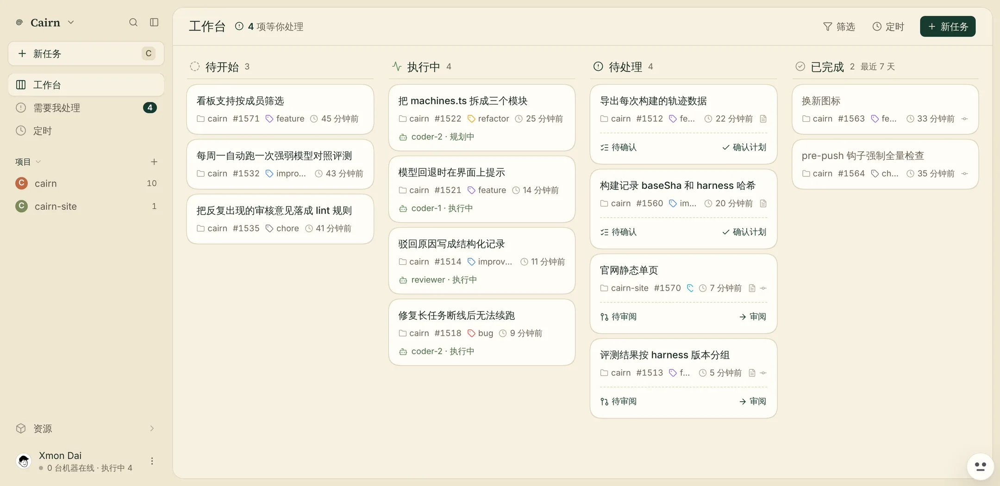

<div align="center">
  

  <h1>Cairn</h1>

  <p><b>你写票，agent 在你自己的机器上干活，合不合由你把关。</b></p>

  <p>自托管、开源的多 agent 编排工作台，而且它在开发它自己。</p>

  <p>
    <a href="https://cairn.xmon.me">官网</a> ·
    <a href="#快速开始">快速开始</a> ·
    <a href="./README.md">English</a>
  </p>

  <p>
    <a href="https://github.com/xiechimon/cairn/actions/workflows/ci.yml"></a>
    <a href="https://www.npmjs.com/package/@xiechimon/cairn"></a>
    
    
    
  </p>
</div>

<picture>
  <source media="(prefers-color-scheme: dark)" srcset="site/img/board-zh-dark.webp">
  
</picture>

## 亮点

- **多 agent 编排。** 每个 agent 有自己的模型、职责、技能、MCP、密钥和记忆。负责调度的 chief 只派活不写代码，上下文保持干净；写代码和审代码交给 coder、reviewer。
- **人工关卡是硬的。** 每次运行停两次等你：计划一次，diff 一次。AI 审核者能直接拦下合并，不只是留评论。
- **自举闭环。** Cairn 自己领票、实现、审核、开 PR，正在用它自己开发它自己。
- **评测与轨迹驱动。** 每次构建记录基线提交和 harness 哈希，驳回写成结构化记录，再用强弱模型对照评测决定哪些提示词、技能、路由的改动留下。这里的「训练」指优化 harness，不微调模型。
- **跑在你自己的机器上。** 在任意主机上跑 daemon 就能登记成执行机，每次构建在独立的 git worktree 里进行，计划、diff、工具调用实时推回看板。

## 作品

这里只放 agent 在 Cairn 里真实做出来的东西，每个都配录屏、PR 链接和能查到出处的数字。项目还在成型，下面先占位。

| | 作品 | 会展示什么 |
|---|---|---|
| 1 | 自举闭环 | Cairn 里的 agent 从领票、实现、审核到合并，自己完成一张 Cairn 的票。*筹备中。* |
| 2 | 从零做一个应用 | 给一句需求，agent 团队在你的机器上把一个完整应用做出来。*筹备中。* |
| 3 | harness 优化前后 | 同一组任务，改了提示词、技能和路由前后的评测对比。*筹备中。* |

## 功能

- **任务与阶段** — 看板 + 带序号的任务、标签、按周期自动重跑的定时。
- **Agent** — 配了模型、职责、技能、MCP 服务器、密钥与记忆的执行角色；每用户一个「总管」agent 负责分派。
- **机器** — 在任意主机跑 daemon 即登记为执行机；build 在其上受监督执行。机器是你的，规则也是你的。
- **模型服务** — api_key / OAuth（GitHub Copilot、OpenAI Codex）/ 自定义端点三协议接入。
- **仓库** — server 自托管 git 仓（API key 走 push/pull），或从 GitHub 接入。
- **全实时** — 看板与会话走 SSE 流、通知、按 build × 模型记账 token 用量。

## 快速开始

环境要求：Node.js 22 或 24（LTS 线自带 better-sqlite3 预编译产物；其它版本可能回退源码编译，需要构建工具链）。

```sh
npx @xiechimon/cairn
```

一条命令：下载、启动、托管在 **http://127.0.0.1:8787/app**。首启在 `~/.cairn` 下自动建库 + 迁移 + seed 默认团队。

换端口：`PORT=9000 npx @xiechimon/cairn`。

### 让自己的机器跑 build

不起 daemon 也能用全部界面功能；要让 agent 真在某台机器上跑 build 时再登记。在执行机上：

```sh
npm i -g @xiechimon/cairn-cli
# 首次注册：网页 /app/api-keys 建 key（明文只显示一次），然后
cairn start --api-key <cairn_...> --team <teamId>
# 日常（凭据已存 ~/.cairn/machine.json）：
cairn start        # stop / restart / logs -f / status 同面
```

两个包都装 `cairn` 这个 bin：同机全局双装时后装的占名。干净的分工是——浏览机跑 server，执行机装 cairn-cli。

### 从源码开发

要求 Node.js >= 22.19、pnpm（可 `corepack enable`）。

```sh
pnpm install
pnpm start        # 构建 web UI 并由 server 同源托管
```

watch 模式开发栈，每进程一条：`pnpm dev:web`、`pnpm dev:server`、`pnpm dev:daemon`（`pnpm dev` 三进程一起跑）。

## 配置

server 环境变量（全部可选）：

| 变量 | 默认 | 说明 |
|---|---|---|
| `CAIRN_TOKEN` | 未设 | 守护 `/api/*` 的 Bearer token。设 = 开鉴权（web 首访出 token 门页）；未设 = 关（默认）。两条 SSE stream 端点额外接受 `?token=`（EventSource 设不了 header）。绑非 localhost 接口时务必设。 |
| `PORT` | `8787` | HTTP 监听端口。 |
| `HOST` | 未设（全部接口） | HTTP 绑定地址。分体部署（server 在常开主机、daemon 在另一台机器用 `CAIRN_SERVER` 指过来）时设为该主机的局域网/内网地址，并同设 `CAIRN_TOKEN`。显式 `0.0.0.0`/`::` 且 `CAIRN_TOKEN` 未设 → 启动日志 WARN。 |
| `CAIRN_HOME` | `~/.cairn` | 数据根。server 状态在 `<CAIRN_HOME>/server/`（`server.db`、`secretbox.key`、托管裸仓）；daemon 的 `machine.json`、`daemon.log`、`workspaces/` 在根下。**备份 = 整目录拷走**——密文离了 keyfile 永久不可解，只拷 db 没用。 |
| `CAIRN_GITHUB_OAUTH_CLIENT_ID`<br>`CAIRN_GITHUB_OAUTH_CLIENT_SECRET` | 未设 | 自注册 GitHub OAuth App 的凭证对，开启 provider OAuth 登录。两件同设或同缺——只配一件 server 启动即报错，不静默。 |
| `CAIRN_WEB_DIR` | `apps/web/dist`（存在即托管） | SPA 静态托管根覆写；未设且无构建产物 = 纯 API 形态。 |
| `CAIRN_SKILLS_DIR` | `~/.agents/skills` | 技能根目录。每个含 `SKILL.md` 的一级子目录 = 一个技能（id = frontmatter `name`，缺省回落目录名）。每次请求现扫，不入库——加技能 = 往目录放文件夹，删技能 = 删文件夹。 |
| `CAIRN_ISSUE_INTAKE` | 未设（关） | GitHub issue 进料。`1`、`true` 或 `yes` 开，其余值一律关，默认关。开了之后 server 每 5 分钟从已连接 GitHub、且总管已绑定带模型 Agent 的团队的每个 GitHub 项目里，领带 `ready-for-agent` 标签的 open issue，导入成任务并开始编排。只领该标签最新一条 `labeled` 事件由仓库 triage、write、maintain 或 admin 权限用户打上、且不经 GitHub App 的 issue。经 GitHub App 打的标不算，即使 app 持有该用户的授权；但这一条只认得出 GitHub App：用 OAuth App 令牌或个人访问令牌（PAT）打的标，看上去与该用户亲手打的一样，照领。OAuth App 令牌包括 `gh auth login` 拿到的令牌，也包括团队的 GitHub 连接令牌。cairn 把连接令牌随步下发给 git 命令（git 自己的钩子也在这个环境里跑），也交给仓库里的 `.agents/setup` 与 `.agents/resume` 钩子，能改这些钩子的 agent 代码就读得到它；cairn 的 agent 步还能直接用机器上已登录的 `gh`。两条路都能让 agent 以对应账号的身份打标、给进料喂票。别人打的、或打了又摘的也不领。每个项目同时至多 3 张不在已完成 / 已关闭的导入任务（失败的也算）。开启时已经打着标签的存量 issue 也会被领，按最旧先、受同一上限约束（每个项目每轮至多读 300 条带标签的 issue）——开之前先看清哪些 issue 打着标签。进料导入的任务以总管绑定的 Agent 为创建者，进料也只关这些任务：手工导入或 webhook 导入的任务从不被它关闭，总管没绑 Agent 的团队不关任何任务，总管换绑别的 Agent 之后，换绑前领的任务也不再由它关闭。这样的任务，server 见过它的 issue 处于 open、之后又看到它被 triage 及以上权限的用户关闭，才把任务关闭；server 第一次看到 issue 时它已关闭（例如重启后）、外部作者自己关掉的 issue、被人重新打开的任务都不动，审核中的任务、有 build 开出过 PR 的任务也不动，拆分后子任务还没全部完成或关闭的任务也不动。这些审核中、开出过 PR 的任务进料从不关闭。build 开出过 PR 的审核中任务，PR 合并进默认分支后 PR 对账可以把它收尾为已完成，PR 未合并就关闭的可以收尾为失败（对账还核别的条件，不满足时只留提示）；施工中的任务继续走 CI 循环；没有 PR 的审核中任务、失败的任务留在原处，等人手动处理。导入后开始编排失败的，后面几轮重试，连同第一次至多 3 次（重启后不再重试），之后任务留在待开始等人处理。进料自己的 GitHub 读（issue 列表、issue 事件、协作者权限、issue 状态）遇到限流时，该团队这一轮停读，等下一轮，GitHub 给了限流解除的时刻就写进日志；导入时的读遇到限流，只算这一次导入失败，本轮接着看下一条 issue。启动日志写明进料开没开。`cairn` 标签的 webhook（`POST /api/webhook/github/<token>`，进料开没开都生效）守同一条权限判据、同一上限：打标人（事件的 `sender`）在仓库上有 triage、write、maintain 或 admin 权限、且项目未到上限 3，才导入；外部作者从带该标签的模板开的 issue 不导入。sender 不是 GitHub 账号名、打标人权限读不到（读失败，或 GitHub 以限流作答）、团队没有可用的 GitHub token、项目已到上限、项目存的仓库名不是 `owner/repo`、或 GitHub 上找不到该 issue，都不导入，记一行日志写明原因，投递以 202 作答。拒收若关于打标人的权限（不到 triage、读不到、遇限流），作答只说打标人未获确认，不说是哪一种、什么权限，细节在日志里。这只让作答文字不带权限结论：之后导入是否继续，仍会显出打标人够不够格，所以 webhook URL 泄漏了仍要吊销它的 token。 |

daemon 环境变量（上述 CLI flag 的等价覆写）：`CAIRN_SERVER`（默认 `http://127.0.0.1:8787`）、`CAIRN_API_KEY`、`CAIRN_TEAM`、`CAIRN_WORKSPACES_DIR`（默认 `<CAIRN_HOME>/workspaces`）。

## 开发

```sh
pnpm dev:server   # API server 热重载，http://127.0.0.1:8787（首启建库 + 迁移 + seed）
pnpm dev:web      # vite dev server，http://localhost:5173，/api 与 /git proxy 到 8787
```

vite dev server 带 `strictPort`：撞端口即启动失败，不静默顺延到下一个空闲口。危险的是
顺延而不是撞端口本身——proxy 目标不变，顺延后的界面会去驱动持有该端口的别的栈。
覆写走 `CAIRN_DEV_WEB_PORT` / `CAIRN_DEV_SERVER_PORT`。

提交前三闸：

```sh
pnpm lint         # biome ci
pnpm typecheck    # 全包 tsc
pnpm test         # vitest
```

### 仓库结构

| 路径 | 内容 |
|---|---|
| `CONTEXT.md` | 领域模型与术语表（中文界面词 ↔ 英文原词 ↔ 内部名，canonical） |
| `apps/web` | Web UI，React + vite（`@cairn/web`） |
| `apps/server` | server：Hono REST + SSE + SQLite（包名 `@xiechimon/cairn`，目录名 ≠ 包名） |
| `apps/daemon` | 执行机 daemon（包名 `@xiechimon/cairn-cli`，目录名 ≠ 包名） |
| `packages/shared` | 协议词表 / 记录形状 / 品牌槽单源（`@cairn/shared`） |
| `docs/spec/` | 实现正典 00–25 册（中文） |
| `docs/research/` | r1–r15 原站盘点与后续产品调研（历史档案） |
| `scripts/` | 构建期工具（含 `generate-icons.mjs`） |

## 第三方署名

- 头像字体 [Lorelei](https://www.figma.com/community/file/1198749693280469639) — © Lisa Wischofsky, CC0 1.0
- 字体 Inter / JetBrains Mono — SIL Open Font License 1.1
- 图标 [lucide](https://lucide.dev) — ISC License
- emoji 策展数据 [gitmoji](https://gitmoji.dev) — MIT License
- 执行引擎 [pi SDK](https://github.com/badlogic/pi-mono) — MIT License

## 许可

Apache-2.0 — 见 [LICENSE](./LICENSE)。
