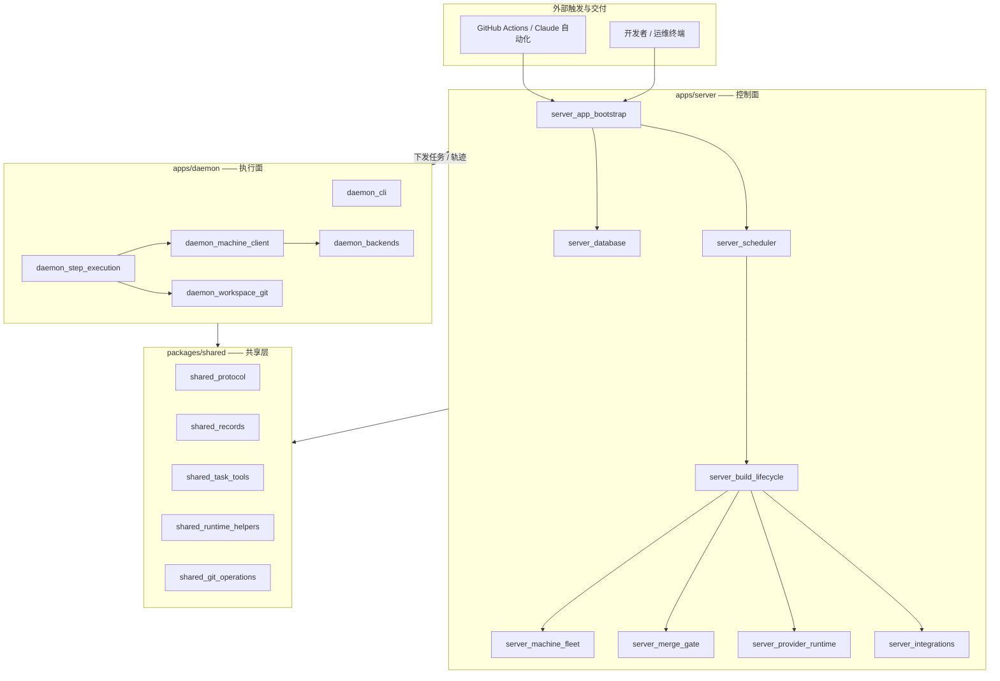
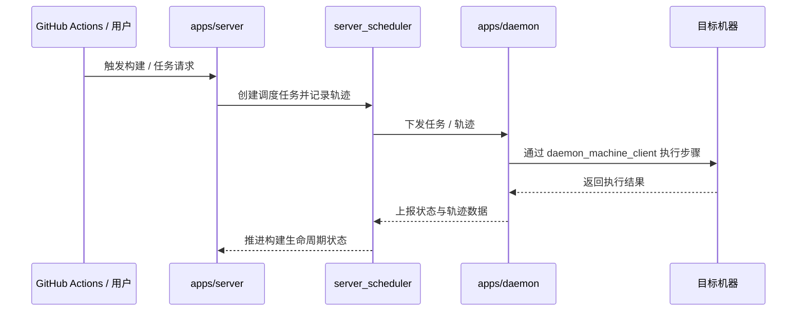
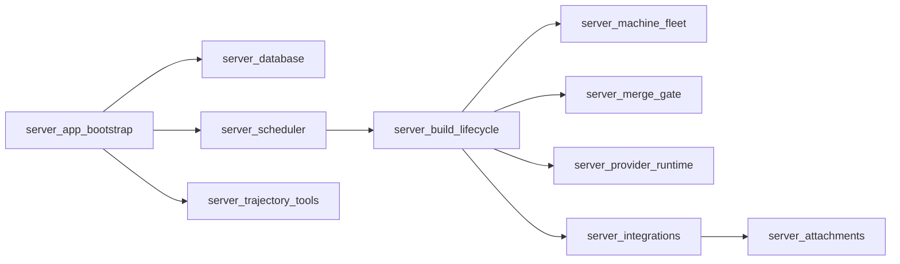
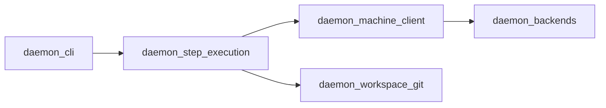

# 后端应用服务（Backend_application_services）概览

## 模块目的

`Backend_application_services` 对应仓库根目录下的 `apps/` 目录，是整个系统的后端应用服务层，包含两个相互独立、可分别部署的进程：

- **`apps/server`（服务端 / 控制面）**：负责承接外部触发（CI 流水线、Claude 自动化、用户 CLI），管理数据库访问、任务调度、构建生命周期、机器集群（machine fleet）、合并门禁（merge gate）、Provider 运行时、外部集成、附件数据以及任务轨迹（trajectory）等。
- **`apps/daemon`（守护进程 / 执行面）**：运行在工作节点上，消费 `server` 下发的任务与轨迹，负责步骤执行、与远端机器通信、维护工作区 Git 状态，并向上回报执行结果。

两个应用共享 `packages/shared` 提供的公共能力（协议、记录模型、任务工具、运行时助手、Git 操作封装），避免重复实现。此外，`Repository_automation_and_delivery` 模块（GitHub Actions、Claude 自动化、根目录构建部署脚本）作为外部触发与交付入口与 `apps/server` 交互。

## 总体架构



整体遵循「控制面 / 执行面分离」的架构：`server` 负责任务编排与状态管理，`daemon` 负责具体步骤执行；两边的协议、记录与工具逻辑收敛到 `packages/shared`，保证一致性。

一次典型任务流转如下：



## 组件划分

### `apps/server` 内部结构



- `server_app_bootstrap`：应用装配与启动入口，负责初始化各子系统；
- `server_database`：统一的数据访问层；
- `server_scheduler`：任务调度，决定何时向 `daemon` 下发工作；
- `server_build_lifecycle`：构建 / 任务生命周期状态机；
- `server_machine_fleet`：维护可用机器集群；
- `server_merge_gate`：合并门禁（PR 策略检查）；
- `server_provider_runtime`：Provider（运行时/执行后端）管理；
- `server_integrations`：外部系统集成；
- `server_attachments`：附件数据管理；
- `server_trajectory_tools`：轨迹数据的记录与工具支持。

### `apps/daemon` 内部结构



- `daemon_cli`：守护进程的命令行入口；
- `daemon_step_execution`：任务步骤执行引擎，消费下发的轨迹；
- `daemon_machine_client`：与远端机器通信的客户端；
- `daemon_backends`：不同的执行后端适配层；
- `daemon_workspace_git`：工作区 Git 状态准备与同步。

## 仓库结构

`Backend_application_services` 模块的目录划分如下（`is_target_for_overview_generation`）：

```
apps/                                    # Backend_application_services（本概览目标）
├── daemon/                              # 执行守护进程
│   ├── daemon_backends/                 # 执行后端适配层
│   ├── daemon_machine_client/           # 机器通信客户端
│   ├── daemon_workspace_git/            # 工作区 Git 管理
│   ├── daemon_step_execution/           # 步骤执行引擎
│   └── daemon_cli/                      # 守护进程 CLI 入口
└── server/                              # 服务端 / 控制面
    ├── server_app_bootstrap/            # 应用引导与装配
    ├── server_database/                 # 数据库访问层
    ├── server_build_lifecycle/          # 构建生命周期
    ├── server_machine_fleet/            # 机器集群管理
    ├── server_merge_gate/               # 合并门禁
    ├── server_provider_runtime/         # Provider 运行时
    ├── server_integrations/             # 外部集成
    ├── server_attachments/              # 附件管理
    ├── server_scheduler/                # 任务调度
    └── server_trajectory_tools/         # 轨迹工具
```

依赖的共享模块（`packages/shared`）：

```
packages/shared/                         # 共享库
├── shared_protocol/                     # 通信协议
├── shared_records/                      # 记录模型
├── shared_task_tools/                   # 任务工具
├── shared_shared_task_tools/            # 任务工具内部实现
├── shared_runtime_helpers/              # 运行时辅助
└── shared_git_operations/               # Git 操作封装
```

## 核心子模块文档

- [daemon 文档](Backend_application_services/daemon.md) —— `apps/daemon` 的详细说明（CLI、步骤执行、机器客户端、后端适配、工作区 Git）。
- [server 文档](Backend_application_services/server.md) —— `apps/server` 的详细说明（引导、数据库、构建生命周期、机器集群、合并门禁、Provider 运行时、集成、附件、调度、轨迹工具）。

更细粒度的模块说明可继续从上述两篇文档进入对应子组件页面查阅。