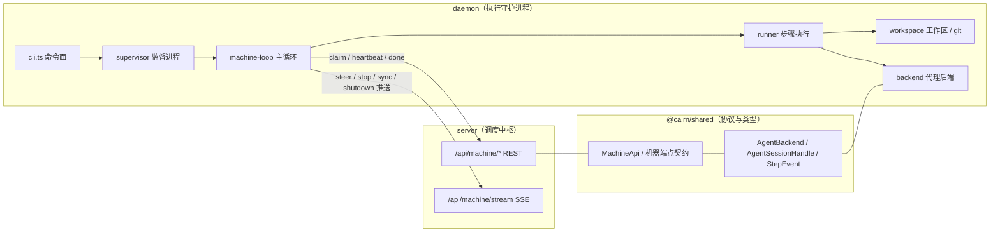
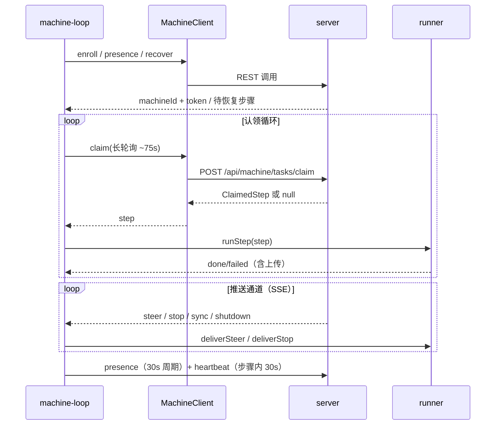
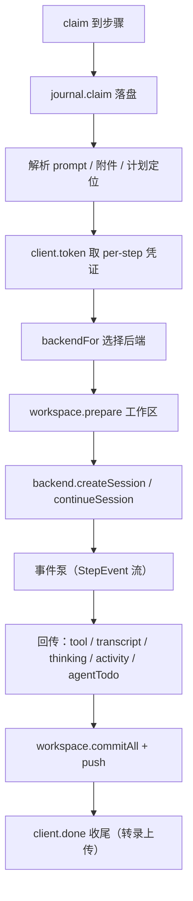

# cairn 执行守护进程（daemon）

## 简介与用途

`daemon`（发布名 `@xiechimon/cairn-cli`，CLI 命令 `cairn`）是 cairn 系统的**执行守护进程**：它以一台「执行机」的身份常驻运行，向 [server](server.md) 轮询并认领任务步骤（`claim`），在本机拉起真实的编码代理（Pi / Claude Code / Gemini ACP）执行这些步骤，再把执行过程中的事件、工具调用、令牌用量与最终产物回传给 server。

本模块与 [server](server.md) 通过 `@cairn/shared`（见 [shared](../shared.md)）中定义的机器 API 契约通信，二者合称「后端应用服务」（[Backend_application_services](../Backend_application_services.md)）：

- **server**：调度中枢（任务/步骤的生成、并发门控、凭证托管、会话编排、合并门、轨迹库）。
- **daemon**：执行单元（机器注册、步骤认领与执行、工作区/仓库管理、代理后端桥接、产物上传）。

核心职责可归纳为五条：

1. **机器生命周期**：注册/登记（enroll，支持 API key 与浏览器授权两条路径）、presence 心跳、能力上报（硬件、MCP、技能）、恢复（recover）。
2. **步骤执行**：长轮询认领步骤（chief 串行 + worker 并发），以受管工作区 + Git 仓库为执行环境，驱动代理后端完成 plan/build/merge/verify/review/chief 等步骤，并持续回传心跳、工具调用、转录增量、活动与 agent todo。
3. **代理后端桥接**：把统一的后端契约（`AgentBackend` / `AgentSessionHandle`）映射到三种真实运行时——pi（自研编码代理）、claude-code（Claude Code SDK）、gemini（ACP 协议），并负责命令门禁（command gate）、技能目录、MCP 桥接、遥测（OTLP）。
4. **仓库与工作区管理**：克隆/复用仓库、创建对话分支工作区、执行 setup/resume 钩子、提交与推送、只读导出、孤儿工作区回收、per-step 凭据注入与回退。
5. **本地状态与恢复**：`outbox` 步骤日志（StepJournal）、会话转录缓冲、停止请求协调、重启后的步骤恢复与上传续传。

## 架构总览

### 进程模型

- **前台（foreground）**：`cairn start -f` 直接运行 `runMachine`（适合 pm2/systemd/容器，macOS 下自动拉起 `caffeinate` 防休眠）。
- **后台（detached）**：`cairn start` 先派生一个**监督进程（supervisor）**，supervisor 再派生 runner 子进程；runner 崩溃后 supervisor 按指数退避（1s→30s 封顶）自动重启。`stop/restart/logout` 通过 `daemon.json` 中记录的 PID 与信号协调。

### 主循环（machine-loop）

### 步骤执行流水线（runner）

## 核心概念

### AgentBackend 统一契约（定义于 [shared](../shared.md)）

daemon 内部不直接绑定任何厂商 SDK，而是依赖 `@cairn/shared` 的抽象接口：

- `AgentBackend`：`createSession(opts)` / `continueSession(id, opts)` / 能力描述（thinking 级别、oauth 提供商、是否支持压缩与续会话）。
- `AgentSessionHandle`：`events`（`AsyncIterable<StepEvent>`）+ `steer(text, images?)` + `stop()` + `usage()`。
- `StepEvent`：统一的事件类型联合（`text_delta`、`thinking`、`toolcall_end`、`message_update/end/stop`、`compaction*`、`auto_retry_*`、`steer`、`done`、`error`）。
- `SessionOpts`：一次会话的全部输入（provider/model/thinking 级别/system prompt/远端与本地工具/MCP 端点/技能注入/图片/遥测上下文等）。

三种后端的适配实现见 [daemon_backends](daemon/daemon_backends.md)，它们在 runner 与外部 SDK 之间完成双向翻译。

### 机器 API（MachineClient）

`MachineClient` 封装与 server 的全部 HTTP 交互（[daemon_machine_client](daemon/daemon_machine_client.md)）：enroll/enrollStart/enrollPoll、me、presence、recover、claim、heartbeat、tool、token、skillsManifest、attachment、uploadUrls、done、steer、stop、stream 等。所有请求体/响应均经 `@cairn/shared` 的 zod schema 校验。

### 步骤本地状态（outbox）

`StepJournal`（[daemon_step_execution](daemon/daemon_step_execution.md)）把每个步骤的认领/运行/等待上传/完成/失败状态落盘在 `outbox/step-<id>.json`；`TranscriptBuffer` 负责把转录消息以 `step-<id>.transcript.json` 增量落盘，供失败后恢复上传。`RunStop`/`StepStops` 协调停止请求的交付与持久化。

## 子模块总览

| 子模块 | 页面 | 职责 |
| --- | --- | --- |
| 代理后端 | [daemon/daemon_backends.md](daemon/daemon_backends.md) | Pi / Claude Code / Gemini（ACP）三种 `AgentBackend` 实现，命令门禁、OTLP 遥测、技能目录与注入 |
| 机器客户端与能力 | [daemon/daemon_machine_client.md](daemon/daemon_machine_client.md) | server REST/SSE 客户端、机器能力探测、claude 二进制与登录态探测 |
| 工作区与 Git | [daemon/daemon_workspace_git.md](daemon/daemon_workspace_git.md) | `gitPrim` 原语、凭据注入与回退、`WorkspaceManager` 工作区生命周期、推送与孤儿回收 |
| 步骤执行支撑 | [daemon/daemon_step_execution.md](daemon/daemon_step_execution.md) | 步骤日志（journal）、停止请求、转录分段缓冲、技能加载工具 |
| CLI 与打包 | [daemon/daemon_cli.md](daemon/daemon_cli.md) | commander 命令面（start/stop/restart/logs/status/token 等）、构建与发布脚本、tsconfig |

## 与其它模块的关系

- **[server](server.md)**：daemon 的所有步骤来源与结果去向。server 侧对应的机器端点实现在 `apps/server/src/services/machines.ts`、`events.ts`（TeamStreamHub/ConversationStreamHub）、`scheduler.ts` 等，详见 [server](server.md)。
- **[shared](../shared.md)**：协议、schema、常量与全部共享类型（`agent-backend.ts`、`protocol/machine-api.ts`、`records/*`、`otel.ts`、`git-ops.ts` 等）。daemon 与 server 通过它保持一致。
- **Repository_automation_and_delivery**：CI 的 `pack-smoke`（[github_ci](../Repository_automation_and_delivery/github_ci.md)）与根 `package.json` 的 `dev:daemon` 等脚本（[root_build_deploy](../Repository_automation_and_delivery/root_build_deploy.md)）负责构建与发布 `@xiechimon/cairn-cli`。

## 构建、配置与运行

- **包**：`apps/daemon/package.json`（详见 [daemon_cli](daemon/daemon_cli.md)），二进制入口 `dist/cli.mjs`（`bin: cairn`），要求 Node `>=22.19.0`，ESM（`"type": "module"`）。
- **构建**：`build.mjs` 用 esbuild 将 `src/cli.ts` 打包为单文件 `dist/cli.mjs`（`format: esm`、`target: node22`、`platform: node`、外部依赖见 `externals.mjs`，banner 注入 `createRequire` 以支持 pino 等 CJS 依赖）。`prepack` 复用同一构建，`smoke` 跑 `scripts/smoke-pack.mjs` 验证发布包。
- **配置**：`loadDaemonConfig`（`config.ts`）从命令行选项与环境变量（`$CAIRN_HOME`、`CAIRN_SERVER`、`CAIRN_API_KEY` 等，常量定义于 shared 的 `ENV_VARS`）解析：serverUrl、apiKey/teamId、机器名、home、workspacesDir、skillsDir、mcpConfigPath、hookTimeoutMs。workspaces 目录父目录不存在时抛出 `WorkspacesDirError`。
- **类型检查/测试**：`typecheck` 用 `tsc --noEmit`（`tsconfig.json`：ES2023、NodeNext、strict、noUncheckedIndexedAccess、verbatimModuleSyntax）；`test` 用 `vitest run`（测试位于 `apps/daemon/test/`）。
