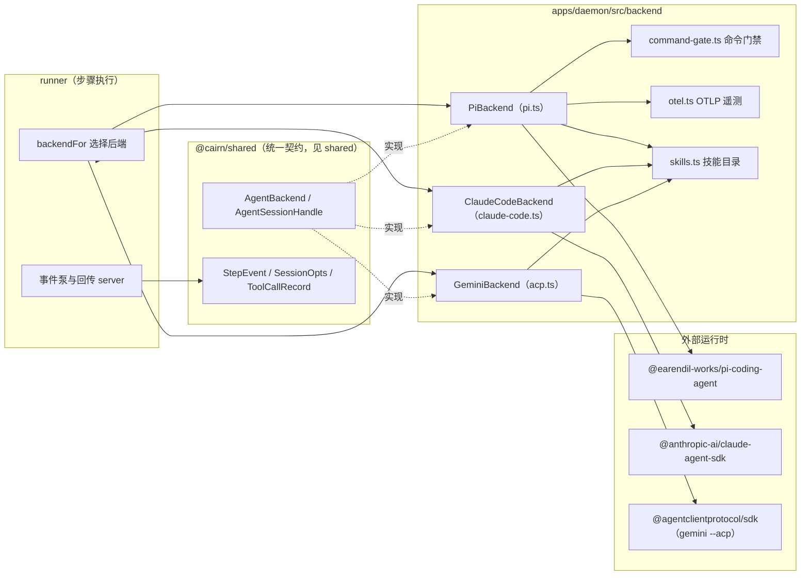
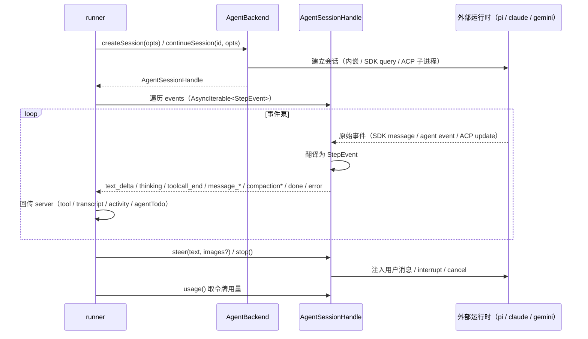
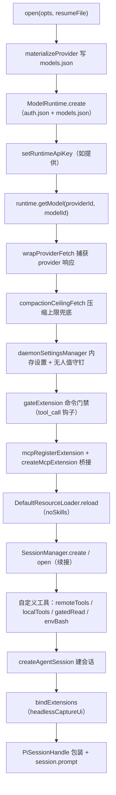
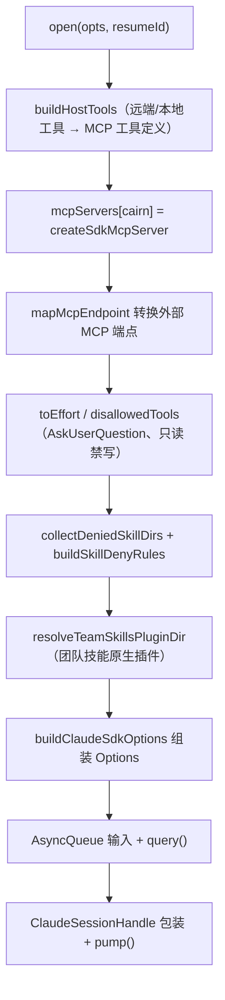
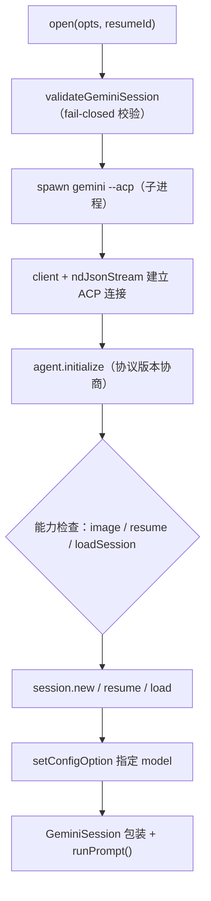
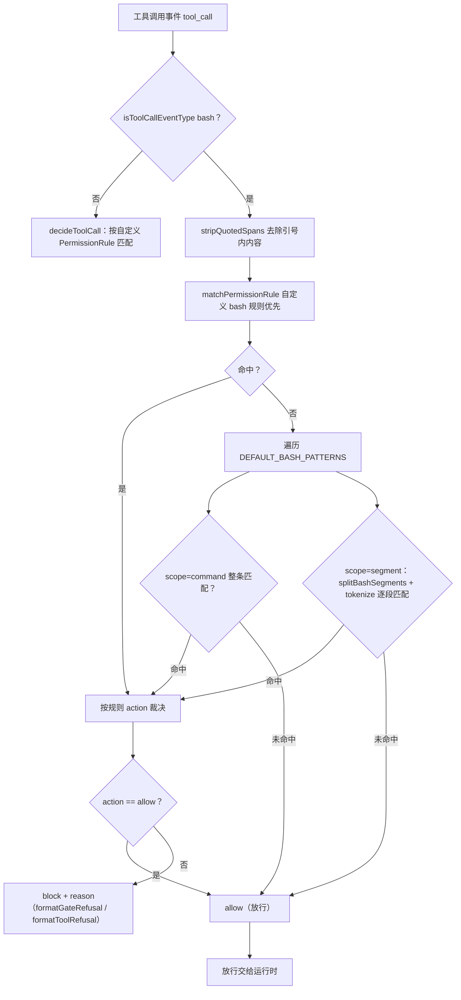
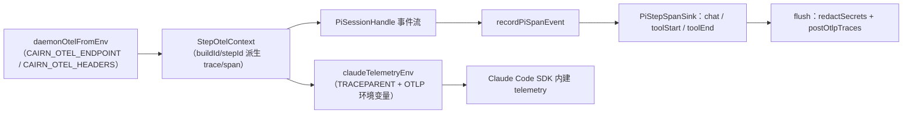
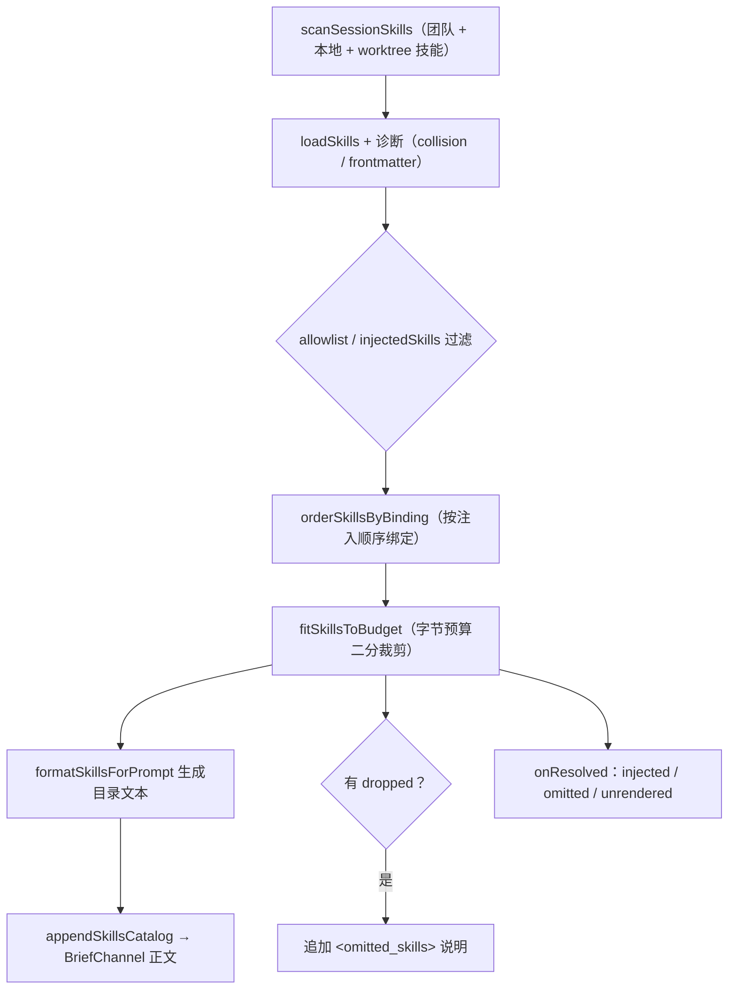

# daemon 代理后端（daemon_backends）

## 简介与用途

`daemon_backends` 是 [daemon](../daemon.md) 的**代理后端（Agent Backend）桥接层**，位于 `apps/daemon/src/backend/`。它的职责是把 [shared](../../shared.md) 中定义的一套**统一后端契约**（`AgentBackend` / `AgentSessionHandle` / `StepEvent` / `SessionOpts`）映射到三种真实编码代理运行时，并为所有后端提供横向支撑设施：

| 后端 | 源文件 | 运行时 | 接入方式 |
| --- | --- | --- | --- |
| Pi | `apps/daemon/src/backend/pi.ts` | `@earendil-works/pi-coding-agent`（自研） | 进程内库嵌入（in-process） |
| Claude Code | `apps/daemon/src/backend/claude-code.ts` | `@anthropic-ai/claude-agent-sdk` | SDK `query()` 会话流 |
| Gemini | `apps/daemon/src/backend/acp.ts` | `@agentclientprotocol/sdk` | 子进程 `gemini --acp` + ACP 协议 |

横向支撑模块（同目录）：

- `command-gate.ts`：**命令门禁**，对 bash 命令与自定义工具调用做 fail-closed 的权限裁决（默认危险模式 + 自定义 `PermissionRule`）。
- `otel.ts`：**OTLP 遥测**，`PiStepSpanSink` 把步骤的 chat/工具调用写成 OTLP span，并为 Claude Code 注入 `TRACEPARENT` 环境变量。
- `skills.ts`：**技能目录与注入**，扫描本地/团队/worktree 技能、按字节预算裁剪、生成提示词目录，并对未授权技能目录做读门禁。
- 支撑文件：`errors.ts`（`SessionNotResumableError`）、`pi-retry.ts`（`PI_RETRY_SETTINGS`）、`mcp-config.ts`（Claude MCP 配置解析）、`provider-response.ts`（provider 响应诊断包装）、`compaction-ceiling.ts`（压缩摘要上下文上限兜底）。

daemon 的 [machine-loop](../daemon.md) 通过 `backendFor(agentProviderId)` 惰性实例化这三种后端（Pi 默认后端；`claude-code` / `gemini` 首次被步骤引用时才创建），并把后端句柄交给 runner（[daemon_step_execution](daemon_step_execution.md)）执行步骤。

## 架构总览

## 统一契约（定义于 shared）

所有后端都实现 [shared](../../shared.md) 的 `agent-backend.ts` 契约，runner 不感知具体厂商：

- **`AgentBackend`**：`createSession(opts)` / `continueSession(id, opts)` / `capabilities` / `brief?`（`BriefChannel`，把技能目录等追加进系统提示）/ `adaptProviderCompat?`（把 provider 兼容标志按错误信息翻转后重新下发）。
- **`AgentSessionHandle`**：`sessionId`、`sessionFile?`、`events`（`AsyncIterable<StepEvent>`）、`steer(text, images?)`、`stop()`、`usage()`。
- **`SessionOpts`**：一次会话的全部输入——provider/model/thinking 级别/systemPrompt、远端工具（`remoteTools` + `executeRemoteTool` 中继）、本地工具（`localTools`）、MCP 端点、技能注入（`skillsAllowlist` / `injectedSkills` / `teamSkillsDir` / `onSkillsResolved`）、`readOnly` / `remoteToolsOnly`、`env`、`telemetry`（`StepOtelContext`）、`cwd`、`prompt` 与 `promptImages`。
- **`StepEvent`**：统一事件联合类型——`text_delta`、`thinking` / `thinking_delta`、`toolcall_end`、`message_update` / `message_end` / `message_stop`、`compaction` / `compaction_start` / `compaction_end`、`auto_retry_start` / `auto_retry_end`、`steer`、`done`（携带 `usage`）、`error`（携带 `retryable`）。

### 能力矩阵

| 能力 | PiBackend | ClaudeCodeBackend | GeminiBackend |
| --- | --- | --- | --- |
| `name` | `pi` | `claude-code` | `gemini` |
| `thinkingLevels` | `off / minimal / low / medium / high / xhigh / max` | `low / medium / high / xhigh / max` | `[]`（不支持） |
| `oauthProviders` | `anthropic / openai-codex / github-copilot / xai` | `[]` | `[]` |
| `compaction` | ✅（可配置、有上限兜底） | ✅（`compact_boundary` 事件） | ❌ |
| `sessionResume` | ✅（`SessionManager.open`） | ✅（按 transcript 文件） | ❌（协议层无 resume，`continueSession` 退化为新会话） |
| `sessionFile` | ✅（pi 会话 JSONL） | ✅（Claude 项目 transcript `.jsonl`） | 无 |

## 会话生命周期与事件泵

三种句柄都对外暴露统一的 `events` 异步迭代器，把厂商原始事件**翻译**成 `StepEvent` 后推给 runner；`steer` 注入用户消息、`stop` 打断、`usage` 返回累计令牌用量。

翻译函数与终止语义：

- `mapClaudeMessage(msg, state)`（claude-code.ts）、`mapPiSessionEvent(event, state)`（pi.ts）、`mapAcpUpdate(update)`（acp.ts）分别把厂商事件映射为 `StepEvent`。
- 终止事件：`done`（携带 `usage`）、`error`（携带 `retryable`）、`message_stop`（被打断/取消）。Claude 的 `pump()` 在遇到 `done / error / message_stop` 后即 `finish()`；Pi 在 `done` 后 `finish()`；Gemini 在 `runPrompt` 结束或出错后 `finish()`。
- 工具调用记录 `ToolCallRecord`：三种后端都维护 `calls` Map 累积「发起 → 结果」两阶段，最后以 `toolcall_end` 事件对外输出（含 `result`、`isError`、可选的 `todo`）。

## PiBackend（pi.ts）

Pi 是 cairn 的**默认后端**（machine-loop 中 `opts.backend ?? createPiBackend(...)`），以内嵌库方式运行自研 `@earendil-works/pi-coding-agent`。它也是功能最全的后端：支持 OAuth 提供商、会话续接、压缩、命令门禁、MCP 桥接、OTLP 遥测与 provider 兼容适配。

### open() 会话建立流程

关键机制：

- **Provider 物化**：`materializeProvider` 把 `ProviderConfig` 写入 `<agentDir>/models.json`（`apiKey` 用 `per-step` 占位，运行时再 `setRuntimeApiKey` 注入），模型带 `CUSTOM_MODEL_DEFAULTS`（`reasoning:false`、`contextWindow:128000`、`maxTokens:16384` 等）与 `customModelReasoning()` 可选的推理能力。
- **无人值守策略**（spec 26）：`daemonSettingsManager()` 用 `SettingsManager.inMemory` 钉死 `compaction.enabled:true`、`enableInstallTelemetry:false`、`cacheWarming:'off'`，`projectTrusted:false`；`piUnattendedEnvPins` 钉 `PI_OFFLINE=1`、`PI_TELEMETRY=0`、`PI_SKIP_VERSION_CHECK=1`、`PI_CACHE_RETENTION`；`PI_SETTINGS_BYPASS` 列明文件位设置一律不参与（信任、重试预算、模型覆盖、代理、缓存预热、遥测、packages、主题、提示模板）。`piSessionPolicyLine` 生成一行策略摘要供日志。
- **Provider 兼容自学习**：`adaptProviderCompat` / `protocolCompatFlip` 根据错误信息（`model does not support this protocol`、`unsupported parameter ... max_completion_tokens`、`... store`）翻转 `maxTokensField` / `supportsStore`，`learnedCompat` 按 providerId 记忆并随 server 下发的 `compat` 合并。
- **压缩上限兜底**：`summarizeCompactionTranscript` 用假模型（`ceiling`、`http://127.0.0.1:9/v1`、`test-key`）调用 `generateSummary`，期间 `globalThis.fetch` 临时替换为 `compactionCeilingFetch`；会话内 `runtime.streamSimple` 也被包装，见 [compaction-ceiling.ts 支撑](#横向支撑设施)。
- **信任保护**：`detectTrustProtectedResources` 探测工作区 `.pi/` 下的受保护条目（settings/mcp/extensions/skills 等），存在即拒绝加载并记日志。
- **命令门禁**：`gateToolCallHandler` 注册为 `cairn-command-gate` 内联扩展，见[命令门禁](#命令门禁command-gatets)。
- **MCP 桥接**：`mcpRegisterExtension` 把 `McpEndpoint` 转为 `McpServerConfig`（`exposure:'direct'`、10s 超时）注册进 pi；`headlessCaptureUi` 以无头 UI 上下文把 MCP 的 `select/confirm/input` 重定向到 `ask_user` 远端工具通道，`parseMcpAttentionMessage` 把「MCP servers need attention」转成连接失败日志（复用 `mcp-config.ts` 的 `connectFailedLine`）。
- **工具面**：`sessionToolNames` 组合内置工具（只读：`read/bash`；全量：`read/bash/edit/write`）、远端、MCP 与本地工具；未授权技能目录用 `createSkillReadGate` 包一层只读工具（`gatedRead`）；`envBash` 给 bash 工具注入会话级 `env`。
- **事件与用量**：`recordPiSpanEvent` 把 `message_end` / `toolcall_end` / `tool_execution_end` 写入 `PiStepSpanSink`；`mapPiSessionEvent` 累计 `MapState.usage`（按 `provider/model` 键合并），`agent_settled` 时产出 `done`。
- **会话续接**：`continueSession(id)` 经 `resolveSessionFile` 定位会话文件，不存在则抛 `SessionNotResumableError`（`errors.ts`）；`SessionManager.open(file, sessionDir, cwd)` 恢复。

## ClaudeCodeBackend（claude-code.ts）

Claude Code 后端通过 `@anthropic-ai/claude-agent-sdk` 的 `query()` 启动子进程会话流，支持会话续接（按 Claude 项目 transcript 文件）与团队技能原生插件通道。

### open() 会话建立流程

关键机制：

- **会话续接**：`continueSession(id)` 要求 `sdkTranscriptPath(cwd, id)`（Claude 项目目录下 `<sessionId>.jsonl`）存在，否则抛 `SessionNotResumableError`；`sdkTranscriptPath` 用 realpath 后的 cwd 生成 slug（非字母数字转 `-`、200 字符上限 + 路径哈希、darwin 下 NFC 归一化），可用 `CLAUDE_CONFIG_DIR` + `CLAUDE_CODE_PROJECT_DIR_NAME` 覆盖项目目录名。
- **工具桥接**：`buildHostTools` 把 `remoteTools` / `localTools` 转成 SDK MCP 工具定义（`createSdkMcpServer`，server 名 `cairn`）；参数 schema 经 `parametersToShape` / `jsonSchemaToZod` 做 **fail-closed** 白名单式校验（只接受 string/number/boolean/array/object 五个基元，多余键直接抛错）。`mapMcpEndpoint` 把 `McpEndpoint` 转成 `McpServerConfig`（http/stdio，`alwaysLoad:true`），并拒绝与宿主工具 server slug 撞名。
- **工具禁用**：`disallowedTools` 恒含 `AskUserQuestion`（无人值守无审批面），`readOnly` 时追加 `Edit` / `Write`；`remoteToolsOnly` 时内置工具清空。
- **技能**：`collectDeniedSkillDirs` + `buildSkillDenyRules` 把未授权技能目录写成 `settings.permissions.deny` 规则（`Read(/**)`、`Skill(name)`）；`resolveTeamSkillsPluginDir` 在 Claude 版本 ≥ `2.1.74`（`claudeVersionAtLeast`）且缓存根可用时，把团队技能物化为原生插件目录注入 `plugins`（见 [team-skills.ts 支撑](#横向支撑设施)）。
- **SDK 选项**：`buildClaudeSdkOptions` 组装 `Options`——`permissionMode:'bypassPermissions'`、`includePartialMessages:true`、`settingSources:['user','project','local']`、`effort` 映射（`toEffort`：`off/minimal` 不传）、`systemPrompt` 追加（`preset:'claude_code'`）、`resume` / `sessionId`、`env`（含 `claudeTelemetryEnv` 注入的 OTLP 环境变量）、`abortController`。
- **事件翻译**：`mapClaudeMessage` 处理五类 SDK 消息——`stream_event`（text/thinking delta）、`assistant`（thinking + tool_use → `toolcall_end`，`TodoWrite` → `todo`）、`user`（tool_result 回填 `result`/`isError`）、`system`（`init` 记 sessionId、`compact_boundary` → `compaction`、`api_retry` → `auto_retry_start`）、`result`（`success` → `done`+usage；失败 → 认证失败则 `message_stop`（`claudeCodeAuthFailureMessage`），否则 `error` + `retryable`（限流/过载/5xx 判定 `isRetryableError`））。
- **用量**：`toUsageRows` 优先取 `modelUsage` 多模型明细，其次取平铺 `usage`；模型名统一加 `claude-code/` 前缀；成本字段仅在 `costBasis` 非 `unknown` 且 `costUSD` 有效时填充。
- **输入队列**：`AsyncQueue<T>` 实现「push 唤醒等待者 / 直接排队」的异步队列；`steer` 通过 `buildUserMessage` 构造 SDK 用户消息（支持图片 `toImageBlock` → base64 inline image），`stop` 置 `interrupted` + `q.interrupt()`。

## GeminiBackend（acp.ts）

Gemini 后端把 `gemini --acp` 子进程包装为 **ACP（Agent Client Protocol）** 客户端，能力面最窄（无思考级别、无工具注入、无压缩、无会话续接），采用 **fail-closed** 策略：任何不受支持的能力被请求时直接抛错，而不是静默降级。

### open() 会话建立流程

关键机制：

- **能力校验**：`validateGeminiSession` 拒绝 `remoteTools` / `localTools`（ACP 面不支持工具注入），并在 `promptImages` 非空但 agent 未声明 `promptCapabilities.image` 时抛错。
- **子进程与连接**：`spawnProcess`（默认 `spawn`）拉起 `gemini --acp`，`ndJsonStream(Writable.toWeb(stdin), Readable.toWeb(stdout))` 与 `client({name:'cairn'})` 对接；`onRequest(session.requestPermission)` 恒选 `reject_once`（无人值守无审批面）；`onNotification(session.update)` 转发给 `GeminiSession.onAcpUpdate`；子进程 `error/exit` 关闭连接。
- **初始化**：`agent.initialize` 校验 `protocolVersion === PROTOCOL_VERSION`；按能力选择 `session.new` / `session.resume` / `session.load`；若 agent 公布 `model` 类 `configOptions` 则 `setConfigOption` 指定 `opts.modelId`，否则打印警告用 CLI 默认模型。
- **事件翻译**：`mapAcpUpdate` 把 `agent_message_chunk(text)` → `text_delta`、`tool_call`/`tool_call_update` → `toolcall_end`、`cancelled` → `message_stop`；`onAcpUpdate` 另处理 `agent_thought_chunk` → `thinking_delta` 与工具调用累积（含 `result` 回填）。
- **错误翻译**：`acpErrorMessage` 把「Gemini 可执行文件缺失 / 未登录」翻译成可操作的中文提示（安装 `@google/gemini-cli`、完成登录流程）。
- **句柄**：`GeminiSession` 用 `queue + waiters` 实现异步事件迭代；`runPrompt` 发送初始 prompt，`stop()` 发 `session.cancel` 通知，`usage()` 恒为空（ACP 面无用量上报）。

## 命令门禁（command-gate.ts）

命令门禁对 agent 的 `bash` 工具调用与自定义工具调用做**权限裁决**，是无人值守执行机的关键安全层。裁决结果三态：`allow`（放行）、`ask`（需要人工批准）、`reject`（直接拒绝）；由于 daemon 无人值守、无批准面，`ask` 实际等价于拒绝（`formatGateRefusal` 会说明这一点，并提示在 confirm/review 门由人批准）。

内置默认模式 `DEFAULT_BASH_PATTERNS`：

| id | 作用域 | 行为 | 判定 |
| --- | --- | --- | --- |
| `reject-forkbomb` | command | reject | 文本含 `:()` 且含 `&` 与 `{`（fork 炸弹，恒无合法用途） |
| `ask-rm-rf-root` | segment | ask | `rm` 递归（`hasRecursiveFlag`）且目标为 `/`、`/*` 或显式 `--no-preserve-root` |
| `ask-rm-rf-home` | segment | ask | `rm` 递归且目标为 `~`、`$HOME`、`/root`（含前缀匹配） |
| `ask-mkfs` | segment | ask | `mkfs` / `mkfs.*`（格式化，恒无合法 agent 用途） |
| `ask-dd-disk` | segment | ask | `dd` 直写块设备 `of=/dev/…`（`of=/dev/null` 空洞放行） |
| `ask-power` | segment | ask | `shutdown / reboot / halt / poweroff`（停机不可逆） |

解析细节：`tokenize` 先剥掉前缀令牌（`sudo/command/nice/nohup/env` 及其 `key=value` 段）；`hasRecursiveFlag` 识别 `--recursive` 与短选项中的 `r/R`；`rmOperands` 剥离选项并归一化 `${VAR}` 花括号变量；`stripQuotedSpans` 把引号内容替换为空格，避免门禁被引号内的伪装文本干扰。

## OTLP 遥测（otel.ts）

后端层把步骤的执行痕迹以 **OTLP traces** 上报，或转发给 Claude Code 内建 telemetry：

- `daemonOtelFromEnv` 从 `CAIRN_OTEL_ENDPOINT` / `CAIRN_OTEL_HEADERS` 解析目标（shared 的 `parseOtlpTarget`）；`contextFor(buildId, stepId)` 返回 `StepOtelContext`（`traceId`/`stepSpanId` 由 build/step 确定性派生，`otlpTraceparent` 等见 shared `otel.ts`）。
- `PiStepSpanSink` 累积 span：`chat(...)` 写 client 类 span（model/usage/成本/finishReason），`toolStart/toolEnd` 写 `execute_tool` internal span（参数与结果经 `jsonText` 序列化，错误置 `OTLP_STATUS_ERROR`）；`flush()` 先收口未结束的工具 span，再用 `redactSecrets(otlpTracesRequest(...))` 脱敏后 `postOtlpTraces` 上报，失败仅记日志。
- `claudeTelemetryEnv` 为 Claude Code 会话注入 `TRACEPARENT`、`CLAUDE_CODE_ENABLE_TELEMETRY=1`、`CLAUDE_CODE_ENHANCED_TELEMETRY_BETA=1` 与 OTLP exporter 端点/头，使 Claude Code 的 span 挂到同一 trace 下。

## 技能目录与注入（skills.ts）

`skills.ts` 统一为各后端的 `BriefChannel` 生成**技能目录**（追加进系统提示），并做未授权技能的读门禁：

- **扫描**：`scanSessionSkills` 按「团队目录优先 → 本地 skillsDir → worktree（`.claude/skills`、`.pi/skills`）」合并，`loadSkills` 关闭默认目录；诊断分四类：`collision`（同名冲突，内容字节相同的镜像自动去重）、`missing-skill-md`、`invalid-frontmatter`、`invalid`，逐条记日志。
- **过滤与排序**：`allowlist` / `injectedSkills` 二选一过滤；`orderSkillsByBinding` 按注入列表顺序重排（保证注入技能优先渲染）。
- **字节预算**：`fitSkillsToBudget` 用二分找到能塞进 `SKILLS_CATALOG_BUDGET_BYTES`（1 MiB，可按 `budgetBytes` 覆盖）的最大前缀；被裁掉的技能在目录末尾追加 `<omitted_skills reason="byte-budget" …>` 说明并记日志；`disableModelInvocation` 的技能计入 `unrendered` 不进目录。
- **回调**：`onResolved` 回传 `{injected, omitted, unrendered}`（供 runner 统计注入事实）。
- **读门禁**：`createSkillReadGate` 对未授权技能 baseDir（realpath 归一）之下的 `readFile/access` 抛 `read denied`，包成 `gatedRead` 只读工具；Claude 侧用 `buildSkillDenyRules` 生成 `settings.permissions.deny`。
- **团队技能**：`collectTeamSkillEntries` 只收集落在团队视图目录内的技能；`discoverNativeSkills` 供能力探测列出本机原生技能（见 [daemon_machine_client](daemon_machine_client.md)）。

## 横向支撑设施

| 文件 | 职责 |
| --- | --- |
| `errors.ts` | `SessionNotResumableError`：continue 时本机无会话文件（Pi/Claude 共用）。 |
| `pi-retry.ts` | `PI_RETRY_SETTINGS`（`maxRetries:3`、`baseDelayMs:2000`、provider `maxRetries:0`）与 `RETRY_STORM_MAX`：无人值守步级纪律——失败不自动重跑，重试预算由宿主钉死。 |
| `mcp-config.ts` | 从 Claude MCP 配置文件解析 `McpEndpoint` 表（`resolveMcpEndpoints`），`notInConfigLine` / `connectFailedLine` 生成规范化失败文案（复用于 Pi 的 MCP 注意消息）。 |
| `provider-response.ts` | `wrapProviderFetch` 记录每个 provider HTTP 响应的形状（状态、content-type、是否 SSE、retry-after、非 SSE 的 512B 预览）；`enrichProviderError` / `describeProviderResponse` 把原始错误增强为带「POST url -> status、machine、baseUrl、首字节预览」的诊断文本（供 `diagnose` 注入 Pi 错误事件）。 |
| `compaction-ceiling.ts` | `compactionCeilingFetch`：识别摘要 prompt（`You are a context summarization assistant.` 标记），在 400/413 上下文上限错误时按窗口数字/比例收缩对话并重试（最多 4 次）；`adjustSummaryBody` 含 thinking budget 保护与 `[...N older messages dropped]` 占位。 |
| `apps/daemon/src/team-skills.ts` | `materializeTeamSkills` 把 server 下发的技能 manifest 物化为内容寻址视图（sha256 去重、原子写、LRU 修剪），`ensureTeamSkillsPlugin` 生成 Claude 原生插件目录（`cairn-team-skills`），供 `resolveTeamSkillsPluginDir` 注入。 |

## 与其它模块的关系

- **[daemon](../daemon.md)**：本模块是其子模块，承接 runner 的后端选择（`backendFor` 在 machine-loop 中惰性创建三个后端实例）与步骤执行（[daemon_step_execution](daemon_step_execution.md)）。
- **[shared](../../shared.md)**：`AgentBackend` / `AgentSessionHandle` / `StepEvent` / `SessionOpts` / `ProviderConfig` / `McpEndpoint` / `ToolCallRecord` / `StepOtelContext` / `PermissionRule` 等契约全部来自 `@cairn/shared`（`agent-backend.ts`、`otel.ts`、`records/provider.ts`、`records/permission-rules.ts`）；`ENV_VARS` / `THINKING_LEVELS` / `CLAUDE_TODO_STATUS_STATES` / `AGENT_TODO_MAX_ITEMS` 等常量亦来自 shared。
- **[daemon_machine_client](daemon_machine_client.md)**：`claude-code-bin.ts`（`probeClaudeBin`，提供 `executablePath` / `executableVersion`）与 `claude-code-auth.ts`（`probeClaudeCodeAuth`，认证失败文案）被本模块消费；能力探测也调用 `discoverNativeSkills`。
- **[daemon_step_execution](daemon_step_execution.md)**：runner 消费 `events` 流并回传 server；`SessionNotResumableError` 在 runner 中触发「改开新会话」降级。
- **[server](../server.md)**：server 侧 `providers.ts`（`claudeCodeModelSource`）与 `machine-deps.ts`（`agentForStep`）决定步骤用哪个后端/provider；本模块把执行痕迹回传供 server 编排。

## 构建、配置与运行

- **依赖**（`apps/daemon/package.json`，详见 [daemon_cli](daemon_cli.md)）：`@earendil-works/pi-coding-agent`（1.4.0）、`@anthropic-ai/claude-agent-sdk`（0.3.278）、`@agentclientprotocol/sdk`（2.0.2）、`@modelcontextprotocol/sdk`（1.30.0）、`zod`；`@cairn/shared` 为 workspace 依赖。
- **环境变量**：`CAIRN_OTEL_ENDPOINT` / `CAIRN_OTEL_HEADERS`（遥测目标）、`CAIRN_STREAM_DURATION_CAP_MS` / `CAIRN_STREAM_IDLE_MS` / `CAIRN_STREAM_FIRST_EVENT_MS`（runner 侧流超时，见 [daemon_step_execution](daemon_step_execution.md)）、`CAIRN_DAEMON_MAX_CONCURRENT` / `CAIRN_PORT_BASE`（并发与端口槽，见 [daemon_machine_client](daemon_machine_client.md)）；Pi 无人值守钉见 `piUnattendedEnvPins`；Claude 侧 `CLAUDE_CONFIG_DIR` / `CLAUDE_CODE_PROJECT_DIR_NAME` 影响 transcript 定位。
- **运行时要求**：Pi 为内嵌库无需外部进程；Claude Code 需要本机 `claude` 可执行文件（`probeClaudeBin` 探测，可被 `--claude-bin` 覆盖）；Gemini 需要 `npm install -g @google/gemini-cli` 且完成登录（`acpErrorMessage` 会给出指引）。
- **测试**：`apps/daemon/test/` 覆盖命令门禁裁决、事件映射（`mapClaudeMessage` / `mapPiSessionEvent` / `mapAcpUpdate`）、用量聚合（`toUsageRows`）、技能目录预算裁剪等；运行方式见 `apps/daemon/package.json` 的 `test`（`vitest run`）。
