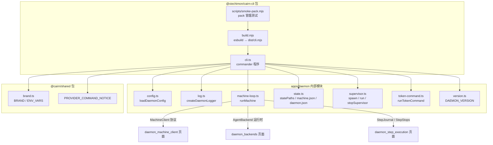
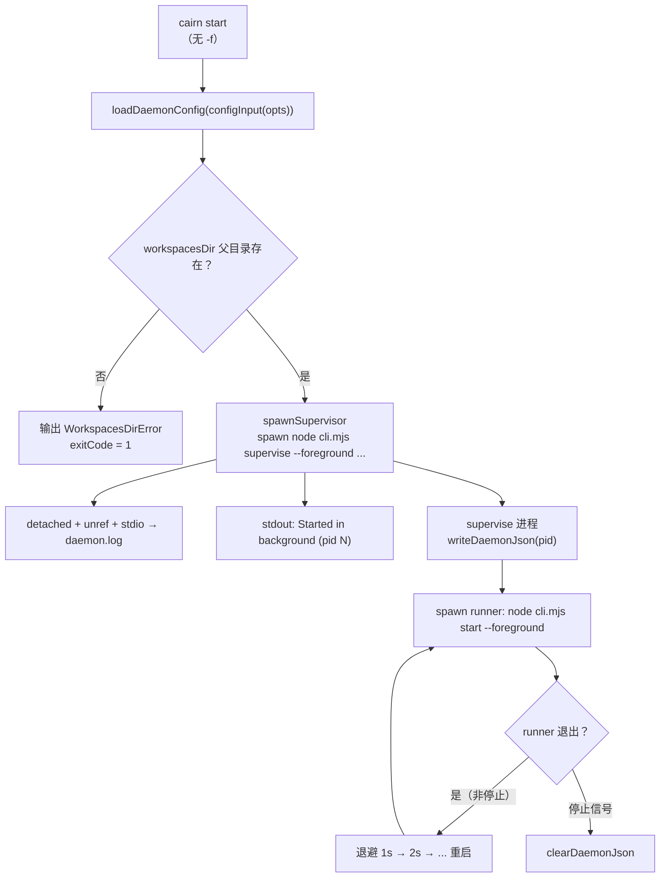
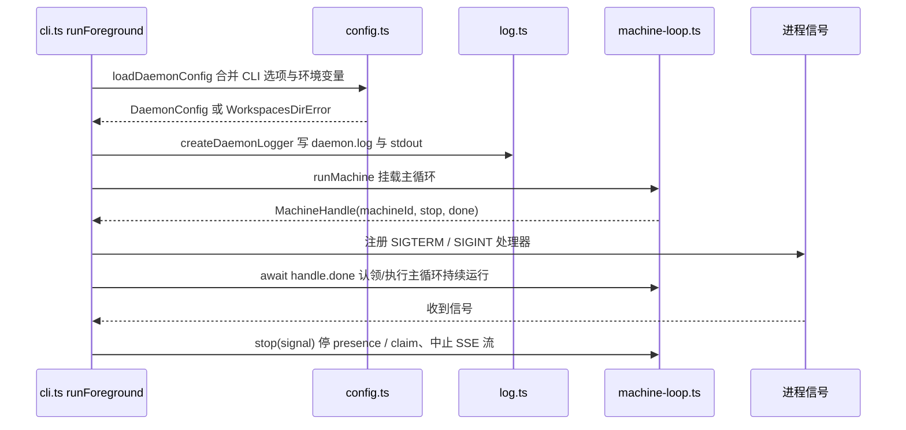

# daemon CLI 命令面（cairn）

## 简介

`daemon_cli` 是 cairn 守护进程（`apps/daemon`）的**命令行命令面**，对应规格书「02 §5.1 command face」。它把守护进程的全部生命周期管理收敛到一个可发布到 npm 的二进制命令 `cairn` 上：启动（前台/后台）、监督重启、停止、重启、日志、退出登录、状态查询、访问令牌管理与版本/厂商信息展示。

模块由三个文件构成：

| 文件 | 职责 |
| --- | --- |
| `apps/daemon/src/cli.ts` | 基于 `commander` 的完整 CLI 程序：`main` / `buildProgram` / `runForeground` 等 |
| `apps/daemon/package.json` | npm 包 `@xiechimon/cairn-cli`：bin 入口 `cairn` → `dist/cli.mjs`，脚本 `dev` / `build` / `prepack` / `smoke` / `typecheck` / `test` |
| `apps/daemon/tsconfig.json` | TypeScript 严格配置（`strict`、`noUncheckedIndexedAccess`、`verbatimModuleSyntax`、`noEmit`） |

`cli.ts` 本身几乎不含业务逻辑——它是一层「薄壳」，负责：

1. **配置解析**：把 CLI 选项与环境变量（`CAIRN_*`）合并为 `DaemonConfig`（见 `./config.ts`）；
2. **进程编排**：通过 `./supervisor.ts` 的 `spawnSupervisor` / `runSupervisor` / `stopSupervisor` 实现后台守护与崩溃自动重启；
3. **主循环挂载**：前台模式下把控制权交给 `./machine-loop.ts` 的 `runMachine`（机器在线、认领步骤、执行会话）；
4. **本地状态访问**：通过 `./state.ts` 读写 `~/.cairn` 下的 `machine.json`、`daemon.json`、`daemon.log` 等；
5. **令牌管理**：通过 `./token-command.ts` 打印/轮换服务端访问令牌。

> 运行主循环的机器协议、后端运行时与步骤执行细节分别见
> [daemon_machine_client](daemon_machine_client.md)、[daemon_backends](daemon_backends.md)、[daemon_step_execution](daemon_step_execution.md)、[daemon_workspace_git](daemon_workspace_git.md) 页面。

## 架构与依赖



依赖要点：

- **对外包边界**：`cli.ts` 只依赖 `commander`、`node:fs` / `node:process` / `node:url` 与 `@cairn/shared`（`BRAND.cliCommandName`、`PROVIDER_COMMAND_NOTICE`、`MachineSyncCommand` 类型）；
- **运行时代码**：`machine-loop.ts`、`supervisor.ts`、`state.ts`、`config.ts` 均属 daemon 应用内部，由 CLI 直接调用；
- **共享常量**：命令名 `cairn`、主目录 `~/.cairn`、环境变量前缀 `CAIRN_` 均来自 `@cairn/shared` 的 `brand.ts`（见 [shared 页面](../../shared.md)）。

## CLI 程序结构

### 入口与直接执行检测

```ts
export async function main(argv: string[] = process.argv): Promise<void> {
  await buildProgram().parseAsync(argv);
}

function isMainModule(): boolean {
  if (!process.argv[1]) return false;
  try {
    return import.meta.url === pathToFileURL(realpathSync(process.argv[1])).href;
  } catch {
    return false;
  }
}

if (isMainModule()) void main();
```

- `isMainModule()` 通过比对 `import.meta.url` 与 `process.argv[1]` 的 realpath 判断 `cli.ts` 是否作为入口被执行；作为库被 `tsx` / `vitest` 等加载时不会自动启动；
- 构建产物 `dist/cli.mjs` 由 `package.json` 的 `bin` 字段以 `cairn` 命令暴露。

### 命令清单

`buildProgram()` 使用 `commander` 注册以下命令：

| 命令 | 选项 | 作用 |
| --- | --- | --- |
| `start` | `-f, --foreground`、`--api-key <k>`、`--team <id>`、`--name <name>`、`--server <url>`、`--workspaces-dir <dir>` | 启动守护进程（默认后台 + 监督进程；`-f` 前台直跑） |
| `supervise`（隐藏） | 透传未知参数 | 监督进程本体：拉起 runner 并在其退出后按退避重启 |
| `stop` | — | 停止后台守护进程 |
| `restart` | 同 `start` | 停止后重新后台启动 |
| `logs` | `-f, --follow` | 打印 `daemon.log` 尾部；`-f` 持续跟踪新行 |
| `logout` | — | 本地退出登录（删除 `machine.json`；服务端记录保留） |
| `status` | — | 显示本地机器/守护进程状态 |
| `token` | `--rotate` | 打印服务端访问令牌及位置；`--rotate` 轮换写入新令牌 |
| `version` | — | 打印 daemon 版本号（`DAEMON_VERSION`） |
| `provider` | — | 打印 provider 管理提示（`PROVIDER_COMMAND_NOTICE`） |

顶层选项：`-v, --version` 输出 `DAEMON_VERSION`（来自 `version.ts`，通过 `createRequire` 读取 `package.json` 的 `version` 字段，构建时与 esbuild banner 的 `createRequire` 错开命名）。

## 启动流程

### 默认模式（后台 + 监督）



- `start`（默认）把 `--api-key` / `--team` / `--name` / `--server` / `--workspaces-dir` 经 `passthroughArgv()` 原样拼回 `['start', '--foreground', ...]` 传给监督进程，再由监督进程拉起真正的 runner；
- `spawnSupervisor` 以 `detached: true`、`stdio` 重定向到 `daemon.log`（追加模式）启动 `supervise` 子进程，`unref()` 使父 CLI 立即退出返回 shell；
- 若已有存活 daemon（`daemon.json` 中的 pid 经 `isAlive` 判定），`spawnSupervisor` 抛错「daemon already running」。

### 前台模式（-f / supervise runner）



- `runForeground` 是后台监督 runner 与容器/pack 场景（pm2、systemd、launchd、Docker）共用的前台入口：加载配置 → 创建 logger → 挂载 `runMachine` 主循环 → 注册 `SIGTERM` / `SIGINT` 优雅停机 → 等待 `handle.done`；
- `idleSleepPrevention: true` 会在 macOS 上派生 `caffeinate -i -w` 防止空闲休眠（见 `machine-loop.ts`）。

## 配置解析（loadDaemonConfig）

CLI 选项通过 `configInput(opts)` 映射为 `DaemonConfigInput`，再与 `CAIRN_*` 环境变量合并（选项优先于环境变量，环境变量优先于默认值）：

| 配置项 | CLI 选项 | 环境变量 | 默认值 |
| --- | --- | --- | --- |
| `home` | — | `CAIRN_HOME` | `~/.cairn` |
| `workspacesDir` | `--workspaces-dir` | `CAIRN_WORKSPACES_DIR` | `<home>/workspaces` |
| `apiKey` | `--api-key` | `CAIRN_API_KEY` | 无（未注册时必需） |
| `teamId` | `--team` | `CAIRN_TEAM` | 无（未注册时必需） |
| `serverUrl` | `--server` | `CAIRN_SERVER` | 默认服务器地址（去除尾部 `/`） |
| `name` | `--name` | — | 主机名 `hostname()` |
| `skillsDir` | — | `CAIRN_SKILLS_DIR` | `~/.agents/skills` |
| `mcpConfigPath` | — | `CAIRN_MCP_CONFIG` | `~/.claude/settings.json` |
| `hookTimeoutMs` | — | `CAIRN_HOOK_TIMEOUT_MS` | 工作区 hook 超时默认值（仅接受正整数） |
| `foreground` | `-f` | — | `false` |

- 若显式指定 `workspacesDir`（CLI 或环境变量）但其父目录不存在，抛出 `WorkspacesDirError`，CLI 捕获后输出错误并以 `exitCode = 1` 退出；
- 最终配置经 zod schema（`daemonConfigSchema`）校验后返回。

## 本地状态与文件

`statePaths(home, workspacesDir)` 定义 `~/.cairn` 下的状态文件布局，CLI 各命令据此读写：

| 文件/目录 | 用途 | 相关命令 |
| --- | --- | --- |
| `machine.json` | 注册记录（machineId / token / teamId / serverUrl） | `status`、`logout`（删除） |
| `daemon.json` | 监督进程记录（pid / startedAt） | `start`、`stop`、`status` |
| `daemon.log` | 守护进程结构化日志 | `logs`（跟踪/尾部） |
| `workspaces/` | 持久工作区根 | `start`（透传） |
| `outbox/`、`chat-sessions/`、`agent-runtime/`、`team-skills/`、`step-attachments/`、`plans/`、`reports/` | 步骤执行、会话与产物目录 | 由 `machine-loop` / `runStep` 使用 |

各命令行为：

- **`status`**：读取 `machine.json` 输出注册信息（machineId / teamId / serverUrl），读取 `daemon.json` 并以 `isAlive(pid)` 判断是否在运行；
- **`logout`**：先 `stopSupervisor`，再 `forgetMachine` 删除 `machine.json`（服务端记录保留，重新 enroll 复用同一 machineId）；
- **`stop`**：`stopSupervisor` 发送 `SIGTERM` 并以 100ms 间隔轮询 pid 最多 8s，返回是否确实停止；
- **`logs`**：`-f` 模式下每 500ms 轮询文件大小增量并追加输出（`openSync` / `readSync` 按偏移读取）。

## 令牌管理（token）

`runTokenCommand({rotate}, {env, writeOut})`：

- **打印**：优先取环境变量 `CAIRN_TOKEN`，否则读取 `<home>/token` 文件（`access-token-file.ts` 格式）；两者皆无时提示「token auth 关闭」；
- **轮换（`--rotate`）**：若环境变量已设置则拒绝（服务端会优先用环境变量，文件令牌无效）；否则生成 32 字节随机 hex 写入 `<home>/token`（`mode 0o600`），提示重启服务端生效；
- 退出码非 0 时由 `cli.ts` 设置 `process.exitCode`。

## 构建、打包与部署

### package.json 脚本与构建

| 脚本 | 命令 | 说明 |
| --- | --- | --- |
| `dev` | `tsx src/cli.ts start -f` | 开发态前台启动 |
| `build` / `prepack` | `node build.mjs` | esbuild 打包 `src/cli.ts` → `dist/cli.mjs`（bundle、`platform: node`、`target: node22`、ESM、sourcemap） |
| `smoke` | `node scripts/smoke-pack.mjs` | 发布前冒烟：`pnpm pack` → 校验 tarball 内容 → 临时目录 `npm install` → 运行 `--help` / `--version` / bin 链接 |
| `typecheck` | `tsc --noEmit` | 类型检查（tsconfig 无产物输出） |
| `test` | `vitest run` | 单测（含 `test/token-command.test.ts`、`test/config-state.test.ts`、`test/version.test.ts` 等） |

- 包名 `@xiechimon/cairn-cli`，版本 `0.2.1`，`engines.node >= 22.19.0`，`files: ["dist"]`，`type: module`，`publishConfig.access: public`；
- `build.mjs` 在 bundle 头部注入 banner，用 `createRequire(import.meta.url)` 建立 `require`，以兼容 pino 等 CJS 依赖在 ESM bundle 中的顶层 `require`；`version.ts` 亦用 `createRequire` 读取 `package.json` 版本；
- esbuild 外部化三个 pi 运行时包（`externals.mjs` 的 `EXTERNALS`：`@earendil-works/pi-ai`、`pi-coding-agent`、`pi-agent-core`），它们作为运行时依赖随包安装；
- `smoke` 校验：Node 版本满足 engines、tarball 含 bin 产物且不含 `src/`、`test/`、manifest 无 `workspace:` / `catalog:` 残留、外部化包在 dependencies 中声明、`--help` 输出 Usage、`--version` 与 `package.json` 一致、`.bin/cairn` 链接可用；
- CI 中由 `.github/workflows/ci.yml` 的 `pack-smoke` job 执行（见 [github_ci 页面](../../Repository_automation_and_delivery/github_ci.md)）。

### 部署形态

- **npm 分发**：`prepack` 保证 `pnpm pack` 产物即含最新 `dist/cli.mjs`；`bin` 字段暴露 `cairn` 命令；
- **macOS launchd**（`apps/daemon/launchd/`）：`install.sh` 渲染 `com.xiechimon.cairn-daemon.plist` 到 `~/Library/LaunchAgents`，以「等价于 `tsx src/cli.ts start -f`」的方式保活守护进程（重启后自动拉起、崩溃重启、30s 风暴上限、不管理 `:8787` 服务端）；
- **容器部署**：仓库根 `Dockerfile` 目前只构建服务端与 Web（`apps/server`、`apps/web`），daemon CLI 不进入容器镜像——daemon 定位为本地/用户态执行器（见 [root_build_deploy 页面](../../Repository_automation_and_delivery/root_build_deploy.md)）。

## 与其他模块的关系

| 相关页面 | 关系 |
| --- | --- |
| [daemon_machine_client](daemon_machine_client.md) | `runMachine` 通过 `MachineClient` 与 `apps/server` 通信；CLI 的 `start -f` 是它的宿主进程 |
| [daemon_backends](daemon_backends.md) | `runMachine` 按需创建 pi / Claude Code / Gemini 后端运行时 |
| [daemon_step_execution](daemon_step_execution.md) | `runMachine` 内的 `StepJournal` / `StepStops` / `SegmentBuffer` 支撑步骤执行 |
| [daemon_workspace_git](daemon_workspace_git.md) | `WorkspaceManager` 管理步骤工作区与 git 推送 |
| [daemon](../daemon.md) | 本页是 daemon 模块的入口页（CLI 命令面） |
| [shared](../../shared.md) | `BRAND`、`ENV_VARS`、`PROVIDER_COMMAND_NOTICE` 等常量与协议 schema |
| [github_ci](../../Repository_automation_and_delivery/github_ci.md) | CI `pack-smoke` job 验证本包可发布 |
| [root_build_deploy](../../Repository_automation_and_delivery/root_build_deploy.md) | 根 `package.json` 的 `dev:daemon` 脚本与本包 `dev` 脚本对应 |
