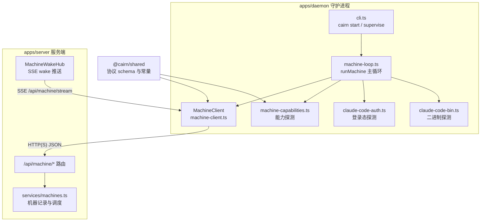
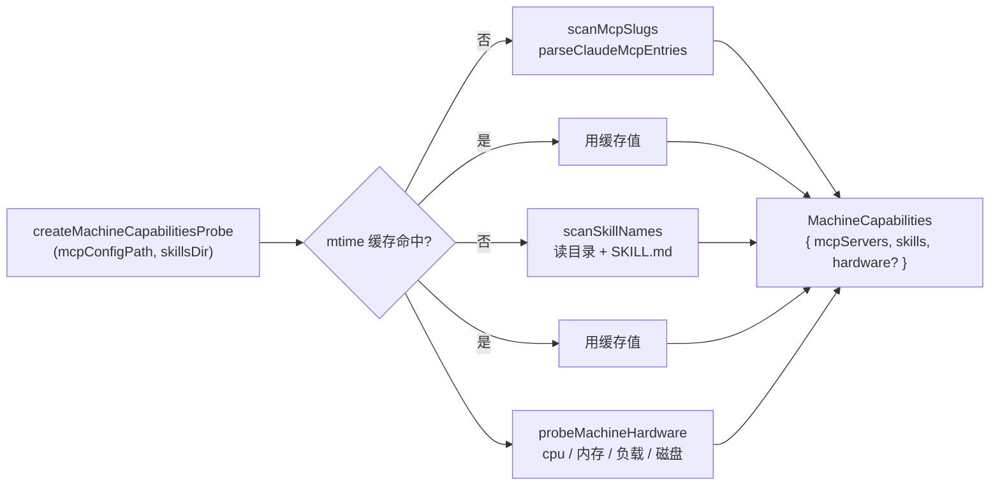
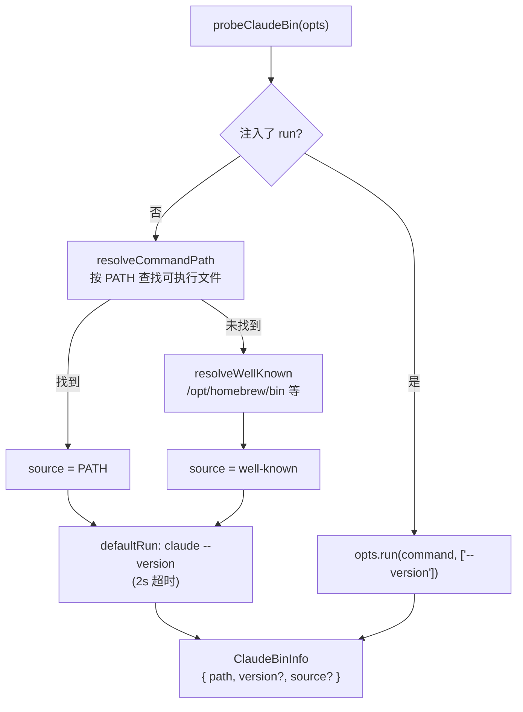
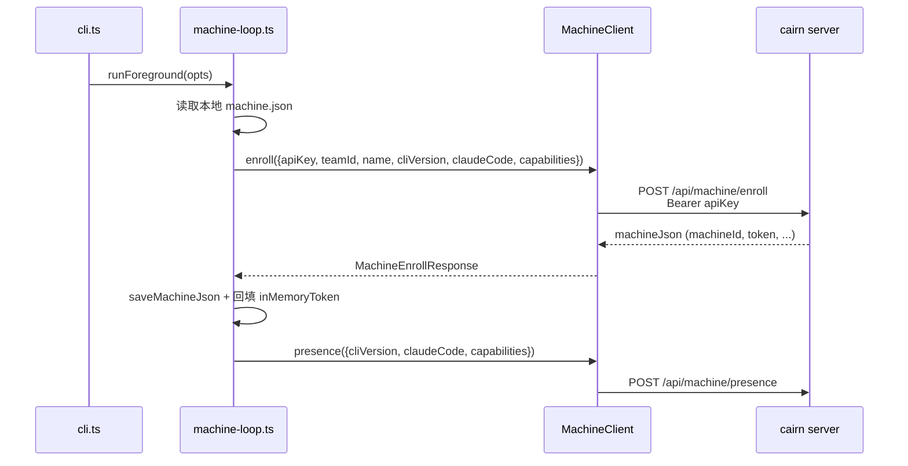
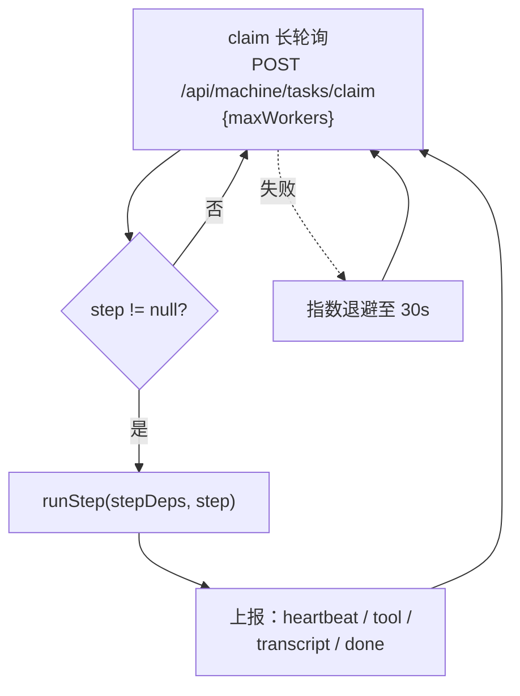
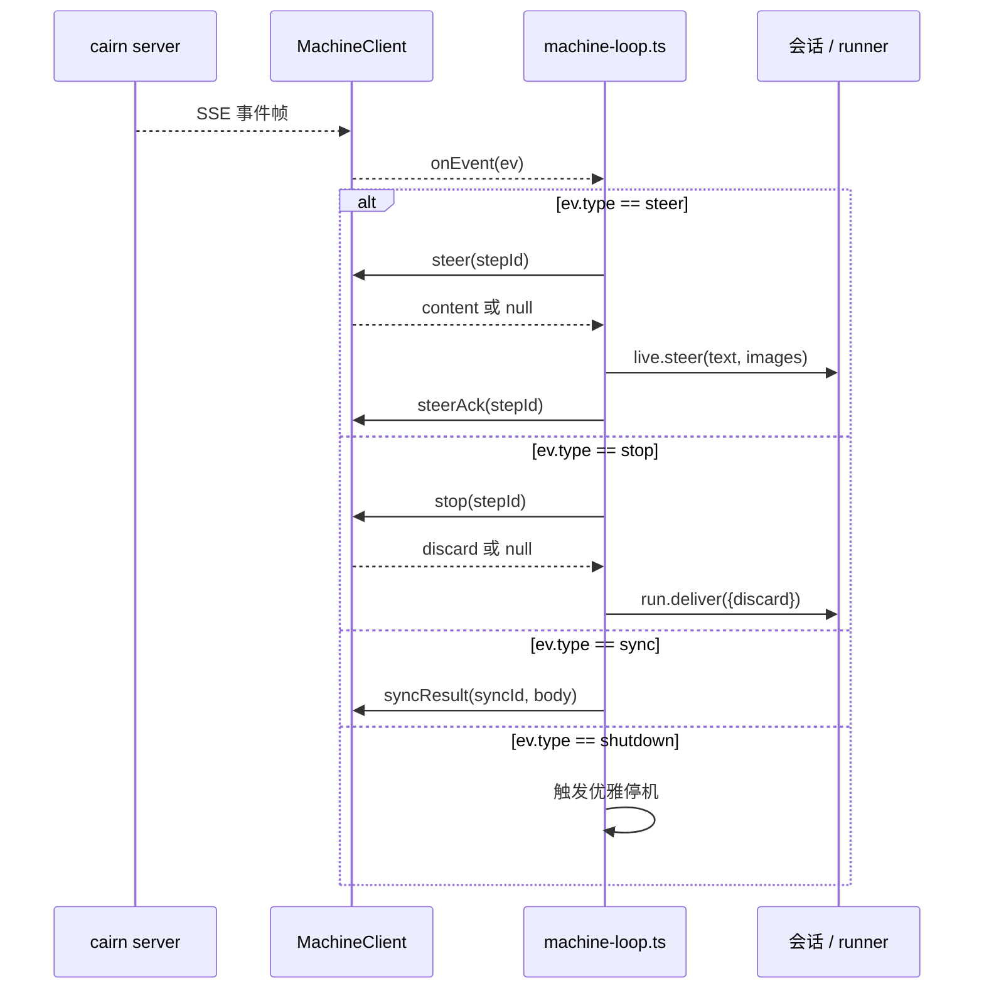

# daemon 机器客户端（MachineClient）

## 简介

`daemon_machine_client` 是 cairn 守护进程（`apps/daemon`）中负责**与 cairn 服务端（`apps/server`）通信**的客户端模块。它由四个文件构成：

| 文件 | 职责 |
| --- | --- |
| `apps/daemon/src/machine-client.ts` | `MachineClient` 类与 `MachineApi` 接口：封装 `/api/machine/*` 全部 HTTP/SSE 端点 |
| `apps/daemon/src/machine-capabilities.ts` | 机器能力探测：MCP 服务、技能目录、硬件指标 |
| `apps/daemon/src/claude-code-auth.ts` | Claude Code 登录态探测（`claude auth status`） |
| `apps/daemon/src/claude-code-bin.ts` | Claude Code 二进制定位与版本探测（`claude --version`） |

模块的核心价值在于：

1. **机器接入协议**：实现注册（enroll）、在线心跳（presence）、任务领取（claim）、步骤执行上报（tool / heartbeat / done）、指令下发（steer / stop）等完整生命周期；
2. **能力自述**：把本机的 MCP server、skills 与硬件信息上报给服务端，供调度器做「机器适配」决策；
3. **运行环境预检**：探测 Claude Code 是否安装、是否登录，为步骤分派提供前提条件。

该模块是 daemon 主循环（`machine-loop.ts` 中的 `runMachine`）与 cairn 服务端之间的唯一通信通道，协议定义与类型/模式校验（zod schema）由 `@cairn/shared`（`packages/shared/src/protocol/machine-api.ts`、`machine-wire.ts`、`records/machine.ts`、`records/machine-capabilities.ts`）提供，本模块只负责「按协议发请求、解析响应、处理重试」。

## 架构与依赖



依赖关系要点：

- `MachineClient` 只依赖 `@cairn/shared` 导出的类型与 zod schema（`machine*ResponseSchema` 等）以及协议常量（`REMOTE_TOOL_RETRY_DELAYS_MS`、`REMOTE_TOOL_TIMEOUT_MS`）；
- `machine-capabilities.ts` 使用 Node 内置 `node:fs` / `node:os` / `node:path` 与 `@cairn/shared` 的 `MachineCapabilities`、`MachineHardware` 类型及 `parseClaudeMcpEntries`；
- `claude-code-auth.ts` / `claude-code-bin.ts` 使用 `node:child_process` / `node:fs` / `node:os` / `node:path`，无业务依赖，可独立测试（通过注入 `run` / `env` / `wellKnownDirs` 选项）。

## MachineClient：HTTP 客户端

### 构造与请求机制

```ts
new MachineClient({
  serverUrl: string;   // 服务端根地址
  getToken?: () => string;  // 返回内存中的机器令牌（enroll 后回填）
  fetchImpl?: typeof fetch; // 可注入的 fetch 实现（测试用）
})
```

- 所有请求统一走私有方法 `request(method, path, opts)`：自动附加 `authorization: Bearer <token>`（`enroll` 例外，用 `apiKey` 作为 Bearer）、JSON 序列化 body、AbortSignal，并在响应非 2xx 时抛出 `MachineApiError`；
- 响应一律经 zod schema 解析（`parse` 回调），保证与 `@cairn/shared` 的协议定义同步；
- 令牌保存在内存（`machine-loop.ts` 的 `inMemoryToken`），不落盘常驻；`enroll` 成功返回的 `token` 会写入本地 `machine.json`（由 `state.ts` 的 `saveMachineJson` 处理）。

### 端点清单

`MachineApi` 接口共 26 个方法；加上 `MachineClient` 类独有的 `enrollStart` / `enrollPoll`，共 28 个端点方法，映射到如下端点：

| 方法 | 端点 | 用途 |
| --- | --- | --- |
| `enroll` | `POST /api/machine/enroll` | 首次注册（API key 作为 Bearer，body 不含 apiKey） |
| `enrollStart` | `POST /api/machine/enroll/start` | 浏览器授权流：申请 `enrollId` 与授权 URL |
| `enrollPoll` | `POST /api/machine/enroll/poll` | 轮询授权结果：`pending` / `authorized` / `expired` |
| `me` | `GET /api/machine/me` | 读取机器自述（含 `maxConcurrent` 并发上限） |
| `presence` | `POST /api/machine/presence` | 在线心跳（约每 30s；断网时失败但不退出进程） |
| `recover` | `POST /api/machine/recover` | 启动时恢复待续步骤（journal 恢复） |
| `claim` | `POST /api/machine/tasks/claim` | 长轮询领取步骤（默认约 75–90s 节奏） |
| `heartbeat` | `POST /api/machine/heartbeat/{stepId}` | 步骤续活（journal 心跳） |
| `tool` | `POST /api/machine/tool/{stepId}` | 工具调用结果回传 |
| `transcriptDelta` / `thinkingDelta` / `transcriptRow` / `activity` / `agentTodo` | `POST /api/machine/tool/{stepId}` | 以 `kind` 字段区分的事件上报（同为 tool 端点） |
| `relayTool` | `POST /api/machine/tool/{stepId}` | remoteTools 中继：转发模型工具调用给服务端执行 |
| `token` | `GET /api/machine/token/{stepId}` | 领取 per-step 凭证（模型 key + 托管 repo 的 git 凭证） |
| `askUser` | `POST /api/machine/ask/{stepId}` | 向用户提问（长轮询直到非 pending 应答） |
| `skillsManifest` | `GET /api/machine/skills/{stepId}` | 拉取团队技能清单 |
| `skillFile` | `GET /api/machine/skills/{stepId}/file?dirName=&path=` | 下载单个技能文件（Buffer） |
| `attachment` | `GET /api/machine/attachment/{stepId}/{attachmentId}?teamId=` | 下载步骤附件 |
| `uploadUrls` | `POST /api/machine/upload-urls/{stepId}` | 申请预签名上传地址（transcript / 产物） |
| `putUpload` | `PUT {url}` | 直接上传到预签名地址（同源时附加 Bearer） |
| `done` | `POST /api/machine/done/{stepId}` | 步骤收尾（成功 / 失败结果） |
| `steer` | `GET /api/machine/steer?stepId=` | 拉取待下发的人工指引内容 |
| `steerAck` | `POST /api/machine/steer/ack?stepId=` | 确认指引已送达会话 |
| `stop` | `GET /api/machine/stop?stepId=` | 查询是否存在停止请求，返回 `discard` 语义 |
| `syncResult` | `POST /api/machine/sync-result/{syncId}` | 汇报同步（branch-sync 等）结果 |
| `stream` | `GET /api/machine/stream` | SSE 长连接：接收 `steer` / `stop` / `sync` / `shutdown` 事件 |

### 错误处理与重试策略

- **`MachineApiError`**：携带 HTTP `status` 与响应正文（截取前 200 字符），用于区分瞬时错误与确定性错误；
- **`isTransientUploadError(err)`**：`MachineApiError` 且状态为 `404` 或 `>= 500` 时视为瞬时错误，否则一律视为瞬时（保守处理）；
- **超时与重试常量**（来自 `@cairn/shared`）：`REMOTE_TOOL_TIMEOUT_MS = 10_000`，`REMOTE_TOOL_RETRY_DELAYS_MS = [500, 2000]`（最多重试 2 次）；
- **`relayTool`**：`replaySafe` 时对 5xx 按 `500ms → 2000ms` 退避重试，否则立即抛错；非 5xx 错误直接抛出；
- **`skillFile` / `attachment`**：4xx 直接抛出，5xx 按 `500ms → 2000ms` 重试；
- **`askUser`**：请求超时 `HOLD_MS(70s) + 15s`；应答为 `pending` 或 5xx 时等待 2s 后继续轮询，直到拿到非 pending 应答或 `opts.signal` 被中止；
- **`heartbeat`**：使用 `AbortSignal.timeout(REMOTE_TOOL_TIMEOUT_MS)` 限时；
- **`claim` 的退避**由主循环负责：失败后 `1s → 2s → …` 指数退避至 `CLAIM_BACKOFF_CAP_MS = 30_000`。

### SSE 事件流（stream）

`stream(signal, onEvent, onConnected)` 建立到 `/api/machine/stream` 的长连接：

1. 携带 `accept: text/event-stream` 与 Bearer 令牌发起 GET；
2. 响应就绪后回调 `onConnected`（主循环据此记录「push channel connected」）；
3. 逐帧解析 `data:` 负载，经 `machineStreamEventSchema` 校验后回调 `onEvent(ev)`；
4. 断开或 `signal` 中止时 `reader.cancel()` 收尾；主循环会以指数退避自动重连。

## 机器能力探测（machine-capabilities.ts）

服务端调度需要知道「这台机器能跑什么」：有哪些 MCP server、哪些技能、硬件余量多少。



要点：

- **`scanMcpSlugs(mcpConfigPath)`**：读取 MCP 配置文件 JSON，用 `parseClaudeMcpEntries` 提取并去重排序的 server slug；解析失败返回空数组；
- **`scanSkillNames(skillsDir)`**：列出目录下（含符号链接）存在 `SKILL.md` 的子目录名，排序返回；
- **`probeMachineHardware(diskPath)`**：读取 CPU 核数、总/可用内存、1 分钟负载均值、磁盘可用空间（MB）；任一步失败返回 `undefined`，上层则省略 `hardware` 字段（能力报告仍有效）；
- **`createMachineCapabilitiesProbe(sources)`**：返回带缓存的可重入探测函数——按 `mcpConfigPath` / `skillsDir` 的 `mtimeMs` 判断是否重扫，避免每次心跳都读盘；`ENOENT` 视为 mtime 0，文件恢复后自动重扫。

## Claude Code 预检

Claude Code 是 daemon 支持的第二运行时可选的依赖。在启动与每次心跳时，daemon 都会探测「二进制是否存在」与「是否已登录」，并随 `presence` 一起上报。

### 二进制探测（claude-code-bin.ts）



- **`resolveCommandPath`**：绝对路径 / 含 `/` 的命令直接检查可执行位；否则按 `PATH`（`delimiter` 分隔）逐一探测；
- **`wellKnownClaudeBinDirs`**：launchd 常省略登录 shell 的 PATH，因此额外回退到 `/opt/homebrew/bin`、`/usr/local/bin`、`~/.local/bin`；
- **`parseClaudeVersion`**：正则 `\d+\.\d+\.\d+(?:[-+][0-9A-Za-z.-]+)?` 提取版本号；
- 命令默认取 `process.env.CAIRN_CLAUDE_BIN ?? 'claude'`。

### 登录态探测（claude-code-auth.ts）

- **`probeClaudeCodeAuth`**：执行 `<bin> auth status`（默认 5s 超时），解析其 JSON 输出；
- **`parseClaudeCodeAuthStatus(stdout)`**：校验 `loggedIn` 为布尔、可选 `authMethod` / `apiProvider` 字段，产出：
  - `{ state: 'logged-in', method, provider }`
  - `{ state: 'not-logged-in', provider }`
  - `{ state: 'unknown', reason }`（非 JSON / 非对象 / 缺布尔字段 / 执行失败）
- **`claudeCodeAuthFailureMessage(machineName)`**：生成面向用户的排障文案（提示 `/login`、`~/.claude/settings.json` 的 env 配置或 `apiKeyHelper`），并强调**凭据不跨机**。

两个探测函数都支持注入 `run` 实现（`ClaudeCodeAuthRun` / `ClaudeBinRun`），便于单元测试与无子进程环境。

## 典型数据流

### 注册（enroll）



无本地记录且未提供 `--api-key` / `--team` 时抛错退出；浏览器授权流（`enrollStart` → `enrollPoll`）由 web 接线路径使用。

### 主循环：领取与执行



- `claim` 超时 = `CLAIM_POLL_INTERVAL_MS(75s) + 15s`（约 90s 长轮询节奏）；
- 并发受 `serverGates` / `localCap` 约束（`me.maxConcurrent` 或 `CAIRN_DAEMON_MAX_CONCURRENT`）；
- 步骤执行期间通过 `tool` 端点回传工具调用、transcript、thinking、activity、agent_todo 等事件；`relayTool` 将远端工具调用中继给服务端执行（replaySafe 时带重试）；
- 结束时 `done(stepId, body)` 汇报状态；崩溃场景由 `recover` 在下次启动时兜底。

### 事件流：steer / stop / sync



- 无对应活跃会话时，steer / stop 直接丢弃并记日志；
- `steer` 的文本可能含附件引用，主循环先经 `resolveStepImages` 解析为本地图片再注入会话；
- SSE 断线后主循环按 `1s → 2s → …`（封顶 30s）自动重连。

## 与其它模块的关系

| 相关模块 | 关系 |
| --- | --- |
| [daemon 总览](../daemon.md) | 本模块是 daemon 子模块之一，服务于 `runMachine` 主循环 |
| [daemon_cli](daemon_cli.md) | `cli.ts` 的 `runForeground` 启动 `machine-loop.ts`，后者构造 `MachineClient` 与各探测函数 |
| [daemon_backends](daemon_backends.md) | 步骤执行依赖的 pi / claude-code / gemini 运行时；Claude 探测结果决定 claude-code backend 是否可用 |
| [daemon_step_execution](daemon_step_execution.md) | `StepJournal`、`RunStop` 等与 `client.heartbeat` / `client.stop` 协作 |
| [daemon_workspace_git](daemon_workspace_git.md) | `WorkspaceManager` 的工作区操作由步骤执行触发，凭证来自 `client.token` |
| [server](../server.md) | 协议对端：`services/machines.ts`（机器记录）、`machine-wake-hub.ts`（SSE 推送）、`services/machine-deps.ts`（agentForStep 决策） |
| [shared](../../shared.md) | 协议 schema、`MachineEndpoint` 清单、重试/超时常量与机器能力类型均来自 `@cairn/shared` |

## 配置与环境变量

| 配置 / 环境变量 | 说明 | 定义位置 |
| --- | --- | --- |
| `serverUrl` | 服务端地址（`MachineClientOpts`） | `machine-client.ts` |
| `getToken` | 内存令牌提供者（enroll 后回填） | `machine-client.ts` / `machine-loop.ts` |
| `CAIRN_CLAUDE_BIN` | Claude Code 可执行文件覆盖（默认 `claude`） | `claude-code-auth.ts` / `claude-code-bin.ts` |
| `CAIRN_DAEMON_MAX_CONCURRENT` | 本地并发上限覆盖（整数 ≥ 1） | `machine-loop.ts` |
| `REMOTE_TOOL_TIMEOUT_MS = 10_000` | 远端工具调用超时 | `@cairn/shared` |
| `REMOTE_TOOL_RETRY_DELAYS_MS = [500, 2000]` | 瞬时错误重试间隔 | `@cairn/shared` |
| `CLAIM_POLL_INTERVAL_MS = 75_000` | 领取长轮询节奏 | `@cairn/shared` |
| `CLAIM_BACKOFF_CAP_MS = 30_000` | 领取失败退避封顶 | `@cairn/shared` |

构建与打包信息见 [daemon_cli](daemon_cli.md)（`apps/daemon/package.json`：`build` / `dev` / `smoke` / `prepack`），协议端点在 [shared](../../shared.md) 的 `packages/shared/src/protocol/machine-api.ts` 中有权威清单。
