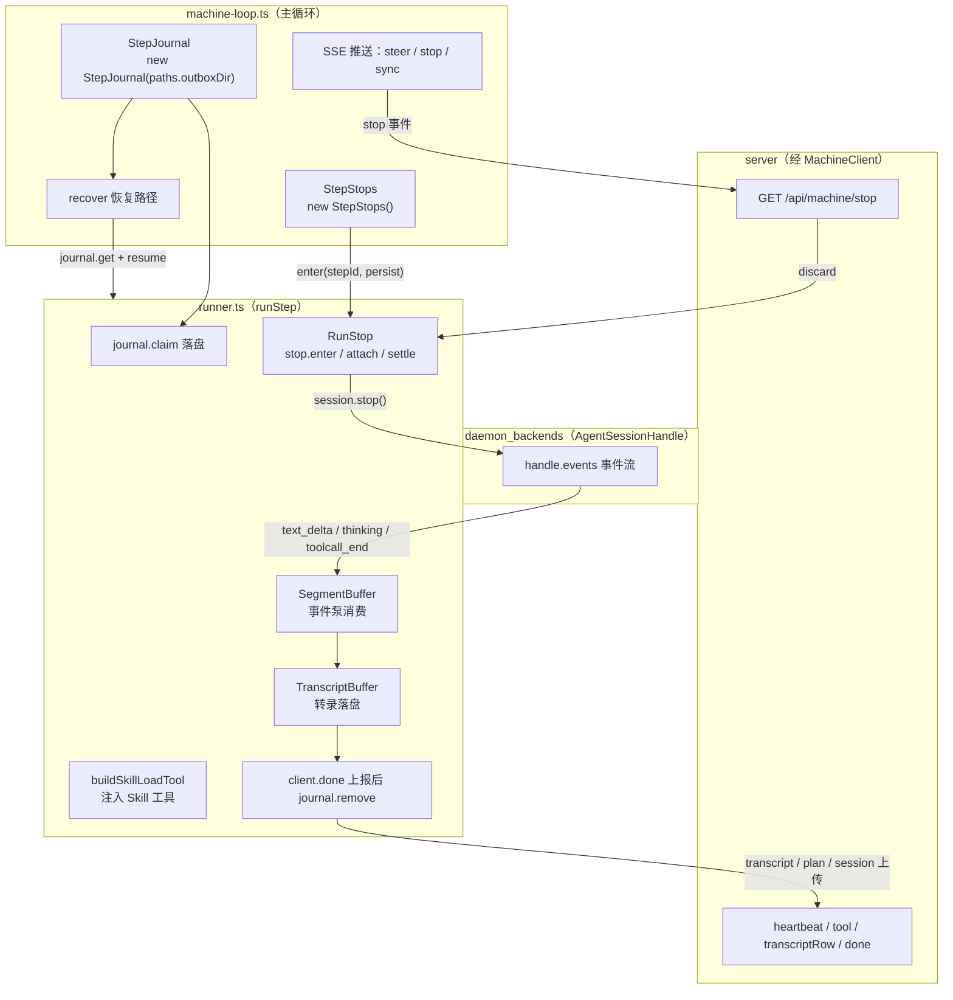
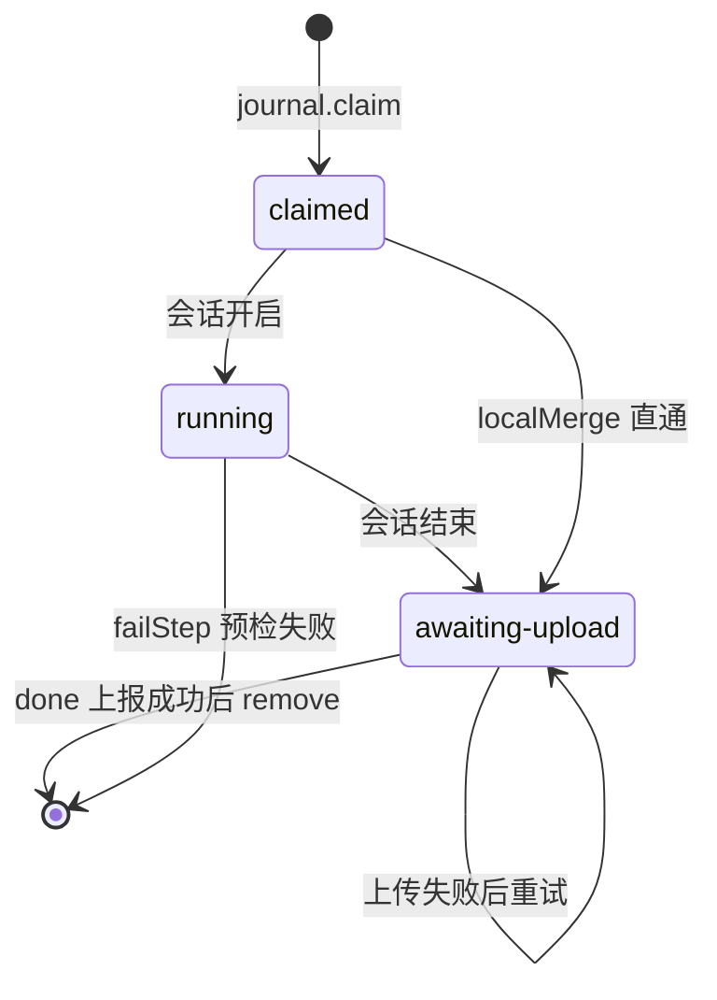
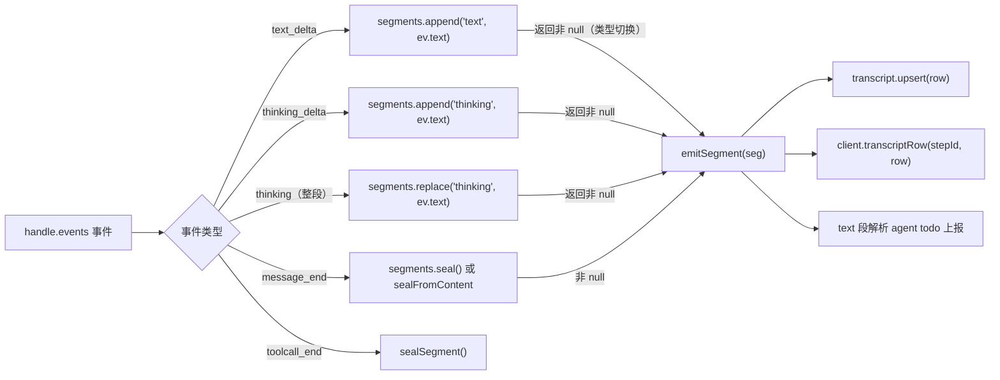
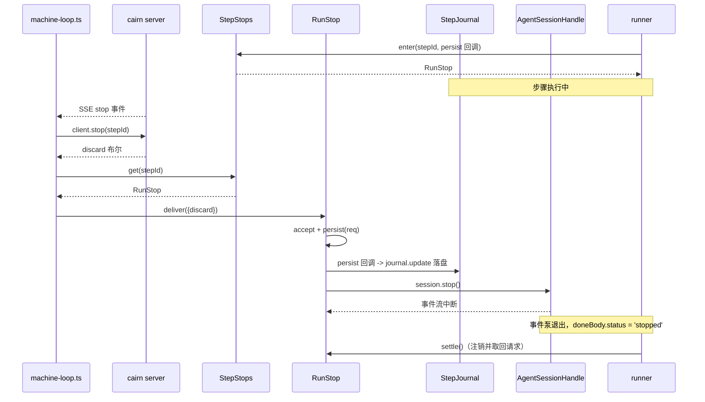

# daemon 步骤执行支撑（StepJournal / SegmentBuffer / Skill 工具 / RunStop）

## 简介与用途

`daemon_step_execution` 是 [daemon](../daemon.md) 的**步骤执行支撑层**，位于 `apps/daemon/src/`，由四个相互独立的工具文件组成。它们不直接与 server 通信，而是被 runner（`runner.ts` 的 `runStep`）与主循环（`machine-loop.ts` 的 `runMachine`）消费，为「认领 → 执行 → 上报 → 收尾」的步骤生命周期提供本地状态、缓冲与协调设施：

| 文件 | 核心组件 | 职责 |
| --- | --- | --- |
| `apps/daemon/src/journal.ts` | `StepJournal` + `TranscriptBuffer` | 步骤状态机落盘（outbox）与转录消息缓冲，支撑重启恢复与上传续传 |
| `apps/daemon/src/segment.ts` | `SegmentBuffer` + `segmentContent` | 把流式 `text` / `thinking` 增量封装为「密封分段」，作为转录行落盘 |
| `apps/daemon/src/skill-tool.ts` | `buildSkillLoadTool` + `scanSkillFileMap` | 为 Pi 后端注入 `Skill` 本地工具，让代理按名加载 `SKILL.md` |
| `apps/daemon/src/step-stops.ts` | `RunStop` + `StepStops` | 停止请求的接收、持久化与对活跃会话的中断交付 |

模块的核心价值：

1. **步骤状态机持久化**：每步以 `outbox/step-<id>.json` 落盘，状态沿 `claimed → running → awaiting-upload` 推进，`done` 上报成功后删除；daemon 重启后靠 `recover` + journal 续跑或补传。
2. **转录缓冲**：`TranscriptBuffer` 把会话产生的消息行（prompt、hook 输出、助手分段、工具调用、系统备注）以 `step-<id>.transcript.json` 增量落盘，最终随 `client.done` 一起上传，失败后可重放。
3. **分段缓冲**：`SegmentBuffer` 把事件泵中的文本/思考增量按「同一类型连续追加、类型切换即密封」合并成完整消息段，避免把半个 token 落进转录。
4. **技能加载工具**：在 Pi 运行时注入名为 `Skill` 的本地工具，使代理用「工具调用」而非 `read` 读取技能正文，配合技能目录（见 [daemon_backends](daemon_backends.md)）工作。
5. **停止协调**：`RunStop` 把用户/服务端停止请求（含 `discard` 语义）持久化到 journal，并对当前活跃会话调用 `session.stop()` 中断；重启后停止请求随 journal 恢复并立即生效。

## 架构总览



依赖关系要点：

- `StepJournal` / `TranscriptBuffer` 只依赖 Node 内置 `node:fs` / `node:path` 与 `@cairn/shared` 的类型（`ClaimedStep`、`MachineDoneBody`、`StepKind`、`TranscriptUpload`），无业务依赖；
- `SegmentBuffer` 是纯内存纯函数式工具，零依赖，可独立测试；
- `skill-tool.ts` 依赖 `@cairn/shared` 的 `LocalToolDef` 与 `@earendil-works/pi-coding-agent` 的 `loadSkills`（仅 `scanSkillFileMap` 用到）；
- `step-stops.ts` 依赖 `@cairn/shared` 的 `AgentSessionHandle` 类型；`persist` / `unregister` 回调由调用方注入，使 `RunStop` 可独立于 journal 测试。

## 组件详解

### StepJournal（journal.ts）—— 步骤状态机

`StepJournal` 是步骤本地状态的唯一权威存储，把每个步骤一行 JSON 落盘到构造时指定的目录（实际为 `StatePaths.outboxDir`，见 [daemon](../daemon.md) 的本地状态说明）：

```
outbox/step-<stepId>.json
```

```ts
type JournalState = 'claimed' | 'running' | 'awaiting-upload' | 'done' | 'failed';

interface StepJournalEntry {
  stepId: string;
  buildId: string;
  kind: StepKind;
  conversationId: string;
  state: JournalState;
  sessionAction: 'new' | 'continue';
  sessionId: string | null;
  prompt: string | null;
  claimed: ClaimedStep | null;
  doneBody?: MachineDoneBody | null;
  planContent?: string | null;
  sessionFile?: string | null;
  stopRequest?: StopRequest | null;
  claimedAt: number;
  updatedAt: number;
}
```

| 方法 | 行为 |
| --- | --- |
| `claim(input)` | 写入初始条目：状态置 `claimed`，`claimedAt` / `updatedAt` 记为当前时间；`sessionId` / `claimed` 允许由调用方预填 |
| `update(stepId, patch)` | 读取 → 合并 patch → 刷新 `updatedAt` 重写；条目不存在返回 `null` |
| `get(stepId)` | 读取并 `JSON.parse`；文件缺失或损坏返回 `null` |
| `pending()` | 列出状态为 `claimed` / `running` / `awaiting-upload` 的全部条目，按 `claimedAt` 升序（供孤儿工作区回收与恢复使用） |
| `remove(stepId)` | 删除条目（`done` 上报成功后调用） |

**状态机流转**（`runner.ts` 中的实际操作）：



> 说明：`JournalState` 类型中虽声明了 `done` / `failed`，实际运行中条目在 `done` 上报成功后即被 `remove` 删除；`failed` 语义通过 `doneBody.status === 'failed'` 表达，而非停留在磁盘上的 `failed` 状态。

**恢复与续传**：`machine-loop.ts` 启动时调用 `client.recover()` 取得 server 侧待续步骤，对每个步骤用 `journal.get(stepId)` 查本地条目：

- 条目存在且状态为 `awaiting-upload`、`doneBody` 非空 → `resumePendingUpload` 重放最终上报（不再开 agent 会话）；
- 条目存在且 `claimed` 非空 → 重建 `ClaimedStep`，以 `continue` 动作 + journal 里的 `prompt` / `sessionId` / `stopRequest` 重新 `runStep`；
- 条目丢失 → 直接向 server 上报 `failed`（「daemon journal lost across restart」）。

### TranscriptBuffer（journal.ts）—— 转录缓冲

`TranscriptBuffer` 是同一个文件里的辅助类，为单个步骤维护转录消息的增量落盘：

```
outbox/step-<stepId>.transcript.json
```

- 构造时若文件已存在则加载进内存 `Map`（按消息 `id` 去重），实现崩溃恢复；
- `upsert(msg)`：按 `msg.id` 覆盖写入并立即 `flush()` 落盘（每次调用都写全量数组，简单可靠）；
- `messages()`：按 `createdAt` 升序返回全部消息；
- 消息形态 `TranscriptMessage = TranscriptUpload['messages'][number]`，即最终上传 `transcript.json` 的行结构。

写入来源（`runner.ts`）包括：初始 prompt 行（`transcriptPromptRowId(stepId)`）、工作区 hook 输出、git 凭据来源行、`localMerge` 结果、会话分段（`emitSegment`）、工具调用记录（`toolcall_end`）、恢复失败/分支漂移/简报残留等各类系统备注。**TranscriptBuffer 与 SegmentBuffer 的分工**：前者负责「整行消息」的持久化与上传，后者负责把流式增量「拼成完整的一行」。

### SegmentBuffer（segment.ts）—— 分段缓冲

`SegmentBuffer` 是一个纯内存的状态机，把事件泵的流式增量按「段类型」聚合：

```ts
type SegmentKind = 'text' | 'thinking';

interface SealedSegment { kind: SegmentKind; text: string; }
```

| 方法 | 行为 |
| --- | --- |
| `append(kind, text)` | 若当前已累积且类型与 `kind` 不同，先 `seal()` 返回前一段；然后把 `text` 追加到当前段；`text === ''` 直接返回 `null` |
| `replace(kind, text)` | 同上，但用 `text` **替换**当前段内容（用于整段 thinking / 消息内容的最终形态） |
| `seal()` | 封存并清空当前段；无内容返回 `null` |
| `current()` | 返回当前未封存段（不改变状态）；无内容返回 `null` |

配套的 `segmentContent(seg)` 把密封段转换为标准消息 content 块：

- `text` 段 → `[{ type: 'text', text }]`
- `thinking` 段 → `[{ type: 'thinking', thinking }]`

**在 runner 中的消费方式**（`runClaimedStep` 事件泵）：



`emitSegment` 为每个密封段生成 `msg-<stepId>-<seq>` 行、递增 `messageSeq`、以单调递增的 `createdAt` 落盘并回传 server；`text` 段还会经 `parseAgentTodoText` 提取 agent todo 上报。`sealFromContent` 则在 `message_end` 时把消息 content 块逐块喂给 `append` / `replace` 兜底，确保流式增量未覆盖到的内容也被完整封装。

### skill-tool.ts —— 技能加载工具

该文件为 Pi 运行时提供「按名加载技能」的本地工具定义：

| 组件 | 行为 |
| --- | --- |
| `SKILL_TOOL_NAME = 'Skill'` | 工具名常量 |
| `buildSkillLoadTool(opts)` | 构造 `LocalToolDef`：参数 `{ skill: string }`；执行时从 `opts.skillFileMap` 查名字 → `readFile` 返回 `SKILL.md` 全文；名字为空 / 不在可见技能集 / 读取失败均返回中文排障文案；命中时回调 `opts.onInvoke(name)` |
| `scanSkillFileMap(dirs, loadSkills, opts)` | 调用 `@earendil-works/pi-coding-agent` 的 `loadSkills`（`includeDefaults: false`）扫描指定目录，产出 `Map<技能名, SKILL.md 路径>`；扫描异常时记日志并返回空 Map |

**在 runner 中的注入时机**（`runClaimedStep`）：仅当后端为 Pi 且配置了 `skillsDir` 时（`canSkillTool`）：

1. 用 `collectVisibleSkillFileMap`（见 [daemon_backends](daemon_backends.md)）构建可见技能 → 路径映射；
2. `buildSkillLoadTool` 生成工具并 push 进 `localToolDefs`（与 `Secret`、`CreateTag` 等本地工具并列）；
3. 同时扫描 prompt 中 `/skill-name` 形式的斜杠指令：若命中可见技能名，则在 prompt 前插入 `Before proceeding, use the Skill tool to load "<name>".` 引导行（技能分发）；
4. 注入的 `Skill` 工具随 `SessionOpts.localTools` 进入会话，工具调用事件经事件泵回传。

### step-stops.ts —— 停止请求协调

`RunStop` 把一个步骤的「停止请求」与「活跃会话」绑定起来：

```ts
interface StopRequest { discard: boolean; }
```

| 方法 | 行为 |
| --- | --- |
| `get request()` | 当前停止请求（`null` 表示未请求停止） |
| `accept(req)` | 记录请求并调用 `persist(req)` 落盘（runner 注入的回调会 `journal.update(stepId, { stopRequest })`） |
| `deliver(req)` | `accept` 后立即 `interrupt()`：若存在活跃会话则 `session.stop()`，中断失败时清空并持久化 `null` 后抛错 |
| `attach(session)` | 绑定会话并立即 `interrupt()`（用于恢复场景：journal 里已有停止请求，会话一开就中断） |
| `detach()` | 解绑会话（事件泵退出时调用） |
| `settle()` | 注销（从 `StepStops` 移除）并返回当前请求，供收尾判断「是否被停止」 |

`StepStops` 是 `Map<stepId, RunStop>` 的注册表：`enter(stepId, persist)` 创建并登记一个 `RunStop`（`unregister` 回调保证 `settle` 时从表中移除自己），`get(stepId)` 供主循环按步骤查找。

**停止请求的完整路径**：



此外还有两条触发停止的旁路：

- **心跳 410**：`runStep` 的心跳定时器收到 `MachineApiError(status 410)`（server 已不认该步骤）且当前无停止请求时，自动 `stop.deliver({ discard: false })`；
- **启动恢复**：`recover` 重建步骤时若 journal 里有 `stopRequest`，作为 `opts.stopRequest` 传入 `runStep`，`stop.accept` 预置后经 `attach` 立即中断会话。

停止语义在收尾处体现：`stopped = stopReq !== null && !sawDone`——被停止时 `doneBody.status = 'stopped'`；若 `discard === true`，runner 还会把工作区回退到步起点 commit（`rewindToStepStart`）。

## 与其它模块的关系

| 相关模块 | 关系 |
| --- | --- |
| [daemon 总览](../daemon.md) | 本模块是 daemon 的「步骤执行支撑」子模块；`runner.ts` 与 `machine-loop.ts` 是其主要消费者 |
| [daemon_machine_client](daemon_machine_client.md) | `client.recover` 驱动 journal 恢复；`client.stop` 查询 `discard` 语义后经 `RunStop.deliver` 交付；`client.done` 成功后 `journal.remove` |
| [daemon_backends](daemon_backends.md) | `AgentSessionHandle.events` 事件流是 `SegmentBuffer` 的输入；`skills.ts` 的 `collectVisibleSkillFileMap` 为 `Skill` 工具提供可见技能映射 |
| [daemon_workspace_git](daemon_workspace_git.md) | 步骤收尾的提交/推送结果写入 `doneBody` 并经 journal 的 `awaiting-upload` 状态上传 |
| [server](../server.md) | server 侧 `services/machines.ts` / `machine-wake-hub.ts` 是停止请求、恢复清单与上传 URL 的对端 |
| [shared](../../shared.md) | `ClaimedStep`、`MachineDoneBody`、`StepKind`、`TranscriptUpload`、`AgentSessionHandle`、`LocalToolDef` 等类型均来自 `@cairn/shared` |

## 关键设计要点

- **崩溃安全**：`StepJournal` 与 `TranscriptBuffer` 都是同步写盘、整文件覆写，配合 `recover` 实现「至多丢失最后一条消息」的语义；journal 条目丢失则步骤上报 `failed`，不静默吞掉。
- **去重与排序**：`TranscriptBuffer` 按消息 `id` 去重、按 `createdAt` 排序；`SegmentBuffer` 用类型切换触发密封，避免流式增量被拆成碎片行。
- **停止先落盘再中断**：`RunStop.deliver` / `accept` 总是先 `persist` 再 `interrupt`，保证进程在会话中断前崩溃也能在重启后立即续停。
- **工具与后端解耦**：`Skill` 工具、`RunStop` 均通过接口（`LocalToolDef`、`AgentSessionHandle`）与后端解耦，三种后端（Pi / Claude Code / Gemini）共用同一套支撑设施。

构建与打包信息见 [daemon_cli](daemon_cli.md)（`apps/daemon/package.json`）；本地状态目录（`outboxDir` 等）由 `state.ts` 的 `StatePaths` 定义，详见 [daemon](../daemon.md) 的「构建、配置与运行」一节。
