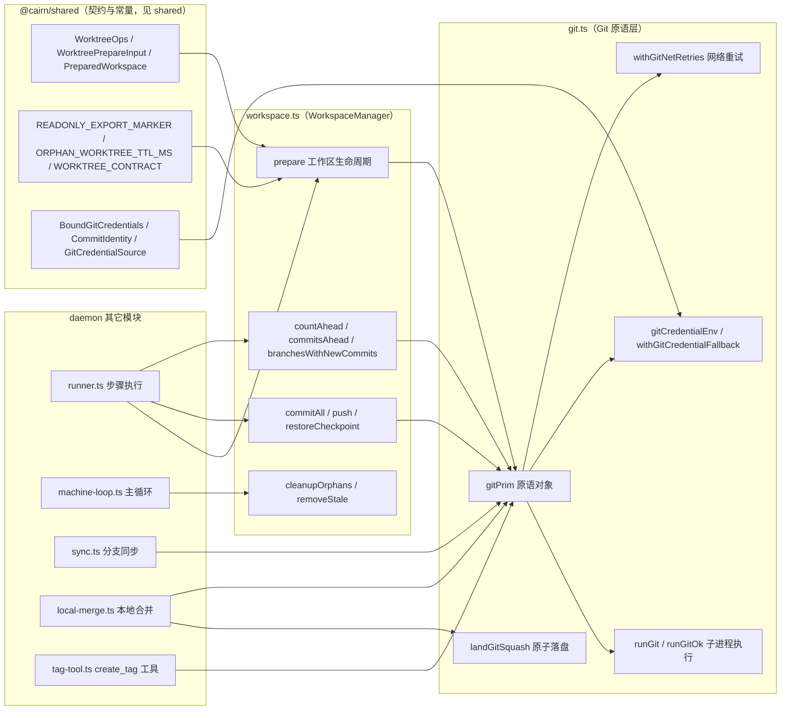
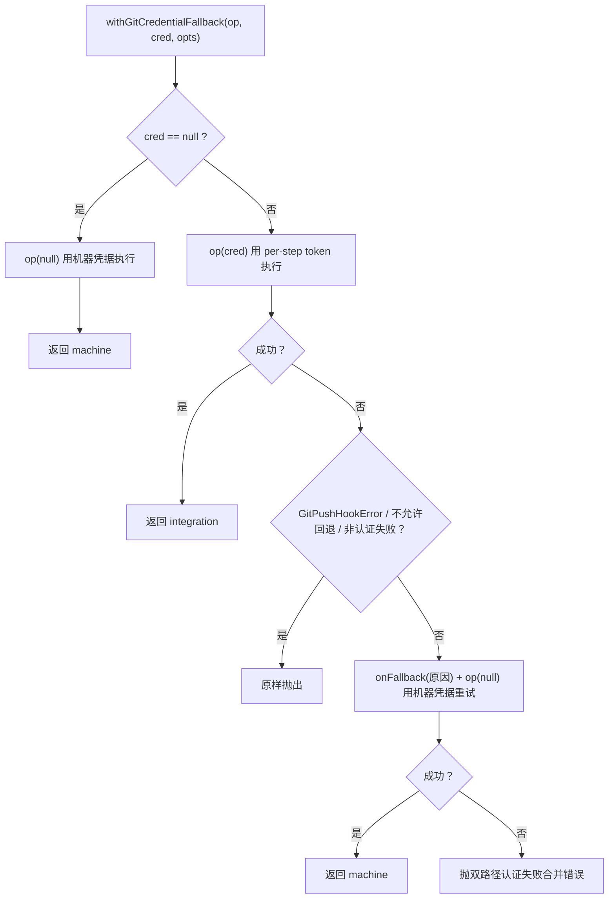
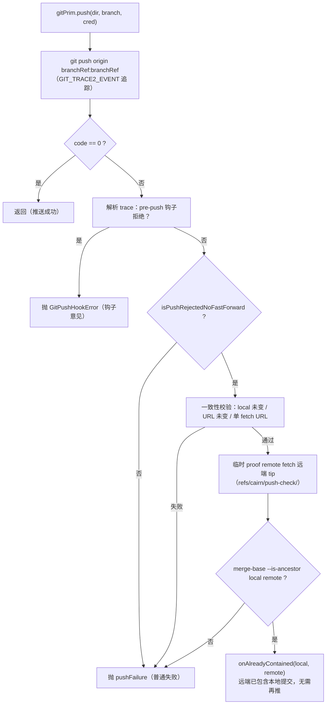
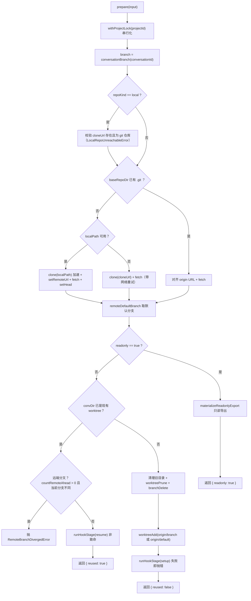
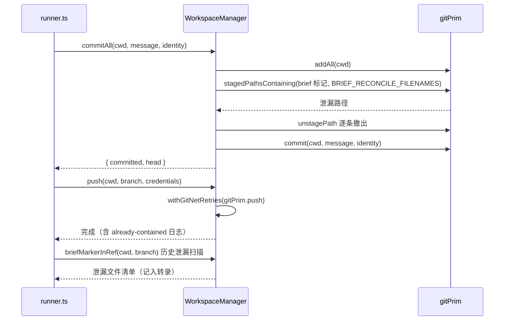
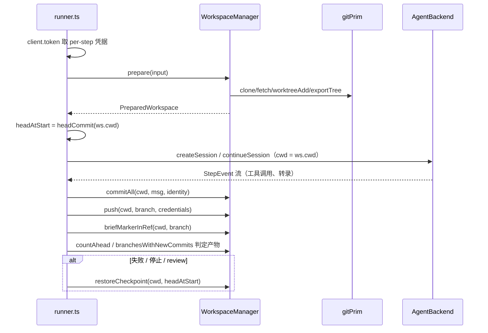

# daemon 工作区与 Git（daemon_workspace_git）

## 简介与用途

`daemon_workspace_git` 是 [daemon](../daemon.md) 的**仓库与工作区管理**子模块，由两个文件构成：

| 文件 | 职责 |
| --- | --- |
| `apps/daemon/src/git.ts` | **Git 原语层**：`runGit` 子进程执行、`gitPrim` 原语对象、per-step 凭据注入与机器凭据回退、网络错误分类与重试、`landGitSquash` 原子落盘、带防分叉证明的推送 |
| `apps/daemon/src/workspace.ts` | **WorkspaceManager**：对话分支工作区的准备/复用/只读导出、setup/resume 钩子、提交与推送、恢复检查点、孤儿工作区回收 |

它的核心价值在于把 cairn 的**工作区契约**（[WORKTREE_CONTRACT](#工作区契约worktree_contract)）落到真实的 Git 操作上，并保证无人值守执行机的两个安全属性：

1. **凭据不落地**：每个步骤的 Git 凭据来自 server 下发的 per-step token（[daemon_machine_client](daemon_machine_client.md) 的 `client.token`），经 `gitCredentialEnv` 以环境变量 + 临时 `credential.helper` 的方式注入子进程，agent 的 shell 永远接触不到用户名/密码；认证失败时可回退到机器本机凭据。
2. **可重入与可恢复**：每个对话一个 `cairn/conv-<conversationId>` 分支 + 一个独立 worktree，步骤可安全回退（`restoreCheckpoint`）、复用（resume 钩子）、并在崩溃后由 daemon 主循环的孤儿回收兜底。

模块边界：它**不**关心 server 协议（那是 [daemon_machine_client](daemon_machine_client.md)），**不**关心代理运行时（那是 [daemon_backends](daemon_backends.md)），**不**关心步骤日志（那是 [daemon_step_execution](daemon_step_execution.md)）；它只做「在正确的位置、用正确的凭据、执行正确的 Git 命令」。

## 架构总览



## 工作区契约（WORKTREE_CONTRACT）

工作区布局的权威定义在 `@cairn/shared` 的 `packages/shared/src/protocol/executor.ts`（`WORKTREE_CONTRACT`），daemon 与 server 都遵循它：

| 条目 | 值 | 说明 |
| --- | --- | --- |
| `baseRepoSubpath` | `<projectId>/repo` | 每项目一个共享的裸式仓库（base repo），所有对话分支都从这里派生 worktree |
| `taskDirLayout` | `<workspacesRoot>/<conversationId>` | 每个对话一个工作目录（即 worktree 或只读导出） |
| `branchPrefix` | `cairn/conv-` | 对话分支前缀（`conversationBranch(id)` 生成 `cairn/conv-<id>`） |
| `checkpointResetArgs` | `reset --hard` + `clean -fd` | 步骤回退的原子操作对（`restoreCheckpoint`） |
| `staleCleanupArgs` | `worktree remove --force` + `worktree prune` + `branch -D` | 孤儿回收的原子操作对（`removeStale`） |
| `concurrencyGuard` | `projectLock(projectId)` | 同一项目的工作区操作串行化（`withProjectLock`） |
| `remoteBranchDiverged` | `remote branch diverged` | 远端分支与本地并发冲突时的拒绝语义（`RemoteBranchDivergedError`） |
| `mergeArgs` | `merge --no-edit` | merge 步骤合入默认分支的方式 |

相关常量与类型同样来自 shared：`READONLY_EXPORT_MARKER = '.cairn-readonly-export'`、`ORPHAN_WORKTREE_TTL_MS = 7 天`、`WORKSPACE_HOOK_TIMEOUT_MS = 20 分钟`、`WorkspaceHookNoteData`、`PreparedWorkspace`、`WorktreePrepareInput`、`WorktreeOps`（[shared](../../shared.md)）。

## git.ts：Git 原语层

### 子进程执行：runGit / runGitOk

`runGit(args, opts)` 用 `node:child_process` 的 `spawn('git', ...)` 执行任意 Git 命令：

- **代理旁路**：用 `loopbackNoProxy`（`proxy.ts`）把 `127.0.0.1 / localhost / ::1` 追加进 `NO_PROXY`，避免本机托管仓库被 HTTP 代理劫持；
- **输出采集**：stdout/stderr 以 `Buffer` 累积后按 utf8 拼接，返回 `GitRunResult { code, signal, stdout, stderr }`（`code === null` 表示被信号终止）；
- **超时**：`opts.timeoutMs` 可选，透传给 `spawn` 的 `timeout`；
- `runGitOk` 是便捷包装：`code === 0` 返回**去首尾空白**的 stdout，否则抛带 code/signal 与 stderr 摘要的 `Error`。

超时档位（`git.ts` 顶部常量）：

| 常量 | 值 | 用途 |
| --- | --- | --- |
| `META_TIMEOUT_MS` | 30 秒 | 元数据类操作（ref、status、config、rev-parse、commit 等） |
| `CHECKOUT_TIMEOUT_MS` | 300 秒 | worktree 增删、checkout-index 物化 |
| `NET_TIMEOUT_MS` | 480 秒 | 网络类操作（clone / fetch / push / set-head） |

### 凭据注入：gitCredentialEnv / machineGitEnv / commitEnv

per-step 凭据（`BoundGitCredentials { username, password, url }`）**永不写盘、永不进 shell**，只通过环境变量注入：

- `gitCredentialEnv(cred, parent)` 生成一组环境变量，利用 Git 的 `GIT_CONFIG_COUNT` 机制：
  1. 在第 `n` 位写入 `credential.helper = ''`——**清空堆叠的既有 helper**（如 osxkeychain），防止 per-step 凭据意外持久化；
  2. 在第 `n+1` 位写入一个内嵌 shell 函数 `CREDENTIAL_HELPER` 作为 `credential.helper`：仅在 `get` 且 protocol/host 与 `CAIRN_GIT_CRED_*` 匹配时输出 `username=` / `password=`；
  3. 同时设 `GIT_TERMINAL_PROMPT = '0'`（禁止交互式密码提示）。
  - `credentialTarget(url)` 从 `https?://[user@]host/path` 中解析 protocol/host；
  - `inheritedGitConfigCount(parent)` 校验父进程已有的 `GIT_CONFIG_COUNT` 是否完整（避免 key/value 错位）；
  - 凭据中含 `\r\n\0` 会直接抛错（拒绝注入带换行的凭据）。
- `machineGitEnv()` = `{ GIT_TERMINAL_PROMPT: '0' }`——机器凭据路径只禁止交互提示，其余交给本机 git 配置。
- `commitEnv(identity)` 设置 `GIT_AUTHOR_NAME/EMAIL` 与 `GIT_COMMITTER_NAME/EMAIL`。

### 凭据回退：withGitCredentialFallback



- 返回值 `GitCredentialSource`（`'integration' | 'machine'`）被 runner 记入转录（`gitCredentialSourceRowContent`），供用户审计「这次推送用的是哪条凭据路径」；
- `onFallback(reason)` 回调同时用于日志与（clone 失败时的）清理动作；
- 若两条路径都失败，错误信息会同时包含两条路径的原始错误。

### 错误分类与网络重试

git 错误被分成三类，供重试与回退决策：

| 分类器 | 判定 | 语义 |
| --- | --- | --- |
| `isGitAuthFailure(msg)` | 匹配 `authentication failed`、`invalid username or token`、`terminal prompts disabled`、`http 401` 等 | 认证失败：触发凭据回退，**不**重试 |
| `GIT_PERMANENT_FAILURE_PATTERNS` | `403/404`、SSL 证书问题、`repository not found`、`not a git repository` 等 | 确定性失败：**不**重试 |
| `isGitTransientNetFailure(msg)` | 非认证失败且不命中永久模式 | 瞬时网络失败：按退避重试 |

- `isPushRejectedNoFastForward(msg)`：非快进拒绝（`non-fast-forward` / `fetch first`），认证失败时恒为 false——用于区分「推送被拒」与「推送因并发被远端领先」；
- `GIT_NET_RETRY_DELAYS_MS = [2s, 4s, 8s, 16s]`，`withGitNetRetries(fn)` 对瞬时网络失败按此退避最多重试 4 次；`GitPushHookError`、认证失败、非快进拒绝、永久失败立即终止；
- `GitPushHookError`：pre-push 钩子拒绝推送时的专用错误（由推送的 trace 证据判定，见下文），runner 会把它单独识别为「钩子意见」并作为 build 步骤的产物输出。

### gitPrim 原语清单

`gitPrim` 是**无状态原语对象**，每个方法只做一件事，全部基于 `runGit` / `runGitOk`。WorkspaceManager 与 [daemon_step_execution](daemon_step_execution.md) 侧的工具（`tag-tool.ts`、`local-merge.ts`、`sync.ts`）都直接消费它。

| 类别 | 原语 | 命令要点 |
| --- | --- | --- |
| 网络 | `clone(url, dir, cred)` | `clone --end-of-options`，按 cred 注入环境 |
| 网络 | `fetch(repoDir, cred)` | `fetch --prune origin` |
| 网络 | `remoteSetHeadAuto` | `remote set-head origin --auto` |
| 网络 | `push(dir, branch, cred, onAlreadyContained?)` | 见[推送保护](#推送保护gitprimpush) |
| 网络 | `tagPush(dir, tag, cred)` | `push origin refs/tags/<tag>` |
| 元数据 | `remoteDefaultBranch` / `remoteUrl` / `originConfigUrl` | `symbolic-ref refs/remotes/origin/HEAD`（回退 `main`）/ `remote get-url` / `config --get` |
| 元数据 | `hasRemoteBranch` / `hasLocalBranch` | `rev-parse --verify refs/...` |
| 元数据 | `currentBranch(dir)` | `branch --show-current` |
| 元数据 | `head(dir)` | `rev-parse HEAD`，校验 40/64 位 hex |
| 元数据 | `countAhead(dir, defaultBranch)` | `rev-list --count origin/<default>..HEAD` |
| 元数据 | `commitsAhead(dir, defaultBranch)` | `rev-list --reverse origin/<default>..HEAD` |
| 元数据 | `countRemoteAhead(repoDir, branch)` | 远端相对本地的领先数（分叉检测） |
| 元数据 | `branchesWithNewCommits(dir, baseCommit, sinceMs)` | `for-each-ref` 按 committerdate 排序扫描（见下文） |
| 元数据 | `diffAgainstRemoteDefault` | `git diff origin/<default>...HEAD` |
| 元数据 | `commitTime(dir, commit)` | `log -1 --format=%ct` |
| 元数据 | `commonGitDir(dir)` | `rev-parse --git-common-dir`（定位 base repo） |
| 工作树 | `worktreeAdd(repoDir, branch, dir, base)` | `worktree add -b branch dir base` 或直接检出 |
| 工作树 | `worktreeRemoveForce` / `worktreePrune` | 孤儿回收的原子操作 |
| 工作树 | `exportTree(repoDir, ref, dir)` | `read-tree`（`GIT_INDEX_FILE` 隔离）+ `checkout-index --all --force` 物化只读导出 |
| 工作树 | `checkout(dir, ref, force)` / `resetHard(dir, commit)` / `cleanFd(dir)` | 步骤回退/同步的原子操作；`resetHard` 先 `rev-parse verify commit^{commit}` 再 `reset --hard` |
| 暂存/提交 | `addAll` / `unstagePath` / `commit(dir, msg, identity)` | `commit` 用 `commitEnv`；`nothing to commit` 返回 `false` |
| 暂存/提交 | `stagedPathsContaining(dir, needle, paths)` | `git grep --cached -l -F`（提交前 brief 标记守卫） |
| 暂存/提交 | `pathsContainingInRef(dir, ref, needle, paths)` | `git grep -l -F <ref>`（推送后历史泄漏扫描） |
| 暂存/提交 | `mergeNoEdit(dir, ref)` | `merge --no-edit`，冲突自动 `merge --abort` 并抛错 |
| 暂存/提交 | `tagCreate(dir, tag, msg, commit, identity)` | 带注解标签（`create_tag` 工具用） |
| 元数据 | `isGitDir(dir)` | `rev-parse --git-dir` |

`branchesWithNewCommits(dir, baseCommit, sinceMs)` 的扫描算法：

1. `for-each-ref refs/heads --sort=-committerdate` 取 `名称 / committer 时间戳 / 对象名`；
2. 按提交时间**降序**遍历，超过 `sinceMs - 2s`（`BRANCH_SCAN_SKEW_MS`）即停（时间上界剪枝）；
3. 对每个候选执行 `rev-list --count <baseCommit>..<sha>`，计数 > 0 即视为「有从 baseCommit 以来的新提交」；
4. 最多扫描 `BRANCH_SCAN_MAX_REVS = 20` 个引用，防慢。

### 推送保护：gitPrim.push

推送是无人值守交付的关键路径，`gitPrim.push` 实现了三层保护：



- **钩子证据**：推送带 `GIT_TRACE2_EVENT` 追踪文件；若 trace 中 `child_start(child_class=hook, hook_name=pre-push)` 后跟非零 `child_exit`，则判定为 **pre-push 钩子拒绝**并抛 `GitPushHookError`（runner 会把钩子输出作为 build 产物的评审依据）；
- **already-contained 证明**：非快进拒绝时，若本地提交其实已包含在远端（`merge-base --is-ancestor`），则说明「远端已经有人推送过同一提交」——此时调用 `onAlreadyContained(local, remote)` 让上层记录日志（WorkspaceManager 用它输出「nothing to push」信息），而不是误报失败；
- 整个证明过程在临时 `cairn-proof-<uuid>` remote + 临时 `refs/cairn/push-check/<uuid>` 引用上进行，`finally` 中必然删除引用与 trace 目录。

### 原子落盘：landGitSquash

`landGitSquash` 用 `git update-ref --no-deref --stdin` 实现**单事务**的分支落盘（本地合并/评审产物用，见 `local-merge.ts` 的 `landLocalMerge`）：

1. 向 stdin 写入 `start` + `symref-verify`（当前分支保护）+ `update refs/heads/<branch>`（`commit → base`）+ `update <receipt>`（交付回执）+ `prepare`；
2. 收到 `prepare: ok` 后异步核对：当前分支未变、worktree 干净（`status --porcelain` + `GIT_OPTIONAL_LOCKS=0`）；若目标正是当前分支则先 `read-tree -m -u base commit` 同步工作树；
3. 通过则 `commit`（落盘），任一校验失败则 `abort` 并返回 `dirty`；
4. 返回值三态：`'landed'`（成功）/ `'stale'`（ref 已被并发移动，update-ref 拒绝）/ `'dirty'`（工作树或分支状态不符，上层按 `worktree-dirty` 挂起）。

## workspace.ts：WorkspaceManager

`WorkspaceManager implements WorktreeOps`，是工作区契约的**唯一实现**，由 [daemon](../daemon.md) 主循环（`machine-loop.ts` 的 `runMachine`）构造（注入 `DaemonLogger`，可选覆盖 `orphanTtlMs` / `hookTimeoutMs`）后交给 runner 与同步/合并路径使用。

### 目录布局与命名

```
<workspacesRoot>/
  <projectId>/repo/        ← 每个项目一个 base repo（共享仓库，真值）
  <conversationId>/        ← 每个对话一个目录（worktree 或只读导出）
```

- 目录名必须匹配 `CONV_DIR_PATTERN`（UUID 形 `xxxxxxxx-xxxx-xxxx-xxxx-xxxxxxxxxxxx`），孤儿回收只认这个形状；
- worktree 目录以存在 `.git` 判定（`isWorktreeDir`）；只读导出目录以存在 `READONLY_EXPORT_MARKER` 文件判定（`isReadonlyExportDir`）；
- `normalizedRepoRef(url)` 把 URL 归一化（去尾 `/`、去 `.git`，把 scp 形 `git@host:path` 与 scheme 形统一成 `host/path`），用于本地仓库 origin 匹配。

### prepare()：工作区生命周期

`prepare(input: WorktreePrepareInput): Promise<PreparedWorkspace>` 是模块的核心入口，由 runner 在每步开始时调用（`logger.workspace('准备工作区...')`）：



要点：

- **仓库获取三级策略**：① `repoKind === 'local'` 时强制校验本机路径（`not_found` / `not_git` 抛 `LocalRepoUnreachableError`，runner 用它生成面向用户的中文排障文案 `localRepoUnreachableMessage`，见下文）；② GitHub 形态且 `localPath` 可用时先 `clone(localPath)` 加速（**ADR 0017** 的 localPath 加速位），再 `setRemoteUrl` 指向真值 URL 并 fetch——克隆失败会回滚删除 baseRepoDir 并退化为网络克隆；③ 否则直接网络克隆。已有 base repo 时只对齐 origin URL 并 fetch。
- **每步凭据**：`input.credentials` 来自 `pushCredential(tokenRes, cloneUrl)`（`credentials.ts`，把 server 下发的 git 凭据绑定到当前 cloneUrl）；`machineCredentialFallback` 仅在 GitHub 形态开启（local 形态一律只用机器凭据，见 ADR 0016）。
- **复用与分叉检测**：已存在的 worktree 直接复用，但若远端分支领先且当前不在契约分支上，抛 `RemoteBranchDivergedError`（并发执行另一台机器已推送过）。
- **返回**：`PreparedWorkspace { cwd, baseRepoDir, branch, defaultBranch, reused, hooks, credentialSource, readonly? }`，runner 用 `cwd` 作为会话工作目录、用 `hooks` 生成转录系统行、用 `credentialSource` 记录凭据来源。

### 只读导出：materializeReadonlyExport

review 步（`readonly: true`）不需要可写仓库，prepare 会物化一个**无 git 元数据**的目录快照：

- 若目录已是只读导出（存在 marker），刷新 marker 的 mtime 并复用；
- 否则删除旧内容，`worktreePrune` + `branchDelete` 后，用 `exportTree(baseRepoDir, origin/<default>, convDir)` 把默认分支**检出物化**到对话目录，并写入 `README` 内容为 `readonly export of origin/<default>` 的 marker 文件；
- 返回 `reused: false`，后续 `commitAll` / `push` / `restoreCheckpoint` 都会以 `ReadOnlyWorkspaceError` 拒绝（写操作守卫），会话侧另有 `READONLY_GIT_ENV`（`.pushInsteadOf` 拒写）兜底。

### 钩子阶段：runHookStage

- 在**新建** worktree 后执行 `.agents/setup`，在**复用** worktree 后执行 `.agents/resume`（`workspace-hooks.ts`：必须是可执行普通文件，否则抛 `WorkspaceHookError`）；
- 子进程以 `detached` 方式拉起整个进程组，超时（默认 `WORKSPACE_HOOK_TIMEOUT_MS = 20 分钟`）后 `process.kill(-pid, 'SIGKILL')` 杀组；输出截断到 `HOOK_OUTPUT_CHAR_LIMIT = 100_000` 字符；
- **setup 失败 = 致命**（抛错，步骤失败）；**resume 失败 = 非致命**（记日志并把 `WorkspaceHookNoteData` 放进返回的 `hooks`，转录可见）——因为复用场景下工作树可能本来就有残留；
- 钩子进程同样通过 `gitCredentialEnv` 获得 per-step 凭据（但**不**持久化）。

### 提交与推送



- `commitAll` 的**brief 标记守卫**：agent 在步内可能把运行简报（`<!-- BEGIN CAIRN-RUNTIME ... -->`，见 [shared](../../shared.md) 的 `brief-file.ts`）写进 `AGENTS.md` / `CLAUDE.md` / `GEMINI.md`（`BRIEF_RECONCILE_FILENAMES`），提交前用 `stagedPathsContaining` 检出并 `unstagePath` 逐条撤出，保证简报不进交付物；`commit` 返回 `{ committed, head }`（`nothing to commit` 时 `committed: false`）；
- `push` 包一层 `withGitNetRetries`；`onAlreadyContained` 回调输出 `push of <branch> already contained ... nothing to push` 日志；runner 还会在推送后做 `briefMarkerInRef` **历史泄漏扫描**（agent 自行提交时 daemon 拦不住，只能事后告警）。

### 查询类方法与恢复

| 方法 | 行为 |
| --- | --- |
| `headCommit(cwd)` | 当前 HEAD（`gitPrim.head`） |
| `countAhead(cwd, defaultBranch)` | 领先默认分支的提交数（runner 用它判定 `pushWarranted` 与 `hasChanges`） |
| `commitsAhead(cwd, defaultBranch)` | 领先提交的 SHA 列表（失败 build 的提交保留清单） |
| `currentBranch(cwd)` | 当前分支名（runner 用它做**分支漂移检测**：收尾时 HEAD 不在契约分支则记入转录） |
| `branchesWithNewCommits(cwd, baseCommit, sinceMs)` | 分支新提交扫描（`headAhead === 0` 时判定产物分支） |
| `diffAgainstDefault(cwd, defaultBranch)` | 相对默认分支的 diff（review/评审用） |
| `mergeDefaultBranch(cwd, defaultBranch)` | `merge --no-edit origin/<default>`（merge 步骤合入默认分支，冲突自动 abort） |
| `restoreCheckpoint(cwd, commit)` | `resetHard` + `cleanFd`（新会话返工回退、review 检出回退、stop discard 回退） |

### 孤儿回收：cleanupOrphans / removeStale

machine-loop 启动时执行一次、此后每天（24h）执行一次 `cleanupOrphans`：

1. 遍历 `<workspacesRoot>` 下匹配 `CONV_DIR_PATTERN` 且不在 `activeConversationIds`（journal 中待处理步骤的对话）里的目录；
2. **只读导出**：以目录 mtime 与 marker mtime 的较大值作为活动时间，超过 TTL（默认 7 天）直接 `rmSync`；
3. **worktree**：`lastActivity(dir)` = max(目录 mtime, HEAD 提交时间)，超过 TTL 则 `removeStale`；
4. `removeStale` 先经 `commonGitDir` 定位 base repo，然后 `worktreeRemoveForce` + `worktreePrune` + `branchDelete`（分支删除失败仅告警）；找不到公共目录时直接删除目录。

### 本地仓库形态与排障文案

- `localSourceUsable(localPath, cloneUrl)`：本地路径需存在、有 `origin` remote、且 origin 与 cloneUrl 归一化后一致，才允许作为克隆源；
- `localRepoUnreachableMessage(machineName, err)`：`LocalRepoUnreachableError` 时生成的中文排障文案，说明 **local 形态仓库真值在登记机文件系统上（ADR 0016）**、其它执行机看不到该路径、以及三种补救法（改钉选机器 / 取消钉选 / 改用 GitHub 形态加 localPath 加速位，ADR 0017）；
- `repoLabel(cloneUrl)`：从 URL 取最后两段路径（去 `.git`、去 `git/` 前缀）作为日志标签。

## 数据流：步骤执行中的工作区

以下时序把本模块放回 [daemon](../daemon.md) 的步骤执行流水线（与 [daemon_step_execution](daemon_step_execution.md) 协作）：



## 与其它模块的关系

| 相关模块 | 关系 |
| --- | --- |
| [daemon 总览](../daemon.md) | 本模块是 daemon 的「仓库与工作区管理」子模块，对应总览中的 `workspace 工作区 / git` |
| [daemon_step_execution](daemon_step_execution.md) | runner 调用 `WorkspaceManager` 的 prepare/commitAll/push/restoreCheckpoint；`StepJournal` 决定孤儿回收的 `activeConversationIds` |
| [daemon_machine_client](daemon_machine_client.md) | `client.token` 返回的 `MachineTokenResponse.git` 经 `pushCredential` 变成 `BoundGitCredentials` 注入本模块 |
| [daemon_backends](daemon_backends.md) | 会话以 `ws.cwd` 为工作目录运行；Pi 的 worktree 技能目录读取同一布局 |
| [daemon_cli](daemon_cli.md) | `machine-loop.ts` 构造 `WorkspaceManager`（`orphanTtlMs` / `hookTimeoutMs` 来自 CLI 配置）；`sync.ts` / `local-merge.ts` / `tag-tool.ts` 消费 `gitPrim` |
| [server](../server.md) | server 侧 `machine-deps.ts` 组装 `MachineTokenResponse`；合并门/评审的 patch 与 `local-merge.ts` 的 `landGitSquash` 落盘结果对应 |
| [shared](../../shared.md) | `git-ops.ts`（`WorktreeOps` / `WorktreePrepareInput` / `PreparedWorkspace` / 各类错误）、`protocol/executor.ts`（`WORKTREE_CONTRACT` / TTL / 钩子超时）、`brand.ts`（`conversationBranch`）、`brief-file.ts`（brief 标记守卫） |

## 配置与环境变量

| 配置 / 环境变量 | 说明 | 定义位置 |
| --- | --- | --- |
| `orphanTtlMs` | 孤儿工作区 TTL（默认 `ORPHAN_WORKTREE_TTL_MS = 7 天`） | `WorkspaceManagerOpts`（machine-loop 注入） |
| `hookTimeoutMs` | setup/resume 钩子超时（默认 `WORKSPACE_HOOK_TIMEOUT_MS = 20 分钟`） | `WorkspaceManagerOpts`（machine-loop 注入，可被 `CAIRN_HOOK_TIMEOUT_MS` 覆盖） |
| `GIT_TERMINAL_PROMPT=0` | 禁止 git 交互式密码提示（所有路径） | `git.ts` |
| `CAIRN_GIT_CRED_*` | per-step 凭据传输通道（protocol/host/username/password），仅存在于单次子进程环境 | `git.ts` |
| `GIT_CONFIG_COUNT` / `GIT_CONFIG_KEY_n` / `GIT_CONFIG_VALUE_n` | 凭据 helper 注入与既有 helper 清空机制 | `git.ts` |
| `GIT_TRACE2_EVENT` | 推送追踪文件（pre-push 钩子证据，临时目录） | `git.ts` |
| `GIT_OPTIONAL_LOCKS=0` | 状态检查时不取锁（避免与并发 git 进程互等） | `git.ts` / `workspace.ts` |
| `NO_PROXY` / `no_proxy` | 回环地址旁路（`loopbackNoProxy` 自动追加 127.0.0.1/localhost/::1） | `proxy.ts` |

构建与打包信息见 [daemon_cli](daemon_cli.md)（`apps/daemon/package.json`）；`git.ts` / `workspace.ts` 无额外运行时依赖（仅 Node 内置模块与 `@cairn/shared`），测试位于 `apps/daemon/test/`。
