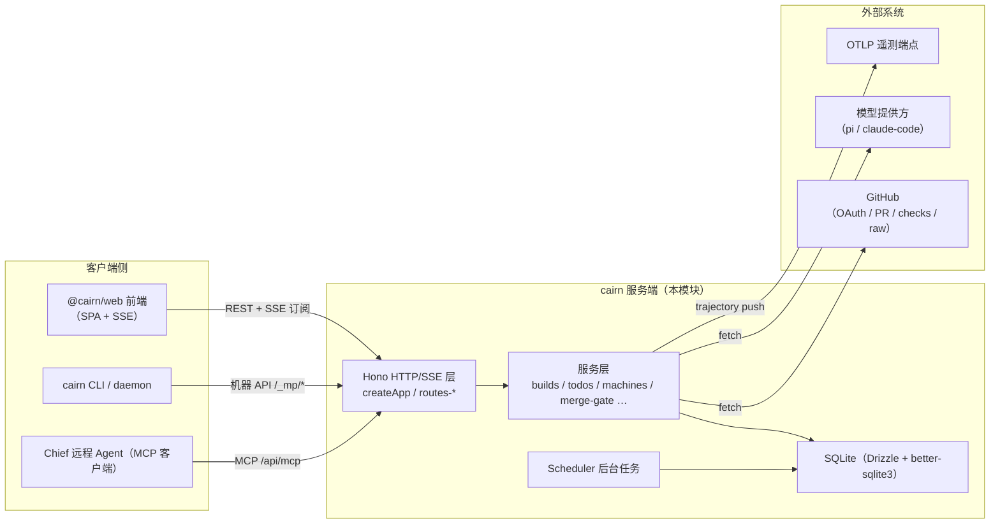
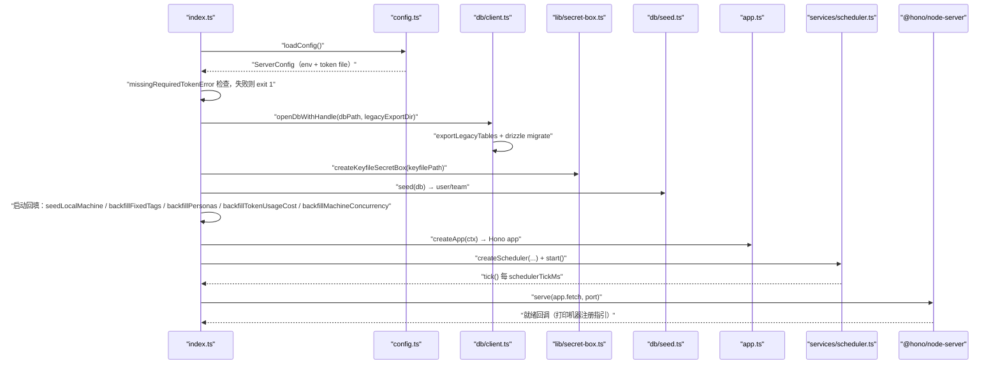
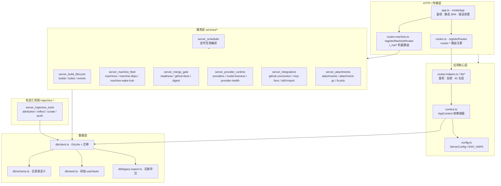
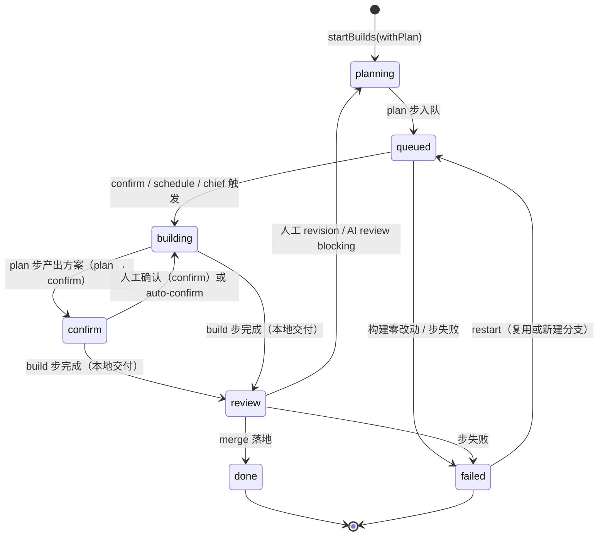

# cairn 服务端（server）

## 模块简介

`apps/server`（包名 `@xiechimon/cairn`，CLI 入口 `cairn`）是 cairn 系统的**控制平面**：它承载全部 HTTP/SSE API、SQLite 持久化、后台调度任务、合并关口（merge gate）判定、机器（daemon）编排、GitHub 集成以及 MCP 工具面。它不直接运行 Agent 会话——真正执行步骤的是 [daemon 模块](daemon.md)（工作节点）；服务端负责把「待办 → 构建 → 步骤」拆解成可认领的任务，并通过 SSE 把每一步的实时进度推给 Web 前端。

核心职责可归纳为：

1. **团队与任务管理**：user/team/project/todo 的 CRUD、相位机（todo → planning → queued → building → confirm → review → done/failed/closed）、标签、计划（plan）文档、GitHub issue 回写。
2. **构建编排**：把一次构建（build）切分成 plan / build / review / verify / merge 等步骤（step），投放到机器队列，处理认领、心跳、停止、失败回退与重试。
3. **机器编排**：机器注册（enrollment）、在线状态、并发建议、步骤认领/心跳/汇报（transcript、activity、tool call）、steer/stop 信号、SSE 唤醒。
4. **合并关口（merge gate）**：读取 GitHub 事实（PR、checks、compare、evidence），计算补丁摘要，输出阻塞项清单与门禁状态（commit status），支撑 autonomous/shadow/human 三种合并策略。
5. **后台调度**：定时触发 schedule、附件 GC、机器存活清扫、CI 轮询、issue intake、trajectory 结果回填与每日导出。
6. **外部集成**：GitHub OAuth 连接（含令牌刷新）、GitHub 技能导入、MCP 工具面（`/api/mcp`）、飞书绑定、首个 PR 报告。
7. **轨迹工具链**：trajectory 导出、归因（attribution）、反思（reflect）、策展（curate）、推送（push）等离线 CLI 流程（对应根仓库 `traj:*` 脚本）。

## 在整体系统中的位置

daemon 节点通过 `/_mp/*` 机器路由认领步骤、上报心跳与转录；服务端通过 `MachineWakeHub` 的 SSE 流把「wake / steer / stop / sync」信号推给在线机器。前端通过 `/api/streams` 类 SSE 端点订阅 todo/build/notification 文档流与逐会话的 `text_delta`、`thinking_delta`、`activity`、`agent_todo` 事件（详见 [server_build_lifecycle](server/server_build_lifecycle.md)）。

## 启动与运行时生命周期

入口 `apps/server/src/index.ts` 的装配顺序（详见 [server_app_bootstrap](server/server_app_bootstrap.md) 与 [server_database](server/server_database.md)）：

进程对 `SIGINT`/`SIGTERM` 依次执行：`scheduler.stop()` → `killInFlightPick()` → `server.close()` → `close()`（关闭 SQLite）→ `exit(0)`。

## 分层架构

## 子模块导航

下表列出的 10 个子模块各有独立的详细文档页（位于 `Backend_application_services/server/` 目录，文件名见「文档」列），覆盖对应文件的实现细节、核心组件职责与内部 Mermaid 图；此处只作索引与概要，不重复细节。

| 子模块 | 文档 | 职责 |
| --- | --- | --- |
| 应用装配与配置 | [server_app_bootstrap](server/server_app_bootstrap.md) | `app.ts`、`config.ts`、`routes-helpers.ts`、密钥盒与设备 ID |
| 数据持久化 | [server_database](server/server_database.md) | Drizzle schema、迁移、seed、旧表导出 |
| 构建生命周期与事件流 | [server_build_lifecycle](server/server_build_lifecycle.md) | build/step 编排、todo 相位机、SSE 流式推送 |
| 机器队列与唤醒 | [server_machine_fleet](server/server_machine_fleet.md) | 机器注册、步骤认领、心跳、wake/steer/stop 信号 |
| 合并关口 | [server_merge_gate](server/server_merge_gate.md) | GitHub 事实读取、补丁摘要、就绪判定、门禁状态 |
| 模型提供方运行时 | [server_provider_runtime](server/server_provider_runtime.md) | 提供方 CRUD、存活探测、熔断、成本回填、persona 播种 |
| 外部集成 | [server_integrations](server/server_integrations.md) | GitHub OAuth、MCP 工具面、技能导入、标签同步、首个 PR |
| 附件与文件 | [server_attachments](server/server_attachments.md) | 上传授权、配额、GC、macOS 目录选择器 |
| 后台调度 | [server_scheduler](server/server_scheduler.md) | 定时触发、附件 GC、CI 轮询、issue intake、轨迹回填/导出 |
| 轨迹工具链 | [server_trajectory_tools](server/server_trajectory_tools.md) | 归因、反思、策展、OTLP 推送等离线 CLI |

## 构建生命周期（一次 build 的流转）

关键服务函数见 [server_build_lifecycle](server/server_build_lifecycle.md)：`startBuilds` 建立 build 并投递首个 step，`enqueueStep` 唤醒机器，`completeStep` 按 step 种类推进相位机，`requestStop`/`cancelBuild` 处理人工停止，`finishTodoDone` 收尾（含 `markFirstPrPromptDue` 与分拆子卡 `advanceSplitWaves`）。

## 合并关口（merge gate）概览

对 GitHub PR 交付的 build，服务端在 review 关口评估一组「阻塞项」（blockers）：PR 是否 open/非 fork、目标分支是否为默认分支、必需检查（required checks）是否全绿、`pr-evidence` 是否通过、compare 补丁摘要是否可绑定、是否有独立评审（模型厂商不同）、证据链接是否存在且命中提交等。结果写入 `gate_state` / `gate_round` / `gate_verdict` 表，并以 `MERGE_GATE_STATUS_CONTEXT` 的 commit status 回写 GitHub（autonomous/shadow 策略下）。详见 [server_merge_gate](server/server_merge_gate.md)。

## 数据持久化与迁移

- 存储：`better-sqlite3`（WAL、busy_timeout、外键开启），通过 `drizzle-orm` 访问；默认路径 `<homeDir>/server/server.db`（`openMemoryDb()` 供测试用）。
- 迁移：`drizzle-kit generate`（`pnpm db:generate`）产出 `drizzle/` 目录，启动时 `migrate(db, { migrationsFolder })` 自动执行；`db:check` 脚本 `scripts/db-check.mjs` 校验迁移一致性。
- 旧数据：`db/legacy-export.ts` 在打开库时把旧 `skill`/`mcp_server` 表导出为 JSON 文件（`legacy-export-*.json`），避免老版本数据丢失。
- 表设计要点：`todo` 记录相位与 `latestBuildId`；`build`/`step` 形成执行历史；`gate_*` 系列记录合并关口状态；`token_usage` 以 `(buildId, model)` 为主键累积 token 与成本。详见 [server_database](server/server_database.md)。

## 配置与环境变量

配置由 `config.ts::loadConfig` 统一装配（zod 校验），优先级：环境变量 → token 文件 → 默认值。常用项：

| 配置/环境变量 | 默认 | 说明 |
| --- | --- | --- |
| `PORT` | `8787` | HTTP 监听端口 |
| `HOST` | `null`（全网卡） | 绑定地址；`warnInsecureBind`/`warnTailscaleBind` 会给出安全提示 |
| `CAIRN_HOME` | `~/.cairn` | 数据根目录（server.db、secretbox.key、repos、attachments、skills） |
| `CAIRN_TOKEN` | token 文件 `~/.cairn/access-token` | Bearer 鉴权令牌；`requireToken` 模式拒绝无令牌启动 |
| `CAIRN_TAILSCALE_USERS` | `[]` | 信任的 tailscale 身份（来自转发头） |
| `CAIRN_GITHUB_OAUTH_CLIENT_ID/SECRET` | 无 | GitHub OAuth（两个必须同设） |
| `CAIRN_MCP_CONFIG` | `~/.claude.json` | MCP 配置路径 |
| `CAIRN_ISSUE_INTAKE` | `false` | 启用 GitHub issue 摄入 |
| `CAIRN_TRAJECTORY_OUTCOME_BACKFILL` | `false` | 启用轨迹结局回填 |
| `LOG_LEVEL` | `info` | pino 日志级别 |

详见 [server_app_bootstrap](server/server_app_bootstrap.md)。

## 构建、测试与部署

- 脚本（`apps/server/package.json`）：`dev` = `tsx watch src/index.ts`；`start` = `tsx src/index.ts`；`build` = `node build.mjs`（esbuild 单文件打包到 `dist/index.mjs`）；`prepack` 先构建 `@cairn/web` 再打包并 stage `web/`；`typecheck` = `tsc --noEmit`；`test` = `vitest run`。
- TS 配置（`apps/server/tsconfig.json`）：`NodeNext`、`strict`、`noUncheckedIndexedAccess`、`verbatimModuleSyntax`、`noEmit`（类型检查专用），target ES2023。
- 容器（`Dockerfile`）：三阶段构建（build → native：仅重编译 `better-sqlite3` 原生模块 → slim 运行镜像），产物 `dist/` + `drizzle/` + `web/`；运行环境 `NODE_ENV=production`、`HOST=0.0.0.0`、`CAIRN_HOME=/data`、`CAIRN_REQUIRE_TOKEN=1`，健康检查探活 `/app`。
- 部署（`railway.json`）：Dockerfile 构建，健康检查路径 `/app`，失败重启策略。
- CI：见 [Repository_automation_and_delivery](../Repository_automation_and_delivery.md) 的 `github_ci`（`pack-smoke`、`e2e` 等覆盖 server 打包与端到端）。

## 与其他模块的关系

- [shared 模块](../shared.md)：`@cairn/shared` 提供跨端共享的协议类型（`TodoRecord`、`BuildRecord`、`MachineStreamEvent`…）、常量（`BRAND`、`ENV_VARS`、`GATE_LIMITS`、`MERGE_BLOCKERS`…）与纯函数（prompt 构建、`parseGithubIssueSourceRef`、`trajectoryPackSchema` 等）。
- [daemon 模块](daemon.md)：daemon 通过 `/_mp/*` 机器 API 认领/汇报步骤；服务端的 `MachineWakeHub` 与 daemon 的 `MachineClient` 通过 SSE 双向同步（wake/steer/stop/sync）。
- [Backend_application_services](../Backend_application_services.md)：本模块与 daemon 共同构成后端应用服务。
- Web 前端：`@cairn/web` 构建产物由 `createApp` 的 `registerStaticSpa` 以 SPA 方式伺服（`/app`、`/assets/*` 等，`/api/*`、`/git/*`、`/_mp/*` 前缀除外）。

## 运维注意

- 令牌模式：生产容器强制 `CAIRN_REQUIRE_TOKEN=1`，启动日志不会打印令牌明文；主机上用 `cairn token`（含 `--rotate`）管理。
- 安全绑定：`warnInsecureBind`/`warnTailscaleBind` 在绑定全网卡且无鉴权/有 tailscale 用户时打印警告，建议 `HOST=127.0.0.1` + tailscale serve 反代。
- 附件配额：团队附件上限 1 GiB（`TEAM_ATTACHMENTS_QUOTA_BYTES`），GC 每小时清扫超期 pending 与孤立附件。
- 轨迹导出：每日自动导出 `dataDir/trajectory-exports/<date>.jsonl`，配合根仓库 `traj:*` 脚本（见 [root_build_deploy](../Repository_automation_and_delivery/root_build_deploy.md)）完成归因/反思/策展/推送闭环。
