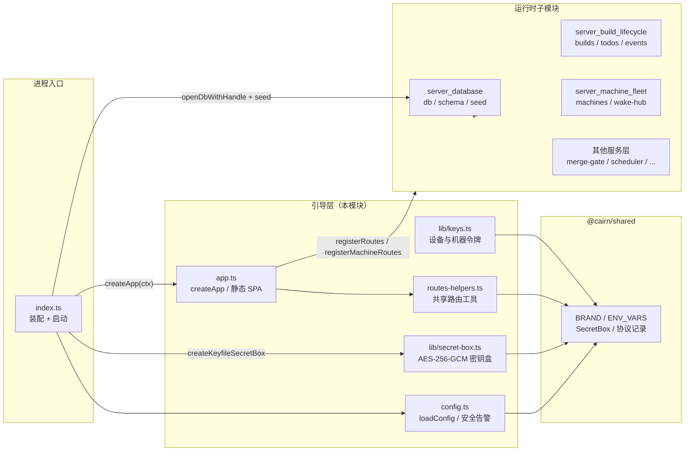
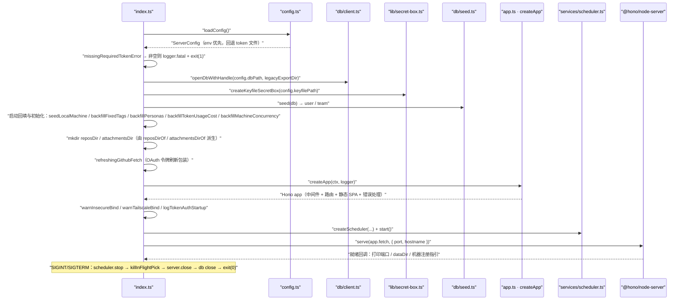
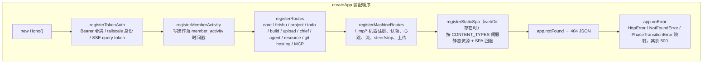
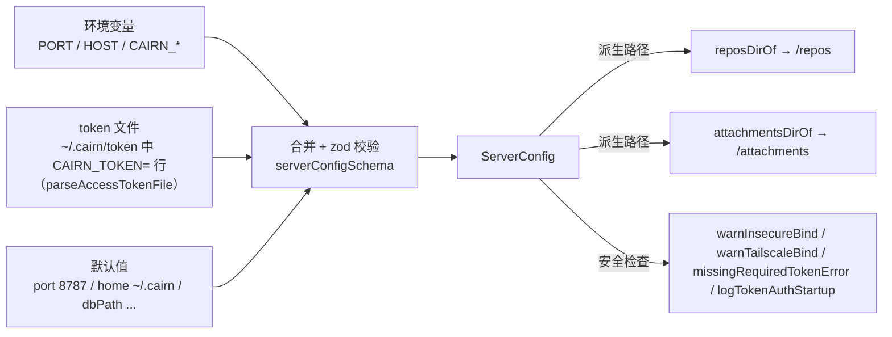
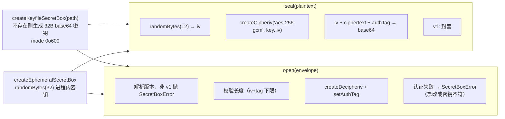

# 服务端应用引导模块（server_app_bootstrap）

## 模块简介

`server_app_bootstrap` 是 cairn 服务端（`apps/server`）的**装配与启动引导层**，负责把零散的依赖（配置、数据库、密钥盒、流枢纽、外部凭据）组装成一个可对外服务的 Hono 应用，并定义启动期的安全策略、静态站点伺服与统一错误处理。它由五个核心文件构成：

| 文件 | 职责 |
| --- | --- |
| `apps/server/src/app.ts` | `createApp()`：按固定顺序装配中间件与路由、注册 `notFound` / `onError` 处理器、静态 SPA 伺服 |
| `apps/server/src/config.ts` | `loadConfig()` 与 `ServerConfig`（zod 校验）；启动安全告警（`warnInsecureBind` / `warnTailscaleBind` / `missingRequiredTokenError`）；数据目录派生（`reposDirOf` / `attachmentsDirOf`） |
| `apps/server/src/routes-helpers.ts` | 路由层共享工具：`toMemoryRecord()`（DB 行 → `MemoryRecord`）、团队/项目/Agent 校验、Git Basic 鉴权、上下文服务切面 |
| `apps/server/src/lib/keys.ts` | `newDeviceId()`（16 字节随机 hex）、`newMachineToken()`（32 字节随机 hex + SHA-256 哈希） |
| `apps/server/src/lib/secret-box.ts` | AES-256-GCM 密钥盒：`createKeyfileSecretBox`（落盘密钥文件）与 `createEphemeralSecretBox`（进程内密钥） |

真正的进程入口 `apps/server/src/index.ts`（属于本模块的装配消费者）调用 `loadConfig()` 与 `createApp()`，并完成数据库打开、seed、启动回填、调度器启动与 HTTP 监听（详见下文「启动装配流程」）。本模块是 [server 模块](../server.md) 的引导子模块，与 [server_database](server_database.md)、[server_build_lifecycle](server_build_lifecycle.md)、[server_machine_fleet](server_machine_fleet.md) 等运行时模块通过 `AppContext` 相互连接。

## 在服务端中的位置

- `index.ts` 从 `config.ts` 拿到全部配置，从 `db/client.ts`（[server_database](server_database.md)）打开数据库，用 `secret-box.ts` 建立凭据加解密能力，然后一次性构造 `AppContext` 交给 `createApp()`。
- `createApp()` 只依赖 `AppContext` 与可选的 `Logger`，因此测试可用 `openMemoryDb()` + `createEphemeralSecretBox()` 组装最小上下文（见 [server_database](server_database.md)）。
- 所有跨文件常量（`BRAND`、`ENV_VARS`、`ACCESS_TOKEN_FILE_NAME`、`SKILLS_DIR_DEFAULT`、`CLAIM_POLL_INTERVAL_MS`、`TEAM_STREAM_PING_INTERVAL_MS`、`CLAUDE_CONFIG_FILE_NAME`、`SecretBox` 接口等）都来自 [shared 模块](../../shared.md) 的 `@cairn/shared` 包。

## 启动装配流程

进程入口 `apps/server/src/index.ts` 的顺序装配（`createApp` 是其核心一步）：

要点：

- **配置 → 拒绝启动**：`loadConfig()` 合并环境变量、token 文件与默认值并经 zod 校验；随后 `missingRequiredTokenError()` 在「`CAIRN_REQUIRE_TOKEN` 已开但令牌缺失」时返回错误文案，`index.ts` 记 `fatal` 日志并 `exit(1)`。
- **凭据先行**：密钥盒在数据库打开后立即创建（`secretbox.key` 不存在则自动生成 `0o600` 文件），供 seed、GitHub OAuth 与 API key 校验使用。
- **安全告警**：绑定全网卡且无鉴权 → `warnInsecureBind`；配置了 tailscale 用户但未回环绑定 → `warnTailscaleBind`；启用令牌 → `logTokenAuthStartup`（打印一次性登录链接；容器 `requireToken` 模式不打印令牌明文）。
- **优雅停机**：信号处理固定顺序 `scheduler.stop()` → `killInFlightPick()` → `server.close()` → `close()`（关闭 SQLite）→ `exit(0)`。

## createApp 的应用装配

`createApp(ctx: AppContext, logger?)` 按固定顺序在 Hono 应用上注册组件：

### 中间件与成员活跃度

- `registerTokenAuth`（`lib/token-auth.ts`）：仅在 `authToken` 非空时启用。放行路径依次为——豁免前缀（静态资源/公开端点）→ tailscale 身份头（`tailscale-user-login`，且仅信任回环对端地址）→ `Authorization: Bearer <token>` → SSE 流路径的 `?token=` 查询参数。详见 `apps/server/src/lib/token-auth.ts`。
- `registerMemberActivity`：对 `countsAsMemberWrite(method, path, status)` 判定为「成员写操作」的 `/api/*` 请求（排除 `GET/HEAD/OPTIONS`、4xx/5xx、以及 `/api/machine`、`/api/mcp`、`/api/oauth/callback` 前缀），在响应后调用 `recordMemberWrite(ctx.db, nowMs())` 写 `member_activity` 表——该时间戳是自主运行门（autonomy gate）判断「成员是否活跃」的依据（见 `apps/server/src/services/autonomy-gates.ts`）。

### 静态 SPA 伺服

`registerStaticSpa` 只在前端产物存在时启用：

- 根目录解析自 `ctx.webDir`，入口文件为 `index.html`。
- 对 `API_PREFIXES = ['/api/', '/git/', '/_mp/']` 的路径一律 404（不落到 SPA）。
- 路径穿越防护：`resolve` 后必须仍位于根目录之内，否则 404。
- 目录请求自动补 `index.html`；文件不存在时回退到 `index.html`（`isIndex` 标记），此时 `cache-control: no-cache`，其余静态资源 `public, max-age=3600`。
- `CONTENT_TYPES` 表覆盖 html/js/mjs/css/json/webmanifest/svg/png/jpg/jpeg/webp/ico/woff/woff2/ttf/txt/map；未识别扩展返回 `application/octet-stream`。
- Docker 健康检查即依赖此路由：`fetch('http://127.0.0.1:8787/app')`（见根仓库 `Dockerfile` 与 `railway.json`，部署细节见 [root_build_deploy](../../Repository_automation_and_delivery/root_build_deploy.md)）。

### 统一错误处理

`app.onError` 将领域异常映射为 HTTP 响应，其余未预期异常记日志并返回 500：

| 异常类型 | 来源 | HTTP 状态 | 响应体 |
| --- | --- | --- | --- |
| `HttpError` | `lib/errors.ts` | `err.status`（默认 400） | `{ error, reason? }` |
| `NotFoundError` | `services/builds.ts` | `404` | `{ error }` |
| `PhaseTransitionError` | `services/phase.ts` | `409` | `{ error }`（非法相位迁移） |
| 其他 | — | `500` | `{ error: 'Internal server error' }` + `logger.error` |

## 配置加载（config.ts）

`loadConfig(overrides?)` 的取值优先级为 **环境变量 → token 文件 → 默认值**，最终由 `serverConfigSchema`（zod）整体校验：

关键规则：

- **GitHub OAuth 必须同设**：`CAIRN_GITHUB_OAUTH_CLIENT_ID` 与 `CAIRN_GITHUB_OAUTH_CLIENT_SECRET` 只配置其一即抛错。
- **令牌来源**：优先 `CAIRN_TOKEN` 环境变量；缺失时读取 `accessTokenFilePath(homeDir)`（`<homeDir>/token`，文件名常量 `ACCESS_TOKEN_FILE_NAME`），用 `parseAccessTokenFile` 解析 `CAIRN_TOKEN=` 行（支持引号包裹），文件存在但无可用行则抛错并提示「删除即关闭鉴权」。
- **webDir 探测**：`CAIRN_WEB_DIR` 未设时按 `dist 上一级` 与 `dist 同级 web/` 两个候选目录探测 `index.html`，命中则启用静态伺服。
- **skills 目录**：默认 `SKILLS_DIR_DEFAULT = '~/.agents/skills'`，支持 `~` 展开。
- **MCP 配置**：默认 `~/.claude.json`（`CLAUDE_CONFIG_FILE_NAME`）。
- **周期常量**：`pingIntervalMs` 取自 `TEAM_STREAM_PING_INTERVAL_MS`（15s，SSE ping），`claimHoldMs` 取自 `CLAIM_POLL_INTERVAL_MS`（75s，步骤认领持有），`schedulerTickMs` 固定 15s。

### 安全告警与令牌启动日志

| 函数 | 触发条件 | 输出 |
| --- | --- | --- |
| `insecureBindWarning` | 无 `authToken` 且 `host` 为 `0.0.0.0`/`::`/`::0` | 提示 API 面裸奔于全网卡，建议设 `CAIRN_TOKEN` 或 `HOST=127.0.0.1` |
| `tailscaleBindWarning` | 配置了 `tailscaleUsers` 且未回环绑定（`127.0.0.1`/`::1`/`::ffff:127.0.0.1`/`localhost`） | 提示非回环对端的身份头将被忽略，建议 `HOST=127.0.0.1` + tailscale serve 反代 |
| `missingRequiredTokenError` | `requireToken=true` 且 `authToken===null` | 拒绝启动文案（`index.ts` 将其作为 fatal 并 `exit(1)`） |
| `tokenAuthStartupLines` / `logTokenAuthStartup` | `authToken` 非空 | 令牌来源说明、`cairn token` 管理命令；非 `requireToken` 时附一次性登录链接 `http://<host>:<port>/app#token=...`；`requireToken` 容器模式明确提示「令牌不写日志」 |

## 密钥盒与设备身份

### SecretBox（lib/secret-box.ts）

`SecretBox` 接口（`seal(plaintext) → envelope` / `open(envelope) → plaintext`）由 [shared 模块](../../shared.md) 定义；本模块提供基于 **AES-256-GCM** 的实现，封套格式为 `SECRET_BOX_ENVELOPE_VERSION('v1'):<base64(iv‖ciphertext‖tag)>`：

- `createKeyfileSecretBox(keyfilePath)`：确保目录存在；密钥文件缺失时写入 32 字节 base64 密钥（`writeFileSync` mode 会被 umask 截断，故再 `chmodSync 0o600`）；读取后校验字节数（必须为 32 字节）。
- `createEphemeralSecretBox()`：每次调用生成新随机密钥，不落盘——用于测试或不需要跨进程持久解密的场景（例如 `openMemoryDb` + 内存库的测试装配）。
- `SecretBoxError`：统一封装版本未知、封套截断、认证失败等错误。

### 令牌与设备 ID（lib/keys.ts）

- `newDeviceId()`：`randomBytes(16)` 的 hex（32 字符），用于设备/机器身份标识，匹配 [shared 模块](../../shared.md) 的 `DEVICE_ID_PATTERN = /^[0-9a-f]{32}$/`。
- `newMachineToken()`：`randomBytes(32)` 的 hex 明文 + `hashCredential`（SHA-256）哈希，机器令牌以哈希入库、明文仅在注册响应中一次性下发（配合 `MACHINE_TOKEN_PATTERN = /^[0-9a-f]{64}$/`）。

## 路由共享辅助（routes-helpers.ts）

该文件是路由层的工具集合（本模块收录其中 `toMemoryRecord`，其余函数与路由模块共享）：

- `toMemoryRecord(row)`：把 `agentMemory` DB 行转换为 [shared 模块](../../shared.md) 的 `MemoryRecord`（含 `history`、`invalidAt`、`supersededBy`、`lastInjectedAt` 等字段）。
- 校验辅助：`requireTeam` / `requireProject` / `requireAgentRow`（不存在即抛 `notFound`）、`jsonBody`（解析失败返回 `null`）、`requestOrigin`。
- 记录转换：`toTagRecord`、`agentRecordOf`（DB 行 → `AgentRecord`）、`toMemoryRecord`。
- 鉴权辅助：`verifyGitBasicAuth`——用常量时间比较（`timingSafeEqual`）校验 `Authorization: Basic` 头中的 API key 哈希（`sha256Hex` 后与 `apiKey.gitAccess=true` 的行比对），供 git hosting 路由使用。
- 上下文切面：`svcOf(ctx)` 与 `githubIssueDepsOf(ctx)` 把 `AppContext` 收窄为各服务所需的依赖子集。
- 共享常量：`SESSION_COOKIE = BRAND.sessionCookieName`（`cairn_session`）、`GIT_AUTH_REALM = 'cairn-git'`、若干 zod 请求体 schema（`githubIssuesQuerySchema`、`patchTodoBodySchema`、`patchSecretBodySchema`、`createApiKeyBodySchema`）。

## 依赖关系

```mermaid
flowchart TB
    subgraph MOD["本模块文件"]
        APP["app.ts"]
        CFG["config.ts"]
        RH["routes-helpers.ts"]
        KEYS["lib/keys.ts"]
        SBX["lib/secret-box.ts"]
    end
    subgraph LOCAL["服务端内部依赖"]
        CTX["context.ts · AppContext"]
        TA["lib/token-auth.ts"]
        RTS["routes.ts · registerRoutes"]
        RTSM["routes-machine.ts · registerMachineRoutes"]
        AG["services/autonomy-gates.ts"]
        ERR["lib/errors.ts · HttpError"]
        NF["services/builds.ts · NotFoundError"]
        PT["services/phase.ts · PhaseTransitionError"]
        DB["db/client.ts · Db / openMemoryDb"]
    end
    subgraph SH["@cairn/shared 包"]
        BR["brand.ts · BRAND / ENV_VARS"]
        ATF["access-token-file.ts · parseAccessTokenFile"]
        SB["secret-box.ts · SecretBox / 版本常量"]
        SK["records/skill.ts · SKILLS_DIR_DEFAULT"]
        MAPI["protocol/machine-api.ts · CLAIM_POLL_INTERVAL_MS"]
        SSE["protocol/sse.ts · TEAM_STREAM_PING_INTERVAL_MS"]
        MCP["protocol/mcp.ts · CLAUDE_CONFIG_FILE_NAME"]
    end

    APP --> TA
    APP --> AG
    APP --> RTS
    APP --> RTSM
    APP --> ERR
    APP --> NF
    APP --> PT
    APP --> CTX
    CFG --> BR
    CFG --> ATF
    CFG --> SK
    CFG --> MAPI
    CFG --> SSE
    CFG --> MCP
    RH --> CTX
    RH --> DB
    RH --> SB
    KEYS --> SB
    SBX --> SB
```

- `createApp` 的四个装配目标（`registerTokenAuth`、`registerMemberActivity`、`registerRoutes`、`registerMachineRoutes`）都直接消费 `AppContext`，因此本模块是路由层与服务层之间的「接线板」。
- 错误类（`HttpError`、`NotFoundError`、`PhaseTransitionError`）分属三个文件但被 `onError` 统一识别，路由/服务层只需抛出即可获得正确状态码。
- 配置层不依赖任何服务端内部模块，只依赖 `@cairn/shared`——便于单独测试与在 CLI 等其他入口复用（例如 daemon 侧读取同一套 `BRAND` / `ENV_VARS`）。

## 构建、测试与部署

- **脚本**（`apps/server/package.json`）：`dev` = `tsx watch src/index.ts`；`start` = `tsx src/index.ts`；`build` = `node build.mjs`（esbuild 单文件打包到 `dist/index.mjs`）；`prepack` 先构建 `@cairn/web` 再打包并 stage `web/`；`typecheck` = `tsc --noEmit`；`test` = `vitest run`；`db:generate` / `db:check` 由 drizzle-kit 管理（见 [server_database](server_database.md)）。
- **类型约束**（`apps/server/tsconfig.json`）：`NodeNext` 模块解析、`strict`、`noUncheckedIndexedAccess`、`verbatimModuleSyntax`、`isolatedModules`、`noEmit`（纯类型检查），target `ES2023`。
- **容器**（根仓库 `Dockerfile`）：三阶段构建——`build`（pnpm 安装 + `@cairn/web` 与 `@xiechimon/cairn` 构建）→ `native`（仅重编译 `better-sqlite3` 原生模块，去除 prebuilds）→ `node:24-bookworm-slim` 运行镜像，产物 `dist/` + `drizzle/` + `web/`；运行环境 `NODE_ENV=production`、`HOST=0.0.0.0`、`PORT=8787`、`CAIRN_HOME=/data`、`CAIRN_REQUIRE_TOKEN=1`，`HEALTHCHECK` 每 30s 探活 `/app`（即 `registerStaticSpa` 的 SPA 入口）。
- **部署**（根仓库 `railway.json`）：`DOCKERFILE` 构建器，`healthcheckPath: /app`，失败重启策略 `ON_FAILURE`（最多 5 次）。构建与部署的完整说明见 [root_build_deploy](../../Repository_automation_and_delivery/root_build_deploy.md)。
- **测试装配模式**：单元/集成测试用 `openMemoryDb()`（内存 SQLite，见 [server_database](server_database.md)）+ `createEphemeralSecretBox()` 构造最小 `AppContext`，再经 `createApp` 获得可注入 `fetch` 的 Hono 实例。

## 关联文档

- 父模块：[server 模块](../server.md) —— 服务端整体架构、分层与子模块导航。
- 数据层：[server_database](server_database.md) —— `openMemoryDb` / 迁移 / seed，`AppContext.db` 的来源。
- 构建生命周期与事件流：[server_build_lifecycle](server_build_lifecycle.md) —— `ConversationStreamHub` / `TeamStreamHub` 装配进 `AppContext` 后的运行时行为。
- 机器队列：[server_machine_fleet](server_machine_fleet.md) —— `registerMachineRoutes` 的消费方（`MachineWakeHub`、步骤认领）。
- 共享契约：[shared 模块](../../shared.md) —— `BRAND`、`ENV_VARS`、`SecretBox`、协议记录与全部共享常量。
- 部署与 CI：[Repository_automation_and_delivery](../../Repository_automation_and_delivery.md) 的 [root_build_deploy](../../Repository_automation_and_delivery/root_build_deploy.md) 与 [github_ci](../../Repository_automation_and_delivery/github_ci.md)（`pack-smoke` / `e2e` 覆盖打包与端到端）。
