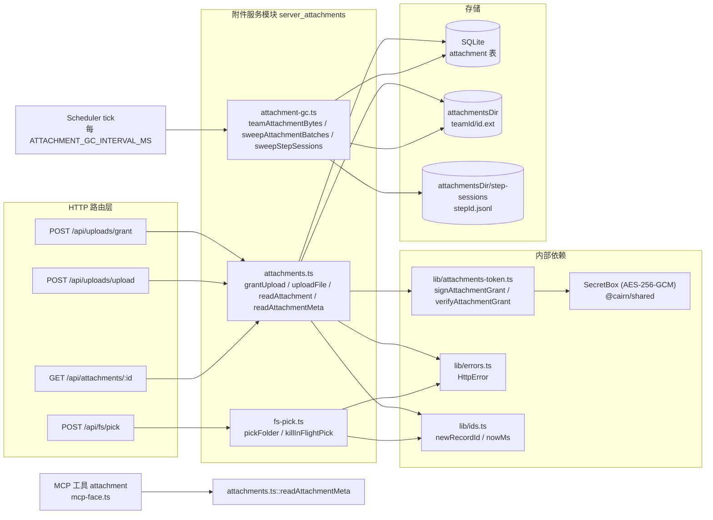
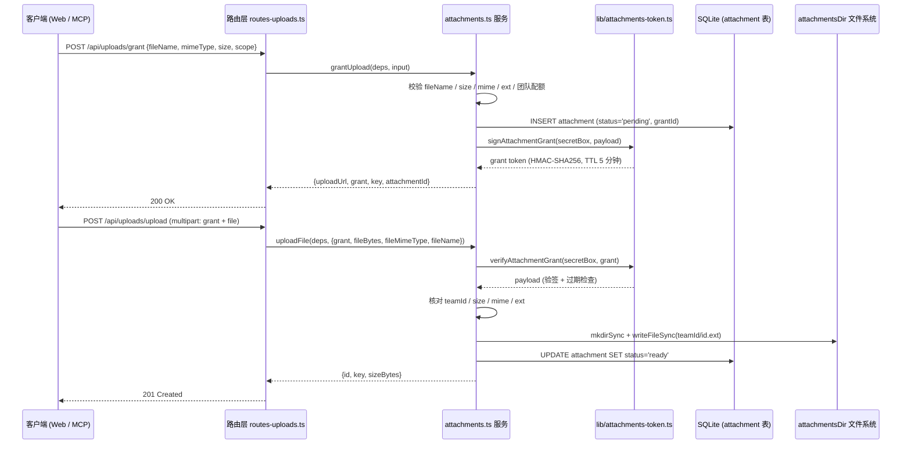
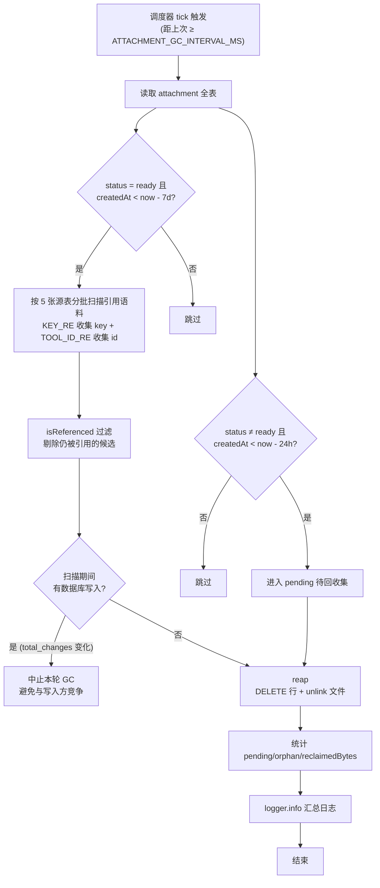
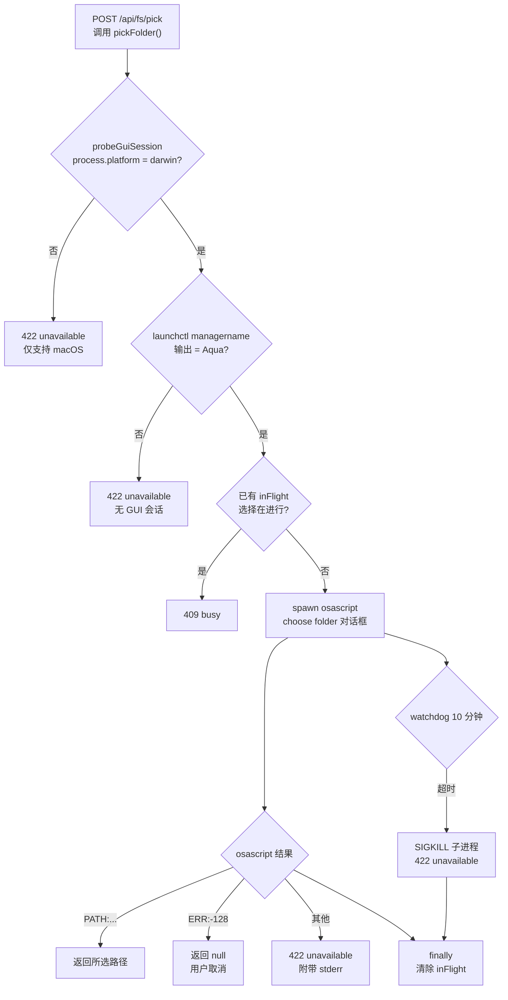

# 附件服务模块 (server_attachments)

## 简介

`server_attachments` 是 cairn 服务端（`apps/server`）中负责**文件附件全生命周期**的服务集合，包含三个核心文件：

| 文件 | 职责 |
| --- | --- |
| `apps/server/src/services/attachments.ts` | 附件的**两阶段上传协议**（授权 + 落盘）、配额校验、附件读取（元数据 / 原始字节） |
| `apps/server/src/services/attachment-gc.ts` | 附件**垃圾回收**：清理过期 pending 记录、孤立附件、`step-sessions` 会话文件，并提供团队配额核算 |
| `apps/server/src/services/fs-pick.ts` | macOS 上的**原生文件夹选择器**（`osascript`），用于本地项目创建时让用户通过系统对话框选取目录 |

三者共同支撑以下业务场景：

- Web 前端与 MCP 客户端通过 `POST /api/uploads/grant` + `POST /api/uploads/upload` 上传附件（规格书配图、消息附件、构建报告等）。
- Agent（daemon 侧）通过 MCP 工具 `attachment` 读取附件内容（文本按 `utf8`、图片等按 `base64` 返回）。
- 调度器（scheduler）周期性地回收过期 / 失去引用的附件，防止 `attachmentsDir` 无限膨胀。
- 本地项目创建时通过 `POST /api/fs/pick` 弹出系统文件夹选择对话框。

> 相关模块：路由注册见 [server_app_bootstrap](server_app_bootstrap.md)（`routes-uploads.ts`、`routes-projects.ts`），数据库表结构见 [server_database](server_database.md)（`attachment` / `step` 表），GC 调度见 [server_scheduler](server_scheduler.md)，附件令牌的 Markdown 语法与共享工具见 [shared](../../shared.md)（`packages/shared/src/attachment-token.ts`）。

---

## 架构总览

**存储布局**：附件目录由 [config.ts 的 `attachmentsDirOf`](server_app_bootstrap.md) 决定，为 `<dataDir>/attachments`（`dataDir = <home>/server`）。每个附件以 `attachmentsDir/<teamId>/<attachmentId>.<ext>` 落盘，`storageKey` 即 `teamId/id.ext`，与 shared 包中附件令牌正则 `ATTACHMENT_KEY`（`^([A-Za-z0-9_-]+)\/([A-Za-z0-9_-]+)\.([a-z0-9]{1,8})$`）严格对应。`step-sessions/` 子目录存放按 step 归档的会话 JSONL 文件。

---

## 1. 附件上传服务（attachments.ts）

### 1.1 两阶段上传协议

为避免“先落盘后校验”造成垃圾文件与配额绕过，附件上传被拆分为**授权（grant）**与**上传（upload）**两步：

1. **grantUpload**：客户端提交文件名、MIME、大小与用途（`scope`），服务端完成全部静态校验后，插入一条 `status = 'pending'` 的 `attachment` 行，并签发一个**带 TTL 的 HMAC 签名上传令牌**（grant token）。
2. **uploadFile**：客户端携带令牌与文件字节发起上传；服务端验签并逐项核对令牌承诺的 size / mime / ext，全部一致后才写入磁盘并把数据库行置为 `ready`。

**路由对照**（见 `routes-uploads.ts`）：

- `POST /api/uploads/grant` — 请求体 `{kind:'attachment', fileName, mimeType, size, scope?}`，返回 `{uploadUrl, grant, key, attachmentId}`。`grantUpload` 返回的 `uploadUrl` 为 `/api/uploads`。
- `POST /api/uploads/upload` — `multipart/form-data`，字段 `grant` 与 `file`（浏览器 `File`）。缺失 grant 返回 `401`，缺失文件返回 `400`。
- `GET /api/attachments/:id` — 按附件 id 读取原始字节，响应头携带 `content-type`（数据库中的 `mimeType`）、`content-length` 与 `cache-control: private, max-age=300`。

### 1.2 grantUpload 校验规则

`grantUpload(deps, input)` 依次执行以下校验，任一失败即抛出 `HttpError`：

| 校验项 | 规则 | 失败状态码 |
| --- | --- | --- |
| 文件名 | `isValidFileName`：长度 1–200、不含 `/` `\` `\0`、非 `.`/`..`、无控制字符（< 0x20） | `400 invalid fileName` |
| 大小 | 正整数且 `≤ MAX_BYTES`（10 MiB） | `400 invalid size` |
| MIME | `isAllowedMime`：精确白名单 `application/json`、`application/pdf`、`application/xml`，或前缀 `text/`、`image/` | `400 mime not allowed` |
| 扩展名 | `extOf` 提取小写扩展名（1–8 位 `[a-z0-9]`），须在 `ALLOWED_EXTS` 集合中 | `400 file extension not allowed` |
| 团队配额 | `teamAttachmentBytes(db, teamId) + size ≤ TEAM_ATTACHMENTS_QUOTA_BYTES`（1 GiB） | `400 team attachment quota exceeded` |

校验通过后：

- 生成附件 id（`newRecordId()`）与存储键 `storageKey = ${teamId}/${id}.${ext}`；
- 构造 grant payload：`{attachmentId, teamId, key, sizeBytes, mimeType, scope, exp: now + ATTACHMENT_GRANT_TTL_MS}`；
- 插入 `attachment` 行（`status = 'pending'`，记录 `grantId` 与 `createdBy`）；
- `signAttachmentGrant(secretBox, payload)` 签发令牌并返回 `{uploadUrl, grant, key, attachmentId}`。

### 1.3 上传授权令牌（grant token）

令牌由 `lib/attachments-token.ts` 实现，格式为 `base64url(payload).base64url(HMAC-SHA256)`：

- **签名密钥**：通过对 `SecretBox` 封包/解封常量 `'attachment-grant-key-v1'` 派生（`hmacKey`），经 SHA-256 压缩为 32 字节，并按 `WeakMap` 缓存；服务端重启后密钥随 keyfile（`secretbox.key`）持久化而保持稳定。
- **有效期**：`ATTACHMENT_GRANT_TTL_MS = 5 * 60 * 1000`（5 分钟）。
- **校验**：`verifyAttachmentGrant` 检查令牌结构、HMAC（`timingSafeEqual` 防时序侧信道）、payload 形状与 `exp`；失败统一抛出携带 `status`（`401`）的 `AttachmentGrantError`。

### 1.4 uploadFile 一致性校验

`uploadFile(deps, input)` 在落盘前强制令牌承诺与实际上传内容一致：

| 校验 | 规则 | 失败状态码 |
| --- | --- | --- |
| 令牌 | `verifyAttachmentGrant` 验签、过期、形状 | `401`（由 `AttachmentGrantError.status` 透传） |
| 团队归属 | `payload.teamId === deps.teamId` | `401 grant team mismatch` |
| 大小 | `fileBytes.byteLength === payload.sizeBytes` | `409 uploaded size ≠ grant` |
| MIME | `fileMimeType === payload.mimeType` | `409 uploaded mime ≠ grant` |
| 扩展名 | 若上传文件名有扩展名，须与令牌中的扩展一致 | `409 uploaded ext ≠ grant` |

全部通过后：递归创建目录并 `writeFileSync` 写入 `attachmentsDir/payload.key`，随后把 `attachment` 行更新为 `status = 'ready'`，返回 `{id, key, sizeBytes}`。

### 1.5 附件读取

- **`requireAttachmentRow(db, teamId, attachmentId)`**：按 `id + teamId` 查询，未命中抛 `404`；状态非 `ready` 抛 `409`（附当前状态）。该函数是读取类操作的统一入口。
- **`readAttachment(deps, attachmentId)`**：返回数据库行与磁盘绝对路径 `join(attachmentsDir, storageKey)`，供 `GET /api/attachments/:id` 读取原始字节。
- **`readAttachmentMeta(deps, teamId, attachmentId)`**：读取文件内容，文本类 MIME（`text/*` 或精确白名单）以 `utf8` 返回，其余以 `base64` 返回，并给出 `encoding` 字段。该函数被 MCP 工具 `attachment`（`mcp-face.ts` 中 `readAttachmentMeta` 动态导入）调用，供 Agent 在会话中查看附件。

> 附件在待办（todo）中的授权关系由 `services/attachment-authorization.ts` 维护：用户文本中的 `` 令牌经 shared 包的 `parseAttachmentTokenLines` 解析后，写入 `todo.userSpecAttachmentIds` / `userMessageAttachmentIds`；`todoAuthorizesAttachment` 用于判断某附件是否被某 todo 授权。

---

## 2. 附件垃圾回收（attachment-gc.ts）

### 2.1 配额核算

`teamAttachmentBytes(db, teamId)` 对团队所有 `attachment` 行的 `sizeBytes` 求和，供 `grantUpload` 在授权时做配额检查（`TEAM_ATTACHMENTS_QUOTA_BYTES = 1 GiB`）。

### 2.2 回收规则

`attachment` 行按状态与年龄分为两类回收目标：

| 类别 | 条件 | 常量 |
| --- | --- | --- |
| pending 过期 | `status ≠ 'ready'` 且 `createdAt < now - ATTACHMENT_PENDING_TTL_MS` | 24 小时 |
| 孤立附件 | `status = 'ready'` 且 `createdAt < now - ATTACHMENT_ORPHAN_GRACE_MS`（且无任何引用） | 7 天 |

### 2.3 引用语料扫描

对“孤立”候选，GC 扫描五张表的文本内容构建**引用语料库**（`RefCorpus`），只要命中任一即视为仍被引用：

| 源表 | 游标列 | 内容列 | JSON 解析 |
| --- | --- | --- | --- |
| `todo` | `id` | `spec` | 否 |
| `message` | `id` | `content` | 是 |
| `chief_message` | `id` | `content` | 是 |
| `steer_pending` | `conversationId` | `content` | 否 |
| `plan` | `id` | `content` | 否 |

每批最多 128 行，用两条正则从文本中抽取引用：

- `KEY_RE`：`attachment:<teamId>/<id>.<ext>` 形式的 Markdown 令牌 → 收集 `storageKey`；
- `TOOL_ID_RE`：`"attachmentId":"<id>"` 形式的 JSON 工具参数 → 收集附件 id。

`isReferenced` 判定：语料中的 `keys` 命中 `storageKey`、`ids` 命中附件 id、或任意文本块包含该 id 子串，均视为被引用。

**并发安全**：GC 在每批扫描后通过 `select total_changes()` 对比快照；若期间发生数据库写入（例如新消息引用新附件），立即放弃本轮回收，防止误删。

### 2.4 调度与批量执行

- `sweepAttachmentBatches(...)` 是**生成器函数**，每处理一批（128 行）`yield` 一次，把 CPU 密集的引用扫描切成小片；
- 调度器（[server_scheduler](server_scheduler.md) 的 `createScheduler`，`index.ts` 中以 `{attachmentsDir, logger}` 注入）在 `tick()` 中每 `ATTACHMENT_GC_INTERVAL_MS`（1 小时）启动一次，用 `setImmediate` 串行推进各批次（`advanceGc`，timer 均 `unref()`，不阻塞事件循环）；
- `sweepAttachments(...)` 是非生成器包装（`while (!done) next()`），供一次性调用 / 测试使用；
- 批次完成后紧接着调用 `sweepStepSessions` 清理会话文件。

### 2.5 step-sessions 清理

`attachmentsDir/step-sessions/<stepId>.jsonl` 保存会话转录文件。`sweepStepSessions` 对目录中每个 `.jsonl`：

1. 若 `step` 表中仍存在对应 `stepId` → 保留；
2. 文件 `mtimeMs > now - ATTACHMENT_ORPHAN_GRACE_MS`（7 天）→ 保留（缓冲期）；
3. 否则 `unlinkSync` 删除并累计回收字节。

---

## 3. 文件夹选择器（fs-pick.ts）

`pickFolder()` 供 `POST /api/fs/pick`（`routes-projects.ts`）调用，用于本地项目创建时让用户通过 macOS 原生对话框选择项目文件夹：

关键设计：

- **GUI 会话探测**：仅 macOS 上执行 `launchctl managername`，输出为 `Aqua` 才视为有图形会话；否则返回 `422 unavailable`（带 `reason: 'unavailable'`）。
- **单飞（in-flight）互斥**：模块级 `inFlight` 单例记录当前子进程；并发请求返回 `409 busy`。`killInFlightPick()` 对 `inFlight` 发送 `SIGKILL` 并清空引用。
- **看门狗**：`WATCHDOG_MS = 10 分钟` 后强制 `SIGKILL` 子进程，返回 `422 unavailable`（timeout），`finally` 中始终清理计时器与 `inFlight`。
- **退出钩子**：`index.ts` 在 `SIGINT` / `SIGTERM` 处理器中调用 `killInFlightPick()`，保证服务优雅退出时不会遗留孤儿 `osascript` 进程。

---

## 4. 与其它模块的关联

| 关联方 | 关系 |
| --- | --- |
| [server_app_bootstrap](server_app_bootstrap.md) | `index.ts` 通过 `attachmentsDirOf(config)` 初始化附件目录并注入 `AppContext.attachmentsDir`；`routes-uploads.ts` / `routes-projects.ts` 注册上传与 fs-pick 路由 |
| [server_database](server_database.md) | `attachment` 表（`id, teamId, createdBy, fileName, mimeType, sizeBytes, storageKey, grantId, scope, status, createdAt`）与 `step` 表为 GC 依赖；`Db` 类型由 `db/client.ts` 提供 |
| [server_scheduler](server_scheduler.md) | `createScheduler` 接收 `AttachmentGcRun`，周期驱动 `sweepAttachmentBatches` 与 `sweepStepSessions` |
| [shared](../../shared.md) | `SecretBox`（AES-256-GCM 封包）用于派生 HMAC 密钥；`attachment-token.ts` 的 `formatAttachmentToken` / `parseAttachmentTokenLines` / `ATTACHMENT_TOKEN_LINE` 定义附件在 Markdown 中的语法；`attachment-authorization.ts` 依赖其解析结果维护 todo 授权 |
| [server_machine_fleet](server_machine_fleet.md) / [daemon_machine_client](../daemon/daemon_machine_client.md) | Agent 会话通过 MCP 工具 `attachment`（`mcp-face.ts`）读取附件元数据，daemon 侧消费附件令牌语法 |
| [server_trajectory_tools](server_trajectory_tools.md) | 轨迹工具解析会话转录文本时同样会涉及 `attachment:` 令牌与 `attachmentId` 引用（与 GC 语料扫描的正则一致） |
