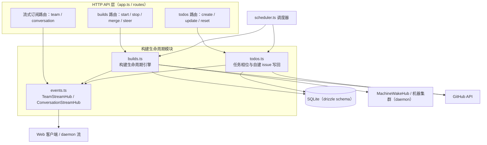
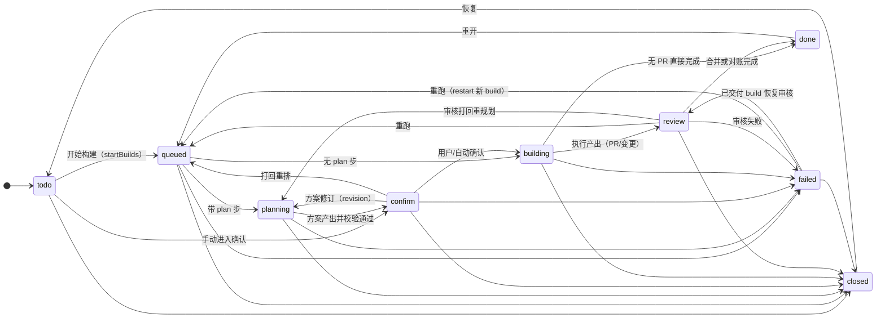
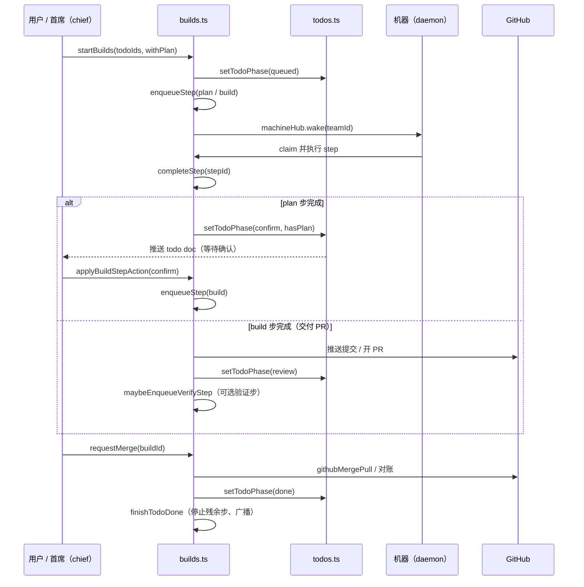
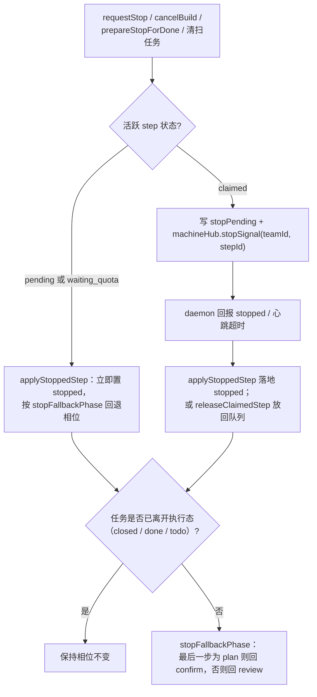
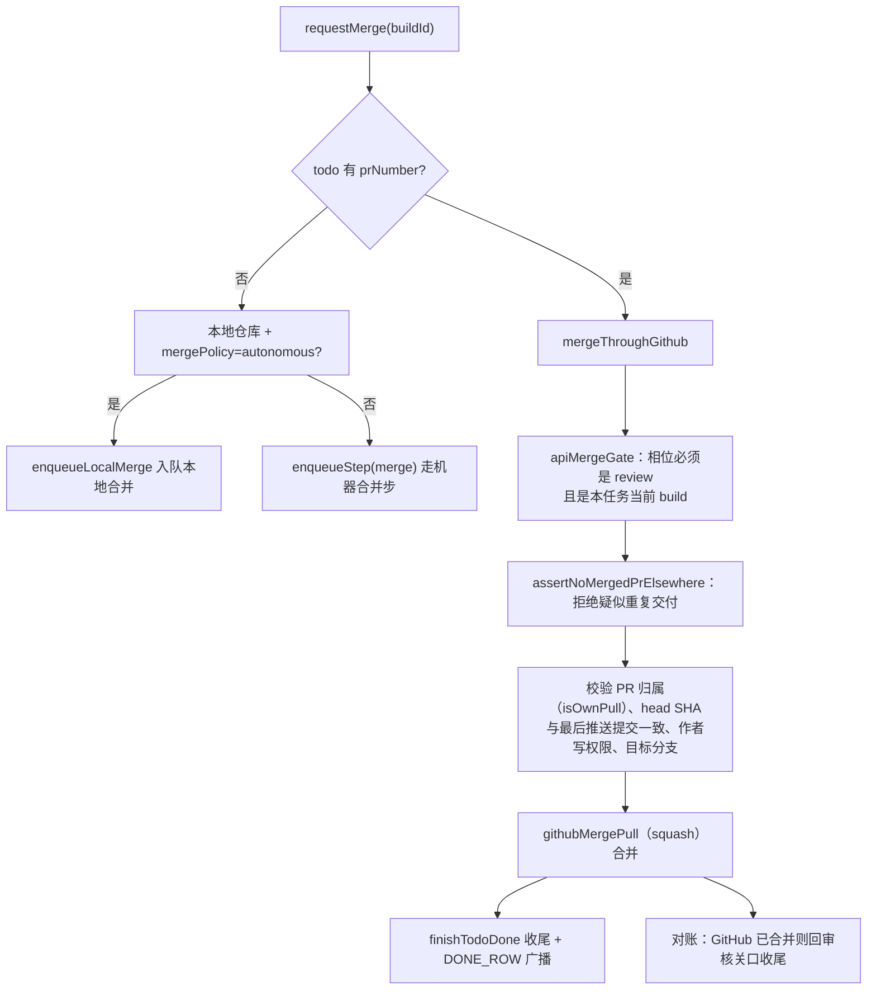
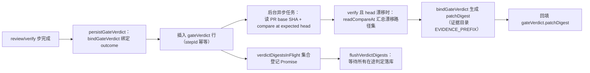
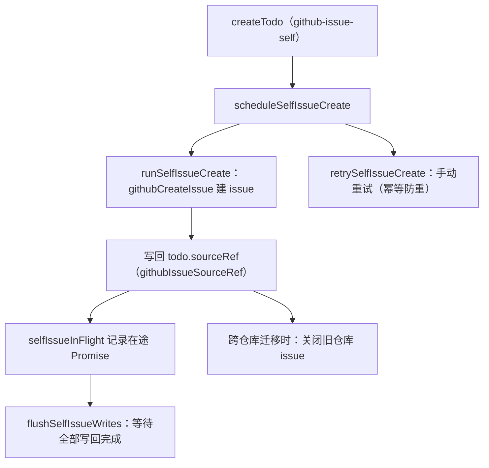
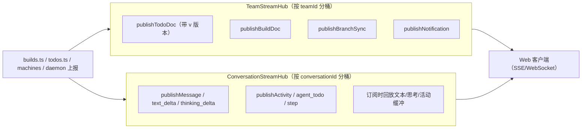

# 服务端构建生命周期（server_build_lifecycle）

## 简介

`server_build_lifecycle` 模块是 Cairn 服务端（`apps/server`）的**构建编排核心**，负责一条任务（todo）从「排队 → 规划 → 确认 → 执行 → 审核 → 合并 → 完成/失败」的完整生命周期。它同时承担三类职责：

1. **构建引擎（`services/builds.ts`）**：管理 build 记录与其 step 队列，处理启动、完成、失败、停止、取消、重启、合并等所有生命周期动作，并与机器集群、GitHub、合并关口等子系统交互。
2. **任务与相位管理（`services/todos.ts`）**：维护 todo 记录的相位（phase）、版本号、标签、依赖拆分等状态，并提供 GitHub 自建 issue 的异步写回能力（`flushSelfIssueWrites`）。
3. **实时事件流（`services/events.ts`）**：`TeamStreamHub` 与 `ConversationStreamHub` 两个内存 Hub，把 todo/build/step/消息等增量实时推送给 Web 客户端与 daemon。

本模块对外暴露的核心导出为 `flushVerdictDigests`、`flushSelfIssueWrites` 以及两个流式 Hub 的订阅方法，其余大量函数（`startBuilds`、`completeStep`、`requestMerge`、`cancelBuild` 等）供路由层与调度器直接调用。

## 模块定位与架构

`server_build_lifecycle` 位于服务端业务服务层，横跨路由层、数据库、机器集群与外部集成。下图展示它在服务端内部的协作关系：

- **路由层**通过 `BuildDeps` / `TodoDeps` 依赖容器把数据库、Hub、机器唤醒 Hub、GitHub fetch 等注入本模块（见 [server_app_bootstrap.md](server_app_bootstrap.md)）。
- **数据库表**（`build`、`step`、`todo`、`gateVerdict`、`steerPending`、`stopPending`、`message`、`plan` 等）由 [server_database.md](server_database.md) 定义；本模块是这些表最主要的读写方。
- **机器集群**协作见 [server_machine_fleet.md](server_machine_fleet.md)：本模块通过 `machineHub.wake/stopSignal/steerSignal` 唤醒 daemon、下发停止与转向指令。
- **合并关口**（merge gate）协作见 [server_merge_gate.md](server_merge_gate.md)：`persistGateVerdict` 生成的判定行由关口绑定补丁摘要。

## 核心数据模型

构建生命周期围绕三张核心表展开（SQLite，drizzle-orm 定义，见 [server_database.md](server_database.md)）：

| 表 | 关键字段 | 说明 |
| --- | --- | --- |
| `todo` | `phase`、`phaseAt`、`latestBuildId`、`assignment`、`hasPlan`、`hasChanges`、`sourceTodo`、`blockedBy`、`v` | 任务卡；`phase` 驱动整条生命周期；`v` 是乐观并发版本号 |
| `build` | `todoId`、`withPlan`、`prevPhase`、`triggerSource`、`errorMessage`、`prUrl`、`prNumber`、`changes`、`diffHash` | 一次运行；同一 todo 可有多次 build（重跑、重启） |
| `step` | `buildId`、`kind`（plan/build/merge/chief/review/verify）、`status`、`checkpointCommit`、`prompt`、`machineId`、`quotaBlock` | 构建内的执行步；`status` 为 `pending / claimed / done / failed / stopped / waiting_quota` |

辅助表：`steerPending`（转向指令暂存）、`stopPending`（停止指令暂存）、`gateVerdict`（审核/验证判定）、`plan`（方案文档，按 `version` 递增）、`message`（会话时间线）。

## 任务相位状态机

`todos.ts` 通过 `setTodoPhase` / `assertPhaseTransition` 维护相位流转（合法转移定义在 `services/phase.ts` 的 `PHASE_TRANSITIONS` 中）：

## 构建生命周期主流程

一次典型构建的时序如下（含 plan 关口）：

关键函数：

- **`startBuilds`**：校验 todo 归属与相位，为每个 todo 插入 build 记录并 `enqueueStep` 首个步（`withPlan` 时先 `plan`，否则直接 `build`），随后 `setTodoPhase(queued)` 并发布 build doc。失败重跑时会携带 `retryLessonsOf` 的教训。
- **`enqueueStep`**：插入 pending step，调用 `machineHub.wake(teamId)` 唤醒机器，并向 `convHub` 推送 step 事件。
- **`completeStep`**：步收尾的统一入口。先做「停滞校验」（`afterStopPhaseByBuild` 预留、build 已过期、任务已离开执行态），再做「产物关口」检查（`stepArtifactGate`），随后按 `kind` 分派：plan → 确认关口（结构不合格自动重写）；build → 信息卡/PR 交付；review/verify → 判定落库并触发修订或验证；merge → 收尾 `finishTodoDone`。
- **`applyBuildStepAction`**：处理用户在关口的动作——`confirm`（确认方案）、`revision`（打回重规划）、`review`（发起 AI 审核，支持按 persona 扇出）、`restart`（失败重跑，复用或新建 build）。

## 停止、取消与失败处理

构建可能因用户操作、任务完成或异常而被中止，处理路径如下：

- **`requestStop`**：用户请求停止（可携带 `discard`），claimed 步走 `stopPending` 委托给机器，pending 步直接停止。
- **`cancelBuild`**：返回 `stopped / delegated / released / not-found` 四态；无活跃步时对 queued 僵尸任务走 `releaseZombieQueued`。
- **`applyStoppedStep` / `stopStepKeepPhase`**：落库 stopped、清理 `stopPending`、写 `STOP_MESSAGE`，并按 `afterStopPhaseByBuild` 预留或 `stopFallbackPhase` 回退相位。
- **`prepareStopForDone`**：任务完成前先停掉活跃步（`done` 或 `exit` 模式），避免「完成了还在跑」。
- **`applyStepFailure`**：步失败落库、生成 fallback 报告、`persistGateVerdict`（步失败判定），并把 todo 相位迁到 `failed`（若允许）。
- **清扫任务**：`sweepZombieQueuedTodos`、`sweepAbandonedBuildSteps`（120 秒无心跳且机器离线时释放 claimed 步）、`sweepPlanAutoConfirm`（确认关口 10 分钟宽限期自动确认，需方案无 open questions、无 pending 首席提问）。

## 合并流程

合并既可通过 GitHub API（PR 存在时）完成，也可走本地仓库自主合并：

- **`requestMerge`**：信息卡产出拒绝合并（`INFO_CARD_MERGE_REFUSAL`）；已有合并步在跑则 409；本地仓库且 `mergePolicy === 'autonomous'` 时走 `enqueueLocalMerge`。
- **`mergeThroughGithub`**：先 `apiMergeGate` 双次校验（读 PR 前后各一次），再核对 PR 的 head 分支归属、作者 `author_association`、`baseRef === defaultBranch`、head SHA 与 `lastPushedCheckpoint` 一致，最后以 `closingLine`（`closes #N`）或默认文案执行 squash 合并。失败态 build 合并后回到 `review` 相位由对账收尾。
- **`assertMergeTools`**：校验 build agent 拥有 `AGENT_TOOL_MERGE` 与 `AGENT_TOOL_PUSH` 授权。

## 审核/验证判定落库（flushVerdictDigests）

`review` / `verify` 步结束时调用 `persistGateVerdict` 插入 `gateVerdict` 行（`onConflictDoNothing` 保证每步一行），随后异步计算补丁摘要 `patchDigest`：

- **`reportedVerdictHeads`**：从步上报的 `gateHeadSha` / `commit` 与 prompt 中解析的 `expectedHeadSha` 比对，识别 head 漂移。
- **`flushVerdictDigests`**：导出给外部（如轨迹导出、测试收尾），`await Promise.all(verdictDigestsInFlight)` 保证在途判定完成后再读取，避免读到底稿不一致。
- 合并关口对判定行的消费见 [server_merge_gate.md](server_merge_gate.md)（`bindGateVerdict`、`githubGatePort`、`readCompareAt`）。

## 任务与会话管理（todos.ts）

`todos.ts` 除驱动相位外，还承担：

- **`createTodo` / `updateTodo` / `deleteTodo` / `resetTodo`**：任务增删改；`resetTodo` 会停止活跃步并级联清理 build/step/message/plan。
- **`setTodoPhase`**：相位迁移的唯一入口，带 `v` 版本号递增并发布 todo doc；进入 `confirm`/`review` 会触发通知与首席唤醒。
- **拆分与依赖**：`childrenOfTodo`、`splitBlockersSatisfied`、`settleSplitOnDone`、`advanceSplitWaves`——父任务拆分子任务，子任务全部 done 时父任务自动收尾。
- **配额等待**：`toTodoRecord` 通过 `waitingOnOf` 计算任务当前等机器还是等配额，前端据此展示等待原因。

### GitHub 自建 issue 写回（flushSelfIssueWrites）

任务在 GitHub 托管的项目下创建时（`sourceKind: 'github-issue-self'`），server 异步在 GitHub 建 issue 并把 `sourceRef` 写回 todo：

- **`flushSelfIssueWrites`**：与 `flushVerdictDigests` 同理，供测试/收尾等待在途 GitHub 写回。
- 其他写回还包括：任务换项目后关闭旧 issue（`scheduleMovedIssueClose`）与标题同步（`writebackSelfIssueTitle`）。

## 实时事件流（events.ts）

两个内存 Hub 负责把状态变更实时推给订阅方：

- **`TeamStreamHub`**：`subscribe(teamId, conn)` 返回退订函数，`subscriberCount` 供统计；`publishBranchSync` 向团队广播分支同步记录。每个连接由 `createSerialConnection` 包装，保证发送串行有序。
- **`ConversationStreamHub`**：按会话分桶，维护文本/思考增量缓冲（上限 `CONV_TEXT_BUFFER_MAX_BYTES` = 128 KiB、`CONV_TEXT_BUFFER_MAX_CONVS` = 128）。`subscribe` 时回放缓冲、最新活动与 agent todo；`publishStep` 在步终态（done/failed/stopped）时清空缓冲。
- 机器侧事件（`wake` / `steer` / `stop` / `sync`）由 `MachineWakeHub` 承载，见 [server_machine_fleet.md](server_machine_fleet.md)；本模块通过 `machineHub` 向 daemon 下发信号。

## 与其他模块的关系

| 相关模块 | 协作内容 |
| --- | --- |
| [server_app_bootstrap.md](server_app_bootstrap.md) | 提供 `BuildDeps` / `TodoDeps` 依赖（db、hub、machineHub、githubFetch、box 等） |
| [server_database.md](server_database.md) | `build` / `step` / `todo` / `gateVerdict` / `plan` 等表结构与迁移 |
| [server_machine_fleet.md](server_machine_fleet.md) | `MachineWakeHub` 唤醒与信号下发；`agentForStep` 指派执行 agent |
| [server_merge_gate.md](server_merge_gate.md) | `bindGateVerdict`、`readCompareAt`、`githubGatePort` 支撑判定与补丁摘要 |
| [server_scheduler.md](server_scheduler.md) | 调度器（issue intake、轨迹导出）调用 `startBuilds` 等入口 |
| [server_integrations.md](server_integrations.md) | `teamGithubToken`、`githubPull/Merge` 等 GitHub 集成 |
| [server_attachments.md](server_attachments.md) | 信息卡报告附件写入（`storeInfoReport`）、消息附件授权 |
| [server_provider_runtime.md](server_provider_runtime.md) | 模型来源与 provider 健康状态影响 `runtimeGatePasses` / 配额等待 |
| [server_trajectory_tools.md](server_trajectory_tools.md) | 轨迹工具读取 build/step 历史与判定证据 |
| [../daemon/daemon_step_execution.md](../daemon/daemon_step_execution.md) | daemon 侧执行步、step journal、segment 缓冲与停止信号消费 |
| [../daemon/daemon_machine_client.md](../daemon/daemon_machine_client.md) | daemon 作为机器客户端 claim/steer/stop，响应本模块信号 |
| [../daemon/daemon.md](../daemon.md) | daemon 整体说明（含各后端适配器） |

## 构建、测试与部署

`apps/server/package.json` 提供以下脚本（详见 [root_build_deploy.md](../../Repository_automation_and_delivery/root_build_deploy.md)）：

| 脚本 | 用途 |
| --- | --- |
| `dev` / `start` | `tsx watch src/index.ts` / `tsx src/index.ts` 本地运行 |
| `build` | `node build.mjs` 产出 `dist` |
| `prepack` | 先构建 Web 再打包并 `stage-web`，供发布与容器构建使用 |
| `typecheck` | `tsc --noEmit` 类型检查 |
| `test` | `vitest run` 单元测试（本模块的 `flushVerdictDigests` / `flushSelfIssueWrites` 即测试收尾钩子） |
| `db:generate` / `db:check` | drizzle-kit 生成迁移 / 迁移一致性检查 |

容器化构建（多阶段 Dockerfile：`build` → `native` → `stage_2`）与 CI（`check`、`e2e`、`pack-smoke` 等 job）见 [github_ci.md](../../Repository_automation_and_delivery/github_ci.md) 与 [root_build_deploy.md](../../Repository_automation_and_delivery/root_build_deploy.md)。

## 关键导出速查

| 导出 | 文件 | 说明 |
| --- | --- | --- |
| `startBuilds` / `enqueueStep` / `completeStep` / `applyStepFailure` | builds.ts | 生命周期主干 |
| `requestStop` / `cancelBuild` / `applyStoppedStep` / `prepareStopForDone` | builds.ts | 停止与取消 |
| `requestMerge` / `mergeThroughGithub` / `finishTodoDone` | builds.ts | 合并与收尾 |
| `applyBuildStepAction` / `sendBuildSteer` / `readSteerPending` | builds.ts | 关口动作与转向 |
| `flushVerdictDigests` | builds.ts | 等待判定补丁摘要落库 |
| `createTodo` / `updateTodo` / `setTodoPhase` / `resetTodo` / `deleteTodo` | todos.ts | 任务 CRUD 与相位 |
| `settleSplitOnDone` / `childrenOfTodo` / `splitBlockersSatisfied` | todos.ts | 拆分与依赖 |
| `flushSelfIssueWrites` / `retrySelfIssueCreate` | todos.ts | GitHub 自建 issue 写回 |
| `TeamStreamHub` / `ConversationStreamHub` | events.ts | 团队级与会话级实时推送 |
| `createSerialConnection` | events.ts | 串行化连接包装 |
