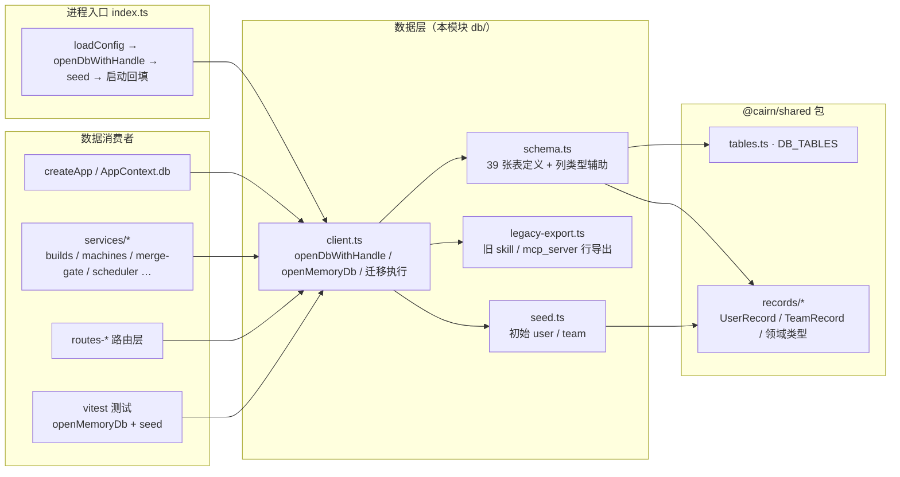
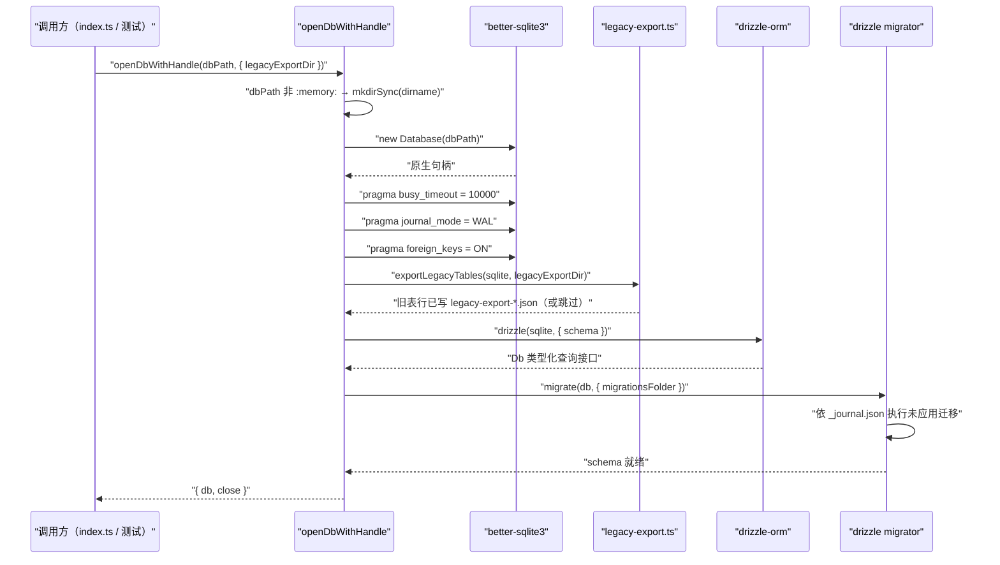
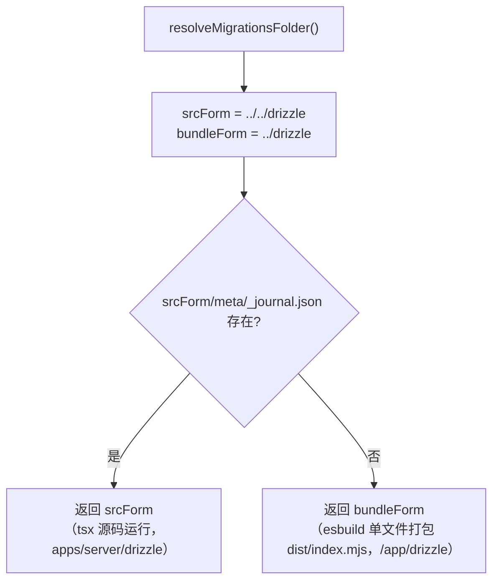
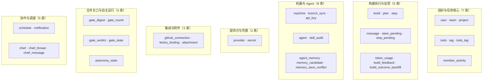
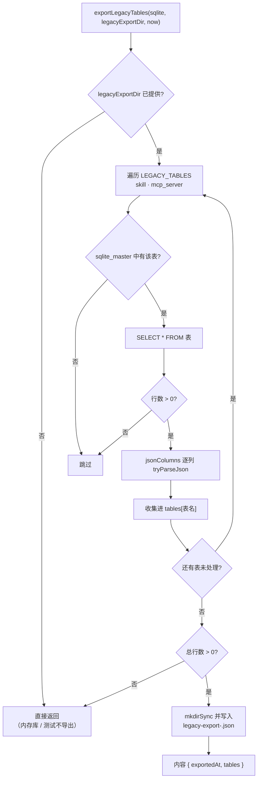
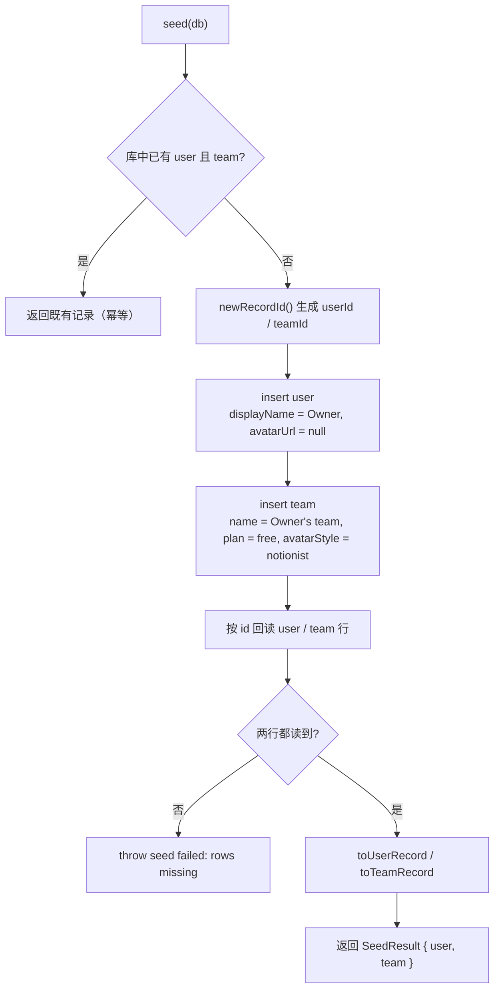
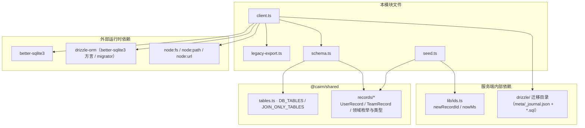

# 服务端数据库模块（server_database）

## 模块简介

`server_database` 是 cairn 服务端（[server 模块](../server.md)）的**SQLite 持久化层**，负责数据模型定义、连接与迁移管理、旧数据兜底导出以及初始种子数据。整个数据层只有四个文件，位于 `apps/server/src/db/`：

| 文件 | 核心组件 | 职责 |
| --- | --- | --- |
| `apps/server/src/db/client.ts` | `openDbWithHandle` / `openDb` / `openMemoryDb` / `resolveMigrationsFolder` / `MIGRATIONS_FOLDER` | 打开 SQLite 库（better-sqlite3）、设置 pragma、执行迁移、返回 Drizzle 类型化 `Db` 句柄 |
| `apps/server/src/db/schema.ts` | 39 张表的 Drizzle 定义 + `epochMs` / `bool` / `json` 列类型辅助 + `GateBlockerRow` / `GateRoundDispatch` 等行内类型 | 全部数据模型的单一事实来源 |
| `apps/server/src/db/legacy-export.ts` | `LegacyTableSpec` / `exportLegacyTables` / `listLegacyExports` | 在迁移执行前把已退役的 `skill` / `mcp_server` 旧表行导出为 JSON 文件，防止升级丢数据 |
| `apps/server/src/db/seed.ts` | `seed` / `toUserRecord` / `toTeamRecord` | 幂等地写入初始 `user` / `team` 记录 |

技术选型：**better-sqlite3**（同步、原生 SQLite 驱动）+ **drizzle-orm**（better-sqlite3 方言 + migrator），迁移文件由 **drizzle-kit** 生成于 `apps/server/drizzle/`。服务端所有路由与服务的持久化访问都经由 `AppContext.db`（见 [server_app_bootstrap](server_app_bootstrap.md)）落到本模块。

## 在服务端中的位置



要点：

- `index.ts`（引导装配，见 [server_app_bootstrap](server_app_bootstrap.md)）在启动时调用 `openDbWithHandle(config.dbPath, { legacyExportDir: config.homeDir })`，随后 `seed(db)` 取得初始 `user`/`team` 注入 `AppContext`。
- 全部服务层（`server_build_lifecycle`、`server_machine_fleet`、`server_merge_gate`、`server_provider_runtime`、`server_integrations`、`server_scheduler`、`server_attachments` 等）共享同一个 `Db` 实例。
- 测试通过 `openMemoryDb()` 获得内存 SQLite，配合 `createEphemeralSecretBox()` 装配最小 `AppContext`（见 [server_app_bootstrap](server_app_bootstrap.md) 的「测试装配模式」）。
- 表名清单的权威来源是 [shared 模块](../../shared.md) 的 `@cairn/shared`（`tables.ts` 的 `DB_TABLES`）；`schema.test.ts` 断言 schema 表集合与 `DB_TABLES` 完全一致（当前 39 张），防止 Drizzle schema 与迁移清单漂移。

## 数据库引擎与连接管理（db/client.ts）

### 导出接口

| 符号 | 签名 | 说明 |
| --- | --- | --- |
| `Db` | `BetterSQLite3Database<typeof schema>` | 全 schema 类型化的 Drizzle 查询接口，`AppContext.db` 的类型 |
| `openDbWithHandle` | `(dbPath, opts?: { legacyExportDir?: string }) => OpenedDb` | 完整打开流程：建目录 → 原生连接 → pragma → 旧表导出 → Drizzle 包装 → 迁移；返回 `{ db, close }` |
| `openDb` | `(dbPath: string) => Db` | 打开后只返回 `db`（不保留句柄，进程退出由系统回收） |
| `openMemoryDb` | `() => Db` | `openDb(':memory:')`，测试与临时装配专用 |
| `resolveMigrationsFolder` | `() => string` | 定位 `drizzle/` 迁移目录（区分源码运行与单文件打包两种形态） |
| `MIGRATIONS_FOLDER` | `string`（常量） | 模块加载时即解析出的迁移目录路径，供 `migrate()` 与 `db-check` 使用 |

### 打开与迁移流程



### SQLite pragma

| pragma | 值 | 作用 |
| --- | --- | --- |
| `busy_timeout` | `10000`（10 秒） | 写锁竞争时等待而非立即报 `SQLITE_BUSY` |
| `journal_mode` | `WAL` | 写前日志模式，读写并发更高 |
| `foreign_keys` | `ON` | 启用外键约束（`build`/`plan`/`gate_*` 等表的 `ON DELETE CASCADE` 依赖此开关） |

### 迁移目录解析

`resolveMigrationsFolder()` 兼容两种运行形态，选择标准是「哪个候选路径下存在 `meta/_journal.json`」：



- **源码形态**（`pnpm dev` / `pnpm start`，`import.meta.url` 指向 `src/db/client.ts`）：`srcForm` = `apps/server/drizzle`，存在 journal → 命中。
- **打包形态**（`dist/index.mjs` 单文件，Docker 部署）：`srcForm` 与 `bundleForm` 都解析到 `/app/drizzle`（Dockerfile 将 `apps/server/drizzle` 复制到镜像 `/app/drizzle`，见 [root_build_deploy](../../Repository_automation_and_delivery/root_build_deploy.md)），命中即返回。

## 数据模型（db/schema.ts）

### 列类型辅助

schema.ts 用三个局部工厂函数统一列类型，全表复用：

| 辅助 | 定义 | 存储 | TS 侧 |
| --- | --- | --- | --- |
| `epochMs(name)` | `integer(name)` | SQLite `INTEGER`（毫秒时间戳） | `number` |
| `bool(name)` | `integer(name, { mode: 'boolean' })` | SQLite `INTEGER`（0/1） | `boolean` |
| `json<T>(name)` | `text(name, { mode: 'json' }).$type<T>()` | SQLite `TEXT`（JSON 文本） | 类型化 `T`（Drizzle 自动序列化/反序列化） |

行内类型（非表）还包括：`QuotaWaitRow`（`step.quotaBlock`）、`StepFallbackRow`（`step.fallback`）、`GateBlockerRow`（`gate_state.blockers` 元素）、`GateRoundDispatch`（`gate_round.dispatches` 值）、以及 `GateVerdictKind` / `GateVerdictOutcome` / `GatePolicy` / `GateRoundState` 等门禁枚举。

### 39 张表分组

表集合由 [shared 模块](../../shared.md) 的 `DB_TABLES` 权威定义，`schema.test.ts` 强制二者一致。按领域分组如下：

#### 组织与任务核心（7 表）

| 表 | 说明 |
| --- | --- |
| `user` / `team` | 用户与团队；`team` 含 `firstPrReportPrompt*` 首 PR 报告字段（见 [server_integrations](server_integrations.md)） |
| `project` | 项目：`teamId` 外键、`repoKind` / `repoName` / `githubRepo` / `localPath`、`autonomy` JSON（自主运行设置 + 合并配置） |
| `todo` | 待办：相位机（`phase` + `phaseAt`）、`assignment`、`latestBuildId`、`blockedBy`、来源（`sourceKind` / `sourceRef` / `sourceTodo`）、附件 ID 数组 |
| `tag` / `todo_tag` | 标签与多对多关联（`todo_tag` 主键 = `(todoId, tagId)`，级联删除） |
| `member_activity` | 成员写操作时间戳（`scope` 主键），自主运行门判据 |

#### 构建执行与反馈（9 表）

| 表 | 说明 |
| --- | --- |
| `build` | 一次构建：`todoId`（级联删除）、`withPlan`、`prevPhase`、`triggerSource`、`changes`（diff 文件）、`diffHash` / `baseSha` / `harnessHash`、`prUrl` / `prNumber` |
| `plan` | 计划文档：`buildId`（级联删除）、`version`、`content`、`stepId` |
| `step` | 执行步骤：`buildId`、`kind`、`machineId`、`status`（pending/claimed/done/failed/stopped/waiting_quota）、`quotaBlock` / `fallback` JSON、会话与心跳字段、`skillInjection` / `blockerHandoff`、`holdReason` / `holdUntil` / `holdCount` |
| `message` | 会话消息：`conversationId`、`role`、`content`（JSON 内容块）、`actor` |
| `steer_pending` / `stop_pending` | 待下发的人工 steer / stop 信号队列（以 `conversationId` 为主键） |
| `token_usage` | 主键 `(buildId, model)` 累积 token 与成本（input/output/cache + 成本列，见 [server_provider_runtime](server_provider_runtime.md)） |
| `build_feedback` | 构建反馈：`kind`（revision/restart）、`side`（plan/build）、`feedback`、`actor` |
| `build_outcome_backfill` | 构建结局回填：`revertedWithin7d` / `fixedByLaterPr` / `mergeCommit` |

#### 机器与 Agent（8 表）

| 表 | 说明 |
| --- | --- |
| `machine` | 机器节点：`online`、`tokenHash`、`kind`、`enabledRuntimes`、`claudeCodeReport`、`maxConcurrent`（含 `maxConcurrentOverridden`）、`capabilities` JSON（详见 [server_machine_fleet](server_machine_fleet.md)） |
| `branch_sync` | 分支同步任务：`buildId` + `machineId` + `teamId`、`directory` / `ref` / `commit`、`force`、状态机（pending/running/synced/failed） |
| `api_key` | API 密钥：`gitAccess` / `mcpAccess` / `toolGrants` JSON、`keyHash` / `masked` |
| `agent` | Agent 定义：`persona`、`provider` / `modelId` / `thinkingLevel`、`tools` / `secrets` / `mcpServers` JSON、`requiredCapabilities`、`fallbackModels`；`(teamId, persona)` 部分唯一索引（persona 非空时） |
| `skill_audit` | 技能文件写审计：`skillId` / `actorType` / `actorId` / `action` / `bytes` |
| `agent_memory` | Agent 记忆：`history` JSON、`invalidAt` / `supersededBy` / `lastInjectedAt` 失效与替代链 |
| `memory_candidate` | 记忆候选：`status`（pending…）、`buildIds` / `evidence` JSON、`conflictIds`、`memoryId` |
| `memory_save_conflict` | 记忆保存冲突登记：`candidateIds` |

#### 模型提供方与凭据（2 表）

| 表 | 说明 |
| --- | --- |
| `provider` | 模型提供方：`kind` / `providerId` / `label` / `baseUrl` / `api` / `compat` JSON / `models` JSON / `apiKeyCipher`（密钥盒加密，见 [server_app_bootstrap](server_app_bootstrap.md)） |
| `secret` | 团队密钥：`name` / `description` / `valueCipher` |

#### 集成与附件（3 表）

| 表 | 说明 |
| --- | --- |
| `github_connection` | GitHub OAuth 连接（`teamId` 主键、级联删除）：`accessTokenCipher` / `refreshTokenCipher` / `accessTokenExpiresAt` / `disconnectedReason` / `scope`（见 [server_integrations](server_integrations.md)） |
| `feishu_binding` | 飞书绑定：`teamId` 主键、`openId` 唯一索引、`appIdCipher` / `appSecretCipher` |
| `attachment` | 附件元数据：`scope`（spec/message）、`status`（pending/ready/failed）、`storageKey` / `grantId`（见 [server_attachments](server_attachments.md)） |

#### 合并关口与自主运行（5 表）

| 表 | 说明 |
| --- | --- |
| `gate_digest` | 补丁摘要：主键 `(buildId, headSha)`、`patchDigest`、计数（counted/kept files/lines） |
| `gate_round` | 关口回合：`round` / `fixRound`、`state`（open/fixing/fix_no_change/closed）、`perspectives` / `timedOut` / `dispatches` JSON；`(buildId, patchDigest)` 与 `(buildId, round)` 双唯一 |
| `gate_verdict` | 关口裁决：`stepId` 主键、`kind`（review/verify/decision）、`perspective`、`outcome`、`patchDigest` / `headSha` / `expectedHeadSha` |
| `gate_state` | 关口状态：`buildId` 主键、`ready`、`policy`（human/shadow/autonomous）、`blockers` JSON（`GateBlockerRow[]`）、`evaluatedAt` |
| `autonomy_state` | 自主运行状态：主键 `(projectId, kind)`、`baselineSha`、`lastBlockedReason`（`AutonomyGateReason`）、`lastEvaluatedAt` |

（关口逻辑详见 [server_merge_gate](server_merge_gate.md)。）

#### 协作与调度（5 表）

| 表 | 说明 |
| --- | --- |
| `schedule` | 定时任务：`kind`（once/hourly/daily/weekly）、`at` / `tz` / `nextRunAt`（含索引） |
| `notification` | 站内通知：`type`（plan_ready/build_review/chief_message/quota_wait/model_fallback）、`entityRef` JSON、`channels`、`readAt` |
| `chief` | Chief 远程 Agent：`charter`、`watches` / `wakes` JSON、`lastTurnAt`、`tz` |
| `chief_thread` | Chief 会话线程：`sessionRuntime` / `sessionId` / `sessionOpenedAt`、`toolDefHashes` / `toolResultHashes` JSON、`activeRun` JSON |
| `chief_message` | Chief 线程消息（`threadId` 级联删除）：`role`、`content` JSON、`projectId` |

### 域分组图示



### 关键索引与外键

- **级联删除链**：`build → todo`、`plan → build`、`todo_tag → todo/tag`、`gate_* → build`、`autonomy_state → project`、`chief_message → chief_thread`、`github_connection / feishu_binding → team`、`build_feedback / build_outcome_backfill → build` 均为 `ON DELETE CASCADE`。
- **执行热路径索引**：`todo(phase)`、`step(status, kind)`、`step(buildId, status)`、`step(kind)`、`schedule(nextRunAt)`、`notification(type, readAt)`、`machine(online, lastSeenAt)`、`memory_candidate(agentId, teamId, projectId)`。
- **部分唯一索引**：`agent(teamId, persona) WHERE persona IS NOT NULL`——每个团队每种 persona 至多一个活跃 Agent。
- **JSON 默认值**：多处使用 `sql`'[]'` / `sql`'{}'` 作为 JSON 列默认值（如 `tools`、`mcpServers`、`watches`、`dispatches`、`toolDefHashes`）。

## 旧数据导出（db/legacy-export.ts）

### 背景

`skill` 表与 `mcp_server` 表已被迁移退役（登记制改为本地只读投影）：

- 迁移 `0013_brave_spot.sql`：先把 `agent.skills` 清为 `[]`，再 `DROP TABLE skill`。
- 迁移 `0014_cold_beast.sql`：先把 `agent.mcpServers` 清为 `[]`，再 `DROP TABLE mcp_server`。

由于迁移是 SQL 文件、无法写 JSON 文件，导出钩子被放在 **migrate 之前**的 TS 侧（`openDbWithHandle` 内部），确保旧行先落盘、再被 DROP。

### 表规格

```ts
interface LegacyTableSpec {
  name: string;
  jsonColumns: readonly string[];
}

const LEGACY_TABLES: readonly LegacyTableSpec[] = [
  { name: 'skill', jsonColumns: ['files'] },
  { name: 'mcp_server', jsonColumns: ['credentialKeys', 'args'] },
];
```

### 导出流程



要点：

- **文件名**：`legacy-export-<ISO 时间戳>.json`，其中 `:` 与 `.` 被替换为 `-`（如 `legacy-export-2025-01-01T00-00-00-000Z.json`），`listLegacyExports` 以 `/^legacy-export-.+\.json$/` 匹配并按字典序返回。
- **JSON 列还原**：`tryParseJson` 只对 `jsonColumns` 中声明的列尝试 `JSON.parse`，解析失败保留原始字符串；其余列原样拷贝。
- **幂等/空库**：表不存在或行数为 0 时不产出文件；第二次启动时表已被 DROP，也不会产生第二个文件（测试 L5b 验证）。
- **生产接线**：`index.ts` 以 `openDbWithHandle(config.dbPath, { legacyExportDir: config.homeDir })` 调用，导出文件落在 `~/.cairn/legacy-export-*.json`。

## 初始种子（db/seed.ts）

`seed(db)` 为全新数据库写入第一个 `user` 与 `team`，并保证**幂等**：库中已存在任意 user 与 team 时直接返回既有记录，不再插入。



- ID 生成：`newRecordId()`（21 字符、首字符字母的 URL-safe 随机 ID，见 `apps/server/src/lib/ids.ts`），时间戳用 `nowMs()`。
- 行 → 记录：`toUserRecord` / `toTeamRecord` 把 Drizzle 行转换为 [shared 模块](../../shared.md) 的 `UserRecord` / `TeamRecord`（zod 记录类型），随后注入 `AppContext.user` / `AppContext.team` 并用于 `seedLocalMachine(db, seeded.team.id)` 等启动回填（见 [server_machine_fleet](server_machine_fleet.md)、[server_provider_runtime](server_provider_runtime.md)）。

## 迁移管理

### 迁移目录与生成

- **配置**：`apps/server/drizzle.config.ts` —— `schema: './src/db/schema.ts'`、`out: './drizzle'`、`dialect: 'sqlite'`。
- **生成**：`pnpm db:generate`（`drizzle-kit generate`）对比 schema 与 `drizzle/meta/*_snapshot.json` 产出新迁移 `XXXX_<tag>.sql` 并追加到 `drizzle/meta/_journal.json`。
- **当前规模**：63 条迁移（journal `idx` 0–62），最后一条为 `0062_feishu_binding.sql`。
- **打包**：`apps/server/package.json` 的 `files` 字段包含 `drizzle`（发布包携带迁移）；Dockerfile 将 `apps/server/drizzle` 复制到运行镜像 `/app/drizzle`（见 [root_build_deploy](../../Repository_automation_and_delivery/root_build_deploy.md)）。

### 一致性校验（db:check）

`pnpm db:check` 运行 `scripts/db-check.mjs`，在 CI 的 `dead-class-gate`/`e2e` 前拦截迁移链损坏：

1. 校验 `drizzle/meta/_journal.json` 存在且非空。
2. **快照链线性**：逐条校验 `XXXX_snapshot.json` 的 `prevId` 等于上一条的 `id`（首条必须为零 UUID）；断链时 drizzle-kit 会静默拒绝生成迁移。
3. 运行 `drizzle-kit check`，检测 snapshot 父节点冲突（平行合并产生的分叉）。
4. 任一项失败即 `exit(1)`，提示修复线性链（「migration discipline 01 §6」）。

### 迁移与 schema 的守卫

`test/schema.test.ts` 断言：schema 表名集合与 `DB_TABLES`（39 张）完全一致、累计迁移 SQL 覆盖每一张 `CREATE TABLE`、`openMemoryDb()` 能干净应用全部迁移——保证「迁移已提交、schema 未漂移」。

## 依赖关系



- `client.ts` 是唯一直接触碰 better-sqlite3 与 migrator 的文件；`schema.ts` / `legacy-export.ts` / `seed.ts` 均被其编排，服务层永远只看到 Drizzle 的 `Db`。
- `schema.ts` 与 `seed.ts` 依赖 [shared 模块](../../shared.md)：前者引用领域类型（`Phase`、`TriggerSource`、`ProviderApi`、`MachineCapabilities`、`MemoryCandidateStatus` 等），后者引用 `UserRecord` / `TeamRecord`；`DB_TABLES` 由 shared 提供并反向约束 schema。
- `better-sqlite3` 是唯一运行时原生依赖（`apps/server/package.json` 的 `dependencies` 仅此一项），Docker 的 `native` 阶段为其单独重编译（见 [root_build_deploy](../../Repository_automation_and_delivery/root_build_deploy.md)）。

## 测试覆盖

| 测试文件 | 场景 | 验证点 |
| --- | --- | --- |
| `test/schema.test.ts` | 39 表集合 | schema 表名集合 == `DB_TABLES`；累计迁移 SQL 覆盖全部 `CREATE TABLE`；`openMemoryDb()` 干净应用迁移 |
| `test/schema.test.ts` | seed 幂等 | 二次 `seed` 返回同一 user/team；`plan = 'free'` |
| `test/legacy-export.test.ts` | L1 | 旧库含 `skill`（2 行）+ `mcp_server`（1 行）→ 导出文件内容完整（`files` / `credentialKeys` / `args` 已 JSON 还原），两表被 DROP，`agent` 的 `skillsAllowlist` / `defaultSkill` 清空、`mcpServers` = `[]` |
| `test/legacy-export.test.ts` | L2 / L3 / L4 | 空表 / 全新库 / 未传 `legacyExportDir` → 不产文件，迁移照常 |
| `test/legacy-export.test.ts` | L5b | 二次启动幂等：不再产生第二个导出文件 |
| `test/legacy-export.test.ts` | L6 | `:memory:` 不触发导出、不抛错 |

## 构建、测试与部署

- **脚本**（`apps/server/package.json`）：`db:generate` = `drizzle-kit generate`；`db:check` = `node scripts/db-check.mjs`；`test` = `vitest run`（覆盖上述 schema/legacy-export 用例）；`typecheck` = `tsc --noEmit`。
- **类型约束**（`apps/server/tsconfig.json`）：`NodeNext` 模块解析、`strict`、`noUncheckedIndexedAccess`、`verbatimModuleSyntax`、`noEmit`（纯类型检查），target `ES2023`。
- **容器**（根仓库 `Dockerfile`）：`build` 阶段产物 `dist/` + `drizzle/` + `web/`；`native` 阶段仅为 `better-sqlite3` 重编译原生模块；运行镜像复制 `drizzle/` 到 `/app/drizzle`，`MIGRATIONS_FOLDER` 在打包形态下解析到该目录。详见 [root_build_deploy](../../Repository_automation_and_delivery/root_build_deploy.md)。
- **CI**：`db:check` 与 schema 守卫测试纳入 `github_ci` 的 `check` / `e2e` 流程（见 [github_ci](../../Repository_automation_and_delivery/github_ci.md)）。

## 关联文档

- 父模块：[server 模块](../server.md) —— 服务端整体架构、分层与子模块导航；「数据持久化与迁移」小节与本页互为索引。
- 引导装配：[server_app_bootstrap](server_app_bootstrap.md) —— `index.ts` 如何打开数据库并 seed；`AppContext.db` 的类型来源；测试装配模式（`openMemoryDb` + `createEphemeralSecretBox`）。
- 数据消费者（服务层）：[server_build_lifecycle](server_build_lifecycle.md)、[server_machine_fleet](server_machine_fleet.md)、[server_merge_gate](server_merge_gate.md)、[server_provider_runtime](server_provider_runtime.md)、[server_integrations](server_integrations.md)、[server_attachments](server_attachments.md)、[server_scheduler](server_scheduler.md)——各自的表/字段消费与本页表分组一一对应。
- 共享契约：[shared 模块](../../shared.md) —— `DB_TABLES`、`UserRecord` / `TeamRecord`、领域枚举类型与 zod 记录 schema。
- 部署与 CI：[Repository_automation_and_delivery](../../Repository_automation_and_delivery.md) 的 [root_build_deploy](../../Repository_automation_and_delivery/root_build_deploy.md)（Dockerfile 打包 `drizzle/`）与 [github_ci](../../Repository_automation_and_delivery/github_ci.md)（`db:check` / 迁移守卫测试）。
