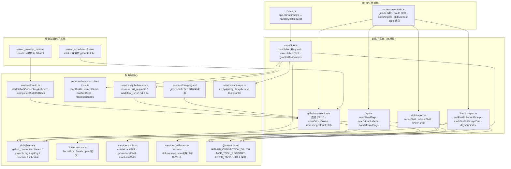
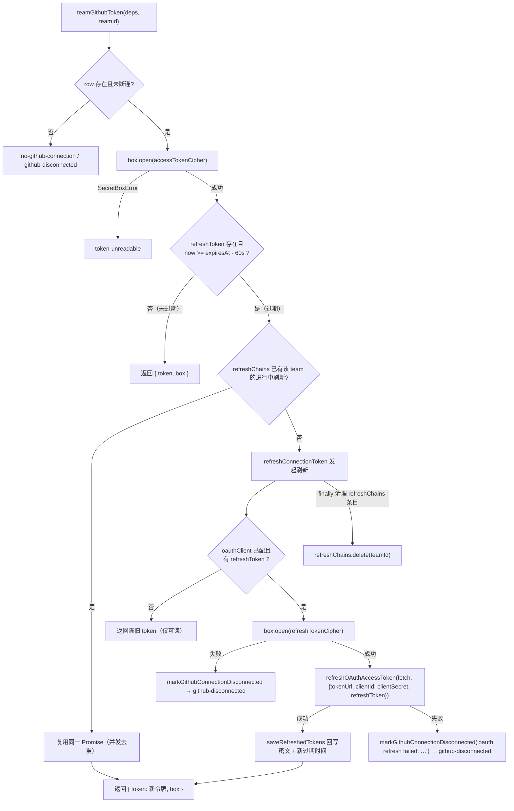
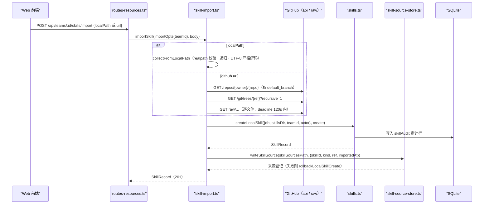
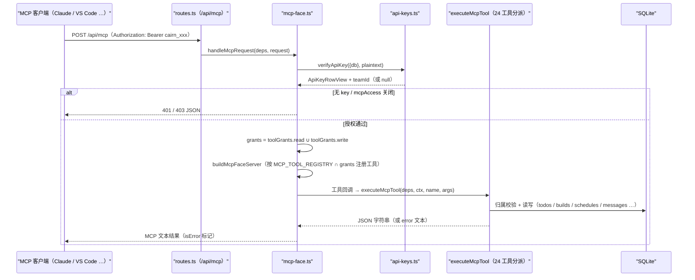
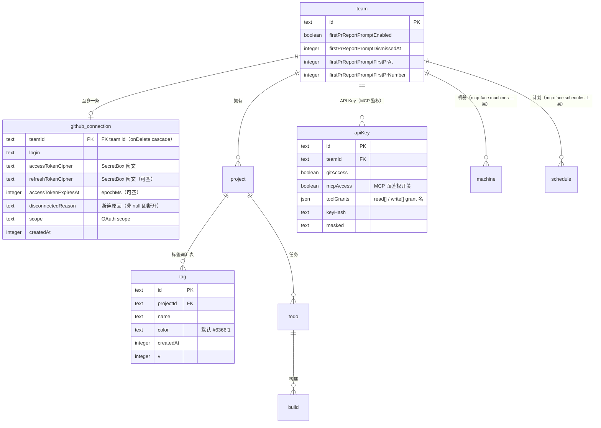
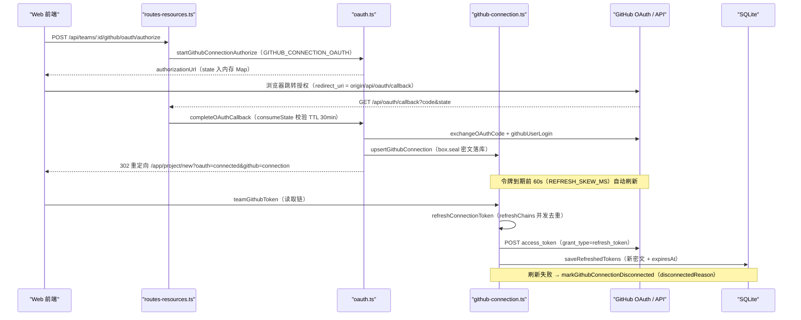
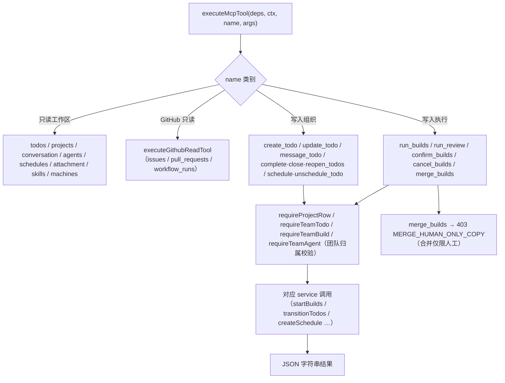

# 服务端集成子系统（server_integrations）

## 模块简介

`server_integrations` 是 cairn 服务端的**外部系统集成子系统**：它统一处理服务端与外部世界的五类交互——GitHub 仓库连接（OAuth 令牌托管与自动刷新）、技能导入（本地目录 / GitHub URL 两种来源）、MCP 工具面（把首席工具以 MCP 协议暴露给外部客户端）、固定标签与 GitHub 标签同步、以及首次 PR 报告提示。它由五个文件构成：

| 文件 | 职责 |
| --- | --- |
| `apps/server/src/services/github-connection.ts` | GitHub OAuth 连接的 CRUD、令牌加密存取、过期自动刷新（含并发去重）、401 自动重试包装（`refreshingGithubFetch`） |
| `apps/server/src/services/skill-import.ts` | 从本地路径或 GitHub URL 导入/刷新技能（`importSkill` / `refreshSkill`），含 SSRF 防护与体积限制 |
| `apps/server/src/services/mcp-face.ts` | 把首席远程工具（`CHIEF_REMOTE_TOOLS`）包装为 MCP 服务器（`/api/mcp`），按 API Key 的 `toolGrants` 裁剪工具面 |
| `apps/server/src/services/tags.ts` | 固定标签（bug / feature / improvement / refactor / docs / chore）播种与回填、GitHub 标签颜色归一化与同步 |
| `apps/server/src/services/first-pr-report.ts` | 团队「首次 PR 报告」提示的读取、开关/忽略设置、到期标记与天数计算 |

核心职责归纳为：

1. **GitHub 连接生命周期**：`startGithubConnectionAuthorize`（见 [server_provider_runtime](server_provider_runtime.md) 的 `oauth.ts`）发起 OAuth 授权，回调落地 `upsertGithubConnection`；此后 `teamGithubToken` 统一提供可用令牌——令牌过期（`REFRESH_SKEW_MS = 60s` 提前量）时自动用 refresh token 换新并回写密文；`refreshingGithubFetch` 把内层 fetch 包装为「401 时自动刷新重试一次」的语义，供全局 GitHub 请求复用。
2. **技能导入**：`POST /api/teams/:id/skills/import`（`importSkill`）与 `POST /api/teams/:id/skills/:sid/refresh`（`refreshSkill`）接受 `localPath`（本地目录递归收集，校验不落入技能目录、逐文件 UTF-8 严格解码、`MAX_SKILL_FILE_BYTES`/`MAX_SKILL_TOTAL_BYTES` 限流）或 `url`（仅 `https://github.com/<owner>/<repo>[/tree/<ref>/<subdir>]`，拒绝私有/环回主机防 SSRF，经 Git Trees API 枚举 + raw 逐文件拉取）；导入成功后注册 `skill-sources.json` 来源记录，刷新时按来源重拉并校验 frontmatter 身份未漂移。
3. **MCP 工具面**：`handleMcpRequest` 在 `/api/mcp` 上以 `WebStandardStreamableHTTPServerTransport` 承载 MCP 会话；Bearer 校验经 `verifyApiKey`（要求 `mcpAccess` 开启），工具注册按 `key.toolGrants.read/write` 与 `MCP_TOOL_REGISTRY` 交集裁剪；`executeMcpTool` 以 `ChiefToolDeps` 为依赖容器分派 24 个工具，其中 `merge_builds` 按 `MERGE_HUMAN_ONLY_COPY` 硬性拒绝（403，合并仅限人工）。
4. **标签体系**：`seedFixedTags` 为项目播种 6 个固定标签（`FIXED_TAGS`，含中文描述与默认色）；`backfillFixedTags` 启动时对非 GitHub 项目补种；`syncGithubLabels` / `normalizeGithubLabelColor` 在 GitHub 仓库连接后把上游标签（含 6 位 hex 颜色归一化）同步为本地 `tag` 行。
5. **首次 PR 报告**：`markFirstPrPromptDue` 在构建产生 PR 时记录 `firstPrAt`/`firstPrNumber`（仅当团队开关开启且从未标记/忽略）；`daysToFirstPr` 计算「建队 → 首个 PR」的天数（<0 返回 `null`），供前端引导页展示分享链接（`firstPrDiscussionUrl`，见 [shared 模块](../../shared.md)）。

## 在服务端架构中的位置

- **路由入口**：GitHub 连接端点与技能导入端点都注册在 `routes-resources.ts::registerResourceRoutes`——`POST /api/teams/:id/github/oauth/authorize` → `startGithubConnectionAuthorize`（OAuth 流程详见 [server_provider_runtime](server_provider_runtime.md)），`GET/DELETE /api/teams/:id/github/connection` → `readGithubConnectionStatus`/`deleteGithubConnection`，`POST /api/teams/:id/skills/import` → `importSkill`，`POST /api/teams/:id/skills/:sid/refresh` → `refreshSkill`；MCP 面在 `routes.ts` 以 `app.all('/api/mcp')` 直接转发给 `handleMcpRequest`。
- **全局 GitHub 请求包装**：`apps/server/src/index.ts` 启动时用 `refreshingGithubFetch({ db, box, oauthClient }, globalThis.fetch)` 装配 `ctx.githubFetch`，再注入 `ChiefToolDeps`（MCP 面、首席工具、调度器）与 merge-gate 的 GitHub 端口——**整个服务端对外 GitHub API 请求都经过这一层自动刷新**。
- **启动回填**：`index.ts` 依次调用 `backfillFixedTags(db)`（非 GitHub 项目补种固定标签）、`seedLocalMachine`/`backfillPersonas`/`backfillTokenUsageCost`（见 [server_app_bootstrap](server_app_bootstrap.md)）；`markFirstPrPromptDue` 由构建流水线（[server_build_lifecycle](server_build_lifecycle.md)）在 PR 产生时触发。
- **消费方**：merge-gate 的 `readGateGithubFacts`（[server_merge_gate](server_merge_gate.md)）与 `github-reads.ts::openTarget` 都经 `teamGithubToken` 取令牌；调度器的 `issueIntakeRunOf`（[server_scheduler](server_scheduler.md)）复用 `githubFetch` 包装。

## 核心组件

### github-connection.ts —— GitHub OAuth 连接与令牌刷新

`github-connection.ts` 是 GitHub 连接的单一事实源：令牌只以 `SecretBox` 密文（`accessTokenCipher` / `refreshTokenCipher`）落库，明文仅存在于进程内短生命周期变量。依赖容器为 `GithubConnectionDeps { db: Db; box: SecretBox }` 与 `GithubTokenDeps`（额外可选 `githubFetch` / `oauthClient`）。

| 函数 | 说明 |
| --- | --- |
| `upsertGithubConnection(deps, input)` | 写入/更新连接：`box.seal` 加密 access/refresh token，`onConflictDoUpdate(teamId)` 幂等 upsert，清空 `disconnectedReason`；OAuth 回调（`completeOAuthCallback`，见 [server_provider_runtime](server_provider_runtime.md)）调用它落地 |
| `markGithubConnectionDisconnected(deps, teamId, reason)` | 写 `disconnectedReason`（刷新失败、refresh token 不可读等场景） |
| `saveRefreshedTokens(deps, row, tokens)` | 刷新成功后回写新密文与 `accessTokenExpiresAt = now + expiresInSeconds*1000`，并清除断连标记 |
| `deleteGithubConnection(deps, teamId)` | 删除连接，返回是否曾存在（`DELETE /api/teams/:id/github/connection`） |
| `openGithubToken(deps, teamId)` | 同步读令牌：行不存在或已断连返回 `null`，否则 `box.open(accessTokenCipher)` |
| `teamGithubToken(deps, teamId)` | 异步取令牌：无 `box` → `no-secret-box`；无行 → `no-github-connection`；解密失败（`SecretBoxError`）→ `token-unreadable`；已断连 → `github-disconnected`；未过期 → `{token, box}`；过期则走刷新链 |
| `refreshingGithubFetch(deps, inner)` | 包装内层 fetch：收到 401 且请求头为 `Bearer <rejected>` 时，遍历全部未断连连接找出被拒令牌，刷新后以新令牌重放一次；无法刷新则原样返回 401 |
| `githubTokenOrNull(deps, teamId)` | `teamGithubToken` 的便捷封装（无令牌返回 `null`） |
| `hasGithubConnection(db, teamId)` | 是否存在未断连连接 |
| `readGithubConnectionStatus(deps, teamId)` | 序列化为 `GithubConnectionStatus`（`connected`/`login`/`scope`/`disconnectReason`） |

#### 令牌过期刷新（refreshChains 并发去重）

- 刷新使用 `lib/github.ts::refreshOAuthAccessToken`（`grant_type=refresh_token`、15s 超时、失败抛 `HttpError(502)`），tokenUrl / clientId / clientSecret 来自 `GITHUB_CONNECTION_OAUTH.tokenUrl` 与配置的 `CAIRN_GITHUB_OAUTH_CLIENT_ID` / `CAIRN_GITHUB_OAUTH_CLIENT_SECRET`（见 [server_app_bootstrap](server_app_bootstrap.md) 的 `loadConfig`）。
- `refreshChains: Map<teamId, Promise<GithubTokenAccess>>` 保证同一团队并发取令牌时只发一次上游刷新，其余调用者复用同一 Promise；`finally` 中仅在仍是当前条目时删除。
- `refreshingGithubFetch` 的 401 重放只匹配「请求头确为 `Bearer <rejected>`」的请求；匹配到存储中的旧令牌后调用 `refreshConnectionToken({...deps, githubFetch: inner})`（用内层 fetch 发刷新），成功后用新令牌重放一次内层请求，否则返回原始 401。

### skill-import.ts —— 技能导入（本地路径 / GitHub）

`skill-import.ts` 提供两条导入通道，统一产出 `CreateSkillBody { name, description, files }` 交给 `services/skills.ts::createLocalSkill` / `updateLocalSkill` 落盘，并用 `skill-source-store.ts`（`skill-sources.json`，写操作经串行 `writeChain` 原子写）登记来源以便后续刷新。

| 常量 | 值 | 含义 |
| --- | --- | --- |
| `SKILL_IMPORT_FETCH_TIMEOUT_MS` | `15_000` | 单次 GitHub fetch 超时 |
| `SKILL_IMPORT_DEADLINE_MS` | `120_000` | 整仓拉取总截止时间（超时抛 504） |
| `SKILL_IMPORT_MAX_FILES` | `256` | 导入文件数上限 |
| `MAX_SKILL_FILE_BYTES` / `MAX_SKILL_TOTAL_BYTES` | `512_000` / `2_000_000` | 单文件 / 总量上限（[shared](../../shared.md) 定义） |
| `GH_API_BASE` / `GH_RAW_BASE` | `api.github.com` / `raw.githubusercontent.com` | GitHub API 与 raw 端点 |
| `GH_USER_AGENT` | `cairn-skill-import` | GitHub 要求 User-Agent（否则 403） |

| 函数 | 说明 |
| --- | --- |
| `importSkill(opts, body)` | 入口：`localPath` 与 `url` 恰好二选一（否则 400）；收集文件 → `assembleCreateBody` 校验 `SKILL.md`（frontmatter 必须有 `name`/`description`）→ `createLocalSkill` 落盘 → `writeSkillSource` 登记来源；来源登记失败时回滚新建（`rollbackLocalSkillCreate`） |
| `refreshSkill(opts, sid)` | 按 `skill-sources.json` 记录的来源重拉文件，`assembleCreateBody` 后校验 frontmatter `name` 仍等于 `sid`（漂移 → 409，要求作为新技能导入）；`updateLocalSkill` 覆盖写入并刷新 `refreshedAt` |
| `collectFromLocalPath(rawPath, skillsDir)` | `~` 展开 → `realpathSync` 解析；拒绝解析进 cairn 技能目录内的路径（避免导入自身）；递归遍历（跳过 `.git`），逐文件 `assertFileBytes` + 严格 UTF-8 解码（`TextDecoder('utf-8', {fatal:true})`，二进制文件 400） |
| `collectFromGithubUrl(rawUrl, opts)` | 解析 URL → `GET /repos/{owner}/{repo}` 取默认分支 → `GET /git/trees/{ref}?recursive=1` 枚举 blob（截断 → 400；>256 文件 → 400）→ 逐文件 `GET raw.githubusercontent.com/...`（`fetchBytes`，先查 `content-length` 声明再查实收字节） |
| `parseGithubUrl(raw)` | 仅接受 `https://github.com/<owner>/<repo>[/tree/<ref>/<subdir>]`；拒绝 blob 单文件 URL、非法 owner/repo/ref/subdir 段（`.`/`..`/`\`/`\0`）；`canonicalUrl` 归一化作为来源 ref |
| `isPrivateOrLoopbackHost(host)` | SSRF 防护：`localhost`/`*.localhost`/`0.0.0.0`/`::`、IPv4 私有段（127/10/172.16-31/192.168/169.254）、IPv6 链路本地/ULA、`::ffff:` 映射地址均视为私有 |
| `fetchGithubJson<T>(opts, url)` | 带超时与 `GH_HEADERS` 的 JSON GET（供 repos meta 与 trees API 使用），非 2xx 返回 `{status, body:null}` 由调用方映射错误 |
| `assembleCreateBody(files, sourceLabel)` | 找 `SKILL_ENTRY_FILE`（`SKILL.md`），`parseSkillFrontmatter` 校验 `name`/`description` 必填，组装 `CreateSkillBody` |

#### 技能导入流程

- **刷新身份校验**：`refreshSkill` 重拉后若 frontmatter `name` 与 `sid` 不一致（上游改名/换技能），抛 409 要求作为新技能导入——防止刷新静默覆盖同名不同义内容。
- **本地路径安全**：导入目录若解析到 cairn 技能目录内部（`real === rootReal || real.startsWith(rootReal + sep)`）直接拒绝；`.git` 目录跳过；文件大小在读取前用 `statSync` 预检。
- **错误映射**：GitHub 404 → 400「not found (or private)」；超时/中止 → 504；上游异常 → 502；`fetchGithubJson` 解析失败 → 502。`refreshSkill` 把来源收集期的 400 包一层「cannot refresh skill …」。

### mcp-face.ts —— MCP 工具面

`mcp-face.ts` 把 cairn 的首席远程工具以 MCP（Model Context Protocol）暴露，让 Claude Desktop / VS Code / 自定义客户端通过 `/api/mcp` 直接操作团队工作区。依赖 `ChiefToolDeps`（见 [server_machine_fleet](server_machine_fleet.md) 与 `chief-tools.ts`），调用上下文为 `McpCallerCtx { teamId, user, grants }`。

| 函数 | 说明 |
| --- | --- |
| `handleMcpRequest(deps, request)` | HTTP 入口：校验 `Authorization: Bearer <apiKey>` → `verifyApiKey`（`mcpAccess` 关闭 → 403）→ 组装 `grants = toolGrants.read ∪ toolGrants.write` → 建 `McpServer` + `WebStandardStreamableHTTPServerTransport`（`enableJsonResponse`）→ `transport.handleRequest(request)`，finally 中关闭 transport 与 server |
| `buildMcpFaceServer(deps, ctx)` | 按 `MCP_TOOL_REGISTRY` 遍历，仅注册 `ctx.grants` 包含对应 `grant` 的工具；每个工具回调把 `executeMcpTool` 结果包成 `{content:[{type:'text', text}]}`，异常包成 `isError:true` 的文本结果 |
| `executeMcpTool(deps, ctx, name, args)` | 24 路工具分派（见下表），返回 JSON 字符串 |
| `grantedToolNames(grants)` | 由授权集合反查 `MCP_TOOL_REGISTRY` 得到工具名列表（供 API Key 管理页展示可授权项） |

**工具分派**（`TOOL_SCHEMAS` 定义入参，`MCP_TOOL_REGISTRY` 定义 grant 名 → 工具名映射，均在 [shared 模块](../../shared.md) 的 `packages/shared/src/protocol/mcp.ts` / `chief-tools.ts`）：

| 类别 | 工具（grant → 名称） | 行为 |
| --- | --- | --- |
| 只读 · 工作区 | Todos / Projects / Conversation / Agents / Schedules / Attachment / Skills / Machines | 分别委托 `listTodos`、项目行聚合、`readConversationPage`（校验 chief 线程或 build 归属）、agent 行投影、`listSchedules`、`readAttachmentMeta`（动态 `import('./attachments.js')`，见 [server_attachments](server_attachments.md)）、`scanLocalSkills`、machine 行投影 |
| 只读 · GitHub | Issues / Pull Requests / Workflow Runs | 委托 `executeGithubReadTool`（`github-reads.ts::openTarget` 消费 `teamGithubToken`，参数 schema 为 `githubReadToolParamsSchemas`） |
| 写入 · 组织 | Create Todo / Update Todo / Message Todo / Complete Todos / Close Todos / Reopen Todos / Schedule Todo / Unschedule Todo | 委托 `createTodo`/`updateTodo`、向 `todo.latestBuildId` 会话插入 user 消息、`transitionTodos`（done/closed/todo）、`createSchedule`/`deleteSchedule`；所有引用先做团队归属校验（`requireProjectRow`/`requireTeamTodo`/`requireTeamBuild`/`requireTeamAgent`） |
| 写入 · 执行 | Run Builds / Run Review / Confirm Builds / Cancel Builds / Merge Builds | `run_builds` 逐 todo 调 `startBuilds`（assignment 槽校验 agent 归属）；`confirm_builds` 调 `confirmBuild`；`cancel_builds` 调 `cancelBuild`；`run_review` 目前返回占位说明；`merge_builds` 一律 `HttpError(403, MERGE_HUMAN_ONLY_COPY)`（合并仅限人工，见 [server_build_lifecycle](server_build_lifecycle.md) 的 merge-gate 语义） |

#### MCP 请求处理流程

- **鉴权粒度**：API Key 的 `toolGrants`（`{read: string[], write: string[]}`）直接决定工具面——`grantedToolNames` 供前端把「可授权工具」展示为能力清单；`MCP_TOOLS_READ` / `MCP_TOOLS_WRITE`（[shared](../../shared.md)）是 grant 名的权威枚举。
- **错误面**：工具内异常不抛出 HTTP 错误，而是包装为 `{content:[{type:'text', text:'error: …'}], isError:true}`，保证 MCP 会话不断裂；仅鉴权失败返回 401/403。

### tags.ts —— 固定标签与 GitHub 标签同步

`tags.ts` 维护项目的标签词汇表：本地固定标签（`FIXED_TAGS`）与 GitHub 上游标签两套来源，统一落在 `tag` 表（`(projectId, name)` 隐含唯一，见 [server_database](server_database.md)）。

| 函数 | 说明 |
| --- | --- |
| `seedFixedTags(db, projectId)` | 按 `FIXED_TAGS`（bug / feature / improvement / refactor / docs / chore，各带中文描述与颜色）补种缺失标签，返回插入数；已存在同名标签跳过 |
| `backfillFixedTags(db)` | 遍历全部项目，`repoKind !== 'github'` 的项目执行 `seedFixedTags`（GitHub 项目的标签由上游同步而来，见下）；启动时由 `index.ts` 调用 |
| `resolveFixedTagId(db, projectId, name)` | 按 `(projectId, name)` 查固定标签 id（供 todo 创建时绑定） |
| `normalizeGithubLabelColor(color)` | GitHub 标签颜色归一化：`"ab12cd"` → `"#ab12cd"`、`"#AB12CD"` → `"#ab12cd"`（小写）、其余回退 `TAG_DEFAULT_COLOR`（`#6366f1`） |
| `syncGithubLabels(db, projectId, labels)` | 把 GitHub 仓库标签列表同步为本地 `tag` 行：缺失插入、颜色不同更新，返回 `{inserted, updated}` |
| `listProjectTagVocab(db, projectId)` | 列出项目全部标签名（供前端标签选择器） |
| `resolveProjectTagIds(db, projectId, names)` | 批量把标签名解析为 id（`Map<name,id>`，未命中跳过） |

> 固定标签与 GitHub 标签的取舍：GitHub 连接的项目以 `syncGithubLabels` 的上游标签为准（`backfillFixedTags` 跳过），非 GitHub（hosted/plain）项目由固定标签提供基线词汇表。`FIXED_TAGS` / `TAG_DEFAULT_COLOR` 定义在 [shared 模块](../../shared.md) 的 `packages/shared/src/task-meta.ts`。

### first-pr-report.ts —— 首次 PR 报告提示

`first-pr-report.ts` 管理「建队后首个通过门禁合并的 PR」引导提示：团队开关开启时，首个 PR 落地即标记到期，前端据此展示「time-to-first-pr」分享卡片（分享 URL 由 [shared](../../shared.md) 的 `firstPrDiscussionUrl` 生成）。状态字段全部位于 `team` 表（见 [server_database](server_database.md)）。

| 函数 | 说明 |
| --- | --- |
| `readFirstPrReportPrompt(db, teamId)` | 读 `team` 行四列（`enabled`/`dismissedAt`/`firstPrAt`/`firstPrNumber`）组装 `FirstPrReportPrompt`；行缺失回退 `DEFAULT_FIRST_PR_REPORT_PROMPT`（`enabled:false, due:false, …`）；`due = firstPrAt !== null && dismissedAt === null` |
| `setFirstPrReportPrompt(db, teamId, patch)` | 部分更新：`enabled` 直写；`dismissed:true` 写 `dismissedAt = nowMs()`，`false` 置 `null`；随后重读返回 |
| `markFirstPrPromptDue(db, buildId)` | 由构建流水线调用：联查 `build → todo` 取 `(teamId, prNumber, createdAt)`，`prNumber` 为 null 则忽略；仅在团队开关开启、`firstPrAt`/`dismissedAt` 均为 null 时写 `firstPrAt = build.createdAt`、`firstPrNumber = prNumber`（幂等：只记第一次） |
| `daysToFirstPr(teamCreatedAt, firstPrAt)` | `floor((firstPrAt - teamCreatedAt) / 86_400_000)`；`firstPrAt < teamCreatedAt` 返回 `null`（异常数据保护） |

## 数据模型

本模块直接依赖的表（完整 schema 见 [server_database](server_database.md)）：

- `github_connection` 以 `teamId` 为主键（每团队至多一条连接）；令牌两列均为 `SecretBox` 密文（`lib/secret-box.ts`，密钥文件 `secretbox.key`，见 [server_app_bootstrap](server_app_bootstrap.md)）——`openGithubToken`/`teamGithubToken` 用时才解密。
- `team.firstPrReportPrompt*` 四列是首次 PR 报告提示的全部状态；`markFirstPrPromptDue` 只在全空时写入，保证「首次」语义。
- `apiKey.toolGrants` 与 `mcpAccess` 是 MCP 面的鉴权输入；`verifyApiKey` 用 `keyHash`（哈希凭证）匹配。
- `skill-sources.json`（非 SQLite）由 `skill-source-store.ts` 维护：`{version:1, sources:{skillId: {skillId, kind:'localPath'|'github', ref, importedAt, refreshedAt}}}`，写操作经模块级 `writeChain` Promise 串行化 + 临时文件 `renameSync` 原子替换。

## 关键流程

### GitHub 连接生命周期（授权 → 落地 → 刷新 → 断连）

- 断连记录是软删除：`markGithubConnectionDisconnected` 只写 `disconnectedReason`，`teamGithubToken`/`readGithubConnectionStatus` 据此拒绝；`DELETE /api/teams/:id/github/connection` 才物理删除。
- `refreshingGithubFetch` 在服务端所有 GitHub API 请求外层提供「401 → 刷新 → 重放一次」的兜底，覆盖并发窗口期（令牌刚过期但读取链尚未触发的场景）。

### 技能导入与刷新

```mermaid
flowchart TB
    subgraph IMP["导入（POST /api/teams/:id/skills/import）"]
        A{"body 恰好含 localPath 或 url 之一?"}
        A -- "localPath" --> B["collectFromLocalPath：<br/>realpath 校验 · 拒绝技能目录内 · 递归收集 · 逐文件 UTF-8 严格解码 + 体积预检"]
        A -- "github url" --> C["parseGithubUrl（仅 github.com · 拒绝私有/环回主机 · 拒绝 blob 单文件）"]
        C --> D["GET /repos/{owner}/{repo} → default_branch"]
        D --> E["GET /git/trees/{ref}?recursive=1 → 枚举 blob（≤256 文件 · 总量 ≤2MB）"]
        E --> F["逐文件 GET raw.githubusercontent.com（15s 超时 · 120s 总截止 · content-length 预检）"]
        B --> G["assembleCreateBody：SKILL.md 必须存在且 frontmatter 含 name/description"]
        F --> G
        G --> H["createLocalSkill 落盘 + skillAudit 审计"]
        H --> I["writeSkillSource 登记来源"]
        I --> J["返回 SkillRecord 201"]
    end
    subgraph REF["刷新（POST /api/teams/:id/skills/:sid/refresh）"]
        K["readSkillSource：无来源记录 → 409"]
        K --> L["按 kind 重走收集（localPath 重扫目录 / github 重拉 trees+raw）"]
        L --> M["assembleCreateBody + frontmatter name 必须仍等于 sid（漂移 → 409）"]
        M --> N["updateLocalSkill 覆盖写入 + refreshedAt 更新"]
    end
```

### MCP 工具分派（写入路径的归属校验）

## 与其他模块的关系

- **[server_app_bootstrap](server_app_bootstrap.md)**：`loadConfig` 解析 `CAIRN_GITHUB_OAUTH_CLIENT_ID` / `CAIRN_GITHUB_OAUTH_CLIENT_SECRET`（`githubOauth`，两者必须同设）与 `CAIRN_SKILLS_DIR`（`skillsDir`）；`createKeyfileSecretBox` 提供本模块全部密文加解密；`index.ts` 装配 `refreshingGithubFetch`、调用 `backfillFixedTags`。
- **[server_database](server_database.md)**：本模块读写 `github_connection`、`team`、`project`、`tag`、`apiKey`、`machine`、`schedule`、`message`、`agent`、`build`、`todo` 等表；`skill-sources.json` 是与 DB 并列的本地文件存储。
- **[server_provider_runtime](server_provider_runtime.md)**：`oauth.ts` 与 GitHub 连接共用同一套 OAuth 状态机（`startGithubConnectionAuthorize` 与 `startOAuthAuthorize` 分属两类 `OAuthStateKind`）；provider OAuth 回调与 github-connection 回调共用 `GET /api/oauth/callback`（按 state kind 分流落地）。
- **[server_machine_fleet](server_machine_fleet.md)**：`ChiefToolDeps`（含 `machineHub`、`reposDir`、`attachmentsDir`、`skillsDir`、`githubFetch`、`oauthClient`）是 MCP 面与技能导入的依赖容器；MCP `machines` 工具投影 `machine` 行。
- **[server_build_lifecycle](server_build_lifecycle.md)**：MCP 面的 `run_builds`/`confirm_builds`/`cancel_builds` 委托 `startBuilds`/`confirmBuild`/`cancelBuild`；`markFirstPrPromptDue` 由构建流水线在 PR 产生时触发；`merge_builds` 硬拒绝对应 merge-gate「合并仅限人工」策略。
- **[server_merge_gate](server_merge_gate.md)**：`readGateGithubFacts` 的门禁 GitHub 端口经由 `teamGithubToken`/`refreshingGithubFetch` 取令牌与请求（`GateGithubPort` 注入）。
- **[server_scheduler](server_scheduler.md)**：`createScheduler` 的各 run-of 复用 `ctx.githubFetch`（`refreshingGithubFetch` 包装），GitHub 令牌自动刷新对所有后台任务生效。
- **[server_attachments](server_attachments.md)**：MCP `attachment` 工具动态 `import('./attachments.js')` 调 `readAttachmentMeta`；附件目录来自 `ChiefToolDeps.attachmentsDir`。
- **[server_trajectory_tools](server_trajectory_tools.md)**：trajectory 的 GitHub 交互（如有）同样可复用 `teamGithubToken` 的统一令牌语义（令牌生命周期完全由本模块 github-connection 托管）。
- **[shared 模块](../../shared.md)**：`GITHUB_CONNECTION_OAUTH`、`GithubConnectionStatus`（`records/github.ts`）；`MCP_TOOL_REGISTRY`、`MCP_TOOLS_READ/WRITE`（`protocol/mcp.ts`）、`CHIEF_REMOTE_TOOLS`、`githubReadToolParamsSchemas`（`protocol/chief-tools.ts`）；`FIXED_TAGS`、`TAG_DEFAULT_COLOR`（`task-meta.ts`）；`DEFAULT_FIRST_PR_REPORT_PROMPT`、`firstPrDiscussionUrl`（`records/first-pr-report.ts`）；`SKILL_ENTRY_FILE`、`MAX_SKILL_FILE_BYTES`、`MAX_SKILL_TOTAL_BYTES`、`parseSkillFrontmatter`、`ImportSkillBody`、`CreateSkillBody`（`records/skill.ts`）；`BRAND` / `ENV_VARS`（`brand.ts`）。
- **[daemon 模块](../daemon.md)**：daemon 侧不直接依赖本模块，但 `machine.claudeCodeReport` 上报与 `claude-code` 模型源（[server_provider_runtime](server_provider_runtime.md)）构成服务端集成消费方；MCP 客户端（Claude Desktop 等）经 `/api/mcp` 与 MCP 面交互。
