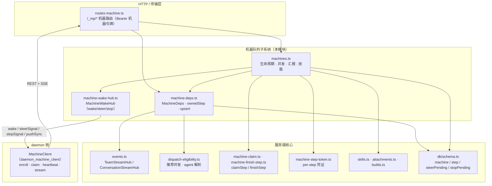
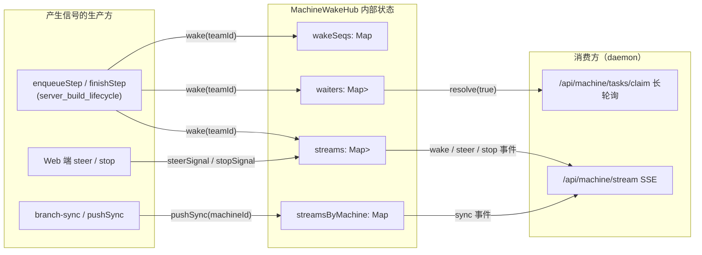
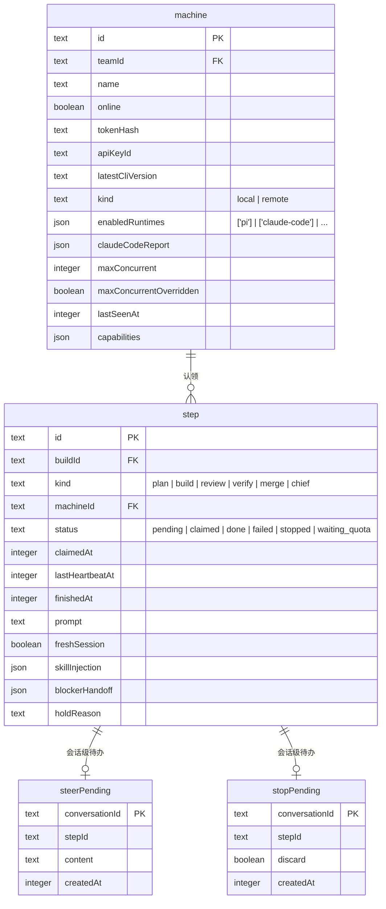
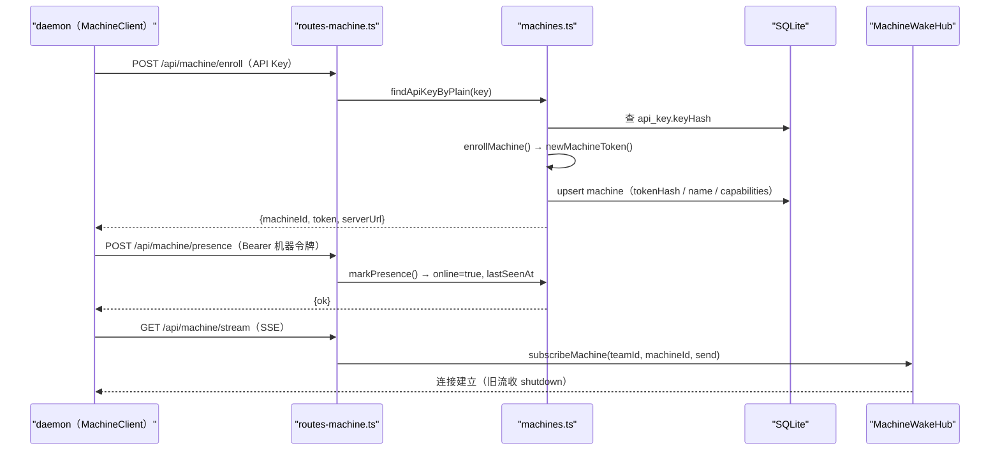
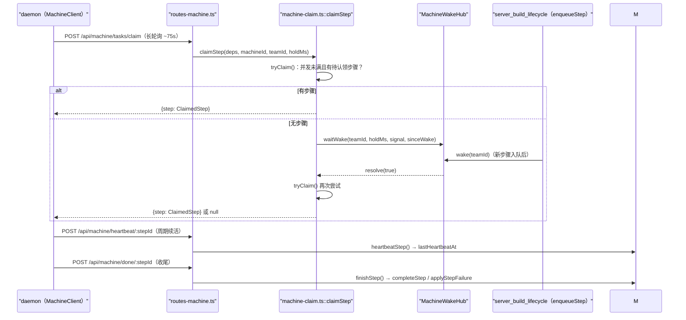
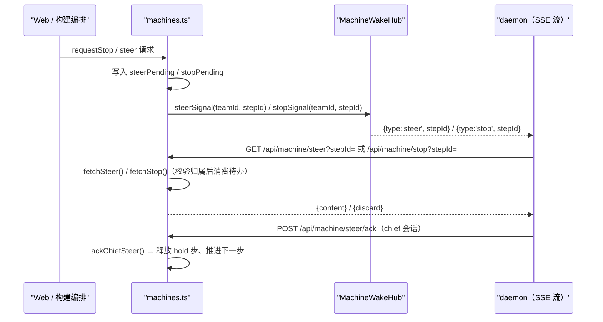
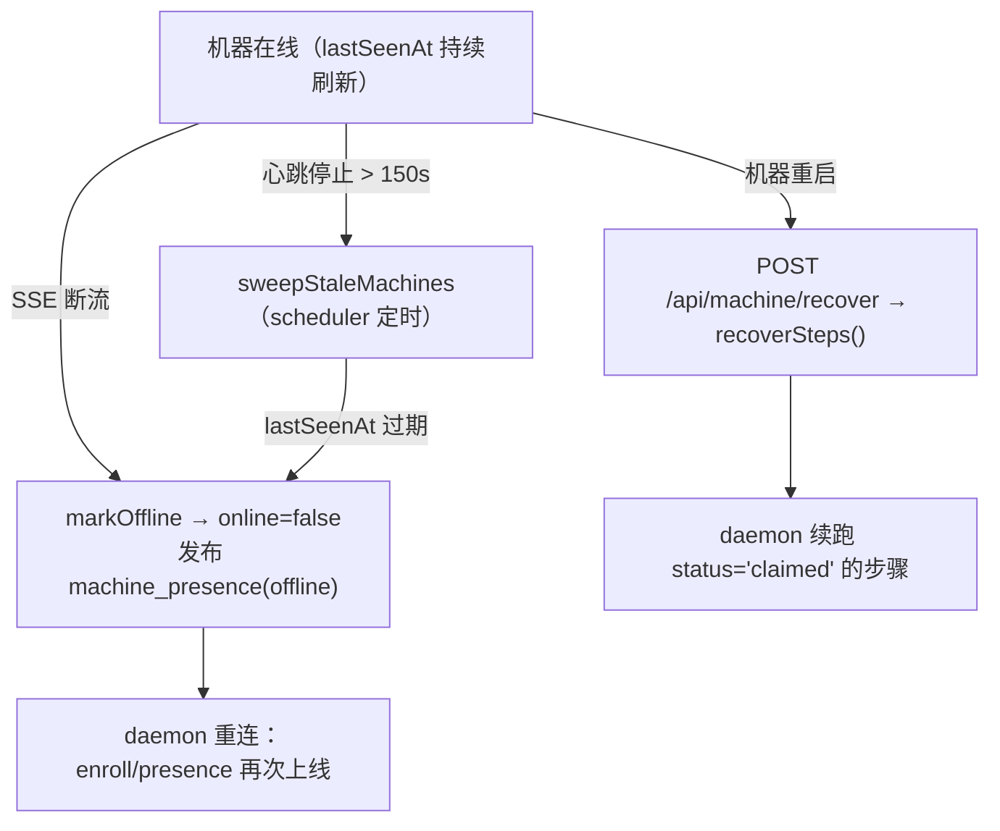
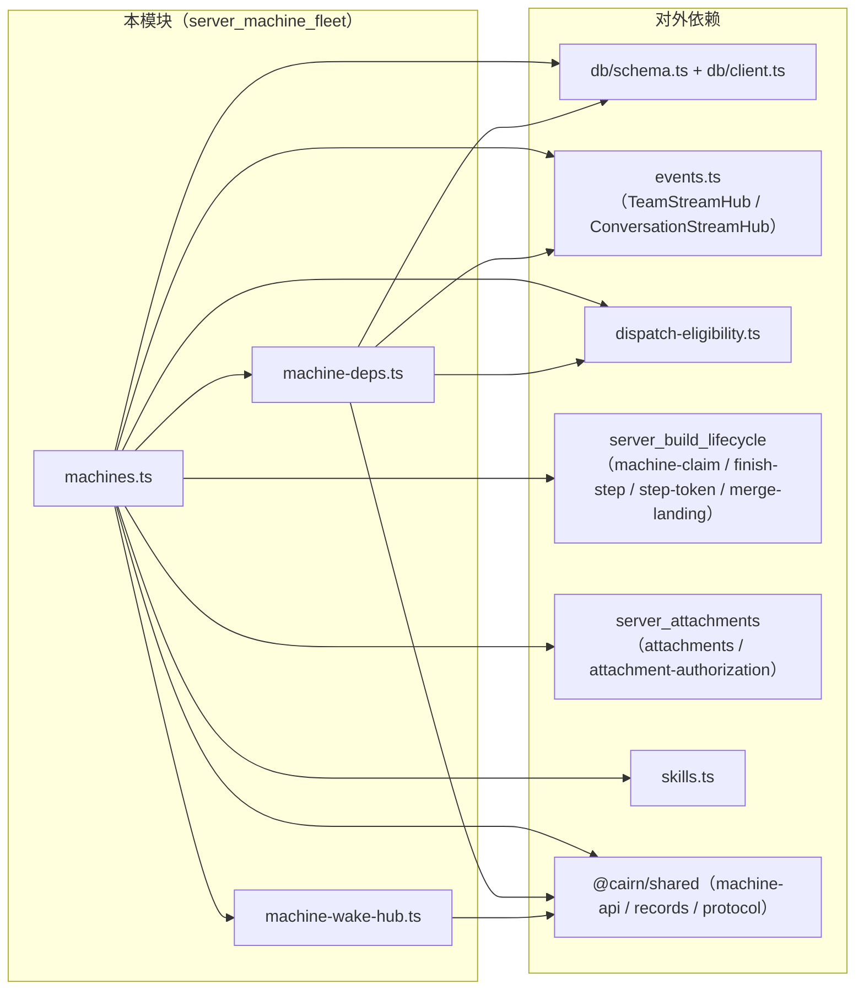

# 机器队列与唤醒（server_machine_fleet）

## 模块简介

`server_machine_fleet` 是 cairn 服务端的**机器编排子系统**，负责管理接入系统的执行节点（daemon 机器）与步骤（step）的认领、心跳、信号下发和遥测汇报。它由三个文件构成：

| 文件 | 职责 |
| --- | --- |
| `apps/server/src/services/machines.ts` | 机器生命周期（注册/上线/离线/清扫）、并发建议、步骤认领辅助、遥测与转录汇报、技能同步、附件下载等对外服务函数 |
| `apps/server/src/services/machine-deps.ts` | 定义 `MachineDeps` 依赖容器与所有权/归属判定、消息落库与流式推送 |
| `apps/server/src/services/machine-wake-hub.ts` | 进程内 `MachineWakeHub`：长轮询唤醒（wake）与 SSE 低延迟信号（steer/stop/sync/shutdown）的扇出枢纽 |

机器（daemon）节点通过 `/_mp/*` 机器 API（`routes-machine.ts`，端点协议见 [shared 模块](../../shared.md) 的 `MACHINE_ENDPOINTS`）与服务端交互；本模块实现服务端一侧的全部逻辑，而客户端侧逻辑在 [daemon_machine_client](../daemon/daemon_machine_client.md)（`MachineClient`）中。

核心职责归纳为：

1. **机器注册与身份**：API Key 注册（`enrollMachine`）与浏览器授权流注册（`authorizeEnrollmentMachine`），发放机器令牌（仅存哈希）；本地机器播种（`seedLocalMachine`）。
2. **在线状态管理**：`markPresence`（心跳上线）、`markOffline`（断流/主动离线）、`sweepStaleMachines`（按 `MACHINE_STALE_OFFLINE_MS = 150s` 清扫失联机器）。
3. **并发与容量建议**：按上报的硬件能力（`MachineCapabilities.hardware`）计算推荐并发（`recommendMachineConcurrency`），支持手动覆盖（`maxConcurrentOverridden`）与启动回填（`backfillMachineConcurrency`）。
4. **步骤认领与执行辅助**：`recoverSteps`（机器重启后的步恢复）、`heartbeatStep`（步骤续活）、`fetchSteer`/`ackSteer`/`fetchStop`（steer/stop 待办消费）；认领主逻辑 `claimStep`、收尾 `finishStep` 由本模块转发导出（实现在 [server_build_lifecycle](server_build_lifecycle.md) 覆盖的 `machine-claim.ts` / `machine-finish-step.ts`）。
5. **遥测与转录**：`reportTool`、`reportTranscriptDelta`、`reportThinkingDelta`、`reportTranscriptRow`、`reportActivity`、`reportAgentTodo` 把执行现场实时推送到 `ConversationStreamHub`（Web 前端 SSE）并落库。
6. **技能与附件分发**：`machineSkillsManifest`/`machineSkillFile` 按 agent 的 skills allowlist 分发本地技能文件；`machineAttachmentDownload` 按 todo 授权读取附件。
7. **唤醒枢纽**：`MachineWakeHub` 支撑「长轮询 + SSE」双通道：`enqueueStep`/`finishStep` 等事件调用 `wake()`，认领长轮询的 `waitWake()` 立即返回，在线机器的 SSE 流同时收到 `wake`/`steer`/`stop`/`sync` 信号。

## 在服务端架构中的位置

- 路由层：`routes-machine.ts::registerMachineRoutes` 把所有 `/_mp/*` 请求按机器令牌鉴权（`findMachineByToken`），再把 `MachineDeps` 从 `AppContext` 装配后调用本模块函数（完整端点清单见下文「与 daemon 的协议对照」）。
- 认领链路：`claimStep`（`machine-claim.ts`）先尝试 `tryClaim`，无任务则 `MachineWakeHub.waitWake` 挂起长轮询；`enqueueStep`（[server_build_lifecycle](server_build_lifecycle.md)）调用 `wake(teamId)` 后长轮询立即返回可认领步骤。
- 信号链路：Web 端或构建编排调用 `steerSignal`/`stopSignal`/`pushSync`，经 `MachineWakeHub` 直接推给该团队在线机器的 SSE 流（`/api/machine/stream`）。
- 数据链路：本模块直接读写 `machine`、`step`、`steerPending`、`stopPending` 等表（见 [server_database](server_database.md)）；转录/活动通过 `ConversationStreamHub` 转发给前端（见 [server_build_lifecycle](server_build_lifecycle.md)）。

## 核心组件

### machines.ts —— 机器队列服务层

`machines.ts` 是面向路由层与服务层其他模块的主要门面，同时转发导出认领/收尾/凭证等子模块函数。

#### 机器生命周期

| 函数 | 说明 |
| --- | --- |
| `enrollMachine(deps, {keyId, teamId, name, cliVersion?, serverUrl, claudeCode?, capabilities?})` | API Key 注册：生成机器令牌（`newMachineToken`），按 `(apiKeyId, teamId)` 或本地主机名复用既有行，更新令牌哈希与上报信息；返回 `{machineId, token(明文仅此一次), teamId, serverUrl}` |
| `authorizeEnrollmentMachine(deps, {teamId, name, serverUrl})` | 浏览器授权流注册（`enroll/confirm`）：无 API Key，仅本地主机名复用或新建 `kind='remote'` 行 |
| `seedLocalMachine(db, teamId)` | 播种本地机器：若已有 `kind='local'` 则跳过；若存在同主机名机器则升级为 `local`；否则插入 `kind='local'`、`enabledRuntimes=['pi']` 的空机器（供 `cairn server` 所在主机直接跑 daemon） |
| `markPresence(deps, machineId, body)` | 心跳上线：置 `online=true`、刷新 `lastSeenAt`/`latestCliVersion`/`claudeCodeReport`/`capabilities`（见并发补丁）；从离线变在线时向 `TeamStreamHub` 发布 `machine_presence(online=true)` |
| `markOffline(deps, machineId)` | 置 `online=false` 并发布 `machine_presence(online=false)`（SSE 断流与主动下线均走此） |
| `sweepStaleMachines(deps, now = nowMs())` | 清扫：找出 `online=true` 且 `lastSeenAt < now - MACHINE_STALE_OFFLINE_MS(150_000)` 的机器逐个 `markOffline`（由 scheduler 定时调用，见 [server_scheduler](server_scheduler.md)） |

#### 并发与容量

| 函数 | 说明 |
| --- | --- |
| `toMachineRecord(row, runningSteps?)` | 序列化机器行：用 `recommendMachineConcurrency(row.capabilities?.hardware)` 计算推荐并发与可调区间，`concurrencySource` 为 `manual`（覆盖）或推荐来源（`measured`/`estimate`）；附带 `runningSteps` 可选 |
| `backfillMachineConcurrency(db)` | 对 `maxConcurrentOverridden=false` 的所有机器重算推荐并发并写库，返回变更行数（服务启动时回填） |
| `machineConcurrencyPatch(row, maxConcurrent)` | 手动覆盖补丁：传 `null` 表示回到推荐值并清除覆盖标记；传数值则 `maxConcurrentOverridden=true` |
| `reportedConcurrencyPatch(row, reported)` | 合并上报能力与并发：保留缺失的 `hardware` 字段（`mergeReportedCapabilities`），未覆盖时同步更新 `maxConcurrent` 为推荐值 |

> 推荐算法（`dispatch-eligibility.ts::recommendMachineConcurrency`）：硬件缺失或非法时返回保守值（来源 `estimate`）；否则以 `min(cpuCores, memory / 每槽内存)` 得到推荐值、以内存推导区间上界，夹在 `[CONCURRENCY_FLOOR, CONCURRENCY_CEILING]` 之间。

#### 步骤认领与执行辅助

| 函数 | 说明 |
| --- | --- |
| `recoverSteps(deps, machineId)` | 机器重启后恢复：取该机器所有 `status='claimed'` 的步骤（按 `createdAt` 升序），映射为 `StepRecord[]`（`toStepRecord`）供 daemon 续跑 |
| `heartbeatStep(deps, machineId, stepId)` | 步骤续活：步骤不存在抛 `HttpError(410)`；`ownedStep` 校验归属后刷新 `lastHeartbeatAt` |
| `fetchSteer({db}, machine, stepId)` | 消费 steer 待办：仅当步骤归属该机器且 `status='claimed'` 时读取 `steerPending`；chief 会话需 `takeChiefSteer` 抢占成功才返回，随后删除待办 |
| `ackSteer(deps, machine, stepId)` | 确认 steer：claimed 的 chief 步骤调用 `ackChiefSteer`（释放 `STEER_SENT_HOLD` 步骤、处理队列下一步并回发 `steerSignal`） |
| `fetchStop({db}, machine, stepId)` | 消费停止待办：返回 `{discard}` 或 `null`（不属于该机器/非 claimed/非本步），并删除 `stopPending` |

> 认领（`claimStep`）与收尾（`finishStep`）为 `machines.ts` 的转发导出，实现位于 `machine-claim.ts` / `machine-finish-step.ts`，行为详见 [server_build_lifecycle](server_build_lifecycle.md)；per-step 凭证 `stepToken`/`toProviderConfig` 由 `machine-step-token.ts` 提供。

#### 遥测与转录汇报（全部先经 `ownedStep` 校验归属）

| 函数 | 说明 |
| --- | --- |
| `reportTool(deps, machineId, stepId, call)` | 工具调用回传：构造 `assistant` + `toolcall` 消息，chief 会话写 `chiefMessage`（`upsertChiefRow`），普通会话写 `message`（`upsertMessage`） |
| `reportTranscriptDelta` / `reportThinkingDelta` | 流式增量：经 `convHub.publishTextDelta` / `publishThinkingDelta` 推送前端（空串忽略） |
| `reportTranscriptRow(deps, machineId, stepId, row)` | 转录行落库：chief → `upsertChiefRow`，普通 → `upsertMessage`，并触发 `convHub.publishMessage` |
| `reportActivity` / `reportAgentTodo` | 活动/待办快照：`convHub.publishActivity` / `publishAgentTodo`（附加 `stepId` 与 `at` 时间戳） |

#### 技能同步与附件

| 函数 | 说明 |
| --- | --- |
| `machineSkillsManifest(deps, machineId, stepId)` | 返回步骤可用技能清单：chief 步骤或 allowlist 为空 → `selection:'all'`；否则按 `agentForStep` 的 `skillsAllowlist` 过滤（`selection:'whitelist'`）。每个技能列出 `dirName` 下全部文件的 `path`/`sizeBytes`/`sha256` |
| `machineSkillFile(deps, machineId, stepId, dirName, filePath)` | 按 `dirName` 与相对路径读取技能文件字节（越权/缺失抛 `NotFoundError`） |
| `machineAttachmentDownload(deps, machineId, machineTeamId, stepId, attachmentId, tokenTeamId)` | 附件下载：校验令牌团队 == 机器团队、build → todo 授权（`todoAuthorizesAttachment`），经 `readAttachmentMeta` 返回 base64 内容 |

#### 鉴权辅助

| 函数 | 说明 |
| --- | --- |
| `findMachineByToken(db, token)` | 按 `hashCredential(token)` 匹配 `machine.tokenHash` |
| `findApiKeyByPlain(db, plain)` | 按 `hashCredential(plain)` 匹配 `apiKey.keyHash`（`/api/machine/enroll` 用） |

### machine-deps.ts —— 依赖容器与归属判定

| 组件 | 说明 |
| --- | --- |
| `interface MachineDeps` | 机器相关函数共享的依赖容器：`db`、`hub`（`TeamStreamHub`）、`machineHub`（`MachineWakeHub`）、`box`（`SecretBox`）、`user`、`reposDir`、`attachmentsDir`、`skillsDir`、可选 `mcpConfigPath`/`convHub`（`ConversationStreamHub`）/`githubFetch`/`oauthClient` |
| `isChiefConversation(id)` | 判断会话是否为 chief 线程（`isChiefConversationId`） |
| `agentForStep(deps, todoRow, kind, prompt?)` | 委托 `dispatch-eligibility.ts::agentForStep`：按 todo、步骤种类与 prompt 解析绑定 agent（返回 `agent` 行或 `null`） |
| `ownedStep(deps, machineId, stepId)` | 所有权判定：步骤不存在或 `machineId` 不匹配抛 `NotFoundError` |
| `stepTeamId(deps, stepRow)` | 归属团队：chief 会话查 `chiefThread.teamId`，普通会话经 `build → todo` 查 `todo.teamId` |
| `publishStepStatus(deps, stepId)` | 通过 `convHub.publishStep` 推送步骤状态事件（含 `status`、`checkpointCommit`、`skillInjection`） |
| `upsertMessage(deps, row + conversationId)` | 消息落库（`onConflictDoUpdate`）并 `convHub.publishMessage` |
| `upsertChiefRow(deps, row + threadId)` | chief 消息落库（`upsertChiefMessage`）并发布 |

### machine-wake-hub.ts —— 唤醒与信号枢纽

`MachineWakeHub` 是进程内单例枢纽，维护三类订阅：**长轮询等待者**（`waiters`）、**团队级 SSE 流**（`streams`）、**机器级单活流**（`streamsByMachine`）。

| 方法 | 说明 |
| --- | --- |
| `wakeSeq(teamId)` | 当前唤醒序号（单调递增，用于长轮询去重） |
| `waitWake(teamId, timeoutMs, signal?, sinceSeq?)` | 长轮询等待：若 `sinceSeq` 之后已有唤醒则立即 `true`；否则注册等待者，超时/`AbortSignal` 中止返回 `false`，被 `wake` 唤醒返回 `true` |
| `wake(teamId)` | 唤醒一整个团队：递增序号，向团队所有 SSE 流发 `{type:'wake'}`，并 resolve 全部等待者 |
| `subscribe(teamId, send)` | 注册团队级 SSE 订阅，返回取消函数 |
| `subscribeMachine(teamId, machineId, send)` | 注册机器级单活流：先向该机器旧流发 `{type:'shutdown'}` 再替换；取消时自动 `releaseMachine` |
| `pushSync(machineId, cmd)` | 向机器流推送 `{type:'sync', sync:cmd}`（如分支同步指令），未连接返回 `false` |
| `releaseMachine(machineId)` | 注销机器的单活流条目（`/api/machine/stream` 断开或机器下线时调用） |
| `streamCount(teamId)` | 团队当前 SSE 流数量（用于节流/观测） |
| `steerSignal(teamId, stepId)` / `stopSignal(teamId, stepId)` | 向团队所有流推送 `steer`/`stop` 事件 |

> `routes-machine.ts` 的 `/api/machine/stream` 在 `streamSSE` 中调用 `subscribeMachine`，并定时发 `: ping` 保活；`stream.onAbort` 时 `unsubscribe()` + `markOffline()`，保证断流机器及时离线。

## 数据模型

本模块直接依赖的表（完整 schema 见 [server_database](server_database.md)）：

- `machine.tokenHash` 仅存哈希（`hashCredential`），明文令牌只在注册响应中出现一次。
- `step.status='claimed'` + `machineId` + `lastHeartbeatAt` 构成认领与续活三元组；`heartbeatStep` 刷新 `lastHeartbeatAt`，`sweepStaleMachines` 依据 `machine.lastSeenAt` 判定离线。
- `steerPending`/`stopPending` 以 `conversationId`（即 `buildId`/chief 线程 id）为主键，保证同一会话至多一条待办；`fetchSteer`/`fetchStop` 消费后即删除。
- `branchSync` 表记录分支同步任务，配合 `MachineWakeHub.pushSync` 下发 `sync` 指令（详见 [server_build_lifecycle](server_build_lifecycle.md)）。

## 关键流程

### 机器注册与上线

### 步骤认领（长轮询 + 唤醒）

认领时的候选筛选（`tryClaim`，`machine-claim.ts`）：机器并发上限取 `min(maxConcurrent, maxWorkers)`；worker 步骤需满足运行时门禁（`enabledRuntimes`）、能力门禁（`capabilityGatePasses`）、agent 机器绑定与并发限制；chief 步骤需抢占 `holdReason` 并满足 CLI 版本门禁（`meetsMcpVersionGate`、`CHIEF_DIGEST_MIN_CLI_VERSION`）。

### 信号下发（steer / stop / sync）

分支同步路径：`branch-sync` 写入 `branchSync` 行后由 [server_build_lifecycle](server_build_lifecycle.md) 调 `MachineWakeHub.pushSync(machineId, cmd)`，daemon 经 `sync-result/:syncId` 回传结果。

### 离线与清扫

## 与 daemon 的协议对照

`routes-machine.ts::registerMachineRoutes` 实现的端点与 `packages/shared/src/protocol/machine-api.ts` 的 `MACHINE_ENDPOINTS` 对应，服务端实现如下：

| 端点 | 服务端函数 | 说明 |
| --- | --- | --- |
| `POST /api/machine/enroll` | `enrollMachine` | API Key 注册 |
| `POST /api/machine/enroll/start` · `poll` · `confirm` | `authorizeEnrollmentMachine` | 浏览器授权流注册（`ctx.enrollments` 暂存，TTL 10 分钟） |
| `GET /api/machine/me` | `toMachineRecord` + `machineRunningCount` | 机器自述（含推荐并发与当前运行数） |
| `POST /api/machine/presence` | `markPresence` | 心跳/上线 |
| `POST /api/machine/recover` | `recoverSteps` | 步 journal 恢复 |
| `POST /api/machine/tasks/claim` | `claimStep`（长轮询） | 步骤认领，间隔 ~75s、退避上限 30s |
| `GET /api/machine/stream` | `subscribeMachine` + `markOffline` | wake SSE 低延迟派发 |
| `GET /api/machine/steer` · `POST /api/machine/steer/ack` | `fetchSteer` · `ackSteer` | steer 消费/确认 |
| `GET /api/machine/stop` | `fetchStop` | 停止信号消费 |
| `POST /api/machine/heartbeat/:stepId` | `heartbeatStep` | 步骤续活（兼 `recordBuildProvenance`） |
| `POST /api/machine/tool/:stepId` | `reportTool` / `reportTranscriptDelta` / `reportThinkingDelta` / `reportActivity` / `reportAgentTodo` / `reportTranscriptRow`（+ relay） | 遥测、转录、工具回传 |
| `GET /api/machine/token/:stepId` | `stepToken` | per-step 凭证下发（模型 key + git 凭证） |
| `GET /api/machine/skills/:stepId` · `.../file` | `machineSkillsManifest` · `machineSkillFile` | 技能清单与文件分发 |
| `GET /api/machine/attachment/:stepId/:attachmentId` | `machineAttachmentDownload` | 附件下载 |
| `POST /api/machine/upload-urls/:stepId` · `PUT /api/machine/upload/:uploadId` | `createUploadUrls` / `receiveUpload` 等 | 预签名产物上传（见 [server_attachments](server_attachments.md)） |
| `POST /api/machine/done/:stepId` | `finishStep` | 步骤收尾（含 merge landing、token 成本聚合、回退重试） |

客户端侧实现见 [daemon_machine_client](../daemon/daemon_machine_client.md)（`MachineClient.claim`、`enrollStart`、`enrollPoll`、`steer`、`stop`）。

## 依赖关系

- **共享协议**：`MachineStreamEvent`、`MachineSyncCommand`、`StepRecord`、`MachineCapabilities`、`machineRecordSchema`、`parseReportedCapabilities`、`MACHINE_ENDPOINTS` 等来自 [shared 模块](../../shared.md)。
- **数据库**：机器/步骤/待办表结构见 [server_database](server_database.md)；`hashCredential`/`newMachineToken` 见 [server_app_bootstrap](server_app_bootstrap.md)。
- **事件流**：`TeamStreamHub`（`machine_presence`、`build` 文档）与 `ConversationStreamHub`（`text_delta`/`thinking_delta`/`activity`/`agent_todo`/`message`/`step`）见 [server_build_lifecycle](server_build_lifecycle.md)。
- **编排联动**：`enqueueStep`/`finishStep` 触发 `MachineWakeHub.wake`；`requestStop` 写 `stopPending` 并发 `stopSignal`；`branch-sync` 用 `pushSync` 下发同步指令。
- **调度联动**：`sweepStaleMachines` 与 `backfillMachineConcurrency` 由 [server_scheduler](server_scheduler.md) 或启动流程（[server_app_bootstrap](server_app_bootstrap.md)）驱动。

## 运维与可观测性注意

- **失联判定**：`MACHINE_STALE_OFFLINE_MS = 150_000`（150 秒）。daemon 心跳/SSE 中断超过该窗口即被 `sweepStaleMachines` 标记离线并广播 `machine_presence(offline)`。
- **令牌安全**：机器令牌明文仅在注册响应中出现一次，库中只存 `tokenHash`；`/api/machine/*`（除 enroll 路径）全部要求 Bearer 机器令牌。
- **单活流约束**：同一机器同时只允许一条 SSE 流（`streamsByMachine` 以机器维度互斥），旧连接被 `shutdown` 事件顶替，避免双 daemon 争抢。
- **长轮询节奏**：认领间隔常量 `CLAIM_POLL_INTERVAL_MS = 75_000`、退避上限 `CLAIM_BACKOFF_CAP_MS = 30_000` 定义在 [shared 模块](../../shared.md) 的 `machine-api.ts`。
- **并发治理**：`maxConcurrentOverridden=false` 的机器由启动回填与上报补丁持续校准推荐并发；手动覆盖后可避免硬件波动导致容量漂移。
