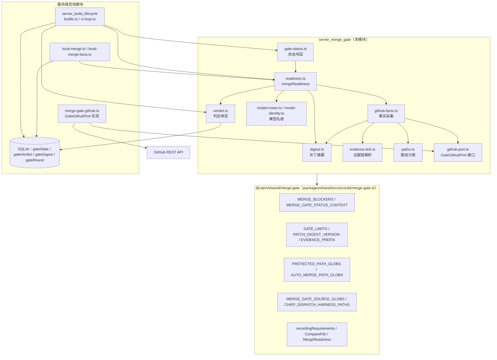
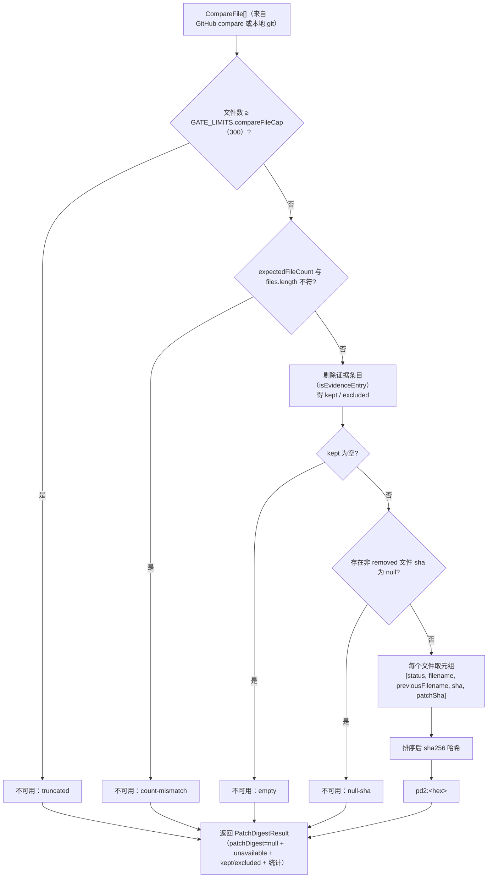
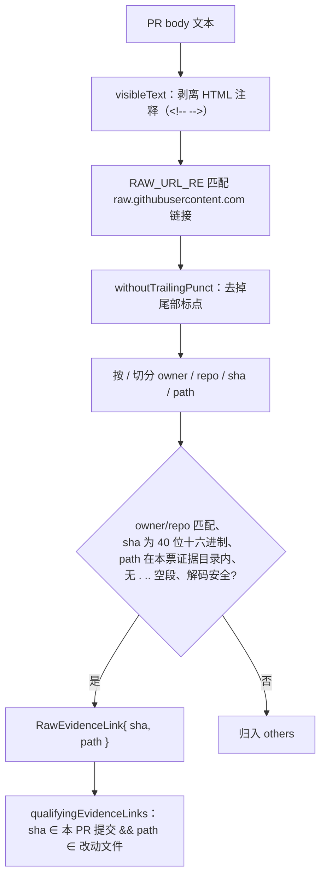
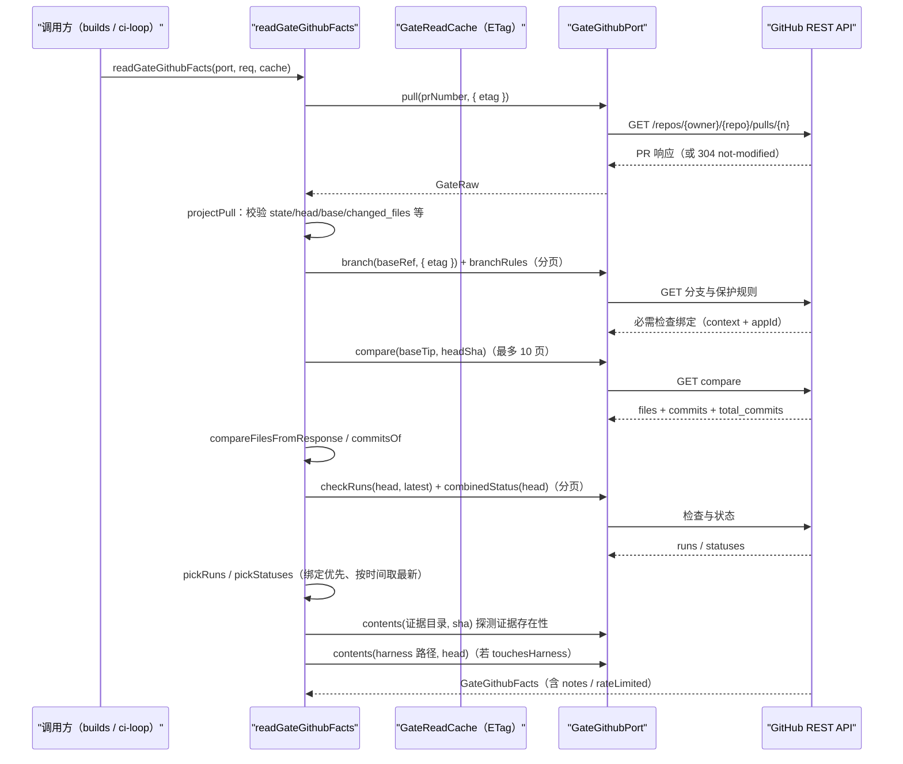
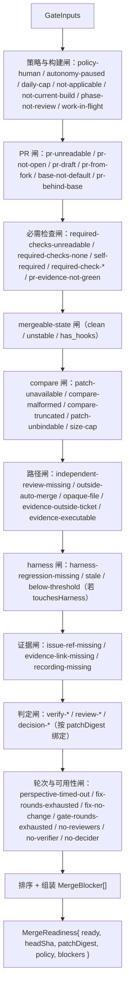
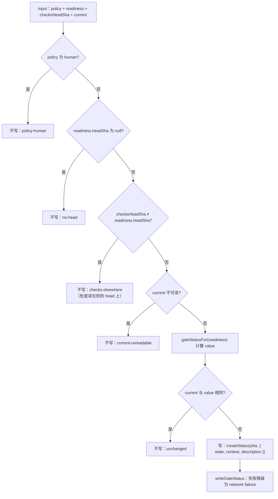
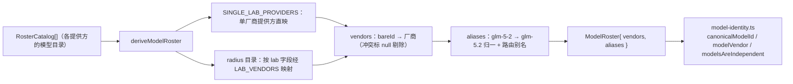
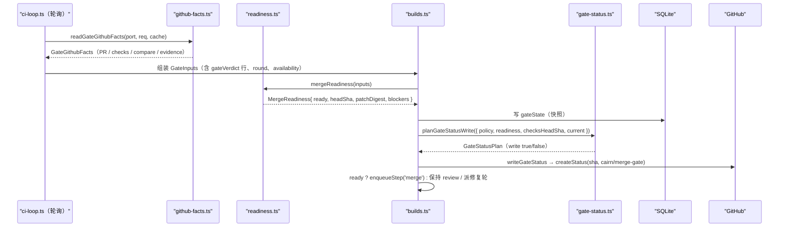

# 合并关口（server_merge_gate）

## 简介

`server_merge_gate` 是 Cairn 服务端（`apps/server`）的**合并关口判定引擎**，位于 `apps/server/src/services/merge-gate/` 目录。它负责在任务的 **review 相位**回答一个关键问题：*当前这个 PR（或本地分支）的补丁，是否满足自动合并（autonomous）、影子合并（shadow）或人工合并（human）策略的全部前置条件？*

模块以**纯函数 + 端口（port）**的方式组织：

1. **事实采集**（`github-facts.ts`）：通过 `GateGithubPort` 端口读取 GitHub 的 PR、分支保护规则、compare 差异、check runs、combined status、证据目录内容与 harness 回归结果，并做严格的结构化校验（`projectPull`、`runOf`、`statusOf` 等投影函数），产出 `GateGithubFacts`。
2. **补丁摘要**（`digest.ts`）：把 compare 得到的文件列表换算成与 commit 无关的 `patchDigest`（`pd2:<sha256>`），作为审核/验证/决策判定与门禁状态的绑定锚点。
3. **路径分类**（`paths.ts`）：把补丁中的路径按「受保护 / 门禁源码 / 自动合并集 / 证据目录 / 可执行证据 / 不可见 diff」等类别归类，输出 `PathFindings`。
4. **就绪判定**（`readiness.ts`）：`mergeReadiness` 把 `GateInputs`（事实 + 策略 + 判定 + 轮次 + 可用性）折叠成有序的 `MergeBlocker[]` 与 `ready` 标志，这是整个门禁的核心决策函数。
5. **状态写回**（`gate-status.ts`）：`planGateStatusWrite` / `writeGateStatus` 把判定结果以 commit status（context `cairn/merge-gate`）写回 GitHub，供分支保护与人类可见。
6. **模型名册**（`model-roster.ts` / `model-identity.ts`）：从提供方目录推导「模型 → 厂商」映射，用于判定独立审核（independent review）是否由**不同厂商**的模型完成。

本模块对外暴露的核心导出为 `mergeReadiness`、`readGateGithubFacts`、`computePatchDigest`、`deriveModelRoster` 与 `planGateStatusWrite` 等，其余内部函数（`compareFilesFromResponse`、`classifyPaths`、`touchesHarness` 等）被上述流程或同目录的 `verdict.ts`（判定绑定）复用。

## 模块定位与架构

`server_merge_gate` 位于服务端业务服务层，被构建生命周期（[server_build_lifecycle.md](server_build_lifecycle.md)）、CI 轮询、本地合并与调度器间接调用；它通过 `GateGithubPort` 端口依赖 GitHub REST API，通过 `@cairn/shared/merge-gate` 共享包获得全部常量、类型与 blocker 元数据：

- **端口与实现的分离**：`github-port.ts` 只定义接口（`GateGithubPort`：pull / branch / branchRules / compare / checkRuns / combinedStatus / contents / createStatus），真正的 HTTP 实现位于 [server_integrations.md](server_integrations.md) 覆盖的 `merge-gate-github.ts`（通过 `lib/github.ts` 的 `github*Raw` 系列函数与 `FetchLike` 注入）。
- **共享常量**：路径 glob、限制、blocker 清单、证据前缀都定义在 `@cairn/shared/merge-gate`，服务端与 [daemon 模块](../daemon.md) 共用同一份语义（见 [shared 模块](../../shared.md)）。
- **数据库持久化**：判定结果（`gateVerdict`）、门禁快照（`gateState`）、补丁摘要（`gateDigest`）、轮次（`gateRound`）由 [server_database.md](server_database.md) 定义，本模块的 `verdict.ts` / 构建生命周期负责写入，`mergeReadiness` 只消费内存态输入。
- **消费方**：`mergeReadiness` 被 [server_build_lifecycle.md](server_build_lifecycle.md) 的 `builds.ts`（合并动作前的判定）与 `local-merge-facts.ts`（本地仓库）调用；`readGateGithubFacts` 由 GitHub PR 流程调用，其读取节奏与 [server_scheduler.md](server_scheduler.md) 的后台轮询配合。

## 核心数据模型

### 内存判定模型

| 类型 | 定义位置 | 说明 |
| --- | --- | --- |
| `GateInputs` | `readiness.ts` | 门禁判定的全部输入：author、policy、build、repo、ticketRef、pr、checks、compare、evidence、verdicts、round、availability、harnessEvalText |
| `MergeReadiness` | `@cairn/shared/merge-gate` | 输出：`ready`、`headSha`、`patchDigest`、`policy`、`blockers[]` |
| `MergeBlocker` | `@cairn/shared/merge-gate` | 单个阻塞项：`code`、`class`（`policy` / `transient` / `human`）、`label`、`detail[]` |
| `GateVerdictView` | `readiness.ts` | 判定视图：kind（`review` / `verify` / `decision`）、outcome、patchDigest、perspective |
| `GateGithubFacts` | `github-facts.ts` | 从 GitHub 采集到的事实快照（PR、checks、compare、evidence、harness 等） |
| `GateRaw` / `GateRawFailure` | `github-port.ts` | 端口返回值：`ok` / `not-modified` / `failed`，失败细分 network / timeout / status / rate-limited / invalid / not-json |

### 持久化表（SQLite，见 [server_database.md](server_database.md)）

| 表 | 关键字段 | 说明 |
| --- | --- | --- |
| `gateState` | `buildId`、`ready`、`headSha`、`patchDigest`、`policy`、`blockers`（JSON）、`evaluatedAt` | 最近一次门禁判定的快照 |
| `gateVerdict` | `stepId`、`buildId`、`kind`、`perspective`、`outcome`、`patchDigest`、`headSha`、`expectedHeadSha` | review / verify / decision 步骤产出的判定行 |
| `gateDigest` | `buildId` + `headSha` 复合主键、`patchDigest`、`countedFiles`、`countedLines`、`keptFiles`、`keptLines` | 补丁摘要与其统计的持久化，供判定绑定复用 |
| `gateRound` | `buildId` + `patchDigest` / `round` 唯一索引、`state`、`perspectives`、`timedOut`、`dispatches` | 审核轮次（open / fixing / fix_no_change / closed）与派发统计 |

`mergeReadiness` 自身是**无副作用纯函数**：它把上述输入折叠成 blocker 列表；持久化由调用方（`builds.ts` / `local-merge-facts.ts`）负责。

## 补丁摘要（digest.ts）

`computePatchDigest` 把 compare 的文件列表换算成**与提交无关的补丁指纹**，作为判定绑定的锚。核心步骤：

- **`computeLocalPatchDigest`**：接收 `LocalDiffFile[]`（含原始 `patch` 文本），先为每个文件计算 `patchSha`（patch 文本的 sha256），再复用 `computePatchDigest` 逻辑。
- **`compareFilesFromResponse`**：把 GitHub compare API 的原始响应体（`files` 数组）严格校验后转成 `CompareFile[]`，包括 `previous_filename`、`additions`、`deletions`、`changes`、`patch` 字段的类型检查；`renamed` / `copied` 状态必须带 `previous_filename`。
- **`recordingRequired` 标记**：经由 `withRecordingFlags`，对满足 [shared 模块](../../shared.md) `recordingRequirements` 的 web 动画/交互文件打上 `recordingRequired: true`，驱动 `recording-missing` blocker 与证据探测逻辑。
- **`isEvidencePath`**：判断路径是否位于证据目录（`docs/verify/` 前缀，常量 `EVIDENCE_PREFIX`）。

## 证据链解析（evidence-link.ts）

PR body 中必须包含指向本票证据目录（`docs/verify/<ticketRef>/`）的 **raw.githubusercontent.com 永久链接**，且链接的 commit 必须是本 PR 的提交、路径必须是本 PR 新增或改动的文件。`evidence-link.ts` 负责从 PR body 文本中提取并校验这些链接：

- **`parseRawEvidenceLinks`**：返回 `{ links, others }`，用 `seen` 集合去重；`decodedPath` 做 `decodeURIComponent` 并拒绝含 `/ \ ? #` 及控制字符的解码结果。
- **`qualifyingEvidenceLinks`**：叠加 compare 事实（`commits`、`files`），只保留「钉在本 PR 提交上、指向本 PR 改动文件（status ≠ removed）」的链接——这是 `evidence-link-missing` / `recording-missing` blocker 的数据来源。

## 路径分类（paths.ts）

`classifyPaths` 对补丁中的每个文件（含重命名前的 `previousFilename`）做多组 glob 匹配，产出 `PathFindings`：

| 类别 | 判定 | 触发的 blocker |
| --- | --- | --- |
| `protected` | 命中 `PROTECTED_PATH_GLOBS` ∪ `MERGE_GATE_SOURCE_GLOBS`，或路径字符不在安全集 | `independent-review-missing`（需要独立审核）等 |
| `gateSource` | 命中 `MERGE_GATE_SOURCE_GLOBS`（门禁自身源码） | 同上，且 `touchesHarness` 联动 |
| `outsideAutoMerge` | 不在 `AUTO_MERGE_PATH_GLOBS` 内 | `outside-auto-merge` |
| `deletedTests` | 删除/重命名走掉 `e2e|test|tests|__tests__` 目录或 `*.test|spec.*` 文件 | 归入 reviewRequired |
| `otherTicketEvidence` | 证据目录内但非本票 `ticketRef/` | `evidence-outside-ticket` |
| `executableEvidence` | 证据目录内新增/改动的可执行扩展名文件 | `evidence-executable` |
| `opaque` | `patchSha === null` 且非证据路径（二进制、diff 过大、纯改名） | `opaque-file` |

- **`globToRegExp` / `protectedRe`**：把仓库共享的 glob（如 `apps/server/src/services/merge-gate/**`、`.github/**`）编译为锚定正则；`protect` 模式对以 `/**` 结尾的目录 glob 允许任意深层子路径，并使用 `iu` 标志。
- **`touchesHarness`**：判断补丁是否触碰 `CHIEF_DISPATCH_HARNESS_PATHS`（chief dispatch 评测 harness、daemon 后端、chief-tools 等），若是则要求 `harness-regression.json` 证据（见 [readiness.ts](#就绪判定readinessts) 的 `harness-regression-*` blocker）。

## GitHub 事实采集（github-facts.ts）

`readGateGithubFacts` 是门禁对 GitHub 的**单次快照读取**：读取 PR → 分支保护规则 → base/head compare → check runs → combined status → 证据目录探测 → harness 回归文件，全程带 ETag 缓存、分页上限与失败归类：

- **`GateReadCache`**：`bodies`（key → `{ etag, body }`）与 `present`（已确证存在的证据 memo），支持 `If-None-Match` 304 复用；`newGateReadCache` 构造空缓存。
- **限流与失败**：任一请求 `rate-limited` 会冻结后续读取（`r.limited`），最终在 `facts.rateLimited` 暴露；`notes[]` 记录每一步不可读的原因，供上层诊断。
- **校验投影**：`projectPull`、`projectBranch`、`runOf`、`statusOf`、`commitsOf` 对响应做字段级类型断言，任何畸形都降级为 `unreadable` / `malformed` / `notes`。
- **`readCompareAt`**：无缓存、独立执行一次 base/head compare 的便捷入口（用于本地或一次性读取）。
- **`always`**：`GateReadCache` 复用谓词的恒真实现（`readGateGithubFacts` 的 pull 与 branch 读取总是尝试带 ETag）。
- 端口的具体 HTTP 实现（`githubGatePort`）在 `merge-gate-github.ts`，见 [server_integrations.md](server_integrations.md)。

## 就绪判定（readiness.ts）

`mergeReadiness(i: GateInputs): MergeReadiness` 是**门禁的核心决策函数**。它按固定顺序累积 blocker，最后按 `MERGE_BLOCKERS` 定义的顺序排序输出。整体判定流程：

几个关键判定细节：

- **`checkName`**（本模块核心组件之一）：对 `GateCheckRun` 与 `GateCommitStatus` 统一取名字（run 取 `name`，status 取 `context`），用于 `mergeable-state` 阻塞明细。
- **head 解析**：GitHub PR 形态取 `pr.headSha`；本地形态（`repoKind === 'local'`）取 `localCompare.headSha`，且要求是 40 位十六进制（`isFullSha`）。
- **必需检查绑定**：`checks.required` 来自分支保护规则（classic `contexts` + rules API 的 `required_status_checks`）；名字等于 `cairn/merge-gate` 自身会触发 `self-required`。
- **独立审核**：当 `classifyPaths` 发现 `protected` / `deletedTests` 改动时，要求存在绑定当前 `patchDigest`、`reviewerId !== author.id` 且 `modelsAreIndependent(authorModel, reviewerModel)` 为真的 pass 判定；`model-identity.ts` 用 `canonicalModelId` + `MODEL_VENDORS` 判定厂商独立性。
- **补丁绑定**：`D = computePatchDigest(compare.files, { expectedFileCount: pr.changedFiles }).patchDigest`，后续 review / verify / decision 判定只认 `patchDigest === D` 的行，杜绝把旧补丁的判定当成新补丁的绿灯。
- **证据存在性**：`qualifyingEvidenceLinks` + `evidence` 探测结果决定 `evidence-link-missing` / `recording-missing`；`recordingRequired` 文件（web 动效）必须存在 ≤ 5 MiB 的 `.gif / .webm / .mp4` 链接。

`MERGE_BLOCKERS`（约 60 个）的完整代码、类别（`policy` / `transient` / `human`）与中文 label 定义在 `@cairn/shared/merge-gate`，见 [shared 模块](../../shared.md)。

## 门禁状态写回（gate-status.ts）

判定结果需要以 **commit status**（context `cairn/merge-gate`）写回 GitHub，让分支保护与人类可见。写回是**有计划的**，避免无效调用：

- **`gateStatusFor`**：无 blocker → `success`（description 带 `patch ${patchDigest 前 12 位}`）；有 blocker → 首条 blocker 的 `label (code) +N`，描述 ≤ 140 字符（`GATE_STATUS_DESCRIPTION_MAX`），并依是否存在非 `transient` blocker 决定 `failure` / `pending`。
- **`planGateStatusWrite`**：返回 `GateStatusPlan` 判别联合——`write: false`（含原因）或 `write: true`（含 `sha` 与 payload）。
- **`writeGateStatus`**：调用端口 `createStatus`，任何异常都收敛为 `{ kind: 'failed', failure: { kind: 'network' } }` 的 `GateRaw`，绝不向上抛错。

## 模型名册（model-roster.ts 与 model-identity.ts）

自动合并要求「独立审核」——审核模型必须与作者模型**来自不同厂商**。`model-roster.ts` 从提供方目录动态推导厂商映射，`model-roster-data.ts` 提供静态兜底表，`model-identity.ts` 提供查询与判定：

- **`rosterBareId`**：去掉 `/` 前缀并小写（如 `anthropic/claude-sonnet-4-5` → `claude-sonnet-4-5`）。
- **`deriveModelRoster`**：遍历各 catalog，厂商来自 provider 名或 radius 的 `lab`；同一 bareId 出现两个不同厂商时标记冲突并剔除；`glm-*` 型号归一（`zai-glm-5-2` → `glm-5.2`）；radius 目录再按成本签名把纯小写路由别名指向唯一上游。
- **`modelsAreIndependent`**：`canonicalModelId` 去别名、去 `[标注]`、取 `/` 后段，然后比较 `MODEL_VENDORS` 中的厂商；厂商不同才返回 `true`。`independenceVendorDetail` 为 `independent-review-missing` 生成人类可读的细节（如「reviewer shares author vendor Anthropic」）。
- 静态表 `MODEL_VENDORS` / `MODEL_ALIASES` 覆盖 Anthropic、OpenAI、Google、Moonshot、xAI、DeepSeek、Z.ai、Mistral、MiniMax、Meta、Xiaomi、Ant Ling 等厂商的数百个型号，作为动态目录的兜底。

## 判定绑定（verdict.ts）

`verdict.ts` 的 `bindGateVerdict` 把 review / verify / decision 步骤的**原始提取结果**绑定为可被 `mergeReadiness` 消费的 `GateVerdictView`：

- 输入：kind、perspective、`expectedHeadSha`、`reportedHeadSha`、`stepFailed`、`extracted`、`blocked`、compare 文件、`pathsAfterExpected`、`evidenceDir`。
- 输出 `outcome`：`step_failed`（步骤失败）→ `extraction_failed`（未提取出结论）→ `block` / `pass`（提取出且是否阻塞）。
- **证据对齐**：verify 判定允许「只动了证据目录」时 `reportedHeadSha` 偏离 `expectedHeadSha`（`evidenceOnly` 检查路径全部落在 `evidenceDir` 内），此时仍可绑定补丁摘要。
- **摘要绑定**：仅当 head 对齐且提供 compare 文件时才计算 `patchDigest`（复用 `computePatchDigest`），否则为 `null`——`mergeReadiness` 中未绑定摘要的判定会被忽略。

`builds.ts` 的 `persistGateVerdict`（见 [server_build_lifecycle.md](server_build_lifecycle.md)）调用 `bindGateVerdict` 后写入 `gateVerdict` 表，`flushVerdictDigests` 负责在进程退出前冲刷在途的摘要写盘。

## 与其他模块的协作

| 协作方 | 方向 | 说明 |
| --- | --- | --- |
| [server_build_lifecycle.md](server_build_lifecycle.md) | 消费方 | `builds.ts` 在 review 相位组装 `GateInputs` 调用 `mergeReadiness`、持久化 `gateState`/`gateVerdict`；`ci-loop.ts` 轮询 GitHub 侧 CI 与合并闸 |
| [server_database.md](server_database.md) | 数据 | `gateState`、`gateVerdict`、`gateDigest`、`gateRound` 四张表的 schema 与迁移 |
| [server_integrations.md](server_integrations.md) | 依赖 | `merge-gate-github.ts` 实现 `GateGithubPort`；GitHub OAuth 令牌与 `refreshingGithubFetch` 供端口使用 |
| [server_machine_fleet.md](server_machine_fleet.md) | 消费方 | `machines.ts` 的 `toStepRecord` 与 daemon 汇报中体现判定结果；机器可用性影响 `availability.verifier` |
| [server_scheduler.md](server_scheduler.md) | 调度 | 后台轮询节奏决定门禁事实的刷新时机；`sweep` 循环调用 CI 轮询 |
| [shared 模块](../../shared.md) | 常量/类型 | `@cairn/shared/merge-gate` 提供 `MERGE_BLOCKERS`、glob、`GATE_LIMITS`、`CompareFile`、`MergeReadiness` 与 `recordingRequirements` |
| [daemon 模块](../daemon.md) | 间接 | daemon 执行 review / verify / merge 步骤后经机器 API 回报，判定经 `gateVerdict` 表回流 |

## 端到端数据流

一次 GitHub PR 的合并关口判定完整链路：

- 本地仓库形态（`repoKind === 'local'`）不经过 `readGateGithubFacts`：`local-merge-facts.ts` 用 `systemGitOps.localCompareFiles` 构造 `CompareFile[]`，同样调用 `mergeReadiness`，由 `local-merge.ts` 派发 `local-merge` 步骤（`judgedDigest` 随命令下发，落地时校验）。
- 整个链路中 `mergeReadiness` 与 `computePatchDigest` 均为纯函数，便于测试与离线回放（`readCompareAt` 可独立重跑 compare）。

## 参考

- 门禁共享常量与 blocker 清单：[shared 模块](../../shared.md) 的 `packages/shared/src/records/merge-gate.ts`
- 构建生命周期与判定持久化：[server_build_lifecycle.md](server_build_lifecycle.md)
- 数据库表定义：[server_database.md](server_database.md)
- GitHub 连接与端口实现：[server_integrations.md](server_integrations.md)
- 后台调度与 CI 轮询节奏：[server_scheduler.md](server_scheduler.md)
- 机器/daemon 侧步骤执行：[server_machine_fleet.md](server_machine_fleet.md) 与 [daemon 模块](../daemon.md)
