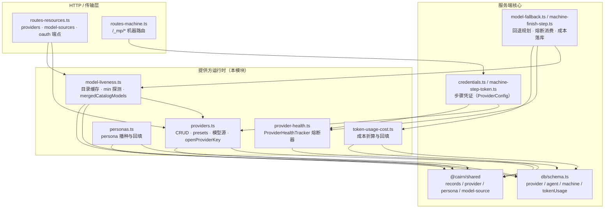
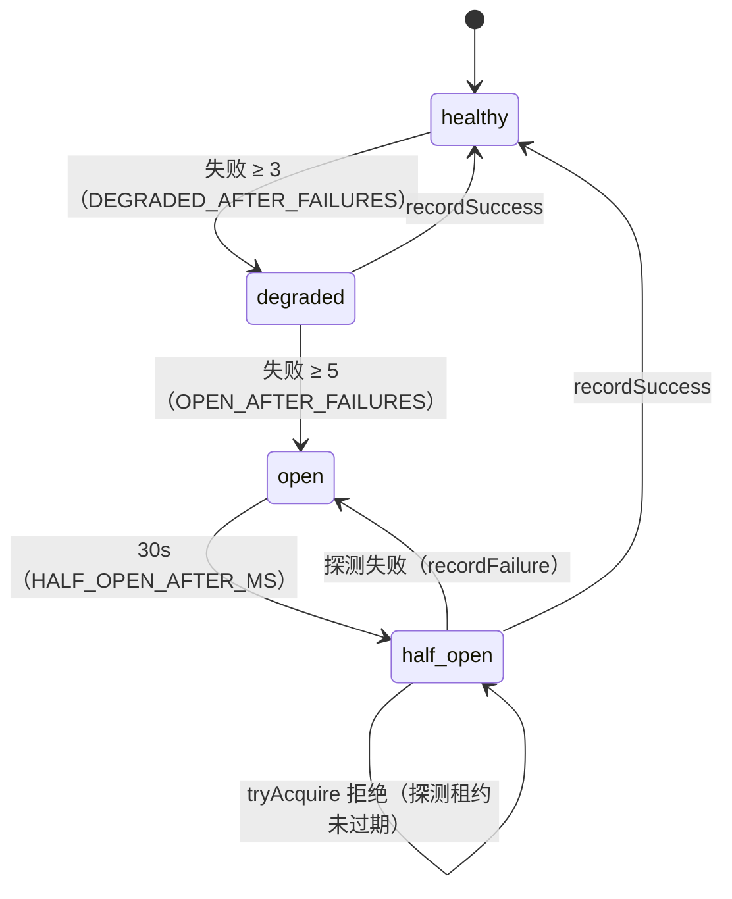
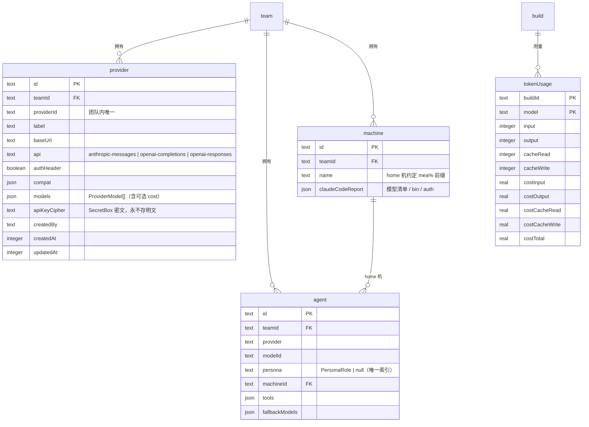
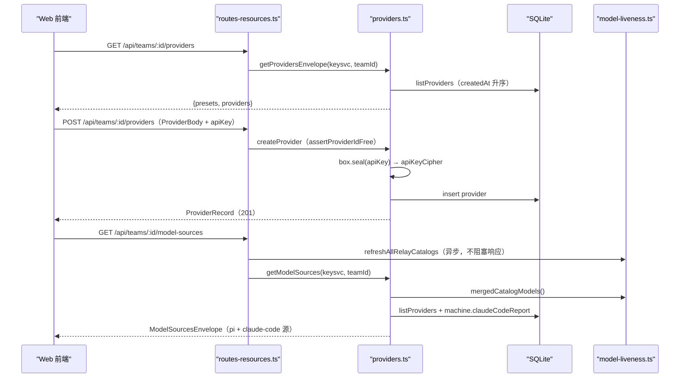
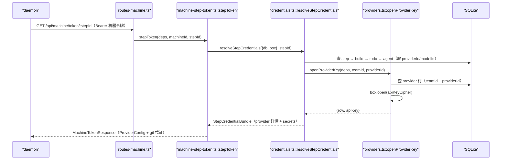
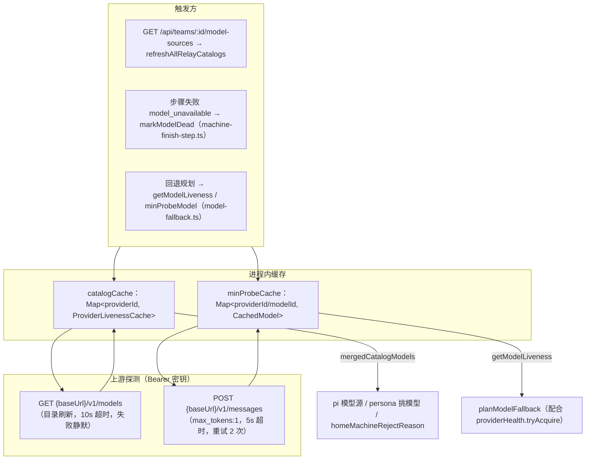
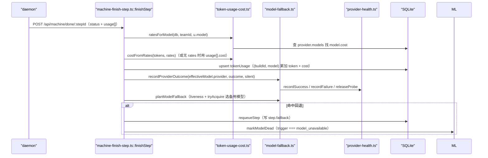
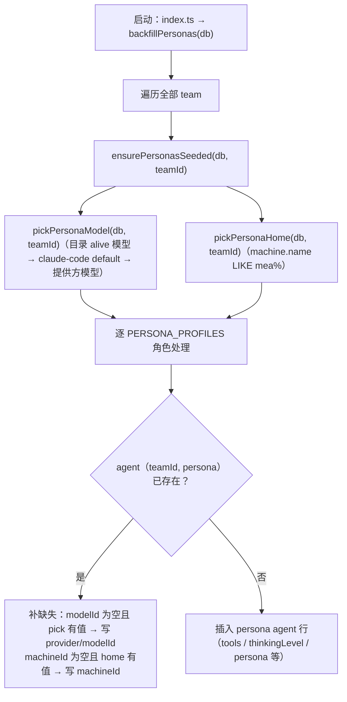
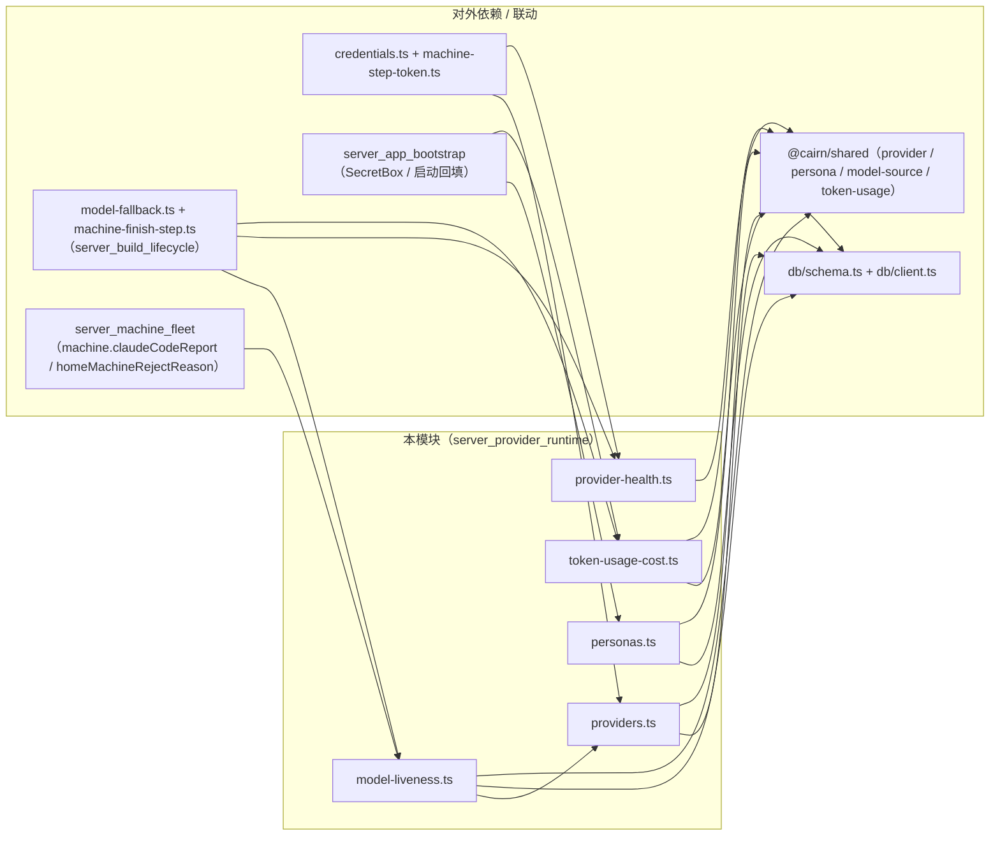

# 模型提供方运行时（server_provider_runtime）

## 模块简介

`server_provider_runtime` 是 cairn 服务端的**模型提供方运行时子系统**：它管理「提供方（provider）→ 模型（model）→ 成本（cost）」这条链路的全部服务端逻辑——自定义提供方的增删改查、密钥的加密存取、模型清单的聚合与上游存活探测、按提供方维度的熔断保护、内置 persona agent 的播种，以及 token 用量成本折算与启动回填。它由五个文件构成：

| 文件 | 职责 |
| --- | --- |
| `apps/server/src/services/providers.ts` | 提供方 CRUD、预设（preset）列表、模型源（`pi` / `claude-code`）聚合、API Key 密文解密（`openProviderKey`） |
| `apps/server/src/services/model-liveness.ts` | relay 模型目录缓存（`/v1/models`）、单模型最小探测（`/v1/messages`）、dead 标记与合并目录（`mergedCatalogModels`） |
| `apps/server/src/services/provider-health.ts` | 进程内熔断器 `ProviderHealthTracker`（healthy / degraded / open / half_open），单例 `providerHealth` |
| `apps/server/src/services/personas.ts` | 内置 persona（planner / implementer / code_reviewer / security_auditor / test_engineer / verifier）agent 的播种与回填 |
| `apps/server/src/services/token-usage-cost.ts` | 按模型成本单价折算 token 用量成本（`costFromRates` / `ratesForModel`）与启动回填（`backfillTokenUsageCost`） |

核心职责归纳为：

1. **提供方生命周期**：`listProviders` / `createProvider` / `updateProvider` / `deleteProvider` 支撑 `/api/teams/:id/providers*` 系列端点；`providerPresets` 输出官方预设（OAuth 或 API Key），`getProvidersEnvelope` 同时返回预设与已配提供方。
2. **密钥托管**：API Key 经 `SecretBox` 加密后仅以 `apiKeyCipher` 落库，`openProviderKey` 在需要时（步骤凭证下发、目录刷新、min 探测）才解密——明文绝不持久化。
3. **模型源聚合**：`getModelSources` 把「relay 合并目录 + 团队自定义提供方模型」组装为 `pi` 源，把每台 daemon 上报的 `claudeCodeReport` 组装为 `claude-code` 源，前端据此展示可选用模型（对应 [shared 模块](../../shared.md) 的 `ModelSourcesEnvelope`）。
4. **存活探测与熔断**：`refreshRelayCatalog` 拉取上游 `/v1/models` 目录（TTL 60s），`minProbeModel` 用 `/v1/messages` 发最小请求探测单个模型；`markModelDead` 在 404 时标记 dead；`providerHealth` 按失败次数开断（5 次 open、30s 后半开放行一次探测）——这两者共同为模型回退（[server_build_lifecycle](server_build_lifecycle.md) 的 `model-fallback.ts`）提供决策依据。
5. **persona 播种**：`backfillPersonas` 在启动时按 `PERSONA_PROFILES` 为每个团队补建带 `persona` 角色的 agent 行（`agent_team_persona_unique` 唯一索引保证每角色一行），并自动挑选可用模型与 home 机器。
6. **成本核算**：`costFromRates` 按「每百万 token」单价折算成本；`backfillTokenUsageCost` 在启动时对缺失成本列的历史 `tokenUsage` 行补齐。

## 在服务端架构中的位置

- **路由入口**：`routes-resources.ts::registerResourceRoutes` 用 `const keysvc = { db: ctx.db, box: ctx.secretBox }` 装配 `ProviderDeps`，`GET /api/teams/:id/providers` → `getProvidersEnvelope`，`GET /api/teams/:id/model-sources` → `refreshAllRelayCatalogs` + `getModelSources`，`POST/PATCH/DELETE /api/teams/:id/providers...` → `createProvider`/`updateProvider`/`deleteProvider`，OAuth 端点 → `services/oauth.ts`（`startOAuthAuthorize` / `completeOAuthCallback` 落地 provider 行，见 [server_integrations](server_integrations.md)）。
- **步骤凭证链路**：daemon 认领步骤后请求 `GET /api/machine/token/:stepId`（`machine-step-token.ts::stepToken`），经 `credentials.ts::resolveStepCredentials` 调 `openProviderKey` 解密 API Key，组装 `ProviderConfig` 下发——凭证链路详见 [server_machine_fleet](server_machine_fleet.md)。
- **失败闭环**：`machine-finish-step.ts::finishStep` 消费步骤结果时调用 `recordProviderOutcome`（喂熔断器）、`markModelDead`（模型 404 标记）、`ratesForModel`/`costFromRates`（成本落库），并依据 `getModelLiveness` + `providerHealth.tryAcquire` 规划模型回退（`model-fallback.ts::planModelFallback`）。
- **启动回填**：`apps/server/src/index.ts` 在启动装配时依次调用 `backfillPersonas(db)` 与 `backfillTokenUsageCost(db)`（启动顺序见 [server_app_bootstrap](server_app_bootstrap.md)）。

## 核心组件

### providers.ts —— 提供方服务层

`providers.ts` 是提供方 CRUD 与模型源聚合的门面，依赖容器为 `ProviderDeps { db: Db; box: SecretBox }`。

#### 提供方 CRUD

| 函数 | 说明 |
| --- | --- |
| `providerPresets()` | 由 `PROVIDER_PRESET_IDS` 生成预设列表：OAuth 家族（`PROVIDER_OAUTH_PRESET_IDS`，即 github-copilot / openai-codex）标 `auth:'oauth'`，其余标 `'api_key'`；`xai` 额外带 `oauthLabel`（SuperGrok / X Premium 登录提示） |
| `toProviderRecord(row)` | 把 `provider` 表行序列化为 `ProviderRecord`（`kind:'custom'`，含 `providerId`/`label`/`baseUrl`/`api`/`authHeader`/`compat`/`models`/时间戳） |
| `listProviders(deps, teamId)` | 按 `createdAt` 升序列出团队全部提供方 |
| `getProvidersEnvelope(deps, teamId)` | 返回 `{ presets, providers }`（提供方配置页一次取全） |
| `createProvider(deps, {teamId, body, createdBy})` | 新建：先 `assertProviderIdFree`（团队内 `providerId` 唯一，冲突抛 `conflict`），`apiKey` 经 `box.seal` 加密存 `apiKeyCipher`，默认 `authHeader=true`、`compat={supportsDeveloperRole:false}` |
| `updateProvider(deps, teamId, id, patch)` | 部分更新：改 `providerId` 时复查唯一性；传 `apiKey` 时重新加密（`null` 表示清空密文）；刷新 `updatedAt` |
| `deleteProvider(deps, teamId, id)` | 按行删除，不存在返回 `false` |
| `openProviderKey(deps, teamId, providerId)` | 按 `(teamId, providerId)` 查行并 `box.open(apiKeyCipher)` 解密，返回 `{ row, apiKey }` 或 `null`——步骤凭证（`credentials.ts`）、目录刷新与 min 探测共用此入口 |

#### 模型源聚合

| 函数 | 说明 |
| --- | --- |
| `claudeCodeModelSource(homeDir)` | 读取 `~/.claude/settings.json`：`model` 字段作为 `default` 槽，`env` 中形如 `ANTHROPIC_<SLOT>_MODEL` 的键作为命名槽（slot 转小写、`_`→`-`）；读取失败/非法返回 `installed:false` 的空源 |
| `listClaudeCodeSources(db, teamId)` | 遍历团队机器行，把 `machine.claudeCodeReport` 展开为 `claude-code` 源（附 `machineId`、可选 `bin`/`auth`） |
| `getModelSources(deps, teamId)` | 组装 `ModelSourcesEnvelope`：`pi` 源 = `mergedCatalogModels()`（relay 合并目录）+ 团队自定义提供方模型中不在目录里的项（liveness 记 `unknown`）；随后附上全部 `claude-code` 源 |

> `ModelSource` / `ModelSourceModel` / `ModelSourcesEnvelope` 类型定义在 [shared 模块](../../shared.md) 的 `packages/shared/src/records/model-source.ts`；`ProviderRecord` / `ProviderCompat` / `ProviderPreset` 在 `packages/shared/src/records/provider.ts`。

### model-liveness.ts —— 模型存活探测与目录缓存

`model-liveness.ts` 维护两层进程内缓存：**目录缓存**（`catalogCache: Map<providerId, ProviderLivenessCache>`）与 **min 探测缓存**（`minProbeCache: Map<providerId/modelId, CachedModel>`），`CachedModel = { at: number; liveness: 'alive'|'dead'|'unknown' }`。

| 常量 | 值 | 含义 |
| --- | --- | --- |
| `CATALOG_CACHE_TTL_MS` | `60_000` | 目录刷新有效期，过期视为无缓存 |
| `MIN_PROBE_TTL_MS` | `10 * 60_000` | min 探测结果有效期 |
| `DEAD_TTL_MS` | `10 * 60_000` | dead 标记有效期，超期自动退化为 `unknown` |
| `MIN_PROBE_TIMEOUT_MS` | `5_000` | min 探测请求超时 |

| 函数 | 说明 |
| --- | --- |
| `getRelayCatalogModels(providerId)` | 返回 TTL 内缓存的目录模型（`dead` 超 `DEAD_TTL` 退化为 `unknown`） |
| `refreshRelayCatalog(deps, teamId, providerId)` | 异步刷新单个提供方目录：`openProviderKey` 取密钥（动态 `import('./providers.js')`，取不到直接返回），`GET {baseUrl}/v1/models`（Bearer 头、10s 超时、失败静默）；命中即写 `alive`，先前 `dead` 且未过期者保留 |
| `refreshAllRelayCatalogs(deps, teamId)` | 并发刷新团队全部提供方（`Promise.allSettled`），由 `GET /api/teams/:id/model-sources` 触发 |
| `markModelDead(providerId, modelId)` | 同时在目录缓存与 min 缓存标记 `dead`（模型 404 时由 `machine-finish-step.ts` 调用） |
| `minProbeModel(deps, teamId, providerId, modelId)` | 单模型最小探测：先查缓存（TTL 内直接返回），再 `POST {baseUrl}/v1/messages`（`model`、`max_tokens:1`、`"hi"`、5s 超时）最多 2 次；404 → `dead` 并 `markModelDead`；成功 → `alive`；其余失败重试一次后记 `unknown` |
| `getModelLiveness(providerId, modelId)` | 只读查询：优先 min 缓存，其次目录缓存，均带 TTL/DEAD 退化逻辑 |
| `mergedCatalogModels()` | 跨提供方合并目录（跳过过期缓存），同一模型任一提供方标 `dead` 则合并结果为 `dead`——供 `getModelSources`、`homeMachineRejectReason`（[server_machine_fleet](server_machine_fleet.md) 的 `dispatch-eligibility.ts`）与 persona 挑模型使用 |

### provider-health.ts —— 提供方熔断器

`ProviderHealthTracker` 是进程内按 `providerId` 维护的熔断器，`providerHealth` 为全局单例。

| 常量 | 值 | 含义 |
| --- | --- | --- |
| `DEGRADED_AFTER_FAILURES` | `3` | 连续失败 3 次进入 `degraded` |
| `OPEN_AFTER_FAILURES` | `5` | 连续失败 5 次进入 `open` |
| `HALF_OPEN_AFTER_MS` | `30_000` | `open` 保持 30s 后转 `half_open` |
| `PROBE_LEASE_MS` | `10 * 60_000` | `half_open` 下单个探测请求的租约时长 |

| 方法 | 说明 |
| --- | --- |
| `state(providerId)` | `open` 且未超时 → `'open'`；`open` 超 30s → `'half_open'`；失败 ≥ 3 → `'degraded'`；否则 `'healthy'` |
| `tryAcquire(providerId)` | `healthy`/`degraded` 放行；`open` 拒绝；`half_open` 仅当上次探测租约过期才放行一次并记录 `probeAt` |
| `recordFailure(providerId)` | 失败计数 +1，达到 `OPEN_AFTER_FAILURES` 时打开并清空探测租约 |
| `releaseProbe(providerId)` | 清除探测租约（既非成功也非失败的中间态调用） |
| `recordSuccess(providerId)` | 清除全部条目（复位为 `healthy`） |
| `reset()` | 清空全部状态（测试/运维用） |

熔断器的读写方：
- **写**：`model-fallback.ts::recordProviderOutcome`——步骤成功（非静默）`recordSuccess`，提供方类失败 `recordFailure`，其余 `releaseProbe`；
- **读**：`planModelFallback` 在挑选备用模型时要求 `providerHealth.tryAcquire(m.provider)`。

### personas.ts —— persona agent 播种

`personas.ts` 依据 [shared 模块](../../shared.md) 的 `PERSONA_PROFILES`（planner / implementer / code_reviewer / security_auditor / test_engineer / verifier）为每个团队维护一组固定角色 agent。

| 函数 | 说明 |
| --- | --- |
| `pickPersonaModel(db, teamId)` | 挑「首选模型」：① `mergedCatalogModels()` 中首个非 dead 模型 + 该团队任意提供方；② 否则用某台机器 `claudeCodeReport` 的 `default` 槽模型（`provider:'claude-code'`）；③ 否则用团队提供方的首个非空模型；都没有返回 `null` |
| `pickPersonaHome(db, teamId)` | 挑 home 机器：`machine.name LIKE 'mea%'` 的第一台（本地开发机命名约定） |
| `ensurePersonasSeeded(db, teamId)` | 逐角色对齐：已存在（按 `(teamId, persona)` 唯一索引）则仅补 `modelId`/`machineId` 缺失项；否则插入完整 agent 行（含 `tools`、`thinkingLevel`、`secrets:[]`、`mcpServers:[]`） |
| `backfillPersonas(db)` | 遍历全部团队执行 `ensurePersonasSeeded`（启动时由 `index.ts` 调用） |
| `personaAgent(db, teamId, role)` | 查询指定角色的 persona agent 行（供编排方按角色取默认 agent） |

> `agent_team_persona_unique` 部分唯一索引（`persona is not null`）保证每个团队每种角色至多一个 agent；角色与 `assignment.plan/build/verify` 槽的绑定见 [server_build_lifecycle](server_build_lifecycle.md)。

### token-usage-cost.ts —— token 成本折算

| 函数 | 说明 |
| --- | --- |
| `costFromRates(tokens, rates)` | 按 `ModelCostRates`（每百万 token 单价：`input`/`output`/`cacheRead`/`cacheWrite`）折算 `CostColumns`（含 `costTotal` 汇总） |
| `ratesForModel(db, teamId, modelKey)` | 解析 `"<providerId>/<modelId>"`，查该团队提供方行的 `models` 数组取对应模型的 `cost`；查不到返回 `undefined` |
| `backfillTokenUsageCost(db)` | 联查 `tokenUsage → build → todo`，筛选五列成本全为 `NULL` 的行，逐行 `ratesForModel` 有价则写回 `costFromRates` 结果（启动时由 `index.ts` 调用） |

> 实时成本累积不依赖回填：`machine-finish-step.ts::finishStep` 在每次步骤完成时已用 `ratesForModel` + `costFromRates`（或 daemon 上报的 `usage[].cost`）upsert `tokenUsage`（`(buildId, model)` 主键累加）。

## 数据模型

本模块直接依赖的表（完整 schema 见 [server_database](server_database.md)）：

- `provider.apiKeyCipher` 由 `SecretBox`（`lib/secret-box.ts`，见 [server_app_bootstrap](server_app_bootstrap.md)）加解密；创建/更新时 `box.seal`，使用时 `box.open`。
- `provider.models` 中的 `ProviderModel` 可携带 `cost`（`ModelCostRates`）——`ratesForModel` 依赖它；模型目录本身（哪些模型可用、是否 alive）则来自 relay 的 `mergedCatalogModels`。
- `machine.claudeCodeReport`（`ClaudeCodeReport`）是 daemon 上报的 `claude-code` 模型清单（见 [daemon 模块](../daemon.md)），`listClaudeCodeSources` 据此展开 `claude-code` 源。

## 关键流程

### 提供方 CRUD 与模型源下发

### 步骤凭证下发（密钥解密链）

### 模型存活探测与 fallback 决策

- **404 语义**：`minProbeModel` 收到 404 视为模型下架（`dead`），同时 `markModelDead` 写入两层缓存；`machine-finish-step.ts` 在 `model_unavailable` 失败时也会 `markModelDead`。
- **TTL 退化**：`dead` 标记 10 分钟（`DEAD_TTL_MS`）后自动退回 `unknown`，允许上游恢复上架后重新进入可用集合。
- **回退门槛**（`model-fallback.ts::planModelFallback`）：候选备用模型须 `getModelLiveness(...) !== 'dead'` 且 `providerHealth.tryAcquire(...)` 通过（详见 [server_build_lifecycle](server_build_lifecycle.md)）。

### 步骤收尾的成本落库与熔断反馈

### persona 播种与回填

## 依赖关系

- **共享类型**：`ProviderRecord`/`ProviderCompat`/`ProviderPreset`/`ProviderModel`/`ModelCostRates`（`records/provider.ts`）、`ModelSource`/`ModelSourcesEnvelope`/`ClaudeCodeReport`/`ModelRef`（`records/model-source.ts`）、`PERSONA_PROFILES`/`PersonaRole`（`records/persona.ts`）均来自 [shared 模块](../../shared.md)。
- **数据库**：`provider`/`agent`/`machine`/`tokenUsage` 表结构见 [server_database](server_database.md)。
- **密钥与启动**：`SecretBox`（`createKeyfileSecretBox`）与启动回填顺序见 [server_app_bootstrap](server_app_bootstrap.md)。
- **凭证与执行**：`openProviderKey` 的消费方 `credentials.ts`/`machine-step-token.ts` 与 `claudeCodeReport` 的来源机器上报见 [server_machine_fleet](server_machine_fleet.md)；`recordProviderOutcome`/`planModelFallback`/`finishStep` 的成本落库见 [server_build_lifecycle](server_build_lifecycle.md)。
- **调度联动**：本模块不注册定时任务；目录刷新为按需触发（`model-sources` 请求时），persona/成本回填为启动一次性执行。

## 运维与可观测性注意

- **密钥安全**：API Key 只在创建/更新时经 `SecretBox` 加密入库，`openProviderKey` 按需解密并立即用于请求；`provider.apiKeyCipher` 是唯一的明文载体，备份 `server.db` 需同时保留 `secretbox.key`（见 [server_app_bootstrap](server_app_bootstrap.md)）。
- **探测节奏**：目录刷新 TTL 60s、min 探测 TTL 10min、探测请求超时 5s——`GET /api/teams/:id/model-sources` 高频调用不会放大上游压力；`refreshAllRelayCatalogs` 异步执行不阻塞响应。
- **熔断粒度**：熔断按 `providerId` 维度（而非单模型）；`degraded` 不拒请求、`open` 拒绝一切新步骤，`half_open` 每 10 分钟放行一个探测租约，避免恢复瞬间打爆上游。
- **成本口径**：`token_usage` 以 `(buildId, model)` 为键累积；有 `ModelCostRates` 的模型按服务端单价折算，否则回退到 daemon 上报的 `cost`；`backfillTokenUsageCost` 只补全五列成本全空的存量行。
- **persona 唯一性**：`agent_team_persona_unique` 保证每团队每角色一行；删除 persona agent 后，下次启动 `backfillPersonas` 会按 `PERSONA_PROFILES` 重建，但已绑定 `assignment` 的历史任务不受影响。
