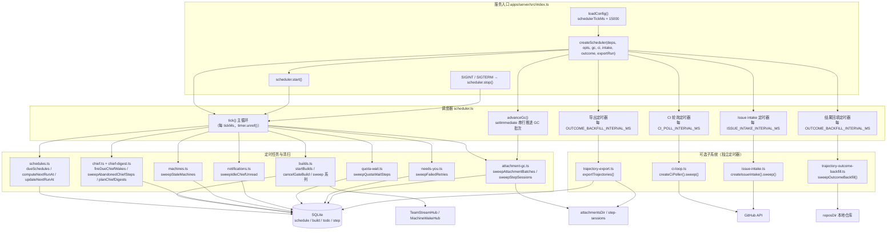
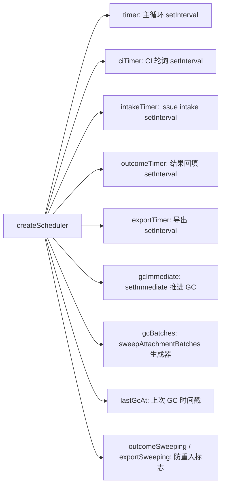
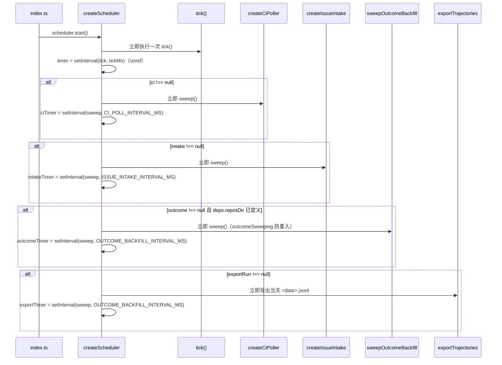
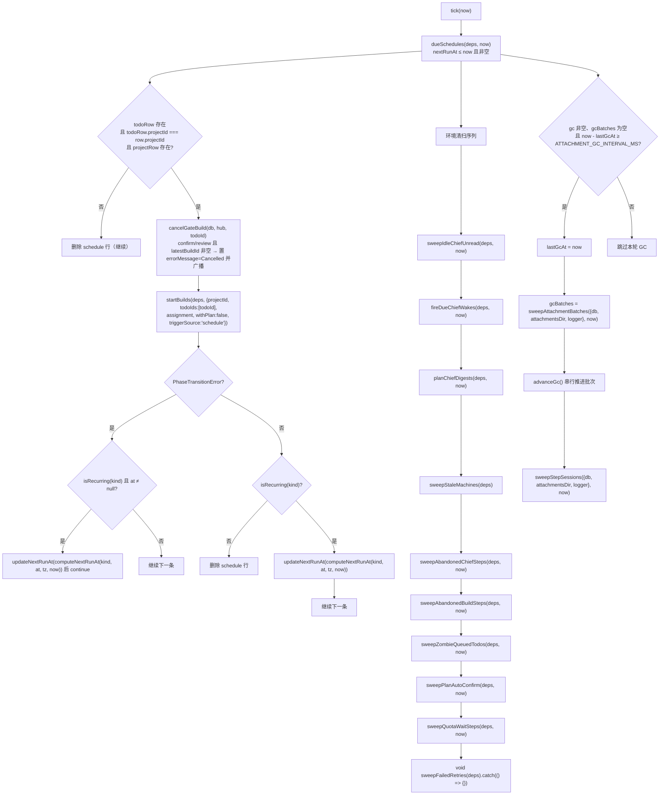
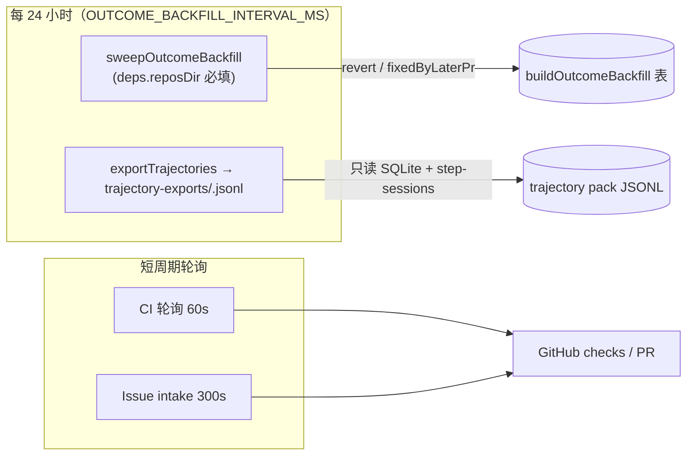

# 服务端调度器（server_scheduler）

## 简介

`server_scheduler` 是 cairn 服务端（`apps/server`）的**后台调度中枢**，核心文件为 `apps/server/src/services/scheduler.ts`。它以固定节拍驱动整个系统的所有「无人值守」工作，包括：

1. **定时任务触发**：查询 `schedule` 表中到期的计划（`once` / `hourly` / `daily` / `weekly`），为对应 todo 启动构建（`startBuilds`），并在 `confirm` / `review` 关口先取消旧的构建。
2. **环境清扫（sweep）**：每个 tick 执行一批巡检任务——闲置首席通知、到期首席唤醒、首席摘要规划、离线机器下线、废弃步释放、僵尸排队任务、方案自动确认、配额等待步重排、失败自动重试。
3. **附件垃圾回收**：每 `ATTACHMENT_GC_INTERVAL_MS`（1 小时）启动分批次 GC（`sweepAttachmentBatches` 生成器 + `setImmediate` 串行推进），并清理 `step-sessions` 会话文件。
4. **可选子系统轮询**：CI 检查轮询（`createCiPoller`）、GitHub issue 摄入（`createIssueIntake`）、轨迹结果回填（`sweepOutcomeBackfill`）、轨迹每日导出（`exportTrajectories`）——均以独立定时器运行，且各自带防重入（sweeping）保护。

调度器在 `apps/server/src/index.ts` 中通过 `createScheduler(...)` 创建并调用 `start()` 启动；`SIGINT` / `SIGTERM` 时调用 `stop()` 优雅退出。对外暴露的 `Scheduler` 接口（`start()` / `stop()` / `tick(nowMs?)`）定义在共享包 `packages/shared/src/scheduler.ts` 中。

> 相关模块：构建生命周期见 [server_build_lifecycle](server_build_lifecycle.md)（`startBuilds` / `sweepAbandonedBuildSteps` 等），机器集群见 [server_machine_fleet](server_machine_fleet.md)（`sweepStaleMachines`），附件 GC 见 [server_attachments](server_attachments.md)（`sweepAttachmentBatches` / `sweepStepSessions`），数据库表结构见 [server_database](server_database.md)（`schedule` / `build` / `todo` / `step` 表），服务启动装配见 [server_app_bootstrap](server_app_bootstrap.md)。

---

## 架构总览

**关键设计**：主循环 `tick()` 使用 `setInterval`（周期 `tickMs`，默认 15 秒）并 `unref()`，不阻止进程退出；所有可选子系统的定时器同样 `unref()`。各类清扫函数以「尽力而为」方式运行——单点失败仅记录日志、不影响后续清扫。

---

## 核心常量与运行配置

| 常量 / 配置 | 值 | 来源 | 说明 |
| --- | --- | --- | --- |
| `SchedulerOptions.tickMs` | `config.schedulerTickMs`（默认 `15_000`） | `config.ts` 的 `serverConfigSchema` | 主循环节拍 |
| `CI_POLL_INTERVAL_MS` | `60_000` | `services/ci-loop.ts` | CI 检查轮询周期 |
| `ISSUE_INTAKE_INTERVAL_MS` | `300_000` | `services/issue-intake.ts` | GitHub issue 摄入周期 |
| `ATTACHMENT_GC_INTERVAL_MS` | `3_600_000`（1 小时） | `services/attachment-gc.ts` | 附件 GC 最小间隔 |
| `OUTCOME_BACKFILL_INTERVAL_MS` | `86_400_000`（24 小时） | `trajectory-outcome-backfill.ts` | 轨迹结果回填与导出周期 |
| `CANCEL_GATE_PHASES` | `{'confirm', 'review'}` | `scheduler.ts` | 定时触发前需取消旧构建的关口相位 |
| `ENV_VARS.issueIntake` | `CAIRN_ISSUE_INTAKE` | `packages/shared/src/brand.ts` | issue intake 特性开关（`issueIntakeRunOf`） |
| `ENV_VARS.trajectoryOutcomeBackfill` | `CAIRN_TRAJ_OUTCOME_BACKFILL` | `packages/shared/src/brand.ts` | 轨迹结果回填特性开关（`trajectoryOutcomeRunOf`） |

`issueIntakeRunOf` 与 `trajectoryOutcomeRunOf` 是**特性开关辅助函数**：配置开启时返回传入的运行单元（`IssueIntakeRun` / `TrajectoryOutcomeRun`），关闭时返回 `null` 并在日志中提示如何用环境变量启用。`index.ts` 用它们的返回值作为 `createScheduler` 的第 5 / 6 个参数（第 3 个为 `gc`、第 4 个为 `ci`），因此开关关闭时对应子系统完全不创建。

---

## createScheduler：工厂与生命周期

`createScheduler(deps: BuildDeps, opts: SchedulerOptions, gc?, ci?, intake?, outcome?, exportRun?)` 返回一个实现 `Scheduler` 接口的对象（`packages/shared/src/scheduler.ts`：`start()` / `stop()` / `tick(nowMs?)`）。

### 参数

| 参数 | 类型 | 用途 |
| --- | --- | --- |
| `deps` | `BuildDeps` | 依赖容器：`db`、`hub`（`TeamStreamHub`）、`machineHub`（`MachineWakeHub`）、`user`、`convHub`、`box`、`reposDir`、`githubFetch`、`oauthClient` 等（见 [server_build_lifecycle](server_build_lifecycle.md)） |
| `opts` | `SchedulerOptions` | `tickMs` 主循环周期 |
| `gc` | `AttachmentGcRun \| null` | `{attachmentsDir, logger}`，驱动附件 GC |
| `ci` | `CiPollRun \| null` | `{githubFetch, logger}`，构建 `createCiPoller` |
| `intake` | `IssueIntakeRun \| null` | `{githubFetch, logger}`，构建 `createIssueIntake` |
| `outcome` | `TrajectoryOutcomeRun \| null` | `{logger}`，驱动 `sweepOutcomeBackfill`（需 `deps.reposDir`） |
| `exportRun` | `TrajectoryExportRun \| null` | `{logger, config}`，驱动每日轨迹导出 |

### 内部状态

- 定时器只在 `start()` 中创建，`stop()` 全部 `clearInterval` / `clearImmediate` 并置 `null`，可重复 `start()`/`stop()`（`start()` 对已启动的实例直接返回）。
- `outcomeSweeping` 与 `exportSweeping` 保证回填 / 导出在同一时刻只有一个在途任务（周期 24 小时且执行可能较长，防止堆积）。
- GC 批次 `gcBatches` 由 `advanceGc()` 用 `setImmediate` 串行推进，每批（128 行引用扫描）让出事件循环；失败或结束时清空状态，调度器继续运行。

### start() 启动时序

导出路径为 `join(cfg.dataDir, 'trajectory-exports', '<YYYY-MM-DD>.jsonl')`，日期取 `new Date().toISOString().slice(0, 10)`；`exportTrajectories` 成功 / 失败都会记录日志（`'trajectory daily export'` / `'trajectory daily export failed (scheduler continues)'`），失败不中断调度。

---

## tick() 主循环

`tick(now = nowMs())` 是调度器的核心，每次执行按顺序完成「定时任务触发 → 环境清扫 → 附件 GC」。

### 1. 定时任务触发（dueSchedules）

- `dueSchedules(deps, now)`（`services/schedules.ts`）查询 `schedule` 表中 `nextRunAt` 非空且 `≤ now` 的行。
- 每条到期计划先校验其 todo 与 project 归属是否仍然一致；不一致（任务被移动 / 删除）则**删除该 schedule 行**。
- 触发前调用 `cancelGateBuild`：若 todo 当前处于 `confirm` 或 `review` 关口且 `latestBuildId` 非空，把对应 build 标记为 `errorMessage = 'Cancelled'` 并通过 `hub.publishBuildDoc(teamId, toBuildRecord(row))` 广播，避免「定时重跑的同时旧构建仍在关口」。
- 随后以 `triggerSource: 'schedule'`、`withPlan: false` 调用 `startBuilds`（见 [server_build_lifecycle](server_build_lifecycle.md)）。
- **`PhaseTransitionError` 处理**：若任务当前相位不允许进入 `queued`（例如已被用户操作占用），周期性计划（且 `at` 非空）按 `computeNextRunAt(kind, at, tz, now)` 重算下一次运行时间后跳过，不报错；单次计划遇到该异常则直接跳过。
- 非周期性计划（`once`）执行后**删除**；周期性计划用 `computeNextRunAt`（基于 `cron-parser` 的 `CronExpressionParser`，按 `tz` 计算）更新 `nextRunAt`。

### 2. 环境清扫（sweep 系列）

| 清扫函数 | 模块 | 作用 |
| --- | --- | --- |
| `sweepIdleChiefUnread` | notifications.ts | 首席消息通知超过 `CHIEF_UNREAD_IDLE_MS`（7 天）未读且首席线程长期无活动时自动置为已读 |
| `fireDueChiefWakes` | chief.ts | 触发 `chief.wakes` 中到期的定时唤醒（`at ≤ now`），清除并写入 chief step |
| `planChiefDigests` | chief-digest.ts | 为配置了 agent 与模型的首席规划每日摘要（`CHIEF_DIGEST_HOUR`）或超阈值摘要，避开忙碌线程与用户回合 |
| `sweepStaleMachines` | machines.ts | 超过 `MACHINE_STALE_OFFLINE_MS` 未见心跳的在线机器置为离线 |
| `sweepAbandonedChiefSteps` | chief.ts | 首席步心跳超时且机器离线 / 不存在时重置为 `pending` 并唤醒机器 |
| `sweepAbandonedBuildSteps` | builds.ts | 已离开执行态（`closed` / `done`）任务的残余 pending 步停止；claimed 步超时（`BUILD_ABANDONED_STEP_MS`）且机器离线 / 无进展时释放回队列 |
| `sweepZombieQueuedTodos` | builds.ts | 处于 `queued` 且 `latestBuildId` 对应的 build 已无活跃步的僵尸任务，按 `stopFallbackPhase` 回退相位 |
| `sweepPlanAutoConfirm` | builds.ts | `confirm` 关口超过宽限期（`PLAN_AUTO_CONFIRM_GRACE_MS`）且方案无待决问题、无 pending 首席提问、合并策略非 human 时自动确认 |
| `sweepQuotaWaitSteps` | quota-wait.ts | `waiting_quota` 步到达 `probeAt` 后重置为 `pending` 并唤醒机器 |
| `sweepFailedRetries` | needs-you.ts | `failed` 相位且 `owedAutomaticRetry`（无需人工、非上轮已 failed）的任务自动 `restart`，捕获 `HttpError` / `PhaseTransitionError` / `NotFoundError` 继续 |

> 各清扫函数的实现细节分属对应模块：构建侧清扫见 [server_build_lifecycle](server_build_lifecycle.md)，机器侧见 [server_machine_fleet](server_machine_fleet.md)，配额等待见 [server_provider_runtime](server_provider_runtime.md)，通知见 [server_integrations](server_integrations.md)。

### 3. 附件垃圾回收（分批量）

- 满足「距上次 ≥ `ATTACHMENT_GC_INTERVAL_MS`」且无在途批次时启动一轮 GC。
- `sweepAttachmentBatches` 是生成器（每 128 行 `yield`），`advanceGc()` 用 `setImmediate`（`unref`）串行推进；扫描期间若检测到数据库写入（`total_changes()` 变化）则中止本轮，防止误删仍被引用的附件（详见 [server_attachments](server_attachments.md)）。
- 批次结束后立即执行 `sweepStepSessions` 清理 `attachmentsDir/step-sessions` 中已无对应 step 的 `.jsonl`。
- 任何 GC 异常只记录日志（`'attachment gc failed (scheduler continues)'`），调度器继续运行。

---

## 可选子系统

### CI 轮询（createCiPoller）

当 `ci` 参数非空时，`createScheduler` 用 `createCiPoller(deps, {githubFetch, logger})` 构建轮询器，`start()` 立即 `sweep()` 一次，随后每 `CI_POLL_INTERVAL_MS`（60 秒）轮询。CI 轮询负责对账 PR 的检查状态（green / red / pending / empty / blocked）、自动追加 CI 修复步（最多 `CI_FIX_ROUNDS_MAX` 轮）、解冲突轮、识别重复 PR 并改记等（见 [server_integrations](server_integrations.md) 与 [server_build_lifecycle](server_build_lifecycle.md) 的合并对账）。

### GitHub issue 摄入（createIssueIntake）

当 `intake` 参数非空时构建 `createIssueIntake`，`start()` 立即 `sweep()` 一次，随后每 `ISSUE_INTAKE_INTERVAL_MS`（5 分钟）轮询。它扫描带 `ready-for-agent` 标签的 open issue，校验打标人权限（triage 以上）、项目在途容量（`ISSUE_INTAKE_IN_FLIGHT_CAP`）、自主性闸门后导入为 todo 并编排（orchestrate），失败重试最多 `ISSUE_INTAKE_MAX_ORCHESTRATE_ATTEMPTS` 次。是否启用由 `CAIRN_ISSUE_INTAKE` 环境变量控制（`issueIntakeRunOf`）。

### 轨迹结果回填（sweepOutcomeBackfill）

当 `outcome` 非空且 `deps.reposDir` 已定义时启动，每 `OUTCOME_BACKFILL_INTERVAL_MS`（24 小时）执行一次，用 `outcomeSweeping` 防重入。它对每个已交付（`DONE_ROW`）且带 `prNumber` 的 build，在本地仓库（`reposDir`）中定位 PR 的 merge commit，检测 7 天回滚窗口内的 revert 与「由后续 PR 修复」，写入 `buildOutcomeBackfill` 表。是否启用由 `CAIRN_TRAJ_OUTCOME_BACKFILL` 环境变量控制（`trajectoryOutcomeRunOf`）。

### 轨迹每日导出（exportTrajectories）

当 `exportRun` 非空时启动，同样每 24 小时执行一次（`exportSweeping` 防重入）。`exportTrajectories(cfg, {out})` 以只读方式打开 SQLite，导出全部 build 的轨迹包（输入 / 过程步转录 / 判定 / 结果），经 `redactSecrets` 脱敏后写入 `<dataDir>/trajectory-exports/<date>.jsonl`（`flag: 'wx'` + 原子 `linkSync`，目标已存在则报 `OutputExists`）。导出与轨迹工具链的关系见 [server_trajectory_tools](server_trajectory_tools.md)。

---

## 特性开关辅助函数

| 函数 | 签名 | 行为 |
| --- | --- | --- |
| `issueIntakeRunOf(config, run)` | `(config: {issueIntake: boolean}, run: IssueIntakeRun) => IssueIntakeRun \| null` | 记录开关状态与启用提示（`CAIRN_ISSUE_INTAKE=1`），开启返回 `run`，关闭返回 `null` |
| `trajectoryOutcomeRunOf(config, run)` | `(config: {trajectoryOutcomeBackfill: boolean}, run: TrajectoryOutcomeRun) => TrajectoryOutcomeRun \| null` | 记录开关状态与启用提示（`CAIRN_TRAJ_OUTCOME_BACKFILL=1`），开启返回 `run`，关闭返回 `null` |
| `trajectoryExportRunOf(config, run)` | `(config: ServerConfig, run: {logger}) => TrajectoryExportRun` | 无条件构造 `{logger, config}`（导出始终启用，路径由 `config.dataDir` 决定） |

`issueIntakeRunOf` / `trajectoryOutcomeRunOf` 返回 `null` 时，`createScheduler` 中对应的子系统（`issueIntake` / `outcome`）保持 `null`，`start()` 不创建对应定时器；`trajectoryExportRunOf` 始终返回运行单元，因此轨迹每日导出默认开启。

---

## 与其它模块的关系

| 关联方 | 关系 |
| --- | --- |
| [server_app_bootstrap](server_app_bootstrap.md) | `index.ts` 装配 `BuildDeps`、`ServerConfig`（`schedulerTickMs`、`dataDir`、`issueIntake`、`trajectoryOutcomeBackfill`）并启动 / 停止调度器 |
| [server_build_lifecycle](server_build_lifecycle.md) | 定时触发 `startBuilds`；清扫 `sweepAbandonedBuildSteps` / `sweepZombieQueuedTodos` / `sweepPlanAutoConfirm`；`cancelGateBuild` 经 `hub.publishBuildDoc` 广播 |
| [server_database](server_database.md) | `schedule` / `build` / `todo` / `step` / `buildOutcomeBackfill` 表；`Db` 类型由 `db/client.ts` 提供 |
| [server_machine_fleet](server_machine_fleet.md) | `sweepStaleMachines` 下线离线机器；`MachineWakeHub` 供清扫函数唤醒机器 |
| [server_attachments](server_attachments.md) | 周期驱动 `sweepAttachmentBatches`（分批量）与 `sweepStepSessions`；`AttachmentGcRun` 携带 `attachmentsDir` |
| [server_integrations](server_integrations.md) | `createCiPoller` 与 `createIssueIntake` 使用 `githubFetch`；issue 摄入导入 GitHub issue 为 todo |
| [server_provider_runtime](server_provider_runtime.md) | `sweepQuotaWaitSteps` 重排配额等待步；`sweepFailedRetries` 重启失败任务 |
| [server_trajectory_tools](server_trajectory_tools.md) | `sweepOutcomeBackfill` 写回结果判定；`exportTrajectories` 生成轨迹包 JSONL |
| [shared](../../shared.md) | `Scheduler` 接口（`packages/shared/src/scheduler.ts`）、`ENV_VARS`（`brand.ts`）、`ScheduleKind` / `ScheduleRecord`（`records/schedule.ts`） |
| [../daemon/daemon.md](../daemon.md) | 机器客户端（daemon）响应 `MachineWakeHub` 的唤醒 / 停止信号，执行被调度器触发的步 |

## 构建、测试与部署

调度器随 `apps/server` 一起构建与部署：`apps/server/package.json` 的 `dev` / `start` 以 `tsx` 运行 `src/index.ts`，`build` / `prepack` 产出 `dist`（详见 [root_build_deploy.md](../../Repository_automation_and_delivery/root_build_deploy.md) 与 [github_ci.md](../../Repository_automation_and_delivery/github_ci.md)）。调度相关配置全部来自环境变量与 `loadConfig()`：

| 配置 | 环境变量 / 默认 | 说明 |
| --- | --- | --- |
| `schedulerTickMs` | 默认 `15_000` | 主循环节拍 |
| `issueIntake` | `CAIRN_ISSUE_INTAKE=1` | 启用 GitHub issue 摄入 |
| `trajectoryOutcomeBackfill` | `CAIRN_TRAJ_OUTCOME_BACKFILL=1` | 启用轨迹结果回填 |
| `dataDir` | `<home>/server` | 轨迹导出目录 `trajectory-exports/`、附件目录、仓库目录的基址 |

## 关键导出速查

| 导出 | 文件 | 说明 |
| --- | --- | --- |
| `createScheduler` | `services/scheduler.ts` | 调度器工厂，返回 `Scheduler`（`start` / `stop` / `tick`） |
| `issueIntakeRunOf` | `services/scheduler.ts` | issue intake 特性开关包装 |
| `trajectoryExportRunOf` | `services/scheduler.ts` | 轨迹导出运行单元构造 |
| `trajectoryOutcomeRunOf` | `services/scheduler.ts` | 轨迹结果回填特性开关包装 |
| `dueSchedules` / `computeNextRunAt` / `isRecurring` / `updateNextRunAt` | `services/schedules.ts` | 定时计划的查询与推进（被 `tick()` 消费） |
| `Scheduler` | `packages/shared/src/scheduler.ts` | 调度器接口（`start` / `stop` / `tick(nowMs?)`） |
