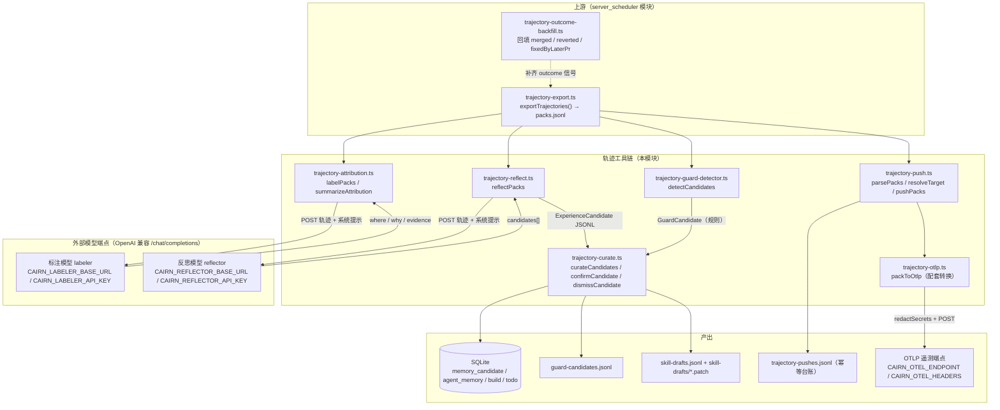
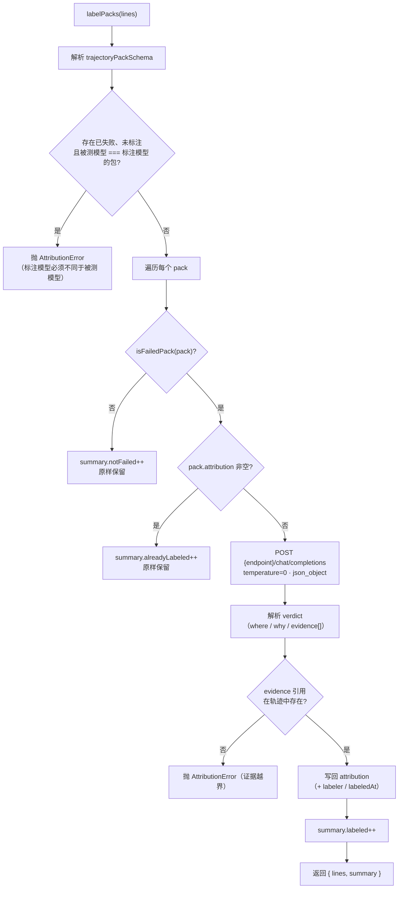
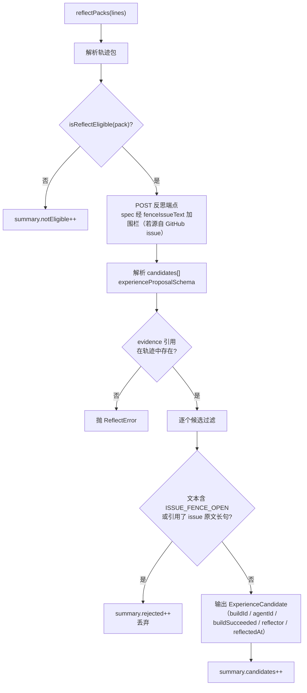
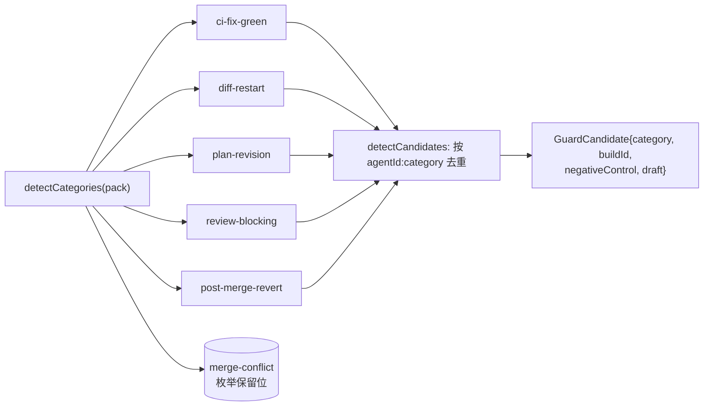
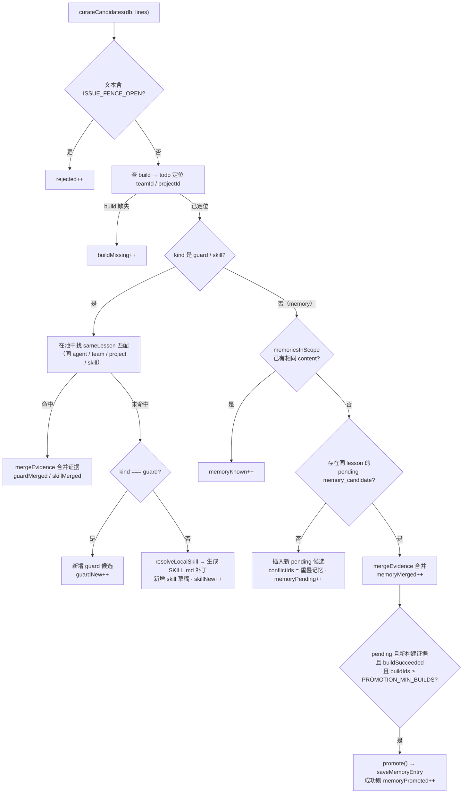
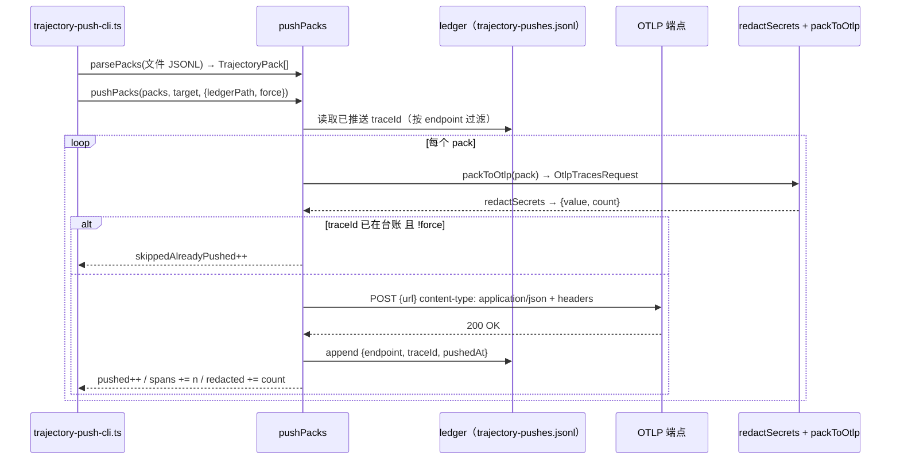
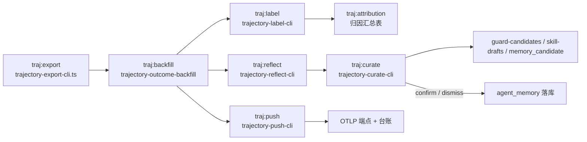

# 轨迹工具链（server_trajectory_tools）

## 简介

`server_trajectory_tools` 是 cairn 服务端（`apps/server`）的**离线轨迹分析工具链**，核心文件位于 `apps/server/src/trajectory-*.ts`。它消费 [server_scheduler](server_scheduler.md) 每日导出的「轨迹包」（`TrajectoryPack` JSONL），对 AI 编码 Agent 的每一次运行进行事后分析，形成闭环的学习回路：

1. **归因标注（attribution）**：`trajectory-attribution.ts` 用「标注模型」（labeler）为失败的轨迹包打上失败层（`where`）与失败原因（`why`），并引用轨迹中的具体证据；`summarizeAttribution` 汇总成 TSV 统计表。
2. **反思提取（reflect）**：`trajectory-reflect.ts` 用「反思模型」（reflector）从「先失败后转绿」或「被人审回」的轨迹中提炼可泛化的经验候选（memory / skill / guard），并拒绝把 GitHub issue 原文抄进候选。
3. **守卫检测（guard detector）**：`trajectory-guard-detector.ts` 用纯规则（不依赖 LLM）从判定数据中检测可自动化的防护类别，生成守卫候选。
4. **策展入库（curate）**：`trajectory-curate.ts` 把经验候选去重、合并证据后沉淀为「记忆候选表」（`memory_candidate`）、`guard-candidates.jsonl` 与 `skill-drafts`（含 SKILL.md 补丁）；`confirmCandidate` / `dismissCandidate` 提供人工确认或驳回的入口。
5. **遥测推送（push）**：`trajectory-push.ts` 把轨迹包经 [trajectory-otlp.ts](#trajectory-otlp-转换) 转换为 OTLP Traces 请求、脱敏后推送至可观测性端点，并用 ledger 文件实现幂等。

> 相关模块：轨迹包来源（导出 / 结果回填）见 [server_scheduler](server_scheduler.md)；`TrajectoryPack` 等数据模型的 schema 定义见 [shared 模块](../../shared.md)；记忆落库依赖 `agent_memory` 等表，见 [server_database](server_database.md)。

---

## 架构总览

**关键设计**：`label` / `reflect` 与 `curate` 是**两个独立的 LLM 调用阶段**——前者分析失败原因、后者提取经验，各自使用独立端点与系统提示；`guard-detector` 完全离线、零 LLM 成本；`curate` 是唯一写数据库 / 写文件的阶段，全部 JSONL 写入均采用「临时文件 + 原子 rename」且权限 `0600`。

---

## 数据模型：TrajectoryPack

轨迹包 schema 定义于 `packages/shared/src/trajectory-pack.ts`（`trajectoryPackSchema`），是整条工具链的流通货币：

| 字段 | 说明 |
| --- | --- |
| `buildId` | 构建 ID（recordId） |
| `input` | 输入：`spec`（任务原文）、`sourceRef`（GitHub issue 引用，可空）、`baseSha`、`persona`、`agentId`、`model`、`skillInjection`、`blockerHandoff`、`harnessHash` |
| `process` | 过程：`steps[]`（`stepId` / `kind` / `transcript` / `checkpointCommit`）、`plans[]`、`token_usage[]` |
| `judgments` | 判定：`plan[]`（confirm / revision）、`diff[]`（approve / revision / restart）、`gate_verdict[]`、`ciFixRounds` |
| `outcome` | 结果（可空）：`merged` / `revertedWithin7d` / `fixedByLaterPr` / `costTotal` |
| `attribution` | 归因（可空，默认 `null`）：`where` / `why` / `evidence[]` / `labeler` / `labeledAt` |

### 失败归因枚举（shared `failure-attribution.ts`）

- **`FAILURE_WHERE`（失败层）**：`prompt`（指令与提示组装）、`knowledge`（技能 / 记忆 / 检索上下文）、`runtime`（控制循环、钩子、恢复、工具调用）、`config`（数值参数、路由、模型选择）、`infra`（Agent 外部原因）、`unknown`。
- **`FAILURE_WHY`（失败原因）**：`premature_finish`、`thinking_runaway`、`wrong_tool`、`ignored_instruction`、`context_missing`、`ci_misread`、`other`。

### 经验候选模型（shared `experience-candidate.ts`）

| 类型 | 说明 |
| --- | --- |
| `ExperienceCandidate` | 反思模型输出的最终候选：`kind`（memory / skill / guard）、`title`、`content`、`skill`、`evidence[]`、`buildId`、`agentId`、`buildSucceeded`、`reflector`、`reflectedAt` |
| `BuildEvidence` | `{buildId, stepId, messageIndex}`，给候选打上「哪个构建的哪个步骤哪条消息」的证据链 |
| `GuardCandidate` | 守卫候选（已归属团队/项目/Agent）：`id`、`teamId`、`project`、`agentId`、`title`、`content`、`buildIds[]`、`evidence[]`、`createdAt`、`updatedAt` |
| `SkillDraft` | 在 `GuardCandidate` 基础上追加 `skill`（技能名）与 `patch`（SKILL.md 补丁相对路径） |
| `PROMOTION_MIN_BUILDS` | `2`：记忆候选升格（promote）所需的不同构建证据数下限 |

---

## trajectory-attribution.ts：失败归因标注

### labelPacks

`labelPacks(lines: string[], options: {model, endpoint, now})` 逐行解析轨迹包，对「失败且尚未标注」的包调用标注模型打标：

- **`isFailedPack(pack)`**：`outcome !== null` 且满足「未合并（`merged === false`）」或「7 天内被回滚（`revertedWithin7d === true`）」或「被后续 PR 修复（`fixedByLaterPr === true`）」之一。
- **`bareModelId(model)`**：取 `model` 最后一个 `/` 之后的部分，用于「标注模型 ≠ 被测模型」的强制校验（防止用同一模型给自己打标产生偏差）。
- **校验要点**：响应必须是合法 JSON（`verdictSchema`）；`evidence` 中的每个 `stepId` / `messageIndex` 必须真实存在于 `pack.process.steps`，防止模型编造证据。
- **错误分类**：`AttributionError`（HTTP 非 2xx、证据越界）、`ZodError`（verdict 结构非法，报出错路径）、`SyntaxError`（verdict 不是 JSON）、其它（请求失败）。任何错误都会包装成 `Labeling <buildId> failed: <reason>`。

### summarizeAttribution

`summarizeAttribution(lines)` 统计全部轨迹包的归因分布，输出 TSV 表（`where\twhy\tcount` 表头 + 行 + `total=… unlabeled=…`）：

- 按 `attribution.where + '\t' + attribution.why` 分组计数，未标注的包单独计入 `unlabeled`。
- 排序规则：先按计数降序，再按 `FAILURE_WHERE` / `FAILURE_WHY` 的枚举顺序升序，便于人工阅读失败模式 Top-N。

> CLI：`pnpm traj:label`（`trajectory-label-cli.ts`，需 `CAIRN_LABELER_BASE_URL` / `CAIRN_LABELER_API_KEY`，输出文件 `flag:'wx'` + `0600`）；`pnpm traj:attribution`（`trajectory-attribution-summary-cli.ts`，直接打印 TSV）。

---

## trajectory-reflect.ts：经验反思

### isReflectEligible

判定一个轨迹包是否值得反思，满足**其一**即可：

- **被退回（sentBack）**：`judgments.plan` 存在 `revision`，或 `judgments.diff` 存在非 `approve` 动作（revision / restart）。
- **转绿（turnedGreen）**：`ciFixRounds > 0` 且 `outcome.merged === true` 且非失败包（`!isFailedPack`）。

### reflectPacks

`reflectPacks(lines, options: {model, endpoint, now})` 对每个合格包调用反思模型，产出 `ExperienceCandidate[]`：

- **系统提示约束**：只保留能泛化到「同一项目的其它任务」的经验；禁止复制任务原文或任何 GitHub issue 原文；`memory` = 项目事实或工作习惯，`skill` = 追加到命名技能文件的流程，`guard` = 可自动化、防止错误复发的检查；空列表也是合法答案。
- **防泄漏机制**：当 `sourceRef` 可解析为 GitHub issue 时，用 `fenceIssueText(sourceRef, spec)` 把原文包进围栏（`ISSUE_FENCE_OPEN`…`结束`），并把 spec 中长度 ≥ `ISSUE_LINE_MIN_CHARS`（20）的行归一化后作为「引用黑名单」——候选的 `title + content` 若包含围栏标记或逐字引用 issue 长句则拒绝（`rejected++`），杜绝第三方数据被写入记忆 / 技能。

> CLI：`pnpm traj:reflect`（`trajectory-reflect-cli.ts`，需 `CAIRN_REFLECTOR_BASE_URL` / `CAIRN_REFLECTOR_API_KEY`）。

---

## trajectory-guard-detector.ts：守卫候选检测

纯规则的离线检测器，`detectCandidates(packs)` 从判定数据中枚举可自动化的防护类别：

| 类别（`GuardCandidateCategory`） | 触发条件 |
| --- | --- |
| `ci-fix-green` | `ciFixRounds > 0` 且 `outcome.merged === true`（CI 修复后转绿） |
| `diff-restart` | `judgments.diff` 存在 `restart`（执行失败后重启） |
| `plan-revision` | `judgments.plan` 存在 `revision`（方案被驳回重做） |
| `review-blocking` | `judgments.diff` 存在 `revision`（审核关口被要求修改） |
| `post-merge-revert` | `outcome.revertedWithin7d === true`（合并后 7 天内被回滚） |
| `merge-conflict` | 类型枚举保留位（当前 `detectCategories` 不产生） |

- 去重键为 `` `${pack.input.agentId ?? ''}:${category}` ``，保证「同一 Agent 的同一类别」只产出一条候选。
- 每个候选附带 `negativeControl`（如 `reproduce <category> on <buildId>`）与 `draft`（如 `candidate protection for <category>`），供后续人工完善为可执行的守卫检查。
- 该模块输出 `GuardCandidate` 结构，与 `curate` 的 guard 池 schema 不同——它更像「建议清单」，可并入策展流程进一步加工。

---

## trajectory-curate.ts：经验策展

`curateCandidates(db, lines, options: {skillsDir, outDir})` 是工具链的「入库关口」：消费 `ExperienceCandidate` JSONL，把候选去重、合并证据，沉淀到数据库与文件。

### 输出与汇总指标

| 产物 | 位置（`options.outDir` 下） | 内容 |
| --- | --- | --- |
| `GUARD_CANDIDATES_FILE` | `guard-candidates.jsonl` | 守卫候选池（按 团队 + 项目 + Agent + 技能 + 相似度 合并证据） |
| `SKILL_DRAFTS_FILE` | `skill-drafts.jsonl` | 技能草稿（含 `skill` 与 `patch` 相对路径） |
| `SKILL_DRAFT_PATCH_DIR` | `skill-drafts/*.patch` | 每个新技能草稿的 SKILL.md unified diff |
| `memory_candidate` 表 | SQLite | 记忆候选行（`pending` / `promoted` / `dismissed`） |

汇总计数：`memoryPending` / `memoryMerged` / `memoryKnown` / `memoryPromoted` / `guardNew` / `guardMerged` / `skillNew` / `skillMerged` / `rejected` / `buildMissing`。

### 处理流程

**关键细节**：

- **`sameLesson`**：用 `overlaps(title, title) && overlaps(content, content)`（`services/memory.ts` 的字符 bigram 重叠算法，`shared >= 2` 且占比 ≥ 50%）判定「同一课」。
- **`mergeEvidence`**：以 `buildId\0stepId\0messageIndex` 为键去重，把候选的 `evidence` 折算成 `BuildEvidence`（补上 `buildId`）合并进既有条目的 `buildIds[]` 与 `evidence[]`。
- **技能草稿**：对新技能，若本地 `skillsDir` 中已存在同名技能则在其 `SKILL.md` 追加 `## <title>` 小节；否则生成带 frontmatter（`---\nname: …\ndescription: …\n---`）的完整新文件。用 `createTwoFilesPatch` 生成 `a/…/SKILL.md` → `b/…/SKILL.md` 的补丁，写入 `<outDir>/skill-drafts/<id>.patch`（`flag:'wx'` + `0600`）。
- **记忆候选的冲突记录**：新插入的 `memory_candidate` 会把范围内与其 title/content 重叠的**已生效记忆** ID 记入 `conflictIds`，提示人工处理。
- **自动升格（promote）**：`pending` 候选在合并后若满足「新增构建 + `buildSucceeded` + `buildIds.length >= PROMOTION_MIN_BUILDS`」，调用 `promote()` 尝试写入 `agent_memory`（`saveMemoryEntry`）；若与现有记忆重叠且未 `force`，`saveMemoryEntry` 返回 `candidates` 状态（HttpError 409 语义），此时不升格，只把冲突记忆 ID 写回候选行。非 `HttpError` 的异常向上抛出。
- **事务与原子写**：整个候选循环在 `db.transaction` 内执行；`guards` / `drafts` 两个 JSONL 用 `writeJsonlAtomic`（临时文件 `flag:'wx'` + `renameSync`，`0600`）落盘，补丁文件在事务外统一写出。

### confirmCandidate / dismissCandidate

| 函数 | 行为 |
| --- | --- |
| `confirmCandidate(db, id, force)` | 人工确认记忆候选升格：要求候选存在且 `status === 'pending'`、`buildIds.length >= PROMOTION_MIN_BUILDS`；用最后一个 `buildId` 调 `promote(db, row, lastBuildId, force)`；与现有记忆冲突且未 `force` 时报 `CurateError`（列出 `conflictIds`），成功返回新记忆 ID |
| `dismissCandidate(db, id)` | 人工驳回：要求候选存在且 `status === 'pending'`，置 `status = 'dismissed'` |

两者对「已 promoted / 已 dismissed」的候选都会报 `CurateError`（`was already promoted` / `is dismissed`）。

> CLI：`pnpm traj:curate`（`trajectory-curate-cli.ts`）：`--in <candidates.jsonl>` 批量策展，或 `--confirm <candidateId> [--force]` / `--dismiss <candidateId>` 单条确认 / 驳回；`--out-dir` 默认 `join(config.dataDir, 'experience-candidates')`。升格写库依赖 `saveMemoryEntry`（`services/memory.ts`），记忆配额与冲突语义见 [server_database](server_database.md)。

---

## trajectory-push.ts：OTLP 遥测推送

### resolveTarget

`resolveTarget(env)` 解析推送目标（见 shared `otel.ts` 的 `parseOtlpTarget`）：

- 环境变量：`CAIRN_OTEL_ENDPOINT`（必填，否则抛 `TrajectoryPushError('Set CAIRN_OTEL_ENDPOINT')`）、`CAIRN_OTEL_HEADERS`（`name=value,name=value` 逗号分隔）。
- 端点 URL 必须为 `http:` / `https:`，路径自动归一化为 `<base>/v1/traces`。
- URL 中的 userinfo（`user:pass@`）自动转为 `Authorization: Basic …`；`OtlpTargetConfigError` 被包装为 `TrajectoryPushError`。

### parsePacks / pushPacks

- **traceId 约定**：`spans[0].traceId`（根 span 的 traceId，由 `packToOtlp` 用 `otlpTraceIdOfBuild(buildId)` 派生，同一构建恒定）。
- **幂等**：`ledgerPath`（默认 `join(config.dataDir, 'trajectory-pushes.jsonl')`）记录 `{endpoint, traceId, pushedAt}`；已推送且未 `--force` 的包跳过（`skippedAlreadyPushed++`），避免重复计费 / 重复上报。
- **失败语义**：端点不可达抛 `Endpoint unreachable after N pushed`；非 2xx 抛 `Endpoint replied HTTP <status> after N pushed`——均在已推送数量上叠加信息，便于断点续推（配合 ledger 实现）。
- 返回 `PushResult {pushed, spans, redacted, skippedAlreadyPushed}`。

### trajectory-otlp 转换（配套）

`packToOtlp(pack)`（`trajectory-otlp.ts`）把轨迹包映射为 OTLP Traces 请求：

- **根 span**：`name = GENAI_OPERATION.invokeAgent`，携带 `buildId / baseSha / harnessHash / persona / agentId / provider / model / ciFixRounds / sourceRef / outcome / attribution` 属性。
- **步骤 span**：每步一个 `step <kind>` span（父为根），其转录中的 assistant 行生成 `chat` client span（含 `provider / model / finishReason / usage / costUsd`，`finishReason === 'error'` 置错误状态），工具调用生成 `executeTool` internal span（含 `name / callId / arguments / result`，失败置错误状态）。
- **ID 派生**：traceId / spanId 均由 `createHash('sha256')` 对 `(buildId, …路径)` 派生，保证同一构建 / 步骤 / 消息的 ID 稳定、可对账。
- 时间戳以纳秒（`otlpNanos`）表示；所有 span 归入 `resourceSpans[0].resource = service.name = cairn`、`scope = cairn.trajectory-push`。

> CLI：`pnpm traj:push`（`trajectory-push-cli.ts`）：`[--force] <packs.jsonl> [<packs.jsonl> …]`，目标取自环境变量，台账写入 `loadConfig().dataDir`。

---

## 端到端流程：从导出到沉淀

对应根仓库 `package.json` 脚本（`pnpm traj:*`）：

| 脚本 | CLI 文件 | 说明 |
| --- | --- | --- |
| `traj:export` | `trajectory-export-cli.ts` | 按 `--build` 或 `--since/--until` 导出轨迹包（上游，见 [server_scheduler](server_scheduler.md)） |
| `traj:backfill` | `trajectory-backfill-cli.ts` | 回填 outcome 信号（上游，见 [server_scheduler](server_scheduler.md)） |
| `traj:label` | `trajectory-label-cli.ts` | 失败归因标注（本模块） |
| `traj:attribution` | `trajectory-attribution-summary-cli.ts` | 归因 TSV 汇总（本模块） |
| `traj:reflect` | `trajectory-reflect-cli.ts` | 经验反思（本模块） |
| `traj:curate` | `trajectory-curate-cli.ts` | 经验策展 + 人工确认 / 驳回（本模块） |
| `traj:push` | `trajectory-push-cli.ts` | OTLP 遥测推送（本模块） |

所有 CLI 均以 `node --import tsx` 运行，失败时统一 `console.error('Trajectory … failed: …')` 并 `process.exitCode = 1`；schema 校验失败（`ZodError`）会列出出错的 JSON path，输入非法 JSON 报 `Invalid JSONL input`。

---

## 与其它模块的关系

| 关联方 | 关系 |
| --- | --- |
| [server_scheduler](server_scheduler.md) | 上游：每日 `exportTrajectories` 产出轨迹包、`sweepOutcomeBackfill` 补齐 outcome 信号；导出文件位于 `<dataDir>/trajectory-exports/` |
| [server_database](server_database.md) | `curate` 读写 `memory_candidate` / `build` / `todo` 表，经 `saveMemoryEntry` 写入 `agent_memory`；`promote` 用 build 反查 `todoId` 作为记忆来源 |
| [server_build_lifecycle](server_build_lifecycle.md) | 轨迹包的 `judgments`（plan/diff 动作、ciFixRounds）与 outcome 信号由构建 / 关口生命周期产生 |
| [shared 模块](../../shared.md) | `TrajectoryPack` / `FailureAttribution` / `ExperienceCandidate` / `GuardCandidate` / `SkillDraft` 等 schema，`parseOtlpTarget` / `redactSecrets` / `fenceIssueText` / `parseGithubIssueSourceRef` / `ISSUE_FENCE_OPEN` / `PROMOTION_MIN_BUILDS` / `SKILL_ENTRY_FILE` 等常量与工具 |
| [server_provider_runtime](server_provider_runtime.md) | `label` / `reflect` 通过 OpenAI 兼容端点调用外部模型（`CAIRN_LABELER_*` / `CAIRN_REFLECTOR_*`），模型选择与 provider 兼容性语义与其一致 |
| [server_integrations](server_integrations.md) | `curate` 通过 `resolveLocalSkill` / `scanLocalSkills`（`services/skills.ts`）定位本地技能目录生成 SKILL.md 补丁 |
