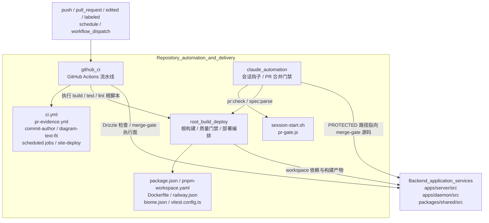
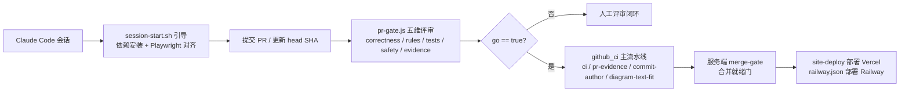

<OVEROVERVIEW>
# 仓库自动化与交付（Repository_automation_and_delivery）概览

## 模块目的

`Repository_automation_and_delivery` 是 Cairn monorepo 的“自动化与交付中枢”。它本身不含业务实现，而是把仓库层面的工程纪律拆成三条互补的自动化通道：

1. **GitHub Actions（`github_ci`）**：在仓库机器侧强制执行 CI、PR 证据、策略门禁、计划任务与网页部署。
2. **Claude 自动化（`claude_automation`）**：在 Claude Code 会话侧完成远程会话自举，并以 `pr-gate.js` 对 PR 合并做独立性裁决。
3. **根构建与部署（`root_build_deploy`）**：统一编排 monorepo 的 workspace、根脚本、镜像构建、质量门禁与 Railway/Vercel 部署。

三者共同实现“机器侧纪律 + Agent 侧裁决 + 根层工程编排”的闭环：CI 门禁负责稳定可重复的检查，`pr-gate` 负责合并前的主观质量判断，根构建层则为两者提供工具链与产物。

## 仓库结构

```text
Repository_automation_and_delivery/
├── github_ci/
│   ├── github_ci_main_pipeline.md        # .github/workflows/ci.yml
│   ├── github_ci_pr_evidence.md          # .github/workflows/pr-evidence.yml
│   ├── github_ci_pr_policy_gates.md      # commit-author.yml + diagram-text-fit.yml
│   ├── github_ci_scheduled_jobs.md       # feature-map-daily-check.yml + gardener-weekly.yml
│   └── github_ci_site_deploy.md          # .github/workflows/site-deploy.yml
├── claude_automation/
│   ├── claude_automation_session_hook.md # .claude/hooks/session-start.sh
│   └── claude_automation_pr_gate.md      # .claude/workflows/pr-gate.js
└── root_build_deploy/
    ├── root_build_deploy_workspace.md    # pnpm-workspace.yaml + package.json
    ├── root_build_deploy_container.md    # Dockerfile + railway.json
    └── root_build_deploy_quality.md      # biome.json + vitest.config.ts + .nvmrc
```

## 架构总览



## 核心组件文档

### GitHub Actions 持续集成与自动化流水线

[github_ci](Repository_automation_and_delivery/github_ci.md) 承载 `.github/workflows` 下全部 7 个 workflow，设计遵循“门禁即纪律校验”和“咨询性与必需性分离”两条原则。绝大多数门禁在 `pnpm install` 之前以零依赖方式运行，争取 1 分钟内失败。

- [github_ci_main_pipeline](Repository_automation_and_delivery/github_ci/github_ci_main_pipeline.md)：主 CI 流，`ci.yml`，包含 `check` 综合检查、4 分片 `e2e`、`e2e-gate` 聚合门禁、`pack-smoke` 打包冒烟，以及多个咨询性门禁 job。
- [github_ci_pr_evidence](Repository_automation_and_delivery/github_ci/github_ci_pr_evidence.md)：`pr-evidence.yml`，强制 PR 正文本证（模板章节、图片链接、任务清单）与 `needs-decision` 决策门禁、自动合并解除。
- [github_ci_pr_policy_gates](Repository_automation_and_delivery/github_ci/github_ci_pr_policy_gates.md)：`commit-author.yml` 与 `diagram-text-fit.yml`，要求提交者不得使用 bot 账号、drawio 图表标签必须适配形状。
- [github_ci_scheduled_jobs](Repository_automation_and_delivery/github_ci/github_ci_scheduled_jobs.md)：特性地图每日校验与园丁每周巡检，输出维护型报告。
- [github_ci_site_deploy](Repository_automation_and_delivery/github_ci/github_ci_site_deploy.md)：`site/**` 变更时向 Vercel 部署生产站点。

### Claude 自动化

[claude_automation](Repository_automation_and_delivery/claude_automation.md) 在 Claude Code 侧完成两件事：远程会话启动引导与合并前独立门禁。

- [claude_automation_session_hook](Repository_automation_and_delivery/claude_automation/claude_automation_session_hook.md)：`.claude/hooks/session-start.sh`，仅在 `CLAUDE_CODE_REMOTE=true` 时执行 `pnpm install --frozen-lockfile`，并对齐 Playwright 浏览器版本，使云端沙箱与本地开发行为一致。
- [claude_automation_pr_gate](Repository_automation_and_delivery/claude_automation/claude_automation_pr_gate.md)：`.claude/workflows/pr-gate.js`，在同一个 head SHA 上以 correctness / rules / tests / safety / evidence 五维评审 PR；blocking 发现由 skeptic 尝试反驳，最终输出绑定该 SHA 的 go / no-go 裁决，落实 ADR 0021 D1–D7。

### 根构建与部署

[root_build_deploy](Repository_automation_and_delivery/root_build_deploy.md) 是“薄根层 + 厚应用层”的工程底座：根配置只负责编排脚本、依赖解析、镜像组装与质量门禁，具体服务实现落在 `server` 与 `daemon`。

- [root_build_deploy_workspace](Repository_automation_and_delivery/root_build_deploy/root_build_deploy_workspace.md)：`pnpm-workspace.yaml` 的 workspace/catalog 声明，以及 `package.json` 的开发、构建、测试、轨迹数据工具脚本。
- [root_build_deploy_container](Repository_automation_and_delivery/root_build_deploy/root_build_deploy_container.md)：`Dockerfile` 三阶段镜像（build / native / runtime）与 `railway.json` 部署配置。
- [root_build_deploy_quality](Repository_automation_and_delivery/root_build_deploy/root_build_deploy_quality.md)：`biome.json` lint/格式/导入纪律门禁、`vitest.config.ts` 测试矩阵、`.nvmrc` Node 版本固定。

## 端到端交付心智模型



## 关键设计决策

- **Push 与 PR 触发面分离**：`ci.yml` 的 `push` 只监听 `main` 与 `prototype/**`，PR 一律走无条件的 `pull_request` 触发，避免同一 head SHA 触发两次运行导致结论分叉与 commit status 被钉成 UNSTABLE。
- **必需上下文必须是稳定 job 名**：`pr-evidence`、`e2e-gate` 以固定 job 名出现在分支保护中；新门禁先在矩阵外跑绿一段再一航升级，只需一行配置改动即可完成推广。
- **pr-gate 默认拒绝（default deny）**：只有 `AUTO_MERGE` 集合内的路径可跳过人类批准；受保护类别、删除测试文件、证据目录外二进制文件、超大补丁一律路由给用户。
- **skeptic fail-closed**：每个 blocking 发现配两名 skeptic，必须两者都在 head SHA 上作答且均 `refuted` 才撤下发现；缺席或读错 SHA 都保留发现，证据不足时门禁失败关闭。
- **第三方 GitHub Actions 全部按完整 commit SHA 固定**：浮动标签可被上游重定向，完整 SHA 是 Dependabot 升级的锚点。
- **薄根层 + 厚应用层**：根配置只负责编排与质量门禁，具体业务实现全部委托给 `apps/server`、`apps/daemon` 与 `packages/shared`。

## 与其它模块的关系

- **Backend_application_services**：CI 的 Drizzle 迁移漂移检查执行 `pnpm --filter @xiechimon/cairn db:check` / `db:generate`，服务端 schema 见 [server_database](Backend_application_services/server/server_database.md)；`pr-gate` 的 `PROTECTED` 类别覆盖 [server_merge_gate](Backend_application_services/server/server_merge_gate.md) 源码路径，防止 agent 修改自己的门禁；merge-gate 的执行面位于 `apps/server/src/services/merge-gate/**`。
- **shared**：CI 若干门禁读取 `packages/shared/src` 的协议与类型定义；`pr-gate` 的 D4 保护面与共享合并记录类型（如 `packages/shared/src/records/merge-gate.ts`）共同构成裁决依据，详见 [shared](shared.md)。
- **root_build_deploy** 与 **github_ci / claude_automation** 互相依赖：CI 消费根脚本，`pr-gate` 消费 `pr:check` 与 `spec:parse`，根构建层消费 server / daemon / shared 的 workspace 声明与构建产物。
</OVERVIEW>