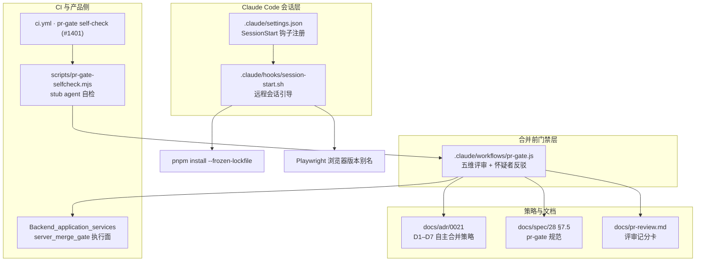
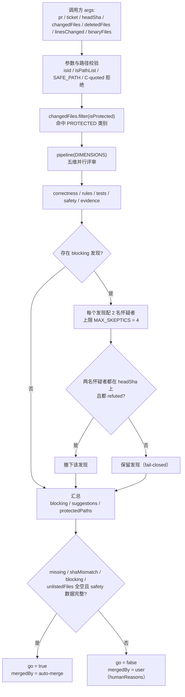

# Claude 自动化：Claude Code 会话钩子与 PR 合并门禁

## 简介

`claude_automation` 模块承载本仓库在 **Claude Code 侧** 的两段自动化：`.claude/hooks/session-start.sh`（远程会话启动引导）与 `.claude/workflows/pr-gate.js`（PR 合并前门禁工作流）。它们与 GitHub Actions 流水线（[github_ci](github_ci.md)）互补：CI 在仓库的机器侧强制纪律，而本模块在 agent 会话侧完成两件事——

1. **远程会话自举**：Claude Code 云端（`CLAUDE_CODE_REMOTE=true`）会话启动时自动安装依赖、对齐 Playwright 浏览器版本，让云端沙箱与本地开发环境行为一致（`session-start.sh`，由 `.claude/settings.json` 的 `SessionStart` 钩子注册）。
2. **合并前的独立门禁**：写 PR 的会话**不评判自己的合并**。`pr-gate.js` 让五个独立评审维度（correctness / rules / tests / safety / evidence）在同一个 head SHA 上读取 PR，blocking 发现由怀疑者（skeptic）尝试反驳，最终给出绑定该 SHA 的 go / no-go 裁决——这正是 ADR 0021 D1–D7 与 `docs/spec/28` §7.5 的落地执行面。

> 相关模块：门禁的机器侧执行（合并就绪门 `merge-gate`、路径路由校验）位于 [Backend_application_services](../Backend_application_services.md) 的服务端；`pr-gate` 的确定性逻辑（D4 路由、go 判定）由 `ci.yml` 的 `pr-gate self-check (#1401)` 步骤用 stub agent 验证（见 [github_ci_main_pipeline](github_ci/github_ci_main_pipeline.md)）；`session-start.sh` 使用的 `pnpm install --frozen-lockfile` 与 workspace 结构定义在根 [root_build_deploy](root_build_deploy.md)。

## 架构总览

## 子模块划分

| 子模块 | 核心文件 | 职责 |
| --- | --- | --- |
| [claude_automation_session_hook](claude_automation/claude_automation_session_hook.md) | `.claude/hooks/session-start.sh` | 远程会话启动钩子：`node-gyp` PATH 补齐、`pnpm install --frozen-lockfile`、Playwright 预装浏览器版本对齐（`$HOME/.cache/cairn-pw-browsers` 符号链接别名） |
| [claude_automation_pr_gate](claude_automation/claude_automation_pr_gate.md) | `.claude/workflows/pr-gate.js` | PR 合并前门禁：`globToRegExp` / `isId` / `isPathList` / `isProtected` / `readRules` 等确定性逻辑，五维评审管道与怀疑者 fail-closed 机制，输出绑定 head SHA 的 go / no-go 裁决 |

上述两个子模块的详细文档位于 `Repository_automation_and_delivery/claude_automation/` 目录下，文件分别为 [claude_automation_session_hook.md](claude_automation/claude_automation_session_hook.md) 与 [claude_automation_pr_gate.md](claude_automation/claude_automation_pr_gate.md)。

## pr-gate 门禁流程

## 关键设计决策

- **写 PR 的会话不评判自己的合并**：评审者与怀疑者都以同一 `headSha` 读取 PR，裁决绑定该 SHA；调用方只在 `go === true` 且 `headSha` 等于 PR head 时才合并。门禁只运行 `origin/main` 上的副本，PR 无法编辑评判自己的门禁。
- **默认拒绝（default deny）路由（ADR 0021 D4）**：`AUTO_MERGE` 集合只列出"可以跳过人类"的路径（产品源码与测试、`docs/verify/**`、`docs/**/*.md`），其余一切路径、受保护类别、删除测试文件、证据目录外的二进制文件、超过 800 行或 40 文件的补丁，一律路由给用户。保护匹配折叠 Unicode（`ſ`/`K` 视作 `s`/`k`），授予自动合并的匹配只折叠 ASCII 大小写。
- **怀疑者 fail-closed**：每个 blocking 发现配两名怀疑者（总数上限 4）；只有两位都在 `headSha` 上作答且都 `refuted` 时才撤下发现。缺席、读错 SHA 的怀疑者都会**保留**发现——门禁在证据不足时失败关闭。
- **评审输入自校验**：safety 维度从 git 自身重新生成 `changedFiles` / `deletedFiles` / `linesChanged` / `binaryFiles`，与调用方传入值比对；未列出的文件（调用方用错 `--no-renames` 或列表过期）会阻止 go。
- **无钩子 git 纪律**：任何移动 ref 的 git 命令都带 `-c core.hooksPath=/dev/null`（共享克隆的 `core.hooksPath` 可能是 husky 的相对路径 `.husky/_`，会在 checkout 出的树内解析并携带本会话凭据运行）；`core.quotePath=false` 保证非 ASCII 文件名不被 C-quote。
- **远程会话自举幂等**：`session-start.sh` 仅对 `CLAUDE_CODE_REMOTE=true` 生效，`pnpm install --frozen-lockfile` 保证锁文件一致性；Playwright 版本别名只在预装目录缺少所需 revision 时创建，并把 `PLAYWRIGHT_BROWSERS_PATH` 追加进 `CLAUDE_ENV_FILE`（去重写入）。

## 与其它模块的关系

- **github_ci**：`ci.yml` 的 `pr-gate self-check (#1401)` 步骤用 stub agent 运行 `.claude/workflows/pr-gate.js`，覆盖其确定性部分（参数校验、D4 路由、怀疑者撤下规则、go 判定）；`pr-evidence.yml` 是合并就绪门所依赖的必需检查（PR 正文证据与 `needs-decision` 决策门禁），见 [github_ci_pr_evidence](github_ci/github_ci_pr_evidence.md)。
- **Backend_application_services**：ADR 0021 的执行面是服务端 `merge-gate`（`apps/server/src/services/merge-gate/**`）与合并就绪门；pr-gate 的 `PROTECTED` 类别④ 正是这些门禁自身源码路径，防止 agent 修改自己的门禁（见 [server_merge_gate](../Backend_application_services/server/server_merge_gate.md)）。`docs/pr-review.md` 记录了 pr-gate 与人工评审记分卡在四个方面的差异（只读 GitHub、独立 worktree、无钩子 checkout、fork head 只读）。
- **root_build_deploy**：`session-start.sh` 依赖根 `package.json` 的 `packageManager: pnpm@12.5.1` 与 `pnpm-workspace.yaml` 的 workspace 布局；`pr-gate` 运行在 Claude Code Workflow 运行时（`agent` / `parallel` / `pipeline` 全局）之上。
- **shared**：门禁涉及的路径集合与产品侧共享的合并记录类型（如 `packages/shared/src/records/merge-gate.ts`）共同构成 D4 保护面，见 [shared](../shared.md)。

## 运行环境与配置

- **钩子注册**：`.claude/settings.json` 的 `hooks.SessionStart[].hooks[0].command` 指向 `$CLAUDE_PROJECT_DIR/.claude/hooks/session-start.sh`，仅 `SessionStart` 事件触发。
- **环境变量**：`CLAUDE_CODE_REMOTE`（是否远程会话，非 `true` 时钩子直接退出）、`CLAUDE_PROJECT_DIR`（项目根目录，缺省回退到 `git rev-parse --show-toplevel`）、`PLAYWRIGHT_BROWSERS_PATH`（预装浏览器目录，缺省 `/opt/pw-browsers`）、`CLAUDE_ENV_FILE`（写入浏览器路径导出的会话环境文件）。
- **pr-gate 调用契约**：args 含 `pr` / `ticket`（正整数）、`headSha`（40 位十六进制）、`changedFiles` / `deletedFiles` / `binaryFiles`（非空字符串数组，后两者必须是 `changedFiles` 子集）、`linesChanged`（非负整数）；文件列表须以 `git -c core.quotePath=false diff --no-renames --name-only` 与 `--numstat` 生成。
- **评审端口约定**：evidence 维度与其怀疑者在独立 worktree 中重跑命令，端口固定为 `VERIFY_PORT=8793`、`VERIFY_WEB_PORT=5275`、`E2E_AFFECTED_PORT=8397`（怀疑者依次递增偏移）。
