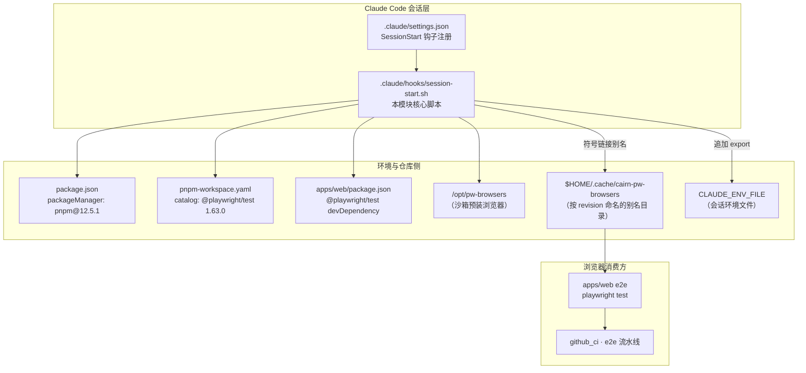
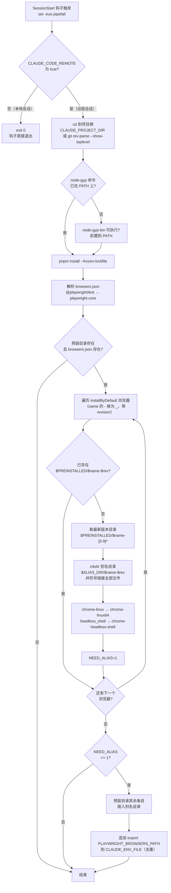
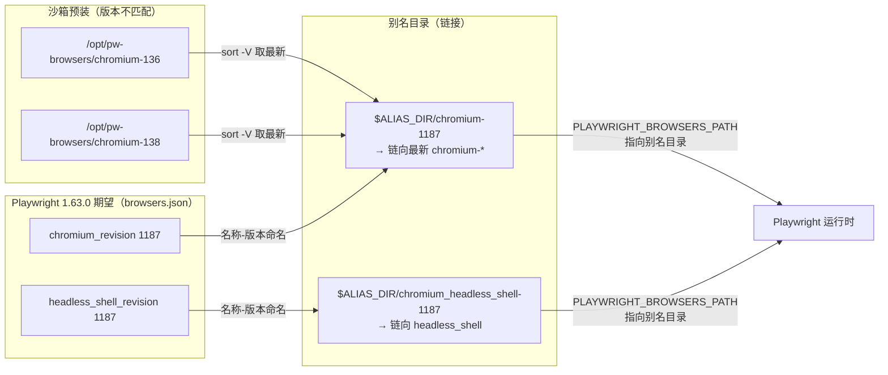

# 会话启动钩子：远程 Claude Code 会话自举

## 简介

`claude_automation_session_hook` 模块对应仓库中的单个脚本 `.claude/hooks/session-start.sh`。它是 Claude Code 的 **SessionStart 钩子**，仅在**远程（云端沙箱）会话**（`CLAUDE_CODE_REMOTE=true`）启动时运行，完成三件事：

1. **补齐构建工具链**：当 `node-gyp` 不在 PATH 上时，把全局 npm 的 `node-gyp-bin` 目录前置到 PATH。
2. **安装依赖**：执行 `pnpm install --frozen-lockfile`，保证沙箱内依赖与锁文件严格一致。
3. **对齐 Playwright 浏览器版本**：把沙箱中预装的浏览器（`/opt/pw-browsers`）通过符号链接"别名"成 Playwright 按 `browsers.json` 期望的 revision 目录（`$HOME/.cache/cairn-pw-browsers`），并把该别名目录写入会话环境文件（`CLAUDE_ENV_FILE`），避免云端重复下载浏览器或版本不匹配。

该钩子与 [claude_automation_pr_gate](claude_automation_pr_gate.md) 同属 [claude_automation](../claude_automation.md) 模块：`pr-gate.js` 负责合并前的独立门禁，本钩子则负责让每个远程 agent 会话在启动时拥有与本地 CI 一致的运行环境（依赖 + 浏览器），从而保证门禁评审与 e2e 验证在云端可复现。

## 架构位置



## 执行流程



## 核心步骤详解

### 1. 远程会话判定

```bash
if [ "${CLAUDE_CODE_REMOTE:-}" != "true" ]; then
  exit 0
fi
```

- 脚本只在 **Claude Code 远程/云端会话**（沙箱环境）中生效；本地会话中 `CLAUDE_CODE_REMOTE` 为空或非 `true`，钩子立即以 0 退出，不产生任何副作用。
- `set -euo pipefail`：任何命令失败、未定义变量引用或管道中途失败都会让钩子整体失败，确保远程会话启动时环境准备**要么完整成功、要么显式报错**（fail-closed），而不会带着残缺环境继续。

### 2. 工作目录与 node-gyp PATH 补齐

```bash
cd "${CLAUDE_PROJECT_DIR:-$(git rev-parse --show-toplevel)}"

if ! command -v node-gyp >/dev/null 2>&1; then
  NPM_GYP_BIN="$(npm root -g)/npm/bin/node-gyp-bin"
  if [ -x "$NPM_GYP_BIN/node-gyp" ]; then
    export PATH="$NPM_GYP_BIN:$PATH"
  fi
fi
```

- 切换到项目根目录（`CLAUDE_PROJECT_DIR`，缺省回退到 git 仓库顶层），保证后续 `pnpm install` 与浏览器解析都以仓库根为上下文。
- 沙箱镜像（基于 Node 官方镜像，见 [Dockerfile](../root_build_deploy.md)）通常没有全局安装 `node-gyp`。若 `node-gyp` 不在 PATH 中，则探测全局 npm 安装目录下的 `npm/bin/node-gyp-bin`（npm 自带的 node-gyp 包装脚本），存在则前置到 PATH。这样后续可能触发的原生模块构建（如 `better-sqlite3`）能使用正确的 node-gyp 版本。

### 3. 依赖安装

```bash
pnpm install --frozen-lockfile
```

- 使用根 `package.json` 声明的 `packageManager: pnpm@12.5.1`（corepack 语义）与 `pnpm-workspace.yaml` 定义的 workspace 布局（`apps/*`、`packages/*`、`integration`、`site`）。
- `--frozen-lockfile` 强制按 `pnpm-lock.yaml` 精确安装，禁止任何隐式版本漂移——这是远程沙箱与本地/CI 环境保持一致的关键保证。

### 4. Playwright 浏览器版本对齐

```bash
ALIAS_DIR="$HOME/.cache/cairn-pw-browsers"
PREINSTALLED="${PLAYWRIGHT_BROWSERS_PATH:-/opt/pw-browsers}"
[ "$PREINSTALLED" = "$ALIAS_DIR" ] && PREINSTALLED=/opt/pw-browsers
```

**问题背景**：沙箱镜像预装了某一版 Playwright 浏览器（目录形如 `/opt/pw-browsers/chromium-XXXX`），但仓库锁文件/catalog 固定的 `@playwright/test` 版本（`1.63.0`，见 `pnpm-workspace.yaml` catalog）期望的是**另一组 revision 号**。若直接把 `PLAYWRIGHT_BROWSERS_PATH` 指向预装目录，Playwright 会因 revision 不匹配而尝试重新下载浏览器（云端网络下既慢又易失败）。

**解决思路**：在 `$HOME/.cache/cairn-pw-browsers` 下按 Playwright **期望的 revision 命名**创建目录，再把预装目录中实际存在的浏览器文件**符号链接**进去——即"用链接伪造出 Playwright 想要看到的目录布局"。

先解析期望清单（`browsers.json` 的实际路径由 `@playwright/test` 在 `apps/web` 下的解析结果推导）：

```bash
BROWSERS_JSON="$(node -e '
  const { createRequire } = require("node:module");
  const req = createRequire(require.resolve("@playwright/test/package.json", { paths: ["apps/web"] }));
  process.stdout.write(require("node:path").join(require("node:path").dirname(req.resolve("playwright-core/package.json")), "browsers.json"));
' 2>/dev/null || true)"
```

- 通过 `createRequire` 从 `apps/web` 出发解析 `@playwright/test`，再定位其内部的 `playwright-core/package.json`，`browsers.json` 与它同目录。这样即使 pnpm 的符号链接布局（`.pnpm` store）与普通 node_modules 不同，也能拿到正确路径。
- 解析失败时 `BROWSERS_JSON` 为空字符串，随后 `[ -f "$BROWSERS_JSON" ]` 判定失败，整个浏览器对齐段被跳过（幂等降级，不影响会话启动）。

随后遍历 `browsers.json` 中 `installByDefault` 为真的浏览器（名称中的 `-` 替换为 `_`，与 Playwright 目录命名一致）：

```bash
while read -r name rev; do
  [ -e "$PREINSTALLED/$name-$rev" ] && continue
  src="$(ls -d "$PREINSTALLED/$name"-[0-9]* 2>/dev/null | sort -V | tail -1 || true)"
  [ -n "$src" ] || continue
  dst="$ALIAS_DIR/$name-$rev"
  mkdir -p "$dst"
  for f in "$src"/*; do ln -sfn "$f" "$dst/$(basename "$f")"; done
  if [ -d "$src/chrome-linux" ]; then
    ln -sfn "$src/chrome-linux" "$dst/chrome-linux64"
    if [ -x "$src/chrome-linux/headless_shell" ]; then
      mkdir -p "$dst/chrome-headless-shell-linux64"
      ln -sfn "$src/chrome-linux/headless_shell" "$dst/chrome-headless-shell-linux64/chrome-headless-shell"
    fi
  fi
  NEED_ALIAS=1
done < <(node -e '
  for (const b of require(process.argv[1]).browsers)
    if (b.installByDefault) console.log(b.name.replace(/-/g, "_"), b.revision);
' "$BROWSERS_JSON")
```

对每个期望 revision：

1. 若预装目录里**已经存在**精确的 `$name-$rev` 目录（版本恰好匹配），跳过。
2. 否则取预装目录中该浏览器**版本号最大的**目录（`sort -V | tail -1`）作为来源；一个都没有则跳过该浏览器。
3. 在别名目录建 `$name-$rev`，把来源目录下所有条目符号链接进去。
4. 处理 Chrome 特有布局：`chrome-linux` 额外链为 `chrome-linux64`（Playwright 新版命名）；`headless_shell` 可执行时，再链出 `chrome-headless-shell-linux64/chrome-headless-shell`（headless shell 独立发行版路径）。
5. 置 `NEED_ALIAS=1` 标记发生过别名操作。

最后，只要创建过任何别名，就把预装目录里**其余未覆盖的条目**也链入别名目录（防止 Playwright 还查找其它资源），并把别名目录持久化进会话环境：

```bash
if [ "$NEED_ALIAS" = 1 ]; then
  for entry in "$PREINSTALLED"/*; do
    [ -e "$ALIAS_DIR/$(basename "$entry")" ] || ln -sfn "$entry" "$ALIAS_DIR/$(basename "$entry")"
  done
  EXPORT_LINE="export PLAYWRIGHT_BROWSERS_PATH=\"$ALIAS_DIR\""
  if [ -n "${CLAUDE_ENV_FILE:-}" ] && ! grep -qxF "$EXPORT_LINE" "$CLAUDE_ENV_FILE" 2>/dev/null; then
    echo "$EXPORT_LINE" >> "$CLAUDE_ENV_FILE"
  fi
fi
```

- 写入采用**逐行精确匹配去重**（`grep -qxF`），重复触发会话钩子不会产生重复行。
- `PLAYWRIGHT_BROWSERS_PATH` 通过 `CLAUDE_ENV_FILE` 注入会话后续进程，使 `apps/web` 的 `playwright test`（e2e）与 `npx playwright` 都能命中别名目录，无需联网下载。

### 浏览器版本对齐示意



## 环境变量契约

| 环境变量 | 默认值 | 作用 | 说明 |
| --- | --- | --- | --- |
| `CLAUDE_CODE_REMOTE` | 未设置 | 远程会话开关 | 不等于字面量 `"true"` 时钩子直接 `exit 0`；由 Claude Code 远程运行环境注入 |
| `CLAUDE_PROJECT_DIR` | 空 | 项目根目录 | 缺省回退到 `git rev-parse --show-toplevel` |
| `PLAYWRIGHT_BROWSERS_PATH` | `/opt/pw-browsers` | 预装浏览器目录 | 若其值恰好等于 `$HOME/.cache/cairn-pw-browsers`，会被重置回 `/opt/pw-browsers`，防止"别名自己"的循环 |
| `CLAUDE_ENV_FILE` | 空 | 会话环境文件 | 非空时把 `export PLAYWRIGHT_BROWSERS_PATH="$ALIAS_DIR"` 追加进去（精确去重）；未设置则别名目录仅对当次钩子进程内有效 |
| `HOME` | — | 别名目录基址 | 别名目录固定为 `$HOME/.cache/cairn-pw-browsers` |
| `npm root -g`（PATH 探测） | — | 全局 npm 根 | 用于定位 `npm/bin/node-gyp-bin`，仅在 `node-gyp` 缺失时生效 |

## 依赖的仓库配置

| 仓库文件 | 与钩子的关系 |
| --- | --- |
| `package.json`（根） | 声明 `packageManager: pnpm@12.5.1` 与 `engines.node >=22.19.0`，是 `pnpm install --frozen-lockfile` 的版本依据；`@playwright/test` 在 devDependencies 中 |
| `pnpm-workspace.yaml` | 定义 workspace 包布局（`apps/*`、`packages/*`、`integration`、`site`）与 catalog（`@playwright/test: 1.63.0`），决定 `apps/web` 内 `@playwright/test` 的解析结果 |
| `apps/web/package.json` | 声明 `@playwright/test` devDependency 与 `e2e` / `e2e:affected` 脚本；钩子的 `browsers.json` 解析以 `apps/web` 为锚点 |
| `pnpm-lock.yaml` | `--frozen-lockfile` 的校验对象，保证沙箱依赖与 CI 完全一致 |
| `.claude/settings.json` | 注册 `SessionStart` 钩子，`command` 指向本脚本（在仓库根 `.claude/hooks/` 下） |
| `Dockerfile`（[root_build_deploy](../root_build_deploy.md)） | 沙箱/部署镜像基于 `node:24-bookworm`，预装浏览器的 `/opt/pw-browsers` 约定与之配套 |

## 幂等性与设计决策

- **仅远程生效**：本地会话零开销退出，钩子的所有副作用都被限制在远程沙箱内。
- **安装幂等**：`pnpm install --frozen-lockfile` 是确定性操作；浏览器别名只在预装目录缺少期望 revision 时创建，且链接全部用 `ln -sfn`（先删后链，可重复执行）。
- **去重写入**：`CLAUDE_ENV_FILE` 用 `grep -qxF` 逐行精确匹配，同一 export 行不会重复追加。
- **失败降级而非中断**：`BROWSERS_JSON` 解析失败（`|| true`）或预装目录缺失时，浏览器对齐段整体跳过；`set -e` 仍会保证依赖安装等关键步骤失败即报错。
- **版本兼容桥接**：核心思想是用"符号链接别名"弥合沙箱预装浏览器版本与锁文件固定 `@playwright/test` 期望 revision 之间的差距，把"重新下载"变成"目录改名视图"，在云端离线/慢网环境下尤为重要。

## 与其它模块的关系

- **[claude_automation](../claude_automation.md)**：本模块是 `claude_automation` 的两个子模块之一；`session-start.sh` 提供会话环境自举，[claude_automation_pr_gate](claude_automation_pr_gate.md) 提供合并前门禁，二者共享"远程会话与 CI 行为一致"的目标。
- **[github_ci](../github_ci.md)**：`ci.yml` 的 `pack-smoke` / `e2e` 等 job 在同一套 `pnpm install --frozen-lockfile` + `@playwright/test` 约定下运行；本钩子让云端 agent 会话与这些流水线共用同一浏览器版本面，e2e 结果在两侧可复现。e2e 流水线细节见 [github_ci_main_pipeline](../github_ci/github_ci_main_pipeline.md)。
- **[root_build_deploy](../root_build_deploy.md)**：根 `package.json`、`pnpm-workspace.yaml`、`Dockerfile` 共同构成钩子运行的前提（pnpm 版本、workspace 布局、Node 镜像与预装浏览器约定）。
- **[Backend_application_services](../../Backend_application_services.md)**：`apps/web`（`@cairn/web`）的 e2e 测试验证服务端（`apps/server`）与前端交互；本钩子保证远程会话中这些 e2e 能实际运行，从而支撑 [server_merge_gate](../../Backend_application_services/server/server_merge_gate.md) 等门禁所需的证据验证。

## 故障排查与注意事项

- **钩子未生效**：确认 `CLAUDE_CODE_REMOTE=true` 确实注入，且 `.claude/settings.json` 的 `SessionStart` 钩子命令指向本脚本的绝对/`$CLAUDE_PROJECT_DIR` 相对路径。
- **浏览器仍被重新下载**：检查 `PLAYWRIGHT_BROWSERS_PATH` 是否在会话中生效（`echo $PLAYWRIGHT_BROWSERS_PATH`），以及 `$ALIAS_DIR` 下是否生成了与 `browsers.json` revision 匹配的目录；`grep -qxF` 去重逻辑在 export 行已被其他来源写入时不会覆盖。
- **node-gyp 缺失导致安装失败**：确认全局 npm 的 `npm/bin/node-gyp-bin/node-gyp` 存在且可执行；若沙箱不提供，需在镜像层预装。
- **版本目录选择**：`sort -V | tail -1` 选取版本号最大的目录作为链接源，若预装存在多个版本，应确认其布局与 Playwright 期望一致（`chrome-linux64` 与 `chrome-headless-shell-linux64` 两个特殊链接是 Chrome 新版命名所必需）。
