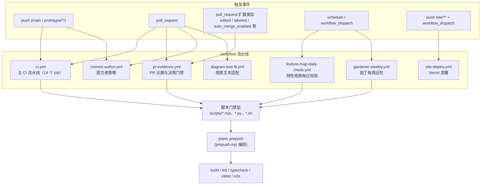

# GitHub Actions 持续集成与自动化流水线

## 简介

`github_ci` 模块承载本仓库在 GitHub Actions 上的全部自动化流水线，共 7 个 workflow 文件：从每个 PR 都必须通过的持续集成（`ci`），到强制 PR 正文证据与决策门禁（`pr-evidence`）、提交者策略（`commit-author`）、图表文本适配（`diagram-text-fit`），再到按计划运行的守护型任务（`feature-map-daily-check`、`gardener-weekly`）和网站部署（`site-deploy`）。

整个 CI 设计遵循两条核心原则：

1. **门禁即机器学习器的纪律校验**：大量"门禁"（gate）脚本以机器方式强制人工或 agent 容易遗漏的仓库纪律（冲突标记、PR 模板、代码风格基线等），且多数在 `pnpm install` 之前以零依赖方式运行，力求在 1 分钟内红。
2. **咨询性（advisory）与必需（required）分离**：只有真正阻断合并的检查才进入分支保护（branch protection）的必需上下文；成熟前的门禁先作为咨询性 job 可见地变红，待稳定一段时间后才升级为必需上下文（如 `pr-evidence` 的推广过程，见 #1440）。

> 相关模块：CI 实际执行的构建、lint、测试、打包步骤大量委托给 `pnpm prepush`（见 [root_build_deploy](root_build_deploy.md)）；`.claude/workflows/pr-gate.js` 的 PR 路由与准入逻辑由 `ci.yml` 中的自检步骤验证（见 [claude_automation](claude_automation.md)）。

## 架构总览

## 子模块划分

| 子模块 | workflow 文件 | 职责 |
| --- | --- | --- |
| [github_ci_main_pipeline](github_ci/github_ci_main_pipeline.md) | `.github/workflows/ci.yml` | 主 CI 流水线：`check` 综合检查、4 分片 `e2e`、`e2e-gate` 聚合门禁、`pack-smoke` 打包冒烟，以及多个咨询性门禁 job |
| [github_ci_pr_evidence](github_ci/github_ci_pr_evidence.md) | `.github/workflows/pr-evidence.yml` | PR 正文证据门禁（模板章节、图片链接、任务清单）与 `needs-decision` 决策门禁、自动合并解除 |
| [github_ci_pr_policy_gates](github_ci/github_ci_pr_policy_gates.md) | `.github/workflows/commit-author.yml`、`diagram-text-fit.yml` | PR 关联的策略门禁：提交作者不得使用 bot 账户、drawio 图表标签必须适配形状 |
| [github_ci_scheduled_jobs](github_ci/github_ci_scheduled_jobs.md) | `.github/workflows/feature-map-daily-check.yml`、`gardener-weekly.yml` | 按计划运行的守护型任务：特性地图每日校验、园丁每周巡检与教训台账发布 |
| [github_ci_site_deploy](github_ci/github_ci_site_deploy.md) | `.github/workflows/site-deploy.yml` | `site/**` 变更时向 Vercel 部署生产站点 |

上述五个子模块的详细文档位于 `Repository_automation_and_delivery/github_ci/` 目录下，文件分别为 [github_ci_main_pipeline.md](github_ci/github_ci_main_pipeline.md)、[github_ci_pr_evidence.md](github_ci/github_ci_pr_evidence.md)、[github_ci_pr_policy_gates.md](github_ci/github_ci_pr_policy_gates.md)、[github_ci_scheduled_jobs.md](github_ci/github_ci_scheduled_jobs.md) 与 [github_ci_site_deploy.md](github_ci/github_ci_site_deploy.md)。

## 关键设计决策

- **触发面收窄（ci.yml）**：`push` 只监听 `main` 与 `prototype/**`（这些分支从不开 PR），PR 场景一律走无条件的 `pull_request` 触发，避免同一 head sha 触发两次运行导致结论分叉、commit status 被钉成 UNSTABLE。同时不做按 sha 的并发去重（push 与 pull_request 的 sha 相同，去重会非确定性丢弃一方）。
- **第三方便件全部按完整 commit SHA 固定版本**（#1076）：浮动标签可能被上游重定向；版本号注释是 Dependabot 升级的锚点，不可删除。
- **`if: always()` + 显式结果判定（e2e-gate，#762）**：分支保护把 `skipped` 视为成功；只用 `needs` 时失败的分片会跳过聚合 job，必须 `always()` 报告并显式检查 `needs.e2e.result` 才能 fail-closed。
- **必需上下文必须是"稳定的 job 名"**：`pr-evidence`、`e2e-gate` 这类受保护上下文都以固定的 job 名出现，新门禁先在矩阵/分支保护之外跑绿一段再一航升级（一行改动即可完成推广）。
- **咨询性门禁的自证**：`ci.yml` 里有专门的"门禁自检"步骤（如 `pr-gate` 自检、`ci-job-structure-gate` 自检、`prepush` 自测），保证决策代码本身被测试覆盖；还有 `pr-evidence-workflow-gate` 用 `ci.yml` 硬钉住 `pr-evidence` 的必需形态（无 job 级 `if`、无 paths 过滤、标签与自动合并触发齐全）。

## 与其它模块的关系

- **root_build_deploy**：`check`、`e2e`、`dead-class-gate` 等 job 依赖根 `package.json` 的 `pnpm prepush`、`pnpm test`、`pnpm lint`、`pnpm typecheck` 脚本与 pnpm workspace 结构（`packageManager: pnpm@12.5.1`）。`pack-smoke` 直接执行 `scripts/pack-smoke.sh`。
- **claude_automation**：`.claude/workflows/pr-gate.js` 的 ADR 0021 D4 路由与准入逻辑由 `ci.yml` 的 `pr-gate self-check (#1401)` 步骤使用 stub agent 运行验证。
- **Backend_application_services**：`ci.yml` 的 Drizzle 迁移漂移检查运行 `pnpm --filter @xiechimon/cairn db:check` / `db:generate`（服务端数据库 schema 定义见 [Backend_application_services/server/server_database.md](../Backend_application_services/server/server_database.md)）。
- **shared**：CI 的若干门禁读取 `packages/shared` 中的协议与类型定义（如 REST 端点 shape、技能记录），`npm-command-gate` 验证依赖包名真实存在。