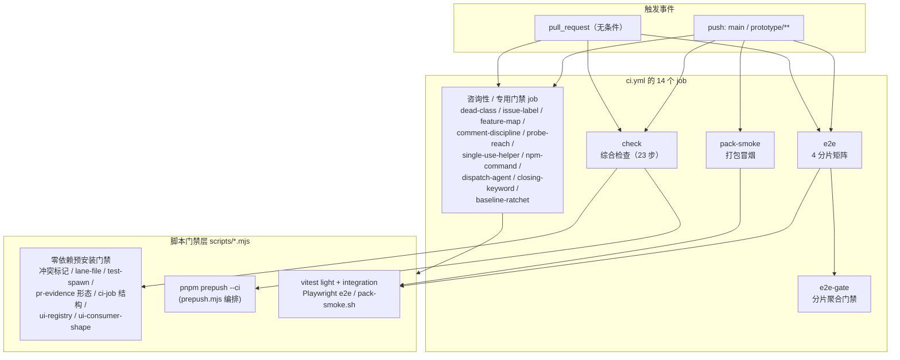
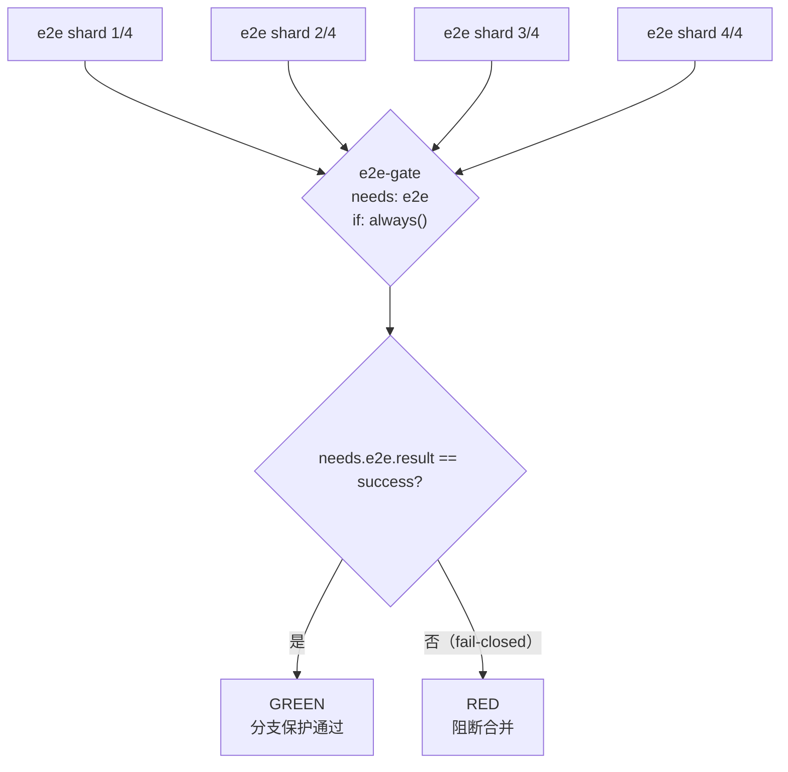
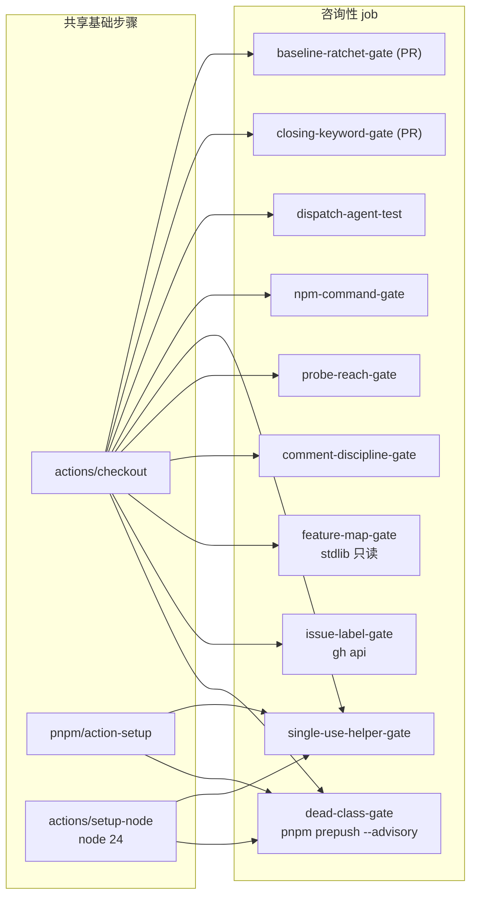

# 主 CI 流水线（ci.yml）

## 简介

`github_ci_main_pipeline` 模块对应 `.github/workflows/ci.yml` —— 本仓库的主持续集成流水线，是每个 PR 合并到 `main` 前必须经过的核心检查面。它由 **14 个 job** 组成：一个 23 步的 `check` 综合检查 job、按 4 分片并行的 `e2e` 端到端测试、fail-closed 的 `e2e-gate` 分片聚合门禁、`pack-smoke` 打包冒烟测试，以及 10 个以咨询性（advisory）为主的专用门禁 job（死类检查、issue 标签、特性地图过期、注释纪律、探针可达、单次辅助函数、npm 包名、分发 agent 自检、关闭关键字、基线棘轮）。

整个流水线的设计哲学与 [github_ci](../github_ci.md) 一致：**把容易遗漏的仓库纪律变成机器强制**。大量门禁脚本刻意在 `pnpm install` 之前以零依赖方式运行，目标是在 1 分钟内变红；需要依赖的门禁则统一委托给 `pnpm prepush`（由 `scripts/prepush.mjs` 编排，见 [root_build_deploy](../root_build_deploy.md)）。

## 触发与并发设计

```yaml
on:
  push:
    branches: [main, 'prototype/**']
  pull_request:
```

- **push 只监听 `main` 与 `prototype/**`**（#500）：`prototype/**` 两条分支（`42-pixel-replica`、`shadcn-visual-tokens`）从不开 PR，push 运行是它们唯一的 CI；`web/**` 等 lane 分支总是开 PR，由无条件的 `pull_request` 覆盖。收窄触发面避免了同一 head sha 同时触发 push + pull_request 两次运行、结论分叉并把 commit status 钉成 UNSTABLE 的历史问题。
- **不做按 sha 的并发去重**：push 的 `github.sha` 与 pull_request 的 head sha 相同，若加 `concurrency` 去重，`cancel-in-progress` 会非确定性丢弃后注册的一方——存活者不确定，且 PR 上只剩 cancelled 运行，合并门禁反而更糟。收窄触发面才是确定性修复。
- **第三方便件全部钉死完整 commit SHA + 尾随版本注释**（#1076）：浮动标签可能被上游重定向；`# v5.1.0` 这类注释是 Dependabot 升级的锚点，不可删除。本文件使用的固定版本包括：`actions/checkout@fbc6f3992d24b796d5a048ff273f7fcc4a7b6c09 # v5.1.0`、`pnpm/action-setup@b906affcce14559ad1aafd4ab0e942779e9f58b1 # v4.3.0`、`actions/setup-node@a0853c24544627f65ddf259abe73b1d18a591444 # v5.0.0`、`actions/upload-artifact@043fb46d1a93c77aae656e7c1c64a875d1fc6a0a`。

## 架构总览



## `check` 综合检查 job

`check` 是唯一同时覆盖"安装前零依赖门禁"与"安装后完整检查"的 job，23 个步骤按顺序执行：

```mermaid
flowchart LR
    A["checkout<br/>fetch-depth: 0"] --> B["pnpm/action-setup<br/>(读 packageManager)"]
    B --> C["setup-node<br/>node 24 + pnpm 缓存"]
    C --> D["零依赖门禁（安装前）<br/>冲突标记 / lane-file / test-spawn /<br/>pr-evidence 形态 / ci-job 结构 /<br/>ui-registry / ui-consumer-shape"]
    D --> E["pnpm install --frozen-lockfile"]
    E --> F["pnpm prepush --ci (#1533)"]
    F --> G["上传 gate-reds 拦截日志<br/>(if: always())"]
    G --> H["pr-evidence 回归测试 + prepush 自测"]
    H --> I["verify-cairn CLI 自测 (#1402)"]
    I --> J["安装 Playwright chromium"]
    J --> K["Drizzle 快照链 + 迁移漂移检查"]
    K --> L["vitest light 项目"]
    L --> M["vitest integration 项目"]
    M --> N["pr-gate 自检 (#1401)"]
    N --> O["lint 警告上限棘轮 (#1192)"]
```



### 安装前零依赖门禁（第 1–10 步）

这些步骤刻意放在 `pnpm install` 之前，只依赖 `git` 与 `node`，任何违规都能在约 1 分钟内变红：

| 步骤 | 脚本 | 强制内容 |
| --- | --- | --- |
| Conflict markers | 内联 `git grep -nE '^(<<<<<<< \| >>>>>>> )'` | 提交中不得残留合并冲突标记（2026-10-08 曾因嵌套 `<<<<<<<` 泄漏到 main；只匹配行首 + 空格的标记形式，不误伤 markdown setext 标题） |
| Lane file gate (#1199) | `scripts/lane-file-gate.mjs` | lane 分支草稿的 `PROGRESS.md` / `BLOCKED.md` 不得骑在 PR 分支上进入 main；PR 场景用 `LANE_FILE_BASE_SHA` 做 added-only diff，push 场景自检已跟踪集合 |
| Test spawn gate | `scripts/test-spawn-gate.mjs` | corepack 的 pnpm/npx shim 会吞掉 SIGTERM，测试不得经由它 spawn 出残留进程树（挂到 PID 1 下） |
| PR evidence workflow shape gate | `scripts/pr-evidence-workflow-gate.mjs` | 硬钉住 `pr-evidence` 作为必需状态检查的形态：无 job 级 `if`/`name`、无 paths 过滤、`needs-decision` 决策守卫与标签/自动合并触发齐全（防止它失去承重能力） |
| CI job structure gate (#1557) | `node --test scripts/ci-job-structure-gate.test.mjs` + `scripts/ci-job-structure-gate.mjs` | 每个具名步骤必须落在基线 `ci-job-structure-baseline.json` 钉住的 job 里；步骤不得跨 job 重复，job 不得增删 |
| UI registry gate (#989) | `scripts/ui-registry-gate.mjs` | `components/ui` 的 allowlist + 内容哈希账本 + 与上游快照比对 + 状态棘轮（S5 vs base 清单）；手写原语或未刷新账本的覆盖都会红 |
| UI consumer shape gate (#1054, ADR 0012 D1) | `scripts/ui-consumer-shape-gate.mjs` | 消费者处可见的 square-box 几何每行必须引用注册表依据（`scripts/ui-consumer-registry.json`），账本 diff 即评审面 |

### 安装后检查（第 11–23 步）

- **Prepush checks (#1533)**：`pnpm prepush --ci` 执行 `scripts/prepush.mjs` 的 CI 模式计划（english-only、ui-debt、ui-drift、pr-evidence-archive、biome lint、typecheck、spec:parse、recording-gate、e2e-affected 覆盖率检查、reach 测试、escape-trace 测试、lessons-ledger 等），并把拦截到的门禁违规写入 `CAIRN_GATE_LOG` 指向的 `gate-log.jsonl`。
- **Upload safeguard interceptions**：`if: always()` 上传 `runner.temp/gate-reds/` 为 artifact（`gate-reds-<run_id>-<run_attempt>`，保留 90 天），供事后审计 prepush 拦截日志。
- **PR evidence regression tests**：`python3 scripts/pr-evidence-gate.test.py` 回归验证 pr-evidence 门禁脚本自身。
- **Prepush self-test**：`node --test` 运行 7 个测试文件（prepush、heavy-slots、english-only、doc-reader、lessons-ledger、recording-gate、lessons-weekly），保证编排代码本身被覆盖。
- **verify-cairn CLI self-test (#1402)**：`node .claude/skills/verify-cairn/scripts/vp-selftest.mjs` 验证 vp.mjs 分发、证据、捕获、链接、归档规则；多数驱动用 `--dry-run`，live 驱动用 stub 探针在复制的技能树里跑；其中一条腿运行 `vp-registry-gate.mjs` 检查未登记的 `scripts/`、新 `drive-<ticket>` 脚本、特性地图缺 vp.mjs 驱动行。
- **Install Playwright chromium**：`pnpm exec playwright install chromium --with-deps` —— 集成 vitest 的四个 e2e 套件（m5-web-e2e 等）在 job 内启动真实 Chromium，移除会直接 `browserType.launch executable doesn't exist`。
- **Drizzle 快照链 + 迁移漂移检查**：`pnpm --filter @xiechimon/cairn db:check`（`scripts/db-check.mjs`）硬性强制迁移快照链不变量；随后 `db:generate` 重新生成迁移并用 `git diff --exit-code apps/server/drizzle` 断言无漂移——schema 变更未重新生成迁移即红（见 [server_database](../../Backend_application_services/server/server_database.md)）。
- **Test (vitest, light project)**：`VITEST_PROJECT_SET=light pnpm test`，运行除 integration 外的全部 vitest 项目（见根目录 `vitest.config.ts` 的项目划分）。
- **Test (vitest, integration stack)**：`VITEST_PROJECT_SET=integration pnpm test`，真实 server + daemon + Chromium 进程内集成栈单独运行（与 light 项目分开是为了避免 2 vCPU runner 上的 false-red）。
- **pr-gate self-check (#1401)**：`scripts/pr-gate-selfcheck.mjs` 用 stub agent 运行 `.claude/workflows/pr-gate.js` 的 ADR 0021 D4 路由与准入逻辑（见 [claude_automation](../claude_automation.md)）。
- **Lint warning cap gate (#1192)**：`scripts/lint-warning-cap.mjs` 解析 biome ci 摘要的 "Found N warnings"，与冻结上限 `scripts/lint-warning-baseline.json` 比较；上限只能向下移动，且 in-tree 基线不得高于 base 的基线（同一 D3 棘轮机制），`--write` 可在清偿债务后重新冻结。

## `e2e` 分片与 `e2e-gate` 聚合门禁

端到端测试只在 CI 全量运行（#693，本地开发用 `e2e:affected`）。`e2e` 用 Playwright 把 83 个 spec 切成 **4 个并行分片**（`--shard N/4`），`fail-fast: false` 保证一个分片红了不隐藏其它分片；每个分片独立 runner，避免与 `check` job 互相覆写 `apps/web/dist`。`timeout-minutes: 30` 是整 job 的后备超时，防止安装挂起无限阻塞合并。



- **分片命令的 `--` 位置陷阱（#765）**：`e2e -- --shard=…` 会让 pnpm 把 `--` 原样转给脚本，Playwright 把 `--` 当位置参数而忽略 `--shard`，四个分片各跑全部 688 用例；去掉 `--` 后 pnpm 把脚本名后的 flag 直接转发，union 才是全集。
- **CSS mechanism gate (#747)**：`e2e` 的 `webServer fixture-build` 已经写出 `apps/web/dist`，随后 `scripts/css-mechanism-gate.mjs` 只做 grep 断言——源码中声明的 `tw-animate-css` token 与 `@keyframes enter/exit` 必须出现在编译产物里（曾因 `tw-animate-css` 已安装、类名存在但缺 `@import` 导致动画编译为空，见 #656/#677）。
- **`e2e-gate` 必须 `if: always()` + 显式结果判定（#762）**：分支保护的必需上下文不会编码矩阵大小，硬编码 `e2e (1..4)` 会在分片数变化时静默失配；固定 job `e2e-gate` 是保护名单里唯一的入口。若只用 `needs`，失败的分片会让本 job 直接 `skipped`，而分支保护把 `skipped` 当成功——`always()` 保证总是报告，再显式断言 `needs.e2e.result == success` 实现 fail-closed。

## `pack-smoke` 打包冒烟

独立 job/runner（与 e2e 分片分开，各自写自己的 dist），运行 `scripts/pack-smoke.sh`，覆盖 #264 / #299 的发布形态失败模式：

1. 对 `@xiechimon/cairn`（服务端）与 `@xiechimon/cairn-cli`（daemon）执行 `npm pack`（`prepack` 触发 web build + esbuild bundle + stage-web）；
2. 两个 tarball 的 manifest 断言：依赖不得残留 `workspace:` / `catalog:`、必须存在 `bin.cairn`、bin 路径不得带 `./` 前缀（npm publish 会静默剥离）；
3. cli tarball 内容断言：`dist/cli.mjs` 与 `LICENSE` 存在、`src` 不泄漏；
4. 主 tarball 内容断言：`dist/index.mjs`、`web/index.html`、`drizzle/meta/_journal.json` 与 `drizzle/0000*`、`LICENSE` 存在、`src` / `test` 不泄漏；
5. 在仓库外临时目录安装主 tarball，用裸 `node` 启动（隔离的 `CAIRN_HOME`），断言 `/api/user/me` 与 `/app` 均 200，验证数据根隔离与 in-package webDir 探测。

## 咨询性与专用门禁 job

以下 job 除 `npm-command-gate` 与 `dispatch-agent-test` 外均为咨询性（advisory）：可见地变红，但**不进入分支保护的必需上下文**，不阻断合并——与 [github_ci](../github_ci.md) 所述的"先咨询、后晋升必需"策略一致。

| job | 脚本 / 命令 | 强制内容 | 依赖 |
| --- | --- | --- | --- |
| `dead-class-gate` (#1036) | `pnpm prepush --advisory`（`ui-dead-class-gate.mjs --compile`） | TSX 类名减去存活样式表（Tailwind 产物 + `src/**/*.css` 选择器）；零命中且零 spec/verify 引用也失败（#950 `chief.css` 退役遗留的死类会静默破坏布局）；零命中失败是防"门禁空转"的保险 | node_modules（`@tailwindcss/postcss` 编译 ~0.5s） |
| `issue-label-gate` | `scripts/issue-label-gate.mjs` | 每个 open issue 必须恰好 1 个类别标签（`bug` / `enhancement`）+ 1 个状态标签（`needs-triage` / `needs-info` / `ready-for-agent` / `ready-for-human` / `wontfix`）；`wayfinder:*` lane 豁免；仅用 `gh api`，无 node_modules | `GH_TOKEN` |
| `feature-map-gate` (#1160) | `scripts/feature-map-staleness-gate.mjs` | verify-cairn 特性地图中的路径 / `.class` / `[data-*]` / CSS 声明必须在树中可解析，且评估分数不得过期（过期 `avatars.md` 曾隐藏 #1156）；冻结基线 `feature-map-staleness-baseline.json`——新过期才算新债，基线条目转绿反而要求移除 | Node stdlib 只读仓库文件 |
| `comment-discipline-gate` (#1520) | `node --test scripts/comment-discipline-gate.test.mjs` + `scripts/comment-discipline-gate.mjs` | `apps/`、`packages/` 下新增的 `.ts/.tsx/.mjs/.css` 行不得引入注释，除非有精确的 allowlist 条目（`scripts/comment-discipline-allowlist.json`，条目须含 path、line、reason） | 按 `COMMENT_DISCIPLINE_BASE_SHA` 做 added-only diff |
| `probe-reach-gate` (#1542) | `node --test docs/verify/1542/reach.test.mjs` + `vp-registry-gate.mjs --check-reach` | verify-cairn 探针（probe）的 reachability 注册表必须与树中实际 drive 脚本一致，`reach.test.mjs` 回归验证规则本身 | 按 `VP_REACH_BASE_SHA` 做基准对比 |
| `single-use-helper-gate` (#1543) | `node --test scripts/single-use-helper-gate.test.mjs` + `scripts/single-use-helper-gate.mjs` | 新增的、只被调用一次的非导出函数必须内联或加入具名 allowlist（`scripts/single-use-helper-allowlist.json`）；用 TypeScript AST（`typescript/unstable/ast`）分析引用计数 | `pnpm install --ignore-scripts`（TypeScript） |
| `npm-command-gate` | `node --test scripts/npm-command-gate.test.mjs` + `scripts/npm-command-gate.mjs` | README、site html、`apps/web/src/**/*.tsx`、`packages/shared/src/brand.ts` 中出现的 `npx` / `npm install` 包名必须真实存在于 npm registry（网络校验） | 网络 + `contents: read` 权限 |
| `dispatch-agent-test` (#1556) | `node --test scripts/dispatch-agent.test.mjs scripts/dispatch-dedupe.test.mjs` | 分发 agent 的 `start` / `check` 往返：写状态文件、进程存活探测、旧 nohup 语法迁移边界、边界 teardown 杀死旧式 job 而保留 dispatch 的 job | 无 |
| `closing-keyword-gate` (#1541, PR only) | `node --test scripts/check-closing-keyword.test.mjs` + `scripts/check-closing-keyword.mjs` | PR 正文声明的 `closes #N` 必须在分支提交里存在对应的 closing 行（读取 `GITHUB_EVENT_PATH` 事件载荷） | `if: github.event_name == 'pull_request'` |
| `baseline-ratchet-gate` (#1617, PR only) | `node --test scripts/baseline-ratchet-gate.test.mjs scripts/gardener-weekly.test.mjs scripts/evidence-prune.test.mjs` + `scripts/baseline-ratchet-gate.mjs` | 冻结基线（`baseline-ledger.mjs` 中 `ratchet: true` 的指标）只能下降不能上升；附带回归 gardener-weekly 与 evidence-prune 脚本 | 按 `BASELINE_RATCHET_BASE_SHA` 对比 base |



## 关键设计决策

- **必需上下文必须是稳定的 job 名**：分支保护只引用 `e2e-gate` 这样的固定 job 名，矩阵大小、分片数量变化都不会破坏保护配置；新门禁先在矩阵外跑绿一段时间，稳定后再一行晋升为必需上下文。
- **门禁自证成风**：`check` job 里 `ci-job-structure-gate`、`pr-evidence-workflow-gate`、`pr-gate self-check`、`verify-cairn self-test`、`prepush self-test` 等步骤都在测试"做决策的代码"本身——用 `node --test` 跑同名单测、用 stub agent 跑路由逻辑、用形状断言钉住必需 job 的形态。
- **安装前 vs 安装后分层**：能零依赖跑的门禁全部前置（冲突标记、lane-file、test-spawn、workflow 形状、CI job 结构、UI registry、UI consumer shape），1 分钟红；需要 node_modules 的（prepush 全家、lint 棘轮、dead-class、single-use-helper）放到 `pnpm install` 之后。
- **咨询性与必需分离**：`dead-class-gate`、`issue-label-gate`、`feature-map-gate`、`comment-discipline-gate`、`probe-reach-gate`、`single-use-helper-gate`、`closing-keyword-gate`、`baseline-ratchet-gate` 全部是咨询性的——可见地红但不阻塞合并，成熟后按需晋升。
- **CI 模式与本地模式分工**（`prepush.mjs`）：`--ci` 只跑必需检查（不含 `localOnly` 清单与自测），本地 `pnpm prepush` 额外跑 local-only 门禁、自测、`prepush-vitest`、web 单测与 `e2e:affected`；`--advisory` 只跑死类编译检查；`--e2e-shard N/4` 只跑对应 Playwright 分片。
- **vitest 项目拆分**：根 `vitest.config.ts` 按 `VITEST_PROJECT_SET` 把 integration（重）与 light 项目分开，避免真实 server + daemon + Chromium 的集成栈在 2 vCPU runner 上与轻项目互相拖累产生 false-red。

## 与其它模块的关系

- **[root_build_deploy](../root_build_deploy.md)**：`check`、`e2e`、`dead-class-gate` 依赖根 `package.json` 的 `pnpm prepush` / `pnpm test` / `pnpm lint` / `pnpm typecheck` 脚本与 pnpm workspace（`packageManager: pnpm@12.5.1`）；`pack-smoke` 直接执行 `scripts/pack-smoke.sh`；vitest 项目划分来自根 `vitest.config.ts`。
- **[github_ci_pr_evidence](github_ci_pr_evidence.md)**：`check` 的 `PR evidence workflow shape gate` 硬钉住 `pr-evidence.yml` 的必需形态（无 job 级 `if`/`name`、无 paths 过滤、`needs-decision` 守卫、标签与自动合并触发齐全），另有 `python3 scripts/pr-evidence-gate.test.py` 回归其脚本。
- **[claude_automation](../claude_automation.md)**：`.claude/workflows/pr-gate.js` 的 ADR 0021 D4 路由与准入逻辑由 `pr-gate self-check (#1401)` 用 stub agent 验证；verify-cairn 技能树的 CLI 与探针注册表由 `verify-cairn CLI self-test (#1402)` 与 `probe-reach-gate` 校验。
- **[server_database](../../Backend_application_services/server/server_database.md)**：Drizzle 快照链与迁移漂移检查运行 `pnpm --filter @xiechimon/cairn db:check` / `db:generate`（见 `apps/server/package.json` 的 `db:check` = `scripts/db-check.mjs`、`db:generate` = `drizzle-kit generate`）。
- **[shared](../../shared.md)**：`npm-command-gate` 扫描 `packages/shared/src/brand.ts` 中的包名并校验其真实存在于 npm；其余门禁间接依赖 shared 中的协议与记录类型定义。
- **[github_ci_scheduled_jobs](github_ci_scheduled_jobs.md)**：`baseline-ratchet-gate` 附带回归 `gardener-weekly` 与 `evidence-prune` 脚本，与每周巡检共享基线台账逻辑。
