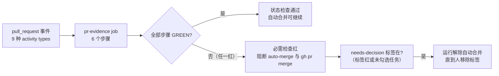
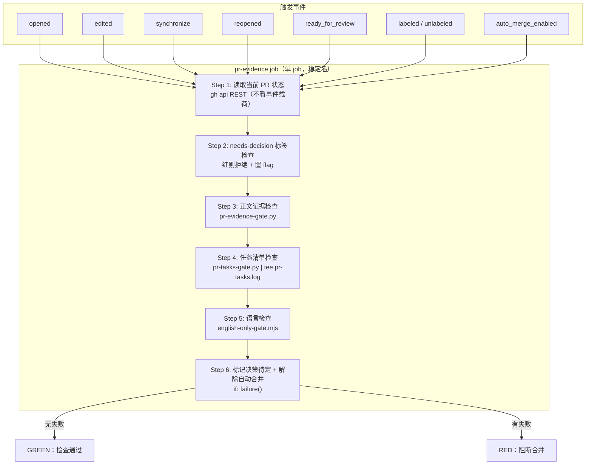
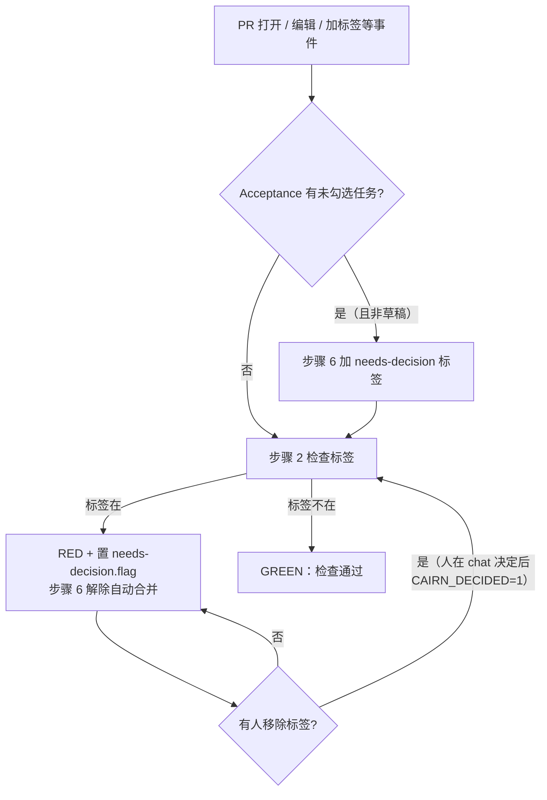

# PR 证据与决策门禁（pr-evidence.yml）

## 简介

`github_ci_pr_evidence` 模块对应 `.github/workflows/pr-evidence.yml` —— 一个**单 job** 的 workflow，承载本仓库最重的 PR 正文门禁：它是 `main` 分支保护中的**必需状态检查（required status check）**，钉死在 GitHub Actions 应用上，红一次就同时阻断自动合并与 `gh pr merge`。

它由三条历史线叠加而成（文件头注释逐条记录了来龙去脉）：

1. **正文证据门禁**（#750，经 #939 / #940 放宽、#1079 折叠章节）：PR 正文必须回答模板的 `## Upstream` 与 `## Verified` 两个章节（回答存在即可，质量由 reviewer 判断）；正文中的图片链接必须以嵌入形式（``，不是 `[...]()`）出现且必须应答 HTTP 200。
2. **任务清单门禁**（#1240）：正文的 `## Acceptance` 章节必须携带至少一个任务清单项，且合并时**不得有未勾选项**（#1234/#1235 曾带未勾选框合并，#1229/#1233 曾只有 prose 子弹、无机器可判定的完成信号）。
3. **决策守卫**（2026-10-21，事故 #1435 之后）：PR 一旦携带 `needs-decision` 标签，本 job 即红，直到有人移除标签；标签存在期间，每次运行还会**解除（disarm）GitHub 自动合并**。未勾选的 Acceptance 项会自动加上该标签。这正是 #1435 事故的教训——当时本 job 只是咨询性的，自动合并已武装、编排者在仍向用户提问时把正文改绿，`check` 一过合并就触发了。



> 相关模块：本 job 是 [github_ci](../github_ci.md) 家族里唯一被分支保护硬钉住形态的 PR 门禁；其形状由主流水线 [github_ci_main_pipeline](github_ci_main_pipeline.md) 的 `check` job 用 `scripts/pr-evidence-workflow-gate.mjs` 强制保护，正文契约由 `.claude/skills/pr-cairn/SKILL.md` 向 agent 侧交付。

## 触发与并发设计

```yaml
on:
  pull_request:
    types: [opened, edited, synchronize, reopened, ready_for_review, labeled, unlabeled, auto_merge_enabled]
```

- **独立于 `ci.yml` 成文件**：`pull_request` 的默认 activity types 只有 `opened / synchronize / reopened`，而正文与标签是可编辑的，所以 `edited`、`labeled`、`unlabeled` 必须显式列出。若把这些 `types:` 加在 [github_ci_main_pipeline](github_ci_main_pipeline.md) 的 `ci.yml` 上，每次正文编辑都会重触发整条流水线；放在本文件里则只有这个轻量 job 会跑。
- **`auto_merge_enabled` 被列出**：在带 `needs-decision` 标签的 PR 上武装自动合并，会在**同一轮运行内**被解除，而不是等下一次编辑或 push。
- **`ready_for_review` 被列出**：草稿（draft）的未勾选项在它脱离草稿的那一刻立即被判定。
- **job 无 `if:`、触发无 `paths:`**：跳过的运行会被当成"通过的必需检查"，从而覆盖掉一个红的运行——这是本文件不可动摇的形态（由 `pr-evidence-workflow-gate.mjs` 硬钉，见下文）。

```yaml
concurrency:
  group: pr-evidence-${{ github.event.pull_request.number }}
  cancel-in-progress: true
```

每个 PR 同一时间只保留一个运行、最新者胜：标签在正文编辑几秒后加上时，编辑触发的运行不得以绿色"活过"该标签。被取消的运行不算通过的检查。

## 权限模型

```yaml
permissions:
  contents: write
  pull-requests: write
```

- `contents: write` **只为 `disablePullRequestAutoMerge` 这一个变更**：只给 `pull-requests: write` 时，该变更会应答 "Resource not accessible by integration"（运行 39540555968，PR #1441，2026-10-21），自动合并保持武装。
- `checkout` 与标签调用只需要 `read` / `pull-requests` 级权限，不额外索取。

## 架构总览



## 作业步骤详解

job 名为稳定的 `pr-evidence`（它就在分支保护的必需检查名单里，改名字会让保护失去目标）。六个步骤按下表执行：

| 步骤 | 名称 | 条件 | 执行的检查 |
| --- | --- | --- | --- |
| 1 | Read the PR as it is now | 恒执行 | 用 REST 读取 PR 现状，产出 `pr-body.md`、`pr-evidence-context.json` 与 `labels` / `draft` 输出 |
| 2 | Refuse while a person has a decision pending | 恒执行 | `needs-decision` 标签在则红并置 `needs-decision.flag` |
| 3 | Check PR body evidence | `!cancelled() && steps.pr.outcome == 'success'` | `python3 scripts/pr-evidence-gate.py`：章节 + 链接嵌入 + 链接可达 |
| 4 | Check PR body tasks | 同上 | `python3 scripts/pr-tasks-gate.py`：Acceptance 任务清单，输出 `tee pr-tasks.log` |
| 5 | Check PR body language | 同上 | `node scripts/english-only-gate.mjs --text`：正文必须全英文 |
| 6 | Mark the decision pending and disarm auto-merge | `if: failure()` | 为未勾选任务加标签；标签在则 `gh pr merge --disable-auto` |

### 步骤 1：读取当前 PR 状态（REST，不是事件载荷）

```bash
gh api "repos/$GITHUB_REPOSITORY/pulls/$PR_NUMBER" > "$RUNNER_TEMP/pr.json"
gh api --paginate --slurp "repos/$GITHUB_REPOSITORY/pulls/$PR_NUMBER/commits" > "$RUNNER_TEMP/pr-commits.json"
jq -n --arg repository "$(jq -r '.base.repo.full_name' "$RUNNER_TEMP/pr.json")" \
     --slurpfile pages "$RUNNER_TEMP/pr-commits.json" \
     '{repository: $repository, commits: ($pages[0] | add)}' > "$RUNNER_TEMP/pr-evidence-context.json"
jq -r '.body // ""' "$RUNNER_TEMP/pr.json" > "$RUNNER_TEMP/pr-body.md"
echo "labels=$(jq -r '[.labels[].name] | join(",")' "$RUNNER_TEMP/pr.json")" >> "$GITHUB_OUTPUT"
echo "draft=$(jq -r '.draft' "$RUNNER_TEMP/pr.json")" >> "$GITHUB_OUTPUT"
```

- **永远从 API 读"此刻的 PR"，从不读事件载荷**：重跑（rerun）会重放运行创建时的载荷，之后加上的标签或修好的正文对它不可见（#1045 上两次红重跑之后才想明白这一点）。
- **用 REST 而不是 `gh pr view` / `gh pr edit`**：gh 的 PR GraphQL 路径会撞上本仓库的 classic-projects 字段而失败，甚至可能"失败且未应用编辑"。
- 产物：`pr-body.md`（正文原文，给步骤 3/4/5）、`pr-evidence-context.json`（`repository` + 全量提交消息，供归档判定）、`labels` / `draft`（给步骤 2 与步骤 6）。

### 步骤 2：needs-decision 标签检查（决策守卫的入口）

```bash
case ",$LABELS," in
  *,needs-decision,*)
    touch needs-decision.flag
    echo "FAIL needs-decision: a person has to remove the needs-decision label before this PR can merge"
    exit 1 ;;
esac
echo "pr-decision: GREEN (no needs-decision label)"
```

带 `needs-decision` 标签的 PR 直接红，并把标记文件 `needs-decision.flag` 留在工作区——步骤 6 靠它知道"有未决决策存在"。

### 步骤 3：正文证据检查（章节 + 链接嵌入 + 链接可达）

```bash
python3 scripts/pr-evidence-gate.py "$RUNNER_TEMP/pr-body.md" "$RUNNER_TEMP/pr-evidence-context.json"
```

输出 `pr-evidence:` 前缀的诊断行，任一失败项都会记入失败集合并最终退出 1。具体规则见下文「门禁脚本详解」。`pr-evidence-context.json` 只用于**归档判定**（见步骤 3 扩展说明）。

### 步骤 4：任务清单检查

```bash
set -o pipefail
python3 scripts/pr-tasks-gate.py "$RUNNER_TEMP/pr-body.md" | tee pr-tasks.log
```

输出以 `pr-tasks:` 前缀区分于步骤 3 的日志；`tee pr-tasks.log` 把输出落盘，供步骤 6 `grep 'FAIL unchecked-task'` 决定是否加标签。`set -o pipefail` 保证 gate 退出码不被 `tee` 掩盖。

### 步骤 5：语言检查

```bash
node scripts/english-only-gate.mjs --text "$RUNNER_TEMP/pr-body.md"
```

仓库正文语言是英语（见 `AGENTS.md` "Language"）；反引号内或围栏块里的中文（如 UI 标签）是允许的，脚本本身就按这个规则剥离。

### 步骤 6：标记决策待定并解除自动合并（`if: failure()`）

```bash
if [ "$PR_DRAFT" != "true" ] && grep -q 'FAIL unchecked-task' pr-tasks.log 2>/dev/null; then
  gh api -X POST "repos/$GITHUB_REPOSITORY/issues/$PR_NUMBER/labels" -f 'labels[]=needs-decision' --silent
  touch needs-decision.flag
  echo "pr-decision: needs-decision label added (unchecked Acceptance item)"
fi
if [ ! -f needs-decision.flag ]; then
  echo "pr-decision: red without a pending decision; auto-merge left as it is"
  exit 0
fi
if gh pr merge "$PR_NUMBER" --repo "$GITHUB_REPOSITORY" --disable-auto 2>disable-auto.err; then
  echo "pr-decision: auto-merge disarmed"
elif grep -q 'not in auto-merge mode\|not enabled' disable-auto.err; then
  echo "pr-decision: auto-merge was not armed"
else
  cat disable-auto.err
  echo "FAIL disarm: auto-merge may still be armed on a PR with a pending decision"
  exit 1
fi
```

- **未勾选的 Acceptance 项 = 待决决策**（要么验证它，要么豁免它），所以步骤 4 红出 `unchecked-task` 时先给它加 `needs-decision` 标签；然后只要标签在（步骤 2 置的 flag 或本步新增的 flag），就解除自动合并。
- **草稿不加标签**：草稿还在撰写中，不可能自动合并，模板框也还不是任何人的决策——它由红的必需检查单独按住，不进入标签状态机。
- **调用全部幂等**：重复加已有标签、解除未武装的自动合并都是 no-op；且都用 workflow token，不会触发又一个 workflow 运行。
- 只有标签状态触发的红会解除自动合并：链接/措辞类红已被必需检查阻断，lane 修好就自动转绿，**没有任何人代替 lane 重新武装自动合并**。

### 决策守卫状态机



- 标签是"人的决策待定"的唯一机器可见信号；agent 只有在用户于聊天中决定后（带 `CAIRN_DECIDED=1` 前缀）才允许移除标签（见 `.claude/skills/pr-cairn/SKILL.md`）。
- 把正文改绿**不会**清除标签——标签由人移除，运行只负责在标签存在时红并解除自动合并。

## 门禁脚本详解

pr-evidence 的检查逻辑全部在 `scripts/` 下实现，workflow 只负责喂文件与汇总退出码。三个 gate 脚本 + 一个形状守卫脚本：

| 脚本 | 语言 | 输入 | 职责 |
| --- | --- | --- | --- |
| `scripts/pr-evidence-gate.py` | Python 3 | `pr-body.md` + `pr-evidence-context.json` | 章节回答、图片链接嵌入形式、链接 HTTP 可达、归档判定、fixture 查询参数 |
| `scripts/pr-tasks-gate.py` | Python 3 | `pr-body.md` | Acceptance 章节任务清单：至少一项、全部勾选 |
| `scripts/english-only-gate.mjs` | Node | `--text <body>` | 正文必须全英文（引号/围栏内的中文豁免） |
| `scripts/pr-evidence-workflow-gate.mjs` | Node | `.github/workflows/pr-evidence.yml` | 硬钉 workflow 的必需检查形态（被 `ci.yml` 的 `check` job 调用） |

### pr-evidence-gate.py

#### 章节检查（#939，章节名 #1079 折叠）

强制 `## Upstream` 与 `## Verified` 两个章节**有回答**（不判断回答好不好）：

- 用与 pr-tasks-gate.py 相同的解析：围栏块剥离（被引用进代码块的模板不算回答）、大小写不敏感的字面 H2 匹配（首匹配胜）、内容延伸到下一个 H2 或 EOF、扫描前剥掉 HTML 注释。
- 判定三态：`missing`（无此标题）、`empty`（标题后剥注释后无文本）、`answered`。`missing` / `empty` 记 `FAIL missing-section` / `FAIL empty-section` 并点名章节。
- 模板的指引以 HTML 注释形式发货，所以**未触碰的模板必然失败**；失败信息会指向完整契约 `.github/PULL_REQUEST_TEMPLATE.md`（六个章节 `What / Verified / Upstream / Risk / Acceptance / Issues`），并指出全局 show-me 模板（Summary/Evidence/Merge Danger）不满足本 gate，应改用 `.claude/skills/pr-cairn/SKILL.md`（曾有一天四个 lane 手改正文就是因为用错了模板，#1110）。

#### 链接检查（#750，放宽 #940，嵌入形式 #1335）

**哪些 URL 是"图片链接"**（两条并行规则）：

1. **扩展名规则**：任何以 `png|gif|jpe?g|webp|svg` 结尾的 https URL，不论主机。
2. **媒体主机规则**：只托管上传媒体的主机（`user-images.githubusercontent.com`、`github.com/user-attachments/`），且末路径段无扩展名——拖放上传的 URL 形状。

例外：`raw.githubusercontent.com` 只按规则 1 判定（它服务一切已提交文件类型，无扩展名的 raw 路径是引用；非图片证据文件 .json/.md/.txt 不能作为图片嵌入，按引用读——#750 范围；把规则 2 扩到 raw 会在 25 个最新正文上误报 79 个引用链接）。

**"嵌入"的三种形式**（#1335，覆盖 agent 注入的 Cursor badge footer——`<picture>` 两个 `<source>` 变体 + `` 回退）：

1. Markdown 图片：`` 的目标。
2. HTML 图片：`` 属性值。
3. HTML source：`<source srcset="...">` 属性中以逗号分隔的任一 URL（允许逗号周围空白、剥离 `2x` / `100w` 描述符）。

HTML 注释（`<!-- ... -->`）内的 URL 既不视为嵌入也不扫描（GitHub 不渲染，按不存在处理；同长空白替换以保持行号）。围栏代码块**不豁免**图片链接：agent 常在代码围栏里列证据，而围栏里的图片链接渲染不出来（#940 明言这是非目标）。裸 URL（未包进三种形式之一）仍失败。

**可达性**：用 `curl -s -o /dev/null -w '%{http_code}' -m 25` 并发（`ThreadPoolExecutor` 8 工人）探测每个图片 URL，非 `200` 记 `FAIL unreachable (HTTP <code>)`。

#### 归档判定与 fixture 检查

每个图片链接还要过 `archive_verdict()`，用 `pr-evidence-context.json` 里的 `repository` 与提交消息（步骤 1 抓取）判定证据是否已归档：

- **`archived`**：URL 是 `raw.githubusercontent.com/<owner>/<repo>/<40或64位sha>/docs/verify/<ticket>/<file>`，且 `<ticket>` 出现在本 PR 任一提交消息的 closing 关键字（`closes|fixes|resolves #N` 或 `…/issues/N`）中，且无路径穿越（`..`、`%2e%2e`）。
- **`decorative badge`**：`cursor.com/assets/images/open-in-{web,cursor}-{dark,light}.png`、`img.shields.io/badge/<name>`——装饰性徽章，无需 issue 上下文。
- 其它一律 `FAIL archive: <原因>`（`missing repository context` / `missing issue context` / `outside associated issue archive`）——截图必须可回溯到 ticket 归档，不能是任何外部或无关图片（`user-images.githubusercontent.com`、别的仓库、别的 ticket、`main` 分支引用等全部失败，见 `pr-evidence-archive.test.py`）。
- **fixture 检查**：URL 查询串含 `scenario=` 参数即 `FAIL fixture:`——那是测试夹具截图，不是真实证据。

### pr-tasks-gate.py

只判定 `## Acceptance` 章节（#1240），解析与 pr-evidence-gate.py 完全相同（共享正则，`scripts/` 不是包，靠"保持一致"的注释约定同步）：

1. 缺 `## Acceptance` 标题 → `FAIL no-tasks`。
2. 章节存在但剥注释/围栏后**零任务项** → `FAIL no-tasks`（prose 子弹不满足存在性——这是对 #1229/#1233 式正文的刻意行为变更；豁免形式 `- [x] no task surface: <reason>` 就是一个已勾选任务，天然满足存在性，其真伪由 reviewer 判断）。
3. 任一未勾选任务 → 每个违规者一行 `FAIL unchecked-task`，带绝对行号。
4. 至少一项且全勾选 → GREEN。

任务行 = GitHub 任务清单项：`-` / `*` / `+` / 有序列表标记后跟 `[x]` / `[ ]`，任意缩进深度；`[x]` 与 `[X]` 都算勾选；空文本的复选框也算任务。

只绑定 open PR：`pull_request` 触发永不作用于已合并 PR（#939 继承的事实），合并后的正文编辑永不被重新判定。

### english-only-gate.mjs

仓库内容必须全英文（AGENTS.md "Language"）。`--text` 模式对传入的正文文件做逐行扫描：

- 先 `stripQuoted` 剥离围栏块、HTML 注释、行内反引号——反引号内或围栏里的中文（如 UI 标签）是允许的。
- 命中汉字（`\p{Script=Han}`）或全角标点（`\u3000-\u303f`、`\uff01-\uff60`）即报 `english-only-gate:<file>:<line>: Chinese text; write repository content in English`。
- 退出码：有违规 1，无违规 0，异常 2。

### pr-evidence-workflow-gate.mjs（形状守卫）

被主流水线 [github_ci_main_pipeline](github_ci_main_pipeline.md) 的 `check` job 在安装前零依赖调用（`PR evidence workflow shape gate`），硬钉住本 workflow 的"承重形态"：

- `on.pull_request` 触发必须存在，且 `types:` 必须含 `edited` / `ready_for_review` / `labeled` / `unlabeled` / `auto_merge_enabled`（缺一个，带标签的 PR 会一直绿到下一次 push）。
- 触发不得有 `paths` / `paths-ignore` 过滤（跳过的运行算通过的必需检查）。
- job 键必须是恰好 `pr-evidence`（分支保护上下文），无 job 级 `if:`（跳过算成功）、无 `name:` 覆盖（分支保护等的上下文没人报）。
- 必须存在提及 `needs-decision` 的步骤（决策守卫不能消失）。

违规时输出 `FAIL workflow-shape: …` 并退出 1；通过时输出 `pr-evidence-workflow: GREEN (required-check shape intact)`。

## 与 PR 模板的契约

`.github/PULL_REQUEST_TEMPLATE.md` 是 lane 必须满足的完整正文契约（六个 `##` 章节：`What` / `Verified` / `Upstream` / `Risk` / `Acceptance` / `Issues`）。gate 只**强制**其中三个，其余章节是失败信息里指引 lane 去看的规范形状：

| 章节 | gate 强制 | 判定规则 |
| --- | --- | --- |
| `## Verified` | ✅ 必答 | 剥 HTML 注释与围栏后有非空文本（`pr-evidence-gate.py`） |
| `## Upstream` | ✅ 必答 | 同上 |
| `## Acceptance` | ✅ 至少 1 任务项且全勾选 | `pr-tasks-gate.py`；未勾选项自动加 `needs-decision` 标签 |
| `## What` / `## Risk` / `## Issues` | ❌ 不强制 | 失败信息里作为完整契约展示，指引 lane 对齐模板 |

模板的每个指引段落都以 HTML 注释发货，所以**原样提交模板必然红**——这保证了"回答"必须是 lane 自己写的，而不是模板残留。`.claude/skills/pr-cairn/SKILL.md` 是向 agent 侧交付同一契约的技能文件，并明确取代会失败的全局 show-me 模板（`## Summary` / `## Evidence` / `## Merge Danger`）。

## 测试与回归

gate 脚本自身被多层测试覆盖，确保"做决策的代码"不会悄悄退化：

| 测试 | 位置 | 覆盖 |
| --- | --- | --- |
| `pr-evidence-gate.test.py` | `scripts/` | fixture 查询参数必失败、无扩展名嵌入保持形式与完整 URL、裸图片带标点/相邻标记失败、引用不算图片、注释内 URL 不扫描、媒体主机嵌入失败、HTTP 404 失败等 |
| `pr-evidence-archive.test.py` | `scripts/` | 归档判定 fail-closed（外部/无关图片全失败）、提交消息关联（`Closes #N`、URL 形式、多 issue）、必须完整 40/64 位 SHA（`main` / 短 SHA / 分支名失败）、Cursor 徽章与 shields.io 徽章豁免、步骤 1 脚本新鲜度（`WorkflowTests` 直接跑 workflow 里的 REST 片段）、回归在 prepush 双计划（local + ci）中运行 |
| `english-only-gate.test.mjs` | `scripts/` | 引号/围栏豁免、prose/code 逐行判定、`--text` 模式 |
| `pr-evidence-workflow-gate.mjs` | 由 `ci.yml` 的 `check` job 直接执行 | 必需形态（见上文形状守卫） |
| `PR evidence regression tests` | `ci.yml` `check` job | `python3 scripts/pr-evidence-gate.test.py` |
| `Prepush self-test` | `ci.yml` `check` job | `node --test scripts/english-only-gate.test.mjs …` |

本地也可用根 `package.json` 的 `pnpm pr:check <pr-body-file>`（`scripts/pr-body-check.mjs`）在开 PR 前串行跑 `pr-evidence-gate.py` 与 `pr-tasks-gate.py` 两个 gate——见 [root_build_deploy](../root_build_deploy.md) 的 `pr:check` 脚本条目。

## 关键设计决策

- **必需状态检查 + 钉死 Actions 应用**：`pr-evidence` 是 `main` 分支保护里的必需上下文，红运行同时阻断自动合并与 `gh pr merge`；只有标签状态红会解除自动合并——链接/措辞红已被必需检查阻断，修好即自清，且**没人替 lane 重新武装**自动合并。
- **无 `if:`、无 `paths:`、显式 activity types**：跳过的运行会被当成通过的必需检查，会覆盖红的运行；因此触发面必须覆盖所有可编辑事件（`edited` / `labeled` / `unlabeled` / `auto_merge_enabled` / `ready_for_review`），并刻意与 `ci.yml` 分文件以免正文编辑重触发整条流水线。
- **并发按 PR 分组、最新者胜**：标签在正文编辑几秒后加上时，编辑触发的运行不得以绿"活过"标签；取消的运行不算通过。
- **`contents: write` 为解除自动合并而设**（#1441）：只给 `pull-requests: write` 时 `disablePullRequestAutoMerge` 应答 "Resource not accessible by integration"。
- **REST 直读现状，不用事件载荷 / 不用 gh 的 GraphQL**（#1045）：重跑重放旧载荷会看不见新标签与新正文；gh 的 GraphQL 撞 classic-projects 字段会失败。
- **`!cancelled()` 串起全部 gate**（#1240）：一个步骤红了，其它 gate 仍在同一轮运行里跑完并展示全部发现——修链接的 lane 不必为发现任务问题再 push 一次。
- **第三方便件钉死完整 SHA + 尾随版本注释**（#1076）：浮动标签可能被上游重定向；`# v5.1.0` 注释是 Dependabot 升级锚点，不可删除。
- **门禁脚本只做"有没有"，不做"好不好"**：回答质量、豁免真伪都是 reviewer 判断，不是 gate 判断——gate 追求机器可判定的最小契约。

## 与其它模块的关系

- **[github_ci](../github_ci.md)**：本模块是 `github_ci` 家族中唯一的必需 PR 门禁；家族页概括了全部 7 个 workflow 与"咨询性 vs 必需"的晋升策略。
- **[github_ci_main_pipeline](github_ci_main_pipeline.md)**：`ci.yml` 的 `check` job 用 `pr-evidence-workflow-gate.mjs` 硬钉本 workflow 的形态，并运行 `pr-evidence-gate.test.py` 与 english-only 自测回归；`ci.yml` 的 `closing-keyword-gate` 与本模块的归档判定共享"closing 关键字"语义。
- **[root_build_deploy](../root_build_deploy.md)**：根 `package.json` 的 `pr:check` 脚本（`scripts/pr-body-check.mjs`）在本地串行跑两个 gate；`prepush.mjs` 的 local + ci 双计划都包含 `pr-evidence-archive.test.py` 回归。
- **[claude_automation](../claude_automation.md)**：`.claude/skills/pr-cairn/SKILL.md` 向 agent 交付本 gate 的正文契约（六章节、嵌入形式、语言规则、`needs-decision` 处理流程）；`.claude/workflows/pr-gate.js` 的准入逻辑与决策守卫语义相互呼应。
- **Backend_application_services**：gate 只读 PR 正文与 GitHub API，不直接依赖后端服务；若后端产生证据文件，路径约定 `docs/verify/<ticket>/` 与归档判定一致（见 [server](../../Backend_application_services/server.md) 相关模块）。
