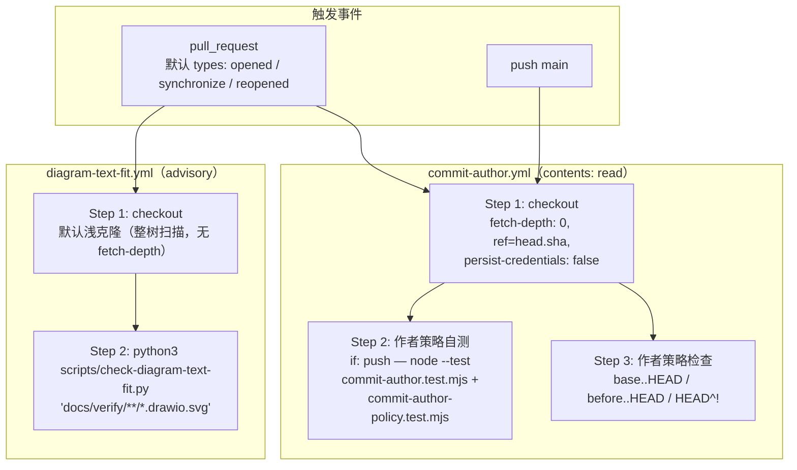
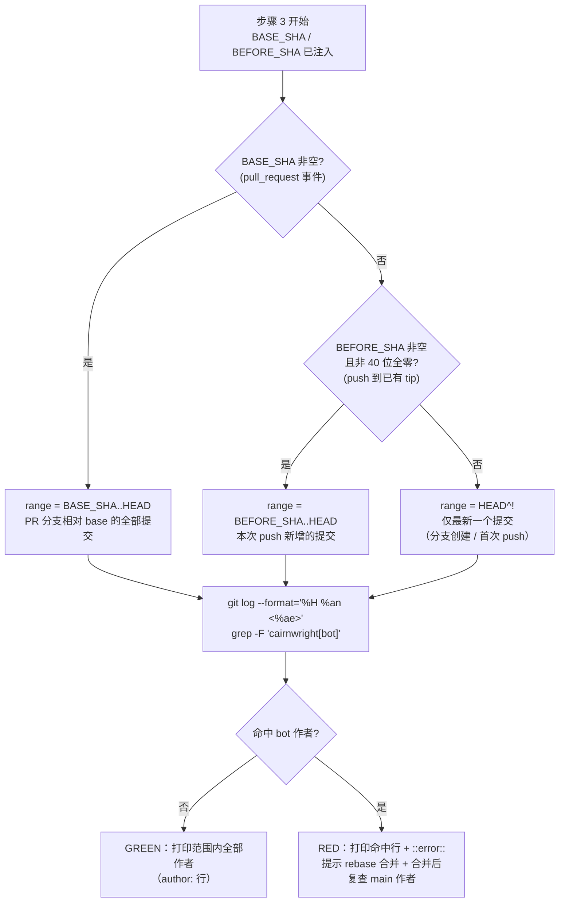
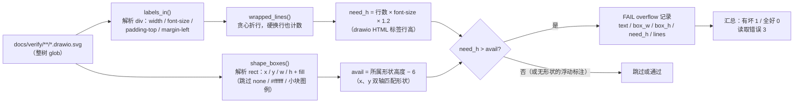
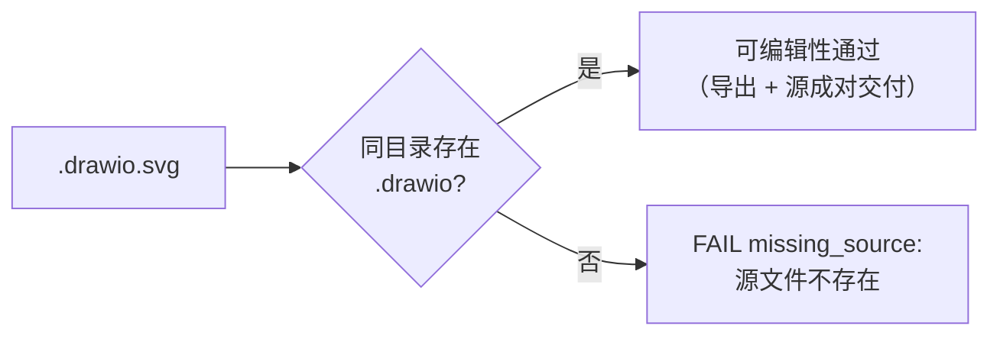

# 提交作者与图表文本适配策略门禁（commit-author.yml 与 diagram-text-fit.yml）

## 简介

`github_ci_pr_policy_gates` 模块由两个**独立的、轻量的 workflow 文件**组成，它们不参与 [github_ci_main_pipeline](github_ci_main_pipeline.md) 的重型构建流水线，而是各自聚焦一条 PR 关联的仓库策略：

| workflow | job | 强制内容 |
| --- | --- | --- |
| `.github/workflows/commit-author.yml` | `commit-author` | **提交作者策略**：`main` 与 PR 分支范围内的每一个提交，作者（author）不得是 GitHub App 的 bot 账户 `cairnwright[bot]` |
| `.github/workflows/diagram-text-fit.yml` | `diagram-text-fit` | **图表文本适配门禁**（#1087）：`docs/verify/**/*.drawio.svg` 的每个标签必须适配其形状，且每个导出必须随附可编辑的 `.drawio` 源文件（#1107） |

两条门禁的设计哲学与整个 `github_ci` 家族一致（见 [github_ci](../github_ci.md)）：

1. **把容易遗漏的仓库纪律变成机器强制**——`commit-author` 解决"App 身份推送到 main 后，main 提交作者被 bot 账户污染"的纪律问题；`diagram-text-fit` 解决"drawio 文本溢出形状几个像素、肉眼不可见、视觉复查总被跳过"的纪律问题。
2. **咨询性（advisory）与必需（required）分离**——`diagram-text-fit` 目前在文件头注释里**明说不是分支保护必需检查**，遵循 `pr-evidence` 走过的推广规则（2026-10-21 推广，#1440）：先以稳定 job 名跑绿一段时间、等在飞 lane 全部合并后才一行晋升。`commit-author` 的承重腿是**合并后的 main push 运行**，PR 腿给 lane 早期反馈。

> 相关模块：`commit-author` 的身份契约由仓库文档 `docs/ops/agent-bot-identity.md` 与技能文件 `.claude/skills/pr-cairn/SKILL.md` 交付；`diagram-text-fit` 的扫描对象 `docs/verify/**` 是 verify 流水线产出的验证归档目录，与 [github_ci_pr_evidence](github_ci_pr_evidence.md) 的证据归档共用同一套目录约定。

## 架构总览



## 触发与并发设计

### commit-author.yml

```yaml
on:
  pull_request:
  push:
    branches: [main]
```

- **`pull_request` 不带 `types:`**：只关心提交作者，正文与标签与它无关，默认的 `opened / synchronize / reopened` 三个类型足够——`synchronize`（push 新提交到 PR 分支）正是它要盯的事件。
- **`push` 只监听 `main`**：这是本 gate 的**承重腿**。合并动作写下的 main 提交作者只有合并后对 `main` 的 push 运行才看得到（见下文 range 逻辑），PR 运行读的是分支上的作者，看不到 squash 合并将来会写的作者。
- **刻意与 `ci.yml` 分文件**：家族里 `pr-evidence` 与 `diagram-text-fit` 都遵循同一条理由——需要什么触发面就单独成文件，避免把轻量门禁绑进重型流水线、也避免重型流水线的形状（如 `ci.yml` 的 `push` 还覆盖 `prototype/**`）污染本 gate 的触发语义；同时稳定的 job 名 `commit-author` 保留"一行晋升为分支保护必需上下文"的能力。
- 无 `concurrency` 分组：运行极轻（两条 git log），重复运行没有代价；main 上的每次 push 都会触发，合并后总有一次运行检查新 tip。

### diagram-text-fit.yml

```yaml
on:
  pull_request:
    types: [opened, synchronize, reopened]
```

- **只扫树、不读正文**：检查对象是整个工作树里的 `docs/verify/**/*.drawio.svg`，不是 diff，所以只需要 PR 生命周期里树会变化的那三个默认类型。
- **`synchronize` 是关键**：lane 修好一张溢出图表并 push 后，`synchronize` 立刻重跑；`edited`（正文编辑）不需要——正文与门禁无关。
- **无 `push` 触发**：`diagram-text-fit` 不在分支保护里（advisory），不需要在 main 上重跑。
- **浅克隆就够**：文件头注释明确"不做 fetch-depth 覆盖：扫描对象是整棵树而非 diff，默认浅克隆即可"。

## 权限模型

| workflow | permissions | 说明 |
| --- | --- | --- |
| `commit-author.yml` | `permissions: contents: read` | 显式收窄到只读。它 checkout 的是 **PR head**（`ref: ${{ github.event.pull_request.head.sha \|\| github.sha }}`），`persist-credentials: false` 保证 checkout 不会把 token 写进被检出的 `.git` 配置；整个运行只用 `git log` 读作者元数据，**从不执行 PR 代码** |
| `diagram-text-fit.yml` | 未声明（默认） | 不使用 token：只有 `actions/checkout` 与 `python3`，没有 `gh` / REST 调用，默认权限即足够 |

`commit-author` 的权限形态被其自测硬钉（见下文「测试与回归」）：`persist-credentials: false`、`permissions: contents: read`、`actions/checkout@<40位sha> # v…` 都是测试断言的 workflow 形状，防止将来有人为图省事给 PR 代码留下凭据。

## 作业步骤详解

### commit-author job（3 步）

| 步骤 | 名称 | 条件 | 内容 |
| --- | --- | --- | --- |
| 1 | Checkout | 恒执行 | `actions/checkout@fbc6f3992d24b796d5a048ff273f7fcc4a7b6c09 # v5.1.0`，`fetch-depth: 0`（range 需要完整历史），`ref: head.sha \|\| github.sha`，`persist-credentials: false` |
| 2 | Test author policy on trusted main code | `if: github.event_name == 'push'` | `node --test scripts/commit-author.test.mjs scripts/commit-author-policy.test.mjs`——只在 main 上跑，因为测试脚本本身是 main 代码而非 PR 代码 |
| 3 | Commit authors never use the bot account | 恒执行 | range 选择 + `git log` 扫描作者 + 命中 bot 则 `::error::` 并退出 1 |

#### 步骤 3：range 选择与作者扫描

```bash
if [ -n "$BASE_SHA" ]; then
  range="$BASE_SHA..HEAD"
elif [ -n "$BEFORE_SHA" ] && [ "$BEFORE_SHA" != "0000000000000000000000000000000000000000" ]; then
  range="$BEFORE_SHA..HEAD"
else
  range="HEAD^!"
fi
offending=$(git log --format='%H %an <%ae>' "$range" | grep -F 'cairnwright[bot]' || true)
git log --format='author: %an <%ae>' "$range"
if [ -n "$offending" ]; then
  echo "$offending"
  echo "::error::every commit in $range must be authored without cairnwright[bot]. …"
  exit 1
fi
```

range 的三分支选择，按优先级：



- **`grep -F` 是固定字符串匹配**：`cairnwright[bot]` 同时覆盖 bot 的显示名 `cairnwright[bot]` 与 noreply 邮箱 `347615582+cairnwright[bot]@users.noreply.github.com`（邮箱里也含这个子串）。
- **`\|\| true` 是防 `set -e` 自杀**：`bash -e` 下 grep 无命中返回 1 会直接终止脚本，`\|\| true` 让"干净"走完下面的作者打印。
- **只看 author，不看 committer**：bot 合并工具以 App 身份 `as-bot.sh` 操作时 committer 可能是 bot（见 `docs/ops/agent-bot-identity.md`），但合并提交的作者必须是 `Cairnwright` 或人；测试表明确断言"bot committer + 人/Cairnwright author → 通过"。
- **先打印全部作者再判定**：`git log --format='author: …'` 无论红绿都输出，给人留复查面；测试断言干净范围也输出 `author:` 行。
- **无法预防 squash 的误导**：check 读的是分支提交作者，squash 合并由 GitHub 以 PR 打开者身份重写——bot 打开的 PR 若 squash，main 提交作者会被写成 bot。所以错误信息要求 bot 打开的 PR **必须 rebase 合并**（由 dispatch 侧的 `~/.cairn/tools/merge-pr.sh` 准备一个 `Cairnwright` 作者的单提交），且**合并后要读 main 提交作者 + 看本次 Actions 结果**（`docs/ops/agent-bot-identity.md` "Merge identity"）。历史性错误作者不会被事后修复。

### diagram-text-fit job（2 步）

| 步骤 | 名称 | 条件 | 内容 |
| --- | --- | --- | --- |
| 1 | Checkout | 恒执行 | `actions/checkout@fbc6f3992d24b796d5a048ff273f7fcc4a7b6c09 # v5.1.0`，无 fetch-depth 覆盖（浅克隆即可） |
| 2 | Check diagram label text fit | 恒执行 | `python3 scripts/check-diagram-text-fit.py 'docs/verify/**/*.drawio.svg'` |

步骤 2 是全树扫描（`**` 递归 glob），退出码即 job 结论：`0` 全部通过、`1` 有溢出或缺源文件、`3` 有文件读取错误。

## 门禁脚本详解

### scripts/check-diagram-text-fit.py

**纯标准库 Python，零依赖、零字体**——这是它在无字体 CI runner 上可复现运行的前提。为什么存在（文件头 docstring 完整记录了 2026-10-09 的来龙去脉）：

- 三个图表曾带着溢出文本到达用户（#1079 模板图、#1081 返工、#1084 钩子迁移），其中两个 lane 被明确告知"先渲染再看一眼"，仍然发生——这是"第 4 级（prose 规则）没有任何强制物"的典型失败模式。
- 视觉复查是次级门禁：既漏掉几何缺陷，又幻觉出新缺陷；文本溢出只有几个像素，肉眼可靠不可见。所以主门禁必须是**确定性算术**。

#### 文本适配检查（算术模型）

对每个 HTML 标签，量文本、对比形状声明的高度：



关键常量与规则：

- **静态字符宽表**（无真实字体文件）：`LATIN_EM = 0.55`、`CJK_EM = 1.00`、大写/宽拉丁字符 `0.72`、窄字符（空格、标点、`iljt` 等）`0.30`；CJK、假名、全角标点按 `ord(ch) > 0x2E80` 判定。表刻意**偏宽**——宁可误报（只花一次布局调整）也不漏报（把 bug 发出去）。
- **校准记录（2026-10-09）**：对仓库全部图表逐一判定、并用渲染 SVG 复核——`docs/verify/1054/mechanism.drawio.svg`（OK）、`1065/zombie-claim.drawio.svg`（OK）、`1079/template-sections.drawio.svg`（修复后 OK）、`1084/hook-migration.drawio.svg`（FAIL，3 个标签全真实）。参考实现是仓库外的 `scratch/check-diagram-text-fit.py`，改一个必须改另一个；同一结论也由真实字体实现（PIL + Helvetica / Hiragino Sans GB）逐标签复现。
- **两个必须丢掉的 bug**（都是"从没检查过的状态给出自信答案"）：0 字节输入（失败的 fetch）曾报 OK——现在空输入直接 `ValueError: no HTML labels found`；只按 y 匹配形状会抓到同一行带两块两列外的形状并幻觉溢出——现在按 **x（`margin-left` 对应形状左缘 + 1）与 y（`padding-top`）双轴**匹配。
- **浮动标注豁免**：没有形状垫底的标签是自由画布标注（标题、边标签、脚注），本来就无界——跳过是正确的（曾尝试标记它们为溢出，立刻在 `1084` 上产生 3 个误报）。

#### 可编辑性检查（#1107 起）



- 判定的是**可编辑性（editability），不是质量**：质量不可机器判定——五种候选质量指标在仓库图表语料上全部因缺乏方差而失败（同作者、同技能、同模板词汇，指标分不开好坏图）；"源文件在不在"才是确定性的。
- 曾有三个图表只带导出到达 main，源文件只能靠 unescape 导出器嵌入的 `content` 属性找回；drawio 技能的工件契约是"导出与源成对交付"。
- 只对导出（`.drawio.svg`）生效：`.drawio` 输入本身就是自己的源。
- 该检查不影响文本适配检查的校准（4/4 保持不变）。

#### 输入形态与退出码

- 输入可为 `.drawio.svg`（直接读）或 `.drawio`（调用 `drawio -x -f svg -e --embed-svg-images` 现场导出）；glob 由脚本内 `glob.glob(recursive=True)` 展开。
- `--json` 输出机器可读结果。
- 退出码：`0` 全部标签适配且源齐；`1` 任一溢出或缺源；`3` 任一读取错误——**读取错误优先于发现**：无法检查的输入不能退 1（那会被调用者误读成"检查过且溢出"）。

### scripts/commit-author.test.mjs 与 scripts/commit-author-policy.test.mjs

`commit-author` 的检查逻辑内联在 workflow 的 `run:` 块里，两个测试脚本**从 workflow 文件里把 shell 抽出来**（正则 ` / {8}run: \|\n((?: {10}.*\n)+)/`），在临时 git 仓库里用真实 `bash -e` 执行它——测试的正是 CI 会跑的那段代码，而不是一份复制品。

| 测试文件 | 覆盖 |
| --- | --- |
| `scripts/commit-author.test.mjs` | **workflow 形状断言**（PR 读取显式 head、不执行 PR 代码）：`pull_request:` 触发存在、`ref: head.sha \|\| github.sha`、`persist-credentials: false`、push 腿的自测 `if` 与命令、`permissions: contents: read`、checkout 钉 40 位 SHA + `# v` 注释、`BASE_SHA` 环境注入。<br>**行为测试**：bot 提交藏在 human tip 之下被拒；bot 作者的 squash 提交被拒；main push 五场景（bot squash / bot 藏于 human tip / 历史 bot / before 缺失 / before 全零）；干净 human 范围通过；author×email 组合表（bot 名或 bot 邮箱任一命中即拒，`Cairnwright` 与人通过——committer 是 bot 也不影响） |
| `scripts/commit-author-policy.test.mjs` | **策略文档一致性**：断言 `.claude/skills/pr-cairn/SKILL.md` 与 `docs/ops/agent-bot-identity.md` 仍保持"bot 打开的 PR → 一个 `Cairnwright` 作者提交 + rebase"与"人打开的 PR → `gh pr merge --squash --auto`"的分离，且不出现"Arm auto-merge"措辞、保留 `~/.cairn/tools/merge-pr.sh` 引用；再对三种作者身份（bot / Cairnwright / Human）跑 workflow shell 验证退出码与输出 |

## 测试与回归

| 门禁 | 自测执行位置 | 说明 |
| --- | --- | --- |
| `commit-author` | **workflow 自身的 push 腿**（Step 2，`if: github.event_name == 'push'`） | 只在 main 上跑 `node --test scripts/commit-author.test.mjs scripts/commit-author-policy.test.mjs`——测试脚本是受信任的 main 代码；PR 腿只跑 git log 检查，不执行任何测试 |
| `diagram-text-fit` | 无独立测试文件 | 门禁脚本自带确定性：校准 4/4 记录在 docstring，`--json` 输出可对比；workflow 只做一步 `python3` 调用 |

与 [github_ci_pr_evidence](github_ci_pr_evidence.md)（其回归测试挂在 `ci.yml` 的 `check` job 里）不同，`commit-author` 的自测**刻意不进 `ci.yml`**：它必须跑在 main 的已合并代码上才有意义（测试抽的是 workflow 的 shell），而 `ci.yml` 的 `check` 在 PR 上跑的是 PR head——这正是 workflow 里 `if: github.event_name == 'push'` 的用意。

## 关键设计决策

- **`commit-author` 只信 git 作者，不执行 PR 代码**：`persist-credentials: false` + `contents: read` + 只跑 `git log`，使 checkout PR head 也不产生凭据与代码执行面；workflow 形状由测试硬钉（同家族 `pr-evidence-workflow-gate.mjs` 的"形状守卫"思路）。
- **`commit-author` 的承重腿在 main push，PR 腿是早期反馈**：squash 合并的作者在分支上不可见，只能等合并后的 main 运行；错误信息明确要求 bot 打开的 PR 走 rebase（`~/.cairn/tools/merge-pr.sh`）并合并后复查。
- **range 三分支退化**：`BASE_SHA`（PR）→ `BEFORE_SHA`（push）→ `HEAD^!`（分支创建/全零 before）；全零 before 与缺失 before 都退化为单提交检查，宁可少查也不漏掉分支创建场景。
- **`diagram-text-fit` 是 advisory，不是必需检查**（文件头注释明说）：遵循 `pr-evidence` 的推广规则（#1440）——先以稳定 job 名 `diagram-text-fit` 跑绿、等在飞 lane 合并后再进分支保护；早期强制会锁死所有携带旧图表的在飞 lane。
- **确定性算术替代视觉**：文本适配用静态字符宽表 + 贪心折行 + 行高 1.2 计算，无字体、无依赖、无网络，CI 与本地结果一致；"从没检查过的状态不得报为已检查"（空输入报错、读取错误退 3）。
- **可编辑性与质量分开判定**（#1107）：质量无法机器判定（语料同质、指标无方差），可编辑性是唯一确定性轴线——导出必须随附源文件。
- **第三方便件钉死完整 SHA + 尾随版本注释**（#1076）：两个 workflow 的 `actions/checkout@fbc6f3992d24b796d5a048ff273f7fcc4a7b6c09 # v5.1.0`，浮动标签可能被上游重定向，注释是 Dependabot 升级锚点。

## 与其它模块的关系

- **[github_ci](../github_ci.md)**：本模块是 `github_ci` 家族中"PR 关联策略门禁"的一组；家族页概括了全部 7 个 workflow 与"咨询性 vs 必需"的晋升策略。
- **[github_ci_pr_evidence](github_ci_pr_evidence.md)**：`diagram-text-fit` 的晋升路径**显式引用** `pr-evidence` 走过的推广规则（2026-10-21 推广，#1440）；两者都因"只需要默认 pull_request types"而独立成文件；`commit-author` 的 workflow 形状硬钉手法与 `pr-evidence-workflow-gate.mjs` 同源，但自测位置不同（前者在自身 push 腿，后者在 `ci.yml` 的 `check` job）。
- **[github_ci_main_pipeline](github_ci_main_pipeline.md)**：`ci.yml` 的 `check` job 承载仓库大部分门禁自测（Prepush self-test 等），但本模块两个 workflow 都不依赖它——`commit-author` 自带 push 腿自测，`diagram-text-fit` 靠脚本内校准。
- **仓库内策略文档（非模块页）**：`commit-author` 的合并身份契约在 `docs/ops/agent-bot-identity.md`（App `cairnwright`、bot 用户 `cairnwright[bot]` id `347615582`、rebase vs squash 规则）与 `.claude/skills/pr-cairn/SKILL.md`（向 agent 交付同一契约），两处都被 `commit-author-policy.test.mjs` 逐条断言。
- **verify 产物目录**：`diagram-text-fit` 扫描的 `docs/verify/**` 也是 [github_ci_pr_evidence](github_ci_pr_evidence.md) 归档判定（`raw.githubusercontent.com/…/docs/verify/<ticket>/…`）引用的同一套归档目录。
