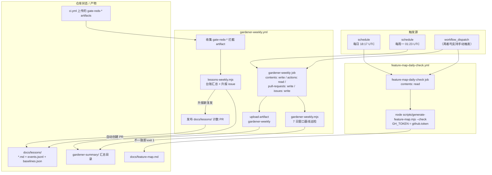
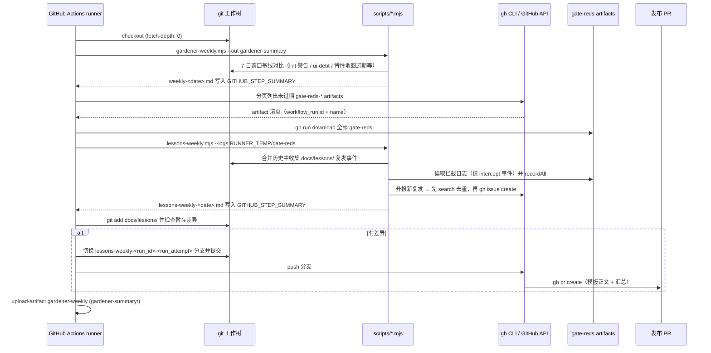
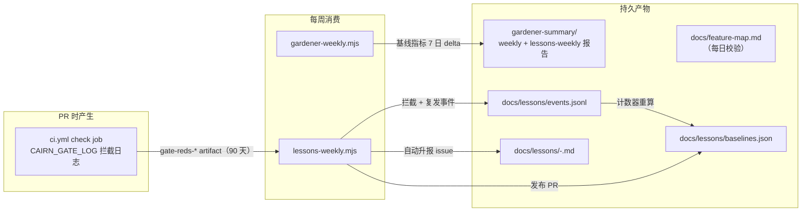

# 定时守护任务（feature-map-daily-check 与 gardener-weekly）

## 简介

`github_ci_scheduled_jobs` 模块承载本仓库在 GitHub Actions 上**按计划运行**的两个守护型 workflow：`.github/workflows/feature-map-daily-check.yml`（每日）与 `.github/workflows/gardener-weekly.yml`（每周）。与 [github_ci_main_pipeline](github_ci_main_pipeline.md) 中由 `push` / `pull_request` 触发的 PR 门禁不同，这两个任务不参与合并决策，而是以"后台守护"的方式维护仓库的两类活文档：

1. **`docs/feature-map.md`**（特性地图）——每日校验这份由脚本机械生成的"当前状态登记册"与它的三个来源（spec 引用、验收证据目录、CI 测试面）保持一致，任何手工篡改或来源漂移都会在次日变红。
2. **`docs/lessons/`**（教训台账）——每周聚合门禁拦截日志（`gate-reds-*` artifacts）与合并历史中的复发事件，冻结基线、重算计数器、自动升报（escalation）新出现的同类错误，并通过自动创建的 PR 把台账计数发布回仓库。

两个 workflow 都支持 `workflow_dispatch` 手动触发，且都遵循 [github_ci](../github_ci.md) 的总体原则：**把容易遗漏的仓库纪律变成机器强制**，只是它们作用在"时间维度"上——PR 门禁管"这次合入时"，定时任务管"长期漂移"。

> 相关模块：定时任务消费 `ci.yml` 主流水线上传的 `gate-reds-*` 拦截日志（见 [github_ci_main_pipeline](github_ci_main_pipeline.md)），并与其中的 `feature-map-gate`、`baseline-ratchet-gate` 两个咨询性门禁共享检查面；`lessons-weekly` 的台账校验逻辑与 `pnpm prepush` 中的 `lessons-ledger-gate` 是同一套脚本（见 [root_build_deploy](../root_build_deploy.md)）。

## 模块组成

| workflow 文件 | 触发计划 | 职责 |
| --- | --- | --- |
| `.github/workflows/feature-map-daily-check.yml` | `cron: '17 18 * * *'`（每日 18:17 UTC）+ `workflow_dispatch` | 用 `scripts/generate-feature-map.mjs --check` 校验 `docs/feature-map.md` 与来源一致 |
| `.github/workflows/gardener-weekly.yml` | `cron: '23 1 * * 1'`（每周一 01:23 UTC）+ `workflow_dispatch` | 每周巡检基线指标、收集门禁拦截日志、发布教训台账计数 PR、上传巡检汇总 artifact |

## 架构总览



## feature-map-daily-check：特性地图每日校验

### 触发与权限

```yaml
on:
  schedule:
    - cron: '17 18 * * *'
  workflow_dispatch:

permissions:
  contents: read
```

- 每日 UTC 18:17 自动运行，也可通过 Actions 页面手动触发。
- 权限只有 `contents: read`——它只读仓库与 GitHub API，不写任何内容；`GH_TOKEN`（即 `github.token`）仅用于 `gh api` 拉取 issue 标题与状态。

### 执行步骤

| 步骤 | 命令 / action | 作用 |
| --- | --- | --- |
| checkout | `actions/checkout@fbc6f3992d24b796d5a048ff273f7fcc4a7b6c09 # v5.1.0`，`fetch-depth: 0` | 完整克隆（`gh` 需要 `repo view` 解析 slug，脚本读取整个工作树） |
| Check docs/feature-map.md against its sources | `node scripts/generate-feature-map.mjs --check`（`GH_TOKEN: ${{ github.token }}`） | 重新生成特性地图并与磁盘上的 `docs/feature-map.md` 逐字节比对，不一致则 exit 1 使 job 变红 |

### `scripts/generate-feature-map.mjs`（#894）的工作方式

`docs/feature-map.md` 是仓库的"活登记册"：记录每个工单当前处于哪个层级（tier）、什么状态（status）、锚定到哪些验证产物。**每个格子都是机械提取的，任何一侧都不允许手工编辑**——要改地图只能改脚本里的规则再重新运行。

- **行来源（三个来源的并集，票号按数值归一化、去掉前导零）**：
  1. `docs/spec/*.md` 中的 `#NNN` 引用（生成物在 `docs/spec/` 之外，输出不会反馈进输入）；
  2. `docs/verify/` 下的纯数字目录名（已落地的验收证据）；
  3. CI 测试面（`apps/`、`packages/`、`integration/` 下的 `*.test.ts / *.test.tsx / *.spec.ts`）中的 `#NNN` 引用。
- **标题与状态**来自 `gh api repos/<owner>/<repo>/issues?state=all`（分页拉取；REST issues 端点会同时返回 PR，PR 不产生行，只列在 gap 区）。
- **层级判定**：按标题关键字正则匹配 `TIER_RULES`（`Differentiation surface` / `Runtime axis` / `General surface`），第一条命中即赢——这是明确的规则而非语义判断（§0.6 记录了该局限）。
- **状态判定**：closed + 有验证锚点 = `Done`；closed + 无锚点 = `Unverified`；open + 有锚点 = `In progress`；open + 无锚点 = `Not started`。
- **锚点**：`docs/verify/<num>/` 目录存在即入锚；已被每周清理剪枝的目录通过 `docs/verify/pruned.json` 账本以 `<sha>:docs/verify/<num>/` 入锚（可用 `git show` 读取）；测试面引用文件的路径也是锚点。两者皆无则标记 `[unverified]` 并进入 §3.1 跟进列表。
- **纯函数性质**：输出是工作树 + GitHub 状态的纯函数——无时间戳、无运行元数据、排序全部显式（票号升序、路径字典序、层级按 `TIER_ORDER`）。**连续两次运行写出逐字节相同的文件**，这正是 `--check` 模式可行的前提：`--check` 在磁盘文件与重新生成结果不一致时 exit 1，且失败的运行绝不写半截文档。
- 前置条件：`gh` 在 PATH 上且已认证、api.github.com 可达；缺任一条件都会 `fail` 退出。

### 与 `ci.yml` 中 `feature-map-gate` 的关系

两者名字相似但检查的是**不同对象**，互补而非重复：

- **`feature-map-gate`**（ci.yml 咨询性 job，见 [github_ci_main_pipeline](github_ci_main_pipeline.md)）：跑 `scripts/feature-map-staleness-gate.mjs`，校验 verify-cairn 特性地图（`.claude/skills/verify-cairn/features`）中引用的路径 / `.class` / `[data-*]` / CSS 声明在树中可解析，且评估分数不过期；冻结基线在 `scripts/feature-map-staleness-baseline.json`。
- **`feature-map-daily-check`**（本模块）：跑 `generate-feature-map.mjs --check`，校验 `docs/feature-map.md` 这份生成文档本身与它的三个来源是否一致。

也就是说：PR 门禁防"树里引用漂移"，每日任务防"活登记册与仓库实际状态脱节"。后者用定时频率补偿"文档一致性"这类没有 PR 触发点的漂移。

## gardener-weekly：园丁每周巡检

### 触发、权限与并发

```yaml
on:
  schedule:
    - cron: '23 1 * * 1'
  workflow_dispatch:

permissions:
  contents: write
  actions: read
  pull-requests: write
  issues: write

concurrency:
  group: lessons-weekly
  cancel-in-progress: false
```

- 每周一 UTC 01:23 自动运行（周一凌晨，错开 PR 高峰）。
- 权限比 feature-map-daily-check 宽得多，且**每一项都有实际用途**：
  - `actions: read` —— `gh api` 分页拉取并下载 `gate-reds-*` artifacts；
  - `issues: write` —— `lessons-weekly.mjs` 为复发事件自动创建升报 issue；
  - `pull-requests: write` + `contents: write` —— 推送 `lessons-weekly-*` 分支并创建发布计数 PR。
- **并发组 `lessons-weekly` + `cancel-in-progress: false`**：台账（`docs/lessons/events.jsonl`、`baselines.json`）是有状态文件，两个并发写入者会互相覆写；因此同名运行排队执行而不是互相取消——定时触发与手动触发重叠时，后一个等待前一个完成。

### 执行流程



### 步骤详解

**1. 园丁周巡检（#1617）**——`node scripts/gardener-weekly.mjs --out gardener-summary`

`scripts/gardener-weekly.mjs` 以**最近 7 天为窗口**对仓库健康做巡检：

- 先断言不是 shallow clone（7 天历史不完整会直接报错），取窗口起点提交 `rev-list -1 --before=<7 天前>`；
- 对 `scripts/baseline-ledger.mjs` 导出的 `METRICS`（lint-warning/warnings、ui-debt/per-face-css-lines、ui-debt/bare-controls、ui-debt/arbitrary-text、ui-debt/arbitrary-spacing、feature-map-staleness/entries、comment-discipline-allowlist/entries、single-use-helper-allowlist/entries）逐个统计当前计数与 7 日变化量（`delta`）；
- 按增长（delta）与存量（count）两个维度排序，指出"下一个目标"（增长最快且 delta > 0 的指标，否则存量最大的）；
- 扫描 `apps/`、`packages/`、`integration/` 自窗口起点以来的**新增行**，匹配 `PATTERNS` 中无现成门禁的 6 类未设防模式（`as unknown as` 双重断言、e2e 固定延时 `waitForTimeout(`、内联 `import()`、skip/fixme 测试、`@ts-ignore`/`@ts-expect-error`、显式 `any`），任一模式在窗口内新增 ≥ 3 处即生成**候选工单**（含位置清单与建议的 lint 规则），"候选而已、并未开单"；
- 把 `docs/lessons/` 的周汇总（`lessonSection`，复用 `lessons-ledger-gate.mjs` 的 `weeklySummary` / `renderWeeklySummary`）并入报告；
- 写入 `gardener-summary/weekly-<date>.md` 并追加到 `$GITHUB_STEP_SUMMARY`，同时原样打印到 stdout。

**2. 收集门禁拦截 artifact**——`gh api` + `gh run download`

```bash
gh api --paginate 'repos/${{ github.repository }}/actions/artifacts?per_page=100' \
  --jq '.artifacts[] | select(.expired == false and (.name | startswith("gate-reds-"))) | [.workflow_run.id, .name] | @tsv'
```

- 分页拉取全部未过期、名字以 `gate-reds-` 开头的 artifact（正是 `ci.yml` `check` job 的 "Upload safeguard interceptions" 步骤上传的，命名 `gate-reds-<run_id>-<run_attempt>`、保留 90 天，见 [github_ci_main_pipeline](github_ci_main_pipeline.md)）；
- 逐行 `gh run download <run> --name <name>` 下载到 `$RUNNER_TEMP/gate-reds/<name>`。

**3. 教训台账周汇总（#1534）**——`node scripts/lessons-weekly.mjs --out gardener-summary --logs "$RUNNER_TEMP/gate-reds"`

`scripts/lessons-weekly.mjs` 是本 workflow 的数据核心，`runWeekly({ root, out, logs })` 做四件事：

1. **`collectMergedRecurrences`**：沿 `git log --first-parent --reverse` 遍历 `docs/lessons/` 的合并历史，对每个已激活（activated）类目的 `Recurrences` 计数增幅，扣除已被 `events.jsonl` 中 committed recurrence 事件解释的部分，把剩余增幅按 `(commit, index)` 为 episode 逐条写入 `events.jsonl`；随后 `freezeBaselines` 冻结基线并 `writeCounters` 重算计数器；
2. **摄入拦截日志**：递归读取 `--logs` 目录下所有 `.jsonl`（即上一步下载的 gate-reds），**只接受 `kind === 'intercept'` 的事件**（混入其它类型直接抛错），`recordAll` 写入台账；
3. **升报（escalation）**：对 `escalationPending` 列出的待升报复发，先用 `gh issue list --search <title>` 查重（标题相同即视为已开），未开则 `gh issue create` 生成升报 issue（附"建议的下一级梯子"，`needs-decision` 复发带 `needs-decision` 标签），并把 `issue` 号写回事件以标记已升报；
4. **周汇总**：`weeklySummary` 渲染新类目、拦截数、复发数、待评估守护、待开 issue 等，写入 `gardener-summary/lessons-weekly-<date>.md` 并追加到 `$GITHUB_STEP_SUMMARY`（尾部附"本次升报：`id -> #issue`"清单）。

**4. 发布台账计数**——自动创建 PR

```bash
git add docs/lessons/
if ! git diff --cached --quiet; then
  branch=lessons-weekly-${{ github.run_id }}-${{ github.run_attempt }}
  git switch -c "$branch"
  git commit -m 'chore(1534): publish weekly safeguard counters'
  git push origin "HEAD:$branch"
  gh pr create ... --title 'chore(1534): publish weekly safeguard counters' --body-file ...
fi
```

- 只有 `docs/lessons/`（事件日志、基线、计数器）**确有暂存差异**时才开分支、提交、推送并创建 PR；无变化则静默跳过（空转安全）。
- PR 正文由固定模板 + 周汇总拼成，明确声明：`What`（发布收集到的拦截事件与预测计数）、`Verified`（汇总内容）、`Upstream`（复用既有台账归约器，无新机制）、`Risk`（仅台账数据，合入前需评审类目计数）、`Acceptance`（`[x] no task surface: generated ledger data only`）、`Issues`（#1534 的每周收集）。
- 分支名 `lessons-weekly-<run_id>-<run_attempt>` 保证同一周的重跑/补跑不会互相冲突。

**5. 上传汇总 artifact**——`actions/upload-artifact@043fb46d1a93c77aae656e7c1c64a875d1fc6a0a # v7.0.1`，name `gardener-weekly`，path `gardener-summary/`，供人工审计每周巡检原始输出。

## 数据流与产物



- **`docs/feature-map.md`**：由每日任务守护的生成文档，纯函数输出保证 `--check` 逐字节可比。
- **`docs/lessons/events.jsonl`**：append-only 事件日志，是计数器与升报的**唯一事实源**；`Intercepts` / `Recurrences` 由脚本写、永不手写。
- **`docs/lessons/baselines.json`**：事件进入日志那一刻冻结的类目基线；打印计数 = 基线 + 守护激活日期后的新增事件。
- **`gate-reds-*` artifacts**：ci.yml 在 `if: always()` 下上传（即使检查失败也上传），是每周台账的拦截事件来源——PR 时拦截、每周发布，形成闭环。

## 关键设计决策

- **定时任务与 PR 门禁互补而非重复**：`feature-map-daily-check` 查"生成文档与来源是否一致"（无 PR 触发点的漂移），`feature-map-gate` 查"树中引用是否可解析/过期"；`gardener-weekly` 的基线巡检由 `baseline-ratchet-gate`（ci.yml，PR only）在同一套 `baseline-ledger.mjs` 指标上做"只能下降"的棘轮校验——PR 时管增量，每周管趋势。
- **`fetch-depth: 0` 是硬前提**：`gardener-weekly.mjs` 需要 7 日窗口的完整提交历史（shallow clone 直接报错），`lessons-weekly.mjs` 需要沿 `--first-parent` 遍历合并历史，`generate-feature-map.mjs` 需要全树扫描。
- **并发组保护有状态台账**：`concurrency: group: lessons-weekly, cancel-in-progress: false` 让重叠运行排队而非互相取消——两个并发写入者会毁掉 `events.jsonl`。
- **权限最小化但够用**：feature-map-daily-check 只读（`contents: read`）；gardener-weekly 的写权限逐项对应实际动作（下载 artifacts → `actions: read`；建 issue → `issues: write`；推送分支 + 建 PR → `contents: write` + `pull-requests: write`）。
- **每周发布走 PR 而非直推 main**：台账计数是"生成的账本数据"，仍需人工评审类目计数后才合入；模板的 `Acceptance` 段明确声明 `no task surface`，防止发布 PR 被误当作功能合入。
- **升报先去重再创建**：`gh issue list --search <title>` 命中即复用既有 issue，避免每周对同一复发反复开单。
- **空转安全**：`git diff --cached --quiet` 无变化则跳过发布；`findCandidates` 无候选则报告 `none`；`gh run download` 无 artifact 则空目录交给 `lessons-weekly` 正常处理。
- **候选工单只建议不开单**：园丁周报里 6 类无门禁模式的候选（≥ 3 处新引入才上榜）"candidate only, not filed"，开单与否留给 #1407 的守护评估环节决策。

## 与其它模块的关系

- **[github_ci](../github_ci.md)**：本模块是 `github_ci` 的 5 个子模块之一，与主流水线共享"机器强制纪律"的总体哲学与第三方便件按完整 commit SHA 固定版本（#1076）的约定（两个 workflow 均使用 `actions/checkout@fbc6f3992d24b796d5a048ff273f7fcc4a7b6c09 # v5.1.0`）。
- **[github_ci_main_pipeline](github_ci_main_pipeline.md)**：`ci.yml` 的 `check` job 上传 `gate-reds-<run_id>-<run_attempt>` 拦截日志（`if: always()`、90 天保留），是 `gardener-weekly` 第 3 步的输入；`feature-map-gate`（staleness）与 `baseline-ratchet-gate`（附带回归 `gardener-weekly.test.mjs`、`evidence-prune.test.mjs`）与每周任务共享检查面和基线账本。
- **[github_ci_pr_evidence](github_ci_pr_evidence.md)** / **[github_ci_pr_policy_gates](github_ci_pr_policy_gates.md)**：同为咨询性/守护类检查，但前者由 PR 触发，本模块由计划触发，无直接数据流。
- **[root_build_deploy](../root_build_deploy.md)**：`lessons-ledger-gate.mjs` 同时被 `pnpm prepush` 与 `lessons-weekly.mjs` 使用（台账校验、事件、计数器、周汇总、升报渲染共享同一实现）；根 `package.json` 的 `lessons:table` 等脚本服务于同一台账。
- **Backend_application_services / shared**：无直接依赖——两个定时任务只操作仓库文档、脚本与 GitHub API，不接触服务端 schema 或共享协议类型。
