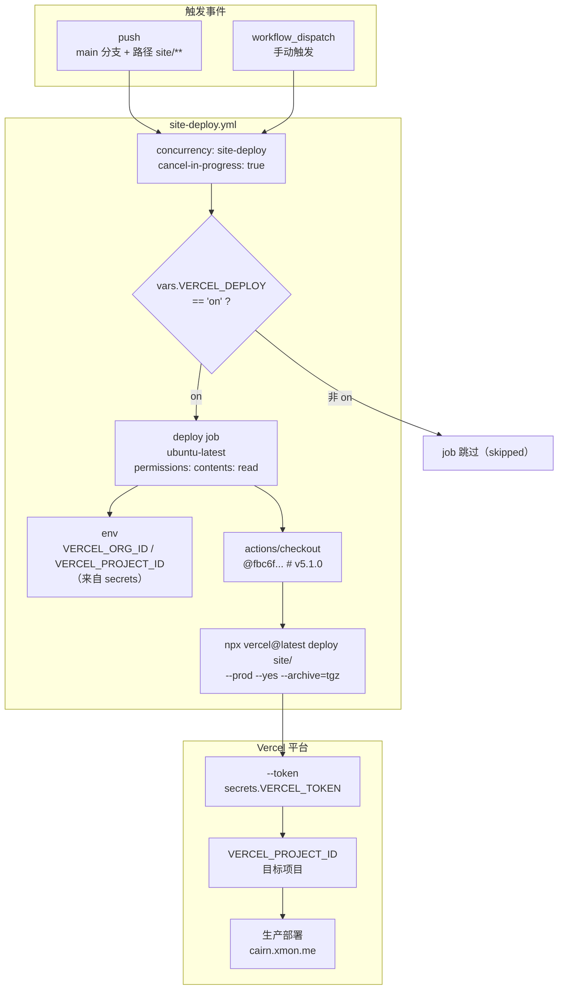
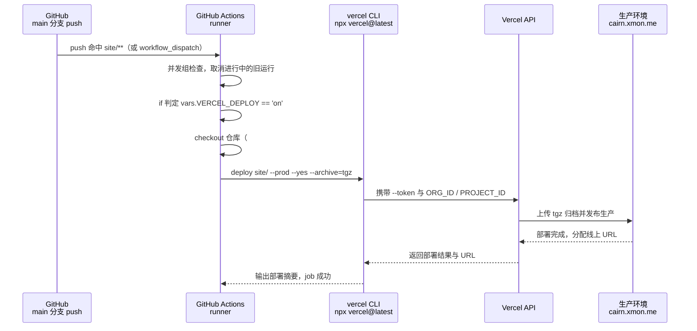
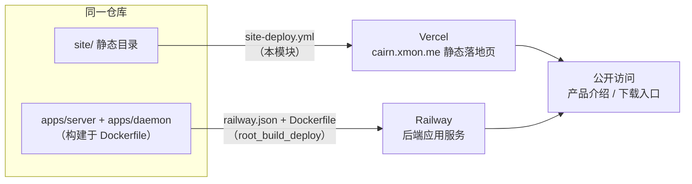

# 站点部署流水线（site-deploy.yml）

## 简介

`github_ci_site_deploy` 模块对应 `.github/workflows/site-deploy.yml` —— 本仓库**静态站点**（`site/` 目录）的生产部署流水线。当 `main` 分支上任何 `site/**` 路径下的文件发生变化（或人工手动触发）时，该 workflow 在 GitHub Actions runner 上调用 Vercel CLI，把 `site/` 目录以 **production（生产）** 环境发布到 Vercel，站点地址为 `https://cairn.xmon.me/`。

与 [github_ci_main_pipeline](github_ci_main_pipeline.md) 的 PR 门禁不同，本 workflow 不参与合并决策，也不构建任何代码——它面向一个**纯静态、无构建步骤**的站点（`site/index.html` 是完整的单文件落地页），职责只有一件事：**把 `site/` 原样推送到 Vercel 生产环境**。

> 相关模块：本 workflow 是 [github_ci](../github_ci.md) 的 5 个子模块之一，是其中唯一面向"外部托管平台部署"的流水线；仓库的**应用后端**（`apps/server`、`apps/daemon`）由 Railway 经 [Dockerfile](../root_build_deploy.md) 部署，与本站点走完全独立的两条通道（见下文「与其它部署通道的关系」）。

## 模块组成

| 文件 | 触发方式 | 职责 |
| --- | --- | --- |
| `.github/workflows/site-deploy.yml` | `push`（分支 `main` + 路径 `site/**`）+ `workflow_dispatch` | 调用 Vercel CLI 将 `site/` 部署为生产环境 |

本模块只包含这一个 workflow 文件；它部署的对象是 `site/` 目录，其中与部署直接相关的配置文件：

| `site/` 内文件 | 作用 |
| --- | --- |
| `site/vercel.json` | Vercel 项目配置：`cleanUrls`、禁用 Git 集成（`git.deploymentEnabled: false`）、全站 `X-Content-Type-Options: nosniff` 响应头 |
| `site/package.json` | 仅声明包名 `@cairn/site`（private），**无构建脚本**——站点即静态目录，可直接部署 |
| `site/index.html`、`site/logo.svg`、`site/img/`、`site/media/` | 站点内容（Cairn 落地页，含 PWA 截图等媒体资源） |

## 触发与并发设计

```yaml
on:
  push:
    branches: [main]
    paths: ['site/**']
  workflow_dispatch:

concurrency:
  group: site-deploy
  cancel-in-progress: true
```

- **`push` + `paths: ['site/**']`**：只有 `main` 分支上命中 `site/` 前缀的变更才会触发部署。改动 `apps/`、`packages/`、`docs/`、`.github/` 等其它路径**不会**触发本 workflow——静态站点的内容变更与后端代码变更在部署维度上是完全解耦的。
- **`workflow_dispatch`**：始终可用（不受 `paths` 过滤影响），便于在 Vercel 侧出问题时手动重跑部署，或绕过路径过滤强制重新发布。
- **并发组 `site-deploy` + `cancel-in-progress: true`**：同一时间只保留一个部署运行。生产部署是"最后一次成功者生效"（latest wins）的幂等操作，快速连续两次 push 时，新运行直接取消掉进行中的旧运行——避免两个 `vercel deploy` 进程并发上传到同一项目互相踩踏，也让"每推必达"的路径过滤在连续提交下仍然有效。

## 架构总览



## `deploy` job 详解

### 权限：最小化

```yaml
permissions:
  contents: read
```

整个 job 只对仓库做**读**操作（`actions/checkout` 拉取代码），不与 GitHub 产生任何写交互——真正的外部动作（发布站点）通过 `VERCEL_TOKEN` 对 Vercel API 完成，因此 `contents: read` 是充分的。

### 特性开关：`vars.VERCEL_DEPLOY`

```yaml
if: ${{ vars.VERCEL_DEPLOY == 'on' }}
```

- 这是一个**仓库级变量（repository variable）驱动的开关**：只有在该变量值恰为字符串 `on` 时 job 才会执行，任何其它值（未设置、`off`、`false`…）都会让 job 变为 `skipped`。
- 作用相当于**无需改代码的部署总闸**：需要暂停对外发布（比如 Vercel 侧故障、需要冻结线上内容）时，在仓库 Settings → Variables 里把该变量改成非 `on` 即可，不用动 workflow 文件、也不用等一次新的 push。
- 注意 `vars.`（变量）与 `secrets.`（机密）是不同的命名空间：开关用变量（不敏感、运维可随时改），凭据用机密（不可见、只可写）。

### 环境变量与机密

| 项 | 来源 | 用途 |
| --- | --- | --- |
| `VERCEL_ORG_ID` | `secrets.VERCEL_ORG_ID` | Vercel 团队（Team）ID，把部署限定到正确的组织 |
| `VERCEL_PROJECT_ID` | `secrets.VERCEL_PROJECT_ID` | Vercel 项目 ID，指定 `site/` 发布到哪个项目 |
| `VERCEL_TOKEN` | `secrets.VERCEL_TOKEN`（经 `--token` 传入 CLI） | Vercel 访问令牌，CLI 的认证凭据 |

`ORG_ID` 与 `PROJECT_ID` 通过 job 级 `env` 注入（Vercel CLI 约定读取这两个环境变量来确定部署目标），`TOKEN` 则显式经命令行参数传入——三者都在 GitHub Secrets 中保管，不出现在仓库文本里。

### 执行步骤

| 步骤 | 命令 / action | 作用 |
| --- | --- | --- |
| 1. checkout | `actions/checkout@fbc6f3992d24b796d5a048ff273f7fcc4a7b6c09 # v5.1.0` | 拉取仓库工作树（默认浅克隆即可，部署只需要 `site/` 内容） |
| 2. Deploy to Vercel | `npx --yes vercel@latest deploy site/ --prod --yes --archive=tgz --token "${{ secrets.VERCEL_TOKEN }}"` | 用最新版 Vercel CLI 将 `site/` 目录部署为生产环境 |

### Vercel CLI 命令剖析

`npx --yes vercel@latest deploy site/ --prod --yes --archive=tgz --token "${{ secrets.VERCEL_TOKEN }}"`

| 参数 | 含义 |
| --- | --- |
| `npx --yes vercel@latest` | 临时通过 `npx` 拉取**最新发布版** Vercel CLI 运行（不写入仓库依赖）；`--yes` 跳过 npx 的安装确认提示 |
| `deploy site/` | 部署对象是 `site/` 目录（相对工作树根） |
| `--prod` | 发布到 **Production** 环境（而非默认的 Preview），对应 `cairn.xmon.me` 线上域名 |
| `--yes` | 跳过 CLI 交互提示，全部使用默认/环境提供配置（CI 无 TTY 场景必需） |
| `--archive=tgz` | 将目录打包成单个 `.tgz` 归档上传，替代逐文件上传——文件多时显著加快上传 |
| `--token "${{ secrets.VERCEL_TOKEN }}"` | 显式传入访问令牌完成认证 |

## 部署执行时序



## `site/` 目录与 Vercel 配置

`site/` 是一份**无需构建的静态目录**：`site/package.json` 只声明私有的 `@cairn/site` 包名、没有任何 `build` 脚本；`site/index.html` 是手写的完整落地页（Cairn 多 agent 工作区的介绍页，含亮暗主题、中英切换的纯前端逻辑），另有 `logo.svg`、`img/`（分享卡片图）、`media/`（PWA 截图等）。因此部署流水线里**没有构建步骤**——checkout 之后直接 `vercel deploy site/` 即可。

`site/vercel.json` 定义了该项目的 Vercel 行为：

```json
{
  "$schema": "https://openapi.vercel.sh/vercel.json",
  "cleanUrls": true,
  "git": { "deploymentEnabled": false },
  "headers": [
    { "source": "/(.*)", "headers": [{ "key": "X-Content-Type-Options", "value": "nosniff" }] }
  ]
}
```

| 配置项 | 作用 |
| --- | --- |
| `cleanUrls: true` | 无扩展名 URL 直接映射到 `index.html` / `.html` 文件（访问 `/` 即命中 `site/index.html`，路径更干净） |
| `git.deploymentEnabled: false` | **关闭 Vercel 原生 Git 集成**——Vercel 不会因 GitHub push 自动部署，唯一的部署入口就是本 workflow |
| `headers` | 全路由附加 `X-Content-Type-Options: nosniff` 安全响应头 |

`git.deploymentEnabled: false` 是"单一部署通道"决策的关键：如果保留 Vercel 的 Git 集成，`push` 到 main 会同时触发 Vercel 原生构建**和**本 workflow，两个部署者在同一项目上竞争、行为还不一致；显式关闭后，`site-deploy.yml` 成为发布 `site/` 的**唯一事实入口**，谁在什么条件下部署完全由仓库内的 workflow 代码决定，可审计、可加开关。

## 与其它部署通道的关系

本仓库的对外发布拆成两条互不相干的通道，**前端静态站与后端应用各自独立部署**：



- **Vercel（本模块）**：只承载 `site/` 静态落地页，`site/**` 变更即部署生产；无构建、无运行时。
- **Railway（见 [root_build_deploy](../root_build_deploy.md)）**：`railway.json` 指定 `DOCKERFILE` 构建器与 `Dockerfile`（`build` / `native` / `stage_2` 多阶段），承载 `apps/server` 与 `apps/daemon` 形成的后端应用服务，带健康检查（`/app`）、失败重启策略——那是 **CI 里被打包验证的应用本体**的部署通道（`ci.yml` 的 `pack-smoke` 打包冒烟即服务于它，见 [github_ci_main_pipeline](github_ci_main_pipeline.md)）。
- 两条通道的触发面在 `push` 事件上按 `paths` 天然分流：改 `site/**` 只部署 Vercel，改 `apps/**` 只影响应用侧构建（`main` 上的 push 也会跑主 CI，见 [github_ci_main_pipeline](github_ci_main_pipeline.md)），互不阻塞。

## 关键设计决策

- **按路径过滤触发，部署面收窄**：`paths: ['site/**']` 让静态站部署只对站点内容变更生效，与后端/文档变更解耦；`workflow_dispatch` 兜底手动重放。
- **并发"取消旧、保新"**：`cancel-in-progress: true` 契合生产部署"最后一次成功者生效"的性质——旧的进行中部署没有保留价值，取消它避免并发上传竞态。
- **部署总闸用变量而非改代码**：`vars.VERCEL_DEPLOY == 'on'` 让运维在 GitHub Settings 里一行变量即可冻结/恢复对外发布，无需提交任何代码。
- **单一部署通道**：`site/vercel.json` 的 `git.deploymentEnabled: false` 关闭 Vercel Git 集成，确保本 workflow 是 `site/` 的唯一发布入口。
- **权限最小化**：仅 `contents: read`——部署凭据全部走机密，job 不与仓库或 GitHub API 产生写交互。
- **沿用仓库的第三方组件固定约定**（#1076）：`actions/checkout` 按完整 commit SHA 钉版本、尾部保留 `# v5.1.0` 注释作为 Dependabot 锚点，与 [github_ci](../github_ci.md) 全部 workflow 一致。
- **CLI 刻意走 `npx vercel@latest` 而非锁版本**：与"第三方 action 锁 SHA"不同，这里是临时 CLI 工具而非 CI 依赖，跟随最新发布（Vercel CLI 上传协议向后兼容，`--archive=tgz` 等参数在新版本持续可用）；用 `--yes` 消除交互、`--archive=tgz` 加速上传，为无人值守 CI 场景专门配置。
- **无需构建的静态发布**：`site/` 是手写单文件站点（无 build 脚本），workflow 得以保持两个步骤的最小形态；若未来引入构建，改动也只限于新增一个步骤。

## 与其它模块的关系

- **[github_ci](../github_ci.md)**：本模块是 `github_ci` 的 5 个子模块之一；与其余子模块共享"第三方便件按完整 commit SHA 固定版本"（#1076）的约定——本文件使用 `actions/checkout@fbc6f3992d24b796d5a048ff273f7fcc4a7b6c09 # v5.1.0`。与多数子模块不同，它不跑 `pnpm prepush`、不依赖脚本门禁层，是纯发布型流水线。
- **[root_build_deploy](../root_build_deploy.md)**：承载应用后端的部署配置（`railway.json` + `Dockerfile`）与根 `package.json` 脚本，与本站点的 Vercel 通道形成"静态站 / 后端应用"两条互不相干的部署路径；`pack-smoke`（[github_ci_main_pipeline](github_ci_main_pipeline.md)）验证的打包产物即 Railway 侧部署输入。
- **[github_ci_main_pipeline](github_ci_main_pipeline.md)** / 其它 github_ci 子模块：无直接数据流——主 CI 管"合并前"，本模块管"合并后发布"；站点的 `site/**` 路径在 `ci.yml` 的触发面之外，两者只在 main 分支上并行运行。
- **Backend_application_services / shared**：无直接依赖——本模块不接触服务端代码、数据库 schema 或共享协议类型，唯一的外部依赖是 `site/vercel.json` 与 GitHub/Vercel 侧的配置与机密。