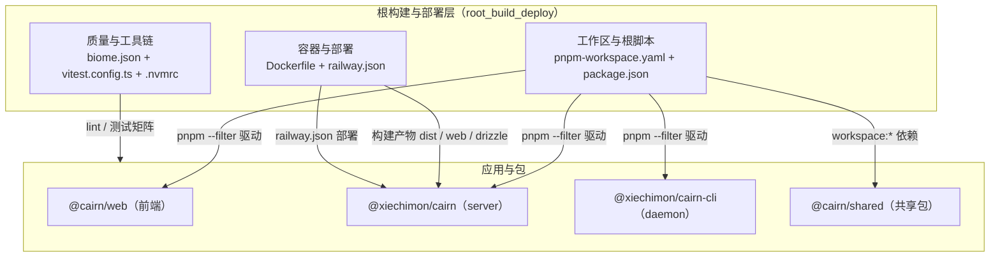
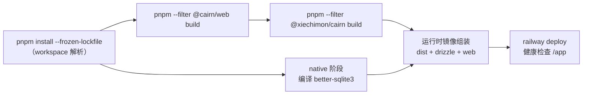
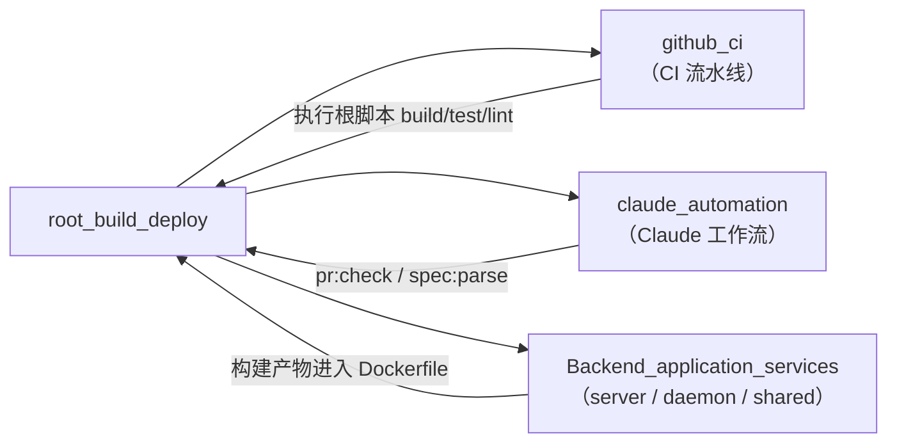

# 根构建与部署（root_build_deploy）

## 模块定位与职责

`root_build_deploy` 是 Cairn 仓库根层的"构建、质量与部署编排层"。它本身不包含业务逻辑，而是把整个 monorepo 的工程化能力集中到仓库根目录：统一 Node/pnpm 工具链、定义根级 npm 脚本、编排多阶段容器镜像构建、配置测试矩阵与代码质量门禁，并描述 Railway 上的部署形态。

该模块由以下配置文件构成：

| 文件 | 职责 |
| --- | --- |
| `.nvmrc` | 固定 Node.js 运行时版本（24） |
| `Dockerfile` | 三段式（`build` / `native` / 运行时）容器镜像构建 |
| `package.json` | 根级脚本：开发、构建、测试、lint、轨迹数据工具 |
| `biome.json` | Biome 代码质量门禁：格式、lint、受限导入纪律 |
| `pnpm-workspace.yaml` | pnpm workspace 声明、依赖版本 catalog、允许构建白名单 |
| `railway.json` | Railway 部署配置（Dockerfile 构建 + 健康检查） |
| `vitest.config.ts` | 跨包的 Vitest 测试项目矩阵 |

## 架构总览

核心思路是"薄根层 + 厚应用层"：根配置只负责编排（脚本、依赖解析、镜像组装、质量门禁），具体的服务实现全部落在 [Backend_application_services](../Backend_application_services.md) 的 `server` 与 `daemon` 两个应用中。

## 构建与部署流程

1. **依赖安装**：`Dockerfile` 的 `build` 阶段执行 `pnpm install --frozen-lockfile`，按 workspace 过滤只安装 server 与 web 所需依赖。
2. **前端构建**：`pnpm --filter @cairn/web build` 产出 `apps/web/dist`。
3. **服务端构建**：`pnpm --filter @xiechimon/cairn build` 调用 `apps/server/build.mjs`（esbuild 打包，`better-sqlite3` 外置为原生依赖）。
4. **原生依赖编译**：`native` 阶段针对 `better-sqlite3` 单独执行 `node-gyp rebuild`，避免镜像携带预编译产物。
5. **运行时镜像**：以 `node:24-bookworm-slim` 为基底，合并 native 的 `node_modules`、server 的 `dist` 与 `drizzle`、web 的 `dist`，以 `node dist/index.mjs` 启动。
6. **部署**：`railway.json` 指定 Dockerfile 构建、`/app` 健康检查路径与失败重启策略。

## 子模块

本模块按关注点拆分为三个子模块，各自拥有独立文档页（最终文件：`root_build_deploy/root_build_deploy_workspace.md`、`root_build_deploy/root_build_deploy_container.md`、`root_build_deploy/root_build_deploy_quality.md`）：

- [工作区与根脚本](root_build_deploy/root_build_deploy_workspace.md)：`pnpm-workspace.yaml` 的 workspace/catalog 声明，以及 `package.json` 中开发、构建、测试、轨迹工具等根脚本。
- [容器与部署](root_build_deploy/root_build_deploy_container.md)：`Dockerfile` 的三段式镜像构建（build/native/运行时）与 `railway.json` 的部署配置。
- [质量与工具链](root_build_deploy/root_build_deploy_quality.md)：`biome.json` 的 lint/格式/导入纪律门禁、`vitest.config.ts` 的测试项目矩阵与 `.nvmrc` 的 Node 版本固定。

## 与其他模块的关系

- [github_ci](github_ci.md)：CI 流水线中的 `check`、`e2e`、`pack-smoke`、`feature-map-gate` 等作业直接调用本模块定义的根脚本（`pnpm test`、`pnpm lint`、`pnpm build` 等）；`pack-smoke` 作业还会验证 `prepack` 打包产物，与本模块的容器/发布配置强相关。
- [claude_automation](claude_automation.md)：其 `pr-gate` 工作流复用根脚本 `pr:check` 与 `spec:parse`，并且整个仓库的代码规范（导入纪律）由本模块的 `biome.json` 统一实施。
- [Backend_application_services](../Backend_application_services.md)：本模块的 `Dockerfile` 与根脚本是 server/daemon/shared 三者的构建入口；反之，本模块不关心它们的内部实现，只消费其构建产物与 workspace 依赖声明。

## 质量门禁与约束

- **导入纪律**：`biome.json` 通过 `noRestrictedImports` 规则强制"缝纪律"——`@earendil-works/*`、MCP SDK、`claude-agent-sdk`、ACP SDK、OpenTelemetry 等只能经 `apps/daemon/src/backend/` 的薄桥模块消费；`simple-git` / `isomorphic-git` 明文禁止，Git 操作一律走自建 `GitOps` 薄 wrapper（见 [shared](../shared.md) 的 `shared_git_operations`）。
- **Node 版本**：`.nvmrc`（24）与根 `package.json` 的 `engines.node`（`>=22.19.0`）共同约束开发与运行环境，`Dockerfile` 亦基于 `node:24-bookworm` 系列镜像。
- **测试分层**：`vitest.config.ts` 支持 `VITEST_PROJECT_SET` 环境变量在"全部项目"与"轻量子集"（排除 `integration`）之间切换，CI 中据此拆分快速反馈与重负载测试。
