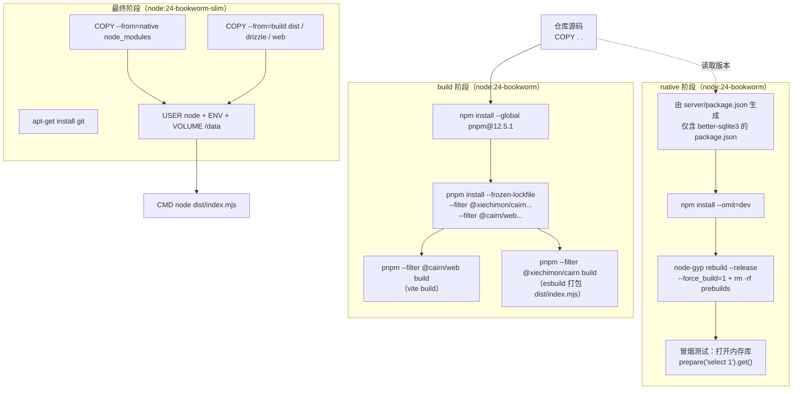
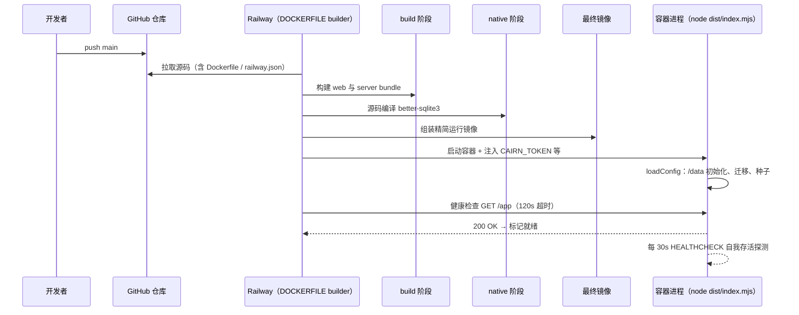
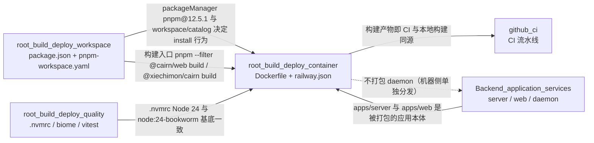

# 容器构建与部署编排（root_build_deploy_container）

## 简介

`root_build_deploy_container` 是 `root_build_deploy` 中负责 **生产容器镜像构建与云端部署配置** 的子模块。它只包含两个文件，却决定了 Cairn 后端 + 前端整套产品如何被打包、如何以非 root 用户运行、如何存活检查以及在 Railway 上如何部署：

| 文件 | 职责 |
| --- | --- |
| `Dockerfile` | 三阶段（`build` / `native` / 最终运行层）多阶段构建，产出仅含 server 运行时 + web 静态资源 + 编译好的 `better-sqlite3` 原生模块的生产镜像 |
| `railway.json` | Railway 平台部署清单：指定 Dockerfile 构建、健康检查路径、失败重启策略 |

该模块是"代码 → 镜像 → 平台"链路的最后一环：上游由 [root_build_deploy_workspace](root_build_deploy_workspace.md) 声明的 pnpm 工作区与根脚本提供构建入口，被构建的应用本体位于 [Backend_application_services](../../Backend_application_services.md) 的 `server` 与 `web` 中。

> 注意：容器 **不包含** daemon（`@xiechimon/cairn-cli`）。daemon 是运行在机器侧（machine fleet）的 agent 守护进程，通过 API 与 server 通信，随机器单独分发，不会打进 server 镜像。

## 架构总览



三阶段的职责切分：

- **build**：在完整 Node 环境中用 pnpm 安装 server/web 及其 workspace 依赖（`...` 后缀表示"连同依赖"），产出 web 静态资源（`apps/web/dist`）与 esbuild 单文件 bundle（`apps/server/dist/index.mjs`）。
- **native**：单独为运行时环境编译 `better-sqlite3` 原生模块——这是整份 Dockerfile 的关键工程决策，详见下文。
- **最终阶段**：基于精简的 `node:24-bookworm-slim`，只拷贝运行必需的三类产物（node_modules、dist、drizzle、web），以非 root 的 `node` 用户启动。

## 构建阶段（build）详解

```dockerfile
FROM node:24-bookworm AS build
RUN npm install --global pnpm@12.5.1
WORKDIR /src
COPY . .
RUN pnpm install --frozen-lockfile --filter @xiechimon/cairn... --filter @cairn/web...
RUN pnpm --filter @cairn/web build
RUN pnpm --filter @xiechimon/cairn build
```

| 步骤 | 说明 |
| --- | --- |
| `npm install --global pnpm@12.5.1` | 全局安装 pnpm 12.5.1，与根 `package.json` 的 `packageManager` 字段一致（见 [root_build_deploy_workspace](root_build_deploy_workspace.md)），保证 lockfile 解析行为与本地/CI 完全一致 |
| `COPY . .` | 拷贝整个仓库上下文（含 `pnpm-lock.yaml`、`pnpm-workspace.yaml`、所有包源码） |
| `pnpm install --frozen-lockfile --filter @xiechimon/cairn... --filter @cairn/web...` | 按 lockfile 精确安装 **server 与 web 及其依赖**（`...` 会带上 workspace 依赖，即 `@cairn/shared`）。刻意不安装 daemon 与根 devDependencies，显著缩小构建产物与层体积 |
| `pnpm --filter @cairn/web build` | `vite build` 产出前端静态资源到 `apps/web/dist` |
| `pnpm --filter @xiechimon/cairn build` | 执行 [server](../../Backend_application_services/server.md) 的 `build.mjs`：esbuild 将 `src/index.ts` 打成单文件 `dist/index.mjs`，其中 `better-sqlite3` 被声明为 `external`——它不进 bundle，运行时从 `node_modules` 加载，这正是 `native` 阶段存在的理由 |

## 原生依赖阶段（native）详解

```dockerfile
FROM node:24-bookworm AS native
WORKDIR /opt/native
COPY apps/server/package.json /tmp/server-package.json
RUN node -e "const v = require('/tmp/server-package.json').dependencies['better-sqlite3']; require('fs').writeFileSync('package.json', JSON.stringify({ private: true, dependencies: { 'better-sqlite3': v } }))"
RUN npm install --omit=dev
RUN cd node_modules/better-sqlite3 && npx node-gyp rebuild --release --force_build=1 && rm -rf prebuilds
RUN node -e "const D = require('better-sqlite3'); new D(':memory:').prepare('select 1').get()"
```

| 步骤 | 说明 |
| --- | --- |
| 生成最小 `package.json` | 从 `apps/server/package.json` 读取 `better-sqlite3` 的精确版本（`13.0.3`），生成只含该依赖的私有清单 |
| `npm install --omit=dev` | 仅安装 `better-sqlite3`（含其依赖），不装任何 devDependencies |
| `node-gyp rebuild --release --force_build=1` + `rm -rf prebuilds` | **强制从源码编译**原生模块，并删除预编译二进制。原因：运行时基底是 `bookworm-slim`，与预编译产物所面向的 ABI/glibc 组合未必匹配；从源码编译可保证在 Node 24 上可用 |
| 冒烟测试 | 用 `new D(':memory:').prepare('select 1').get()` 真实打开一次内存数据库并执行 SQL，验证编译出的模块可加载、可执行；任何 ABI 不匹配都会在此步直接构建失败（fail fast） |

`native` 阶段选择了与 build 相同的 `node:24-bookworm` 基底来编译，保证与最终 `node:24-bookworm-slim` 的 Node 大版本完全一致；编译产物通过 `COPY --from=native` 进入精简运行镜像。

## 最终运行阶段详解

```dockerfile
FROM node:24-bookworm-slim
RUN apt-get update \
  && apt-get install --yes --no-install-recommends git \
  && rm -rf /var/lib/apt/lists/*
WORKDIR /app
COPY --from=native /opt/native/node_modules ./node_modules
COPY --from=build /src/apps/server/dist ./dist
COPY --from=build /src/apps/server/drizzle ./drizzle
COPY --from=build /src/apps/web/dist ./web
RUN mkdir /data && chown node:node /data
ENV NODE_ENV=production
ENV HOST=0.0.0.0
ENV PORT=8787
ENV CAIRN_HOME=/data
ENV CAIRN_REQUIRE_TOKEN=1
VOLUME /data
EXPOSE 8787
USER node
HEALTHCHECK --interval=30s --timeout=5s --start-period=20s --retries=3 \
  CMD node -e "fetch('http://127.0.0.1:' + process.env.PORT + '/app').then((r) => process.exit(r.ok ? 0 : 1), () => process.exit(1))"
CMD ["node", "dist/index.mjs"]
```

### 产物布局与运行时解析

| 镜像内路径 | 来源 | 运行时如何被消费 |
| --- | --- | --- |
| `/app/node_modules` | `native` 阶段 | esbuild bundle 将 `better-sqlite3` 标记为 external，进程启动时从该目录 `require` 原生模块 |
| `/app/dist/index.mjs` | build 阶段 `apps/server/dist` | `CMD ["node", "dist/index.mjs"]` 的入口；bundle 内 `resolveMigrationsFolder()` 会探测 `../drizzle`（见 [server_database](../../Backend_application_services/server/server_database.md)） |
| `/app/drizzle` | build 阶段 `apps/server/drizzle` | SQLite 迁移文件，启动时按需应用 |
| `/app/web` | build 阶段 `apps/web/dist` | 未设置 `CAIRN_WEB_DIR` 时 `defaultWebDir()` 从 bundle 位置向上探测 `/app/web`（含 `index.html`）命中，作为 web 静态目录 |

### 环境变量与安全基线

| 变量 | 值 | 效果（对应 [server_app_bootstrap](../../Backend_application_services/server/server_app_bootstrap.md) 的 `loadConfig`） |
| --- | --- | --- |
| `NODE_ENV` | `production` | pino 日志不加载 `pino-pretty` transport（bundle 形态下也无法加载 worker） |
| `HOST` | `0.0.0.0` | server 绑定所有网卡接口，供平台负载均衡与外部访问 |
| `PORT` | `8787` | `envPort()` 读取的监听端口（默认即 8787） |
| `CAIRN_HOME` | `/data` | `homeDir=/data` → `dataDir=/data/server` → 数据库 `/data/server/server.db`、密钥文件 `/data/server/secretbox.key`、仓库 `/data/server/repos`、附件 `/data/server/attachments` 全部落在持久卷内 |
| `CAIRN_REQUIRE_TOKEN` | `1` | `requireToken=true`：若 `CAIRN_TOKEN` 未设置且 `/data` 下无访问令牌文件，`missingRequiredTokenError` 会使进程 **拒绝启动**（fatal + exit 1）——部署时必须注入 `CAIRN_TOKEN` |

安全相关设计：

- `USER node` + `/data` `chown node:node`：容器以非 root 身份运行，持久化数据卷属主为 `node` 用户。
- `CAIRN_REQUIRE_TOKEN=1`：容器模式强制开启 Bearer 令牌鉴权；`HOST=0.0.0.0` 全网卡可达 + 未设令牌时，`warnInsecureBind` 会在启动时打出警告。
- `VOLUME /data`：所有状态（SQLite、密钥、git 仓库、附件）都通过该卷持久化，镜像本身保持无状态、可随时重建。

### 健康检查

```dockerfile
HEALTHCHECK --interval=30s --timeout=5s --start-period=20s --retries=3 \
  CMD node -e "fetch('http://127.0.0.1:' + process.env.PORT + '/app').then((r) => process.exit(r.ok ? 0 : 1), () => process.exit(1))"
```

每 30 秒向本机 `PORT`（8787）的 `/app` 发一次 HTTP 请求：响应 `ok` 则存活，否则失败；给予 20 秒启动宽限、5 秒超时、连续 3 次失败判不健康。`/app` 正是 web 应用入口路径（与登录链接 `http://host:8787/app#token=...` 一致），健康检查同时验证了 HTTP 服务与前端静态资源都已就绪。

## 部署清单（railway.json）

```json
{
  "$schema": "https://railway.com/railway.schema.json",
  "build": {
    "builder": "DOCKERFILE",
    "dockerfilePath": "Dockerfile"
  },
  "deploy": {
    "healthcheckPath": "/app",
    "healthcheckTimeout": 120,
    "restartPolicyType": "ON_FAILURE",
    "restartPolicyMaxRetries": 5
  }
}
```

| 字段 | 值 | 说明 |
| --- | --- | --- |
| `build.builder` | `DOCKERFILE` | Railway 直接构建仓库根目录的 `Dockerfile` |
| `build.dockerfilePath` | `Dockerfile` | 明确指定构建文件 |
| `deploy.healthcheckPath` | `/app` | 平台级健康检查路径，与 Dockerfile `HEALTHCHECK` 检查的是同一个端点（`/app`） |
| `deploy.healthcheckTimeout` | `120` | 健康检查超时 120 秒，覆盖启动阶段迁移/种子等耗时 |
| `deploy.restartPolicyType` | `ON_FAILURE` | 仅失败时重启 |
| `deploy.restartPolicyMaxRetries` | `5` | 最多重试 5 次 |

部署时仍需注入 `CAIRN_TOKEN`（与 `CAIRN_REQUIRE_TOKEN=1` 配套），并按需设置 `CAIRN_GITHUB_OAUTH_CLIENT_ID` / `CAIRN_GITHUB_OAUTH_CLIENT_SECRET`（GitHub OAuth，见 [server_integrations](../../Backend_application_services/server/server_integrations.md)）等运行时环境变量。

## 部署与运行数据流



## 与其他模块的关系



- **[root_build_deploy](../root_build_deploy.md)**：本页是其"容器构建与部署"子模块；工作区声明与根脚本见 [root_build_deploy_workspace](root_build_deploy_workspace.md)，质量门禁与 Node 版本约束见 [root_build_deploy_quality](root_build_deploy_quality.md)。
- **[root_build_deploy_workspace](root_build_deploy_workspace.md)**：Dockerfile 的 `pnpm@12.5.1`、`--frozen-lockfile`、`--filter @xiechimon/cairn... --filter @cairn/web...` 全部依赖该页声明的 workspace 与 catalog；`pnpm-workspace.yaml` 的 `allowBuilds.better-sqlite3: true` 与 `native` 阶段的编译行为呼应。
- **[Backend_application_services](../../Backend_application_services.md)**：容器装入的 server（[server](../../Backend_application_services/server.md)）在 `dist/index.mjs` 启动时执行配置加载（[server_app_bootstrap](../../Backend_application_services/server/server_app_bootstrap.md)）、迁移应用（[server_database](../../Backend_application_services/server/server_database.md)）、调度器与机器编排（[server_scheduler](../../Backend_application_services/server/server_scheduler.md) / [server_machine_fleet](../../Backend_application_services/server/server_machine_fleet.md)）；web 静态资源由 `@cairn/web`（Vite）构建。daemon（[daemon](../../Backend_application_services/daemon.md)）不在镜像内。
- **[github_ci](../github_ci.md)**：CI 的 `check` / `e2e` / `pack-smoke` 等作业在代码侧完成与镜像构建同源的编译与测试；本模块的 Dockerfile 是生产部署的可复现构建路径（Railway 直接消费），两者共享同一 workspace 工具链。
