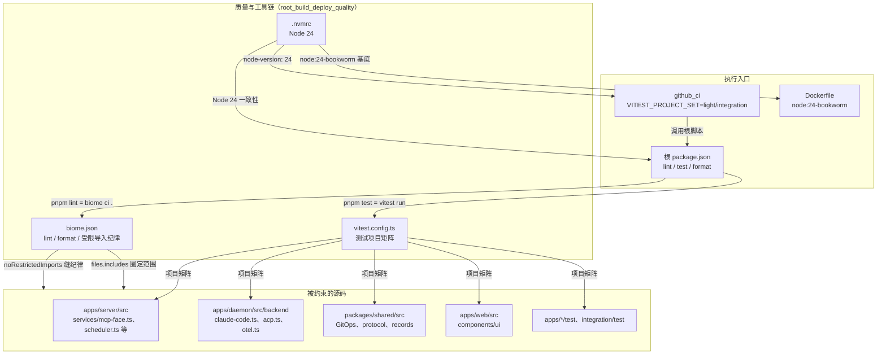
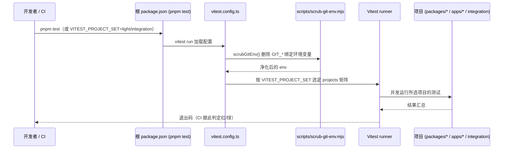
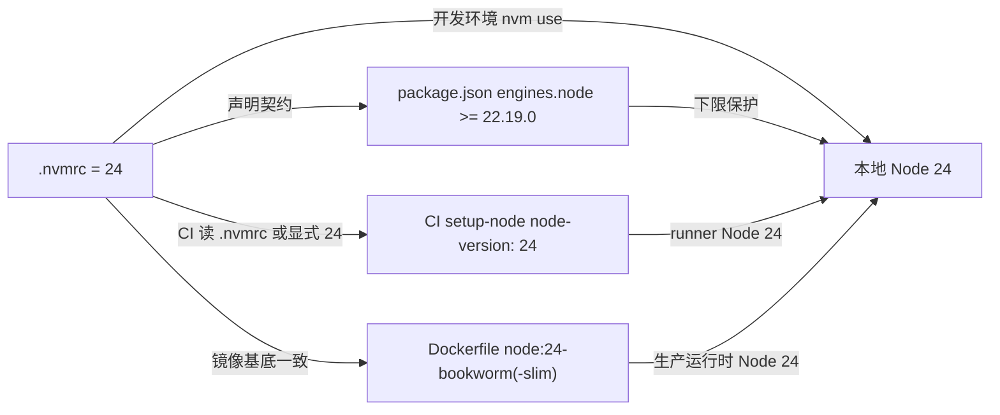
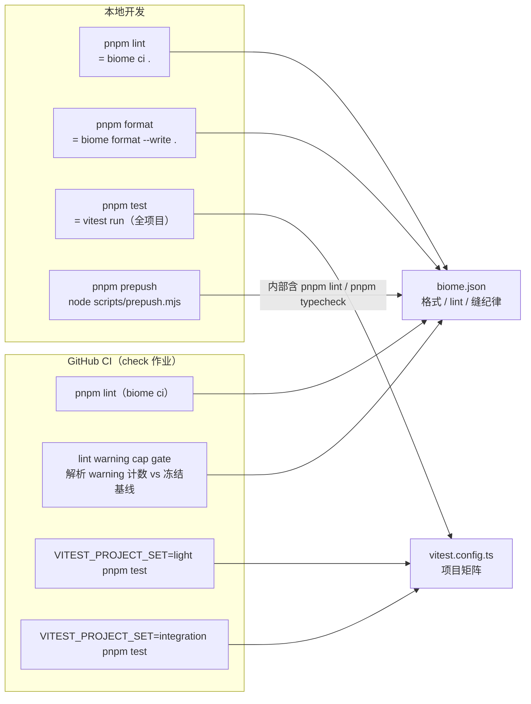
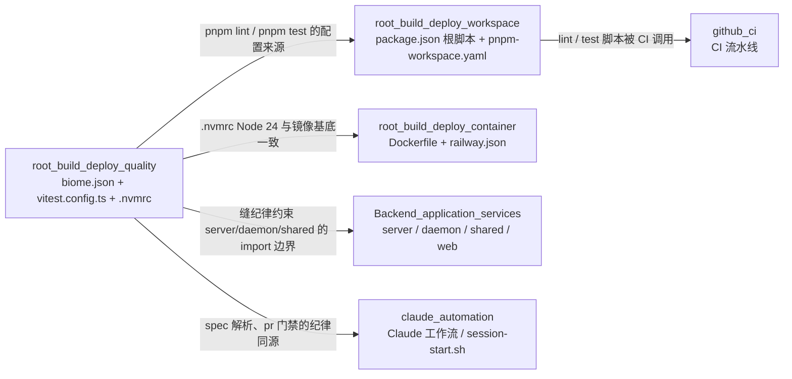

# 质量门禁与工具链（root_build_deploy_quality）

## 简介

`root_build_deploy_quality` 是 `root_build_deploy` 中负责 **代码质量门禁与测试/运行工具链** 的子模块。它由三个根级配置文件构成，全部作用于整个 monorepo：

| 文件 | 职责 |
| --- | --- |
| `biome.json` | Biome 2.5.14 的统一质量门禁：格式（formatter）、静态检查（linter）、以及"缝纪律"受限导入规则（`noRestrictedImports`） |
| `vitest.config.ts` | 跨包 Vitest 测试项目矩阵：按 `VITEST_PROJECT_SET` 在"全部项目 / 轻量子集 / 集成重负载"三档之间切换 |
| `.nvmrc` | 固定 Node.js 运行时大版本（24），统一本地、CI 与容器三处的 Node 版本 |

该子模块不产生业务代码，而是"工程护栏"的载体：`biome.json` 守护代码规范与架构边界（哪些包可以被谁 import），`vitest.config.ts` 决定测试如何分层运行，`.nvmrc` 保证工具链版本一致。它们被根脚本（见 [root_build_deploy_workspace](root_build_deploy_workspace.md) 的 `lint` / `test`）与 CI 流水线（见 [github_ci](../github_ci.md)）消费，并约束 [Backend_application_services](../../Backend_application_services.md) 中 `server`、`daemon`、`shared`、`web` 全部代码的落地形态。

## 架构总览



三个文件各自的"消费者"不同：`biome.json` 被本地 `pnpm lint`、`pnpm format` 与 CI 的 lint 门禁消费；`vitest.config.ts` 被根脚本 `pnpm test` 消费，CI 通过 `VITEST_PROJECT_SET` 环境变量切换测试子集；`.nvmrc` 则是版本契约，与根 `package.json` 的 `engines.node`、CI 的 `actions/setup-node`、`Dockerfile` 的 `node:24-bookworm` 镜像基底四方对齐。

## biome.json：统一代码质量门禁

`biome.json`（5.7 KB）以 `https://biomejs.dev/schemas/2.5.14/schema.json` 为 schema，版本 2.5.14 与 `pnpm-workspace.yaml` catalog 中的 `@biomejs/biome: 2.5.14` 一致（见 [root_build_deploy_workspace](root_build_deploy_workspace.md)）。根脚本 `lint`（`biome ci .`）与 `format`（`biome format --write .`）都直接读取此配置。

### 顶层结构

```json
{
  "$schema": "https://biomejs.dev/schemas/2.5.14/schema.json",
  "vcs": { "enabled": true, "clientKind": "git", "useIgnoreFile": true },
  "files": { "includes": ["apps/web/src/**", "..."] },
  "formatter": { "enabled": true, "indentStyle": "space", "indentWidth": 2, "lineWidth": 100 },
  "css": { "parser": { "tailwindDirectives": true } },
  "linter": { "enabled": true, "rules": { "preset": "recommended", "..." } },
  "javascript": { "formatter": { "quoteStyle": "single", "semicolons": "always" } },
  "assist": { "actions": { "source": { "organizeImports": "on" } } }
}
```

| 配置段 | 含义 |
| --- | --- |
| `vcs` | 启用 git 版本控制集成，读取 `.gitignore`（`useIgnoreFile`）来尊重已有忽略规则 |
| `files.includes` | 显式圈定 lint/format 覆盖的文件集合（见下） |
| `formatter` | 统一缩进：空格、2 宽、行宽 100 |
| `css.parser.tailwindDirectives` | Tailwind CSS 指令（`@tailwind` / `@apply` 等）可被 CSS 解析器识别 |
| `linter` | 开启 `recommended` 预设规则集，并追加"缝纪律"受限导入规则 |
| `javascript.formatter` | JS/TS 格式偏好：单引号、强制分号 |
| `assist` | 编辑器辅助动作：源码保存时自动整理 import 顺序 |

### files.includes：覆盖范围

`files.includes` 列出全部受管文件（未列出的路径不被 Biome 处理）：

| 分组 | 覆盖路径 |
| --- | --- |
| web 应用 | `apps/web/src/**`、`apps/web/index.html`、`apps/web/vite.config.ts`、`apps/web/postcss.config.js`、`apps/web/tsconfig.json`、`apps/web/package.json` |
| shared 包 | `packages/shared/src/**`、`packages/shared/test/**/*.ts`、`packages/shared/package.json`、`packages/shared/tsconfig.json` |
| server 应用 | `apps/server/src/**`、`apps/server/test/**/*.ts`、`apps/server/package.json`、`apps/server/tsconfig.json`、`apps/server/drizzle.config.ts`、`apps/server/build.mjs`、`apps/server/scripts/stage-web.mjs` |
| daemon 应用 | `apps/daemon/src/**`、`apps/daemon/test/**/*.ts`、`apps/daemon/build.mjs`、`apps/daemon/externals.mjs`、`apps/daemon/scripts/**`、`apps/daemon/package.json`、`apps/daemon/tsconfig.json` |
| 集成测试 | `integration/test/**/*.ts`、`integration/eval/**/*.mts`、`integration/*.ts`、`integration/package.json` |
| 根工具 | `vitest.config.ts`、`parity/*.mjs`、`scripts/**`、`package.json`、`pnpm-workspace.yaml` |

> 注意：本模块自身的 `biome.json` 与 `.nvmrc` 不在 includes 列表中（JSON 配置与纯文本版本文件无需 lint）；而 `vitest.config.ts` 在列——它本身也受格式与 lint 约束。

### linter 核心：noRestrictedImports"缝纪律"

`linter.rules` 在 `recommended` 预设之上，把 `style.noRestrictedImports` 设为 `error`，分 **pattern（按包名通配）** 与 **paths（按具体包名）** 两组限制 import：

#### pattern 组：只能经"薄桥/缝"消费的生态包

| 限制组 | 允许的唯一消费点 | 对应实现 |
| --- | --- | --- |
| `@earendil-works/*`（pi 系包） | 经 `AgentBackend` 缝消费；其余模块只能 import 缝接口（`@cairn/shared` 的 agent-backend） | `apps/daemon/src/backend/` |
| `@modelcontextprotocol/sdk` | 自建薄桥模块：server 的 `/api/mcp` 面 = `services/mcp-face.ts`；daemon 每轮对话 client 桥 = `src/backend/` | [server_integrations](../../Backend_application_services/server/server_integrations.md) 的 `mcp-face.ts`、[daemon_backends](../../Backend_application_services/daemon/daemon_backends.md) |
| `@anthropic-ai/claude-agent-sdk` | 唯一落点 `apps/daemon/src/backend/claude-code.ts` | [daemon_backends](../../Backend_application_services/daemon/daemon_backends.md) 的 `ClaudeCodeBackend` |
| `@agentclientprotocol/sdk`（ACP） | 唯一落点 `apps/daemon/src/backend/acp.ts` | [daemon_backends](../../Backend_application_services/daemon/daemon_backends.md) 的 `GeminiBackend` |
| `@opentelemetry/*` | 唯一落点 `apps/daemon/src/backend/otel.ts`，且仅在配置 `CAIRN_OTEL_ENDPOINT` 时启用 | [daemon_backends](../../Backend_application_services/daemon/daemon_backends.md) 的 `PiStepSpanSink` |

#### paths 组：明文禁止或定点消费的包

| 包名 | 规则 | 说明 |
| --- | --- | --- |
| `cron-parser` | 只许 Scheduler 缝实现消费 | 对应 [server_scheduler](../../Backend_application_services/server/server_scheduler.md) 的 `schedules.ts` / `scheduler.ts`（`overrides` 已豁免） |
| `simple-git` | 明文不引入 | GitOps 缝 = `spawn` 系统 git 的自建薄 wrapper，见 [shared_git_operations](../../shared/shared_git_operations.md) |
| `isomorphic-git` | 明文不引入 | 同上（无 http-backend / worktree 面） |

这些规则的每条 `message` 都带规范编号（如"缝纪律（01 §5/§7.3）"），把架构约束直接固化进 linter，违反即 CI 报错——这是本仓库"机器强制架构边界"的核心手段。

### overrides：按路径豁免

| 覆盖路径 | 关闭的规则 | 理由 |
| --- | --- | --- |
| `apps/daemon/src/backend/**` | `noRestrictedImports` | 缝实现落点本身豁免——它就是要 import 这些 SDK 的地方 |
| `apps/server/src/services/schedules.ts`、`apps/server/src/services/scheduler.ts` | `noRestrictedImports` | cron-parser 的合法消费点（Scheduler 缝） |
| `apps/server/src/services/mcp-face.ts` | `noRestrictedImports` | MCP SDK 薄桥的实现落点 |
| `apps/daemon/test/**/*.test.ts`、`apps/server/test/**/*.test.ts`、`integration/test/**` | `noRestrictedImports` + `noNonNullAssertion` | 测试代码不受架构边界限制；同时放开非空断言以简化测试桩 |
| `apps/web/src/components/ui/field.tsx` | `a11y.useSemanticElements` | shadcn/ui 风格的 field 组件按设计使用非语义元素 |
| `apps/web/src/components/ui/input-group.tsx` | `a11y.useSemanticElements` + `a11y.useKeyWithClickEvents` | 同上，input-group 组合组件豁免键盘事件规则 |

### lint 在 CI 中的闭环

CI 的 `check` 作业中，除直接 `pnpm lint`（`biome ci .`）外，还有独立的 **Lint warning cap gate（#1192）**（见 [github_ci](../github_ci.md)）：`biome ci` 只对 error 非零退出，warning 只出现在摘要里——该 gate 解析 `Found N warnings` 汇总行并与冻结基线 `scripts/lint-warning-baseline.json` 对比，超过上限即红，且基线只能下移（防止 PR 抬高自己的上限）。这使 `biome.json` 的规则变更（新增规则产生的 warning）也被纳入机器约束。

## vitest.config.ts：测试项目矩阵

```typescript
import { defineConfig } from 'vitest/config';
import { scrubGitEnv } from './scripts/scrub-git-env.mjs';

scrubGitEnv();

const ALL_PROJECTS = ['packages/*', 'apps/server', 'apps/web', 'apps/daemon', 'integration'];
const HEAVY_PROJECTS = ['integration'];
const projectSet = process.env.VITEST_PROJECT_SET;
const projects =
  projectSet === 'integration'
    ? HEAVY_PROJECTS
    : projectSet === 'light'
      ? ALL_PROJECTS.filter((p) => !HEAVY_PROJECTS.includes(p))
      : ALL_PROJECTS;

export default defineConfig({
  test: { projects },
});
```

### 启动时环境净化：scrubGitEnv()

模块加载即调用 `scripts/scrub-git-env.mjs` 导出的 `scrubGitEnv()`：它把环境变量中所有 `GIT_DIR`、`GIT_WORK_TREE`、`GIT_INDEX_FILE`、`GIT_PREFIX`、`GIT_COMMON_DIR`、`GIT_OBJECT_DIRECTORY`、`GIT_ALTERNATE_OBJECT_DIRECTORIES`、`GIT_NAMESPACE`、`GIT_CEILING_DIRECTORIES` 等仓库绑定变量删除（`REPO_BINDING` 正则）。

原因：测试中会 `spawn` 系统 git（GitOps 缝，见 [shared_git_operations](../../shared/shared_git_operations.md)），若测试进程继承了外层仓库的 git 绑定环境，子进程 git 会被绑定到错误仓库、读到错误索引，产生难以排查的假红。该脚本同时被 `scripts/prepush.mjs` 复用（`runPlan` 中对每个 spawn 步骤都做 `scrubGitEnv`），是测试隔离的公共基础设施。

### 项目矩阵与三档切换

| `VITEST_PROJECT_SET` | 生效项目 | 用途 |
| --- | --- | --- |
| （未设置） | `packages/*`、`apps/server`、`apps/web`、`apps/daemon`、`integration` 全部 | 本地 `pnpm test` 完整回归 |
| `light` | 除 `integration` 外的全部轻量项目 | CI `check` 作业快速反馈（2 vCPU runner 上跑集成栈会假红，见 [github_ci](../github_ci.md) 的注释） |
| `integration` | 仅 `integration`（真实 server + daemon + Chromium 的 e2e 栈） | CI `check` 作业单独执行重负载集成测试 |

CI 中的实际用法（`.github/workflows/ci.yml` 的 `check` 作业）：

```yaml
- name: Test (vitest, light project)
  run: VITEST_PROJECT_SET=light pnpm test
- name: Test (vitest, integration stack)
  run: VITEST_PROJECT_SET=integration pnpm test
```

> 项目拆分动机（2026-09-30 记录在 ci.yml）：集成栈（真实 server + daemon + Chromium in-process）与轻量项目同跑时在 2 vCPU runner 上会 false-red——同一 sha 两次相同失败、docs-only 变更也红、本地同测试 10.9s 通过。因此把 `integration` 定义为重负载项目，与轻量项目完全隔离。

测试执行的数据流：



## .nvmrc：Node 版本契约

`.nvmrc` 内容为纯文本 `24`，是 nvm（以及 fnm、asdf 等工具）读取的 Node 大版本声明。它参与四方一致性：

| 位置 | Node 版本声明 | 出处 |
| --- | --- | --- |
| `.nvmrc` | `24` | 本文件 |
| 根 `package.json` | `engines.node: ">=22.19.0"` | [root_build_deploy_workspace](root_build_deploy_workspace.md) |
| CI `check` / `e2e` / `pack-smoke` | `actions/setup-node` `node-version: 24` | [github_ci](../github_ci.md) |
| `Dockerfile` | 三阶段全部 `node:24-bookworm`（含 `-slim`） | [root_build_deploy_container](root_build_deploy_container.md) |



实际约束：`engines.node >= 22.19.0` 提供下限保护（pnpm 会警告低于该版本），`.nvmrc` / CI / Docker 统一固定在 24 大版本，保证"本地跑得过的，CI 与容器里同样跑得过"。

## 质量门禁执行流



- **本地**：`pnpm lint` 直接执行 `biome ci .`；`pnpm format` 用同一配置自动修复；`pnpm test` 全量跑；`pnpm prepush`（`scripts/prepush.mjs`）把 `pnpm lint`、`pnpm typecheck` 等编入推送前门禁计划（见 [root_build_deploy_workspace](root_build_deploy_workspace.md)）。
- **CI**：`check` 作业的 `Prepush checks (#1533)` 步骤以 `pnpm prepush --ci` 运行同一计划；`Lint warning cap gate (#1192)` 再叠加 warning 计数冻结基线；测试按 light / integration 两档拆分。

## 与其他模块的关系



- **[root_build_deploy](../root_build_deploy.md)**：本页是其"质量与工具链"子模块；根脚本编排见 [root_build_deploy_workspace](root_build_deploy_workspace.md)，容器与部署见 [root_build_deploy_container](root_build_deploy_container.md)。
- **[root_build_deploy_workspace](root_build_deploy_workspace.md)**：`pnpm lint`（`biome ci .`）、`pnpm test`（`vitest run`）、`pnpm format` 等根脚本在此页声明并消费本模块的两个配置；`pnpm-workspace.yaml` 的 catalog 固定 `@biomejs/biome 2.5.14` 与 `vitest 5.0.1`，与本模块 schema/依赖版本一一对应。
- **[github_ci](../github_ci.md)**：`check` 作业以 `VITEST_PROJECT_SET=light/integration` 两段执行本模块的测试矩阵，并运行 `pnpm lint` 与 `Lint warning cap gate (#1192)`；`setup-node` 的 `node-version: 24` 与 `.nvmrc` 对齐。
- **[root_build_deploy_container](root_build_deploy_container.md)**：`Dockerfile` 三阶段基底 `node:24-bookworm(-slim)` 与 `.nvmrc` 的 24 大版本一致，保证构建/运行环境与本地、CI 同源。
- **[Backend_application_services](../../Backend_application_services.md)**：`biome.json` 的缝纪律直接约束 [daemon_backends](../../Backend_application_services/daemon/daemon_backends.md)（`claude-code.ts` / `acp.ts` / `otel.ts` 是生态 SDK 的唯一落点）、[server_integrations](../../Backend_application_services/server/server_integrations.md)（`mcp-face.ts`）、[server_scheduler](../../Backend_application_services/server/server_scheduler.md)（`cron-parser` 定点消费）与 [shared_git_operations](../../shared/shared_git_operations.md)（GitOps 缝，禁止 `simple-git` / `isomorphic-git`）；`vitest.config.ts` 的项目矩阵则决定这三个应用的测试如何被 `pnpm test` 触发。
- **[claude_automation](../claude_automation.md)**：仓库代码规范（含导入纪律）由本模块统一实施，`claude_automation` 的 `pr-gate` 工作流复用的 `pr:check` / `spec:parse` 根脚本与 `biome.json` 的纪律同源；`.claude/hooks/session-start.sh` 亦按 `.nvmrc` 的 Node 版本约定初始化会话环境。
