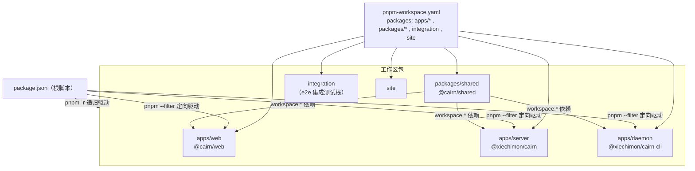
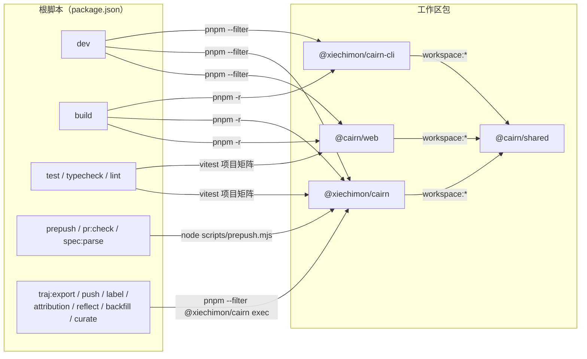
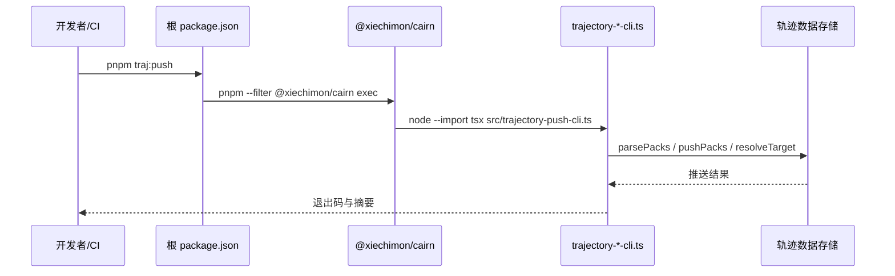
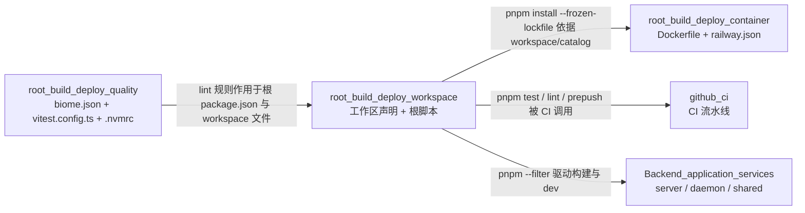

# 工作区与根脚本（root_build_deploy_workspace）

## 简介

`root_build_deploy_workspace` 是 `root_build_deploy` 中负责 **pnpm 工作区声明与根级 npm 脚本编排** 的子模块。它由仓库根目录的两个文件构成：

| 文件 | 职责 |
| --- | --- |
| `package.json` | 根包 `cairn` 的元数据与全部根脚本：开发、构建、启动、测试、lint、PR 门禁与轨迹数据工具 |
| `pnpm-workspace.yaml` | workspace 包集合声明、依赖版本 catalog 与 `allowBuilds` 构建白名单 |

该子模块不包含任何业务逻辑，是"薄根层 + 厚应用层"思路的载体：它只负责把 monorepo 中 `apps/*`、`packages/*`、`integration`、`site` 各包的脚本统一编排起来，具体实现全部落在 [Backend_application_services](../../Backend_application_services.md) 的 `server`、`daemon` 与 `shared` 应用中。

## 架构总览



- `pnpm-workspace.yaml` 声明哪些目录是 workspace 成员，并统一约定版本 catalog 与依赖构建白名单。
- 根 `package.json` 的脚本通过 `pnpm --filter <包名>` 定向到具体包，或通过 `pnpm -r` 递归作用于所有 workspace 包。
- `@cairn/shared` 以 `workspace:*` 形式被 `web`、`server`、`daemon` 三个应用依赖，是唯一被复用的内部包。

## 工作区声明（pnpm-workspace.yaml）

### packages：工作区成员

```yaml
packages:
  - apps/*
  - packages/*
  - integration
  - site
```

| 成员 | 包名 | 说明 |
| --- | --- | --- |
| `apps/web` | `@cairn/web` | 前端应用（Vite + React），详见 [Backend_application_services](../../Backend_application_services.md) 的 `server` 文档中关于 web 产物的说明 |
| `apps/server` | `@xiechimon/cairn` | 后端服务（Hono + SQLite），详见 [server](../../Backend_application_services/server.md) |
| `apps/daemon` | `@xiechimon/cairn-cli` | 后台 agent 守护进程，详见 [daemon](../../Backend_application_services/daemon.md) |
| `packages/shared` | `@cairn/shared` | 跨应用共享的类型、协议与工具，详见 [shared](../../shared.md) |
| `integration` | — | 端到端集成测试栈（真实 server + daemon + Chromium） |
| `site` | — | 站点目录 |

### allowBuilds：依赖构建白名单

```yaml
allowBuilds:
  '@google/genai': false
  better-sqlite3: true
  esbuild: true
  protobufjs: false
```

pnpm 默认会拒绝在安装时执行依赖的 `postinstall` 构建脚本；`allowBuilds` 显式放行确有构建需要的包，同时保持其余依赖禁止构建。关键放行项：

- `better-sqlite3`（**true**）：server 的原生 SQLite 驱动，需要编译原生模块。容器部署时由 `Dockerfile` 的 `native` 阶段单独 `node-gyp rebuild`（见 [root_build_deploy_container](root_build_deploy_container.md)）。
- `esbuild`（**true**）：各应用构建脚本使用的打包器。
- `@google/genai` 与 `protobufjs`（**false**）：明确禁止其构建脚本执行。

### catalog：依赖版本目录

`catalog:` 是 pnpm 的依赖版本中心化机制：工作区各包的 `package.json` 中写 `"typescript": "catalog:"` 这类引用，实际版本统一在 `pnpm-workspace.yaml` 的 `catalog` 段解析。本仓库 catalog 内容：

| 依赖 | 版本 |
| --- | --- |
| `@biomejs/biome` | 2.5.14 |
| `@playwright/test` | 1.63.0 |
| `@tailwindcss/postcss` | 4.3.3 |
| `@tanstack/react-query` | 5.103.1 |
| `@types/react` / `@types/react-dom` | 19.3.0 |
| `@vitejs/plugin-react` | 6.1.1 |
| `autoprefixer` | 10.6.1 |
| `diff` | 9.0.0 |
| `postcss` | 8.5.28 |
| `react` / `react-dom` | 19.3.0 |
| `react-router` | 8.4.0 |
| `tailwindcss` | 4.3.3 |
| `typescript` | 7.0.2 |
| `vite` | 8.3.0 |
| `vitest` | 5.0.1 |
| `zod` | 4.6.5 |

采用 catalog 后，跨包共享的工具链（TypeScript、Vitest、React、Vite、Zod 等）只需在根层改一处版本，所有引用 `catalog:` 的包同时升级，避免 monorepo 中版本漂移。

## 根脚本分类详解

根 `package.json`（包名 `cairn`，私有，Apache-2.0，`"type": "module"`，`packageManager: pnpm@12.5.1`，`engines.node >= 22.19.0`）定义的脚本按用途分为四类。

### 1. 开发脚本（dev）

| 脚本 | 命令 | 行为 |
| --- | --- | --- |
| `dev` | `concurrently -n web,server,daemon -c blue,magenta,green "pnpm dev:web" "pnpm dev:server" "pnpm dev:daemon"` | 用 `concurrently` 同时启动三个应用，前缀分别标色 `web`（蓝）、`server`（紫）、`daemon`（绿） |
| `dev:web` | `pnpm --filter @cairn/web dev` | 启动 Vite 开发服务器 |
| `dev:server` | `pnpm --filter @xiechimon/cairn dev` | `tsx watch src/index.ts` 热重载启动后端 |
| `dev:daemon` | `pnpm --filter @xiechimon/cairn-cli dev` | `tsx src/cli.ts start -f` 启动 daemon CLI |

### 2. 构建与生产启动

| 脚本 | 命令 | 行为 |
| --- | --- | --- |
| `build` | `pnpm -r build` | 递归构建全部 workspace 包（按依赖拓扑顺序） |
| `start` | `pnpm --filter @cairn/web build && pnpm --filter @xiechimon/cairn start` | 生产启动：先构建前端产物，再以 `tsx src/index.ts` 启动 server（生产镜像实际使用 `node dist/index.mjs`，见 [root_build_deploy_container](root_build_deploy_container.md)） |

### 3. 质量门禁与仓库纪律

| 脚本 | 命令 | 行为 |
| --- | --- | --- |
| `typecheck` | `pnpm -r typecheck` | 递归执行各包 `tsc --noEmit` |
| `test` | `vitest run` | 以根 `vitest.config.ts` 的项目矩阵运行全部测试；可通过 `VITEST_PROJECT_SET=light/integration` 切换子集（详见 [root_build_deploy_quality](root_build_deploy_quality.md)） |
| `lint` | `biome ci .` | Biome 检查（格式 + lint + 受限导入纪律，配置见 [root_build_deploy_quality](root_build_deploy_quality.md)） |
| `prepush` | `node scripts/prepush.mjs` | 推送前门禁总入口：按变更路径规划并执行 english-only、UI debt、recording、e2e coverage、lessons ledger 等一系列 gate（CI 中以 `pnpm prepush --ci` 运行，见 [github_ci](../github_ci.md)） |
| `pr:check` | `node scripts/pr-body-check.mjs` | 校验 PR 正文：调用 `scripts/pr-evidence-gate.py` 与 `scripts/pr-tasks-gate.py` |
| `spec:parse` | `node scripts/spec-parse-gate.mjs` | 遍历 `apps/web/e2e` 与 `integration/test` 下所有 `*.spec.*` / `*.test.*` 文件并做解析校验 |
| `lessons:table` | `node scripts/lessons-ledger-gate.mjs --table` | 输出 lessons 账本表格 |
| `prepare` | `husky` | 安装 husky git hooks（`pnpm install` 时自动触发） |

### 4. 轨迹数据工具（traj:*）

这组脚本全部通过 `pnpm --filter @xiechimon/cairn exec node --import tsx src/trajectory-*-cli.ts` 在 server 包内执行轨迹数据（trajectory）的各类 CLI，服务于 agent 会话轨迹的采集、标注、策展与回流：

| 脚本 | CLI 入口 | 用途 |
| --- | --- | --- |
| `traj:export` | `src/trajectory-export-cli.ts` | 导出轨迹数据 |
| `traj:push` | `src/trajectory-push-cli.ts` | 将轨迹打包推送到目标仓库（`parsePacks` / `pushPacks` / `resolveTarget`） |
| `traj:label` | `src/trajectory-label-cli.ts` | 为轨迹打标签 |
| `traj:attribution` | `src/trajectory-attribution-summary-cli.ts` | 生成轨迹归因摘要（`labelPacks` / `summarizeAttribution`） |
| `traj:reflect` | `src/trajectory-reflect-cli.ts` | 轨迹反思（`reflectPacks`） |
| `traj:backfill` | `src/trajectory-backfill-cli.ts` | 回填轨迹数据 |
| `traj:curate` | `src/trajectory-curate-cli.ts` | 策展轨迹候选（`curateCandidates` / `confirmCandidate` / `dismissCandidate`） |

> 这些 CLI 的实现分别对应 [server_trajectory_tools](../../Backend_application_services/server/server_trajectory_tools.md) 中的模块（`trajectory-push.ts`、`trajectory-attribution.ts`、`trajectory-reflect.ts`、`trajectory-curate.ts`、`trajectory-guard-detector.ts`）。

## 脚本编排与数据流



轨迹工具的执行链路：



## 工具链与环境约束

根 `package.json` 的 `devDependencies` 与字段定义了整套工具链：

- **包管理器**：`packageManager: pnpm@12.5.1`，CI 与 Docker 均据此固定 pnpm 版本（`Dockerfile` 中 `npm install --global pnpm@12.5.1`）。
- **Node 版本**：`engines.node >= 22.19.0`，与 `.nvmrc`（24）及容器基底 `node:24-bookworm` 保持一致（见 [root_build_deploy_quality](root_build_deploy_quality.md) 与 [root_build_deploy_container](root_build_deploy_container.md)）。
- **根级 devDependencies**：`@biomejs/biome`（lint/format）、`@playwright/test`（e2e）、`concurrently`（并行 dev）、`husky`（git hooks）、`lucide-static`、`typescript`、`vitest`（测试）。
- **模块体系**：`"type": "module"`，全部脚本以 ESM 方式运行。

## 与其他模块的关系



- **[root_build_deploy](../root_build_deploy.md)**：本页是其"工作区与根脚本"子模块；容器编排（`Dockerfile` 的 `pnpm install --filter`）与质量配置（`vitest.config.ts` 的项目矩阵）分别见同级兄弟页 [root_build_deploy_container](root_build_deploy_container.md) 与 [root_build_deploy_quality](root_build_deploy_quality.md)。
- **[github_ci](../github_ci.md)**：CI 的 `check`、`e2e`、`pack-smoke` 等作业直接调用本模块定义的根脚本——`pnpm install --frozen-lockfile`（依赖 workspace 解析）、`pnpm test`（`VITEST_PROJECT_SET` 切换项目子集）、`pnpm lint`、`pnpm prepush --ci`。
- **[claude_automation](../claude_automation.md)**：其 `pr-gate` 工作流复用根脚本 `pr:check` 与 `spec:parse`（对应 `scripts/pr-body-check.mjs` 与 `scripts/spec-parse-gate.mjs`）。
- **[Backend_application_services](../../Backend_application_services.md)**：本模块的 `--filter` 与 `-r` 脚本是 `server` / `daemon` / `web` 的构建、开发、测试入口；`traj:*` 系列脚本则直接调用 [server_trajectory_tools](../../Backend_application_services/server/server_trajectory_tools.md) 的 CLI 入口。`@cairn/shared` 通过 `workspace:*` 被三个应用消费，其内容见 [shared](../../shared.md)。
