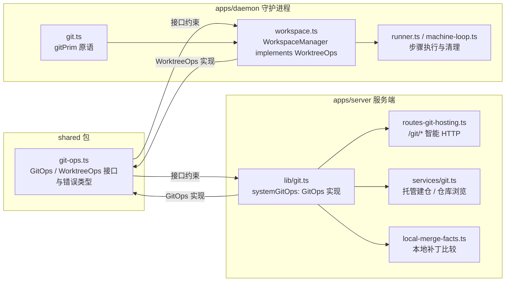
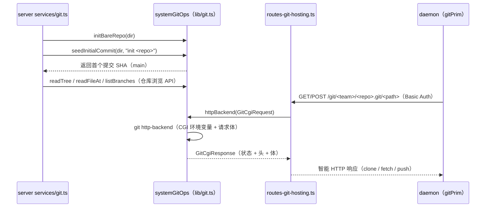
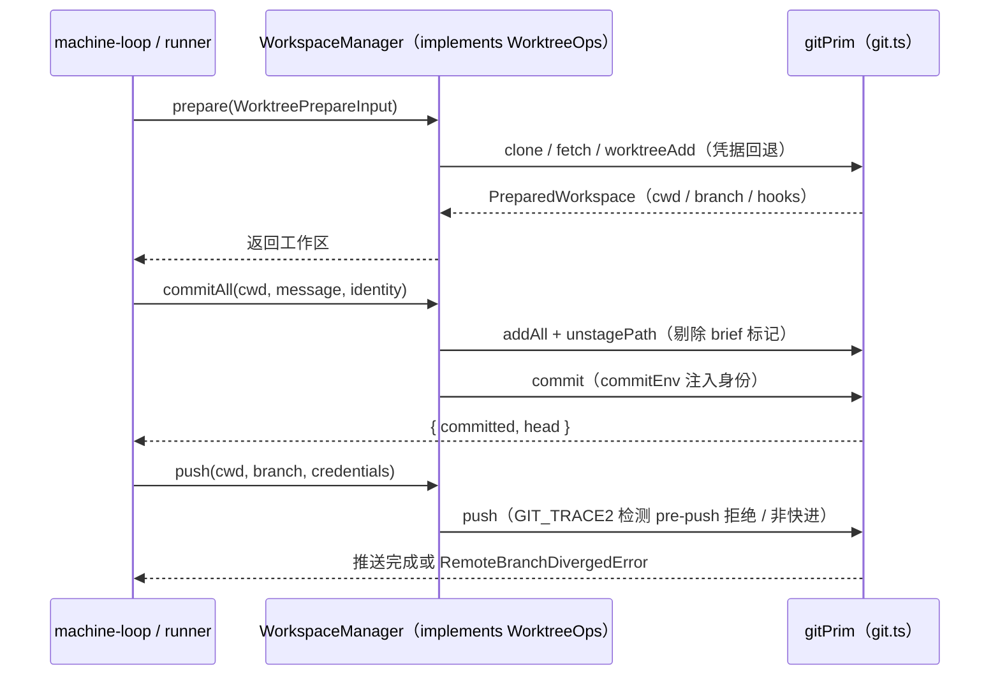
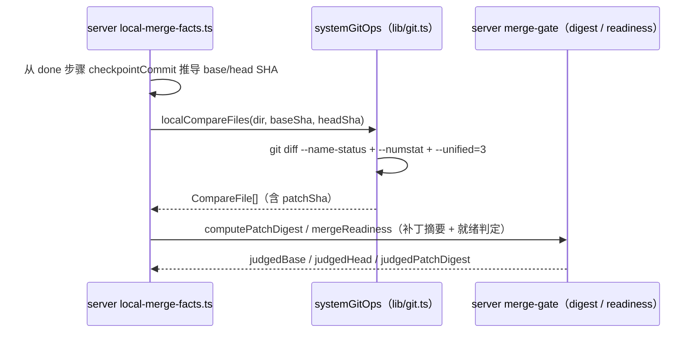

# 共享 Git 操作契约（shared_git_operations）

## 简介与定位

`shared_git_operations` 是 [共享包 shared](../shared.md)（`packages/shared`）中**git 操作抽象契约**的唯一来源，对应 `packages/shared/src/git-ops.ts` 一个文件。它**不实现任何 git 命令**，而是定义两组“接口 + 数据类型 + 错误类型”的契约：

- **`GitOps`** —— 面向仓库的底层只读/管理操作（建裸仓、解析提交、遍历树、读文件、比较补丁、列分支、CGI 智能 HTTP 后端），主要被**服务端**实现并用于托管仓库与仓库浏览；
- **`WorktreeOps`** —— 面向**守护进程**工作区（worktree）的任务执行操作（准备、提交、推送、合并默认分支、恢复检查点、清理孤儿），由 daemon 的 `WorkspaceManager` 实现。

服务端与守护进程都通过 `@cairn/shared` 引用本模块的类型，两端实现互不感知，但共用同一套语义与错误约定（`RemoteBranchDivergedError`、`LocalRepoUnreachableError`、`ReadOnlyWorkspaceError`）。这样“git 怎么操作”由契约固定，“git 怎么执行”由两端各自负责，避免 server/daemon 的 git 逻辑漂移。

## 模块组成与架构

依赖方向：本模块只导入 `shared` 包内的类型（见下节），不依赖任何业务服务；server 与 daemon 分别以 `systemGitOps` / `WorkspaceManager` 实现契约，通过 `@cairn/shared` 主入口（`src/index.ts` 的 `export * from './git-ops.js'`）被消费。

### 依赖的数据类型（来自共享包其它文件）

| 导入类型 | 来源 | 用途 |
| --- | --- | --- |
| `WorkspaceHookNoteData` | `./protocol/executor.js`（协议面） | `PreparedWorkspace.hooks`：工作区 setup/resume 钩子执行结果（状态、退出码、输出、耗时） |
| `CompareFile` | `./records/merge-gate.js`（记录面） | `GitOps.localCompareFiles` 的返回项，即合并门卫补丁摘要的输入（见 [server_merge_gate](../Backend_application_services/server/server_merge_gate.md)） |
| `LocalErrorReason` | `./records/project.js`（记录面） | `LocalRepoUnreachableReason = Extract<LocalErrorReason, 'not_found' \| 'not_git'>` 的取值来源 |
| `ProjectRepoKind` | `./records/project.js`（记录面） | `WorktreePrepareInput.repoKind`：`hosted` / `github` / `local` |

## 核心类型定义

### Git 数据视图类型

| 类型 | 字段 | 说明 |
| --- | --- | --- |
| `GitTreeEntry` | `name` / `path` / `type`（`'blob' \| 'tree'`）/ `size: number \| null` | `ls-tree` 单行条目；`size` 对应 `-l` 输出，树对象为 `null` |
| `GitFileAtRef` | `size: number` / `content: Uint8Array` | 某个提交路径下 blob 的原始字节与大小 |
| `GitRefInfo` | `name` / `isDefault: boolean` | 分支引用信息，`isDefault` 标记是否为默认分支 |

### Git CGI 类型（git http-backend 桥）

服务端把 `git http-backend` 的 CGI 协议包装成纯数据，供 `GitOps.httpBackend` 使用：

| 类型 | 字段 | 说明 |
| --- | --- | --- |
| `GitCgiRequest` | `projectRoot` / `pathInfo` / `queryString` / `method`（`'GET' \| 'POST'`）/ `contentType?` / `remoteUser?` / `body: Uint8Array` | 对应 CGI 环境变量：`GIT_PROJECT_ROOT`、`PATH_INFO`、`QUERY_STRING`、`REQUEST_METHOD`、`CONTENT_TYPE`、`REMOTE_USER`、请求体 |
| `GitCgiResponse` | `status: number` / `headers: [string, string][]` / `body: Uint8Array` | 解析后的 CGI 输出：状态码、响应头对列表、响应体 |

服务端 `apps/server/src/lib/git.ts` 用 `decodeCgiResponse` 把 `git http-backend` 的原始输出（含 `Status:` 头与 chunked 传输编码）翻译为 `GitCgiResponse`。

### 凭据类型

| 类型/常量 | 说明 |
| --- | --- |
| `GitCredentials` | `{ username: string; password: string }`，基础凭据对 |
| `BoundGitCredentials` | `GitCredentials & { url: string }`，绑定目标仓库 URL 的凭据（“per-step 下发 token”） |
| `GitCredentialSource` | `'integration' \| 'machine'`：凭据来源——`integration` 为服务端按步骤下发的 token，`machine` 为执行机本机 git 凭据 |
| `GITHUB_ACCESS_TOKEN_USERNAME` | `'x-access-token'`，GitHub 访问令牌的固定 Basic Auth 用户名 |

### 提交身份与工作区类型

| 类型 | 字段 | 说明 |
| --- | --- | --- |
| `CommitIdentity` | `name` / `email` | 提交作者/提交者身份；daemon 侧 `commitEnv(identity)` 会同时设置 `GIT_AUTHOR_*` 与 `GIT_COMMITTER_*` |
| `WorktreePrepareInput` | 见下 | `WorktreeOps.prepare` 的输入 |
| `PreparedWorkspace` | 见下 | `prepare` 的结果 |
| `OrphanCleanupInput` | `workspacesRoot` / `ttlMs` / `now` / `activeConversationIds: Iterable<string>` | 孤儿工作区清理参数：根目录、存活期、当前时间、活跃会话 id 集合 |

`WorktreePrepareInput` 字段：`projectId`（项目锁粒度）、`conversationId`（决定工作分支名 `conversationBranch(conversationId)`）、`cloneUrl`、`repoKind?`（`ProjectRepoKind`）、`workspacesRoot`、`credentials`（`BoundGitCredentials \| null`）、`localPath?`（本地仓库直连克隆源）、`machineCredentialFallback?`（允许回退到机器凭据）、`readonly?`（只读导出模式）。

`PreparedWorkspace` 字段：`cwd`（工作区目录）、`baseRepoDir`（共享仓库目录）、`branch`（会话工作分支）、`defaultBranch`、`reused`（是否复用既有工作区）、`hooks?`（`WorkspaceHookNoteData[]`）、`credentialSource?`（`GitCredentialSource`）、`readonly?`。

## `GitOps` 接口详解

服务端实现（`apps/server/src/lib/git.ts` 的 `systemGitOps`）面向“仓库本身”，全部方法以 `dir`（仓库目录）为第一参数：

| 方法 | 签名 | 说明 |
| --- | --- | --- |
| `initBareRepo` | `(dir: string) => Promise<void>` | `git init --bare`，并把 HEAD 指向 `main`、开启 `http.receivepack` / `http.uploadpack`（供智能 HTTP 推送/拉取） |
| `seedInitialCommit` | `(dir, message) => Promise<string>` | 用空树 `commit-tree` 造首个提交并 `update-ref` 到 `main`，返回 SHA；用于 `provisionHostedRepo` 建仓 |
| `resolveCommit` | `(dir, ref) => Promise<string \| null>` | `rev-parse --verify <ref>^{commit}`，校验 40–64 位十六进制后返回，否则 `null` |
| `isGitRepo` | `(dir) => Promise<boolean>` | `rev-parse --is-inside-work-tree` 判定目录是否工作树仓库 |
| `lsTree` | `(dir, commit, subPath?) => Promise<GitTreeEntry[]>` | `ls-tree -l <commit>`；`subPath` 需通过 `isSafeRepoPath`（拒绝空串、`/` 开头、`..` 段、`\0`） |
| `readFileAt` | `(dir, commit, path) => Promise<GitFileAtRef \| null>` | `cat-file blob <commit>:<path>`，返回原始字节 |
| `localCompareFiles` | `(dir, base, head) => Promise<CompareFile[]>` | `git diff --name-status -z --find-renames <base>...<head>` 配合逐文件 `--numstat` / `--unified=3` 产出 `CompareFile[]`（含 `patchSha`），供本地合并闸门计算补丁摘要 |
| `listBranches` | `(dir) => Promise<{ defaultBranch: string \| null; branches: GitRefInfo[] }>` | `symbolic-ref --short HEAD` + `for-each-ref refs/heads` |
| `isAncestor` | `(dir, ancestor, commit) => Promise<boolean>` | `merge-base --is-ancestor` 判定祖先关系 |
| `updateBranchRef` | `(dir, branch, commit) => Promise<void>` | `update-ref refs/heads/<branch> <commit>`；校验分支名与 SHA 形状，拒绝不安全输入 |
| `httpBackend` | `(req: GitCgiRequest) => Promise<GitCgiResponse>` | 以 CGI 环境变量执行 `git http-backend`，解析输出为 `GitCgiResponse` |

服务端消费方：

- **托管建仓**：`services/git.ts` 的 `provisionHostedRepo` 调 `initBareRepo` + `seedInitialCommit`；
- **仓库浏览**：`services/git.ts` 的 `readTree` / `readFiles` / `readFile` / `readBranches` / `readCommitHistory` / `readCommitDetail` / `readBuildChanges` 分别调 `lsTree` / `readFileAt` / `listBranches` / `resolveCommit` 等，支撑项目 Files/Tasks 页；
- **git 智能 HTTP**：`routes-git-hosting.ts` 的 `/git/*` 路由把 Basic Auth 校验后的请求翻译为 `GitCgiRequest` 交给 `httpBackend`，使 daemon 能对托管仓库 clone/fetch/push；
- **本地合并闸门**：`local-merge-facts.ts` 的 `localGateFacts` 调 `localCompareFiles` 计算本地补丁的 `CompareFile[]`（见 [server_merge_gate](../Backend_application_services/server/server_merge_gate.md)）。

## `WorktreeOps` 接口详解

daemon 实现（`apps/daemon/src/workspace.ts` 的 `WorkspaceManager`）面向“会话工作区”，方法以 `cwd`（工作区目录）为第一参数。标注 `?` 的为可选成员（渐进接口）：

| 方法 | 签名 | 说明 |
| --- | --- | --- |
| `prepare` | `(input: WorktreePrepareInput) => Promise<PreparedWorkspace>` | 按 `projectId` 加锁：克隆/复用 `baseRepoDir`、建会话分支 worktree、跑 setup/resume 钩子；`repoKind === 'local'` 时校验 `LocalRepoUnreachableError`；远端领先且分支不一致时抛 `RemoteBranchDivergedError` |
| `commitAll` | `(cwd, message, identity: CommitIdentity) => Promise<{ committed: boolean; head: string \| null }>` | `add -A`，剔除泄露的 brief 托管标记文件，提交并返回 head；只读导出目录抛 `ReadOnlyWorkspaceError` |
| `push` | `(cwd, branch, credentials: BoundGitCredentials \| null) => Promise<void>` | 带网络重试与凭据回退推送；检测远端分支已包含本地提交时记日志；只读目录抛 `ReadOnlyWorkspaceError` |
| `mergeDefaultBranch` | `(cwd, defaultBranch) => Promise<{ output: string }>` | `merge --no-edit origin/<defaultBranch>` |
| `headCommit` | `(cwd) => Promise<string \| null>` | 当前 HEAD 提交 |
| `countAhead` | `(cwd, defaultBranch) => Promise<number>` | `rev-list --count origin/<defaultBranch>..HEAD` |
| `commitsAhead?` | `(cwd, defaultBranch) => Promise<string[]>` | 领先提交 SHA 列表（逆序） |
| `currentBranch?` | `(cwd) => Promise<string \| null>` | `branch --show-current` |
| `branchesWithNewCommits?` | `(cwd, baseCommit, sinceMs) => Promise<string[]>` | 扫描 `refs/heads`（按提交时间倒序、上限 20 个 rev），返回相对 `baseCommit` 有新提交的分支名 |
| `diffAgainstDefault?` | `(cwd, defaultBranch) => Promise<string>` | 与远端默认分支的 diff 文本 |
| `restoreCheckpoint` | `(cwd, commit) => Promise<void>` | `reset --hard <commit>` + `clean -fd`，恢复步骤检查点 |
| `cleanupOrphans` | `(input: OrphanCleanupInput) => Promise<string[]>` | 回收超 TTL 的孤儿 worktree / 只读导出目录，返回移除的目录名 |
| `briefMarkerInRef?` | `(cwd, ref) => Promise<string[]>` | 检查某个 ref 中的 brief 托管标记文件（用于对账） |

daemon 消费方：

- `machine-loop.ts`：构造 `WorkspaceManager`，启动时与每日定时执行 `cleanupOrphans`（TTL 默认 `ORPHAN_WORKTREE_TTL_MS`）；
- `runner.ts`：步骤执行期以 `workspace?: WorktreeOps` 依赖注入，`prepare` 建区、`commitAll` 落盘、`push` 上推、`restoreCheckpoint` 回滚；
- `local-merge.ts`：本地合并落地直接使用 `gitPrim` 原语（`landLocalMerge` / `inspectLocalPatch`），与 `WorktreeOps` 的补丁摘要口径一致（`PATCH_DIGEST_VERSION`）。

## 错误类型与常量

| 名称 | 值/类型 | 说明 |
| --- | --- | --- |
| `REMOTE_BRANCH_DIVERGED` | `'remote branch diverged'` | 消息前缀常量 |
| `RemoteBranchDivergedError` | `class extends Error` | 远端分支已领先且当前 checkout 不是该分支时抛出（`prepare` 复用 worktree 场景） |
| `LocalRepoUnreachableReason` | `Extract<LocalErrorReason, 'not_found' \| 'not_git'>` | 本地仓库不可达的两种原因 |
| `LocalRepoUnreachableError` | `class extends Error`（含 `repoPath` / `reason` 只读字段） | 本地直连仓库路径不存在（`not_found`）或不是 git 仓库（`not_git`）时抛出 |
| `READONLY_EXPORT_MARKER` | `'.cairn-readonly-export'` | 只读导出目录的标记文件名 |
| `ReadOnlyWorkspaceError` | `class extends Error` | 对只读导出目录执行 git 写操作（`commitAll` / `push`）时抛出 |

## 关键数据流

### 服务端托管仓库：建仓 → 浏览 → git 智能 HTTP

### 守护进程工作区：prepare → commitAll → push

### 本地合并闸门：localCompareFiles

## 与其它模块的关系

- **[共享包 shared](../shared.md)**：本模块的上层页面，包级配置、`exports` 子路径与构建/CI 说明见该页。
- **[shared_protocol](shared_protocol.md)**：`protocol/executor.ts` 的 `WorkspaceHookNoteData` 是 `PreparedWorkspace.hooks` 的类型来源（协议面，本模块只消费类型）。
- **[shared_records](shared_records.md)**：`records/merge-gate.ts` 的 `CompareFile`、`records/project.ts` 的 `LocalErrorReason` / `ProjectRepoKind` 是本模块接口的输入/输出类型（记录面）。
- **[shared_task_tools](shared_task_tools.md) / [shared_shared_task_tools](shared_shared_task_tools.md) / [shared_runtime_helpers](shared_runtime_helpers.md)**：与 `git-ops.ts` 同属 `shared` 根级工具面的兄弟模块；`shared_task_tools` 即“运行时辅助 + git 操作接口”的并集。
- **[daemon_workspace_git](../Backend_application_services/daemon/daemon_workspace_git.md)**：`apps/daemon/src/git.ts`（`gitPrim` 原语、`withGitCredentialFallback`、`GitPushHookError`、`landGitSquash`）与 `apps/daemon/src/workspace.ts`（`WorkspaceManager implements WorktreeOps`）——`WorktreeOps` 契约的实现侧。
- **[daemon_step_execution](../Backend_application_services/daemon/daemon_step_execution.md)**：`runner.ts` 以 `workspace: WorktreeOps` 注入执行步骤（prepare / commitAll / push / restoreCheckpoint）。
- **[server_merge_gate](../Backend_application_services/server/server_merge_gate.md)**：`localCompareFiles` 的 `CompareFile[]` 经 `computeLocalPatchDigest` 进入补丁摘要；本地合并闸门（`local-merge-facts.ts` / `local-merge.ts`）依赖 `GitOps` 与 `PATCH_DIGEST_VERSION` 口径一致。
- **[server_app_bootstrap](../Backend_application_services/server/server_app_bootstrap.md)**：`config.ts` 的 `reposDirOf` 决定 `systemGitOps` 操作的托管仓库根目录；`provisionHostedRepo` 在其中建仓。

## 构建、测试与 CI

本模块没有独立的构建产物或测试文件——它是 `@cairn/shared` 包的一个纯类型模块（`git-ops.ts`）：

- **类型检查**：随包执行 `pnpm --filter @cairn/shared typecheck`（`tsc --noEmit`），也覆盖在根 `pnpm typecheck`。
- **单元测试**：随包执行 `pnpm --filter @cairn/shared test`（`vitest run`）；CI 的 [check 作业](../../.github/workflows/ci.yml)（`VITEST_PROJECT_SET=light pnpm test`）覆盖 `packages/*`。
- **打包**：无独立构建；server/daemon 经 `workspace:*` 直接引用 `src/` 源码。`git-ops.ts` 本身只导出类型、常量与错误类，无运行时副作用，配合 `sideEffects: false` 便于摇树。

## 设计约定

1. **契约与实现分离**：`git-ops.ts` 只声明接口与错误语义；服务端 `systemGitOps` 与守护进程 `gitPrim` / `WorkspaceManager` 各自实现，互不引用对方代码。
2. **错误先于操作可观测**：三类错误（远端分叉、本地仓库不可达、只读拒绝）都带固定消息前缀与可机读字段（`repoPath` / `reason` / `branch`），供上层日志与提示词引用。
3. **安全校验内建**：`lsTree` / `readFileAt` 的路径须过 `isSafeRepoPath`（拒绝绝对路径、`..`、`\0`）；`resolveCommit` / `updateBranchRef` / `resetHard` 校验 SHA 形状，防止把任意字符串传给 git。
4. **凭据来源可追溯**：`GitCredentialSource`（`integration` / `machine`）随 `PreparedWorkspace` 返回，daemon 写入任务提示词（“git 凭据来源：integration（per-step 下发 token）”），供审计与排查。
5. **与合并闸门口径一致**：`localCompareFiles` 产出的 `CompareFile[]` 与 daemon `inspectLocalPatch` 的补丁摘要算法（`PATCH_DIGEST_VERSION` + 排序元组 SHA-256）严格一致，保证本地合并判定可复验。
