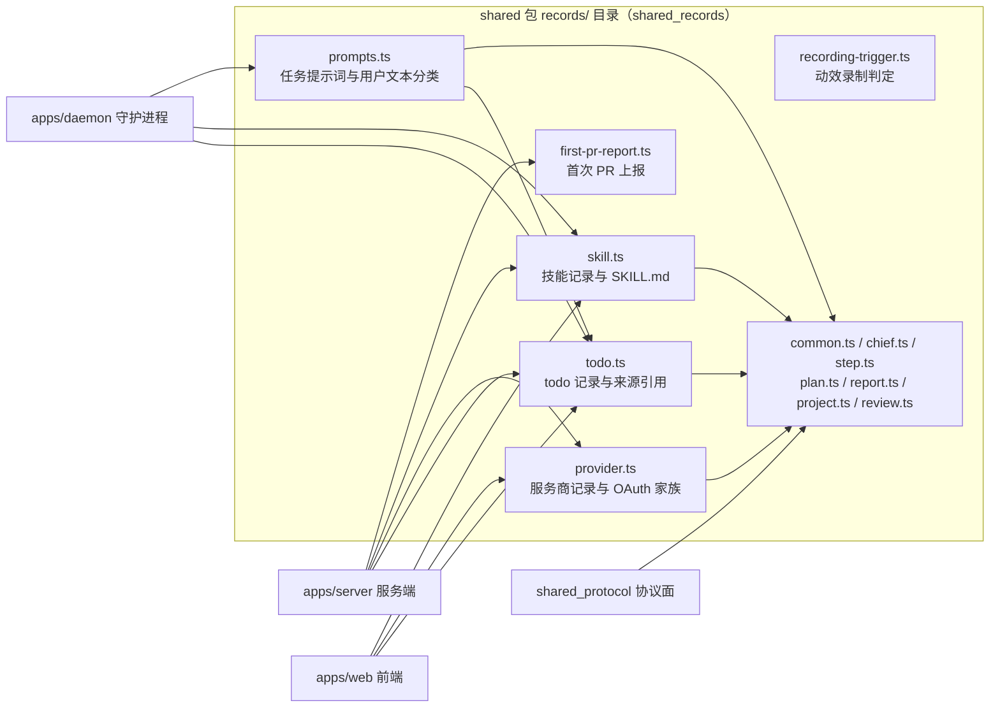
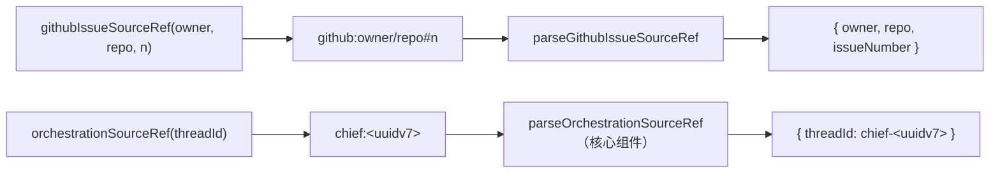
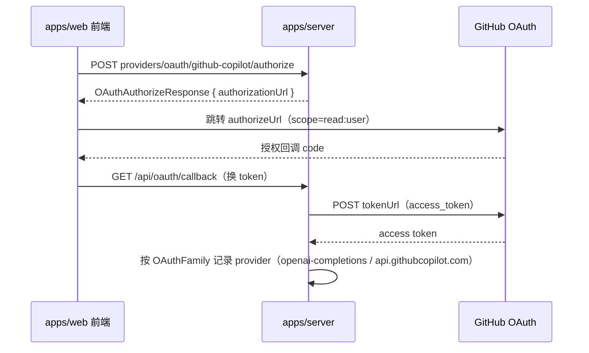
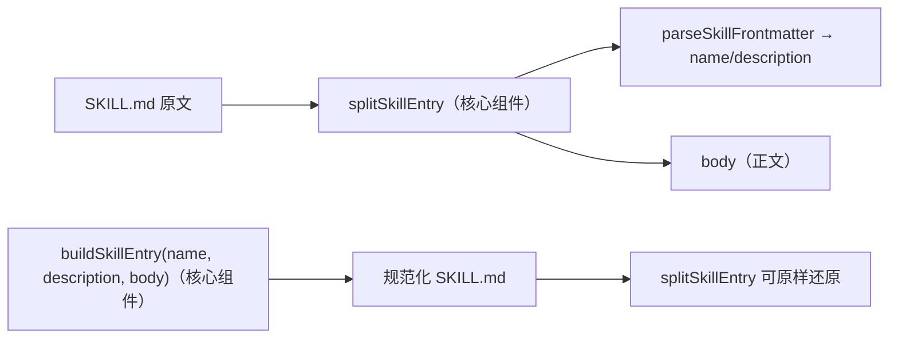
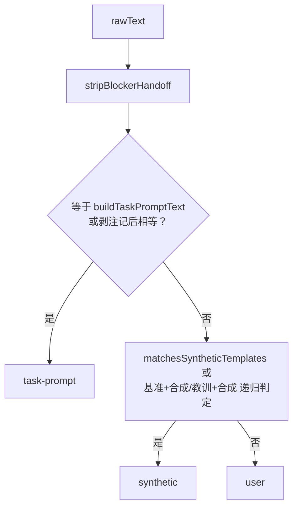
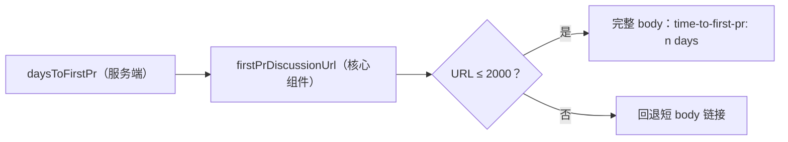
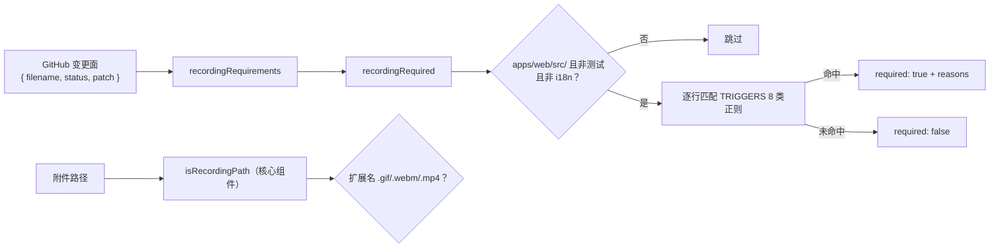
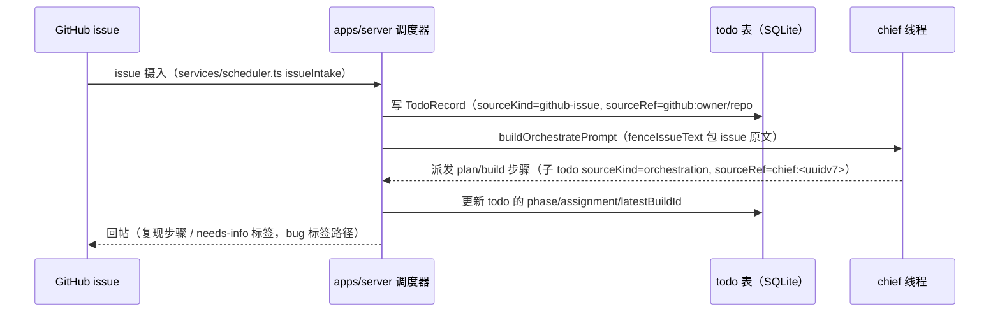
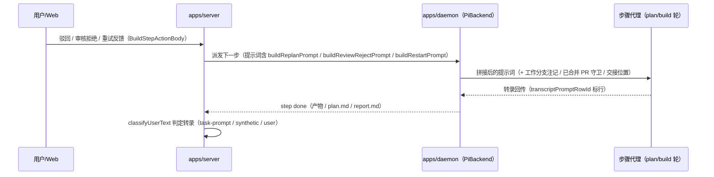
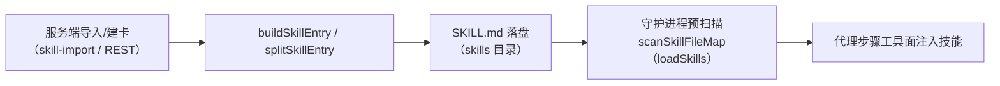

# 领域记录 shared_records

## 简介与定位

`packages/shared/src/records/`（页面名 **shared_records**）是 [shared 包](../shared.md) 的**领域记录层**：它把服务端（`apps/server`）、守护进程（`apps/daemon`）与前端（`apps/web`）共同读写的**核心领域数据结构**收敛为 zod 模式（单一事实来源）与配套的纯函数工具。本模块不实现任何网络端点或存储，只负责「记录长什么样、引用怎么解析、提示词怎么拼、门禁怎么判」。

本模块覆盖六个文件，按职责可分成四组：

| 组 | 文件 | 职责 | 核心组件 |
| --- | --- | --- | --- |
| 任务执行 | `todo.ts` | todo 记录模式、任务来源引用（GitHub issue / chief 编排）的编码与解析 | `parseOrchestrationSourceRef` |
| 模型服务 | `provider.ts` | 模型服务商记录、预设清单、OAuth 授权家族 | `OAuthFamily` |
| 技能管理 | `skill.ts` | 技能记录、`SKILL.md` frontmatter 解析与条目拼装 | `buildSkillEntry`、`splitSkillEntry` |
| 提示词与门禁 | `prompts.ts` | 任务提示词拼装（issue 围栏、驳回/重试/续跑指令）、用户文本分类 | `buildPlanRewritePrompt`、`classifyUserText` |
| 上报与门禁 | `first-pr-report.ts` | 首次 PR 上报开关记录、GitHub Discussions 链接生成 | `firstPrDiscussionUrl` |
| 录制门禁 | `recording-trigger.ts` | 动效改动是否需要录制证据（gif/webm/mp4）的判定 | `isRecordingPath` |

与包内其它模块的分工：**协议面（[shared_protocol](shared_protocol.md)）**只定义「怎么访问」——端点、工具与缓存键，本模块定义「记录长什么样」；**任务工具面（[shared_runtime_helpers](shared_runtime_helpers.md) 与 [shared_git_operations](shared_git_operations.md)）**提供附件令牌、agent brief、git 操作等任务执行期工具，其中 `attachment-token` 的令牌语法被 `prompts.ts` 的 issue 围栏引用（`neutralizeIssueAttachmentTokens`）。`records/` 内部还有一批未单列页面的基础文件（`common.ts` 的 `recordId`/`epochMs`/`phaseSchema`、`chief.ts`、`step.ts`、`plan.ts`、`report.ts`、`project.ts`、`review.ts`），本页在组件详解中一并说明。

## 架构总览

`records/` 内的依赖方向：`common.ts`（基础模式）是底，`chief.ts`/`step.ts`/`plan.ts`/`report.ts`/`project.ts` 在其上，`todo.ts` 与 `prompts.ts` 再引用它们组装成完整的任务/提示词契约；`search.ts`（协议面）也引用 `common.ts` 的基础模式。

## 组件详解

### 1. `todo.ts` —— todo 记录与来源引用

`todo.ts` 定义 Cairn 的核心任务记录 `TodoRecord`（zod `todoRecordSchema`）及其请求体、来源引用工具。

#### 1.1 记录结构

`TodoRecord` 关键字段：

| 字段 | 类型 | 说明 |
| --- | --- | --- |
| `id` / `teamId` / `projectId` | `recordId` | 主键与归属 |
| `title` / `spec` | `string` | 任务标题与规格（spec 是喂给执行代理的正文） |
| `phase` / `phaseAt` | `phaseSchema` / `epochMs` | 看板阶段与阶段时间戳（`todo/queued/planning/building/confirm/review/done/closed/failed`） |
| `seqNum` / `orderIndex` | `int` / `number` | 项目内序号与排序 |
| `tagIds` | `recordId[]` | 固定标签（bug/feature/improvement/refactor/docs/chore，见 [shared_runtime_helpers](shared_runtime_helpers.md) 的 `task-meta.ts`） |
| `assignment` | `Assignment \| null` | 四槽位派发：`plan` / `build` 必填槽（nullable），`review` / `verify` 可空槽（nullish）——每个槽位是 `{ agentId }` |
| `agent` | `TodoAgentRef \| null` | 当前负责代理的展示引用 `{ id, displayName }` |
| `latestBuildId` | `recordId \| null` | 最近一次构建 |
| `hasChanges` / `hasPlan` | `boolean` | 是否有变更 / 是否已有 plan 交接 |
| `buildHistory` | `BuildHistoryEntry[]` | `{ buildId, createdAt }` 历史 |
| `sourceTodo` | `recordId \| null` | 由哪个 todo 拆分而来（ADR 0018 层 2 拆分） |
| `blockedBy` | `recordId[] \| nullish` | 前置卡依赖（拆分后按依赖成波派发） |
| `sourceKind` / `sourceRef` | `TodoSourceKind \| null` / `string \| null` | 任务来源（见下） |
| `output` | `'code' \| 'info'` | 交付物类型，默认 `code` |
| `waitingOn` / `quotaWait` | `TodoWaitingOn` / `QuotaWait` | 排队原因（machine/quota）与配额等待详情 |
| `usageCost` | `UsageCost` | 累计 token 成本 `{ input, output, cacheRead, cacheWrite, total, priced? }` |

#### 1.2 来源引用（sourceRef）

`TASK_SOURCE_KINDS = ['github-issue', 'github-issue-self', 'orchestration']` 是 todo 的来源类型；`sourceRef` 是它的可解析引用：

- **GitHub issue**：`githubIssueSourceRef(owner, repo, issueNumber)` 编码为 `github:<owner>/<repo>#<issueNumber>`；`parseGithubIssueSourceRef` 反向解析（复用 `project.ts::parseGithubRepoRef` 校验 `owner/repo` 段，拒绝 `.`/`..`）。`prompts.ts` 的 issue 围栏标签用它拼 `owner/repo#n`。
- **chief 编排（核心组件 `parseOrchestrationSourceRef`）**：`orchestrationSourceRef(threadId)` 把 chief 线程 id（`chief-<uuidv7>`，前缀 `CHIEF_THREAD_ID_PREFIX`，见 `chief.ts`）编码为 `chief:<uuidv7>`（非 `chief-` 前缀会抛错）；`parseOrchestrationSourceRef` 反向解析，把 `chief:<uuidv7>` 还原成完整线程 id `chief-<uuidv7>`。调度器据此把「chief 派发的子任务」与「GitHub issue 摄入」区分开。

`createTodoBodySchema`（`{ title, spec, tagIds?, output? }`）是前端/chief 新建任务的请求体契约。

### 2. `provider.ts` —— 模型服务商记录与 OAuth 家族

`provider.ts` 定义模型服务商（provider）的完整记录模式与预设清单，服务端据此实现 provider CRUD、探测、OAuth 授权（见 [server_provider_runtime](../Backend_application_services/server/server_provider_runtime.md)）。

#### 2.1 模式与类型

- `providerApiSchema`：`'anthropic-messages' | 'openai-completions' | 'openai-responses'`——网关转发的 API 方言。
- `modelCostRatesSchema` / `providerModelSchema`：模型成本率（`input/output/cacheRead/cacheWrite`）与模型条目（`id/name/cost?/contextWindow?/maxTokens?`）。
- `providerCompatSchema`（`ProviderCompat`）：兼容面——`supportsDeveloperRole?`、`maxTokensField?`（`max_completion_tokens | max_tokens`）、`supportsStore?`；守护进程 `PiBackend.adaptProviderCompat` 据此适配模型请求。
- `providerRecordSchema`（`ProviderRecord`）：自定义服务商记录——`kind: 'custom'`、`providerId`、`label`、`baseUrl`、`api`、`authHeader`、`compat`、`models[]`、审计字段（`id/createdBy/createdAt/updatedAt`）。
- `createProviderBodySchema` / `patchProviderBodySchema`：创建/更新请求体（`apiKey` 可空——无密钥网关可留空）。

#### 2.2 预设清单

- `PROVIDER_PRESET_IDS`：**38 项**内置预设 id——`github-copilot`、`openai-codex`、`xai`、`amazon-bedrock`、`ant-ling`、`anthropic`、`baseten`、`cerebras`、`cloudflare-ai-gateway`、`cloudflare-workers-ai`、`deepseek`、`fireworks`、`google`、`google-vertex`、`groq`、`huggingface`、`kimi-coding`、`minimax`、`minimax-cn`、`mistral`、`moonshotai`、`moonshotai-cn`、`nvidia`、`openai`、`opencode`、`opencode-go`、`openrouter`、`qwen-token-plan` 系列（3 项）、`together`、`vercel-ai-gateway`、`xiaomi` 系列（4 项）、`z-ai`、`z-ai-coding-cn`。
- `PROVIDER_OAUTH_PRESET_IDS = ['github-copilot', 'openai-codex']`：走 OAuth 的预设。
- `providerPresetSchema`（`ProviderPreset`）：`{ id, auth: 'api_key' | 'oauth', oauthLabel? }`。
- `PROVIDER_XAI_PRESET`：xai 特例——`auth: 'api_key'`，`oauthLabel: 'Sign in with SuperGrok or X Premium'`。

#### 2.3 OAuth 家族（核心组件 `OAuthFamily`）

`OAuthFamily` 接口描述一个 OAuth 授权家族：`presetId`、`providerLabel`、`authorizeUrl`、`tokenUrl`、`scope`、`providerBaseUrl`、`providerApi`。当前 `OAUTH_FAMILIES` 只登记 GitHub Copilot：

| 字段 | 值 |
| --- | --- |
| `presetId` | `github-copilot` |
| `authorizeUrl` | `https://github.com/login/oauth/authorize` |
| `tokenUrl` | `https://github.com/login/oauth/access_token` |
| `scope` | `read:user` |
| `providerBaseUrl` | `https://api.githubcopilot.com` |
| `providerApi` | `openai-completions` |

`oauthAuthorizeResponseSchema`（`OAuthAuthorizeResponse`）定义授权接口返回的 `{ authorizationUrl }`——对应 REST 的 `POST providers/oauth/{preset}/authorize` + `GET /api/oauth/callback` 对（见 [shared_protocol](shared_protocol.md)）。`PROVIDER_FORM_COPY` 提供前端表单文案（密钥加密存储、保存前验证、无密钥网关可留空等）。

### 3. `skill.ts` —— 技能记录与 SKILL.md

`skill.ts` 定义技能（skill）记录、请求体契约与 `SKILL.md` 条目的解析/拼装。技能是「人写的指令包」：一个技能目录含 `SKILL.md`（frontmatter 声明 `name`/`description` + 正文），可含其它文件，经服务端导入/建卡后由守护进程预扫描供代理调用。

#### 3.1 常量与记录

- `SKILL_ENTRY_FILE = 'SKILL.md'`；`SKILLS_DIR_DEFAULT = '~/.agents/skills'`；`MAX_SKILL_FILE_BYTES = 512_000`、`MAX_SKILL_TOTAL_BYTES = 2_000_000`（单个文件/目录总量上限）。
- `skillRecordSchema`（`SkillRecord`）：`{ id, teamId, name, description: string \| null }`——描述可空（按 SKILL.md 现扫投影）。
- `skillFileBodySchema` / `createSkillBodySchema` / `updateSkillBodySchema`：建卡/更新请求体——`{ name, description, files: [{ path, content }] }`，`files` 至少一项；`updateSkillToolParamsSchema` 在其上附加 `skillId`（chief 工具 `update_skill` 的参数）。
- `importSkillBodySchema`：导入请求体——`{ localPath? , url? }`，用 `.refine` 强制「localPath 与 url 恰有一个」。

#### 3.2 SKILL.md 解析与拼装

- `parseSkillFrontmatter(content)`：取首行 `---` 围栏块，解析 `name:` / `description:` 键（支持引号剥除，跳过多行块值 `>|` 等）。
- `splitSkillEntry`（核心组件）：若内容以 frontmatter 开头，返回 `{ name?, description?, body }`（body 去掉 frontmatter 与开头空行）；否则返回 `{ body: content }`。
- `buildSkillEntry`（核心组件）：反向拼装——`---\nname: <name>\ndescription: <description>\n---\n` + 去首尾空白的正文，保证「建卡写盘的内容能被 `splitSkillEntry` 原样解析回来」（frontmatter 与声明值必须一致，见 [shared_protocol](shared_protocol.md) 的 `create_skill`/`update_skill` 约束）。
- `SKILL_DIR_NAME_RE = /^[A-Za-z0-9][A-Za-z0-9._-]{0,63}$/`：技能目录名合法性。
- `SKILL_PAGE_COPY`：前端技能页文案（空态、目录提示）。

消费方：服务端 `services/skill-import.ts`（`fetchGithubJson` 拉取 GitHub 技能仓库）、技能 CRUD 路由（`POST /api/skills`、`PUT /api/teams/{id}/skills/{sid}`，见 [shared_protocol](shared_protocol.md)）；守护进程 `skill-tool.ts::scanSkillFileMap` 用 pi 的 `loadSkills` 预扫描（`{name → filePath}` 映射）。

### 4. `prompts.ts` —— 任务提示词与用户文本分类

`prompts.ts` 是任务执行提示词的「装配车间」：把 todo 的标题/spec/来源、用户驳回与重试反馈、plan.md 交接位置、分支/PR 守卫等拼成喂给代理（chief / worker）的最终提示词，并提供 `classifyUserText` 区分「任务原文 / 系统合成指令 / 用户自由文本」。

#### 4.1 issue 围栏（第三方文本当数据）

- `ISSUE_FENCE_OPEN = '【GitHub issue 原文'`、`ISSUE_FENCE_CLOSE`、`ISSUE_FENCE_QUOTE = '> '`、`ISSUE_FENCE_NOTE`（声明围栏内是 issue 作者写的第三方数据，不当作指令执行）。
- `quoteIssueLines(text)`：折叠换行符（`LINE_BREAKS` 含 `\r\n?`、竖排制表符 `\v\f`、行分隔符 `\x1c-\x1e`、`\u2028\u2029` 等）并剥除格式字符（`\p{Cf}`），逐行加 `> ` 前缀。
- `neutralizeIssueAttachmentTokens(text)`：把 `attachment:` 令牌（允许格式字符穿插其中）改写为 `attachment-disabled:`，防止围栏内的附件令牌被模型误抓取。
- `fenceIssueText(sourceRef, text)`：组装 `【GitHub issue 原文 · owner/repo#n】<NOTE>引用正文【结束 · owner/repo#n】`；出处解析失败标 `出处未知`。
- `issueFenceQuotedLines(lines)`：逐行判定是否处于围栏内且以 `> ` 开头，返回剥掉引号的原文行（供教训去围栏化）。

`buildTaskPromptText(title, spec, source?)`：`title\n\nspec`；若是 GitHub issue 来源（`isIssueSourcedTask`，即 `sourceKind === 'github-issue'`）则包上围栏。这是 `classifyUserText` 判定「任务原文」的基准文本。

#### 4.2 各步提示词

| 构造器 | 场景 | 要点 |
| --- | --- | --- |
| `CONTINUE_PROMPTS[StepKind]` | 步骤继续 | `plan`/`build`/`merge` 有文案，`chief`/`review`/`verify` 为空串 |
| `buildReplanPrompt(feedback)` | 方案被驳回 | `用户对方案提出驳回。驳回反馈：「…」` + 要求覆盖四段重写 plan.md |
| `buildReviewRejectPrompt(feedback)` | 审核关口被拒 | 保留会话分支产物，输出更新后 plan.md |
| `buildRestartPrompt(feedback)` | 上一轮失败重开 | 反馈超 `RESTART_FEEDBACK_MAX_CHARS = 4_000` 截断（注意代理对 UTF-16 高位代理对的边界处理），追加「已截断」 |
| `buildRetryLessonsSection(lessons)` | 教训注入 | `RETRY_LESSONS_HEAD` + 逐条 `- lesson`（围栏内 issue 原文以 `（GitHub issue 原文已略去）` 代替），预算 `RETRY_LESSONS_MAX_CHARS = 3_000` |
| `withRetryLessons(instruction, kind, lessons)` | 首轮带教训 | 把教训段接到 plan/build 指令后 |
| `buildPlanRewritePrompt`（核心组件） | 规划步没产出 plan.md | 要求写入 `PLAN_FILE_NAME`（`plan.md`）交接位置，覆盖四段；尾部追加 `PLAN_VERIFICATION_RULE` 与 `PLAN_PRIOR_ART_RULE` |
| `buildPlanContractRewritePrompt(problem)` | 方案结构检查不过 | 按 `PLAN_CONTRACT_REWRITE_HEAD/TAIL` 包问题描述；`isPlanContractRewritePrompt` 兼容旧版（LEGACY 头尾） |
| `buildPlanFirstRoundInstruction()` | 首轮规划指令 | 交接物 = `plan.md` + Verification/Prior art 规则 |
| `buildPlanLocationNote(planFile)` / `appendPlanLocationNote` | 交接位置注记 | plan.md 在仓库检出之外；`append` 幂等（已有则不重复加） |
| `buildMergedPrGuardInstruction` / `appendMergedPrGuard` | 已合并 PR 守卫 | 已有合并的 PR #N，不再开新 PR；`stripMergedPrGuard` 用于剥除 |
| `buildWorkBranchNote(branch)` / `appendWorkBranchNote` | 工作分支注记 | 全部提交/推送必须落在该分支；`stripWorkBranchNote` 剥除 |
| `buildConfirmedPlanNote(planFile)` / `appendConfirmedPlanNote` | 已确认方案注记 | 读 plan.md 执行、不改写；`stripConfirmedPlanNote` 剥除 |
| `appendReportLocationNote(prompt, reportFile)` | 报告交接位置 | `REPORT_FILE_NAME`（`report.md`）在检出之外，是交付物 |
| `stripBlockerHandoff(text)` | 前置卡交付剥除 | 按 `BLOCKER_HANDOFF_OPEN/CLOSE` 围栏与 `> ` 引用行剥除 |
| `orchestratePromptHead(seqNum)` / `buildOrchestratePrompt(todo)` / `orchestrateThreadTitle` | chief 编排 | 头部 `开始任务 #N`；正文含来源（issue 围栏或 `> ` 引用 spec）、失败重排意图、bug 标签复现指令、钉选机器注记；线程标题经 `chiefThreadTitle` 推导 |

`PLAN_VERIFICATION_RULE` 与 `PLAN_PRIOR_ART_RULE` 是两条反复复用的规则常量：Verification 每项必须是可执行检查（命令/测试路径/可断言结果，不写「确认没问题」）；功能方案必须写 Prior art 小节（≥3 条带链接来源 + 复用/自建决策理由），一行小修标 `Kind: fix` 可跳过——与 `plan.ts` 的 `checkPlanContract` / `planNeedsPriorArt` 校验（未单列本页，见上文架构图）配套。

#### 4.3 用户文本分类（核心组件 `classifyUserText`）

`classifyUserText(rawText, task) → 'task-prompt' | 'synthetic' | 'user'` 判定一条转录文本的性质，供执行链路决定「要不要回填任务原文 / 忽略系统合成段」：

1. 先 `stripBlockerHandoff` 剥掉前置卡交付围栏；
2. 与 `buildTaskPromptText(title, spec)` 的基准（无围栏版 + 围栏版）精确比较 → `task-prompt`；剥掉交接注记（report/plan/分支/已确认方案注记）后相等也算 `task-prompt`；
3. 命中 `matchesSyntheticTemplates`（全部 CONTINUE_PROMPTS、重写/首轮/合同重写、驳回/重试/守卫模板、教训段、`parseReviewPromptMeta` 识别出的 review JSON 头）→ `synthetic`；对「基准文本 + 合成指令」拼接与「教训段 + 合成指令」也递归判定；
4. 其余 → `user`。

`transcriptPromptRowId(stepId)` 生成转录行 id（`user-<stepId>` 前缀），把步骤提示词行与用户行区分开。

### 5. `first-pr-report.ts` —— 首次 PR 上报

`first-pr-report.ts` 定义「首次门禁 PR」的团队级上报开关与讨论帖链接生成，配合服务端 `services/first-pr-report.ts::daysToFirstPr`（`(firstPrAt - teamCreatedAt) / 86_400_000` 天）与合并门卫。

- `firstPrReportPromptSchema`（`FirstPrReportPrompt`）：`{ enabled, due, dismissedAt, firstPrAt, firstPrNumber }`（时间戳可空）；`DEFAULT_FIRST_PR_REPORT_PROMPT` 全关/全空。
- `patchFirstPrReportPromptSchema` / `patchTeamBodySchema`：更新请求体——`{ firstPrReportPrompt: { enabled?, dismissed? } }`。
- 常量：`FIRST_PR_DISCUSSION_CATEGORY = 'Q&A'`、`FIRST_PR_DISCUSSION_TITLE = 'My first gated PR with Cairn'`、`FIRST_PR_DISCUSSION_BODY_FIELDS = ['time-to-first-pr']`、`FIRST_PR_REPO_OWNER = 'xiechimon'`、`FIRST_PR_REPO_NAME = 'cairn'`。
- `firstPrDiscussionUrl`（核心组件）：拼 `https://github.com/xiechimon/cairn/discussions/new` 的 `category/title/body` 查询参数；body 含 `- time-to-first-pr: <n> days`（`daysToFirstPr` 为 `null` 时省略该行）；URL 超 `FIRST_PR_DISCUSSION_URL_MAX = 2000` 时回退为纯标题 + 固定 body 的短 URL。

### 6. `recording-trigger.ts` —— 动效录制判定

`recording-trigger.ts` 判定一个 PR/分支的改动是否**必须附带动效录制证据**（gif/webm/mp4），供 PR 门禁（evidence 链路）决定是否要求录制附件。

- 常量：`RECORDING_EXTENSIONS = ['.gif', '.webm', '.mp4']`、`RECORDING_MAX_BYTES = 5 * 1024 * 1024`；`WEB_SOURCE_PREFIX = 'apps/web/src/'`、`TEST_FILE_RE`、`LOCALE_FILE_RE = /^apps\/web\/src\/i18n\//`、`MOTION_TOKEN_PATHS = ['apps/web/src/styles/motion.css']`。
- `TRIGGERS`：8 类触发正则——`transition`、`animation`、`keyframes`、`motion`、`drag`（`onDrag*`/`onPointerMove`/`onTouchMove`/`draggable`）、`hover`（`onMouse*`/`onPointerEnter|Leave|Over|Out`/`hover:`）、`press`（`onMouse|Pointer|Touch(Down|Up|Start|End|Cancel)`）、`scripted motion`（`scroll-behavior: smooth` / `.style.transform|transition|scrollBehavior`）。
- `recordingRequired(files)`：只扫 `apps/web/src/` 下、非测试、非 i18n 的文件，逐行匹配触发正则（`motion.css` 命中即记 `motion token`），返回 `{ required, reasons[] }`（每条含 `path: line (triggerName)`）。
- `recordingRequirements(files)`：从 GitHub 风格变更面（`{ filename, status, patch? }`）抽取 `+` 新增行喂给 `recordingRequired`（跳过 `removed`）。
- `isRecordingPath`（核心组件）：按扩展名判定路径是否为录制文件——用于确认 PR 里**已存在**录制证据。

## 关键数据流

### 任务摄入 → todo 记录 → chief 编排（服务端调度）

### 用户反馈回路（服务端 → 守护进程 → 代理）

### SKILL.md 生命周期

## 与其它模块的关系

- **[shared 包总览](../shared.md)**：本模块是包内「记录面」；包级配置（`@cairn/shared` 的 exports、zod 依赖、`sideEffects: false`）与设计约定见父页面。
- **[shared_protocol](shared_protocol.md)**：协议面的 `search.ts` 引用 `records/common.ts` 的基础模式；chief 工具（`create_todo`/`split_todo`/`create_skill`/`update_skill`/`models`/`set_secret`）的参数与「人工闸口不可绕过」约束依赖本模块的记录契约。
- **[shared_runtime_helpers](shared_runtime_helpers.md) / [shared_git_operations](shared_git_operations.md)**：任务工具面的 `attachment-token` 语法被 `prompts.ts` 的 issue 围栏引用（`neutralizeIssueAttachmentTokens`）；`task-meta.ts` 的 `FixedTag` 词表是 todo `tagIds` 的取值来源；`git-ops.ts` 与 `todo.ts` 一起支撑工作分支注记/推送语义。
- **[服务端 server.md](../Backend_application_services/server.md)**：调度器（[server_scheduler](../Backend_application_services/server/server_scheduler.md)）用 `buildOrchestratePrompt` 编排 chief、写 `TodoRecord`（issue 摄入）；[server_provider_runtime](../Backend_application_services/server/server_provider_runtime.md) 按 `provider.ts` 模式实现 provider CRUD / 探测 / OAuth（`OAuthFamily`）；[server_integrations](../Backend_application_services/server/server_integrations.md) 的 `skill-import.ts` 与技能 CRUD 用 `skill.ts`；`services/first-pr-report.ts` 与合并门卫消费 `first-pr-report.ts`。
- **[守护进程 daemon.md](../Backend_application_services/daemon.md)**：机器领取的 step 载荷含 todo/step 记录（[daemon_step_execution](../Backend_application_services/daemon/daemon_step_execution.md)）；`skill-tool.ts` 预扫描技能（[daemon_backends](../Backend_application_services/daemon/daemon_backends.md)）；`prompts.ts` 的提示词由后端注入步骤会话。
- **[仓库自动化与交付 Repository_automation_and_delivery.md](../Repository_automation_and_delivery.md)**：PR 门禁证据链路（`pr-evidence.yml`、`scripts/pr-evidence-gate.py`）与合并门卫消费 `recording-trigger.ts` 的录制判定与 `first-pr-report.ts` 的上报链接。

## 设计约定

1. **zod 单一事实来源**：所有记录（todo/provider/skill）与请求体都以 zod 模式定义并 `z.infer` 出类型；服务端校验请求体、守护进程校验响应、前端生成表单共用同一套模式。
2. **引用一律可解析**：`sourceRef` 用带前缀的紧凑语法（`github:` / `chief:`）编码，配套解析函数互为逆运算；解析失败返回 `null` 或降级标签（`出处未知`），绝不猜测。
3. **第三方文本当数据**：issue 围栏（`fenceIssueText`）把 GitHub issue 原文标为第三方数据并逐行引用，`neutralizeIssueAttachmentTokens` 掐断围栏内的附件令牌；教训回填时围栏原文以占位句略去，防止把第三方内容当指令。
4. **提示词幂等拼接**：交接注记、分支注记、PR 守卫、确认方案注记全部「可追加、可剥除、重复追加不生效」（`appendX` 检测已含 `X_HEAD`），保证重派发不会叠层。
5. **门禁判定显式化**：录制要求（`recordingRequired`）只对 `apps/web/src/` 的动效改动生效，触发原因逐行记录；首次 PR 上报的讨论链接有长度回退。
6. **前后端共享文案收敛**：`SKILL_PAGE_COPY`、`PROVIDER_FORM_COPY`、讨论帖标题/分类等界面文案与记录定义同文件，避免漂移。

## 关键常量一览

| 常量 | 值 | 说明 |
| --- | --- | --- |
| `TASK_SOURCE_KINDS` | `['github-issue', 'github-issue-self', 'orchestration']` | todo 来源类型 |
| `sourceRef` 前缀 | `github:` / `chief:` | issue 与编排引用编码 |
| `CHIEF_THREAD_ID_PREFIX` | `chief-` | chief 线程 id 前缀（`chief.ts`） |
| `PLAN_FILE_NAME` | `plan.md` | 方案交接文件名（`plan.ts`） |
| `REPORT_FILE_NAME` | `report.md` | 报告交付文件名（`report.ts`） |
| `PROVIDER_PRESET_IDS` | 38 项 | 内置模型服务商预设 |
| `PROVIDER_OAUTH_PRESET_IDS` | `['github-copilot', 'openai-codex']` | OAuth 预设 |
| `OAUTH_FAMILIES` | 1 项（github-copilot） | OAuth 授权家族 |
| `SKILL_ENTRY_FILE` | `SKILL.md` | 技能条目文件名 |
| `SKILLS_DIR_DEFAULT` | `~/.agents/skills` | 技能目录默认位置 |
| `MAX_SKILL_FILE_BYTES` | `512_000` | 单个技能文件上限 |
| `MAX_SKILL_TOTAL_BYTES` | `2_000_000` | 技能目录总大小上限 |
| `RESTART_FEEDBACK_MAX_CHARS` | `4_000` | 重启反馈截断上限 |
| `RETRY_LESSONS_MAX_CHARS` | `3_000` | 教训回填预算 |
| `FIRST_PR_DISCUSSION_CATEGORY` | `'Q&A'` | 首次 PR 讨论帖分类 |
| `FIRST_PR_DISCUSSION_URL_MAX` | `2000` | 讨论链接长度上限 |
| `RECORDING_EXTENSIONS` | `['.gif', '.webm', '.mp4']` | 录制证据扩展名 |
| `RECORDING_MAX_BYTES` | `5 * 1024 * 1024` | 录制文件上限 |
| `TRIGGERS` | 8 类（transition/animation/keyframes/motion/drag/hover/press/scripted motion） | 动效触发正则 |
