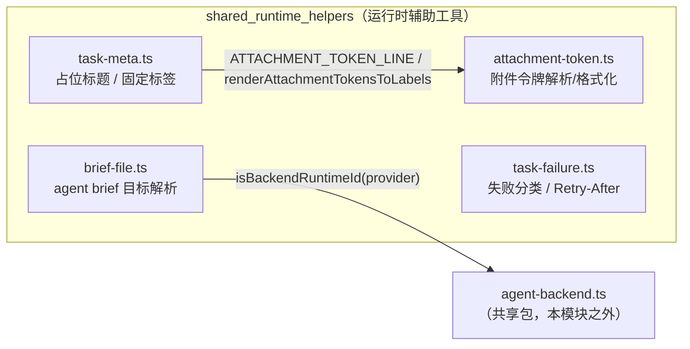
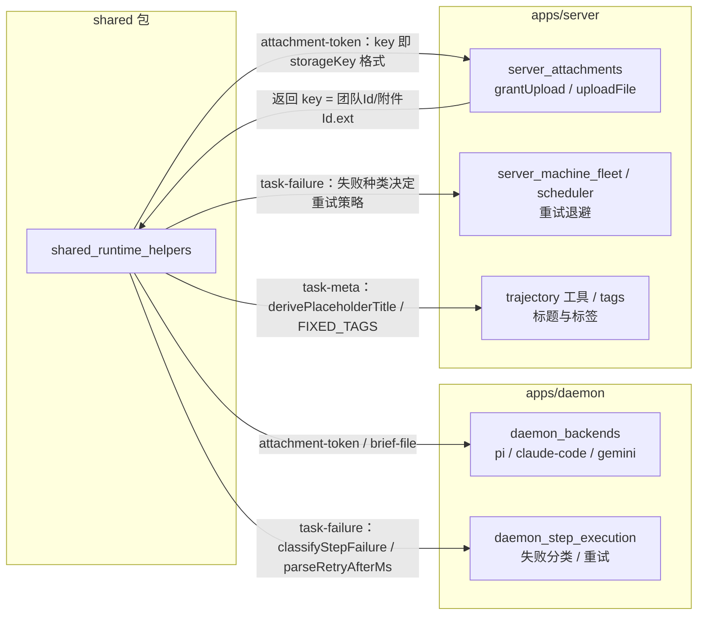
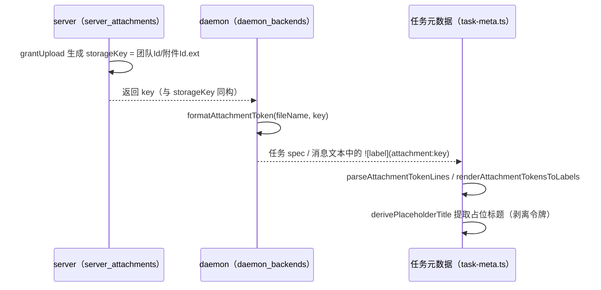
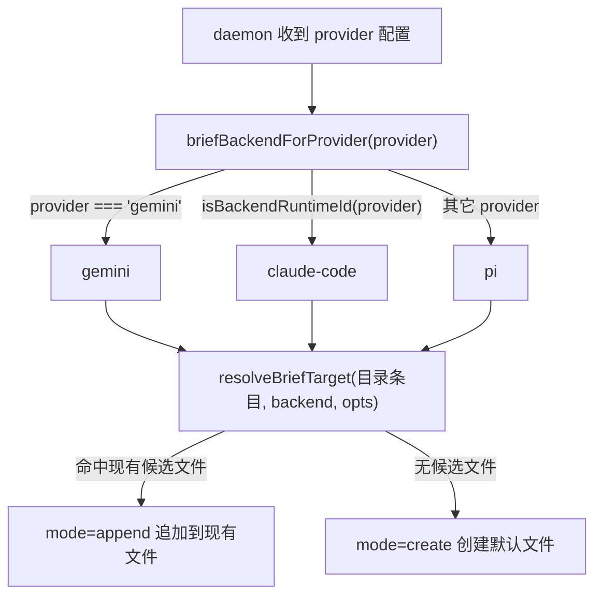
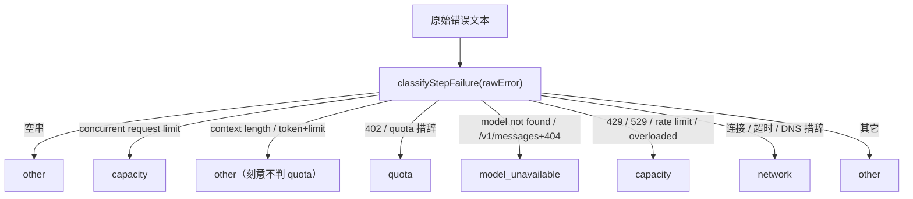

# 共享包运行时辅助工具（shared_runtime_helpers）

## 简介与定位

`shared_runtime_helpers` 是 [共享包 shared](../shared.md)（`packages/shared`）之下的一组**任务执行期运行时辅助工具**，覆盖 `packages/shared/src/` 根目录中的四个纯函数模块：

| 文件 | 职责 |
| --- | --- |
| `packages/shared/src/attachment-token.ts` | 附件令牌（``）的解析、格式化、渲染回退，以及图片扩展名/MIME 对照表 |
| `packages/shared/src/brief-file.ts` | agent brief 文件（`AGENTS.md` / `CLAUDE.md` / `GEMINI.md`）的后端判定与目标（创建/追加）解析 |
| `packages/shared/src/task-failure.ts` | 步骤级 / 代理级失败分类、`Retry-After` 解析、provider 故障与鉴权失败识别 |
| `packages/shared/src/task-meta.ts` | 任务占位标题推导、固定标签词表（`FIXED_TAGS`） |

这些模块与 git 操作契约（[shared_git_operations](shared_git_operations.md)，即 `git-ops.ts` 的 `GitOps`/`WorktreeOps` 抽象接口）共同构成完整的“任务工具面”。本模块可视为该工具面中“运行期纯函数”的部分。

与 `shared/protocol`（端点注册表）和 `shared/records`（领域记录 zod 模式）不同，本模块**不定义任何 wire 契约或数据结构模式**，而是提供任务从创建、执行到收尾过程中的计算辅助：

- **daemon（执行侧）**：把附件写进任务文本、落盘 agent brief、对步骤失败分类以决定重试/退避；
- **server（编排侧）**：为任务推导占位标题、提供固定标签词表、按失败分类决定调度策略。

所有函数均为**无副作用纯函数**（配合 `packages/shared/package.json` 的 `sideEffects: false`，便于摇树），可在 server / daemon / web / CI 中任意复用与单测。

## 模块组成与架构



模块内部依赖关系：

- `task-meta.ts` → `attachment-token.ts`（导入 `ATTACHMENT_TOKEN_LINE` 与 `renderAttachmentTokensToLabels`，用于在推导标题时识别并剥离附件令牌）；
- `brief-file.ts` → `agent-backend.ts`（导入 `isBackendRuntimeId`，用于把任意 provider 映射到 `pi` / `claude-code` / `gemini` 三个后端 id 之一）；
- `task-failure.ts` 与 `attachment-token.ts` 各自独立，不依赖本模块其它文件。

四个模块全部经由 [共享包入口 shared](../shared.md) 的 `src/index.ts` 对外导出（`export * from './attachment-token.js'`、`'./brief-file.js'`、`'./task-failure.js'`、`'./task-meta.js'`），daemon 与 server 通过 `@cairn/shared` 直接引用。

## 组件详解

### attachment-token.ts（附件令牌）

附件令牌是一种内联 Markdown 语法，用于在任务 spec / 消息文本中引用已上传的附件，形如：

```text

```

其中 `key` 严格匹配 `ATTACHMENT_KEY` 正则 `^([A-Za-z0-9_-]+)\/([A-Za-z0-9_-]+)\.([a-z0-9]{1,8})$`，即 `团队Id/附件Id.扩展名` 三段式。该格式与服务端 [server_attachments](../Backend_application_services/server/server_attachments.md) 中 `grantUpload` 生成的存储键 `storageKey = ${teamId}/${id}.${ext}` 一一对应——令牌的 `key` 即附件在磁盘上的相对路径。

核心 API：

| 成员 | 类型/签名 | 说明 |
| --- | --- | --- |
| `ATTACHMENT_TOKEN_LINE` | `RegExp` | 整行令牌正则：`/^ {0,3}!\[([^\]\n]*)\]\(attachment:([^)\s]+)\)\s*$/` |
| `ATTACHMENT_KEY` | `RegExp` | 令牌 key 的三段式结构校验 |
| `AttachmentTokenRef` | `interface` | 解析结果：`line`、`label`、`key`、`attachmentId`、`ext` |
| `parseAttachmentTokenLines(text)` | `(text: string) => AttachmentTokenRef[]` | 逐行扫描文本，返回所有**整行**附件令牌的引用 |
| `formatAttachmentToken(fileName, key)` | `(fileName: string, key: string) => string` | 格式化出 `` 令牌文本 |
| `renderAttachmentTokensToLabels(text)` | `(text: string) => string` | 把文本中的**内联**附件令牌替换为纯 label（`` → `x`） |
| `INLINE_IMAGE_EXTS` | `readonly string[]` | `['png','jpg','jpeg','gif','webp']`，可在消息流中直接内联渲染的图片扩展名 |
| `INLINE_IMAGE_MIME_BY_EXT` | `Readonly<Record<string, string>>` | 上述扩展名对应的 MIME 类型（如 `png` → `image/png`） |
| `IMAGE_ATTACHMENT_EXTS` | `readonly string[]` | 内联扩展名 + `svg`/`bmp`/`ico`/`avif`，即所有图片附件扩展名 |
| `isImageAttachmentExt(ext)` | `(ext: string) => boolean` | 判定扩展名是否属于图片附件 |

典型用法：daemon 侧把服务端返回的附件 key 与文件名拼成令牌写入任务文本；server / 轨迹工具侧用 `parseAttachmentTokenLines` 还原附件引用、用 `renderAttachmentTokensToLabels` 在纯文本场景（如占位标题）剥离令牌。

### brief-file.ts（agent brief 文件）

Agent brief（提示词简报）是 daemon 为不同 agent 运行时在仓库中维护的系统提示文件。本模块负责两件事：**后端判定**（provider → `BriefBackendId`）与**目标解析**（目录中已有哪个候选文件、追加还是新建）。

核心常量：

| 常量 | 值 | 说明 |
| --- | --- | --- |
| `BRIEF_MARKER_BEGIN` | `<!-- BEGIN CAIRN-RUNTIME (auto-managed; do not edit) -->` | 托管区域起始标记 |
| `BRIEF_MARKER_END` | `<!-- END CAIRN-RUNTIME -->` | 托管区域结束标记 |
| `BRIEF_MANAGED_SEPARATOR` | `'\n\n'` | 托管段落之间的分隔 |
| `BRIEF_BACKEND_IDS` | `['pi', 'claude-code', 'gemini']` | 三个受支持后端 |
| `BRIEF_CANDIDATES` | 见下 | 各后端**优先追加**的候选文件名 |
| `BRIEF_CREATE_NAME` | `pi`→`AGENTS.md`、`claude-code`→`CLAUDE.md`、`gemini`→`GEMINI.md` | 各后端无候选文件时**新建**的默认文件名 |
| `BRIEF_RECONCILE_FILENAMES` | 全部候选名的去重并集 | 用于统一对账（reconcile） |

`BRIEF_CANDIDATES` 明细：

| 后端 | 候选文件（按优先级） |
| --- | --- |
| `pi` | `AGENTS.override.md`、`AGENTS.md`、`AGENTS.MD`、`CLAUDE.md`、`CLAUDE.MD` |
| `claude-code` | `CLAUDE.md` |
| `gemini` | `GEMINI.md` |

核心函数：

- `briefBackendForProvider(provider: string | null | undefined): BriefBackendId` —— `provider === 'gemini'` 返回 `gemini`；否则若 `isBackendRuntimeId(provider)`（即 `claude-code` / `gemini`，见 `agent-backend.ts` 的 `BACKEND_RUNTIME_IDS`）返回 `claude-code`；**其余一切 provider 默认回落为 `pi`**。
- `resolveBriefTarget(entries: readonly string[], backend, opts: { caseInsensitiveFs }): BriefTarget` —— 在目录条目（`entries`）中按 `BRIEF_CANDIDATES[backend]` 顺序查找首个命中的真实文件名（`caseInsensitiveFs` 时按键小写匹配，避免大小写不敏感文件系统的差异）；命中返回 `{ file, mode: 'append' }`，否则返回 `{ file: BRIEF_CREATE_NAME[backend], mode: 'create' }`。

该函数被 daemon 各后端（[daemon_backends](../Backend_application_services/daemon/daemon_backends.md) 中的 `PiBackend` / `ClaudeCodeBackend` 的 `BriefChannel`）用于决定 brief 落盘位置；托管区域标记用于区分“由运行时维护”与“用户手写”的段落。

### task-failure.ts（失败分类）

本模块是 daemon/server 重试与退避策略的判定依据，提供两套分类维度（步骤级与代理级）外加三个辅助判定函数。

`digitBounded(codes: string): RegExp` 是内部构造器：把一组数字码包装成 `(^|[^0-9])(codes)([^0-9]|$)`，避免把 `402` 误匹配进 `10402` 之类的长数字串。

**步骤级分类** `classifyStepFailure(rawError: string): StepFailureKind`（`StepFailureKind = 'quota' | 'capacity' | 'model_unavailable' | 'network' | 'other'`），按以下优先级短路判定：

| 优先级 | 命中条件（`lower` 为 trim + 小写后的错误文本） | 结果 |
| --- | --- | --- |
| 1 | 空串 | `other` |
| 2 | 包含 `concurrent request limit` | `capacity` |
| 3 | context length / `context_length_exceeded` / prompt 过长 / 同时含 `token` 与 `limit` | `other`（**刻意不判为 quota**，避免把输入超长误报为额度问题） |
| 4 | HTTP `402`（`digitBounded`）或 `insufficient_balance` / `usage limit` / `quota` / `credits` 等措辞 | `quota` |
| 5 | `/v1/messages` 且含 HTTP `404` | `model_unavailable` |
| 6 | `model not found` / `model unavailable` 等措辞，或 `404` + `model`/`not found` | `model_unavailable` |
| 7 | HTTP `429`/`529` 或 `rate limit` / `overloaded` / `no capacity available` | `capacity` |
| 8 | `stream disconnected` / `connection reset` / `econnreset` / `etimedout` / `dns` / `deadline exceeded` 等网络措辞 | `network` |
| 9 | 其余 | `other` |

**辅助判定**：

- `isProviderOutage(rawError): boolean` —— 先排除 git 类错误（`git xxx failed (...)` 前缀、`enumerating/counting/... objects:` 进度行），命中账户耗尽措辞（`quota exhausted`、`insufficient balance`、`accounts exhausted` 等）或 provider 5xx 模式（`http 5xx`、`status: 500`、`provider response: ... 5\d\d` 等）返回 `true`。
- `isProviderAuthFailure(rawError): boolean` —— 命中 `authentication_error`、`invalid api key`、`api key expired` 等措辞，或 HTTP `401` 且同时含 `api key` / `api_key` / `x-api-key` 时返回 `true`。

**代理级分类** `classifyAgentFailure(message: string): AgentFailureKind`（`AgentFailureKind = 'quota' | 'capacity' | 'provider_network' | 'other'`），面向 agent 会话返回的失败消息，基于三条正则（均含中文措辞）：

- `QUOTA_PATTERN`：`402`、`usage limit`、`insufficient quota/credit/balance`、`billing`，以及中文 `余额不足` / `额度不足|用完|耗尽|已用尽` / `欠费`；
- `CAPACITY_PATTERN`：`429`/`529`、`rate limit`、`too many requests`、`overloaded`，以及中文 `请求过于频繁` / `限流` / `负载(已)饱和`；
- `NETWORK_PATTERN`：`connection error|reset|refused|closed`、`ECONNREFUSED`/`ECONNRESET`/`ETIMEDOUT`、`socket hang up`、`fetch failed`、`temporarily unavailable` 等。

**重试窗口解析** `parseRetryAfterMs(text: string): number | null`：

- 正则 `retry[ _-]?after[\s:=]+(\d+)\s*(s|sec|seconds?|m|min|minutes?|h|hours?)?`（忽略大小写）解析 `Retry-After` 类文本；
- 单位乘数：`s`/秒 → `1_000`，`m`/分 → `60_000`，`h`/时 → `3_600_000`，缺省按秒；
- 数值非有限或 ≤ 0 返回 `null`；超过 `RETRY_AFTER_MAX_MS`（`24 * 60 * 60 * 1000`，即 24 小时）也返回 `null`，防止异常大值打爆退避。

消费方：daemon 步骤执行（[daemon_step_execution](../Backend_application_services/daemon/daemon_step_execution.md)）捕获步骤错误后分类；server 的调度器与机器舰队（[server_scheduler](../Backend_application_services/server/server_scheduler.md)、[server_machine_fleet](../Backend_application_services/server/server_machine_fleet.md)）据此决定重试、退避与止损。

### task-meta.ts（任务元数据）

- `PLACEHOLDER_TITLE_FALLBACK = '未命名任务'`：任务 spec 完全无法提炼标题时的兜底文案。
- `derivePlaceholderTitle(spec: string): string`：从任务 spec 文本推导占位标题。算法：逐行 trim；**整行附件令牌**（`ATTACHMENT_TOKEN_LINE` 命中）不参与标题，但其 `label` 记录为后备；其余行先用 `renderAttachmentTokensToLabels` 剥离内联令牌，取首个非空行作为标题；超过 50 字符截断并追加 `…`；若所有非令牌行都为空，则回退到首个附件令牌的 label。
- `FixedTag { name, description, color }` 与 `FIXED_TAGS`：任务固定标签词表，共 6 项：

| name | description | color |
| --- | --- | --- |
| `bug` | 修坏的东西 | `#ef4444` |
| `feature` | 新功能 | `#8b5cf6` |
| `improvement` | 改进既有功能 | `#3b82f6` |
| `refactor` | 重构（不改行为） | `#f59e0b` |
| `docs` | 文档 | `#0ea5e9` |
| `chore` | 杂务/依赖/配置 | `#71717a` |

消费方：server 侧任务创建与轨迹工具（[server_trajectory_tools](../Backend_application_services/server/server_trajectory_tools.md)）推导展示用标题；固定标签词表供标签回填（`backfillFixedTags`）与前端渲染使用。与 [shared_records](shared_records.md) 中的 `todo` / `tag` 记录配合，保证“标签名字面量”在 server/daemon/web 三端一致。

## 关键数据流与调用关系



### 附件令牌生命周期



### agent brief 解析流程



### 步骤失败分类决策流程



## 与其它模块的关系

- **[共享包 shared](../shared.md)**：本模块的上层页面。包级配置（`package.json` 的 `exports`、`sideEffects: false`、`scripts`、`tsconfig` 严格基线）与整体构建/CI 说明见该页，此处不重复。
- **[shared_git_operations](shared_git_operations.md)**：`git-ops.ts` 的 `GitOps` / `WorktreeOps` 抽象接口与错误类型单独成页；需要 git 操作契约时参考该页。
- **[shared_records](shared_records.md)**：`records/todo.ts`、`records/tag.ts`、`records/provider.ts` 等 zod 记录与 `task-meta.ts` / `brief-file.ts` 配合使用（标签字面量、provider 记录中的后端映射）。
- **[server_attachments](../Backend_application_services/server/server_attachments.md)**：`grantUpload` / `uploadFile` 生成与消费 `storageKey`，与 `attachment-token.ts` 的 `ATTACHMENT_KEY` 三段式格式严格对应。
- **[daemon_backends](../Backend_application_services/daemon/daemon_backends.md)**：`PiBackend` / `ClaudeCodeBackend` / `GeminiBackend` 通过 `BriefChannel` 使用 `brief-file.ts` 决定 brief 落盘；渲染消息时使用附件令牌。
- **[daemon_step_execution](../Backend_application_services/daemon/daemon_step_execution.md)**：步骤执行失败时使用 `task-failure.ts` 分类并决定重试。
- **[server_scheduler](../Backend_application_services/server/server_scheduler.md) / [server_machine_fleet](../Backend_application_services/server/server_machine_fleet.md)**：按 `classifyStepFailure` / `classifyAgentFailure` 的结果实施退避与止损，按 `parseRetryAfterMs` 读取服务端重试窗口。
- **[server_trajectory_tools](../Backend_application_services/server/server_trajectory_tools.md) / server 标签服务**：使用 `derivePlaceholderTitle` 与 `FIXED_TAGS` 推导展示标题、回填固定标签。

## 构建、测试与 CI

本模块没有独立的构建产物或测试配置——它只是 `@cairn/shared` 包的四个源码文件：

- **类型检查**：随包执行 `pnpm --filter @cairn/shared typecheck`（即 `tsc --noEmit`），也覆盖在根 `pnpm typecheck` 中。
- **单元测试**：随包执行 `pnpm --filter @cairn/shared test`（即 `vitest run`）；CI 的 [check 作业](../../.github/workflows/ci.yml)（`VITEST_PROJECT_SET=light pnpm test`）会覆盖 `packages/*`。
- **打包**：无独立构建；daemon/server 经 `workspace:*` 直接引用 `src/` 源码，`sideEffects: false` 保证摇树友好。

## 设计约定

1. **纯函数、无副作用**：四个文件全部导出无副作用的纯函数与只读常量，便于三端复用、单测与树摇。
2. **文本一律当数据**：附件令牌、brief 文件名、错误消息都按“数据”处理——解析严格（正则锚定、数字边界防误匹配），渲染时剥离令牌避免把附件语法混入提示词。
3. **失败分类可审计且顺序敏感**：`classifyStepFailure` 的优先级表是刻意设计的——上下文超长被归为 `other` 而非 `quota`，避免调度器对输入问题做额度退避；git 错误在 `isProviderOutage` 中被先行排除。
4. **单一事实来源**：`BRIEF_CANDIDATES`、`FIXED_TAGS`、`INLINE_IMAGE_EXTS` 等词表均为 `as const` 只读常量，daemon/server/web 不各自复制字面量。
5. **与磁盘/存储格式对齐**：附件令牌 `key` 与 server 存储键同构、brief 候选文件名与 daemon 落盘路径同构，跨模块修改需同步（见 [server_attachments](../Backend_application_services/server/server_attachments.md) 与 [daemon_backends](../Backend_application_services/daemon/daemon_backends.md)）。