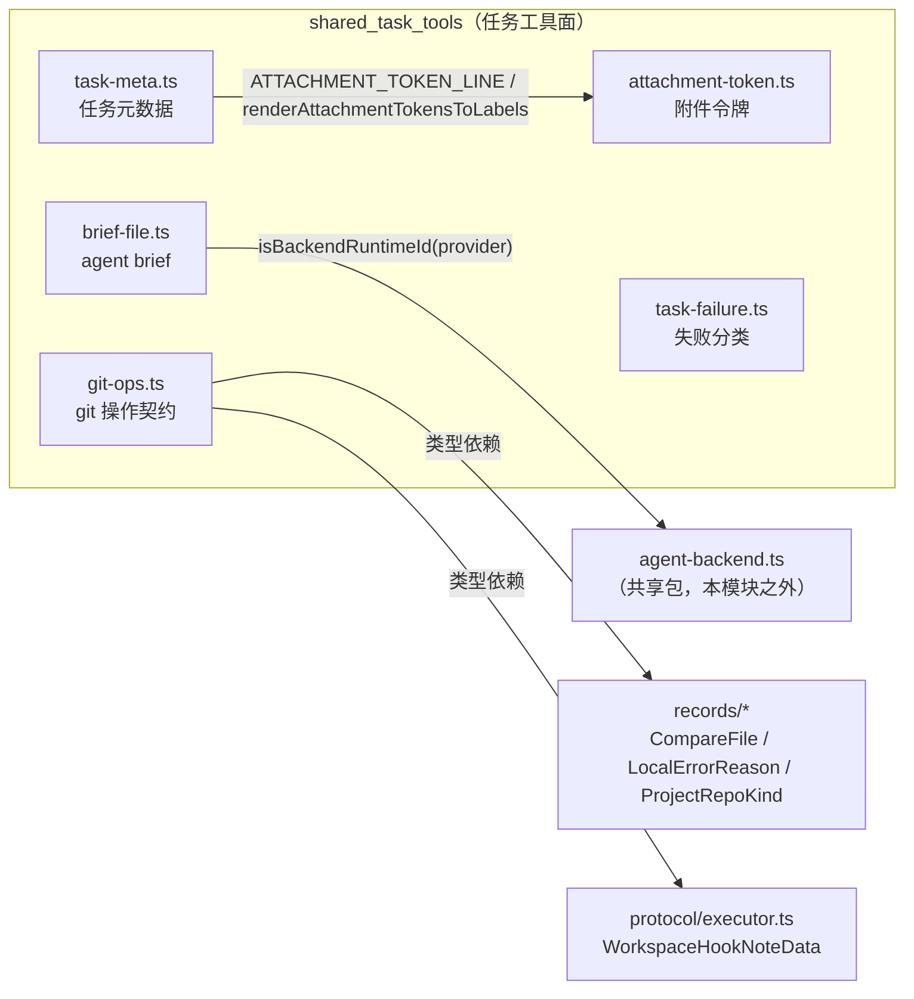
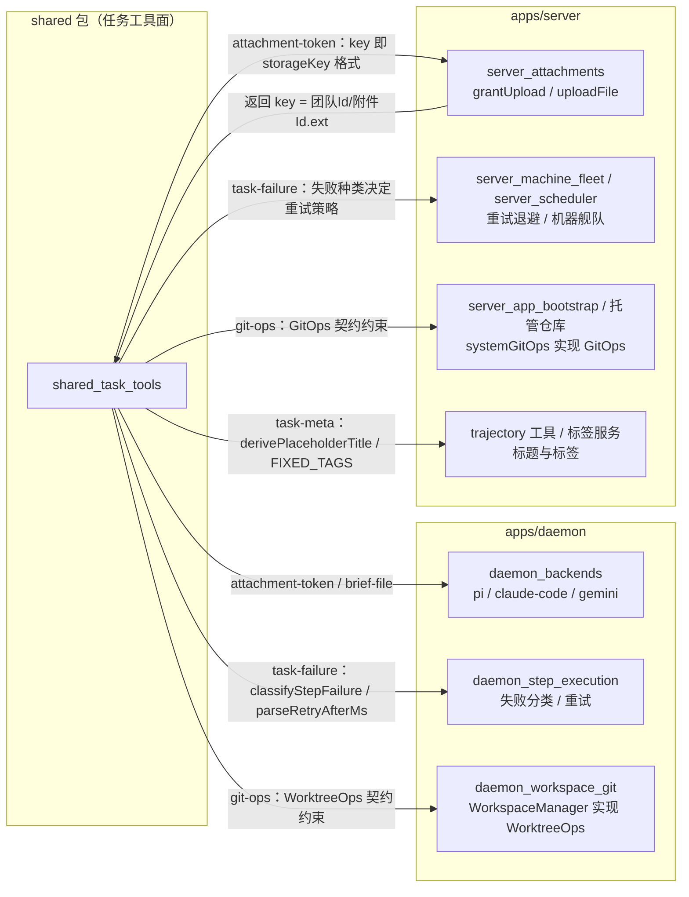

# 任务工具面（shared_task_tools）

## 简介与定位

`shared_task_tools` 是 [共享包 shared](../shared.md)（`packages/shared`）根目录下**五个任务工具文件**的总集页面，覆盖任务从创建、执行到收尾过程中被 daemon 与 server 反复引用的工具代码：

| 文件 | 职责 | 子模块页 |
| --- | --- | --- |
| `packages/shared/src/attachment-token.ts` | 附件令牌（``）的解析、格式化、渲染回退与图片扩展名/MIME 对照 | [shared_task_tools_attachment](shared_task_tools/shared_task_tools_attachment.md) |
| `packages/shared/src/brief-file.ts` | agent brief 文件（`AGENTS.md` / `CLAUDE.md` / `GEMINI.md`）的后端判定与目标（创建/追加）解析 | [shared_task_tools_brief](shared_task_tools/shared_task_tools_brief.md) |
| `packages/shared/src/git-ops.ts` | git 操作抽象契约：`GitOps` / `WorktreeOps` 接口、凭据、工作区与错误类型 | [shared_task_tools_gitops](shared_task_tools/shared_task_tools_gitops.md) |
| `packages/shared/src/task-failure.ts` | 步骤级/代理级失败分类、provider 故障与鉴权失败识别、`Retry-After` 解析 | [shared_task_tools_failure_classification](shared_task_tools/shared_task_tools_failure_classification.md) |
| `packages/shared/src/task-meta.ts` | 任务占位标题推导与固定标签词表（`FIXED_TAGS`） | [shared_task_tools_meta](shared_task_tools/shared_task_tools_meta.md) |

这五个文件构成完整的“任务工具面”：**运行时辅助**（附件令牌、brief、失败分类、任务元数据，详见 [shared_runtime_helpers](shared_runtime_helpers.md)）与 **git 操作契约**（详见 [shared_git_operations](shared_git_operations.md)）的并集。本页从模块视角统一描述它们的分工、相互依赖以及它们在整个系统（daemon 执行侧 + server 编排侧）中的位置。

与 [shared_protocol](shared_protocol.md)（端点注册表）和 [shared_records](shared_records.md)（领域记录 zod 模式）不同，本模块**不定义 wire 契约或数据表模式**，而是提供任务生命周期中的计算辅助与接口契约：

- **daemon（执行侧）**：把附件写进任务文本、落盘 agent brief、对步骤失败分类以决定重试/退避、按 `WorktreeOps` 契约操作会话工作区；
- **server（编排侧）**：为任务推导占位标题、提供固定标签词表、按失败分类决定调度策略、以 `GitOps` 契约实现托管仓库与 git 智能 HTTP。

所有代码均为无副作用纯函数或纯类型/常量（配合 `packages/shared/package.json` 的 `sideEffects: false`，便于摇树），可在 server / daemon / web / CI 中任意复用与单测。

## 模块组成与架构

模块内部依赖关系：

- `task-meta.ts` → `attachment-token.ts`（导入 `ATTACHMENT_TOKEN_LINE` 与 `renderAttachmentTokensToLabels`，用于在推导标题时识别并剥离附件令牌）；
- `brief-file.ts` → `agent-backend.ts`（导入 `isBackendRuntimeId`，把任意 provider 映射到 `pi` / `claude-code` / `gemini` 三个后端 id 之一）；
- `git-ops.ts` → `records/merge-gate.ts`（`CompareFile`）、`records/project.ts`（`LocalErrorReason` / `ProjectRepoKind`）、`protocol/executor.ts`（`WorkspaceHookNoteData`），只消费类型；
- `task-failure.ts` 与 `attachment-token.ts` 各自独立，不依赖本模块其它文件。

五个文件全部经由 [共享包入口 shared](../shared.md) 的 `src/index.ts` 对外导出，daemon 与 server 通过 `@cairn/shared` 直接引用。

## 子模块总览

| 子模块 | 页面 | 一句话职责 |
| --- | --- | --- |
| 附件令牌 | [shared_task_tools_attachment](shared_task_tools/shared_task_tools_attachment.md) | 附件令牌的解析 / 格式化 / 渲染回退与图片类型判定 |
| agent brief | [shared_task_tools_brief](shared_task_tools/shared_task_tools_brief.md) | provider → 后端 id 映射与 brief 文件目标（追加/新建）解析 |
| git 操作契约 | [shared_task_tools_gitops](shared_task_tools/shared_task_tools_gitops.md) | `GitOps` / `WorktreeOps` 接口、凭据、工作区与错误类型 |
| 失败分类 | [shared_task_tools_failure_classification](shared_task_tools/shared_task_tools_failure_classification.md) | 步骤级/代理级失败分类、故障与鉴权识别、重试窗口 |
| 任务元数据 | [shared_task_tools_meta](shared_task_tools/shared_task_tools_meta.md) | 占位标题推导与固定标签词表 |

各子模块页包含组件级详解、消费方与数据流；本页仅做架构级概述，不重复细节。

## 关键数据流与调用关系

## 与其它模块的关系

- **[共享包 shared](../shared.md)**：本模块的上层页面。包级配置（`package.json` 的 `exports`、`sideEffects: false`、`scripts`、`tsconfig` 严格基线）与整体构建/CI 说明见该页，此处不重复。
- **[shared_runtime_helpers](shared_runtime_helpers.md)**：任务工具面中“运行期纯函数”部分的既有页面，覆盖 `attachment-token.ts`、`brief-file.ts`、`task-failure.ts`、`task-meta.ts` 四个文件；本模块的 [shared_task_tools_attachment](shared_task_tools/shared_task_tools_attachment.md)、[shared_task_tools_brief](shared_task_tools/shared_task_tools_brief.md)、[shared_task_tools_failure_classification](shared_task_tools/shared_task_tools_failure_classification.md)、[shared_task_tools_meta](shared_task_tools/shared_task_tools_meta.md) 是其组件级细分。
- **[shared_git_operations](shared_git_operations.md)**：`git-ops.ts` 的接口/错误类型既有页面；本模块的 [shared_task_tools_gitops](shared_task_tools/shared_task_tools_gitops.md) 是其组件级细分。
- **[shared_records](shared_records.md)**：`records/todo.ts`、`records/tag.ts`、`records/provider.ts` 等 zod 记录与 `task-meta.ts` / `brief-file.ts` 配合使用；`records/merge-gate.ts` 的 `CompareFile`、`records/project.ts` 的 `LocalErrorReason` / `ProjectRepoKind` 是 `git-ops.ts` 接口的输入/输出类型。
- **[shared_protocol](shared_protocol.md)**：`protocol/executor.ts` 的 `WorkspaceHookNoteData` 是 `PreparedWorkspace.hooks` 的类型来源。
- **[server_attachments](../Backend_application_services/server/server_attachments.md)**：`grantUpload` / `uploadFile` 生成与消费 `storageKey`，与 `attachment-token.ts` 的 `ATTACHMENT_KEY` 三段式格式严格对应。
- **[daemon_backends](../Backend_application_services/daemon/daemon_backends.md)**：`PiBackend` / `ClaudeCodeBackend` / `GeminiBackend` 通过 `BriefChannel` 使用 `brief-file.ts` 决定 brief 落盘；渲染消息时使用附件令牌。
- **[daemon_step_execution](../Backend_application_services/daemon/daemon_step_execution.md)**：步骤执行失败时使用 `task-failure.ts` 分类并决定重试；`runner.ts` 以 `workspace: WorktreeOps` 注入执行步骤。
- **[daemon_workspace_git](../Backend_application_services/daemon/daemon_workspace_git.md)**：`apps/daemon/src/git.ts`（`gitPrim`）与 `apps/daemon/src/workspace.ts`（`WorkspaceManager implements WorktreeOps`）——`WorktreeOps` 契约的实现侧。
- **[server_scheduler](../Backend_application_services/server/server_scheduler.md) / [server_machine_fleet](../Backend_application_services/server/server_machine_fleet.md)**：按 `classifyStepFailure` / `classifyAgentFailure` 的结果实施退避与止损，按 `parseRetryAfterMs` 读取服务端重试窗口。
- **[server_merge_gate](../Backend_application_services/server/server_merge_gate.md)**：`GitOps.localCompareFiles` 的 `CompareFile[]` 经 `computeLocalPatchDigest` 进入补丁摘要。
- **[server_trajectory_tools](../Backend_application_services/server/server_trajectory_tools.md) / server 标签服务**：使用 `derivePlaceholderTitle` 与 `FIXED_TAGS` 推导展示标题、回填固定标签。

## 构建、测试与 CI

本模块没有独立的构建产物或测试文件——它只是 `@cairn/shared` 包的五个源码文件：

- **类型检查**：随包执行 `pnpm --filter @cairn/shared typecheck`（即 `tsc --noEmit`），也覆盖在根 `pnpm typecheck` 中。
- **单元测试**：随包执行 `pnpm --filter @cairn/shared test`（即 `vitest run`）；CI 的 [check 作业](../../.github/workflows/ci.yml)（`VITEST_PROJECT_SET=light pnpm test`）会覆盖 `packages/*`。
- **打包**：无独立构建；daemon/server 经 `workspace:*` 直接引用 `src/` 源码，`sideEffects: false` 保证摇树友好。

## 设计约定

1. **纯函数、无副作用**：附件令牌、brief、失败分类、任务元数据四个文件导出无副作用的纯函数与只读常量；`git-ops.ts` 只导出类型、常量与错误类，无运行时副作用，便于三端复用、单测与摇树。
2. **文本一律当数据**：附件令牌、brief 文件名、错误消息都按“数据”处理——解析严格（正则锚定、数字边界防误匹配），渲染时剥离令牌避免把附件语法混入提示词。
3. **失败分类可审计且顺序敏感**：`classifyStepFailure` 的优先级表是刻意设计的——上下文超长被归为 `other` 而非 `quota`，避免调度器对输入问题做额度退避；git 错误在 `isProviderOutage` 中被先行排除。
4. **契约与实现分离**：`git-ops.ts` 只声明接口与错误语义；服务端 `systemGitOps` 与守护进程 `gitPrim` / `WorkspaceManager` 各自实现，互不引用对方代码。
5. **单一事实来源**：`BRIEF_CANDIDATES`、`FIXED_TAGS`、`INLINE_IMAGE_EXTS` 等词表均为 `as const` 只读常量，daemon/server/web 不各自复制字面量。
6. **与磁盘/存储格式对齐**：附件令牌 `key` 与 server 存储键同构、brief 候选文件名与 daemon 落盘路径同构、`CompareFile[]` 与 daemon 补丁摘要口径一致，跨模块修改需同步（见 [server_attachments](../Backend_application_services/server/server_attachments.md)、[daemon_backends](../Backend_application_services/daemon/daemon_backends.md) 与 [server_merge_gate](../Backend_application_services/server/server_merge_gate.md)）。
