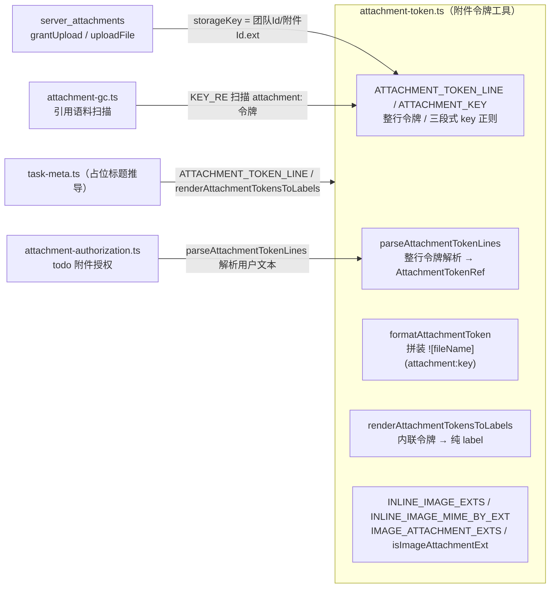
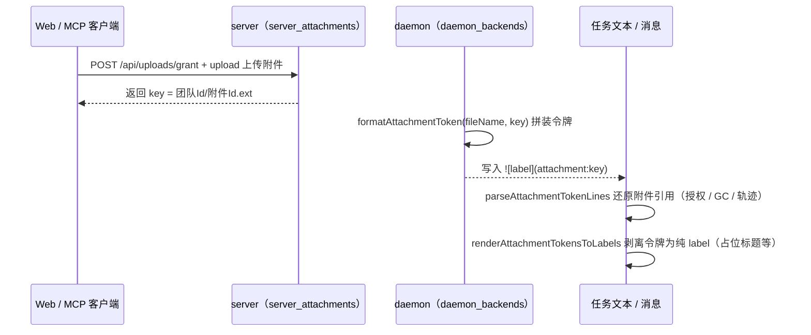
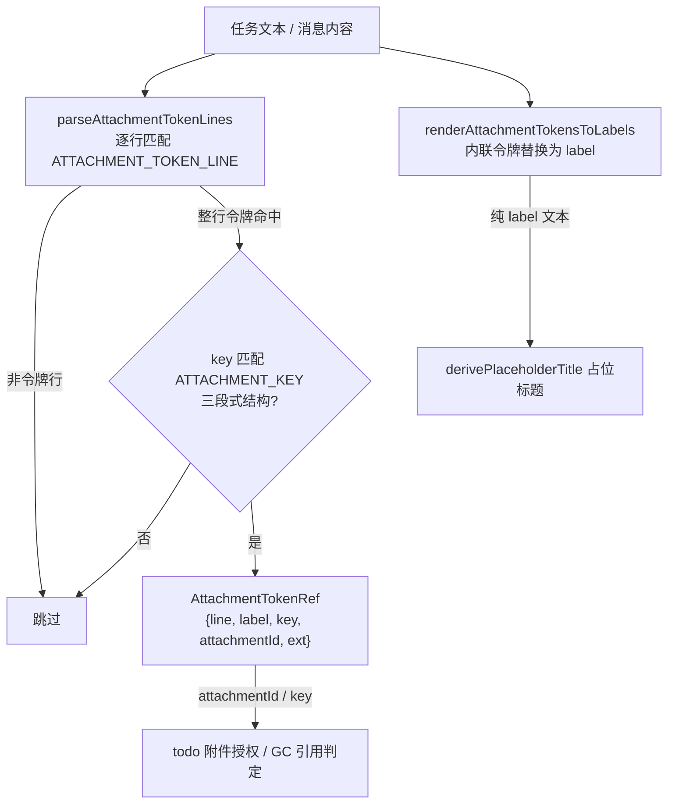

# 附件令牌工具（shared_task_tools_attachment）

## 简介与定位

`shared_task_tools_attachment` 是 [任务工具面 shared_task_tools](../shared_task_tools.md) 的五个子模块之一，对应共享包中的单个文件 **`packages/shared/src/attachment-token.ts`**，核心组件为 `formatAttachmentToken`。

该文件定义了 cairn 系统中**附件令牌（attachment token）**的完整语法契约与纯函数工具集。附件令牌是一种内联 Markdown 引用语法：

```text

```

它允许用户在任务 spec、消息内容、计划文本中引用已经上传的附件（规格书配图、构建报告、会话截图等），同时保证：

- **语法单一事实来源**：正则、格式化函数、渲染回退函数都在此一处定义，daemon / server / web / CI 各自引用，不复制字面量；
- **与磁盘存储键严格对齐**：令牌中的 `key` 即服务端 [server_attachments](../../Backend_application_services/server/server_attachments.md) 落盘的相对路径（`团队Id/附件Id.扩展名`）；
- **纯函数、无副作用**：所有导出均为无副作用的纯函数与 `as const` 只读常量，配合 `packages/shared/package.json` 的 `sideEffects: false` 便于摇树，可在三端任意复用与单测。

## 令牌语法与格式契约

附件令牌由**两条正则**共同约束：

| 正则 | 值 | 作用 |
| --- | --- | --- |
| `ATTACHMENT_TOKEN_LINE` | `/^ {0,3}!\[([^\]\n]*)\]\(attachment:([^)\s]+)\)\s*$/` | **整行**令牌匹配：行首允许 0–3 个空格，`label` 为 `[^\]\n]*`（不含 `]` 与换行），`key` 为 `[^)\s]+`（不含 `)` 与空白） |
| `ATTACHMENT_KEY` | `/^([A-Za-z0-9_-]+)\/([A-Za-z0-9_-]+)\.([a-z0-9]{1,8})$/` | 令牌 `key` 的**三段式结构**校验：`团队Id/附件Id.扩展名`，扩展名 1–8 位小写字母数字 |

`ATTACHMENT_KEY` 与服务端 [server_attachments](../../Backend_application_services/server/server_attachments.md) 中 `grantUpload` 生成的存储键 `storageKey = ${teamId}/${id}.${ext}` 严格同构——令牌的 `key` 就是附件在 `attachmentsDir` 下的相对路径。`extOf`（服务端）与 `ATTACHMENT_KEY` 的扩展名段使用同一约束（`[a-z0-9]{1,8}`），保证“能上传的扩展名都能被令牌引用”。

## 模块组成与架构



**模块内部依赖**：`attachment-token.ts` 是 [任务工具面](../shared_task_tools.md) 中**完全独立**的文件——不依赖同模块的 `brief-file.ts`、`git-ops.ts`、`task-failure.ts`、`task-meta.ts` 中的任何一个；相反，[shared_task_tools_meta](shared_task_tools_meta.md)（`task-meta.ts`）反向依赖它，导入 `ATTACHMENT_TOKEN_LINE` 与 `renderAttachmentTokensToLabels` 用于推导占位标题时识别并剥离令牌。

**导出路径**：经 [共享包入口 shared](../../shared.md) 的 `src/index.ts` 以 `export * from './attachment-token.js'` 对外导出，daemon 与 server 通过 `@cairn/shared` 引用。

## 组件详解

### 解析结果类型 `AttachmentTokenRef`

`parseAttachmentTokenLines` 的返回元素，携带令牌的全部结构化信息：

| 字段 | 类型 | 含义 |
| --- | --- | --- |
| `line` | `string` | 命中的**原始整行文本** |
| `label` | `string` | 令牌显示名（`![...]` 中的内容，可能为空串） |
| `key` | `string` | 令牌引用键（`attachment:` 后的内容） |
| `attachmentId` | `string` | `ATTACHMENT_KEY` 第二段，即服务端附件 id |
| `ext` | `string` | `ATTACHMENT_KEY` 第三段，即小写扩展名 |

### `parseAttachmentTokenLines(text)`

```ts
parseAttachmentTokenLines(text: string): AttachmentTokenRef[]
```

逐行扫描文本，用 `ATTACHMENT_TOKEN_LINE` 匹配**整行**令牌，再用 `ATTACHMENT_KEY` 校验 key 结构；两层正则都命中才产出 `AttachmentTokenRef`。仅识别“独占一行”的令牌，行内混排的令牌由 `renderAttachmentTokensToLabels` 处理。消费方示例：

- [server_attachments](../../Backend_application_services/server/server_attachments.md) 的 `attachment-authorization.ts`：解析用户 spec / 消息中的令牌，写入 `todo.userSpecAttachmentIds` / `userMessageAttachmentIds`，用于判定某附件是否被某 todo 授权；
- 轨迹与 GC 工具：还原转录文本中的附件引用。

### `formatAttachmentToken(fileName, key)`（核心组件）

```ts
formatAttachmentToken(fileName: string, key: string): string
// 返回 ``
```

把文件名与存储键拼装成标准令牌文本。它是**令牌的“写”方向**，与 `parseAttachmentTokenLines`（读方向）互逆。典型消费方是 daemon：拿到服务端 `grantUpload` 返回的 `key` 后，用 `formatAttachmentToken(fileName, key)` 生成令牌写入任务 spec / 消息文本，从而把附件“挂”进 agent 的可见上下文。

### `renderAttachmentTokensToLabels(text)`

```ts
renderAttachmentTokensToLabels(text: string): string
```

基于 `INLINE_ATTACHMENT_TOKEN`（`/!\[([^\]\n]*)\]\(attachment:[^)\s]+\)/g`）把文本中所有**内联**（不要求独占整行）的附件令牌替换为纯 label：`` → `x`。用于纯文本场景（如占位标题、摘要、日志）剥离附件语法，避免把 Markdown 令牌混入提示词或展示文本。

### 图片类型词表

| 常量 | 值 | 说明 |
| --- | --- | --- |
| `INLINE_IMAGE_EXTS` | `['png','jpg','jpeg','gif','webp']` | 可在消息流中直接内联渲染的图片扩展名（浏览器原生支持） |
| `INLINE_IMAGE_MIME_BY_EXT` | `{ png: 'image/png', jpg: 'image/jpeg', jpeg: 'image/jpeg', gif: 'image/gif', webp: 'image/webp' }` | 上述扩展名对应的 MIME 类型（`Readonly<Record<string, string>>`） |
| `IMAGE_ATTACHMENT_EXTS` | `[...INLINE_IMAGE_EXTS, 'svg','bmp','ico','avif']` | 全部图片附件扩展名：内联五类 + 需特殊处理的 `svg`/`bmp`/`ico`/`avif` |
| `isImageAttachmentExt(ext)` | `(ext: string) => boolean` | 判定扩展名是否属于 `IMAGE_ATTACHMENT_EXTS` |

`INLINE_IMAGE_MIME_BY_EXT` 供渲染侧（web 端内联展示图片附件）直接查表得到 `Content-Type`；`isImageAttachmentExt` 供需要区分“图片附件”与“普通附件”的逻辑（如附件预览、轨迹渲染）使用。

## 关键数据流与调用关系

### 附件令牌生命周期



### 解析与渲染流程



## 与其它模块的关系

- **[任务工具面 shared_task_tools](../shared_task_tools.md)**：本模块的上层页面。五个任务工具文件的分工总览见该页，此处不重复。
- **[共享包 shared](../../shared.md)**：包级配置（`package.json` 的 `exports`、`sideEffects: false`、`scripts`、`tsconfig` 严格基线）与整体构建/CI 说明见该页。
- **[shared_runtime_helpers](../shared_runtime_helpers.md)**：`attachment-token.ts` 所属的“运行期纯函数”既有页面，含本模块的概览级描述；本页是其组件级细分。
- **[shared_task_tools_meta](shared_task_tools_meta.md)**：`task-meta.ts` 的 `derivePlaceholderTitle` 导入 `ATTACHMENT_TOKEN_LINE` 与 `renderAttachmentTokensToLabels`——本模块的**直接消费者**，二者修改需同步。
- **[server_attachments](../../Backend_application_services/server/server_attachments.md)**：`grantUpload` 生成 `storageKey = 团队Id/附件Id.ext`（与 `ATTACHMENT_KEY` 同构）、`uploadFile` 落盘消费；`attachment-authorization.ts` 用 `parseAttachmentTokenLines` 维护 todo 授权；`attachment-gc.ts` 用 `KEY_RE` / `TOOL_ID_RE` 扫描引用语料。上传协议、配额与 GC 规则细节见该页。
- **[daemon_backends](../../Backend_application_services/daemon/daemon_backends.md)**：`PiBackend` / `ClaudeCodeBackend` / `GeminiBackend` 渲染消息时消费附件令牌语法；拿到服务端 `key` 后用 `formatAttachmentToken` 把附件挂进任务文本。
- **[server_trajectory_tools](../../Backend_application_services/server/server_trajectory_tools.md)**：解析会话转录文本时同样涉及 `attachment:` 令牌与 `attachmentId` 引用（与 GC 语料扫描的正则一致）。
- **[server_scheduler](../../Backend_application_services/server/server_scheduler.md)**：周期驱动附件 GC，GC 的引用语料扫描依赖令牌语法（本模块正则的语义镜像）。
- **[shared_records](../shared_records.md)**：`records/recording-trigger.ts` 等记录层与附件令牌无直接依赖；如需在记录字段中存储附件引用 id，其格式约定以本模块解析结果为准。

## 构建、测试与 CI

本模块没有独立的构建产物或测试配置——它只是 `@cairn/shared` 包的一个源码文件：

- **类型检查**：随包执行 `pnpm --filter @cairn/shared typecheck`（即 `tsc --noEmit`），也覆盖在根 `pnpm typecheck` 中。
- **单元测试**：随包执行 `pnpm --filter @cairn/shared test`（即 `vitest run`）；CI 的 [check 作业](../../.github/workflows/ci.yml)（`VITEST_PROJECT_SET=light pnpm test`）会覆盖 `packages/*`。
- **打包**：无独立构建；daemon/server 经 `workspace:*` 直接引用 `src/` 源码，`sideEffects: false` 保证摇树友好。

## 设计约定

1. **读、写、渲染三方向解耦**：`parseAttachmentTokenLines`（读）、`formatAttachmentToken`（写）、`renderAttachmentTokensToLabels`（剥离渲染）各司其职，语义互不重叠：整行解析只认独占行，渲染剥离用宽松的内联正则，避免“解析严格、渲染宽松”互相污染。
2. **双层正则、锚定严格**：先 `ATTACHMENT_TOKEN_LINE` 整行锚定，再 `ATTACHMENT_KEY` 校验三段式结构——防止把普通 Markdown 图片（``）误判为附件引用；key 的扩展名段约束（`[a-z0-9]{1,8}`）与服务端 `extOf` 一致。
3. **与磁盘/存储格式对齐**：令牌 `key` 与服务端 `storageKey` 同构、`INLINE_IMAGE_MIME_BY_EXT` 与上传 MIME 白名单口径一致，跨模块修改需同步（见 [server_attachments](../../Backend_application_services/server/server_attachments.md)）。
4. **词表单一事实来源**：`INLINE_IMAGE_EXTS` / `IMAGE_ATTACHMENT_EXTS` / `INLINE_IMAGE_MIME_BY_EXT` 均为 `as const` 只读常量，daemon / server / web 不各自复制字面量。
5. **纯函数、无副作用**：全部导出为纯函数与只读常量，任意上下文可安全复用与单测。
