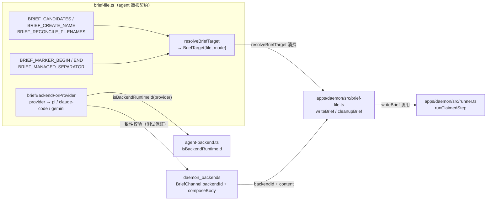
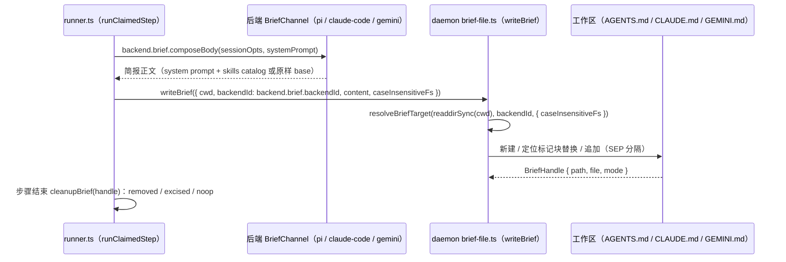
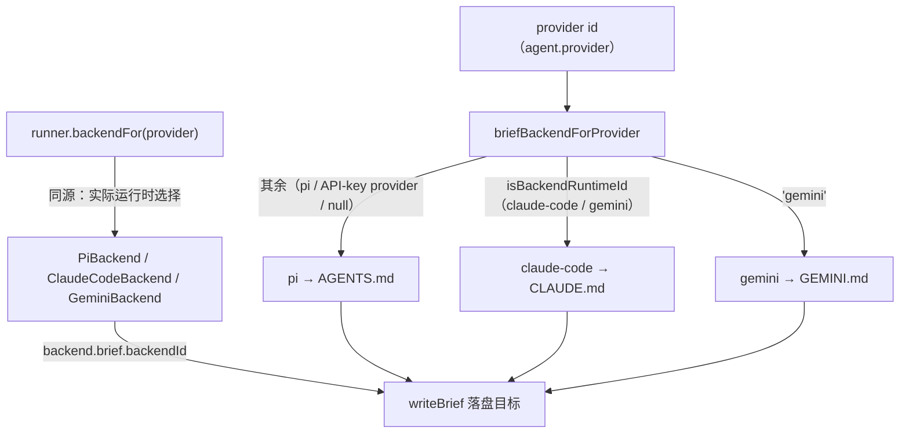

# Agent 简报文件工具（shared_task_tools_brief）

## 简介与定位

`shared_task_tools_brief` 是 [任务工具面 shared_task_tools](../shared_task_tools.md) 的五个子模块之一，对应共享包中的单个文件 **`packages/shared/src/brief-file.ts`**，核心组件为 `briefBackendForProvider`（同文件的 `resolveBriefTarget` 与其配套）。

该文件定义 cairn 系统中 **agent 简报（brief）文件**的完整命名契约、后端判定与落盘目标解析：

- **后端判定**：`briefBackendForProvider(provider)` 把任意 provider 标识映射到 `pi` / `claude-code` / `gemini` 三个后端 id 之一，与 daemon `runner` 的 `backendFor`（provider → 实际运行时）保持同源（见下文“失败模式 4”）；
- **文件名词表**：`BRIEF_CANDIDATES`（每个后端的候选文件名与优先级）、`BRIEF_CREATE_NAME`（新建时的标准名）、`BRIEF_RECONCILE_FILENAMES`（清理/对账扫描范围）；
- **目标解析**：`resolveBriefTarget` 根据工作区现有文件与文件系统大小写敏感性，决定**追加进哪个现有文件**还是**新建标准文件**；
- **标记常量**：`BRIEF_MARKER_BEGIN` / `BRIEF_MARKER_END`（HTML 注释形式的自动管理块边界）与 `BRIEF_MANAGED_SEPARATOR`（追加分隔）。

**什么是 agent brief？** cairn 的每个步骤（plan / build / merge / verify / review / chief）开工前，daemon 会把本步的运行简报——system prompt（任务描述、记忆、任务元信息指令）加技能目录（skills catalog）——作为**项目内文件**写入工作区根目录：pi 运行时读取 `AGENTS.md`（含 `AGENTS.override.md` 覆盖优先级）、Claude Code 读取 `CLAUDE.md`、Gemini 读取 `GEMINI.md`。这份文件由 cairn 运行时自动管理，步骤结束时被擦除，绝不允许 agent 把它当作仓库改动提交。本模块是这套机制在共享包侧的**纯函数契约**，daemon / server / web / CI 各自引用，不复制字面量。

## 模块组成与架构



**模块内部依赖**：`brief-file.ts` 唯一的外部依赖是 `agent-backend.ts` 的 `isBackendRuntimeId`（判断 provider 是否属于 `['claude-code','gemini']` 运行时词表）。它不依赖任务工具面其它四个文件；相反，[shared_task_tools_meta](shared_task_tools_meta.md) 与 [shared_task_tools_attachment](shared_task_tools_attachment.md) 与它互不引用。

**导出路径**：经 [共享包入口 shared](../../shared.md) 的 `src/index.ts`（`export * from './brief-file.js'`）对外导出，daemon 通过 `@cairn/shared` 引用；`apps/daemon/src/brief-file.ts` 的 `writeBrief` / `cleanupBrief` 是该契约在生产侧的直接消费者。

## 组件详解

### 类型与词表

| 导出 | 值 | 说明 |
| --- | --- | --- |
| `BRIEF_BACKEND_IDS` | `['pi','claude-code','gemini'] as const` | 全部后端 id，`BriefBackendId` 即其元素类型 |
| `BRIEF_CANDIDATES` | `Record<BriefBackendId, readonly string[]>` | 每个后端的**候选文件名（按优先级排序）**，见下表 |
| `BRIEF_CREATE_NAME` | `Record<BriefBackendId, string>` | 找不到候选文件时**新建**的标准文件名 |
| `BRIEF_RECONCILE_FILENAMES` | `readonly string[]` | `BRIEF_BACKEND_IDS.flatMap(BRIEF_CANDIDATES)` 去重后的全集，供清理/对账扫描 |
| `BRIEF_MARKER_BEGIN` | `'<!-- BEGIN CAIRN-RUNTIME (auto-managed; do not edit) -->'` | 自动管理块起始标记（HTML 注释，渲染侧惰性） |
| `BRIEF_MARKER_END` | `'<!-- END CAIRN-RUNTIME -->'` | 自动管理块结束标记 |
| `BRIEF_MANAGED_SEPARATOR` | `'\n\n'` | 追加到已有文件时块与原有内容之间的分隔 |
| `BriefTarget` | `{ file: string; mode: 'create' \| 'append' }` | `resolveBriefTarget` 的解析结果 |

`BRIEF_CANDIDATES` 各后端候选顺序（`as const`，顺序即优先级）：

| 后端 | 候选文件名（按序） | 新建标准名 |
| --- | --- | --- |
| `pi` | `AGENTS.override.md` → `AGENTS.md` → `AGENTS.MD` → `CLAUDE.md` → `CLAUDE.MD` | `AGENTS.md` |
| `claude-code` | `CLAUDE.md` | `CLAUDE.md` |
| `gemini` | `GEMINI.md` | `GEMINI.md` |

### `briefBackendForProvider(provider)`（核心组件）

```ts
briefBackendForProvider(provider: string | null | undefined): BriefBackendId
```

按以下顺序判定：

1. `provider === 'gemini'` → `'gemini'`（Gemini ACP 运行时，写 `GEMINI.md`）；
2. `isBackendRuntimeId(provider)`（即 `provider` 属于 `['claude-code','gemini']`）→ `'claude-code'`（Claude Code SDK 运行时，写 `CLAUDE.md`）；
3. 其余一切（含 `'pi'`、任意 API-key provider id、`null` / `undefined`）→ `'pi'`（pi 运行时，写 `AGENTS.md`）。

该映射与 daemon `runner.ts` 的 `backendFor`（`'gemini'` → GeminiBackend、运行时 id → ClaudeCodeBackend、其余 → PiBackend）**刻意保持同源**——单元测试以 `briefBackendForProvider('claude-code') === 'claude-code'`、`('pi') === 'pi'`、`('stub-gw') === 'pi'`、`(null) === 'pi'` 等断言钉死（见 `packages/shared/test/brief-file.test.ts` 的 failure mode 4 用例，随 CI [check 作业](../../Repository_automation_and_delivery/github_ci/github_ci_main_pipeline.md) 运行）。这样“provider 被哪个运行时执行”与“简报写进哪份文件”永远不会错位。

### `resolveBriefTarget(entries, backend, opts)`（配套组件）

```ts
resolveBriefTarget(
  entries: readonly string[],          // 工作区根目录的现有条目（readdirSync 结果）
  backend: BriefBackendId,             // 由后端判定得到
  opts: { caseInsensitiveFs: boolean },// darwin / win32 为 true
): BriefTarget
```

**判定决策表**（来自 `packages/shared/test/brief-file.test.ts` 的 gate 2 用例）：

| 工作区现状 | `pi` | `claude-code` | 设计动机 |
| --- | --- | --- | --- |
| 空目录 | 新建 `AGENTS.md` | 新建 `CLAUDE.md` | 各后端用自己标准名 |
| 只有 `CLAUDE.md` | **追加** `CLAUDE.md` | 追加 `CLAUDE.md` | 失败模式 1（shadowing）：pi 绝不新建 `AGENTS.md` 去遮蔽 `CLAUDE.md` |
| 只有 `AGENTS.md` | 追加 `AGENTS.md` | **新建** `CLAUDE.md` | Claude Code SDK **不读** `AGENTS.md`，必须新建自己的文件 |
| 两者都在 | 追加 `AGENTS.md`（候选序中 `AGENTS.md` 先于 `CLAUDE.md`） | 追加 `CLAUDE.md` | 各自取自己候选序的首个命中 |
| 有 `AGENTS.override.md` | **追加 `AGENTS.override.md`**（压过一切） | 新建 `CLAUDE.md` | 失败模式 2（invisible）：pi 必须写进 override 文件，否则内容不可见 |
| 大小写不敏感盘上只有 `CLAUDE.MD` | 追加 `CLAUDE.MD`（用**盘上真实拼写**） | 追加 `CLAUDE.MD` | 失败模式 3/5：`CLAUDE.MD` 满足 `CLAUDE.md` 候选，且写回真实文件名 |
| 大小写敏感盘上只有 `CLAUDE.MD` | 追加 `CLAUDE.MD`（pi 第 5 候选命中） | **新建** `CLAUDE.md` | 大小写敏感时 claude-code 不认 `CLAUDE.MD` |
| 大小写敏感盘上只有 `claude.md` | **新建** `AGENTS.md` | 新建 `CLAUDE.md` | 全小写不命中任何候选——简报必须可见，宁新建不写错文件 |
| 无关文件（`README.md` 等） | 新建 `AGENTS.md` | 新建 `CLAUDE.md` | 无关条目不影响判定 |

要点：

- **命中顺序 = 候选序**：对每个候选，先做大小写折叠（`caseInsensitiveFs` 时 `toLowerCase()`）查 `realNameFor` 映射（记录盘上真实拼写），命中即返回 `{ file: 真实拼写, mode: 'append' }`；
- **未命中 → 新建**：返回 `{ file: BRIEF_CREATE_NAME[backend], mode: 'create' }`；
- 输出 `mode` 只区分“追加”与“新建”，**实际写盘**（含标记块定位、`BRIEF_MANAGED_SEPARATOR` 追加、块替换）由 daemon 侧 `apps/daemon/src/brief-file.ts` 的 `writeBrief` 完成。

## 关键数据流与调用关系

### 简报写入生命周期（daemon 侧）



### 后端 → 简报文件映射



## 与其它模块的关系

- **[任务工具面 shared_task_tools](../shared_task_tools.md)**：本模块的上层页面。五个任务工具文件的分工总览、模块内依赖与架构级数据流见该页，此处不重复。
- **[共享包 shared](../../shared.md)**：包级配置（`package.json` 的 `exports`、`sideEffects: false`、`scripts`、`tsconfig` 严格基线）与整体构建/CI 说明见该页。
- **[shared_runtime_helpers](../shared_runtime_helpers.md)**：`brief-file.ts` 所属的“运行期纯函数”既有页面，含本模块的概览级描述；本页是其组件级细分。
- **[daemon_backends](../../Backend_application_services/daemon/daemon_backends.md)**：`PiBackend.brief`（backendId `'pi'`，composeBody 追加 `composeSkillsSection`）、`ClaudeCodeBackend.brief`（backendId `'claude-code'`，同上）、`GeminiBackend.brief`（backendId `'gemini'`，composeBody 原样返回 `base`）——三者共同构成 `BriefChannel`，是简报内容的“写”方向来源。
- **[daemon_step_execution](../../Backend_application_services/daemon/daemon_step_execution.md)**：`runner.ts` 在步骤执行流程中调用 `writeBrief`（`backend.brief.backendId` + `composeBody`），并在步骤收尾调用 `cleanupBrief`；`apps/daemon/src/brief-file.ts` 是共享契约的落盘实现（`locateMarkerBlock` / `reconcileBriefLeftovers` / `cleanupBriefFile`）。
- **[daemon_machine_client](../../Backend_application_services/daemon/daemon_machine_client.md)**：`machine-loop.ts` 的 `backendFor` 是 provider → 运行时选择的生产实现，`briefBackendForProvider` 与其保持同源（测试钉死一致性）。
- **[daemon_workspace_git](../../Backend_application_services/daemon/daemon_workspace_git.md) / git 操作契约**：简报文件写在 `WorktreeOps` 管理的工作区（`ws.cwd`）内，步骤结束时必须被擦除——`runner.ts` 在 `cleanupBrief` 失败时明确跳过提交/推送，避免简报被当作改动带进分支。
- **[Repository_automation_and_delivery](../../Repository_automation_and_delivery.md)**：CI 的 [check 作业](../../Repository_automation_and_delivery/github_ci/github_ci_main_pipeline.md)（`VITEST_PROJECT_SET=light pnpm test`）覆盖 `packages/*` 单测，`brief-file.test.ts` 即在此运行。

## 构建、测试与 CI

本模块没有独立的构建产物或测试配置——它只是 `@cairn/shared` 包的一个源码文件：

- **类型检查**：随包执行 `pnpm --filter @cairn/shared typecheck`（即 `tsc --noEmit`），也覆盖在根 `pnpm typecheck` 中。
- **单元测试**：随包执行 `pnpm --filter @cairn/shared test`（即 `vitest run`）；`packages/shared/test/brief-file.test.ts` 覆盖 `resolveBriefTarget` 决策表（gate 2）、`briefBackendForProvider` 映射（failure mode 4）与词表形状约束；CI 的 [check 作业](../../Repository_automation_and_delivery/github_ci/github_ci_main_pipeline.md) 会执行。
- **打包**：无独立构建；daemon 经 `workspace:*` 直接引用 `src/` 源码，`sideEffects: false` 保证摇树友好。

## 设计约定

1. **单一事实来源**：`BRIEF_CANDIDATES` / `BRIEF_CREATE_NAME` / `BRIEF_RECONCILE_FILENAMES` / 标记常量均为 `as const` 只读，daemon 落盘、清理对账、后端 composeBody 都不各自复制字面量；daemon 侧 `apps/daemon/src/brief-file.ts` 直接 import 本模块常量。
2. **与运行时选择同源**：`briefBackendForProvider` 与 `runner.backendFor` 共享同一判定（`'gemini'` → gemini、运行时 id → claude-code、其余 → pi），由单测钉死，防止“被哪个运行时执行”与“简报写进哪份文件”错位（failure mode 4）。
3. **候选序即优先级，防遮蔽防不可见**：`AGENTS.override.md` 压过一切（否则 pi 写入对 override 文件不可见，failure mode 2）；pi 在只有 `CLAUDE.md` 时追加而非新建 `AGENTS.md`（否则新建文件遮蔽现有文件，failure mode 1）。
4. **大小写折叠 + 真实拼写**：`caseInsensitiveFs`（darwin / win32）折叠比较但回写盘上真实文件名；大小写敏感盘上全小写 `claude.md` 不命中任何候选时宁新建标准文件，保证简报一定可见（failure modes 3/5）。
5. **标记块是 HTML 注释、内容禁含标记**：`BRIEF_MARKER_BEGIN/END` 以 `<!--`/`-->` 包裹，渲染侧惰性；`writeBrief` 的 `buildBlock` 拒绝包含标记的正文，避免块嵌套破坏 `locateMarkerBlock`。
6. **纯函数、无副作用**：全部导出为纯函数与只读常量，daemon / server / web / CI 可任意复用与单测。
