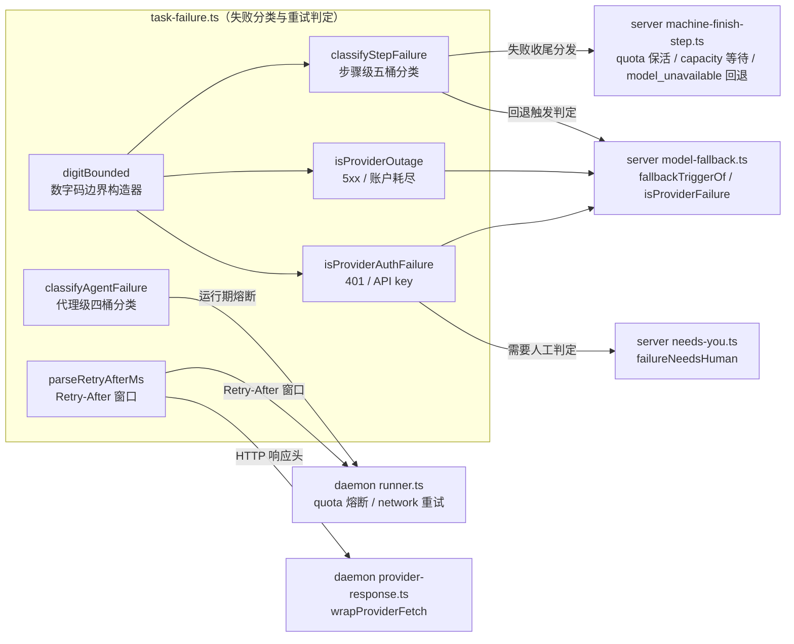
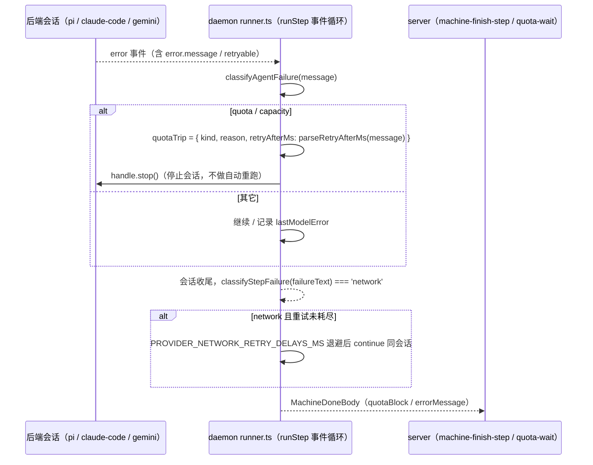

# 失败分类与重试判定（shared_task_tools_failure_classification）

## 简介与定位

`shared_task_tools_failure_classification` 是 [任务工具面 shared_task_tools](../shared_task_tools.md) 之下针对 **`packages/shared/src/task-failure.ts`** 的组件级页面，覆盖该文件中**失败分类与重试判定的全部六个组件**：`digitBounded`、`classifyStepFailure`、`classifyAgentFailure`、`isProviderOutage`、`isProviderAuthFailure`、`parseRetryAfterMs`。

该文件是 cairn 系统重试与退避策略的**单一判定依据**，为 daemon（执行侧）与 server（编排侧）提供三组契约：

- **两套分类维度**：
  - 步骤级 `classifyStepFailure(rawError): StepFailureKind`——面向**步骤最终失败收尾**（server 决定保活/挂起/换模型），种类为 `quota` / `capacity` / `model_unavailable` / `network` / `other`；
  - 代理级 `classifyAgentFailure(message): AgentFailureKind`——面向**agent 会话运行中的失败消息**（daemon 决定熔断/退避），种类为 `quota` / `capacity` / `provider_network` / `other`；
- **两个布尔判定**：`isProviderOutage`（provider 5xx 与账户耗尽，驱动模型回退链）与 `isProviderAuthFailure`（认证失败，驱动“需要人工”判定）；
- **一个窗口解析**：`parseRetryAfterMs`（解析 `Retry-After`，生成额度等待/退避窗口），附带 `RETRY_AFTER_MAX_MS`（24 小时）上限常量。

它与 [shared_runtime_helpers](../shared_runtime_helpers.md)（`task-failure.ts` 所属的“运行期纯函数”概览页）在模块树中共存；本页侧重**分类语义、优先级表、消费方数据流与跨模块联动**，避免重复已有概览级描述。

本模块与任务工具面其它文件一致：**无副作用的纯函数与只读常量**（配合 `packages/shared/package.json` 的 `sideEffects: false` 便于摇树），不依赖任务工具面内部的 `attachment-token.ts`、`brief-file.ts`、`git-ops.ts`、`task-meta.ts` 任何一个文件，可被 server / daemon / web / CI 任意复用与单测。

## 模块组成与架构



**模块内部依赖**：`digitBounded` 是内部辅助构造器，被 `classifyStepFailure`（`402`/`429|529`/`404` 三个数字码）、`isProviderOutage` 与 `isProviderAuthFailure`（`401`）复用；`containsAny` 是文件内私有的子串匹配辅助。文件对外**不依赖本模块之外的任何运行时代码**，只导出纯函数与 `as const` 词表（`STEP_FAILURE_KINDS`、`AGENT_FAILURE_KINDS`、`RETRY_AFTER_MAX_MS`）。

**导出路径**：经 [共享包入口 shared](../../shared.md) 的 `src/index.ts`（`export * from './task-failure.js'`，见第 26 行）对外导出，daemon 与 server 通过 `@cairn/shared` 直接引用。

## 组件详解

### `digitBounded`（内部辅助构造器）

```ts
const digitBounded = (codes: string): RegExp =>
  new RegExp(`(^|[^0-9])(${codes})([^0-9]|$)`);
```

把一组数字码包装成“两侧均非数字”的正则，**避免数字码误匹配进长数字串**。例如：

- `digitBounded('402')` 能命中 `402 Payment Required`、`code=402 billing`，但不会命中 `input tokens: 402913`（`402` 两侧是数字）；
- `digitBounded('429|529')` 命中 `HTTP 429` / `529 overloaded`，不命中 `15290ms`；
- `digitBounded('401')` 命中 `401 Unauthorized`，不命中 `see PR #401`、`request took 4013ms`。

模块树中该构造器也由 [shared_runtime_helpers](../shared_runtime_helpers.md) 的概览页提及；本页从分类语义的角度引用它。

### `classifyStepFailure`（步骤级分类）

```ts
export const STEP_FAILURE_KINDS = ['quota', 'capacity', 'model_unavailable', 'network', 'other'] as const;
export type StepFailureKind = (typeof STEP_FAILURE_KINDS)[number];

export function classifyStepFailure(rawError: string): StepFailureKind
```

输入**步骤最终失败**的原始错误文本（trim 后小写为 `lower`），按以下**刻意设计的优先级表**短路判定（来自 `packages/shared/test/task-failure.test.ts`，issue #1257）：

| 优先级 | 命中条件（`lower`） | 结果 | 设计意图 |
| --- | --- | --- | --- |
| 1 | 空串 / 全空白 | `other` | 无信息可分类 |
| 2 | 含 `concurrent request limit` | `capacity` | 并发上限属容量而非额度 |
| 3 | `context length` / `context_length_exceeded` / `maximum context` / `prompt is too long` / `context size has been exceeded`，**或**同时含 `token` 与 `limit` | `other` | **刻意不判为 quota**——把输入超长报成额度问题会让调度器做错误退避（#1257 三桶设计） |
| 4 | HTTP `402`（`digitBounded`）或 `insufficient_balance` / `balance is too low` / `monthly usage limit` / `usage limit` / `you've/you’ve hit your limit` / `quota` / `credits` | `quota` | 额度桶 |
| 5 | 含 `/v1/messages` 且命中 HTTP `404`（`digitBounded`） | `model_unavailable` | Claude 风格 `/v1/messages` 404 |
| 6 | `model not found` / `model_not_found` / `model unavailable` / `model is not available` / `no such model`，**或** `404` +（`model` 或 `not found`） | `model_unavailable` | 模型不可用桶 |
| 7 | HTTP `429`/`529`（`digitBounded`）或 `rate limit` / `overloaded` / `no capacity available` | `capacity` | 容量/限流桶 |
| 8 | `stream disconnected` / `connection closed` / `mid-response` / `connection error` / `fetch failed` / `connection reset` / `econnreset` / `etimedout` / `socket hang up` / `error sending request` / `unable to connect` / `dial tcp` / `connection refused` / `connectionrefused` / `dns` / `i/o timeout` / `deadline exceeded` / `timeout exceeded while awaiting` / `request timed out` | `network` | 网络桶 |
| 9 | 其余 | `other` | 兜底 |

关键顺序语义（由单测钉死）：

- **quota > capacity > network**：`upstream stream disconnected ... (402 quota)` 判 `quota`，`stream disconnected before rate limit window reset (429)` 判 `capacity`——额度问题优先于网络表象；
- **数字边界**：`input tokens: 402913`、`request failed after 15290ms`、`exit status 4030` 均为 `other`（`digitBounded` 防误匹配），而 `HTTP error 429`、`code=402 billing` 正确分类；
- **401 / 5xx 归 `other`**：认证失败与 provider 5xx 在步骤级不被分类（前者交给 `isProviderAuthFailure`、后者交给 `isProviderOutage` 单独判定）。

### `isProviderOutage`（provider 故障判定）

```ts
export function isProviderOutage(rawError: string): boolean
```

判定 provider 侧**服务故障**（5xx / 账户耗尽），先做两层排除再匹配（issue #1786）：

1. 空串 → `false`；
2. **排除 git 通道错误**：`GIT_ERROR_PREFIX_RE`（`^git \w+ failed \([^)]*\)`）或 `GIT_PROGRESS_RE`（`enumerating|counting|compressing|writing|receiving|resolving objects:` 进度行）命中即 `false`——git 命令里出现的 HTTP 500 不是 provider 故障；
3. **账户耗尽**：`ACCOUNT_EXHAUSTION_PHRASES`（`quota exhausted` / `credits exhausted` / `insufficient balance` / `no credits left` / `all available accounts exhausted` 等）命中 → `true`；
4. **provider 5xx**：`PROVIDER_5XX_PATTERNS`（`http 5xx`、`status: 5\d\d`、`-> 503`、`provider response: ... 5\d\d`、`502 Internal Server Error` 等 7 条正则）任一命中 → `true`。

单测钉死的反例：`429 rate limited`（容量而非故障）、`Context length exceeded`（输入问题）、`git push failed (1): ... HTTP 500`（git 通道）、`checked out 512 files`（进度行）、`the agent exhausted its tool-call budget`（非 provider 语域）均返回 `false`。

### `isProviderAuthFailure`（鉴权失败判定）

```ts
export function isProviderAuthFailure(rawError: string): boolean
```

判定 provider **认证/API key 失败**（issue #1493）：

1. 空串 → `false`；
2. 命中 `authentication_error` / `invalid api key` / `invalid_api_key` / `invalid x-api-key` / `incorrect api key` / `api key expired` → `true`；
3. 命中 HTTP `401`（`digitBounded`）**且**同时含 `api key` / `api_key` / `x-api-key` → `true`。

单测钉死的反例：裸 `401 Unauthorized`（无 API key 上下文）为 `false`，`request took 4013ms`、`see PR #401`（数字边界）为 `false`，git 远程 `The requested URL returned error: 401`、`gh: Bad credentials (HTTP 401)` 为 `false`——避免把 git 通道的 401 误判为 provider 鉴权问题。

### `classifyAgentFailure`（代理级分类）

```ts
export const AGENT_FAILURE_KINDS = ['quota', 'capacity', 'provider_network', 'other'] as const;
export type AgentFailureKind = (typeof AGENT_FAILURE_KINDS)[number];

export function classifyAgentFailure(message: string): AgentFailureKind
```

输入 **agent 会话运行中返回的失败消息**，按三条正则短路判定（issue #1261，F1–F4）：

| 优先级 | 正则（均忽略大小写，含中英文措辞） | 结果 |
| --- | --- | --- |
| 1 | `QUOTA_PATTERN`：`\b402\b`、`usage limit`、`insufficient quota/credit/balance`、`quota/credit/balance is insufficient`、`quota exceed/exhaust/limit`、`credit balance`、`billing`、`余额不足`、`额度不足\|用完\|耗尽\|已用尽`、`欠费` | `quota` |
| 2 | `CAPACITY_PATTERN`：`\b(?:429|529)\b`、`rate limit`、`too many requests`、`overloaded`、`请求过于频繁`、`限流`、`负载(已)饱和` | `capacity` |
| 3 | `NETWORK_PATTERN`：`connection error/reset/refused/closed`、`upstream stream disconnected`、`ECONNREFUSED`/`ECONNRESET`/`ETIMEDOUT`、`socket hang up`、`fetch failed`、`network error`、`temporarily unavailable` | `provider_network` |
| 4 | 其余（含空串） | `other` |

单测钉死的语义：

- **优先级 quota > capacity**：`429 then 402: out of credit` 判 `quota`；
- **诊断行形状**：`provider error\nprovider response: POST ... -> 402 ...; first bytes: "insufficient credit"` 判 `quota`（与 daemon `describeProviderResponse` 的增强错误格式兼容）；
- **`other` 反例**：`400: {"message":"Model does not support this protocol."}`（协议问题）、`git commit failed (1): lint/style/useTemplate`（git/工具失败）、`session abc not found`（会话问题）均不落入前三种；
- 代理级**没有** `model_unavailable` 桶——模型不可用在运行期由其它机制（`protocolCompatFlip`、server 端回退链）处理。

### `parseRetryAfterMs`（重试窗口解析）

```ts
export const RETRY_AFTER_MAX_MS = 24 * 60 * 60 * 1000;

export function parseRetryAfterMs(text: string): number | null
```

从任意文本中解析 `Retry-After` 窗口为毫秒数（issue #1261 F5）：

1. 正则 `retry[ _-]?after[\s:=]+(\d+)\s*(s|sec|seconds?|m|min|minutes?|h|hours?)?`（忽略大小写）——覆盖 `retry-after: 120`、`Retry-After: 30`、`retry after 45 seconds`、`retry-after=60s`、`please retry-after 2 minutes` 等形状；
2. 数值非有限或 ≤ 0 → `null`（`retry-after: soon`、HTTP 日期 `Wed, 21 Oct 2026 ... GMT`、无匹配文本均为 `null`，**不臆造数字**）；
3. 单位乘数：`s`/秒 → `1_000`，`m`/分 → `60_000`，`h`/时 → `3_600_000`，缺省按秒；
4. **上限钳制**：超过 `RETRY_AFTER_MAX_MS`（24 小时）返回 `null`——防止异常大值（如 `retry-after: 999999999`）把探测/退避调度到数年后（#1261 F5 设计意图）。

## 关键数据流与调用关系

### daemon 执行侧：运行期熔断与网络重试（runner.ts）

`apps/daemon/src/runner.ts` 是步骤执行的主循环，运行期消费 `classifyAgentFailure` / `parseRetryAfterMs` / `classifyStepFailure`：



要点：

- **quota 熔断**：`classifyAgentFailure` 判 `quota` / `capacity` 时，若 `quotaTrip === null` 则记录 `{ kind, reason, retryAfterMs: parseRetryAfterMs(message) }` 并 `handle.stop()`——**不做零进展自动重跑**，避免在额度/容量问题上空转（`logger.step` 输出 `quota circuit breaker`）；
- **网络重试**：`classifyStepFailure(failureText) === 'network'` 且 `networkRetries < networkRetryDelays.length`（plan/build 步 `[2s, 4s, 8s, 16s]`，其余 `[0, 5s]`）时，按延迟退避后 `continueId = handle.sessionId` **续接同一会话**重试；
- **收尾兜底**：若运行期未熔断，收尾时对 `lastModelError ?? lastError` 再跑一次 `classifyAgentFailure`，命中 quota/capacity 则生成 `QuotaBlock` 写入 `MachineDoneBody`——server 据此进入额度等待。

`QuotaBlock` 的 wire 形状见 [shared_records](../shared_records.md) 的 `records/step.ts`（`quotaWaitSchema`：`kind` ∈ `quota`/`capacity`、`providerId`、`label`、`retryAfterMs`、`probeAt`），server 侧 `quota-wait.ts` 消费 `retryAfterMs` 计算指数退避探测窗口（`QUOTA_PROBE_BASE_MS` 60s → `QUOTA_PROBE_MAX_MS` 30min）。

### daemon 后端：Retry-After 响应头捕获（provider-response.ts）

`apps/daemon/src/backend/provider-response.ts` 的 `wrapProviderFetch` 包装 provider HTTP 响应，用 `parseRetryAfterMs('retry-after: ' + raw)` 把 `Retry-After` 头解析进 `ProviderResponseShape.retryAfterMs`，再经 `describeProviderResponse` 把窗口拼进步骤错误文本（`retry-after: Ns`）——**这就是 runner 的错误消息里能出现 `retry-after` 文本的来源**，两条链路闭环。

### server 编排侧：失败收尾分发（machine-finish-step.ts）

`apps/server/src/services/machine-finish-step.ts` 的 `finishStep` 在步骤失败收尾时按 `classifyStepFailure` 分发：

| 分类结果 | 动作 |
| --- | --- |
| `quota`（且 body 无 `quotaBlock`） | `holdStepForQuota`——步置回 `pending` + `holdReason: 'quota'` + 指数退避 `holdUntil`，并唤醒机器舰队 |
| `capacity` | `applyQuotaWaitStep(kind: 'capacity', providerId, reason)`——进入额度等待队列，按 `probeAt` 周期重探 |
| `model_unavailable` | 交 `planModelFallback`（`markModelDead` + 换备用模型重排步骤） |
| `network` / `other` | 进入通用失败路径（是否自动重试由 `needs-you.ts` 的 `owedAutomaticRetry` 决定） |

> 注意：runner 已把 quota/capacity 折叠进 `MachineDoneBody.quotaBlock`（见上），`finishStep` 先处理 `quotaBlock !== undefined`，`classifyStepFailure` 只作为**未携带 quotaBlock 时的兜底判定**——两层判定共用同一分类语义，保证口径一致。

### server 编排侧：模型回退与 provider 健康（model-fallback.ts）

`apps/server/src/services/model-fallback.ts` 把分类结果映射为回退触发点（`FallbackTrigger`）：

- `fallbackTriggerOf(outcome)`：先排除 git 失败（`isGitFailure`）→ `classifyStepFailure(msg)` 得 `quota` / `model_unavailable` / `capacity` / `network`；`other` 时再查 `isProviderAuthFailure(msg)` → `auth`；最后 `isProviderOutage(msg)` → `provider_outage`；
- `isProviderFailure(outcome)`：`quota` / `capacity` / `network`，或 `other` +（auth 或 outage）——供 `recordProviderOutcome` 驱动 [server_provider_runtime](../../Backend_application_services/server/server_provider_runtime.md) 的 `ProviderHealthTracker`（连续失败熔断 `open`、半开探测 `half_open`、`tryAcquire` 门控备用模型选择）；
- `planModelFallback`：按 `tried` 链选择备用模型时，需 `providerHealth.tryAcquire(m.provider)` 与 `getModelLiveness(...) !== 'dead'` 同时通过。

### server 编排侧：需要人工判定（needs-you.ts）

`apps/server/src/services/needs-you.ts` 的 `failureNeedsHuman(errorMessage)` 用 `isProviderAuthFailure` 判定认证失败 → 需人工介入（`NeedsYouReason = 'failed'`），否则 `owedAutomaticRetry` 允许自动重启——**鉴权失败不会进入自动重试循环**，避免用无效 key 反复烧配额。

## 与其它模块的关系

- **[任务工具面 shared_task_tools](../shared_task_tools.md)**：本模块的上层页面。五个任务工具文件的分工总览与架构级数据流见该页，此处不重复。
- **[共享包 shared](../../shared.md)**：包级配置（`package.json` 的 `exports`、`sideEffects: false`、`scripts`、`tsconfig` 严格基线）与整体构建/CI 说明见该页。
- **[shared_runtime_helpers](../shared_runtime_helpers.md)**：`task-failure.ts` 所属的“运行期纯函数”既有页面，含本模块的概览级描述与优先级表；本页是其组件级细分，可对照阅读。
- **[shared_records](../shared_records.md)**：`records/step.ts` 的 `quotaWaitSchema` 定义 `QuotaBlock` / `QuotaWait` 的 wire 形状——`parseRetryAfterMs` 的结果经 `quotaBlockOf` 写入其中。
- **[daemon_step_execution](../../Backend_application_services/daemon/daemon_step_execution.md)**：`apps/daemon/src/runner.ts` 的步骤执行主循环，消费 `classifyAgentFailure`（quota 熔断）、`classifyStepFailure`（network 重试）、`parseRetryAfterMs`（窗口）。
- **[daemon_backends](../../Backend_application_services/daemon/daemon_backends.md)**：`apps/daemon/src/backend/provider-response.ts` 的 `wrapProviderFetch` 用 `parseRetryAfterMs` 捕获 provider `Retry-After` 头；pi/claude-code 后端内置的本地 `isRetryableError` 与共享分类语义并行（daemon 内部快速重试判断，不替代本模块的收尾判定）。
- **[server_machine_fleet](../../Backend_application_services/server/server_machine_fleet.md) / [server_scheduler](../../Backend_application_services/server/server_scheduler.md)**：`machine-finish-step.ts` 按 `classifyStepFailure` 分发 quota 保活 / capacity 等待 / model_unavailable 回退；`quota-wait.ts` 与 `sweepQuotaWaitSteps` 按 `retryAfterMs` 重探释放；调度器定期驱动这些清扫。
- **[server_provider_runtime](../../Backend_application_services/server/server_provider_runtime.md)**：`model-fallback.ts` 用 `isProviderOutage` / `isProviderAuthFailure` / `classifyStepFailure` 驱动 `ProviderHealthTracker` 熔断与备用模型选择（`provider-health.ts`、`model-liveness.ts` 见该页）。
- **[server 页面](../../Backend_application_services/server.md)**：`needs-you.ts` 的 `failureNeedsHuman` 用 `isProviderAuthFailure` 决定失败构建是否需要人工介入与自动重试豁免。

## 构建、测试与 CI

本模块没有独立的构建产物或测试配置——它只是 `@cairn/shared` 包的一个源码文件：

- **类型检查**：随包执行 `pnpm --filter @cairn/shared typecheck`（即 `tsc --noEmit`），也覆盖在根 `pnpm typecheck` 中。
- **单元测试**：`packages/shared/test/task-failure.test.ts` 覆盖全部六个组件——`classifyStepFailure` 的 #1257 三桶优先级与数字边界（`402913` / `15290ms` / `4030` 反例）、`isProviderOutage` 的 #1786 git 通道排除与 5xx/账户耗尽、`classifyAgentFailure` 的 #1261 F1–F4 中英文措辞与优先级、`parseRetryAfterMs` 的 F5 单位/上限/日期反例、`isProviderAuthFailure` 的 #1493 表格化正反例；随包执行 `pnpm --filter @cairn/shared test`（即 `vitest run`），CI 的 [check 作业](../../Repository_automation_and_delivery/github_ci/github_ci_main_pipeline.md)（`VITEST_PROJECT_SET=light pnpm test`）会覆盖 `packages/*`。
- **打包**：无独立构建；daemon/server 经 `workspace:*` 直接引用 `src/` 源码，`sideEffects: false` 保证摇树友好。

## 设计约定

1. **单一事实来源**：分类种类（`STEP_FAILURE_KINDS` / `AGENT_FAILURE_KINDS`）与上限常量（`RETRY_AFTER_MAX_MS`）均为 `as const` 只读词表，daemon 熔断、server 分发、回退链共用同一判定函数，**不各自复制字面量**；`packages/shared/test/task-failure.test.ts` 钉死词表形状（闭枚举）。
2. **分类可审计且顺序敏感**：`classifyStepFailure` 的优先级表是刻意设计的——上下文超长归 `other` 而非 `quota`（避免输入问题触发额度退避）；quota > capacity > network 优先（额度表象优先于网络表象）；401/5xx 在步骤级不分类，交给专门判定。
3. **数字边界防误匹配**：所有 HTTP 状态码判定都经 `digitBounded` 锚定非数字边界（`402913`、`15290ms`、`PR #401` 不误触发），由单测钉死。
4. **语域隔离**：git 通道错误在 `isProviderOutage` / `isProviderAuthFailure` 中被先行排除（`GIT_ERROR_PREFIX_RE` / `GIT_PROGRESS_RE`、401 需伴随 API key 上下文），避免把 git 的 500/401 误判为 provider 故障；`model-fallback.ts` 的 `isGitFailure` 也遵循同一原则。
5. **窗口解析不臆造**：`parseRetryAfterMs` 对 HTTP 日期、`soon`、超 24 小时的值一律返回 `null`，防止异常大值把探测/退避调度到数年后；上限由 `RETRY_AFTER_MAX_MS` 显式表达。
6. **中英文措辞并重**：`classifyAgentFailure` 的三条模式同时覆盖中文措辞（`余额不足` / `额度用完` / `限流` / `请求过于频繁` / `负载饱和` / `欠费`），与上游 provider 的本地化错误文案对齐。
7. **两层判定口径一致**：daemon 运行期熔断（`classifyAgentFailure` + `parseRetryAfterMs`）与 server 收尾分发（`classifyStepFailure`）共用同一分类语义；runner 优先把 quota/capacity 折叠进 `quotaBlock`，`finishStep` 的 `classifyStepFailure` 只作兜底，避免双源判定漂移。
