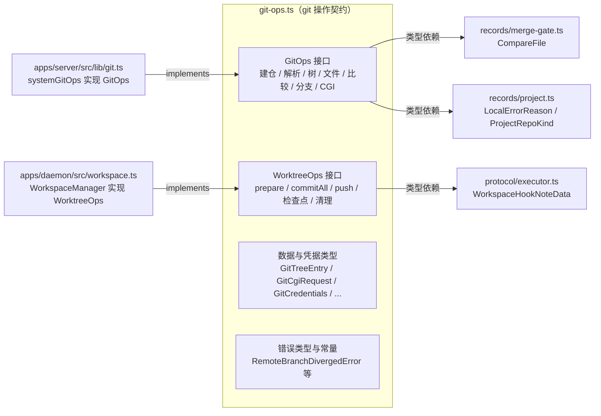
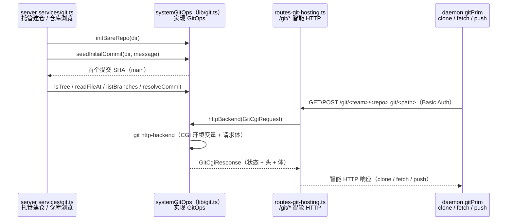
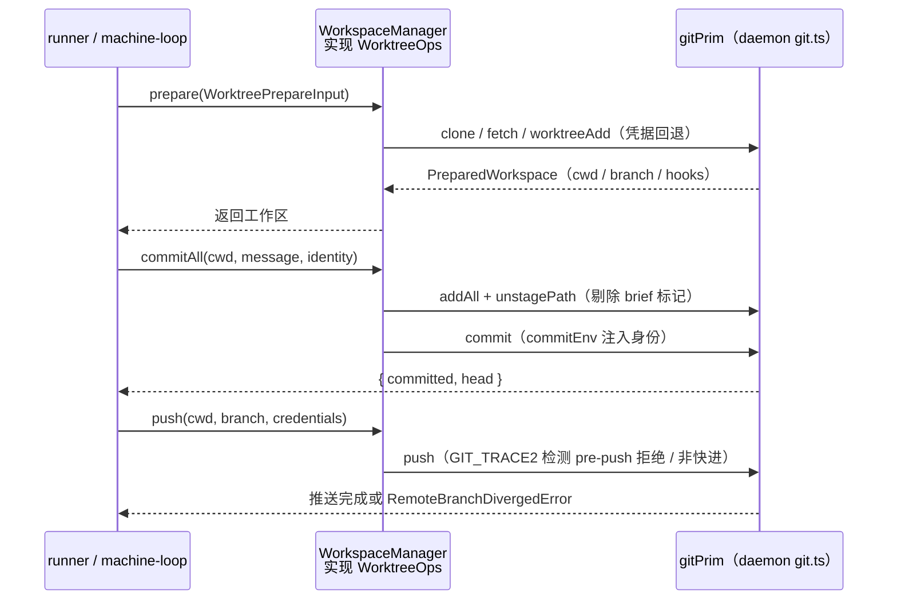
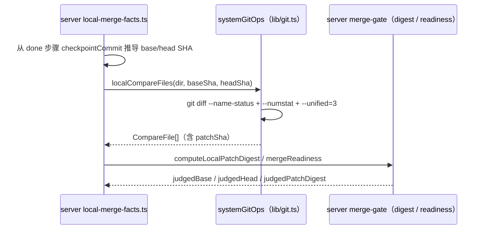

# Git 操作契约组件（shared_task_tools_gitops）

## 简介与定位

`shared_task_tools_gitops` 是 [任务工具面 shared_task_tools](../shared_task_tools.md) 的五个子模块之一，对应共享包中的单个文件 **`packages/shared/src/git-ops.ts`**，核心组件为 `GitOps`（同文件的 `WorktreeOps` 与其配套）。

与任务工具面的另外四个文件（附件令牌、brief、失败分类、任务元数据——都是运行时纯函数）不同，`git-ops.ts` **不实现任何 git 命令**，也不产生运行时副作用：它只导出“两组接口 + 数据类型 + 错误类型”的**契约**，把 cairn 系统里所有 git 操作抽象成可被 server 与 daemon 两端各自实现、互不感知的边界：

- **`GitOps`** —— 面向仓库（repository）本身的底层只读/管理操作：建裸仓、造初始提交、解析提交、遍历树、读 blob、比较补丁、列分支、祖先判定、更新分支引用、CGI 智能 HTTP 后端。主要由**服务端** `systemGitOps` 实现，用于托管仓库、仓库浏览与 git 智能 HTTP；
- **`WorktreeOps`** —— 面向**守护进程**会话工作区（worktree）的任务执行操作：准备（克隆/建 worktree/跑钩子）、提交全部改动、推送、合并默认分支、取 head、数领先提交、恢复检查点、清理孤儿工作区。由 daemon 的 `WorkspaceManager` 实现。

两端通过 `@cairn/shared` 主入口引用同一套类型，共用同一批错误语义（`RemoteBranchDivergedError` / `LocalRepoUnreachableError` / `ReadOnlyWorkspaceError`）——这就是“git 怎么操作由契约固定、git 怎么执行由两端各自负责”的分工基础，避免 server/daemon 的 git 逻辑漂移。

## 模块组成与架构

**模块内部依赖**：`git-ops.ts` 只消费共享包内其它三个文件的**类型**，不依赖任务工具面的其它四个文件：

| 导入类型 | 来源 | 用途 |
| --- | --- | --- |
| `CompareFile` | `./records/merge-gate.js`（记录面） | `GitOps.localCompareFiles` 的返回项，即本地合并闸门补丁摘要的输入 |
| `LocalErrorReason` | `./records/project.js`（记录面） | `LocalRepoUnreachableReason = Extract<LocalErrorReason, 'not_found' \| 'not_git'>` 的取值来源 |
| `ProjectRepoKind` | `./records/project.js`（记录面） | `WorktreePrepareInput.repoKind`：`hosted` / `github` / `local` |
| `WorkspaceHookNoteData` | `./protocol/executor.js`（协议面） | `PreparedWorkspace.hooks`：工作区 setup/resume 钩子执行结果 |

**导出路径**：经 [共享包入口 shared](../../shared.md) 的 `src/index.ts` 以 `export * from './git-ops.js'` 对外导出，server 与 daemon 通过 `@cairn/shared` 引用。`git-ops.ts` 本身只导出类型、常量与错误类，无运行时副作用，配合 `sideEffects: false` 便于摇树。

## 组件详解

### Git 数据视图类型

| 类型 | 字段 | 说明 |
| --- | --- | --- |
| `GitTreeEntry` | `name` / `path` / `type`（`'blob' \| 'tree'`）/ `size: number \| null` | `ls-tree` 单行条目；`size` 对应 `-l` 输出，树对象为 `null` |
| `GitFileAtRef` | `size: number` / `content: Uint8Array` | 某个提交路径下 blob 的**原始字节**与大小（不经文本解码） |
| `GitRefInfo` | `name` / `isDefault: boolean` | 分支引用信息，`isDefault` 标记是否为默认分支 |

### Git CGI 类型（git http-backend 桥）

服务端把 `git http-backend` 的 CGI 协议包装成纯数据，供 `GitOps.httpBackend` 使用：

| 类型 | 字段 | 说明 |
| --- | --- | --- |
| `GitCgiRequest` | `projectRoot` / `pathInfo` / `queryString` / `method`（`'GET' \| 'POST'`）/ `contentType?` / `remoteUser?` / `body: Uint8Array` | 对应 CGI 环境变量：`GIT_PROJECT_ROOT`、`PATH_INFO`、`QUERY_STRING`、`REQUEST_METHOD`、`CONTENT_TYPE`、`REMOTE_USER` 与请求体 |
| `GitCgiResponse` | `status: number` / `headers: [string, string][]` / `body: Uint8Array` | 解析后的 CGI 输出：状态码、响应头对列表、响应体 |

服务端 `apps/server/src/lib/git.ts` 用 `decodeCgiResponse` 把 `git http-backend` 的原始输出（含 `Status:` 头与 chunked 传输编码）翻译为 `GitCgiResponse`。

### 凭据类型

| 类型/常量 | 说明 |
| --- | --- |
| `GitCredentials` | `{ username: string; password: string }`，基础凭据对 |
| `BoundGitCredentials` | `GitCredentials & { url: string }`，**绑定目标仓库 URL** 的凭据（“per-step 下发 token”）——daemon 侧 `gitCredentialEnv(cred)` 只对匹配 `url` 的 host/protocol 注入凭据 helper |
| `GitCredentialSource` | `'integration' \| 'machine'`：凭据来源——`integration` 为服务端按步骤下发的 token，`machine` 为执行机本机 git 凭据 |
| `GITHUB_ACCESS_TOKEN_USERNAME` | `'x-access-token'`，GitHub 访问令牌的固定 Basic Auth 用户名 |

### 提交身份与工作区类型

| 类型 | 字段 | 说明 |
| --- | --- | --- |
| `CommitIdentity` | `name` / `email` | 提交作者/提交者身份；daemon 侧 `commitEnv(identity)` 会同时设置 `GIT_AUTHOR_*` 与 `GIT_COMMITTER_*` |
| `WorktreePrepareInput` | `projectId` / `conversationId` / `cloneUrl` / `repoKind?` / `workspacesRoot` / `credentials` / `localPath?` / `machineCredentialFallback?` / `readonly?` | `WorktreeOps.prepare` 的输入：`projectId` 是加锁粒度；`conversationId` 决定工作分支名 `conversationBranch(conversationId)`；`localPath` 是本地仓库直连克隆源；`readonly` 开启只读导出模式 |
| `PreparedWorkspace` | `cwd` / `baseRepoDir` / `branch` / `defaultBranch` / `reused` / `hooks?` / `credentialSource?` / `readonly?` | `prepare` 的结果：`cwd` 为工作区目录、`baseRepoDir` 为共享仓库目录、`hooks` 为 `WorkspaceHookNoteData[]`（setup/resume 钩子结果）、`credentialSource` 记录凭据来源供审计 |
| `OrphanCleanupInput` | `workspacesRoot` / `ttlMs` / `now` / `activeConversationIds: Iterable<string>` | 孤儿工作区清理参数：根目录、存活期、当前时间、活跃会话 id 集合 |

### `GitOps` 接口（核心组件）

服务端实现（`apps/server/src/lib/git.ts` 的 `systemGitOps`）面向“仓库本身”，全部方法以 `dir`（仓库目录）为第一参数：

| 方法 | 签名 | 说明 |
| --- | --- | --- |
| `initBareRepo` | `(dir) => Promise<void>` | `git init --bare`，并把 HEAD 指向 `main`、开启 `http.receivepack` / `http.uploadpack`（供智能 HTTP 推送/拉取） |
| `seedInitialCommit` | `(dir, message) => Promise<string>` | 用空树 `commit-tree` 造首个提交并 `update-ref` 到 `main`，返回 SHA；用于 `provisionHostedRepo` 建仓 |
| `resolveCommit` | `(dir, ref) => Promise<string \| null>` | `rev-parse --verify <ref>^{commit}`，校验 40–64 位十六进制后返回，否则 `null` |
| `isGitRepo` | `(dir) => Promise<boolean>` | `rev-parse --is-inside-work-tree` 判定目录是否工作树仓库 |
| `lsTree` | `(dir, commit, subPath?) => Promise<GitTreeEntry[]>` | `ls-tree -l <commit>`；`subPath` 需通过 `isSafeRepoPath`（拒绝空串、`/` 开头、`..` 段、`\0`） |
| `readFileAt` | `(dir, commit, path) => Promise<GitFileAtRef \| null>` | `cat-file blob <commit>:<path>`，返回原始字节 |
| `localCompareFiles` | `(dir, base, head) => Promise<CompareFile[]>` | `git diff --name-status -z --find-renames <base>...<head>` 配合逐文件 `--numstat` / `--unified=3` 产出 `CompareFile[]`（含 `patchSha`），供本地合并闸门计算补丁摘要 |
| `listBranches` | `(dir) => Promise<{ defaultBranch: string \| null; branches: GitRefInfo[] }>` | `symbolic-ref --short HEAD` + `for-each-ref refs/heads` |
| `isAncestor` | `(dir, ancestor, commit) => Promise<boolean>` | `merge-base --is-ancestor` 判定祖先关系 |
| `updateBranchRef` | `(dir, branch, commit) => Promise<void>` | `update-ref refs/heads/<branch> <commit>`；校验分支名与 SHA 形状，拒绝不安全输入 |
| `httpBackend` | `(req: GitCgiRequest) => Promise<GitCgiResponse>` | 以 CGI 环境变量执行 `git http-backend`，解析输出为 `GitCgiResponse` |

### `WorktreeOps` 接口（配套组件）

daemon 实现（`apps/daemon/src/workspace.ts` 的 `WorkspaceManager`）面向“会话工作区”，方法以 `cwd`（工作区目录）为第一参数。标注 `?` 的为**可选成员**（渐进接口，实现方可按需提供）：

| 方法 | 签名 | 说明 |
| --- | --- | --- |
| `prepare` | `(input: WorktreePrepareInput) => Promise<PreparedWorkspace>` | 按 `projectId` 加锁：克隆/复用 `baseRepoDir`、建会话分支 worktree、跑 setup/resume 钩子；`repoKind === 'local'` 时校验 `LocalRepoUnreachableError`；远端领先且分支不一致时抛 `RemoteBranchDivergedError` |
| `commitAll` | `(cwd, message, identity: CommitIdentity) => Promise<{ committed: boolean; head: string \| null }>` | `add -A`，剔除泄露的 brief 托管标记文件，提交并返回 head；只读导出目录抛 `ReadOnlyWorkspaceError` |
| `push` | `(cwd, branch, credentials: BoundGitCredentials \| null) => Promise<void>` | 带网络重试与凭据回退推送；检测远端分支已包含本地提交时记日志；只读目录抛 `ReadOnlyWorkspaceError` |
| `mergeDefaultBranch` | `(cwd, defaultBranch) => Promise<{ output: string }>` | `merge --no-edit origin/<defaultBranch>` |
| `headCommit` | `(cwd) => Promise<string \| null>` | 当前 HEAD 提交 |
| `countAhead` | `(cwd, defaultBranch) => Promise<number>` | `rev-list --count origin/<defaultBranch>..HEAD` |
| `commitsAhead?` | `(cwd, defaultBranch) => Promise<string[]>` | 领先提交 SHA 列表（逆序） |
| `currentBranch?` | `(cwd) => Promise<string \| null>` | `branch --show-current` |
| `branchesWithNewCommits?` | `(cwd, baseCommit, sinceMs) => Promise<string[]>` | 扫描 `refs/heads`（按提交时间倒序、上限 20 个 rev），返回相对 `baseCommit` 有新提交的分支名 |
| `diffAgainstDefault?` | `(cwd, defaultBranch) => Promise<string>` | 与远端默认分支的 diff 文本 |
| `restoreCheckpoint` | `(cwd, commit) => Promise<void>` | `reset --hard <commit>` + `clean -fd`，恢复步骤检查点 |
| `cleanupOrphans` | `(input: OrphanCleanupInput) => Promise<string[]>` | 回收超 TTL 的孤儿 worktree / 只读导出目录，返回移除的目录名 |
| `briefMarkerInRef?` | `(cwd, ref) => Promise<string[]>` | 检查某个 ref 中的 brief 托管标记文件（用于对账） |

### 错误类型与常量

| 名称 | 值/类型 | 说明 |
| --- | --- | --- |
| `REMOTE_BRANCH_DIVERGED` | `'remote branch diverged'` | 消息前缀常量 |
| `RemoteBranchDivergedError` | `class extends Error`（构造入参 `branch`） | 远端分支已领先且当前 checkout 不是该分支时抛出（`prepare` 复用 worktree 场景）；`name` 固定为 `'RemoteBranchDivergedError'` |
| `LocalRepoUnreachableReason` | `Extract<LocalErrorReason, 'not_found' \| 'not_git'>` | 本地仓库不可达的两种原因 |
| `LocalRepoUnreachableError` | `class extends Error`（含 `repoPath` / `reason` 只读字段） | 本地直连仓库路径不存在（`not_found`）或不是 git 仓库（`not_git`）时抛出 |
| `READONLY_EXPORT_MARKER` | `'.cairn-readonly-export'` | 只读导出目录的标记文件名（`materializeReadonlyExport` 写入，孤儿清理据此识别） |
| `ReadOnlyWorkspaceError` | `class extends Error` | 对只读导出目录执行 git 写操作（`commitAll` / `push`）时抛出 |

## 关键数据流与调用关系

### 服务端托管仓库：建仓 → 浏览 → git 智能 HTTP

### 守护进程工作区：prepare → commitAll → push

### 本地合并闸门：localCompareFiles → 补丁摘要

## 与其它模块的关系

- **[任务工具面 shared_task_tools](../shared_task_tools.md)**：本模块的上层页面。五个任务工具文件的分工总览、模块内依赖与架构级数据流见该页，此处不重复。
- **[共享包 shared](../../shared.md)**：包级配置（`package.json` 的 `exports`、`sideEffects: false`、`scripts`、`tsconfig` 严格基线）与整体构建/CI 说明见该页。
- **[shared_git_operations](../shared_git_operations.md)**：`git-ops.ts` 的**概览级既有页面**（接口表、实现侧、数据流总览）；本页是其**组件级细分**——类型逐字段、错误常量、消费方与设计约定。
- **[shared_runtime_helpers](../shared_runtime_helpers.md)**：与 `git-ops.ts` 同属 `shared` 根级工具面的兄弟模块（运行时纯函数）；`shared_task_tools` 即“运行时辅助 + git 操作接口”的并集。
- **[shared_records](../shared_records.md)**：`records/merge-gate.ts` 的 `CompareFile`、`records/project.ts` 的 `LocalErrorReason` / `ProjectRepoKind` 是本模块接口的输入/输出类型（记录面）。
- **[shared_protocol](../shared_protocol.md)**：`protocol/executor.ts` 的 `WorkspaceHookNoteData` 是 `PreparedWorkspace.hooks` 的类型来源（协议面，本模块只消费类型）。
- **[daemon_workspace_git](../../Backend_application_services/daemon/daemon_workspace_git.md)**：`apps/daemon/src/git.ts`（`gitPrim` 原语、`withGitCredentialFallback`、`GitPushHookError`、`landGitSquash`）与 `apps/daemon/src/workspace.ts`（`WorkspaceManager implements WorktreeOps`）——`WorktreeOps` 契约的实现侧，本模块的 `BoundGitCredentials` / `CommitIdentity` / `GitCredentialSource` 由它消费。
- **[daemon_step_execution](../../Backend_application_services/daemon/daemon_step_execution.md)**：`runner.ts` 以 `workspace: WorktreeOps` 依赖注入执行步骤（prepare / commitAll / push / restoreCheckpoint）；步骤收尾 `cleanupBrief` 失败时明确跳过提交/推送。
- **[server_merge_gate](../../Backend_application_services/server/server_merge_gate.md)**：`GitOps.localCompareFiles` 产出的 `CompareFile[]` 经 `computeLocalPatchDigest` 进入补丁摘要；本地合并闸门（`local-merge-facts.ts` / `local-merge.ts`）依赖 `GitOps` 与 `PATCH_DIGEST_VERSION` 口径一致。
- **[server_app_bootstrap](../../Backend_application_services/server/server_app_bootstrap.md)**：`config.ts` 的 `reposDirOf` 决定 `systemGitOps` 操作的托管仓库根目录；`provisionHostedRepo` 在其中建仓（`initBareRepo` + `seedInitialCommit`）。

## 构建、测试与 CI

本模块没有独立的构建产物或测试配置——它只是 `@cairn/shared` 包的一个源码文件，且是**纯类型模块**：

- **类型检查**：随包执行 `pnpm --filter @cairn/shared typecheck`（即 `tsc --noEmit`），也覆盖在根 `pnpm typecheck` 中。
- **单元测试**：随包执行 `pnpm --filter @cairn/shared test`（即 `vitest run`）；CI 的 [check 作业](../../Repository_automation_and_delivery/github_ci/github_ci_main_pipeline.md)（`VITEST_PROJECT_SET=light pnpm test`）会覆盖 `packages/*`。`git-ops.ts` 本身没有可执行逻辑，其语义由两端实现（`systemGitOps` / `WorkspaceManager`）的单测与集成测试间接钉死。
- **打包**：无独立构建；daemon/server 经 `workspace:*` 直接引用 `src/` 源码，`sideEffects: false` 保证摇树友好。

## 设计约定

1. **契约与实现分离**：`git-ops.ts` 只声明接口与错误语义；服务端 `systemGitOps` 与守护进程 `gitPrim` / `WorkspaceManager` 各自实现，互不引用对方代码——这是全系统唯一同时被两端实现、又同时被两端消费的接口面。
2. **错误先于操作可观测**：三类错误（远端分叉、本地仓库不可达、只读拒绝）都带固定消息前缀与可机读字段（`branch` / `repoPath` / `reason`），供上层日志、提示词与审计引用；`LocalRepoUnreachableReason` 从 `records/project.ts` 的 `LocalErrorReason` 中 `Extract` 出来，与 REST 层“路径不存在 / 不是 git 仓库”的文案口径一致。
3. **安全校验内建**：`lsTree` / `readFileAt` 的路径须过 `isSafeRepoPath`（拒绝绝对路径、`..`、`\0`）；`resolveCommit` / `updateBranchRef` / `resetHard` 校验 SHA 形状，防止把任意字符串传给 git 子进程。
4. **凭据来源可追溯**：`GitCredentialSource`（`integration` / `machine`）随 `PreparedWorkspace` 返回，daemon 写入任务提示词（“git 凭据来源：integration（per-step 下发 token）”），供审计与排查；`BoundGitCredentials` 绑定目标 `url`，daemon 侧凭据 helper 只对匹配的 host/protocol 注入，杜绝凭据泄露到无关远端。
5. **渐进接口**：`WorktreeOps` 的可选成员（`commitsAhead?` / `currentBranch?` / `branchesWithNewCommits?` / `diffAgainstDefault?` / `briefMarkerInRef?`）允许实现方按能力提供，避免强制 daemon 一次性实现全部原语。
6. **与合并闸门口径一致**：`localCompareFiles` 产出的 `CompareFile[]` 与 daemon `inspectLocalPatch` 的补丁摘要算法（`PATCH_DIGEST_VERSION` + 排序元组 SHA-256）严格一致，保证本地合并判定可复验。
7. **只读导出语义显式化**：`READONLY_EXPORT_MARKER` 文件区分“只读导出目录”与普通 worktree——`commitAll` / `push` 对只读目录抛 `ReadOnlyWorkspaceError`，孤儿清理对两类目录分别按 TTL 回收。
