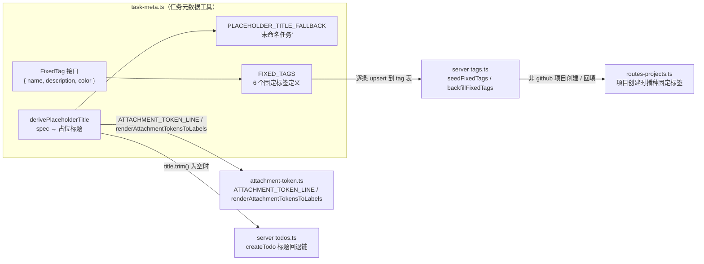
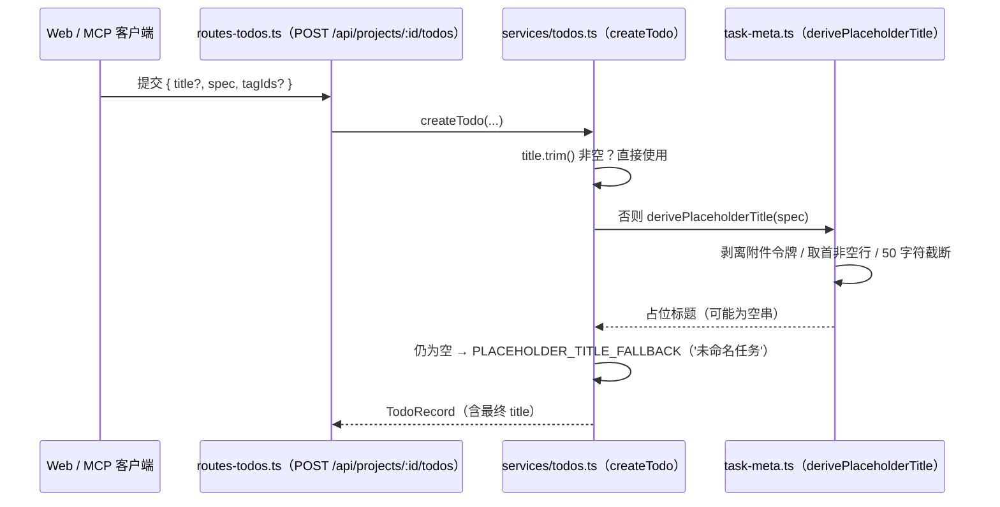
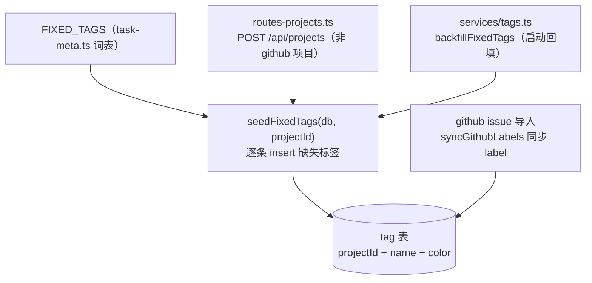

# 任务元数据工具（shared_task_tools_meta）

## 简介与定位

`shared_task_tools_meta` 是 [任务工具面 shared_task_tools](../shared_task_tools.md) 的五个子模块之一，对应共享包中的单个文件 **`packages/shared/src/task-meta.ts`**，核心组件为 `FixedTag`（同文件的 `derivePlaceholderTitle`、`FIXED_TAGS`、`PLACEHOLDER_TITLE_FALLBACK` 与其配套）。

该文件定义 cairn 系统中**任务元数据（task meta）**的两个纯函数契约：

- **占位标题推导**：`derivePlaceholderTitle(spec)` 在任务只有正文（spec）、没有显式标题时，从正文推导一个可展示的占位标题；`PLACEHOLDER_TITLE_FALLBACK`（`'未命名任务'`）作为兜底文案；
- **固定标签词表**：`FixedTag` 接口与 `FIXED_TAGS` 只读常量——`bug` / `feature` / `improvement` / `refactor` / `docs` / `chore` 六个项目级内置标签的定义（名称、中文说明、颜色）。

它的定位与模块内其它文件一致：**无副作用的纯函数与只读常量**——`FIXED_TAGS` 以显式 `readonly FixedTag[]` 类型标注（接口字段亦为 `readonly`）表达不可变性，配合 `packages/shared/package.json` 的 `sideEffects: false` 便于摇树，在 server / daemon / web / CI 中可任意复用与单测。与 [shared_task_tools_attachment](shared_task_tools_attachment.md) 不同的是，本模块**反向依赖**附件令牌工具——推导标题时需要识别并剥离正文中的 `` 令牌，避免标题表面出现裸附件路径。

## 模块组成与架构



**模块内部依赖**：`task-meta.ts` 唯一的外部依赖是 `attachment-token.ts` 的 `ATTACHMENT_TOKEN_LINE` 与 `renderAttachmentTokensToLabels`（见 [shared_task_tools_attachment](shared_task_tools_attachment.md)），用于在推导标题时跳过“独占整行的附件令牌”、并把行内令牌渲染为纯 label。它不依赖任务工具面的 `brief-file.ts`、`git-ops.ts`、`task-failure.ts` 中的任何一个。

**导出路径**：经 [共享包入口 shared](../../shared.md) 的 `src/index.ts`（`export * from './task-meta.js'`，见第 27 行）对外导出，server 通过 `@cairn/shared` 引用。

## 组件详解

### `FixedTag`（核心组件）

```ts
export interface FixedTag {
  readonly name: string;
  readonly description: string;
  readonly color: string;
}
```

固定标签的**类型契约**，字段全部只读：

| 字段 | 类型 | 含义 |
| --- | --- | --- |
| `name` | `string` | 标签名（英文短词，入 `tag.name` 列） |
| `description` | `string` | 标签的中文说明（写入数据但主要供人读） |
| `color` | `string` | 标签颜色（`#rrggbb` 十六进制，入 `tag.color` 列） |

### `FIXED_TAGS`（核心组件）

```ts
export const FIXED_TAGS: readonly FixedTag[] = [ ... ];
```

六个**项目级固定标签**，顺序即定义顺序（`name` 全局唯一，`color` 均为合法 hex，`description` 非空——由 `packages/shared/test/task-meta.test.ts` 钉死）：

| 名称 | 说明 | 颜色 |
| --- | --- | --- |
| `bug` | 修坏的东西 | `#ef4444`（红） |
| `feature` | 新功能 | `#8b5cf6`（紫） |
| `improvement` | 改进既有功能 | `#3b82f6`（蓝） |
| `refactor` | 重构（不改行为） | `#f59e0b`（橙） |
| `docs` | 文档 | `#0ea5e9`（青） |
| `chore` | 杂务/依赖/配置 | `#71717a`（灰） |

消费方是服务端 `apps/server/src/services/tags.ts`（隶属于 [server 页面](../../Backend_application_services/server.md)）：`seedFixedTags(db, projectId)` 遍历 `FIXED_TAGS`，对每个项目把尚不存在的标签名插入 `tag` 表（`name` + `color` 直接取自定义，`createdAt` / `v` 由服务端补全）。注意：**GitHub 项目不播种固定标签**——标签以 GitHub issue 的 label 为准（`syncGithubLabels` 负责同步），固定词表只服务于非 GitHub（`local` / `hosted`）项目。

### `PLACEHOLDER_TITLE_FALLBACK`

```ts
export const PLACEHOLDER_TITLE_FALLBACK = '未命名任务';
```

`createTodo` 标题回退链的最后一级兜底文案。当 `title` 为空 **且** `derivePlaceholderTitle(spec)` 也为空（spec 只有空白或全为附件令牌且令牌 label 为空）时使用。

### `derivePlaceholderTitle(spec)`

```ts
export function derivePlaceholderTitle(spec: string): string
```

从任务正文推导占位标题，按以下规则（来自 `packages/shared/test/task-meta.test.ts`）：

1. 按 `\n` 逐行扫描，跳过空白行；
2. 命中 **独占整行** 的附件令牌（`ATTACHMENT_TOKEN_LINE`，行首 0–3 空格）：若 `fallback` 尚未赋值，取第一个令牌的 label（文件名）作为后备；随后**继续扫描**（令牌行不阻断标题推导）；
3. 非令牌行先经 `renderAttachmentTokensToLabels` 把**行内**令牌替换为纯 label，再判定：渲染后为空继续扫描，非空即**返回该行**作为标题；
4. 全部行都被跳过时，返回之前记录的令牌 label 后备（即 `fallback`）；
5. 任何结果超过 50 字符都截断到 50 字符并追加 `…`；恰好 50 字符不截断不加省略号；
6. 输入全空白或空串 → 返回空串（由调用方再回退到 `PLACEHOLDER_TITLE_FALLBACK`）。

设计要点：标题表面**绝不出现附件路径**——整行令牌被跳过、行内令牌只留文件名；这条规则由 issue #757 驱动（"title surface shows no bare path"）。

## 关键数据流与调用关系

### 占位标题回退链（服务端建卡）



### 固定标签播种与回填



`seedFixedTags` 在两条路径触发：

- **项目创建**：`routes-projects.ts` 的 `POST /api/projects`，当 `kind !== 'github'`（即 `local` / `hosted`）时立即播种；
- **启动回填**：`backfillFixedTags(db)` 扫描全部非 GitHub 项目，为缺失的项目补齐固定标签（幂等：已有标签名跳过）。

## 与其它模块的关系

- **[任务工具面 shared_task_tools](../shared_task_tools.md)**：本模块的上层页面。五个任务工具文件的分工总览与架构级数据流见该页，此处不重复。
- **[共享包 shared](../../shared.md)**：包级配置（`package.json` 的 `exports`、`sideEffects: false`、`scripts`、`tsconfig` 严格基线）与整体构建/CI 说明见该页。
- **[shared_runtime_helpers](../shared_runtime_helpers.md)**：`task-meta.ts` 所属的“运行期纯函数”既有页面，含本模块的概览级描述；本页是其组件级细分。
- **[shared_task_tools_attachment](shared_task_tools_attachment.md)**：`derivePlaceholderTitle` 导入 `ATTACHMENT_TOKEN_LINE` 与 `renderAttachmentTokensToLabels`——本模块的**直接依赖**，二者修改需同步（附件令牌格式、`INLINE_ATTACHMENT_TOKEN` 渲染规则见该页）。
- **[shared_records](../shared_records.md)**：`records/tag.ts` 定义 `tagRecordSchema` 与 `TAG_DEFAULT_COLOR`——`FIXED_TAGS` 的 `color` 直接写入 `tag.color`，与 `TAG_DEFAULT_COLOR`（`#6366f1`，自定义标签的默认色）同属标签颜色体系但各自独立：固定标签自带颜色，自定义标签用默认色。
- **[server_app_bootstrap](../../Backend_application_services/server/server_app_bootstrap.md)**：`apps/server/src/app.ts` 的 `createApp` 装配路由与启动流程，`backfillFixedTags` 等回填任务在启动期执行，`routes-todos.ts` / `routes-projects.ts` 注册于其中。
- **[server_database](../../Backend_application_services/server/server_database.md)**：`tag` 表由 `db/schema.ts` 定义，`seedFixedTags` 的插入依赖其 `projectId` / `name` / `color` 列结构。
- **[server 页面](../../Backend_application_services/server.md) / [server_trajectory_tools](../../Backend_application_services/server/server_trajectory_tools.md)**：任务展示标题由 `derivePlaceholderTitle` 推导（`createTodo` 时固化进 `todo.title`，见 [server_database](../../Backend_application_services/server/server_database.md) 的 `todo` 表），固定标签由 `seedFixedTags` 落地到 `tag` 表；标签服务（`services/tags.ts`）与轨迹/标签相关页面消费这些产物。

## 构建、测试与 CI

本模块没有独立的构建产物或测试配置——它只是 `@cairn/shared` 包的一个源码文件：

- **类型检查**：随包执行 `pnpm --filter @cairn/shared typecheck`（即 `tsc --noEmit`），也覆盖在根 `pnpm typecheck` 中。
- **单元测试**：`packages/shared/test/task-meta.test.ts` 覆盖 `derivePlaceholderTitle` 的 13 条规则（首行优先、空白跳过、50 字符截断边界、附件令牌剥离的 6 个 #757 用例）与 `FIXED_TAGS` 的形状约束（6 项词表、name 唯一、hex 颜色、description 非空）；随包执行 `pnpm --filter @cairn/shared test`（即 `vitest run`），CI 的 [check 作业](../../Repository_automation_and_delivery/github_ci/github_ci_main_pipeline.md)（`VITEST_PROJECT_SET=light pnpm test`）会覆盖 `packages/*`。
- **打包**：无独立构建；server 经 `workspace:*` 直接引用 `src/` 源码，`sideEffects: false` 保证摇树友好。

## 设计约定

1. **单一事实来源**：`FIXED_TAGS`（显式 `readonly FixedTag[]`）、`PLACEHOLDER_TITLE_FALLBACK` 均为只读常量，server / web / CI 不各自复制字面量；`seedFixedTags` 直接消费词表，标签名与颜色永远一致。
2. **标题表面不出现裸附件路径**：整行令牌跳过、行内令牌渲染为纯 label（#757），避免把 `` 混入展示标题；与附件令牌工具的修改需同步（见 [shared_task_tools_attachment](shared_task_tools_attachment.md)）。
3. **回退链可审计且顺序敏感**：`title.trim()` → `derivePlaceholderTitle(spec)` → `PLACEHOLDER_TITLE_FALLBACK` 三级回退；`derivePlaceholderTitle` 返回空串（而非抛错）以表达“推导不出”，由调用方决定最终兜底。
4. **截断边界明确**：50 字符以内原样返回，超过才截断并加 `…`——恰好 50 字符不加省略号，由单测钉死边界。
5. **固定标签只服务非 GitHub 项目**：GitHub 项目的标签以 issue label 同步为准（`syncGithubLabels`），`seedFixedTags` 仅覆盖 `local` / `hosted`，避免与 GitHub label 来源冲突。
6. **纯函数、无副作用**：全部导出为纯函数与只读常量，任意上下文可安全复用与单测。
