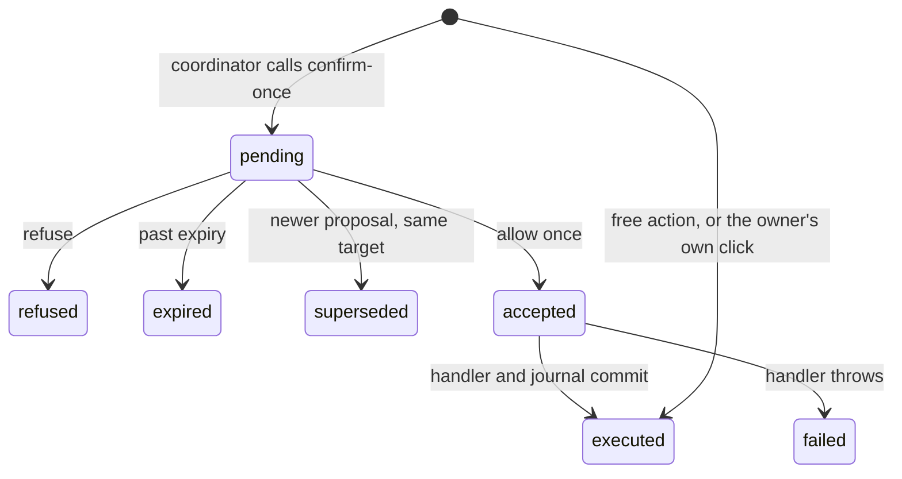

# Action registry and approvals

Status: design for the owner's review. Nothing here is built. First slice of the proposal on #3924 (`docs/design/ai-native-actions.md`), plus approvals as its confirm-once class. Grounded on `origin/main` `7299c658e`. Prior art: `docs/research/action-registry-approvals-2026-11-11.md`.

## Decision

Slice 1 adds one registry, one execute function, a journal, and the approval record. It does not migrate the 47 Coordinator tools, does not edit `apps/server/src/services/mcp-face.ts`, and does not add daemon CLI commands. Those three are the drift, and rewriting them in the same change would hide the approval behavior.

Today the Coordinator runs `executeChiefTool` (`apps/server/src/services/chief-tools.ts`), the MCP face runs its own switch in `executeMcpTool` (`apps/server/src/services/mcp-face.ts`) over `MCP_TOOL_REGISTRY` (29 names in `packages/shared/src/protocol/mcp.ts`), and the web calls REST routes. The same name already means different things: MCP `create_todo` takes `title` and `spec`; the Coordinator tool cites the owner's messages. `confirm_builds` is removed from Coordinator tools (`CHIEF_TOOLS_REMOVED_UNDER_D60`) and still calls `confirmBuild` on the MCP face. `merge_builds` returns a rejection from the Coordinator and throws 403 from MCP (`MERGE_HUMAN_ONLY_COPY`).

`PermissionCard` already has deny / once / always (`apps/web/src/components/thread/permission-card.tsx`) and is used only in the design gallery. `permission-rules.ts` is an in-memory allow / ask / reject matcher for the daemon command gate, with no store. `ask_user` writes a model-authored question into `chiefMessage` and holds the tool for 70 seconds (`apps/server/src/services/chief-questions.ts`). None of those is this record.

## Registry

One entry in `packages/shared`: `id`, `toolName`, input schema, output schema, `scope` (`team` | `project`), `class` (`free` | `confirm-once` | `owner-only`), `standingGrant` (boolean), `inverse` (another id, or none), `surfaces` (`web` | `coordinator` | `mcp` | `cli`), and `targetOf(input)`.

Slice 1 entries:

| Id | Class | Inverse | Standing grant | Surfaces |
|---|---|---|---|---|
| `project.archive` | free | `project.unarchive` | no | web, coordinator |
| `project.unarchive` | free | `project.archive` | no | web, coordinator |
| `project.delete` | confirm-once | none | no | web, coordinator |

`toolName` is a field (`archive_project`, `unarchive_project`, `delete_project`), not derived. Handlers are the existing functions: `setProjectArchived` and `deleteProject` (`apps/server/src/services/projects.ts`). REST archive, unarchive, and delete call the execute function. The Coordinator tools are registered from these three entries and call the same function. They are not added to `CHIEF_REMOTE_TOOLS`.

`project.delete` does not offer always-allow. A grant with no match would delete any later project. The grant table exists so a later action can set `standingGrant` without a new store. Slice 1 has no such action.

Owner-only names are a frozen list, not a removal: `set_secret`, `delete_secrets`, `merge_builds`, and the REST routes that change merge policy, ship route, or the eval ruler. A test fails if a new registry id is owner-only and also appears on a surface, or if that exception list grows. Slice 1 does not take `set_secret` away from the Coordinator. That is a behavior change and stays an owner decision.

The daemon CLI (`apps/daemon/src/cli.ts`) is machine start, stop, and token. It is not a product action surface. `surfaces` does not include `cli`. Worker threads and the MCP face do not receive these three actions.

## State

Three tables, team-scoped, cascade on team delete. No retention TTL in this slice.

- Proposal: `pending`, `refused`, `accepted`, `executed`, `failed`, `expired`, `superseded`. Holds the validated input, its hash, `targetId`, actor, decision (`refuse` | `allow-once` | `always` or empty), and expiry.
- Grant: `active` or revoked (`revokedAt` set, row kept). Unique on team, action, and match hash while active.
- Journal: append-only. One row per run, undo, or refused undo. A refusal lives on the proposal, not a second copy in the journal.

A pending proposal is unique on team, action, and target. A repeat returns that row. A new pending proposal for the same target marks the old one `superseded`.

Expiry is 7 days from insert, not the end of the Coordinator turn. A turn ends before the owner is back; expiring with the turn would throw away the answer. This disagrees with the proposal's "expires with its turn" and is open below.

## Transitions

The Coordinator tool returns `pending` and the proposal id. It does not call `holdForQuestion`. The answer route wakes the Coordinator once by calling `enqueueChiefStep` (`apps/server/src/services/chief.ts`) with trigger `wake` and provenance `action-proposal:<id>`. That insert is the wake. It does not add a trigger kind. No existing sweep knows about proposals, so a decided proposal with no wake is retried by the next read of that proposal, which enqueues once.

The owner's own click is the confirmation. Actor `user` on `project.delete` runs the handler and journals it. It does not insert a proposal, so the person is not asked twice. Actor `coordinator` always proposes.

## Paths that read or write

| Path | Reads | Writes | On failure |
|---|---|---|---|
| Execute, unknown id or bad input | registry | nothing | 400, no row |
| Execute, owner-only id | registry | nothing | 403, no row |
| Execute, target missing or other team | project row | nothing | 404, no row. Archive already checks team (`routes-projects.ts`); delete does not, and this check closes that gap |
| Execute, caller surface not listed | registry | nothing | 403, no row. MCP and the daemon CLI hit this |
| Execute, free, or user on confirm-once | registry, project | project row and one journal row, one transaction | handler error rolls both back; 4xx or 5xx, no journal row |
| Execute, coordinator confirm-once | registry, pending proposal | one `pending` row, or none if one exists | returns the pending id; handler does not run |
| Answer, body contains `input` | proposal | nothing | 400. The stored input runs, or nothing runs |
| Answer, not pending, unknown, or past expiry | proposal | expiry stamp if past `expiresAt` | 409, handler does not run |
| Answer, refuse | proposal | status `refused`, decision, `decidedBy` | wake still fires; handler does not run |
| Answer, allow once | proposal, stored input | status `accepted`, then handler and journal, then `executed` or `failed` | handler throw: `failed`, one journal row with the error, no retry |
| Answer, always | proposal, registry flag | nothing in slice 1 | 409 `standing grant not offered`, proposal stays `pending` |
| Revoke grant | grant, team | `revokedAt` | owner session only; agent and MCP get 403; other team is 404 |
| Expiry sweep | pending proposals | `expired` | a failed sweep leaves them pending; the next sweep retries |
| Undo | journal row, inverse, current project | one new journal row, and the inverse write if it still matches | no inverse: 409, no write. State moved: journal `undo-refused`, names the later journal id, does not overwrite |
| Delete files follow-up | journal row for `project.delete` | one journal row for the directory removal | `deleteProject` removes the hosted repo directory after the db transaction. The db delete and its journal row commit together; the directory removal is a second row. A crash between them is retried by the sweep, which does not delete again |
| Web pending list and journal list | proposals, journal | nothing | empty list |
| Coordinator wake | proposal id on the answer | one `enqueueChiefStep` row | enqueue failure after the decision commit leaves the proposal decided; the next read enqueues once and does not run the handler again |
| `ask_user`, command gate, `clientMessage`, `skill_audit`, plan auto-approve | their own rows | their own rows | unchanged. They do not read or write these three tables |

`deleteProject` still deletes todos, builds, steps, and secrets, and it still does not stop running work. That guard is a separate to-do. The proposal text shown to the owner names the project and says running work is removed with it. Slice 1 does not add the guard.

`deleteTodo` (`apps/server/src/services/todos.ts`) also queues a GitHub issue close. It is not in this slice, because that side effect is outside the journal transaction.

## Tests the implementation writes first

One test per row above, plus: a registry entry with surface `mcp` or `cli` fails the slice-1 fixture; `delete_project` is absent from `MCP_TOOL_REGISTRY` and `CHIEF_REMOTE_TOOLS`; the owner-only exception list is exact; a journal row never contains a field named `value`, `token`, `secret`, or `password`; two concurrent proposes for one target return one pending id.

## Risks

Deleting a project is still not undoable, and a confirmed delete still removes running work. The directory removal can fail after the db delete; the second journal row is the record, not a rollback. MCP `create_todo` and `confirm_builds` keep drifting until a later slice. A future `standingGrant: true` with an empty match is a standing widening of the agent; the flag defaults false, and revoke is owner-only. Slice 1 does not edit the MCP face. An implementation that does is owner-routed on its own.

## Open decisions

- Expiry: 7 days, recommended here, against the proposal's turn expiry.
- Always-allow on delete: not offered, recommended. The owner can require it for a matched scope.
- Whether a worker thread or an MCP client later shares the Coordinator's free class: not in this slice.
- Journal retention: keep with the team, no TTL, until the owner says otherwise.
- Whether `set_secret` loses its Coordinator tool: not in this slice.
