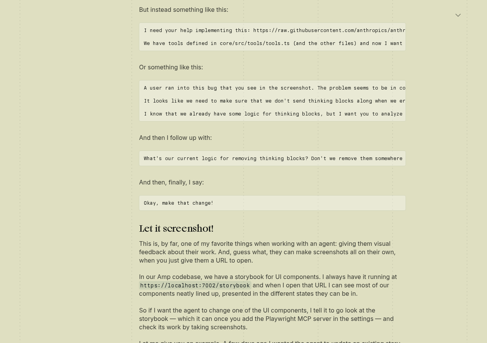
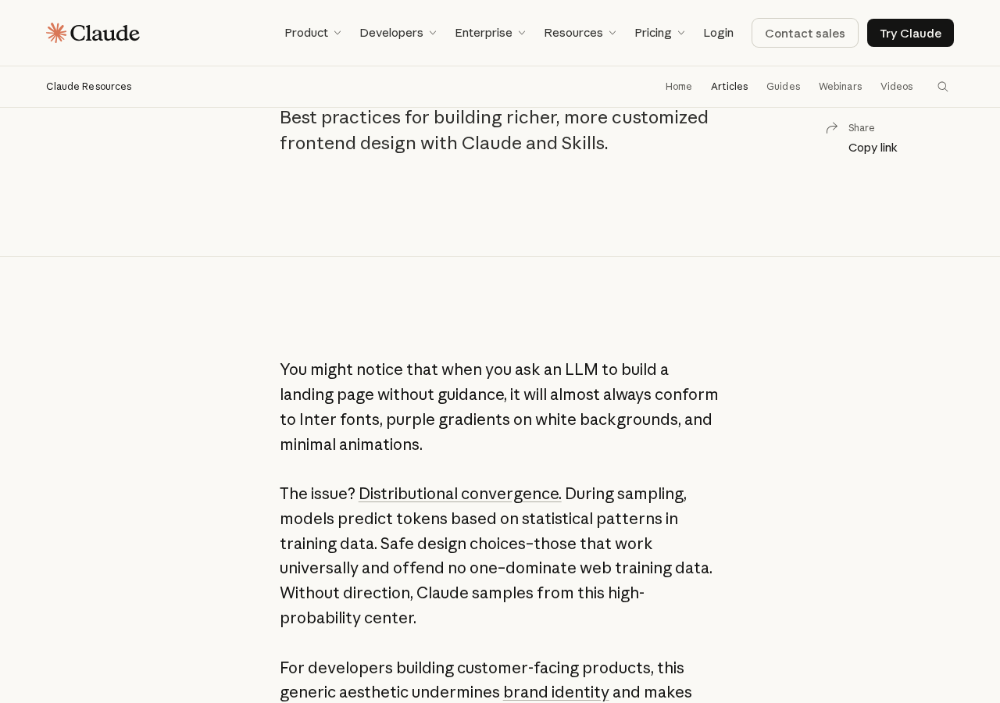
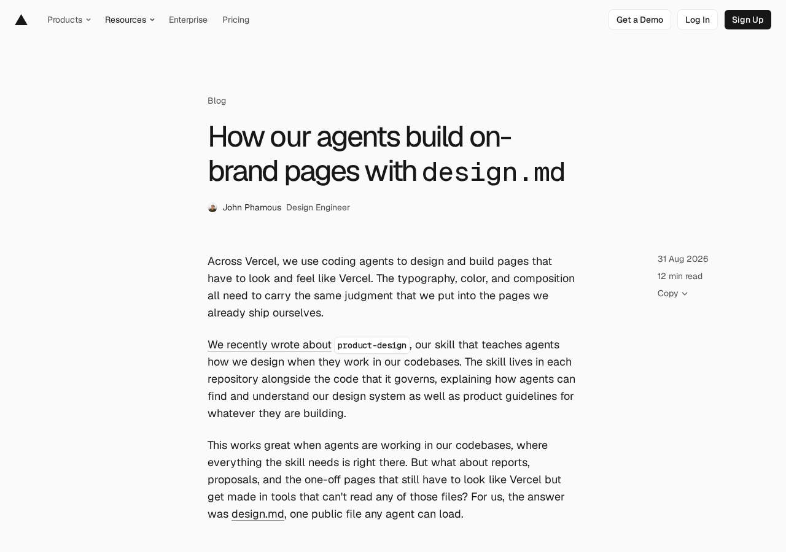

# AI-written frontends: why others' look good, where cairn falls short, what to change (2026-11-06)

Labels: `实测` = output I ran myself or original text I read this round; `推断` = derived from `实测`, re-checkable; `猜测` = everything else. This document is research and recommendations only; it changes no repository code, gate or skill. Screenshots are in [`ai-frontend-quality-2026-11-06/`](ai-frontend-quality-2026-11-06/).

## 0. Conclusions

1. People who do this well do not let the model decide the design. They fix the design system first, then give a visible target (a reference screenshot or Figma), have the agent screenshot its work and compare it with the target, iterating, and finally a human makes the taste call and writes that call into a file or an eval so the next round picks it up automatically.
2. What cairn lacks is not tokens. cairn's design system and style gates are heavy for projects of this kind: DESIGN.md is 9,186 words, plus 4 UI gates and gallery pixel snapshots. Three other things are missing:
   - There is no reference at the start of each piece of UI work: in the latest 64 UI PRs, 0 name a reference product in the body (`实测`).
   - The agent does not compare its result against a reference: screenshots are evidence handed to reviewers, not a comparison used while iterating.
   - No gate measures "does it look and work right".
3. Most problems the audit found are not "AI flavor" but whole-page, cross-feature problems: the first run does not work end to end, one state has four phrasings, spacing of 42–46px, placeholder gray blocks, developer toggles exposed. They exist because features are delivered as backend slices and the UI gets a block added with each slice, with nobody responsible for the whole page (`推断`).

## 1. Why write code with AI (brief)

- **Speed, especially prototypes.** Karpathy coined "vibe coding" in 2025-02, with a UI tweak as the example: asking the model to halve the sidebar padding ([tweet](https://x.com/karpathy/status/1886192184808149383)). Simon Willison says the biggest gain is development speed; 77 small apps in his tools repository were all written by LLMs ([2025-03-11](https://simonwillison.net/2025/Mar/11/using-llms-for-code/)). `实测`
- **Frontend is where AI writes the most.** Anthropic's 2025-04 report: 79% of Claude Code use is automation-type, and among the top five task categories "UI/UX component development" is 12% and JS/TS is 31% ([report](https://www.anthropic.com/research/impact-software-development)). `实测`
- **Widespread, but trust is low.** Stack Overflow 2025 survey: 84% use or plan to use it, 51% of professional developers use it daily; 46% distrust AI accuracy and 66% complain about answers that are "almost right" ([survey](https://survey.stackoverflow.co/2025/ai)). `实测`
- **AI is an amplifier.** The core DORA 2025 finding is that AI amplifies an organization's existing strengths and weaknesses ([DORA](https://dora.dev/research/2025/dora-report/)). For cairn this means: if the process lacks a taste step, AI only produces tasteless UI faster (`推断`).

## 2. Part A: how people who do it well do it

### 2.1 Fix the design system first

- **shadcn/ui** has five principles including Open Code, Beautiful Defaults and AI-Ready: open code and a consistent style, so models can read and improve the components. Theming is done with semantic CSS variables such as `background` / `primary`; an official MCP lets agents search and install components directly ([docs](https://ui.shadcn.com/docs), [theming](https://ui.shadcn.com/docs/theming), [mcp](https://ui.shadcn.com/docs/mcp)). `实测`
- **Tailwind v4** collects tokens into CSS with `@theme`, and the tokens decide which utility classes exist ([docs](https://tailwindcss.com/docs/theme)). **Geist** is Vercel's ready-made set of colors, grid, fonts and icons ([geist](https://vercel.com/geist/introduction)). `实测`
- **Linear's 2024 UI redo**: the theme moved from HSL to LCH, and each theme went from 98 variables down to 3 (base, accent, contrast). The process was to draw hundreds of screens in Figma first, then put the new UI behind a feature flag so insiders could switch between old and new, then roll out gradually ([original](https://linear.app/now/how-we-redesigned-the-linear-ui)). `实测`
- **Theo (t3.gg) tested comparison**: with the same task, without a shadcn template the output was "classic AI slop" (gradients, glowing buttons); once given the template, even a fast model that is poor at UI got visibly better. He also warns that models invent icon names that do not exist ([video 2025-12-16](https://www.youtube.com/watch?v=aKPaxQJs-30)). `实测` (captions)

### 2.2 Start from a reference

- **Figma MCP** (2025-06) hands variables, components and styles to Claude Code and Cursor. Figma's own wording is that without this context the generated code "works, but doesn't look like yours" ([blog](https://www.figma.com/blog/introducing-figma-mcp-server/)). `实测`
- **v0 Design Systems 2.0** imports a code repository, Storybook or Figma as a skill. Rauch's pitch is to remove the "ai look" in one click ([docs](https://v0.app/docs/design-systems-2), [tweet 2025-09-08](https://x.com/rauchg/status/1965196675750003145)). `实测`
- **Claude Design** (2026-04-17) first reads the codebase to build a design system on onboarding, can capture live page elements as references, and hands the result to Claude Code when done ([announcement](https://www.anthropic.com/news/claude-design-anthropic-labs)). `实测`
- **Claude Code official best practices**: paste the design screenshot straight into the prompt, treat "browser screenshot next to the design" as a pass/fail check, and require the agent to hand in screenshots, not accept a bare "tests pass" ([best practices](https://code.claude.com/docs/en/best-practices)). `实测`

### 2.3 The agent looks at its own result

- **Amp's Thorsten Ball**'s favorite trick is "Let it screenshot!": have the agent open the local Storybook with Playwright MCP, screenshot each state, and inspect the component it changed ([original 2025-05-15](https://ampcode.com/notes/how-i-use-amp)). `实测`

- **Chrome DevTools MCP** (Google, 2025-09-23) addresses the problem that an agent cannot see what its code looks like in the browser. It can read the live DOM and CSS and run performance traces ([blog](https://developer.chrome.com/blog/chrome-devtools-mcp)). **Playwright MCP** reads the accessibility tree by default; screenshots need `--caps vision` ([repo](https://github.com/microsoft/playwright-mcp)). `实测`
- **Elie Steinbock**: every PR gets about 350 page screenshots in CI and he only looks at the few that changed; with no screenshots the goal is not considered done ([video](https://www.youtube.com/watch?v=xk-aLMQRYfk), summary in [pr-evidence-review](pr-evidence-review-2026-11-06.md) section 4). `实测`

### 2.4 Inject taste

- **Anthropic's "Improving frontend design through Skills" (2025-11-12)** gave sameness a name: distributional convergence. Without guidance the model lands on the most common class in its training data: Inter font, white background with a purple gradient, almost no motion. The frontend-design skill is only about 400 tokens and corrects along four axes (fonts, color, motion, background), and warns that models converge to new defaults (for example Space Grotesk), which must be explicitly forbidden ([blog](https://claude.com/blog/improving-frontend-design-through-skills)). The current [SKILL.md](https://github.com/anthropics/skills/blob/main/skills/frontend-design/SKILL.md) has become a blacklist of "AI default styles": cards with the same radius and shadow, all-caps small labels, every block fading in and sliding up, and so on. `实测`

- **Vercel's DESIGN.md plus eval (2026-08-31)** is the hardest evidence found this round:
  - Without DESIGN.md, the model produces "a generic SaaS dashboard".
  - The most effective piece was a public style sheet, which takes the decisions on fonts, spacing and layout out of the model's hands.
  - Each rule is blind A/B tested on fixed scenarios and only included if it passes; mechanical problems go to deterministic checks, while hierarchy and composition are judged by humans.
  - They themselves admit the sample is only 6 pages.

  See the [blog](https://vercel.com/blog/how-our-agents-build-on-brand-pages-with-design-md). The companion [product-design skill article](https://vercel.com/blog/teaching-agents-product-design-at-vercel) argues that code tells the agent only what shipped, not why, so product decisions should be written into the repository, with AGENTS.md saying when to load them. `实测`

- **[Vercel Web Interface Guidelines](https://github.com/vercel-labs/web-interface-guidelines)** can be loaded directly as a skill, and consist of rules that can be checked one by one: `:focus-visible`, reduced-motion, animate only transform/opacity, and so on. **[Lovable guide](https://docs.lovable.dev/prompting/prompting-one)**: fix the visuals first rather than leaving them to final polish; use real copy, not lorem. `实测`

### 2.5 Process and the human's place

- **Ryo Lu (Cursor's design lead)** hands off with code prototypes instead of Figma: about a month of Figma work done in 5 days, because edge cases surface by themselves while building; a project starts with 5–10 rules ([2026-01-15](https://x.com/ryolu_/status/2011808864153280563), [2025-04-21](https://x.com/ryolu_/status/1914384195138511142)). `实测`
- **Karri Saarinen (Linear CEO)** worries that when everyone brings an agent and ships their own changes, the product becomes the average of all outputs and loses its "soul" ([blog](https://karrisaarinen.com/posts/someone-behind-the-software/)). Taste comes from making things and paying attention ([homepage](https://karrisaarinen.com/)). `实测`
- **Polish has dedicated methods.** Emil Kowalski: animations are generally shorter than 300ms, use ease-out, and have a purpose ([Great Animations](https://emilkowal.ski/ui/great-animations)). Rauno Freiberg: interactions can be interrupted midway, and gestures reuse real-world metaphors ([Invisible Details](https://rauno.me/craft/interaction-design)). `实测`
- **No primary source found for**: Raycast's writing on AI doing UI; Pieter Levels on UI method (only found that he built a 3D page with Claude Code in a few hours, [tweet](https://x.com/levelsio/status/1951764854580105453)); Theo specifically on t3.chat's UI. Rauch's "taste can be trained" passage from Lenny's Podcast was only seen second-hand.

**Why others look better**: what is shown online is mostly landing pages and small single-flow apps, exactly the scenario the frontend-design skill is best at. cairn is a dense operations app with many states (offline, queued, awaiting an answer, failed), so it is a level harder to begin with (`猜测`). Still, the practices above are independent of product type and can be adopted directly.

## 3. Part B: diagnosis of cairn's process

Measured data: `gh pr list --state merged --limit 250` covers 11-02 to 11-06, of which 64 PRs changed `apps/web/src`; for the latest 40 the body and files were checked one by one, and for 12 the reviewers were spot-checked.

| # | Question | Current state | Judgment | Label |
|---|---|---|---|---|
| 1 | Does the agent start from a reference? | The rules are thorough: the design skill requires "the reference product must have actually been operated"; memory has `use-the-reference-product` and `walk`. But of 64 UI PRs, **0** name a reference product in the body (none of Claude.ai, ChatGPT, Amp, t3code, Linear; all 13 hits are the Cursor Bugbot badge); **9** write "owner-picked / owner picked". The t3code and Amp references in the UI audit are marketing images from their websites, not operated. | References appear only in redesigns; routine feature PRs do not carry them | `实测` |
| 2 | Is there a tokenized design system the agent really follows? | Yes, and a strong one: all tokens are in `shadcn.css`; DESIGN.md has the full color scale, 7 font sizes, and three tiers of radius and shadow; `ui-page-style-gate`, `ui-debt-gate` and `ui-drift-gate` plus `gallery-snapshots` pixel snapshots guard it. Two problems: (a) the root `AGENTS.md` (which CLAUDE.md points to) **does not mention DESIGN.md at all**, so a Codex lane reads it only if the brief says so; (b) DESIGN.md covers tokens and components, not how pages are composed, how states are expressed or how copy is written, and the audit problems cluster in those latter areas. | Tokens are not the bottleneck; the entry point and the coverage are | (a) `实测`; (b) `推断` |
| 3 | Does the agent look after finishing? | Of 40, 28 have screenshots, 18 have before/after, 23 mention dark mode, 10 mention phone width. But screenshots serve as evidence for reviewers, not as a comparison against a reference during iteration; 7 have only fixture screenshots. The audit's "awaiting-answer question" state had no fixture and nobody ever saw it (recurrence noted in memory `review-each-component`, 11-06). | They looked, but there was no target to compare to, and the states were not fully covered | `实测` |
| 4 | Who makes the taste call? | On GitHub, the reviewers of the 12 spot-checked UI PRs are all `chatgpt-codex-connector` (code review), the Cursor bot and cairnwright; there is not one visual review. Memory `ui-review-by-claude` has the session that built the component judge the look itself, which is author self-review. The owner's judgment happens only sporadically in chat ("feels like you just didn't align it, didn't look"), with no fixed rhythm. | Taste depends on the owner happening to see it; there is no fixed entry point | Reviewers: `实测`; self-review bias: `推断` |
| 5 | Do gates test tests or the look? | `pr-evidence-gate` only checks that Proof is written and the images open; `gallery-snapshots` only checks whether something changed (1/1000 pixels), not whether it is good; the style gates only check token violations. None of the audit's findings on spacing, hints, placeholders and contradictory copy could be stopped by an existing gate. | Gates stop regressions; they cannot stop "ugly" or "hard to use" | Gate behavior: `实测` (see [pr-evidence-review](pr-evidence-review-2026-11-06.md) §3); cannot stop: `推断` |
| 6 | Is the feature built backend first and UI added afterwards? | 17 of the 40 UI PRs also changed server/daemon; titles are mostly feature tickets (`D60 PR8c` route override, routing rules settings, Orb RFB bridge); in the same period only 64 of 250 PRs touched web. The audit's P0 (first run) spans three features (provider, machine, agent), and no slice is responsible for it. Audit #8's 250px gray block says "the screen ships together with desktop control", the typical case of the UI taking a placeholder and waiting for the backend. | Yes. Work is sliced by feature, with no owner of a page or journey | Counts: `实测`; causation: `推断` |

One-line diagnosis: cairn has Linear-grade token discipline but lacks Vercel's closed loop of "reference → rules → screenshot comparison → human judgment → write the rule back", and also lacks Linear's rhythm of "one person owns the whole page and polishes it regularly" (`推断`).

## 4. Part C: recommendations (ordered by payoff)

Legend: "in flight" = an existing decision already covers part of it. D117 is the PR evidence standard plus full-page CI screenshots; D118 is the UI audit plan plus audit in CI; D119 is the question card.

### R1 UI brief template: reference, states, comparison (effort S, payoff high)

- **What to change**: the orchestrator adds a UI clause to every brief that touches `apps/web/src`, written after the UI-AUDIT clause in orchestrator.md. The brief must carry:
  - 1–3 reference screenshots from products that were actually operated, stored in `docs/design/references/<surface>/`;
  - a state list: empty, loading, error, offline, long content, awaiting answer, 390px, dark;
  - a completion standard: for each state one side-by-side screenshot "reference | ours", plus one sentence on the difference.

  The design skill's "Done when" already says this; what is missing is getting it into routine briefs.
- **Example: the Coordinator conversation.** References: ChatGPT's [R02 sent message pins to top](ui-ux-audit-2026-11-06/R02-chatgpt-sent-pins-top.jpg) and [R03 reply actions](ui-ux-audit-2026-11-06/R03-chatgpt-reply-actions.jpg), plus the equivalent screens from Claude.ai. States to cover: a burst of short messages, a long reply, an awaiting-answer question (D119 card above the input), no agent, touch. Side-by-side acceptance: message spacing drops from the 42–46px of [F05](ui-ux-audit-2026-11-06/F05-chief-scroll-long.png) to 16–24px; on touch only the latest message shows actions.
- **The owner does**: choose 1–2 reference products for each main surface (see section 5, question 1). **The agent does**: operate the reference products with `walk`, store the screenshots, and write briefs from the template.

### R2 A short rules file for agents and a "cairn anti-patterns" list (S–M, high)

- **What to change**:
  - add one line to `AGENTS.md` pointing at the "Aesthetic constraints for agents" section of DESIGN.md;
  - write a separate `apps/web/DESIGN-RULES.md` of at most 150 lines, in two parts: page composition rules, and anti-patterns distilled from the audit, for example "one fact has one phrasing", "do not render a placeholder block for a capability that does not exist", "no raw English errors in the user UI", "hidden elements take no space", "icon buttons must have a tooltip", "developer toggles stay out of the account page".

  Adopt Vercel's method: each rule is A/B compared on a fixed set of 3–6 scenarios and kept only if it helps.
- **Example**: the Coordinator conversation's tool row with `opacity-0` still takes 24px of height, matching the anti-pattern "hidden elements take no space". The message toast showing `chief agent not bound` matches "no raw English errors".
- **The owner does**: confirm the list (10 minutes). **The agent does**: draft, run the A/B, maintain.

### R3 Turn audit findings into CI assertions (M, medium-high) [in flight: D118]

- **What to change**: following "fix mistakes with constraints", turn the layer-A measurements of audit section 1 into Playwright assertions:
  - message spacing no more than 24px;
  - click targets at least 24px, and at least 44px on phones;
  - icon buttons have a visible hint;
  - the page shows no placeholder strings like `—·—·—`;
  - user-visible text has no raw English error strings;
  - status copy comes from the same `fleetStatus` selector.

  Start as a non-blocking report and become blocking after two weeks. D118 already decided the audit goes into CI; this item widens the assertion scope from axe to look and feel.
- **Example**: on the `chief-scroll-long` fixture assert that adjacent message spacing is at most 24px, so no change after #3124 can regress it.
- **The owner does**: nothing. **The agent does**: all of it.

### R4 Screenshot comparison loop: CI produces the images, the agent looks first (M, high) [in flight: D117]

- **What to change**: D117 already decided that CI runs full-page screenshots for PRs that change web and looks only at changed pages. On top of that add two things:
  1. before sending a PR the agent must read the screenshots of the changed pages and, in Proof, write one sentence per image on "what is still missing compared with the reference", following Amp's "Let it screenshot";
  2. fix the screenshot matrix at two widths (1440 and 390), light and dark, plus R1's state list, and require at least one image from the real stack (verify-cairn `capture`), not all fixtures.
- **Example**: a Coordinator PR's Proof table has three columns: ChatGPT reference | before | after, covering the awaiting-answer question card (D119) and the no-agent state.
- **The owner does**: nothing. **The agent does**: extend D117's workflow and the pr-cairn template.

### R5 Own by page and journey, UI first (M, high)

- **What to change**:
  - set up owner lanes for 5 pages or journeys: first run, Coordinator conversation, threads and review, settings, sidebar. Any feature slice that changes these pages first submits a page sketch, the owning lane merges it into the whole page, and the backend is written only after the owner has chosen. This matches the design skill's "draft first", extended from "when redesigning" to "when adding a feature".
  - When backend capability is not ready, the UI does not draw a placeholder block.
- **Example**: first run (audit P0) is owned end to end by one lane: "provider → machine → agent → first message" as a home-page checklist (direction already decided in D118). The PRs for provider, machine and agent no longer add their own hints to the home page.
- **The owner does**: approve the ownership split. **The agent does**: the orchestrator dispatches by page.

### R6 A fixed 30-minute taste review every week for the owner (S, high)

- **What to change**: each week, turn the pages that changed in the CI screenshots into a "reference | current" contact sheet and send it to the owner. The owner circles problems with Scrawl, or replies item by item "good / not good / change the reference". The agent sorts each comment into two classes: quantifiable ones go into R3 assertions, taste ones go into R2 rules; fixing it once is not enough. This corresponds to Vercel's "hierarchy and composition are judged by humans" and to Linear's regular polish.
- **The owner does**: 30 minutes a week. **The agent does**: build the comparison sheet, classify, write the rules back.

### R7 Polish round: motion, fonts, copy (S–M, medium)

- **What to change**: after the structural problems in R1–R5 are fixed, run a polish round each month. Go through the [Vercel Web Interface Guidelines](https://github.com/vercel-labs/web-interface-guidelines), Emil Kowalski's motion principles and the frontend-design skill's blacklist item by item; unify the wording for thread, task and the Chinese term for thread (audit #12). Memory `review-each-component` already requires opening every component in all states; this item makes it a fixed cadence.
- **Example**: the animation when the Coordinator sends a message (target within 200ms, ease-out, honoring reduced-motion), and only one phrasing for the done state (audit #10).
- **The owner does**: settle the glossary. **The agent does**: everything else.

### Division of work

| | The owner | Agent |
|---|---|---|
| R1 | Choose a reference product for each main surface | Operate the reference products and store screenshots, write the brief template |
| R2 | Confirm the anti-pattern list | Draft, run the A/B evaluation, add the entry point in AGENTS.md |
| R3 | — | Write assertions, wire them into CI (D118) |
| R4 | — | Extend D117's screenshot matrix and the Proof comparison table |
| R5 | Approve the page ownership split | The orchestrator dispatches by page |
| R6 | 30 minutes of review each week | Build the comparison sheet, write comments back as rules or assertions |
| R7 | Settle the glossary | Polish |

## 5. For the owner to decide

1. **Which reference for each main surface?** Recommended: Claude.ai and ChatGPT for the Coordinator conversation; t3code and Amp for the thread list and sidebar; Linear for settings; ChatGPT (works first) plus Amp (connection status written on the input box) for first run. The agent operates them and stores the screenshots.
2. **Is the short rules file DESIGN-RULES.md new, or a compression of DESIGN.md?** Recommended: new, at most 150 lines, with AGENTS.md pointing to it; DESIGN.md stays as the full reference. Rules are A/B tested one by one, as Vercel does.
3. **Should UI visual review go back to cross-vendor?** Recommended: no. Keep Claude self-review (memory `ui-review-by-claude`), but the self-review must compare against reference screenshots; add R6's weekly owner review to offset author self-review bias.
4. **Must new features first submit a page sketch?** Recommended: features touching the 5 main surfaces must; pure backend or pure settings items are exempt.
5. **When do look-and-feel assertions become blocking?** Recommended: in step with D118's axe, non-blocking for two weeks, then blocking once stable.
6. **Which day for the weekly review?** Recommended: Monday, reviewing the pages that changed in last week's CI screenshots, circling problems with Scrawl.

## Appendix: source reachability

- X's twitter-cli lacks `twitter_auth_token` and could not be used. The fxtwitter API was used instead and returned the full text of all cited tweets, so no source is missing; main was notified.
- This round had no primary source that had to rely on Reddit.
- Raycast, Pieter Levels (UI method) and Theo (t3.chat UI): no primary content found, see §2.5.
- The Vercel, Amp and Anthropic pages were screenshotted by Playwright this round.
