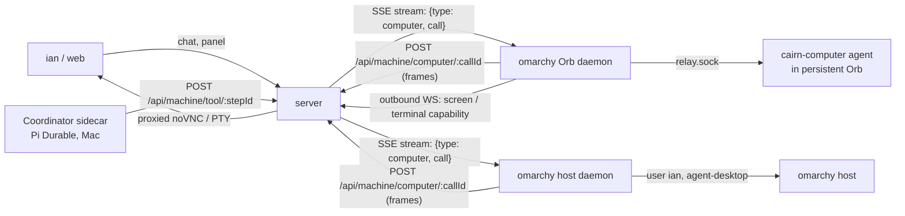

# The Coordinator's computer: Rakazo's method and a cairn design

Status: research and design, 2026-11-03. No code. Sources are labelled measured (read or run this session), inferred (follows from measured facts) or guessed.

Goal (ian): in the Coordinator chat, the bot operates a computer directly, starting with omarchy: terminal, files, browser and a graphical desktop, and the Computers panel (#2644) shows it working.

## 0. Summary

- Rakazo keeps the agent runtime and the computer apart. Pi runs in Rakazo's API/worker; the computer is reached only through ordinary Pi tools behind one `SandboxProvider` interface (measured, `packages/adapter-kit/src/interfaces.ts:97`). cairn already has the same split: the Coordinator runs in Pi, and machines are reached over the machine protocol.
- Decision (ian, 2026-11-03): copy Rakazo's design. cairn gets Rakazo's two kinds of computer:
  - a private computer for the Coordinator: a persistent Orb on omarchy, for the browser, the web and the desktop;
  - ian's own computers: the omarchy host first, and the Mac later. They use Rakazo's `user_computer_*` tools and gate: only ian's own messages reach them, the first command and each app ask, and actions after outside content always ask.
- Tool names, argument shapes, lifecycle numbers and the screen gateway are Rakazo's. Deviations are only where D69, D71, D72 and the outbound-only machine protocol force them (§3.8). Tools go from the sidecar through `/api/machine/tool/:stepId` to the server, which pushes them over `/api/machine/stream` to the daemon holding the computer. This is the same shape as branch sync.
- 9 PRs. 6 are owner route and need `/security-review`; P5 (the gates) also needs it.

## 1. The Rakazo method (from the code)

Repository cloned at `/tmp/rakazo-src`, read 2026-11-03. Paths below are relative to it.

### 1.1 How a computer is modelled and provisioned

- One `Computer` row per scope (`packages/db/prisma/schema.prisma`, `model Computer`). Fields: `scope` (`team` or private), a unique `scopeKey`, `homeKey` / `homeRevision` for the durable workspace, `kind` and an opaque `providerRef`, `state`, and two fenced leases: an execution lease (`executionRunId`, `executionBotId`, `executionLeaseExpiresAt`, `executionFence`) and a control lease for human takeover (`controlHolder`, `controlLeaseId`, `controlFence`). There is also `screenGeneration`. `ComputerExecutionLease` holds one lease per (computer, bot). `ComputerRun` records each running stretch for billing (measured).
- `computerScopeKey` (`packages/db/src/computers.ts:24`): `team:<spaceId>:<userId>` or `bot:<botId>` (measured).
- Provider boundary `SandboxProvider` (`packages/adapter-kit/src/interfaces.ts:97-217`):
  - lifecycle: `provision` (allocate or reconnect, returns a `ComputerRef` before fallible setup), `prepare` (idempotent setup), `isRunning` / `isStopped` read-only probes, stop and destroy;
  - `execute(computer, {argv, cwd, env, pty, timeoutMs})` returns `AsyncIterable<ProcessEvent>` of `stdout` / `stderr` / `exit` (`types.ts:116-130`);
  - `observe`, `act`, `sendInput`, `connectScreen({view: 'stream'|'snapshot', interactive, controlToken})`, optional `connectTerminal`, optional `pageBrowser`;
  - `listFiles`, `readFile`, `writeFile`, `exportWorkspace` / import (measured).
- Providers: Docker, E2B, Daytona, Boat, CreateOS, Kubernetes, Novita, Railway, Wuying, a fake, and the `desktop` host computer (`packages/adapters/src/*-sandbox.ts`, measured). The remote Linux providers share one desktop runtime (`linux-desktop.ts`, `remote-desktop-sandbox.ts`). The provider supplies only command execution, paths and screen URLs (`docs/computer-runtime.md`).
- The Docker image (`infra/sandboxes/computer/Dockerfile`) contains Xvfb, x11vnc, fluxbox, xdotool, noVNC, websockify, Chromium (or Brave), agent-browser pinned by sha256 (`install-agent-browser.sh`), `control.py` for input and `xcapture.c` for screenshots. It runs as uid 1000 (`rakazo`), never root. The supervisor starts containers with `CapDrop: ["ALL"]`, `no-new-privileges`, and memory and pids limits (`infra/sandboxes/supervisor/src/computer-spec.ts:186-189, 618-623`) (measured).

### 1.2 Tools the bot gets

Defined once in `packages/adapters/src/builtin-tools.ts:263-545` as plain Pi tools, so any model works. Screen tools need a vision model (measured).

| Tool | Arguments | Notes |
|---|---|---|
| `shell` | `{command, cwd?}` | Returns early, with the process still running, once output has been quiet for 1 s (`SHELL_STREAM_IDLE_MS`, `shell-command-stream.ts`). The final output arrives as an automated follow-up message on a later turn. The command is killed after a few minutes; long work must use `nohup … > log 2>&1 &` |
| `list_files` / `read_file` / `write_file` | `{path}` / `{path}` / `{path, content}` | UTF-8; paths relative to the bot's folder |
| `attach_file` | `{path, name?, description?}` | Posts a workspace file to the chat as an artifact |
| `computer_observe` | `{}` | Screenshot plus frame metadata. Identical consecutive frames omit the image bytes |
| `computer_act` | `{actions[≤24], observe?, settle_ms?}` | Action kinds: `click, move, down, up, type, key, scroll, wait, focus`. A repeated action that leaves the frame unchanged is refused |
| `open_path` / `launch_app` | `{path}` / `{application, uri?}` | Returns the resulting screen |
| `browser_navigate` / `browser_snapshot` / `browser_act` | `{url}` / `{}` / `{actions:[{kind, ref, text, paths, secret, purchase, field}]}` | Drives the visible Chromium through agent-browser. Refs `e1…` are rechecked against a fresh snapshot before each action. `fill_secret` and `fill_card` type saved values over CDP after a site check, so the model never sees them |
| `request_takeover` | `{reason}` | For passwords, 2FA, CAPTCHA and payment |
| `user_computer_shell` / `_observe` / `_act` | `{command, cwd?}` / `{app, query?}` / `{app, actions[≤24]}` | For the user's own paired computer (§1.4) |

### 1.3 Streaming to the UI

- Command feed: each `shell` call is appended as a `computer.command` event, holding the redacted command and its output tail. `write_file`, `attach_file`, `open_path` and `launch_app` each get one line. Reads are left out (`packages/adapters/src/run-tools-computer.ts:53-75`, `docs/computer-runtime.md` "Terminal"). The Activity view replays these events live and from history (measured).
- Screen: noVNC through one token-protected screen gateway. View and control are separate revocable websocket capabilities. Each capability targets a unique Unix socket, so recycling a display cannot redirect an old connection, and teardown disconnects clients before a slot is reused. The web proxy injects a status reporter (`loading`, `connected`, `failed`) and shows a fixed error after 15 s of silence (`docs/computer-runtime.md` "Screen connection diagnostics").
- Interactive terminal: only while the user holds the control lease. It is a PTY server beside the screen gateway, bound to the control token, running as the workspace user. Releasing control kills it (`connectTerminal`, `docs/computer-runtime.md`).
- Takeover: "Take control" grants an exclusive control lease. It is refused with HTTP 409 while the bot holds an execution lease, unless the run is `waiting_takeover` (measured, doc).

### 1.4 The trusted local computer

Rakazo has two separate mechanisms (measured):

- **The user's own computer (desktop app).** The Electron main process calls `POST /api/user-devices/pair` with the user's session. The request must be JSON, and a foreign Origin is refused. It gets a random device token, which is stored hashed with a limit of 10 devices and recorded as a `device.paired` security event (`apps/api/src/user-devices.ts:42-76`). The app then opens an outbound websocket to `/api/user-devices/connect` (`packages/adapters/src/user-device-client.ts:35-40`). The server never dials in. API and worker processes forward requests to whichever process holds the socket, over an internal path authenticated by a key derived from `ENCRYPTION_KEY` (`user-device-gateway.ts:21-60`). Revoking a device disconnects it. On the device, the screen is driven through agent-desktop (`agent-desktop-host-screen.ts`), which refuses to drive the app's own process "so it cannot answer its own approval cards".
- **Gating.** Only the bot owner's own messages can reach their computer; routines, webhooks, other bots and other people cannot (`userComputerOwner`, `run-tools-user-computer.ts:47-58`). In every approval mode the first command in a space and the first use of each app ask the user, until they pick "Allow in this space". Removing the computer resets this (`userComputerGate`, same file). The docs warn: "A bot with access to your computer can read your files and run programs as you."
- **Self-host local stack.** `apps/desktop/src/host-computer.ts` and `host-computer-server.ts` run an HTTP listener reached from Docker through `host.docker.internal`. It takes a 64-hex bearer token compared with `timingSafeEqual`, refuses any request with an `Origin` header, caps bodies at 12 MB, streams NDJSON frames and has an explicit consent file.

### 1.5 Binding: team or private

- Team (the default): one computer per (space, user). Bots share files and installed tools. Each bot gets its own X display, Chrome process and persistent profile. Folders `bots/<id>/` and `shared/` organise work but are not a security boundary. The container is the boundary (`docs/computer-runtime.md`, "Computer contract").
- Private: `bot:<botId>`, a computer of its own. The setting lives under the bot's settings, Advanced (`docs/computer.md`).
- Concurrency: fenced per-bot execution leases. Different bots can run at once; one bot has one driver at a time.

### 1.6 Lifecycle

- Lazy start on first use, and opening the viewer wakes the computer. The desktop stack starts only when a graphical tool is used (measured, doc).
- Idle: `DEFAULT_SANDBOX_IDLE_MS` = 10 min. On billed providers, uptime is capped by `DEFAULT_COMPUTER_MAX_ACTIVE_MS` = 2 h. `TAKEOVER_IDLE_GRACE_MS` = 30 min keeps a takeover page open. A sweep runs every 10 min, and a background-work probe (marker files plus `lsof` or `/proc`) keeps a computer up while `nohup` work runs (`packages/adapters/src/computer-idle.ts:37-61, 300-320`).
- Persistence: the OS image is disposable and the home is durable. Checkpoints are taken at run end, at stop and before idle suspend. They exclude caches, `node_modules` and similar, and homes over 5 GiB are not saved (`docs/computer-runtime.md` "Persistence"). Update and recover run as durable jobs that reserve the whole computer.

### 1.7 What to borrow and what to leave

Borrow:
- the provider seam (lifecycle, exec, files, observe/act, page browser);
- shell that returns on quiet output, with the finished output delivered later;
- the redacted command feed;
- ref-checked browser actions with password masking;
- an outbound-only device channel;
- view and control capabilities kept separate;
- "never replay completed or uncertain actions".

Leave:
- multi-provider portability and the checkpoint archive (cairn has one host);
- per-bot displays and leases (cairn has one Coordinator);
- billing.

## 2. agent-browser and agent-desktop (read 2026-11-03, `/tmp/agentcap`)

- **agent-browser** (vercel-labs): a CLI that sends commands to a per-session daemon, which drives Chrome over CDP. It covers `open, snapshot -i` (refs `@e1`), `click, fill, type, press, select, upload, screenshot, read`, tabs and frames, and `batch`. It can attach to a running Chrome with `--cdp`. Live viewing: every session runs a WebSocket stream server that sends JPEG frames and accepts input. Only localhost origins may connect; others get 403 and need a proxy (`docs/content/docs/streaming.mdx`). Security options, all off by default (`security.mdx`):
  - `--content-boundaries` wraps page output in nonce markers;
  - `--allowed-domains` cannot be combined with `--cdp` or `--profile`;
  - `--action-policy` and `--confirm-actions` gate `eval`, downloads and uploads;
  - `--max-output` caps output;
  - an encrypted auth vault, so the model never sees passwords (measured, docs).
- **agent-desktop** (vercel-labs): a CLI and C library. `snapshot --app X -i` returns an accessibility tree with refs scoped to the snapshot (`@s8f3k2p9:e8`), and acting on a stale ref returns `STALE_REF`. It acts headless by default through the accessibility API; `--headed` allows physical input. On Linux it needs a graphical session with `at-spi2-core`, and X11 keys need XTEST. Screenshots of X11 windows are supported (`README.md` "Platform support", `docs/install.md`). Every command prints a JSON envelope, and a retry is allowed only when `error.disposition.retry` is `safe` (measured).
- Rakazo uses agent-browser inside the container. It uses agent-desktop only on the user's own Mac or Windows machine; container desktops use `control.py` with xdotool (measured). cairn copies that split: xdotool in the Orb computer, agent-desktop on ian's own computers. Spike S4 in §5 checks agent-desktop on the omarchy host session.

## 3. cairn design: Rakazo's design, mapped onto cairn

Decision (ian, 2026-11-03): copy Rakazo's design. This section keeps Rakazo's model, tool names, argument shapes, gates and lifecycle numbers. It changes only what cairn's constraints force: D69 (no model SDK in the server), D71 (the computer is a machine capability), D72 (tools go through `/api/machine/tool/:stepId` with replay rules) and D51 (the Orb agent connects back over `relay.sock`). Every deviation is listed in §3.8.

### 3.1 What exists today (measured, `origin/main` 721db97de)

- The Coordinator turn is a `chief` step. The runner POSTs relayed tool calls `{name, params}` to `/api/machine/tool/:stepId`. `executeRelayToolCall` (`apps/server/src/services/machine-relay.ts:74`) requires the step to be claimed by the calling machine and runs the tool on the server.
- D72 moves the Coordinator into a Pi Durable sidecar (`apps/coordinator`, not on main yet) using the same route. Pi Durable tools carry `replay: "safe" | "unsafe"` (pi-durable `.d.ts` in `/tmp/pd-spike`).
- Server-to-machine push already exists:
  - `/api/machine/stream` is SSE and carries `wake | shutdown | steer | stop | sync` (`packages/shared/src/protocol/machine-wire.ts:241-247`);
  - `sync` is answered by `POST /api/machine/sync-result/:syncId`;
  - daemons never accept inbound connections.
- Orbs:
  - `OrbProvider` has `ensure, prepare, start, stop, destroy, list, touch` (`apps/daemon/src/orb/provider.ts:62`);
  - idle stop 20 min, removal after 72 h, at most 2 at once (`orb/lifecycle.ts:3-8`);
  - `cairn-orb.nspawn` sets `PrivateUsers=pick`;
  - egress goes through the relay at `10.203.0.1:7890`, which refuses private addresses and allows only ports 80, 443 and 22 (`scripts/ops/orb/egress-relay.mjs:12-18`).
- D71 reports `executor: 'orb'` (`packages/shared/src/records/machine-capabilities.ts:20`). Missing capabilities fail closed (#2652).
- #2644 is the Computers panel with placeholders.

### 3.2 Two kinds of computer, as in Rakazo

| Rakazo | cairn | Purpose |
|---|---|---|
| Private Computer: a container with its own home (`scopeKey = bot:<botId>`) | **Coordinator computer**: one persistent Orb on omarchy, `scopeKey = chief:<chiefId>` | Browser, web, downloads, installs, a graphical desktop: anything that reads outside content |
| Team Computer (`team:<spaceId>:<userId>`) | Not in v1. Workers keep per-task Orbs. A later shared computer would use this key shape | Shared files and tools across bots |
| The user's own computer, paired through the desktop app (`user_computer_*`) | **ian's own computers**: the omarchy host daemon, and the Mac daemon later, through the machine enrollment that already exists | Operations that need the real machine: systemd, journal, packages, fixing the Orb, ian's own apps |

The container is the security boundary for the first kind, as in Rakazo (`docs/computer-runtime.md`). The second kind has no boundary; it is protected by Rakazo's gate (§3.6).

### 3.3 Model and provisioning

Rakazo's `Computer` row, kept with only the fields cairn needs: `computer` table.

| Field group | Fields |
|---|---|
| Identity | `id`, `teamId`, `scope` (`private`), `scopeKey` unique, `machineId` |
| Provider | `kind` (`orb`), `providerRef` (Orb machine name) |
| State | `state` (`stopped`, `starting`, `running`, `failed`), `runningSince` |
| Execution lease | `executionStepId`, `executionLeaseExpiresAt`, `executionFence` |
| Control lease | `controlHolder` (`none`, `bot`, `user`), `controlLeaseId`, `controlLeaseExpiresAt`, `controlFence` |
| Screen | `screenGeneration` |

A paired own computer needs no new row. It is an enrolled machine whose capability report says `ownComputer: true`. Rakazo's `UserDevice` maps onto cairn's existing machine enrollment and token.

The provider seam copies Rakazo's `SandboxProvider` subset. It lives on the daemon side as `ComputerProvider`:
- lifecycle: `provision` / `prepare` / `isRunning` / `stop` / `destroy`;
- execution: `execute → AsyncIterable<stdout|stderr|exit>`;
- desktop: `observe`, `act`, `connectScreen({view, interactive, controlToken})`, `connectTerminal`;
- browser: `pageBrowser`;
- files: `listFiles` / `readFile` / `writeFile`.

There are two implementations:
- `orb-computer`: a persistent nspawn Orb.
- `host`: the daemon's own user. It implements `execute`, the file methods, and `observe`/`act` through agent-desktop only, as Rakazo's host computer does (`host-computer-protocol.ts` method list).

The Coordinator computer image, `cairn-orb-computer`, copies Rakazo's `infra/sandboxes/computer/Dockerfile` onto `cairn-orb-base`:
- Xvfb, x11vnc, fluxbox, xdotool, noVNC and websockify;
- Chromium with a managed policy;
- agent-browser pinned by sha256;
- an input helper ported from Rakazo's `control.py`, and `xcapture`;
- a non-root `agent` user (Rakazo: uid 1000, never root).

The container setup also follows Rakazo:
- `/home/agent` is bind-mounted from `/var/lib/cairn-computer/<id>/home`, so the image is disposable and the home durable;
- the Chrome profile lives at `~/.browser-profiles/coordinator`;
- the systemd slice limits are the counterpart of Rakazo's memory and pids limits plus `CapDrop ALL`;
- egress uses the existing Orb relay;
- the container is excluded from the 72 h removal and from `CAIRN_ORB_MAX`.

### 3.4 Tools: Rakazo's names and shapes

All are Pi tools in the sidecar. Each forwards through `/api/machine/tool/:stepId` (§3.5). The descriptions are Rakazo's, adapted to the computer's home path. Replay rules follow D72: reads are `safe`, everything with an effect is `unsafe`.

| Tool | Arguments (Rakazo) | Replay |
|---|---|---|
| `shell` | `{command, cwd?}`. Returns when output has been quiet for 1 s while the process runs, and the finished output arrives as an automated follow-up. The command is stopped after a few minutes, so long work uses `nohup … &` | unsafe |
| `list_files` | `{path?}` | safe |
| `read_file` | `{path}` | safe |
| `write_file` | `{path, content}` | unsafe |
| `attach_file` | `{path, name?, description?}`, posted to the chat as an artifact | unsafe |
| `computer_observe` | `{}`. An identical frame omits its bytes | safe |
| `computer_act` | `{actions[≤24]: click\|move\|down\|up\|type\|key\|scroll\|wait\|focus, observe?, settle_ms?}`. A repeated action that changes nothing is refused | unsafe |
| `open_path` | `{path}` | unsafe |
| `launch_app` | `{application, uri?}` | unsafe |
| `browser_navigate` | `{url}` | unsafe |
| `browser_snapshot` | `{}`: refs, bounded text, passwords masked | safe |
| `browser_act` | `{actions[]: {kind, ref, text?, paths?}}`. Each ref is rechecked against a fresh snapshot before acting. `fill_secret`, `fill_card` and `fill_pay_token` are left out in v1 | unsafe |
| `request_takeover` | `{reason}` | unsafe |
| `user_computer_shell` | `{command, cwd?}`. cwd must be inside the home (`userComputerCwd`) | unsafe |
| `user_computer_observe` | `{app, query?}`: accessibility rows plus a screenshot | safe |
| `user_computer_act` | `{app, actions[≤24]: click\|type\|set\|key\|scroll\|menu\|wait}` | unsafe |

Replay: Rakazo's rule is "never replay completed or uncertain actions automatically". cairn implements it with `callId = hash(stepId, toolCallId)`:
- a finished `unsafe` call returns its stored result;
- an `unsafe` call started without a result returns `interrupted, may have partially run`;
- a `safe` call reruns.

The relay response gains an image content part (today it is `{text}` only).

### 3.5 Transport

- Rakazo has the desktop app hold an outbound websocket, and other processes forward to it with NDJSON frames `{value} | {done} | {error} | {heartbeat}` (`host-computer-protocol.ts`, `user-device-gateway.ts`). cairn reuses its own outbound channel instead, with the same frame shape:
  - the server pushes a `computer` event over `/api/machine/stream`;
  - the daemon posts the frames back to `/api/machine/computer/:callId`.
- The deadlines are Rakazo's (`hostComputerDeadlineMs`): command timeout + 30 s for execute, 2 min for screen calls and 10 min for the rest.
- Live screen and terminal: Rakazo's screen gateway. Each viewer gets one sealed capability, view or control, with separate tokens that can be revoked. Each capability maps to its own Unix socket inside the container, and teardown disconnects viewers before a display is reused. cairn differs only in transport: the daemon opens an outbound websocket per capability and the server proxies it, because the daemon accepts no inbound connections.

### 3.6 Gates

These are copied from Rakazo's approvals and `userComputerGate`.

- **Who can reach ian's own computer** (`userComputerOwner`): only turns started by ian's own chat messages. Schedules, wake turns, worker threads, webhooks and messages from other people never reach `user_computer_*`.
- **Own computer, shell**: the first `user_computer_shell` asks. The card offers Allow once, Allow on this computer, and Deny. "Allow on this computer" lasts until the machine is re-enrolled; it is Rakazo's "Allow in this space", with space mapped to machine. A Block rule refuses without a card.
- **Own computer, screen**: the first use of each app asks. Rakazo also refuses to drive its own process (`selfPid`); in cairn the cairn web tab and the daemon are excluded the same way.
- **Coordinator computer**: no per-command gate, because the container is the boundary.
- **What always asks**: Rakazo's rule. Actions that text ian did not write could be steering always ask. Concretely: after outside content (a page, a downloaded file, a screenshot) enters the turn, every `user_computer_*` call and every Coordinator dispatch tool shows a card, even if allowed before.
- **Protection guard**: Rakazo's desktop-protection guard refuses shell commands that stop or restart the computer's own desktop, browser or agent processes (`desktop-command-guard.ts`). cairn ports its rule set for the Orb computer, and on the host adds the cairn daemon, the server and the Orb units.
- **Takeover**: Rakazo's control lease. While the Coordinator holds the execution lease, takeover is refused with "Stop the Coordinator first", unless the turn is waiting for a takeover. While ian holds control, bot input is refused.

### 3.7 Lifecycle

Rakazo's numbers, kept as they are:
- **Start** on first use. Opening the panel wakes the computer. The desktop stack starts on the first screen or browser tool.
- **Idle**: suspend after 10 min (`DEFAULT_SANDBOX_IDLE_MS`), checked every 10 min. A background-work probe (marker files, plus `/proc` or `lsof`) keeps it up while `nohup` work runs. A pending takeover keeps it awake for 30 min (`TAKEOVER_IDLE_GRACE_MS`). There is no 2 h cap, because omarchy is not billed per minute.
- **Run end**: control is revoked, and the screen and browser are kept for the next turn with their sign-ins. Failed or cancelled turns tear the screen down. Stopping a Coordinator turn cancels its in-flight calls.
- **Maintenance**: Stop, Update (rebuild the image, keep the home) and Recover from the panel menu, as in Rakazo `docs/computer.md`. Rakazo's checkpoint archive is not needed, since the home is a bind on one host. A btrfs snapshot is taken before Update.

### 3.8 Deviations from Rakazo, and why

| Rakazo | cairn | Forced by |
|---|---|---|
| Pi runs in the API process | Pi runs in the sidecar; tools are relayed through the server | D69, D72 |
| Desktop app websocket per device | The existing daemon SSE plus POST, and outbound WS for screens | Daemons are outbound-only (machine protocol) |
| Ten providers | `orb-computer` and `host` only | One host today |
| Workspace checkpoints to an object store | A durable bind-mounted home plus btrfs snapshots | Single host |
| Approval modes Ask, Auto and Never ask | The "always asks" rules and the own-computer gate only; the Coordinator computer runs freely | cairn has no approval-mode setting; adding one is a separate decision |
| Spaces | Machines (for "Allow on this computer") | cairn has no spaces |

## 4. Failure modes

| Failure | Behaviour (Rakazo source) | Test |
|---|---|---|
| Computer offline | The tool fails at once with "the computer is not connected" (`USER_COMPUTER_UNAVAILABLE` / `UserDeviceOfflineError`) and is never queued. The panel shows offline, and chat keeps working | A forwarder unit test: no presence gives an immediate error and no stream event |
| Daemon dies mid-call | An error frame. A rerun of an `unsafe` call returns "interrupted, may have partially run" | An integration test that kills the daemon mid-`shell` |
| Runaway command | Return on quiet output, then stop after the command timeout, killing the process tree (`desktop-process-tree.ts`). Long work uses `nohup`. Output keeps head plus tail. Slice limits contain the Orb. The panel Stop button cancels | `yes`, a fork bomb and a sleep past the timeout |
| Secret on screen or in output | Commands in the feed are redacted (`redactSecrets`, as in Rakazo's `computer.command`). Browser snapshots mask passwords and saved logins. Protected input goes through `request_takeover`, never through chat. No cairn credentials exist inside the Coordinator computer | A token-shaped string in stdout reaches neither DB nor hub |
| Prompt injection from a web page | The page content stays in the container. Once outside content has entered the turn, ian's own computer and dispatch tools always ask (§3.6). The protection guard stops the bot from killing its own stack. Content boundaries come from agent-browser | A red-team page telling the bot to run `curl … \| sh` on the host: a card appears and nothing runs |
| Two drivers | Fenced execution and control leases; takeover is refused while the bot drives | A lease test |
| Wayland on the omarchy host | Known v1 limit (accepted 2026-11-03). Measured in S4: Wayland apps get semantic actions only, and only on elements that advertise them (GTK4 list rows with only `Select` cannot be driven). Keys, pointer and per-window screenshots are refused; full-screen screenshots work. Xwayland windows accept pointer input through XTEST in X11 coordinates, which are Hyprland's logical coordinates times the monitor scale (1.25). `user_computer_act` returns agent-desktop's refusal as is | S4 refusal cases as fixtures |

## 5. PR list

Spikes run first, with no PR:
- S1: Rakazo's computer image stack inside nspawn with `PrivateUsers=pick` behind the relay;
- S2: noVNC through an outbound daemon websocket;
- S3: an image tool result through Pi in the sidecar;
- S4: agent-desktop on the omarchy host session. Measured 2026-11-03 over ssh:
  - seat0 runs a Hyprland Wayland session with rootless Xwayland on `:0`;
  - the at-spi bus is running (at-spi2-core 2.62.1);
  - `ian` has NOPASSWD sudo;
  - `/var/lib/machines` is btrfs.

  The spike checks semantic actions on Wayland apps, and pointer input on Xwayland apps.

| # | PR | Main paths | Route |
|---|---|---|---|
| P1 | Wire and table: `computer` stream event, `/api/machine/computer/:callId` frames, an image part in relay responses, `computer` and `ownComputer` capabilities, `computer` and `computer_call` tables | `machine-wire.ts`, `routes-machine.ts`, `apps/server/drizzle/**` | **owner** + `/security-review` |
| P2 | `cairn-orb-computer` image and the persistent Orb mode | `scripts/ops/orb/**`, `apps/daemon/src/orb/*` | **owner** + `/security-review` |
| P3 | Daemon `ComputerProvider` (`orb-computer`, `host`), the in-container agent over relay.sock, the protection guard | `apps/daemon/src/computer/**` (new), `machine-client.ts` | **owner** + `/security-review` |
| P4 | Server forwarder: presence, leases, callId replay, deadlines, cancel on stop, redacted `computer.command` events | `apps/server/src/services/machine-computer.ts` (new), `machine-relay.ts` | **owner** + `/security-review` |
| P5 | Gates: `userComputerOwner`, the own-computer shell and per-app cards, and the "always asks" rule after outside content | `apps/server/src/services/chief*.ts`, sidecar | normal path; `/security-review` required (it is the security control) |
| P6 | Sidecar tools: Rakazo's names, descriptions and replay rules, plus a test that every tool has a rule | `apps/coordinator/**` | normal (`review-gate`) |
| P7 | Screen gateway: view and control capabilities, the outbound websocket, the takeover lease, the user PTY under control | `routes-machine.ts`, `machine*.ts`, daemon | **owner** + `/security-review` (new external entry) |
| P8 | Panel: Rakazo's computer view (screen, command feed, Files, Take control, More computer actions) in place of the #2644 placeholders | `apps/web/src/board/machines-panel.tsx`, e2e | normal |
| P9 | Browser tools on agent-browser with the ref recheck and password masking | `apps/daemon/src/computer/browser*.ts`, image | **owner** (image) + `/security-review` |

Order: S1–S4 → P1 → P2 ∥ P6 → P3 → P4 → P5 → P8 (feed and screen) → P7 → P9. Own-computer tools ship only after P5. Browser tools ship only after P5 and P9.

## 5a. Spike results (measured 2026-11-03)

| Spike | Result |
|---|---|
| S1 stack in nspawn | A clone of `cairn-orb-base` (`PrivateUsers=pick`, uid map `0 291766272 65536`) with `xorg-server-xvfb`, `x11vnc`, `fluxbox`, `xdotool`, `chromium` and `imagemagick` added is 3.1 GB. Run as `agent`: Xvfb, fluxbox, x11vnc on a Unix socket and Chromium start. Chromium runs with its full sandbox (zygote up), so unlike Rakazo's Docker computer it needs no `--no-sandbox`. `xdotool` click changed the page title; `import -window root` took a screenshot. RSS about 1.05 GB with one page (Chromium 937 MB). Egress through the relay returns 200; a private address through the relay returns 403; direct egress fails to resolve. `arch-chroot` cannot install into an image that is not a mount point, so P2 builds the computer image with `systemd-nspawn -D` or `pacstrap` |
| S2 noVNC over an outbound daemon websocket | Two x11vnc Unix sockets (`vnc.sock`, and `view.sock` with `-viewonly`) in a cap-drop-ALL container. The daemon holds one outbound control websocket and opens one outbound data websocket per viewer; the server pipes raw RFB. The browser uses `@novnc/novnc` from npm, so no websockify is needed. Connect 238 to 438 ms. Control clicks work, view clicks do nothing, revoking closes the live viewer and refuses reconnects, and a daemon death disconnects the viewer. Full motion at 1280x800 is about 150 KB/s |
| S3 image tool result through Pi | A pi-durable 1.5.0 tool returning an image content part reached `claude-haiku-5-5`, which read the text and shapes correctly. After reopening the store, the model answered from the stored image with no tool rerun. Images are stored inline in the durable store, so P6 downscales and keeps only recent frames in context |
| S4 agent-desktop on the omarchy host | See the Wayland row in §4. Chromium only appears to at-spi with `ACCESSIBILITY_ENABLED=1`; ian's own Wayland Chromium is not visible to it |

## 6. Decisions for ian

Rakazo's design settles most questions. These remain:

1. **Own computer on omarchy as user `ian`, who has NOPASSWD sudo.** Rakazo runs commands as the user, and the warning reads "can read your files and run programs as you". On omarchy that means root.
   - Recommended: accept it behind the gate in §3.6.
   - Alternative: drop NOPASSWD for the daemon's user, which keeps Rakazo's semantics but loses root.
2. **Approval modes.** Recommended: no Ask/Auto/Never setting in v1, only the fixed gates in §3.6. Adding Rakazo's modes (Auto needs an approval model) is a later decision.
3. **The Mac as an own computer.** It is the second use of the same tools, and the Mac also runs the control plane. Recommended: omarchy first, the Mac after it has run cleanly for a while.
4. **Signing in to sites in the Coordinator computer.** Recommended: ian signs in through Take control, as in Rakazo. Saved logins and cards (`request_secret`, `fill_secret`) wait until a separate decision.
