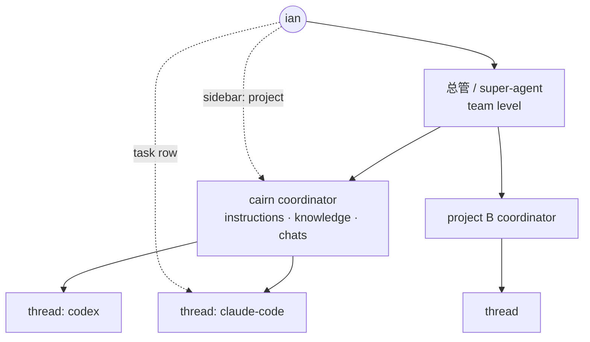
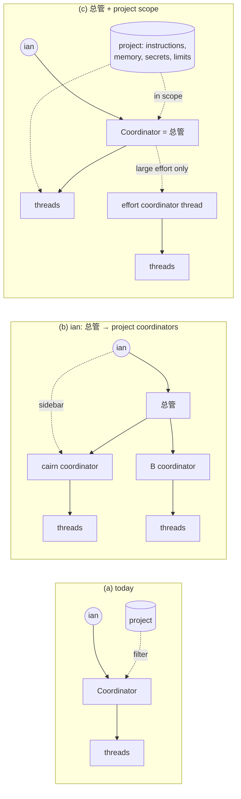
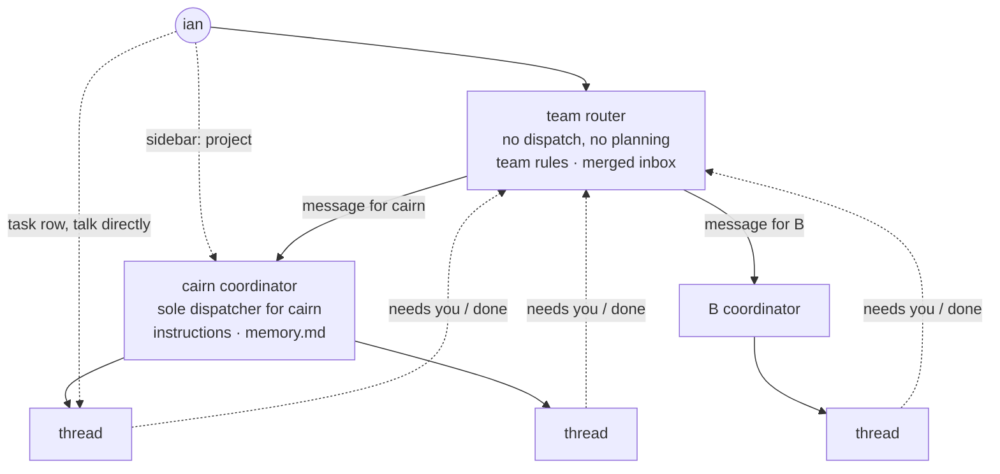

# A super-agent over per-project coordinators: Claude Projects, and how two-layer agent systems govern many projects

Researched 2026-11-03 for ian's proposal: a team-level super-agent (`总管`, after the DeepSeek DSH super-agent) on top of one coordinator per project, each like a Claude Project (instructions, knowledge, chats), each running its own threads (one claude-code or codex session each). Clicking a project in the sidebar opens that project's coordinator; clicking a task opens its thread.

Evidence labels: **measured** means this research ran it or read it in the product or database; **read** means a pinned primary source says so; **inferred** means it follows from measured or read facts and can be rechecked.

## 0. Conclusions

1. **"Claude Projects" is now two products, and only the new one has a per-project coordinator.**
   - **Chat Projects (claude.ai chat, unchanged):** a scope of instructions, knowledge files and independent chats, plus a separate memory per project when memory is on. Chats do not see each other (measured on ian's account; Matthew Esposito, 2026-10-29).
   - **Redesigned Projects (Claude Code, beta since 2026-09-17, waitlist fully admitted 2026-10-09):** "threads that do the work and a coordinator that directs them". Each thread is "a Claude Code cloud session working on its own branch and copy of the repo". A shared project memory "every thread now adds to and draws from", a library and routines complete it. The user briefs the coordinator "the way you'd brief a chief of staff" and can open any thread to steer it (read: claude.com/blog/projects-redesigned; demoed in AI Foundations, 2026-10-12).

   So ian's reading, "each project has its own coordinator and its own threads", is accurate for the redesigned Projects. Anthropic puts **no team-level layer above** them: memory and the library are per project only.
2. **Two vendors converged on a per-project coordinator in September 2026.** Cursor Projects (2026-09-10) and Claude Code Projects (2026-09-17) both run one coordinator per project. The coordinator plans and routes but does not do the work, uses a cheaper setting than its workers (Claude: coordinator effort low, thread effort medium), and keeps a task view. Neither adds a super-agent over projects (read).
3. **The router-style super-agents do not put an agent under the router per project.** They govern many projects with scope and rules:
   - **DSH** scopes one super-agent to one repository; a second repository is a second deployment with its own profile, state, worker slots and panel.
   - **sig** runs one steward over all repos, routes deterministically first and asks when unsure, and gives each repo a 1,500-character note layer and a serial/parallel setting.
   - **Rakazo** lets the user pick a bot per job and walls work off with spaces.
   - **Amp** runs one personal Puck over projects that hold configuration only (read, §3).
4. **So ian's three-level shape exists only in halves.** Coordinator-per-project → threads is shipped by Anthropic and Cursor. A super-agent over several projects is shipped by sig and Amp, but over project scopes, not over project agents. Nobody studied ships both stacked (inferred from §3, §4).
5. **cairn tried per-project Coordinator chats and reverted them.** #2500 shipped them on 2026-11-01; D58 reverted them the same day ("attention is scattered"), and #2547 merged them into one thread (measured: commits `5c0659184`, `608eabac0`). Last 7 days: all 13 active todos in one of 4 projects; 423 of 425 Coordinator messages untagged (measured, production database, read-only).
6. **Recommendation.** First build the project scope that every shape needs: instructions, project memory, a scoped project view, per-project concurrency and priority, project secrets (P1–P5, §6). Then adopt Anthropic's shape as option (d): one coordinator per project, which alone dispatches that project's threads. Above them goes a thin team router that never dispatches; it only routes messages, holds team-wide rules and merges every project's "needs you" into one inbox. The router is the DSH rule ("router does not plan"), the merged inbox is sig's, and the merged inbox answers D58's attention complaint. Run (d) behind a flag on one project first. Four decisions for ian (§7).

## 1. The shape ian proposes, and what Claude Projects really are

### 1.1 The proposal



### 1.2 Chat Projects versus redesigned Projects

Videos from the last three months, newest first. Transcripts were pulled with agent-reach `yt_sub.py`, and timestamps come from the caption track.

| Video | What it shows |
|---|---|
| **Matthew Esposito, "How to Use Claude Projects (2026 Update)"**, Matthew Esposito \| AI, 2026-10-29, https://www.youtube.com/watch?v=U-WtXdXdcKY | Chat Projects. [2:15] a project is "a workspace with 3 things: your files, your instructions, and your chats in one spot". [7:08] instructions apply "in every chat in this project and only this project". [8:37] starts a new chat in the project, which uses the files unprompted. [8:37–9:20] "Memory is a separate layer and each project gets its own", next to account-level memory and instructions. No coordinator, no cross-chat sharing |
| **AI Foundations, "Claude Projects Just Got Rebuilt (Full Guide)"**, AI Foundations, 2026-10-12, https://www.youtube.com/watch?v=MLl41Q9p3Ps | Redesigned Projects. [0:21] "They've added threads. They've added a coordinator agent. They've added a library". [1:03–2:09] one central prompt bar; the coordinator "decides what are the things that we need to do", breaks them into threads and "comes back with one unified plan". [2:30] projects for ongoing work or work with a finish line, to archive afterwards. [10:57] a threads panel: "you're no longer the one creating new threads". [12:44–13:05] settings pick a coordinator model and effort (default low) and a thread model and effort (default medium). [13:25–14:49] the memory tab holds project instructions, "loaded in at the beginning of every single new thread", and a `memory.md` that "will be accessible across every thread the coordinator agent creates". [16:14] the coordinator splits a request into two threads; [17:39] one thread receives "a message from the coordinator" about the other's results. [19:24] a "waiting on you" list. [20:26] talking straight to a thread: "I'm not even talking to the coordinator agent here. The thread agent will notify the coordinator if it needs to". [21:07] routines (scheduled tasks) run from the project |
| **Eliot Prince, "3 Levels of Claude MEMORY Clearly Explained"**, Eliot Prince, 2026-08-31, https://www.youtube.com/watch?v=EV-NSTvb1kQ | Memory around chat Projects. [0:41] a new memory settings tab, then rolling out. [3:34] account memory works "across both chat and co-work". [7:44–8:04] project context is "a sandboxed area… so you're not getting cross-contamination across your projects". [8:45–9:06] per-project memory goes "much deeper" than general memory |

Primary source for the redesign: Anthropic, "Projects redesigned", claude.com/blog/projects-redesigned, 2026-09-17. It covers beta access for select Pro and Max users of Claude Code cloud sessions, local execution "coming very soon", and chat and Cowork getting the update later. It warns that "projects can reach usage limits faster" and offers per-project usage and model/effort choice for coordinator and threads (read).

ian's chat Projects, checked before the switch to videos (2026-11-03, measured): two chats in one project both followed the project instructions, but the second could not see a code word given in the first. A probe project, "cairn probe: project chats", is left in ian's claude.ai list (Archive did not take effect); delete it by hand.

**Answer to "independent chats or a project-level agent?":**
- **Chat Projects:** independent chats sharing instructions, files and a per-project memory; there is no project-level agent.
- **Redesigned Projects:** a project-level coordinator agent with a persistent conversation, a shared `memory.md` that every thread reads and writes, and a library. Threads report to it and can be talked to directly.

## 2. What cairn does today

```mermaid
flowchart LR
  ian((ian)) -->|chat, any project| C[Coordinator<br/>one per team<br/>Pi Durable sidecar, D72]
  ian -->|click task, talk directly D65 ②| T1
  C -->|dispatch| T1[thread: claude-code<br/>plan → implement → self-check D60]
  C -->|dispatch| T2[thread: codex]
  T1 & T2 -->|≤200-char report D65 ①| C
  P[(project<br/>repo, base branch, autonomy)] -.tag + filter.-> C
  P -.repo + AGENTS.md.-> T1 & T2
```

| Fact | Source | Label |
|---|---|---|
| One active Coordinator thread per team; `projectId` only tags a turn and filters the page; per-project routes removed; migration 0085 merged the old per-project threads | commit `608eabac0` (#2547), D58 | measured |
| The picked project reaches the model only as a one-line prefix `【输入框选定项目：<name>（id: …）】` | `apps/server/src/services/chief.ts:503-506`, `picked-project.ts` | measured |
| `project` has `description`, repo fields, `baseBranch` and `autonomy`, but no instructions field | `apps/server/src/db/schema.ts` `project` | measured |
| `agent_memory.projectId` exists; `injectMemories` returns a project's rows plus team-wide rows | `schema.ts` `agentMemory`, `services/memory.ts:61-72` | measured |
| Secrets are team-scoped (`secret.teamId`) and granted per agent (`agent.secrets`); there is no project scope | `schema.ts` `secret`, `agent` | measured |
| Concurrency is per machine (`machine.maxConcurrent`, default 3) and per agent (`agent.maxConcurrentTasks`); there is no per-project limit or priority | `schema.ts` | measured |
| D60 ③: the Coordinator is a thin DSH-style router that listens, opens threads and intercepts, and does not plan or wait. D66 ①: a sidebar project opens the Coordinator in that project's context | plan | read |
| 4 active projects; 13 todos with activity in 7 days, all in one project; 425 Coordinator messages in 7 days, 2 with a project tag | `~/.cairn/server/server.db`, read-only, 2026-11-03 | measured |

## 3. How two-layer super-agent systems govern many projects

### 3.1 Summary

| Question | DSH super-agent | sig steward | Rakazo | Amp (Puck) | Anthropic orchestrator-worker |
|---|---|---|---|---|---|
| Unit of "project" | the deployment's one repository | a registered repo (`sh_repo`); a Thread may involve several (`sh_thread_repo`) | a bot ("a bot for one client") inside a space | a project = one codebase's configuration | none |
| Which project does a request belong to? | no choice: the router is scoped to one repo ("assess and route requests for the deployment's repository") | Explicit reply/quote/button first (no LLM). Then a mentioned Thread, repo or machine name, then FTS match, then recency. At most 12 candidates. A policy hook forces `ask_user` unless the match is explicit or high-confidence and unique. A routing eval runs as a merge check | the user picks the bot; in a group chat, `@Name` wakes a bot, and with no mention the first bot answers and may bring in others | Puck uses "the thread or project you are viewing as context"; the CLI matches git remotes (`amp -ox`) | "Routing classifies an input and directs it to a specialized followup task" |
| Per-project context, memory, instructions | one repo: team skill prompts, policy, the repo's own files; DSH ships no memory | Memory in three layers: resident (2,400 chars, every turn), **project (1,500 chars per repo)**, injected "whenever a Thread involving that repo is fetched", and archive. Worker-reported notes stay project-only until the owner confirms | each bot has its own instructions, memory and open-work list; shared memory per space | repo `AGENTS.md`; project env and secrets ("Project values override workspace values"); Puck loads personal and workspace skills | the lead saves its plan to memory |
| Concurrency and priority | per deployment: `maxWorkers` (default 3, max 16); a person's message gets one extra slot, and "wakes have priority over launches" | per repo `--concurrency parallel\|serial`, set only by the local CLI; machine slots; daily budget cap on model wakes | one run per bot's computer at a time; no global queue ("No queue, scan, shared slot or notification sits between a due run and its start") | per orb, per thread | the lead waits synchronously for each batch of subagents |
| Isolation of work and secrets | a separate profile, state directory, git config and agent GitHub account per deployment; one directory or worktree per Ticket; `danger-full-access` inside | per-task worktree; repo isolation, concurrency and approval are local-only settings the steward cannot change; session records stay on the machine | **space** = hard wall: chats, files, memory, computer, app connections and credentials stay inside; bots talk across spaces only if allowed; Team or Private computer per bot | project secrets as orb env; one orb per thread; OIDC workload identity | not addressed |
| What reaches the user | one panel per deployment listing only what needs a person; replies go back into the original GitHub or Feishu conversation | **one merged conversation** with deterministic done cards per Thread, a "Needs you" view and a 90-second fallback that forwards worker questions verbatim | per-bot chat with its own unread state; cards for questions and approvals | Puck "can… bring their results back to you"; thread list | the lead synthesizes |
| When is a middle layer added? | never: more repos means more deployments | never: "If Thread counts grow later, add vector recall inside `findCandidates`; the interface stays unchanged" | never as a layer; a bot may "manage other bots" (fleet tools), but only in runs the user started | never; an agent may start a thread in another project via Agent to Agent | two levels; agents "are not yet great at coordinating and delegating to other agents in real time" |

### 3.2 Products that do add a middle coordinator

| Product | When the middle coordinator appears | What it may do | Lifetime |
|---|---|---|---|
| Cursor Projects (2026-09-10) | a Project = "a feature, a migration, or a full app" | plans and delegates but "doesn't write code itself"; owns the task tracker (workers can read it, not edit it); shared Project Context; subscriptions to a Slack channel, a schedule or PRs; asks before using a new machine | until the effort ends; child coordinators exist |
| Devin managed Devins | Devin "automatically breaks down large tasks" or the user asks to parallelize | spin up, message, sleep or terminate children; woken when a child finishes or needs input; children auto-approved unless turned off | one task |
| Factory Missions | large multi-feature work (1–500 features) | the orchestrator manages workers; "you can talk to it"; validation per feature | one mission |
| Claude Code Projects, redesigned (beta 2026-09-17) | one per project, for ongoing work or work with a finish line | coordinator routes work to new or existing threads; each thread is a Claude Code cloud session on its own branch; shared `memory.md` and library; "waiting on you" list; routines; coordinator effort low, thread effort medium by default | as long as the project; archive when done |

### 3.3 What this means for the five questions

- **Routing a request to a project.** The routers use cheap deterministic signals first (an explicit reference, the current view, a repo name), then a model pick from a short candidate list, and ask when unsure. cairn has the first signal (the composer pick, and the todo's `projectId` when a message targets a todo), but no ask-when-ambiguous rule or routing eval.
- **Per-project context.** Every system that spans repos gives each repo a small, bounded layer that is injected only when relevant (sig's 1,500 characters, Claude's per-project memory, Amp's project env). None gives the repo its own agent to hold that context.
- **Concurrency and priority.** Limits sit on the executor (DSH slots, sig per-repo serial/parallel, Rakazo one run per computer) and reserve room for a human's message. None does fair-share scheduling between projects. cairn limits per machine and per agent only.
- **Isolation.** The hard wall is a deployment (DSH) or a space (Rakazo), each with its own credentials. Inside one wall, isolation is per task (a worktree or a container). cairn's secrets are team-wide.
- **What reaches the user.** Single-user systems merge everything into one stream with per-item cards and a "needs you" list (sig, DSH's panel, cairn's Tasks panel). Per-project streams appear only where the user deliberately splits work into bots or spaces (Rakazo).

## 4. Other products, briefly

| Product | Per-project coordinator? | Project unit carries | User ↔ worker |
|---|---|---|---|
| Claude Code subagents | no; project-scoped definitions and `memory: project` | `CLAUDE.md`, `.claude/agents/` | results return to the caller; nesting up to 3 layers |
| Claude Code agent teams | no; "No nested teams" | shared task list, mailboxes | "talk to any teammate directly without going through the lead" |
| OpenAI Codex cloud | no | environment (container, setup script), `AGENTS.md` | one task, one diff |
| Linear agents | no | workspace and team guidance; "team guidance takes priority" | assign as delegate; human stays owner |
| Devin | per effort only (§3.2) | repo-pinned knowledge (now skills); **memory is personal**, not per repo | coordinator messages children |

## 5. The options for cairn



### 5.1 Trade-offs

| Dimension | (a) flat, project = filter | (b) `总管` → per-project coordinators → threads | (c) `总管` + project scope (+ effort thread) |
|---|---|---|---|
| Routing | the Coordinator picks the project from the composer pick or the todo | the `总管` picks the project, then the project coordinator picks the thread: two model decisions, two places to get it wrong | as (a), plus sig's rule: ask when the project is ambiguous |
| Context and tokens | one window holds every project | smaller windows per project, but a message through the `总管` costs a `总管` turn plus a project turn. Anthropic measures multi-agent at ~15× chat tokens | one window; project instructions and memory added only in scope |
| Memory isolation | team-wide | strong by construction | as strong as Claude Projects: project memory only in scope; D72's per-turn context selection can prefer the project's history |
| Latency | — | one extra model turn before any thread starts for `总管`-routed messages | — |
| Concurrency and priority | per machine and agent | each coordinator dispatches into the same machines; still needs a shared limit | per-project limit and priority on the dispatch queue (DSH-style slots, human wakes first) |
| Secret isolation | team-wide | the layer does not isolate secrets; a scope does | project-scoped secrets, as in Amp's projects or Rakazo's spaces |
| Conflicting dispatch | impossible: one writer | the `总管` and a project coordinator can both open threads on one repo; DSH's "one writer per state" is broken unless the `总管` stops dispatching, which makes it a router to routers | one writer; an effort thread owns only the children it creates |
| Lost decisions | none | "stop X" said to one layer is missed by the other; the Pi Durable spike measured recall of ian's verdicts as weak already (C2 3.5/6, Pi 0/6) | one transcript |
| UI | one chat | N+1 chats, the shape D58 removed | one chat; a project click = the scoped view (D66) |
| D60 thin router | fits | a project coordinator either duplicates the `总管` (routing only) or plans (against D60 ③) | fits; an effort thread owns its outcome, which D60 says threads do |
| D72 Pi Durable | one durable session | N+1 durable sessions, summaries and recoveries | one durable session |
| D71 routing | fits | independent | fits |
| Idle cost now | — | 3 of 4 projects idle for 7 days | none |

### 5.2 Failure modes

1. **Double dispatch (b).** The `总管` and the cairn coordinator both act on "fix the flaky test". Avoiding it needs a per-project dispatch lock.
2. **Stale verdict (b).** "Stop #2510" lands in one layer only; cairn has had this class of incident (#2510 merged early).
3. **Misrouted project (all).** sig's answer: deterministic signals first, ask when not unique, and a routing eval as a merge check.
4. **Scope leak (c).** Project A's memory is injected into a turn about project B. Fix: scope by the todo's `projectId` when a turn acts on a todo, not by the composer pick, and show the scope chip.
5. **Starvation (a, c).** A busy project fills every machine slot. Fix: a per-project limit and a reserved slot for ian's own messages (DSH).
6. **Runaway fan-out (effort thread).** Anthropic saw "spawning 50 subagents for simple queries". Fix: only the Coordinator opens an effort thread, with a child cap.

### 5.3 Option (d): project coordinators under a thin team router

The redesigned Claude Projects, with DSH's routing rule on top and sig's single inbox:



| Concern from §5.1 | How (d) answers it | Residual risk |
|---|---|---|
| Conflicting dispatch | only a project's coordinator opens threads in that project; the router has no dispatch tool | cross-project work needs one coordinator to ask another (Amp Agent to Agent), which is slower |
| Lost decisions | a verdict on a todo goes to its project's coordinator by `projectId`, deterministically. Team-wide verdicts ("pause everything") are code (`team.autonomyPaused`), not a model's memory | a verdict about a project stated in the team chat must be routed; sig's ask-when-unsure rule covers it |
| Extra hop | messages typed in a project view skip the router; team-level messages route by deterministic signals first and use the model only when ambiguous | ambiguous team-level messages pay one cheap routing turn |
| UI and attention (D58) | one home inbox merges every project's "needs you" and done cards, and each project gets one chat with a threads panel (the Claude Code Projects layout) | N project chats exist again, but the inbox, not the chats, is where attention goes |
| D60 | each project coordinator is the thin router for its project: it routes to threads and does not plan the work itself | — |
| D72 | one Pi Durable session per project coordinator plus the router; idle projects cost nothing if sessions start lazily | N summaries and recoveries to operate |
| Cost | Anthropic's defaults put the coordinator at low effort and threads at medium | more model turns than (c) when several projects are active |

## 6. Recommendation and PR sketch

Build the project scope first (P1–P5); every shape needs it, and it is (c) on its own. Then move to (d) behind a flag on one project (P6–P8). Keep the single Coordinator as the default until (d) has run on real work. P6–P8 replace the earlier "effort coordinator thread" idea: a per-project coordinator covers it.

| PR | Scope | Route |
|---|---|---|
| P1 `server(project): project instructions` | `project.instructions` column (drizzle migration) and a settings field; injected into Coordinator turns scoped to the project and into thread prompts for its todos, after the repo's `AGENTS.md` | owner (migration) |
| P2 `server(chief): project-scoped memory` | memories written in a project-scoped turn get that `projectId`; `injectMemories({ agentId, projectId })`; team-wide stays `null`; scope = the todo's project, else the composer pick | normal |
| P3 `web(sidebar): project view` | a project click opens a project chat with a threads panel and the Tasks panel filtered; a structured `scopeProjectId` on the turn replaces the text prefix | normal |
| P4 `server(dispatch): per-project concurrency and priority` | `project.maxConcurrent` and `project.priority` checked at claim alongside machine limits; ian's own message wakes take a reserved slot | owner (machine claim files, TLA+ rerun) |
| P5 `server(secrets): project-scoped secrets` | `secret.projectId` (nullable = team); a step gets only its project's and team secrets | owner + `/security-review` (credentials surface) |
| P6 `server(chief): project coordinator sessions` (flag) | one Coordinator session per project in the sidecar, started lazily; dispatch tools limited to its own project; coordinator and thread model/effort set per project | owner (Coordinator tools, D72 replay rules) |
| P7 `server(chief): team router` (flag) | team-level messages routed by deterministic signals (todo mention, project name, current view), then a model pick with ask-when-ambiguous; no dispatch tools; a small routing eval as a check | owner |
| P8 `web(home): merged inbox across projects` | the home "needs you" and done cards from every project coordinator and thread in one list, each tagged with its project | normal |

## 7. Decisions for ian

1. **Shape.** Recommended: P1–P5 now, then (d) behind a flag, which partly reopens D58 by bringing back project chats while keeping one inbox. Alternatives: stop at (c), one Coordinator with project scopes; or (b) exactly as proposed, with a dispatching super-agent.
2. **Project memory default.** Recommended: memories from a project's turns stay project-only, and ian promotes one to team-wide when he wants. Alternative: team-wide by default.
3. **Isolation strength.** Recommended: project-scoped secrets inside one team (P5). Alternative: a hard wall per client (a separate team, like Rakazo's spaces).
4. **Which project pilots (d).** Recommended: cairn itself, the only project with activity in the last 7 days. Alternative: a quieter project, for lower risk.

## 8. Not done

- Cursor Projects, Amp Puck, Devin and Factory were read from official docs and changelogs, not operated.
- The redesigned Claude Code Projects were not operated: the walk on ian's account used chat Projects, and the coordinator behaviour is cited from Anthropic's post and the AI Foundations video.
- Per-project memory in chat Projects is cited from Anthropic's announcement and the videos; the account walked had memory off.
- DSH and sig were read at pinned commits, not run in this round (DSH was installed and walked earlier in `docs/research/dsh-sig-walk-2026-11.md`). Rakazo was read from its docs at `3d0887f`.
- No measurement of an extra hop's tokens or latency on cairn's own sidecar.

## 9. Sources

- DSH super-agent `deepseek-ai/dsh-superagent-prototype` at `6337fc8` (2026-10-31): `README.md`; `docs/001-domain.md`; `docs/003-execution.md` "Concurrency"; `docs/006-deployment.md` "Start and stop"; `docs/007-architecture.md` (`WorkerSlots`); `prompts/orchestrator.md:1`; `src/policy.ts:93`, `src/limits.ts:6`
- sig `iefnaf/sig` at `b048eab` (2026-11-01): `docs/design/steward.md` §1, §2.2–2.5, §3.1–3.4; `apps/connector/src/cli.ts:17,81` (repo-config)
- Rakazo at `3d0887f` (2026-11-02): `docs/bots-and-chats.md`, `docs/spaces.md`, `docs/memory.md`, `docs/groups.md`, `docs/fleet-management.md`, `docs/run-execution.md`, `docs/computer.md`
- Amp: https://ampcode.com/docs/puck ; https://ampcode.com/news/meet-puck (2026-07-20); https://ampcode.com/docs/projects
- Anthropic: https://www.anthropic.com/engineering/building-effective-agents ; https://www.anthropic.com/engineering/multi-agent-research-system
- Claude Projects: https://support.claude.com/en/articles/9517075-what-are-projects ; https://claude.com/blog/memory ; https://claude.com/blog/projects-redesigned (2026-09-17); videos in §1.2 (U-WtXdXdcKY, MLl41Q9p3Ps, EV-NSTvb1kQ); walk on claude.ai, 2026-11-03
- Claude Code: https://code.claude.com/docs/en/sub-agents ; https://code.claude.com/docs/en/agent-teams
- Cursor: https://cursor.com/changelog/projects (2026-09-10); https://cursor.com/docs/release-notes/cloud-agents
- Devin: https://docs.devin.ai/work-with-devin/advanced-capabilities ; https://docs.devin.ai/product-guides/memory ; https://docs.devin.ai/product-guides/knowledge
- Factory: https://docs.factory.com/cli/configuration/custom-droids ; https://docs.factory.com/docs/missions/overview
- OpenAI Codex: https://learn.chatgpt.com/docs/environments/cloud-environment
- Linear: https://linear.app/docs/agents-in-linear ; https://linear.app/developers/agents
- cairn: commits `5c0659184` (#2500), `608eabac0` (#2547); plan rows D58, D60, D65, D66, D70, D71, D72; `apps/server/src/db/schema.ts`; `apps/server/src/services/{chief,memory,picked-project}.ts`
