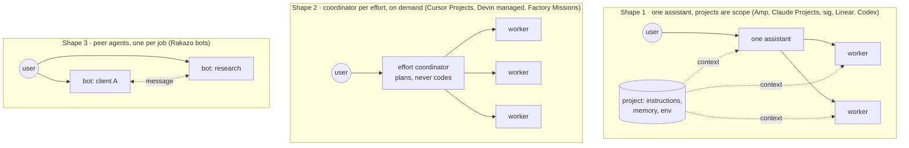
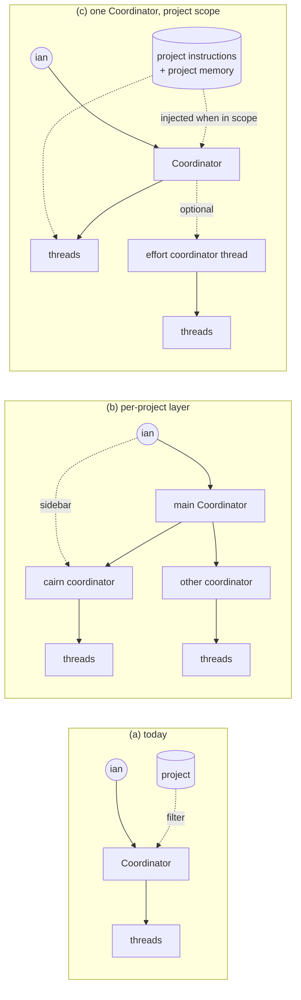

# Per-project coordinators: should cairn add a layer between the Coordinator and threads?

Researched 2026-11-03 for ian's question: should cairn become main Coordinator → one coordinator per project (opened from the sidebar) → threads (one external harness session each)?

Evidence labels: **measured** means this research ran it or read it in the product or database; **read** means a pinned primary source says so; **inferred** means it follows from measured or read facts and can be rechecked. Products were read from their official docs and changelogs, not operated; section 7 lists what was not walked.

## 0. Conclusions

1. **cairn already built ian's proposal once and reverted it.** #2500 (issue #2321, merged 2026-11-01) gave every project its own Coordinator conversation. The same day ian decided D58 ("attention is scattered"), and #2547 merged every per-project thread into one team Coordinator, keeping the project as a tag and filter (measured: commit `608eabac0`, plan D58). D66 then made the sidebar project "the Coordinator in that project's context". So the open question is not "flat or hierarchical", but whether that project view should get its own memory and instructions, and whether some work deserves a sub-coordinator.
2. **The industry splits on one word.** "Project" means a codebase in Amp, Codex, Devin and Claude Code, and none of them puts a coordinator on it: the project carries configuration, instructions and memory, and one personal assistant (Amp's Puck) or the session itself coordinates. "Project" means a bounded effort in Cursor (2026-09-10) and Factory Missions, and there each effort gets a coordinator that plans and delegates but does not write code (read).
3. **Claude Projects, which ian compared it to, has no coordinator at all.** A Claude Project is knowledge + instructions + its own memory, shared by independent chats (read). Its value is scoped context, not an extra agent. That maps to option (c), not (b).
4. **The data says (b) would add idle layers today.** In the last 7 days, all 13 active todos were in one of 4 active projects, and 423 of 425 Coordinator messages carried no project (measured, production database, read-only). Per-project coordinators would give one busy coordinator and three empty ones.
5. **Recommendation: (c) now, plus an on-demand "effort coordinator" thread later.** Keep one Coordinator (D58, D60, D72 unchanged). Give projects Claude-Projects-style scope: project instructions and project-scoped Coordinator memory, injected when the project view or a project todo is in play. When a single effort needs several parallel threads, the Coordinator may open a long-lived coordinator thread for it, the way Devin's managed Devins and Cursor's Projects work, instead of a permanent per-project layer. Four PRs; sketch in section 5.

## 1. What cairn does today

```mermaid
flowchart LR
  ian((ian)) -->|chat, any project| C[Coordinator<br/>one per team<br/>Pi Durable sidecar, D72]
  ian -->|click task, talk directly D65 ②| T1
  C -->|dispatch| T1[thread: claude-code<br/>plan → implement → self-check D60]
  C -->|dispatch| T2[thread: codex]
  T1 & T2 -->|≤200-char report D65 ①| C
  T1 & T2 --> G[merge gate<br/>independent review]
  P[(project<br/>repo, base branch, autonomy)] -.tag + filter.-> C
  P -.repo + AGENTS.md.-> T1 & T2
```

| Fact | Source | Label |
|---|---|---|
| One active Coordinator thread per team; `projectId` only tags a turn and filters the page; per-project routes removed; migration 0085 merged old per-project threads | commit `608eabac0` (#2547), D58 | measured |
| The picked project reaches the model only as a one-line prefix `【输入框选定项目：<name>（id: …）】` on the user message | `apps/server/src/services/chief.ts:503-506`, `picked-project.ts` | measured |
| `project` has no instructions field; it has `description`, repo fields, `baseBranch`, `autonomy` | `apps/server/src/db/schema.ts` `project` | measured |
| `agent_memory` already has a nullable `projectId`; `injectMemories` returns project rows plus team-wide rows for a given project | `schema.ts` `agentMemory`, `services/memory.ts:61-72` | measured |
| Sidebar project = Duet-style channel, "clicking it opens the Coordinator in that project's context" | plan D66 ① | read |
| Coordinator is a thin DSH-style router: listen, open threads, intercept; no planning, no waiting | plan D60 ③ | read |
| Clicking a task opens the thread (`threadHref`); ian can message a thread directly | `apps/web/src/board/work-panel.tsx`, `thread-copy.ts:35`, D65 ② | measured |
| 4 active projects; 7-day todos with activity: 13, all in one project; Coordinator messages in 7 days: 425, of which 2 tagged with a project | `~/.cairn/server/server.db`, read-only query 2026-11-03 | measured |

## 2. How comparable products layer it

| Product | Top-level orchestrator | Per-project / per-workspace coordinator with its own context? | What the project unit carries | How the user talks to workers |
|---|---|---|---|---|
| Claude Projects (claude.ai) | none | **No agent.** Each project has its own memory: "Claude creates a separate memory for each project", a "safety guardrail that keeps sensitive conversations contained" | knowledge base (RAG on paid plans), instructions, chats, separate memory | each chat is independent |
| Claude Code subagents | the main session | No. Subagents can be project-scoped definitions (`.claude/agents/`) with `memory: project` | `CLAUDE.md`, project agents, project agent memory | results return to the caller; `@`-mention to force one; nesting up to 3 layers by default |
| Claude Code agent teams | the lead session | No. "No nested teams: teammates cannot spawn their own teammates"; one team per session | shared task list, mailboxes | "You can also talk to any teammate directly without going through the lead" |
| Amp | **Puck**, "your personal Amp assistant… start agents, monitor them, send messages to them, create projects" | **No.** A project is "where Amp keeps everything about one codebase"; the docs describe no project agent. Puck "can use the thread or project you are viewing as context" | repo, base branch, ship behavior, orb setup, env and secrets; `AGENTS.md` in repo | open the thread; Puck relays instructions and gathers reports |
| Devin | any session can become a coordinator of **managed Devins** | No permanent one. "The coordinator session scopes the work, monitors progress, resolves conflicts, and compiles results" for one task | repo-pinned knowledge (now skills), playbooks, repo setup; **memory is personal**, not per repo | coordinator messages children; children wake it when done or blocked |
| Cursor Projects (2026-09-10) | — | **Yes, one coordinator per Project**, where a Project is "a feature, a migration, or a full app". The coordinator "doesn't write code itself; it plans the work, delegates it to agents that implement it". Shared Project Context files; runs "on its own computer in the cloud"; task tracker that only coordinators edit; child coordinators exist | Context files, subscriptions (Slack channel, schedule, PRs), tracker | review what the coordinator brings back; `@`-mention another agent to the coordinator |
| OpenAI Codex cloud | none | No. An environment = container + repo checkout + setup script; tasks start fresh | environment, `AGENTS.md` | one task, one diff, follow-ups in that task |
| Factory | main Droid; **Missions** orchestrator for large bounded work | Per mission, not per repo. "The orchestrator is an agent, and you can talk to it." Custom droids cannot nest ("a subagent cannot spawn its own subagents") | project droids in `.factory/droids/` | talk to the orchestrator; pause it to recover |
| DSH super-agent | one main Session (router) | One router per repository; the router "does not plan" and may not wait | one repo, one host | later events on a thread go straight to the owning worker |
| sig | one steward per owner | No. Per-project notes (1,500 chars) next to resident notes | ledger, per-project notes | quote-reply relays straight to a worker |
| Rakazo | none | **Peer bots**: "One bot per job works best: an inbox bot, a research bot, a bot for one client. Each keeps its own history and memory". Hard isolation is a **space** | bot instructions, memory, computer; shared memory per space | each bot is its own chat; bots message each other; subagents "have no chat or memory of their own" |
| Linear agents | none | No. Guidance at workspace and team level; "When both exist, team guidance takes priority" | team guidance | assign (agent becomes `delegate`, human stays owner) or `@`-mention |
| Anthropic multi-agent research | lead agent | Two levels only. Multi-agent uses "about 15× more tokens than chats"; coding has "fewer truly parallelizable tasks than research" | lead's plan saved to memory | not user-facing |

Sources are in section 8.

### Three shapes in the field



Observations (inferred from the table):

- Nobody ships a **permanent** three-level stack (team coordinator → per-repo coordinator → workers). Cursor's child coordinators and Devin's coordinator sessions are created per effort and end with it.
- Where a coordinator is per project, the project is a **body of work with an end**, and the coordinator owns a task tracker for it. Where the project is a **codebase**, it carries scope (instructions, memory, env), not an agent.
- Two-level orchestrator → worker is the norm. Claude Code's teams refuse nesting; Factory refuses nesting; Anthropic's research system is two levels. Nesting where it exists (Claude Code subagents, Cursor cloud subagents) is capped at three.
- Direct user → worker access is standard (agent teams, DSH fast path, sig quote-reply, cairn D65 ②). An extra layer would sit between ian and the worker unless it is bypassable.

## 3. The options for cairn



### 3.1 Trade-offs

| Dimension | (a) flat, project = filter | (b) per-project coordinator layer | (c) one Coordinator + project scope (+ optional effort thread) |
|---|---|---|---|
| Context and tokens | One window holds every project; a project turn carries unrelated history. D72's rolling summary bounds it | Each project window is smaller, but every cross-project or routed request costs a main turn plus a project turn. Anthropic measures multi-agent at ~15× chat tokens; the extra hop is that overhead on every message | One window; project instructions and project memory added only when in scope (Claude Projects, Devin repo-pinned knowledge). Effort threads pay the multi-agent cost only for work that fans out |
| Memory isolation | Team-wide; project tag exists on memory rows but the Coordinator does not use it | Strong by construction | Same strength as Claude Projects: project memory injected only in scope, team memory always. Leaks only through the shared conversation history, which D72's per-turn context selection can filter by project tag |
| Latency of an extra LLM hop | none | Main → project coordinator adds one model turn (seconds to tens of seconds) before any thread starts; sidebar chats skip it, main chats do not | none for normal work; one long-lived coordinator thread for a large effort |
| Conflicting dispatch | impossible: one writer | Main and project coordinators can both open threads on the same repo; needs a lock or ownership rule. DSH's design rule "one writer per state" is broken | one writer; an effort thread owns only the todos it creates (Cursor: only coordinators edit the tracker; workers read it) |
| Lost decisions between layers | none | ian tells the main Coordinator "stop X", the project coordinator never hears; or tells the project one and the main dispatches again. The Pi Durable spike already measured recall of ian's verdicts as the weak point (C2 3.5/6, Pi 0/6) | one transcript; the effort thread receives its mandate once, reports through D65 ① |
| UI clarity | one chat; project click filters | N+1 chats again, the shape D58 removed after ian said attention was scattered | one chat; project click = same Coordinator primed with that project (D66 already says so); an effort thread looks like any thread with children |
| Fit with D60 (thin router, thread owns plan → implement) | fits | the project layer must plan or route; if it only routes it duplicates the main, if it plans it contradicts D60 ③ | fits; an effort coordinator is a thread that owns its outcome, which is what D60 says threads do |
| Fit with D70 / D72 (Pi Durable sidecar) | fits | N durable sessions, N summaries, N recoveries; sidecar holds every project session; replay rules per layer | one durable session; scope is context selection, which D72 already does per turn |
| Fit with D71 (machine routing) | fits | independent: machines are chosen per step either way | fits; effort threads use the same routing |
| Idle cost today | — | 3 of 4 projects had no activity in 7 days (measured) | none |

### 3.2 Failure modes worth naming

1. **Double dispatch (b).** Main and project coordinator both act on "fix the flaky test in cairn". Mitigation would need a per-project dispatch lock, i.e. the main stops dispatching to projects that have a coordinator, which makes the main a router to routers.
2. **Stale verdict (b).** ian's "stop #2510" lands in one layer only. cairn has had this class of incident (#2510 merged early; memory note on coordinator-hold).
3. **Scope leak (c).** Project A's memory injected into a turn about project B because the picked project was wrong. Mitigation: inject by the todo's `projectId` when a turn acts on a todo, not by the composer pick; show the active scope chip.
4. **Runaway fan-out (effort thread).** Anthropic saw "spawning 50 subagents for simple queries". Mitigation: the effort thread is opened only by the Coordinator, with a child cap and the existing review-gate path per child.
5. **Ghost coordinator (b, effort thread).** A coordinator idles waiting on children. Mitigation from Devin and DSH: children wake the coordinator; it does not poll (D60 ③ "no waiting").

## 4. Answering ian's framing

- **"main Coordinator → sub-coordinator → harness?"** Today it is two levels: Coordinator → thread (harness). The thread already does its own planning (D60), so it plays the part a sub-coordinator would in other products.
- **"Like a layer on top of Claude Projects."** Claude Projects adds scope, not a coordinator. The faithful port is (c): a project has instructions and its own memory, and a chat opened from the project starts in that scope.
- **"Clicking a project opens that project's coordinator."** Under (c) the click opens the same Coordinator filtered and primed with that project. The user-visible difference from (b) is small (a project-scoped chat either way); the system difference is one writer and one memory of ian's decisions instead of N.

## 5. Recommendation and PR sketch

Adopt (c). Do not add a permanent per-project layer. Add the effort coordinator only when a real effort needs it.

| PR | Scope | Route |
|---|---|---|
| P1 `server(project): project instructions` | `project.instructions` text column (drizzle migration), settings UI field, `PATCH /api/projects/:id`. Injected into (i) Coordinator turns whose scope is that project and (ii) thread prompts for todos in that project, after the repo's `AGENTS.md`/`CLAUDE.md` | owner (migration) |
| P2 `server(chief): project-scoped Coordinator memory` | Use the existing `agent_memory.projectId`: memories the Coordinator writes during a project-scoped turn get that `projectId`; injection uses `injectMemories({ agentId, projectId })`; team-wide memories stay `projectId = null`. Scope = the todo's project when the turn acts on a todo, else the composer pick | normal |
| P3 `web(sidebar): project view = scoped Coordinator` | Project click opens the Coordinator timeline filtered by project tag, composer pinned to the project, scope chip in the header, Tasks panel filtered; replace the text prefix `【输入框选定项目：…】` with a structured `scopeProjectId` on the turn so the sidecar's context selection can prefer that project's history | normal |
| P4 `server(chief): effort coordinator thread` (later, behind a flag) | A thread kind whose tools are only `create child todo`, `message child`, `read tracker`; children report to it and wake it; child cap; ian can talk to it like any thread (D65 ②); the Coordinator opens it only on ian's request or above N parallel children | owner (Coordinator tools, `.claude` if replay rules change) |

P1–P3 need no change to D60, D70, D71 or D72. P4 extends D60 (a thread may own children) and needs a D72 replay rule (`never` for dispatching tools, as already planned).

## 6. Decisions for ian

1. **Layer shape.** Recommended: (c), one Coordinator with project scope; no permanent per-project coordinator. Alternative: (b), which reopens D58.
2. **Project memory default.** Recommended: memories learned in a project-scoped turn are project-only; ian can promote one to team-wide. Alternative: team-wide by default, project-only on request.
3. **Project instructions reach threads too?** Recommended: yes, appended after the repo's `AGENTS.md`, so one place steers both the Coordinator and harness threads for that project. Alternative: Coordinator only.
4. **Effort coordinator (P4).** Recommended: defer until one real effort needs more than about 3 parallel threads; then build behind a flag. Alternative: build now; or never and let the Coordinator fan out itself.

## 7. Not done

- No product was operated in this round. Cursor Projects, Amp Puck and Devin managed Devins were read from official docs and changelogs only; walking Cursor Projects (beta, available to all users per its changelog) would show how the project chat and worker chats look side by side.
- Claude Projects' per-project memory is cited from Anthropic's memory announcement; the current help article does not describe it.
- Rakazo was read from its docs in `/tmp/rakazo-src` at `3d0887f` (2026-11-02), not run.
- No token or latency measurement of an extra hop on cairn's own sidecar; the 15× figure is Anthropic's for research workloads.

## 8. Sources

- Claude Projects: https://support.claude.com/en/articles/9517075-what-are-projects ; project memory: https://claude.com/blog/memory (2025-09-11, updated 2025-10-23)
- Claude Code subagents: https://code.claude.com/docs/en/sub-agents ; agent teams: https://code.claude.com/docs/en/agent-teams
- Anthropic, "How we built our multi-agent research system": https://www.anthropic.com/engineering/multi-agent-research-system
- Amp Puck: https://ampcode.com/docs/puck ; "Meet Puck" (2026-07-20): https://ampcode.com/news/meet-puck ; projects: https://ampcode.com/docs/projects
- Devin managed Devins: https://docs.devin.ai/work-with-devin/advanced-capabilities ; memory: https://docs.devin.ai/product-guides/memory ; knowledge: https://docs.devin.ai/product-guides/knowledge
- Cursor Projects (2026-09-10): https://cursor.com/changelog/projects ; cloud agents release notes: https://cursor.com/docs/release-notes/cloud-agents
- OpenAI Codex cloud environments: https://learn.chatgpt.com/docs/environments/cloud-environment
- Factory custom droids: https://docs.factory.com/cli/configuration/custom-droids ; Missions: https://docs.factory.com/docs/missions/overview
- Linear agents: https://linear.app/docs/agents-in-linear ; developer docs: https://linear.app/developers/agents
- DSH super-agent and sig: `docs/research/dsh-sig-walk-2026-11.md` (pinned commits there)
- Rakazo: `/tmp/rakazo-src/docs/{bots-and-chats,spaces,memory,groups}.md` at `3d0887f`
- cairn: commits `5c0659184` (#2500), `608eabac0` (#2547); plan rows D58, D60, D65, D66, D70, D71, D72
